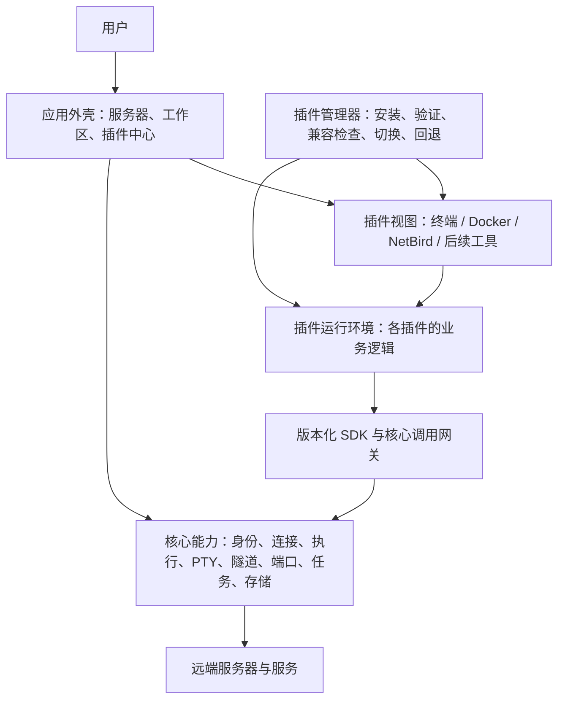

# SoDeck v2 总体架构

日期：2026-10-24 · 版本：0.3 · 状态：总体边界基线，具体技术方案待验证；尚未实施

已明确的产品方向：核心提供服务器管理、连接、隧道和端口等公共能力；终端、Docker、NetBird 等业务面板独立更新。插件更新必须重启 App 后生效，不做热更新。其他建议仍待验证或确定。

本轮用户明确：优先解决模块耦合、通信混乱和插件边界问题；首阶段在 Windows 验证插件架构和独立更新，先做官方插件，结构保留跨平台能力。决定及待决范围统一见[产品总览](product.md)。

## 1. 对产品意图的理解

**SoDeck v2 是以服务器资源为中心、通过插件扩展工具的桌面工作平台。**

用户在核心系统中添加服务器、完成认证并建立工作区，然后选择需要的工具。工具共享同一套连接与资源管理，能够分别安装、启用、停用和升级。

由此推断出以下设计目标：

1. **核心稳定，功能持续扩展。** 增加或修复 Docker、NetBird 等工具时，尽量只发布对应插件。
2. **界面和业务逻辑一起插件化。** Docker 命令适配、NetBird 状态解析、终端交互规则都属于各自插件，具备独立交付能力。
3. **公共能力统一管理。** 插件复用服务器身份、SSH 认证、连接路径、隧道、端口和任务机制，不各自保存密码或建立互不协调的连接体系。
4. **功能可选择，体验保持一致。** 不同服务器可以使用不同的工具组合；插件仍使用统一的工作区、主题、通知与设置入口。
5. **插件有故障时，核心仍可管理资源。** 某个面板不可用时，用户仍能查看服务器、停止隧道、处理后台任务或禁用问题插件。

“按需安装”“不同服务器的工具组合”是以上方向自然衍生的建议。首期官方插件来源已确定；默认安装组合和具体安装交互仍由产品范围决定。市场、第三方发布与远程 Agent 不作为首期前提。

最重要的产品结构变化是：**服务器工作区独立于终端存在。** 打开服务器可以只使用 Docker 或端口转发，不必先打开一个终端来维持其他工具的连接。

## 2. 总体结构

| 层次 | 职责 | 更新单位 |
| --- | --- | --- |
| 应用外壳 | 服务器管理、工作区布局、全局资源视图、插件管理、主题与通用交互 | SoDeck 核心版本 |
| 核心能力 | 凭据、连接路径、SSH、执行通道、PTY、SFTP 基础能力、隧道与端口、资源生命周期 | SoDeck 核心版本 |
| 插件平台 | 插件加载、隔离、权限检查、SDK、版本兼容和更新机制 | SoDeck 核心版本 |
| 业务插件 | 工具界面、业务规则、远端服务适配、插件设置与数据 | 各插件独立版本 |

核心内部按模块组织，首期保持单个桌面应用和本地服务体系，无需为了插件化引入云端服务或微服务部署。

针对当前耦合与通信问题，每条跨模块协作必须能够定位调用入口、状态所有者和生命周期。核心接口表达通用操作，插件解释业务结果；插件调用和协作经过公开契约，具体请求、事件与流的职责见[协议方案](technical/plugin-protocol.md)。这些边界需要在原型中验证，不以目录拆开代替能力拆开。

## 3. 按层阅读详细设计

| 主题 | 有效文档 |
| --- | --- |
| 文档维护与编码前置流程 | [文档更新流程](documentation-workflow.md) |
| UI、编码与测试的公共规则 | [UI 规范](standards/ui.md)、[编码规范](standards/coding.md)、[测试规范](standards/testing.md) |
| 核心职责、端口模型和资源归属 | [SoDeck 核心能力](core/README.md) |
| 技术候选、选型流程与工程组织 | [技术方案与选型](technical/README.md) |
| 插件包、运行容器与隔离 | [插件运行方案](technical/plugin-runtime.md) |
| SDK、RPC、协作与版本契约 | [插件协议方案](technical/plugin-protocol.md) |
| 插件更新、迁移与恢复 | [插件更新方案](technical/plugin-updates.md) |
| 插件职责和详细文档要求 | [插件文档入口](plugins/README.md) |

各功能进入编码前，必须在对应层补齐功能规格和测试流程，并取得用户对本次具体方案的确认。下面的架构验收场景是总体目标，不能代替单项功能的详细测试步骤或确认记录。

## 4. 实施顺序与架构验收

### 阶段一：先验证最难撤回的技术假设

将验证拆成三个可以分别得出结论的任务。首阶段在 Windows 实测，平台相关实现保留明确边界；跨平台结构不代表其他平台已通过验证。每个任务按[文档更新流程](documentation-workflow.md)先写好实验范围、测试步骤、通过标准和清理方法，经用户确认后再编码；并发规模和性能指标在该次方案中确定，不从结果倒推标准。

| 顺序 | 要回答的问题 | 最小实验与证据 | 此时不需要建设的内容 |
| --- | --- | --- | --- |
| A：运行与界面容器 | 候选方案能否在目标平台承载插件逻辑与视图？ | 一个最小插件；分别评估业务运行方式和视图容器，记录嵌入布局、焦点、输入法、快捷键、关闭视图后的逻辑生命周期、故障影响及资源占用 | 真实 SSH、完整 SDK、插件中心和分发服务 |
| B：调用与流通道 | 核心能否识别调用者、管理资源并承载终端类流量？ | 仅实现本实验需要的调用、租约与字节流；先用可控数据源，再接隔离 SSH 环境，验证迟到结果、取消、越权拒绝、背压及主界面响应 | 全部能力目录、完整终端产品功能、Docker 和 NetBird |
| C：版本准备与重启激活 | 独立插件包能否安全切换并从失败中恢复？ | 本地两个版本、最小私有数据；验证当前运行不切换，重启激活、损坏包拒绝、迁移与初始化失败、中断恢复 | 在线市场、自动更新服务、完整业务迁移 |

A 的结果用于选择可继续验证的运行和视图方案；B 的结果用于收敛最小协议；C 的结果用于收敛包与激活机制。前一项不满足要求时先修改相关方案，再进入依赖该结论的实验；无依赖的文档工作可以继续。

独立 WebView、受限 JS 引擎以及每插件独立进程均为候选实现。一个实验通过只证明其覆盖的假设，不能据此宣布整个平台可用；采用结论、验证平台和限制写入技术方案。具体选择不得削弱已确定的资源归属、调用授权及故障处理要求。

### 阶段二：核心与终端插件形成首条真实流程

阶段二至四是业务验证顺序建议，尚未作为首发范围确认；仅细化下一项选中的流程。

服务器配置 → 核心认证与连接 → 终端插件创建 PTY → 输入输出 → 核心管理断开。另行验证没有终端插件时，核心仍能管理服务器和独立隧道。

### 阶段三：用 Docker 检验通用性

实现容器查询、一个有明确回执的操作和一个服务端点转发流程。Docker 命令适配变化必须能通过仅更新插件完成；若仍需为普通 Docker 行为不断增加核心专用命令，说明边界尚未成功。

### 阶段四：引入 NetBird，再按产品范围迁移其他能力

以 NetBird 验证第二种业务状态机和长时间运行场景。文件、日志、监控等功能按用户优先级进入，不因架构允许就默认列入首发。

### 判断架构是否成立的验收场景

以下随阶段推进验证；阶段一可使用最小样例插件证明调用及界面、业务逻辑的独立更新，不必先完成 Docker 或 NetBird 产品功能。

- 不安装终端插件，仍可添加服务器、完成需要的认证并运行核心隧道。
- 核心版本不变，仅升级 Docker 包并重启后，新的 Docker 界面与业务逻辑都生效，NetBird 的版本保持不变。
- 插件更新准备完成后，当前插件界面和运行逻辑仍是旧版本，现有会话不因下载而中断。
- 退出并重启 App 后才切换插件版本；不会声称原 PTY 在重启中保持连接。
- 有故障的插件不会使核心资源管理入口不可用；内存、事件和流量有可验证的预算与故障处理。
- 不兼容或损坏的插件被拒绝，启动失败能够退回兼容版本或禁用单个插件。
- 关闭面板不意外停止用户保留的隧道；资源可在核心统一查看和处理。
- 原生权限边界、数据迁移、插件激活及断线结果不明等关键行为有真实环境证据。

## 5. 产品决定的来源

已确定要求、待决问题及细化时机在[产品总览](product.md)维护。本文件只保留架构影响，避免将产品建议在多处重复写成已采用规则。

## 6. 设计依据与技术参考

- v1 的 `src-tauri/src/lib.rs` 直接持有 Docker、NetBird、终端等模块状态，业务能力与主程序一同编译；实现本方案需要迁出业务适配逻辑，仅拆前端目录无法得到完整的独立更新能力。
- v1 Docker 与 NetBird 执行器都处理了远端命令回执和结果不明的问题，v2 应抽取通用执行语义，同时将各业务的核对与恢复规则保留在插件。
- [Tauri Capabilities](https://v2.tauri.app/security/capabilities/)：窗口/WebView 权限模型及 iframe 限制。
- [Tauri Plugin Development](https://v2.tauri.app/develop/plugins/)：原生插件结构与权限机制，供核心实现参考。
- [Tauri Sidecar](https://v2.tauri.app/develop/sidecar/)：随应用分发辅助进程的方式，不代表已验证具体 JS 引擎或插件运行时。

本文完成的是架构设计；没有搭建运行时、创建插件包或执行上述技术原型。具体跨平台行为必须通过阶段一验证后再作实现承诺。
