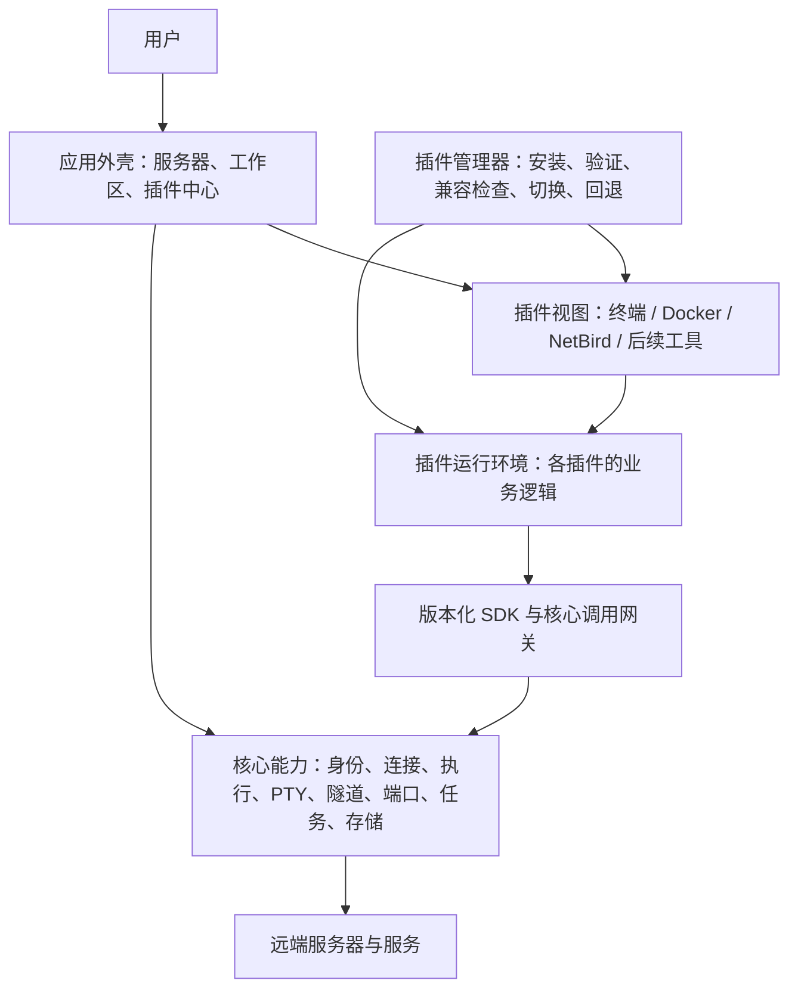

# SoDeck v2 总体架构

日期：2026-10-27 · 版本：0.9 · 状态：总体边界基线；T-016事件与诊断增量为设计，实际实现与未验收范围见各任务。

已明确的产品方向：核心提供服务器管理、连接、隧道和端口等公共能力；终端、Docker、NetBird 等业务面板独立更新。插件更新必须重启 App 后生效，不做热更新。其他建议仍待验证或确定。

本轮用户明确：优先解决模块耦合、通信混乱和插件边界问题；首阶段在 Windows 验证插件架构和独立更新，先做官方插件，结构保留跨平台能力。决定及待决范围统一见[产品总览](product.md)。

## 1. 对产品意图的理解

**SoDeck v2 是以服务器资源为中心、通过插件扩展工具的桌面工作平台。**

用户在核心系统中添加服务器、完成认证并建立工作区，然后选择需要的工具。工具共享同一套连接与资源管理，能够分别安装、启用、停用和升级。

由此推断出以下设计目标：

1. **核心稳定，功能持续扩展。** 增加或修复 Docker、NetBird 等工具时，尽量只发布对应插件。
2. **界面和业务逻辑一起插件化。** Docker 命令适配、NetBird 状态解析、终端交互规则都属于各自插件，具备独立交付能力。
3. **公共能力统一管理。** 插件复用服务器身份、SSH 认证、连接路径、隧道、端口和任务机制，不各自保存密码或建立互不协调的连接体系。
4. **功能可选择，体验保持一致。** 不同服务器可以使用不同的工具组合；插件仍使用统一的工作区、主题、通知与设置入口。
5. **插件有故障时，核心仍可管理资源。** 某个面板不可用时，用户仍能查看服务器、停止隧道、处理后台任务或禁用问题插件。

“按需安装”“不同服务器的工具组合”是以上方向自然衍生的建议。首期官方插件来源已确定；默认安装组合和具体安装交互仍由产品范围决定。市场、第三方发布与远程 Agent 不作为首期前提。

最重要的产品结构变化是：**服务器工作区独立于终端存在。** 打开服务器可以只使用 Docker 或端口转发，不必先打开一个终端来维持其他工具的连接。

按 P-15 至 P-18，工作台由核心统一提供：每服务器工作区、侧边工具面板、中央 Tab 及双区域分屏、独立窗口和系统托盘。插件声明一个或多个视图及各自支持的位置，用户可移动；逻辑视图、展示容器和业务会话分离。具体交互建议及验证见[工作台规格](core/workbench.md)。

## 2. 总体结构

| 层次 | 职责 | 更新单位 |
| --- | --- | --- |
| 应用外壳 | 服务器管理、工作区、停靠/Tab/双区域/窗口/托盘、焦点与布局、全局管理及通用交互 | SoDeck 核心版本 |
| 核心能力 | 凭据、连接路径、SSH、执行通道、PTY、SFTP 基础能力、隧道与端口、资源生命周期 | SoDeck 核心版本 |
| 插件平台 | 插件加载、实例与故障管理、调用记录、SDK、版本兼容和更新机制 | SoDeck 核心版本 |
| 业务插件 | 工具界面、业务规则、远端服务适配、插件设置与数据 | 各插件独立版本 |

核心内部按模块组织，首期保持单个桌面应用和本地服务体系，无需为了插件化引入云端服务或微服务部署。

P-53的[事件与诊断能力设计](core/observability.md)为核心增加统一采集、关联、持久历史、问题投影与证据服务的职责建议。领域服务/插件仍拥有业务含义和状态，通过有版本的描述与公开SDK报告；外壳和未来AI是诊断消费者。历史订阅有独立的可靠性和补读语义，既不替代可合并的最新状态feed，也不成为插件命令总线。数据默认在本机，外部遥测/模型执行不由此获得授权。方案与各功能测试见[T-016](tasks/T-016-observability.md)，尚未实现。

T-012样式前置增量：公开`@sodeck/ui`集中设计参数、三主题外观及当前通用组件，外壳/插件消费，UI不调用SDK、核心或插件业务。插件仍拥有页面组合、数据与流程，允许虚拟滚动/xterm等专用布局；业务不会因提取样式移入公共包。UI随各插件独立构建，核心主题服务只拥有选择/快照。详见[代码方案](technical/design-system-implementation.md)；这是待确认的实现组织，保持上述总体依赖与独立交付边界。

针对当前耦合与通信问题，每条跨模块协作必须能够定位调用入口、状态所有者和生命周期。核心接口表达通用操作，插件解释业务结果；插件调用和协作经过公开契约，具体请求、事件与流的职责见[协议方案](technical/plugin-protocol.md)。这些边界需要在原型中验证，不以目录拆开代替能力拆开。

P-36 对未来组件数量提出通用通信要求。[通信策略 r1](technical/component-communication.md)建议抽取不依赖业务的 scope/状态订阅/容量机制，由核心领域服务拥有具体状态；首先让目录上下文与视图呈现共用，插件仍通过公开 SDK 使用核心，不开放任意跨插件 topic 或共享可写业务 store。模块、兼容和采用条件见 [T-010 代码方案](technical/terminal-directory-follow-implementation.md)，这是待确认增量，不改变总体分层或宣称基础设施已存在。

## 3. 按层阅读详细设计

| 主题 | 有效文档 |
| --- | --- |
| 文档维护与编码前置流程 | [文档更新流程](documentation-workflow.md) |
| UI、编码与测试的公共规则 | [UI 规范](standards/ui.md)、[编码规范](standards/coding.md)、[测试规范](standards/testing.md) |
| 核心职责、端口模型和资源归属 | [SoDeck 核心能力](core/README.md) |
| 事件、操作关联、重要问题与诊断证据 | [统一事件与诊断设计](core/observability.md)及五项能力规格；T-016设计增量 |
| 核心 UI 与插件内容边界、窗口及布局行为 | [工作台、插件视图与窗口](core/workbench.md) |
| 技术候选、选型流程与工程组织 | [技术方案与选型](technical/README.md) |
| 插件包、运行容器与隔离 | [插件运行方案](technical/plugin-runtime.md) |
| SDK、RPC、协作与版本契约 | [插件协议方案](technical/plugin-protocol.md) |
| 插件更新、迁移与恢复 | [插件更新方案](technical/plugin-updates.md) |
| 插件职责和详细文档要求 | [插件文档入口](plugins/README.md) |

各功能进入编码前，必须在对应层补齐功能规格和测试流程，并取得用户对本次具体方案的确认。下面的架构验收场景是总体目标，不能代替单项功能的详细测试步骤或确认记录。

## 4. 实施顺序与架构验收

### 阶段一：核心与真实终端一起交付

按 P-19，首批直接完成服务器配置 → 核心认证与连接 → 终端插件创建 PTY → 输入输出 → 分屏及窗口迁移 → 关闭与退出，并用终端独立包验证重启更新。具体范围、技术与测试集中在 [T-003](tasks/T-003-core-terminal.md)，不再安排两个测试插件的前置里程碑。首阶段在 Windows 实测，平台适配保留跨平台边界。

| 实施顺序 | 本批可观察结果 | 验证边界 |
| --- | --- | --- |
| 1：核心连接与终端 | 核心保存服务器、认证和创建 PTY，独立终端包呈现真实输入输出 | 通信、归因、逐次记录、租约及失败恢复在真实 SSH 链路验证；底层故障用夹具注入 |
| 2：工作台与生命周期 | 多会话、每服务器工作区、侧边/Tab/独立窗口、双区域、托盘及退出 | 承接 v1 窗口迁移，验证同一 PTY、唯一输入绑定、状态恢复与失败回滚 |
| 3：终端独立更新 | 核心不变，仅准备终端新版，当前版本继续工作，重启后启用 | 两个真实终端版本的界面及业务行为有实际变化；坏包、启动失败和中断恢复均验证 |

三步属于同一真实交付，不要求用户逐步重新确认。按已确认范围实施、逐项留证；不把页面可打开、Mock 流或版本文字变化当作真实终端和独立更新通过。UI 使用 apple-design，功能均有自己的测试流程。

本批技术建议及失败处理见[终端实施方案](technical/first-terminal.md)。一个实际插件只能证明其覆盖的边界；跨插件的真实并行运行留待第二个业务插件，契约层可以用不同来源身份的测试夹具验证，不能冒充两个真实插件已验收。按 P-14 不建立插件权限分配。

### 阶段二：按实际需求扩展核心与终端

阶段二至四是后续建议，尚未作为首发范围确认；仅细化下一项选中的流程。

根据首批使用结果再选择文件、跳板、隧道、会话保留或历史等能力，不要求先迁完 v1。没有终端插件时，核心服务器管理仍可使用；独立隧道随其自身功能实现后验证。

### 阶段三：用 Docker 检验通用性

实现容器查询、一个有明确回执的操作和一个服务端点转发流程。Docker 命令适配变化必须能通过仅更新插件完成；若仍需为普通 Docker 行为不断增加核心专用命令，说明边界尚未成功。

### 阶段四：引入 NetBird，再按产品范围迁移其他能力

以 NetBird 验证第二种业务状态机和长时间运行场景。文件、日志、监控等功能按用户优先级进入，不因架构允许就默认列入首发。

### 判断架构是否成立的验收场景

以下随对应功能推进验证；阶段一使用实际终端包证明调用及界面、业务逻辑的独立更新。Docker、NetBird、隧道及多业务插件并存的场景不冒记为本批已覆盖。

- 不安装终端插件，仍可添加服务器、完成需要的认证并运行核心隧道。
- 核心版本不变，仅升级 Docker 包并重启后，新的 Docker 界面与业务逻辑都生效，NetBird 的版本保持不变。
- 插件更新准备完成后，当前插件界面和运行逻辑仍是旧版本，现有会话不因下载而中断。
- 退出并重启 App 后才切换插件版本；不会声称原 PTY 在重启中保持连接。
- 有故障的插件不会使核心资源管理入口不可用；内存、事件和流量有可验证的预算与故障处理。
- 不兼容或损坏的插件被拒绝，启动失败能够退回兼容版本或禁用单个插件。
- 关闭面板不意外停止用户保留的隧道；资源可在核心统一查看和处理。
- 插件视图在支持的位置之间移动不重建业务会话；工作区切换不串服务器；主窗口收起到托盘后独立窗口继续，明确退出仍统一清理。
- 原生调用来源与逐次记录、数据迁移、插件激活及断线结果不明等关键行为有真实环境证据。

## 5. 产品决定的来源

已确定要求、待决问题及细化时机在[产品总览](product.md)维护。本文件只保留架构影响，避免将产品建议在多处重复写成已采用规则。

## 6. 设计依据与技术参考

- v1 的 `src-tauri/src/lib.rs` 直接持有 Docker、NetBird、终端等模块状态，业务能力与主程序一同编译；实现本方案需要迁出业务适配逻辑，仅拆前端目录无法得到完整的独立更新能力。
- v1 Docker 与 NetBird 执行器都处理了远端命令回执和结果不明的问题，v2 应抽取通用执行语义，同时将各业务的核对与恢复规则保留在插件。
- [Tauri Capabilities](https://v2.tauri.app/security/capabilities/)：窗口/WebView 权限模型及 iframe 限制。
- [Tauri Plugin Development](https://v2.tauri.app/develop/plugins/)：原生插件结构与权限机制，供核心实现参考。
- [Tauri Sidecar](https://v2.tauri.app/develop/sidecar/)：随应用分发辅助进程的方式，不代表已验证具体 JS 引擎或插件运行时。

本文维护总体架构。T-003 已建立 Windows 运行时与实际终端包，已执行范围和限制见[桌面结果](tasks/T-003-desktop-results.md)；这里的后续阶段和跨平台方向不代表已经实现或验收。
