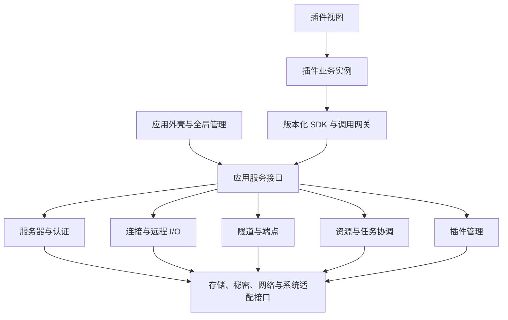

# 程序核心设计方案

更新日期：2026-10-25 · 修订：r5 · 文档就绪：草案
关联任务：[T-002](../tasks/T-002-core-design.md)

本文件是基于[已确定产品方向](../product.md)提出的详细设计建议。核心能力目录中的全部功能不等于首期范围；本文没有决定具体技术栈，也不授权编码。通信、资源、逐次调用记录及工作台是本次优先展开的基础规格，其余能力在即将实现时继续拆分。

## 1. 核心的定位

核心应提供稳定的桌面平台、插件运行支持和通用服务器资源。Docker、NetBird、终端的工具界面与业务规则随各自插件交付。判断某项能力是否属于核心，依次看：

1. 是否需要由 App 统一持有身份、调用记录、数据或运行资源？
2. 是否是多个工具可复用的协议原语？
3. 是否需要在某个插件损坏或未安装时仍可使用？

“以前写在 Rust 中”“多处复制过代码”本身不是进入核心的理由。核心不理解容器重启成功、NetBird 节点在线等业务含义，也不逐项代理所有业务命令。

推荐采用具有明确模块边界的本地应用：每个模块通过接口提供服务、独立维护状态，由启动入口组装。模块划分不等于必须拆进程；插件运行实例是否独立进程，由运行时实验决定。

## 2. 分层与依赖

图中是逻辑调用关系，不代表所画的每个模块都是一个进程，也不表示所有调用都必须经过 RPC。

- 外壳和插件都通过明确的应用服务操作核心，不直接修改内部对象或数据库。
- 网关负责验证和路由；操作规则留在所属模块。网关不变成集中编排所有功能的大型管理器。
- 核心模块在同一进程内使用有类型的接口调用；跨容器或进程时使用版本化通信契约。
- 业务状态只有一个所有者。事件只通知已发生的变化，不靠全局广播猜测哪个模块执行命令。
- 系统适配层封装凭据库、文件系统、窗口、网络等平台差异。Windows 首阶段验证不代表其他平台已经可用。
- 所有依赖由应用启动入口组装；避免业务模块互相查找全局服务、直接持有彼此的可变状态。

## 3. 核心应提供的能力

以下 C 编号表示能力分组。各组可以拆成多个单项功能，不要求建立同名巨型类或提前实现全部 API。

### C-01：应用启动、退出与恢复

- 管理应用数据目录、版本、启动标识和写入锁；建议同一数据目录只有一个拥有写权限的核心实例，后续启动转交请求或给出明确提示。
- 依次完成基础诊断、数据检查、核心迁移、插件版本选择、受限初始化、正常运行；核心必需数据无法打开时进入恢复入口，不伪装成空配置。
- 一个可选插件启动失败时禁用该插件并记录原因，核心服务器和资源管理仍可用；反复失败不无限循环重启。
- 退出时停止接收新工作，处理未保存内容及活动操作，按资源依赖顺序关闭；记录结果不明的远端操作。
- 恢复保存的服务器配置和工作区布局；旧连接、PTY、租约不得当作已恢复会话。

主状态建议为 `starting → running → stopping → stopped`，启动异常进入 `recovery` 或明确失败。按产品 P-11，明确退出后结束全部 App 持有的连接、PTY 通道与隧道，包括此前明确保留的运行资源；需要后台工作时保持 App 运行。按 P-18，主窗口“×”收起到托盘，App 与独立窗口继续运行；托盘恢复和退出由核心统一处理，细则见[工作台规格](workbench.md)。

### C-02：插件管理与运行支持

- 统一登记插件身份、安装版本、启动选定版本、已准备版本、启用配置、兼容要求和失败原因；按 P-14 不登记插件能力授权表。
- 验证插件包、启动业务实例、接入视图、监测健康、停止故障实例，并移除其失效扩展点。
- 插件包版本是 App 级选择；业务实例、工作区会话和视图是不同对象。先采用每插件一个业务实例还是按工作区实例化，需要在运行实验中确定。
- 更新过程中旧版本继续运行；新版本在 App 重启后经过验证、私有数据迁移和初始化才激活。
- 可选插件失败不阻止核心启动；回退包必须同时考虑数据兼容，不能覆盖正常运行后产生的新数据。

插件包、业务实例和视图各自有状态，不能用一个“已加载”字段代表三者。包与迁移细则以[更新方案](../technical/plugin-updates.md)为来源。安装、停用、卸载的生效时机仍待产品确认。

### C-03：公开调用、状态事件与数据流

- 提供版本和能力查询、调用者识别、逐次调用记录、请求路由、超时、取消与统一错误结构；所有插件平等调用公开且已支持的接口。
- 可信宿主确定调用者身份，用于记录来源及资源回收；不按包声明或插件清单筛选能力，不提供授权弹窗。
- 请求用于执行操作或取得快照；事件携带状态变化及版本；连续输出使用有界数据流。
- UI 切换服务器后丢弃过期结果；事件缺口通过快照恢复；原会话中的字节不能混入重连后的新会话。
- 按产品 P-13，首阶段插件只调用核心公共能力，不开放插件互调。未来如开放，另行设计版本化可选服务，明确双方身份、调用记录及资源转交规则。

详细行为和测试见 [F-CORE-001：调用与状态通信](communication.md)及 [F-CORE-003：插件核心调用记录](call-records.md)。SDK 名称和字段是契约草案；具体编码方式、传输和 schema 工具尚未选定。

### C-04：资源与长任务管理

- 区分保存的配置、真实运行资源、调用者访问租约、业务操作和数据流。
- 每个连接、PTY、监听 socket、文件传输都有资源提供者、归属范围、使用者、关闭策略和可查看的当前状态。
- 核心提供统一资源索引及停止入口；底层模块仍是实际状态的唯一写入者，索引不复制另一套可独立修改的状态机。
- 长任务有操作标识、阶段、进度、取消能力和结果。未知总量时显示阶段或已处理量，不伪造百分比。
- 取消分成请求已接收、停止已证实和结果不明；关闭本机通道不等于远端命令未执行或已撤销。
- 按产品 P-12，关闭面板默认结束它创建的会话；用户明确保留且核心支持托管的资源可在视图关闭后继续存在，并有查看与停止入口。保留只在 App 运行期间有效，不允许插件自行延长任意资源。

详细行为和测试见 [F-CORE-002：资源与生命周期](resources.md)。通用任务状态不解释容器、节点等业务是否达到目标。

### C-05：服务器档案与连接配置

- 保存稳定服务器 ID、显示名、地址、端口、账号、凭据引用、连接路径、分组/标签及配置修订。
- 允许相同主机的不同账号或不同访问路径成为独立配置；显示名和地址均不作为稳定标识。
- 增删改查、查询引用、校验目标配置；删除前识别工作区、隧道和其他配置引用，明确停止、解除引用或取消删除。
- 配置修改生成新修订。已建立连接保持自己的配置快照，后续连接使用新修订；不能在运行中偷偷替换账号或目标。
- 插件通过统一公开接口取得服务器信息和上下文，不做按插件分配的服务器访问权限；核心保存密码与密钥的引用。

服务器配置存在、网络可达、认证通过、连接可用是不同状态。批量导入、v1 迁移、同步及云端账号属于后续功能，当前保留数据版本边界。

### C-06：凭据、主机信任与认证交互

- 统一保存或引用密码、私钥及口令、SSH Agent 等认证来源；具体首期认证方式在连接功能方案中选择。
- 主机身份校验先于发送认证秘密；新主机确认、指纹变更和认证失败分别处理，拒绝后不继续连接。
- 凭据通过秘密引用供核心使用，插件不得读取服务器密码、私钥正文或任意本地文件。
- 同一连接尝试需要认证交互时合并提示；取消一个调用者不应取消其他独立使用者的认证请求。
- 凭据修订影响后续连接，已认证会话是否立即断开由显式撤销操作定义。
- 错误和诊断只记录来源类型及失败分类，不回显秘密。操作系统凭据库或加密存储方案通过平台适配层实现。

插件自有服务令牌与服务器认证秘密按用途分别管理；公开秘密服务不按插件能力许可审批。是否提供原文读取、安全导出、凭据同步和硬件密钥等接口，随实际需求单独设计，不能把未提供的接口误作权限限制。

### C-07：连接路径、连接池与租约

- 根据服务器、账号、配置/凭据修订、连接路径和工作区等运行上下文获取连接租约；先明确能复用的边界，再决定物理连接数量。
- 推荐首先实现同工作区内插件之间的共享；跨工作区复用和全局后台资源的调度随后按需求验证，不预先依赖一个全局 socket。
- 同一兼容上下文的并发请求可合并建连；每个消费者仍持有独立租约。一个消费者释放不会断开其他消费者。
- 路径解析识别跳板依赖和环路；直连先验证，跳板链及代理逐项引入，不因列入目录就承诺首期全部支持。
- 超时、保活、空闲释放、断线通知、并发通道配额和有界重试均有明确策略。
- 网络断线可以重新获取连接；认证拒绝或主机指纹变更不能作为普通网络波动持续自动重试。
- 每次新物理会话有新代次，旧 PTY、流及访问句柄不会复活；远端写操作不自动重放。

建议状态为 `idle / connecting / awaiting-auth / ready / reconnecting / failed / closing / closed`。持久服务器档案不承担这些瞬时状态。

### C-08：远程执行、PTY 与文件原语

- `exec`：启动远端命令，处理标准输入、标准输出、标准错误、退出码、超时、取消及结果不明；返回操作标识和流句柄。
- `pty`：创建交互会话、写入、调整尺寸、读取、关闭；终端渲染、快捷键、历史和终端业务体验归终端插件。
- `files`：在真正需要文件功能时增加属性查询、目录操作、流式读取/写入及传输状态；文件浏览器和同步策略归插件。
- 所有输出受流预算控制；大输出不能阻塞核心主界面或无界占用内存。
- 明确命令在远端 shell 中的执行和转义规则，不能把参数数组外观误称为任意远端系统上的无 shell 执行。
- 调用者负责声明操作意图，核心如实记录发送及回执状态；Docker/NetBird 插件自己解释命令内容、解析结果和判断业务恢复。

本机任意命令执行、通用 HTTP 客户端、远端 Agent 等均按后续实际需求提出；它们不是首个连接实验的默认能力。

### C-09：隧道、端口与服务端点

- 服务端点表示业务插件发现的访问目标；保存的转发规则描述映射需求；运行隧道、监听地址与租约表示当前实际资源。
- 推荐先实现本地转发和回环绑定。远程转发、动态代理及对外监听需要各自的交互、系统条件和测试方案，不新增插件授权步骤。
- 申请端口时实际绑定并持有 socket，或向负责绑定的提供者原子申请；不得先扫描空闲端口再假定稍后仍可占用。
- 固定端口冲突返回冲突原因；请求自动分配时返回真实地址和端口。是否允许换端口由调用方显式选择。
- 转发记录监听地址、目标、路径、状态、用途和持有者，核心可统一查看及停止。
- 连接断开后隧道可能失效；重连是否重新绑定、端口变化是否允许，遵循该规则的恢复策略并通知使用者。
- 用户明确保留的隧道不因 Docker 面板关闭而结束。核心保存目标的快照，插件提供其业务名称和来源，不把容器对象引入核心。

NetBird 网络管理不是 SSH 隧道管理的同义词。节点及网络策略仍由 NetBird 插件解释，核心只提供被验证的通用能力。

### C-10：存储、设置与数据版本

- 核心配置和插件业务数据分开管理、分开迁移；默认命名空间避免冲突，公开存储接口对插件一致开放，不把模块内部表直接暴露为稳定 API。
- 提供受控键值/文档或文件对象接口及事务边界；具体存储引擎可用 SQLite 候选，插件不直接取得核心数据库连接。
- 区分全局设置、服务器配置、工作区状态及插件设置的所有者。确有继承的设置需定义优先级、默认值、修订和变更通知，不默认每项配置都有四级覆盖。
- 为插件设置配额、校验、数据版本及失败状态；磁盘满、写入冲突和迁移失败要明确反馈，不能当作空数据或成功。
- 普通数据备份和秘密导出分开；带凭据的导出属于单独的用户操作与方案。
- 更新前在事务或副本中迁移，保留失败恢复能力；进入正常运行后的降级不能直接覆盖新数据。

云同步、团队协作与复杂数据分析不进入首期核心。持久化 schema 随真实功能建立，不提前建齐未来全部表。

### C-11：工作区、扩展点与公共界面服务

- 按 P-15 至 P-17，核心提供每服务器工作区、侧边停靠、中央 Tab、左右或上下两个区域及独立窗口。打开服务器不要求先打开终端。
- 一个插件可贡献多个视图类型，声明各视图支持的位置及默认位置；用户在支持范围内移动。核心持有逻辑视图身份、容器、布局、焦点及窗口，插件提供内容和业务状态。
- 移动、弹出和返回保持逻辑视图与会话；渲染表面可重建，旧挂载身份需撤销。切换工作区不把已有视图的服务器上下文原地替换，也不结束原工作区。
- 插件声明命令、菜单和设置入口，通过公开扩展点接入；停用或故障时核心能够移除失效入口。插件不实现自己的工作台框架。
- 全局提供通知、错误提示、认证请求、任务和资源查看入口；插件提供业务内容，核心控制跨窗口一致性。
- 主题、字体、间距等通过版本化令牌传递。公共 UI 组件可随插件独立构建，插件不绑定外壳的某个 React 实例。
- 快捷键按 App、工作区、视图上下文处理冲突；终端专属键盘规则由终端插件实现，并遵循宿主的焦点契约。
- 插件视图崩溃或无法加载时提供可恢复状态；核心资源入口不依赖这个插件的界面。

详细 UI 边界、移动/关闭/托盘行为、布局恢复和测试见 [F-CORE-004：工作台、插件视图与窗口](workbench.md)。界面设计必须使用 `apple-design`，执行细则见 [UI 规范](../standards/ui.md)；具体视觉参数和原生容器技术仍待实验方案收敛。

### C-12：诊断与核心维护

- 统一关联 App 启动、插件实例、服务器、操作和资源标识，记录模块错误、状态转换、资源使用和更新失败原因；按 P-14 对每次插件核心调用自动留痕，覆盖查询、失败、取消和重送。
- 应用诊断日志、通用操作回执和业务历史分开保存；默认不自动录制终端内容、完整远端命令或文件正文。
- 采用明确的日志字段和秘密过滤；插件提交的自由文本仍可能含秘密，诊断导出需定义内容范围与用户可查看的结果。
- 为日志、失败记录和流缓冲设置可配置预算与保留策略；资源统计反映可验证事实，不冒充精确系统监控。
- 备份恢复、诊断导出和核心安装更新由核心负责；核心更新与插件更新是不同交付链路。
- 支持明确识别故障插件、启动时禁用故障实例的恢复途径；具体自动更新、回滚和安装平台在相应任务细化。

首个实验只需要结构化日志、资源计数及错误追踪。完整更新服务、备份产品界面和遥测不是实验前置条件。

## 4. 状态分别由谁持有

| 信息 | 唯一状态所有者 | 其他模块如何使用 |
| --- | --- | --- |
| 服务器配置及修订 | 服务器模块 | 经公开接口取得快照，按修订发起连接 |
| 凭据与主机信任 | 认证模块 | 核心取得认证材料；插件只得到结果或秘密引用的受控用途 |
| 物理连接和通道 | 连接与远程 I/O 模块 | 通过租约及句柄操作 |
| 隧道及真实监听 | 隧道提供者 | 公开查询及显式停止，记录发起者和影响 |
| 通用资源目录及租约 | 资源协调模块 | 通过所属提供者执行操作，不直接改写提供者状态 |
| 操作回执与进度 | 操作模块，更新来自执行提供者 | 插件查询状态并解释业务结果 |
| 激活版本与插件实例 | 插件管理模块 | 外壳展示、网关核验 |
| 容器、节点及业务状态 | 所属业务插件 | 可选公开服务或业务视图 |
| 工作区、逻辑视图、布局、窗口及挂载关系 | 外壳工作台模块 | 插件调用公开扩展点，移动不更换业务目标或重建会话 |
| 当前页面临时选择与展开 | 所属视图 | 无需塞入核心全局状态 |

依赖模块可以缓存带修订的只读快照，不能维护第二个可独立写入的权威状态。

## 5. 用实际流程检查边界

**终端与 Docker 共用服务器。** 两个插件各自申请连接租约。终端创建 PTY，Docker 发起 exec 查询；未明确选择保留时，关闭终端默认结束该 PTY 并释放所属租约，Docker 的租约继续有效。没有安装终端插件时，Docker 仍可取得核心连接。两个插件共享核心资源不等于它们相互调用。

**Docker 提供 Web 服务入口。** Docker 解析容器信息并向核心登记目标；核心建立本地转发并返回实际端口。用户选择保留后，该转发由核心管理，面板关闭不改变它。删除容器后的端点有效性由插件报告或连接失败体现，核心不自行理解容器状态。

**写操作期间断网。** 操作已发出但没有收到最终回执时，核心报告结果不明。插件重新连接后通过业务查询核对，不能直接重复“重启容器”或“修改网络配置”。

**插件崩溃。** 核心使旧实例、订阅和普通租约失效，按资源既定策略处理残留资源。显式保留的资源仍可通过核心查看和停止；新实例取得有效句柄，无需重新授权，旧句柄不能继续用。

**准备插件更新。** 下载和校验只改变已准备版本；现有插件及会话继续运行。用户重启 App 后选择新包和适配数据，恢复布局但不宣称旧 SSH/PTY 连接仍在。

**终端从中央移到独立窗口。** 核心迁移展示容器，终端插件恢复视图状态，PTY 保持本次会话；失败时回到原位置。主窗口切换服务器或收起到托盘不改变该终端的目标。明确关闭终端才按 P-12 处理；具体窗口行为建议以工作台规格为准。

## 6. 首个可运行核心应做到什么

按 P-19，第一批直接交付核心与真实终端插件，不交付两个测试插件。首批范围及确认记录见 [T-003](../tasks/T-003-core-terminal.md)，终端自己的规格见[插件总览](../plugins/terminal/README.md)，连接侧见[核心 SSH](ssh.md)。

| 步骤 | 实现时需要证明 | 暂缓的部分 |
| --- | --- | --- |
| 核心连接与终端 | 真实 SSH/PTY、独立终端包、逐次记录、多个终端消费者、租约与有界流 | 通用 exec、文件、隧道、跳板及完整 SDK |
| 工作台与生命周期 | 真实会话列表与终端视图；侧边/Tab/独立窗口、双区域、迁移回滚、托盘及退出 | 完整 IDE、全部 v1 工作台功能、关闭后的 PTY 托管 |
| 终端独立更新 | 同一终端插件两个真实版本、重启生效、坏包及启动失败恢复，核心文件不变 | 第二个真实插件、在线市场、自动发布及正式发布渠道 |

自动化可使用故障提供者和不同来源身份夹具，不能把这些当作第二个已交付插件；一个插件多视图也不能证明跨插件并行运行。T-003 给出本批技术建议、数值预算与测试组合，远期能力继续保持范围说明。

## 7. 各能力的验证准备

本表是下属功能规格的测试索引，未运行，也不能代替编码前的详细用例。通信与资源已有独立流程；其余能力需在进入相应任务时确定环境、步骤、预期和清理。

| 能力 | 最低需要验证的流程 | 实际边界与清理 |
| --- | --- | --- |
| C-01 | 空目录启动、重复启动、核心数据损坏、可选插件失败、带活动资源退出 | 临时数据目录；关闭 App、检查本机资源、移除测试目录 |
| C-02 | 加载成功、不兼容拒绝、故障隔离、准备更新不切换、重启和回退 | 本地测试包及真实容器；恢复包选择和数据 |
| C-03 | 无需授权、身份归因、逐次留痕、重复请求、事件缺口、慢流与迟到结果 | [通信测试流程](communication.md)与[调用记录测试](call-records.md)；结束订阅和流 |
| C-04 | 双租约、视图关闭、实例崩溃、显式保留、重连和回收失败 | [资源测试流程](resources.md)；释放所有测试资源 |
| C-05 | 同地址不同账号、修改配置不串会话、带引用删除、插件可见范围 | 临时服务器档案；删除引用及配置 |
| C-06 | 新指纹、指纹改变、拒绝认证、取消共享认证请求、日志秘密检查 | 隔离 SSH 和测试秘密存储；清除信任及秘密记录 |
| C-07 | 并发建连、复用隔离、释放单个租约、网络中断、认证拒绝 | 隔离 SSH 服务；关闭连接和测试网络故障注入 |
| C-08 | exec 退出码及双输出、PTY 输入和 resize、大输出、写后断线 | 可控 SSH 命令；核查并清理远端测试进程 |
| C-09 | 固定端口冲突、自动绑定、保留转发、断线恢复及端口变化 | 本机测试监听和隔离目标；关闭 socket、清除规则 |
| C-10 | 命名空间不串数据、公开接口一致可用、写入冲突、磁盘满、迁移失败 | 临时数据副本与配额；恢复副本、清除测试数据 |
| C-11 | 三种承载、双区域、工作区隔离、迁移回滚、焦点、托盘及布局恢复 | [工作台测试流程](workbench.md)；Windows 原生验证，关闭全部窗口/实例并恢复设置 |
| C-12 | 操作可追踪、秘密不进入约定字段、日志限额、故障诊断 | 测试标记数据；检查导出内容、删除诊断产物 |

## 8. 已确认约束与剩余设计事项

| 已确认约束 | 来源 | 对本方案的影响 |
| --- | --- | --- |
| 明确退出后全部结束本机连接和隧道 | 产品 P-11 | 首阶段不做退出后继续运行的后台服务；保留资源也随退出结束 |
| 关闭面板默认结束其会话，需要时明确保留 | 产品 P-12 | 先完成托管及依赖转交才可保留；释放所属租约不影响其他消费者 |
| 第一阶段不开放插件互调 | 产品 P-13 | 仅提供核心能力；服务发现及跨插件句柄转交留到后续独立方案 |
| 插件不分配调用权限，每次调用记录 | 产品 P-14 | 取消插件能力/服务器授权及权限声明；统一记录来源、方法、目标、耗时和结果 |
| 插件声明视图支持位置，用户可移动；每服务器工作区及中央双区域 | 产品 P-15 至 P-17 | 工作台统一承载；插件、视图、渲染容器和会话分离，运行实验须验证跨窗口迁移 |
| 主窗口“×”收起到托盘，App 与独立窗口继续 | 产品 P-18 | 主窗口隐藏不进入退出清理；明确退出仍按 P-11 处理 |

以上约束已由用户于 2026-10-25 明确答复或补充，决定的有效来源是[产品总览](../product.md)。它们不代表本方案其他工程建议均已确认。

| 剩余事项 | 当前建议或准备方式 | 细化时机 |
| --- | --- | --- |
| 具体技术栈 | 继续用 Tauri/Rust、React/TypeScript 等现有候选做最小验证 | 在实验前确定比较范围，实测后再正式采用 |
| 插件实例粒度及数值预算 | 由运行实验明确 | 不以“模块化”推导为每插件必须独立进程 |
| 具体资源的保留能力及操作入口 | 定义可托管的类型、依赖、缓冲、记录与停止方式 | 对应功能编码前；本轮不默认所有会话均已支持保留 |
| 调用记录存储 | 明确保留时长、容量、持久化时点及磁盘故障处理 | 调用记录功能实施前，验证逐次留痕与故障可见性 |
| 工作台详细交互与原生可行性 | 按工作台规格审阅独立窗口归属、移动恢复和关闭建议，并验证容器、输入与布局 | 相关 UI/运行实验编码前；不以框架候选代表已支持 |

其余已知待决产品事项继续在产品总览维护。本机资源结束不保证远端进程已停止，结果核对仍遵循通信与资源规格。

## 9. 修订记录

- r5：按 P-19 改为核心与真实终端首批交付，移除样例平台前置阶段；新增连接与终端实施入口。
- r4：按 P-15 至 P-18 细化 C-11，建立工作台规格及测试；同步托盘生命周期和实验 A 的窗口迁移要求。
- r3：按 P-14 取消插件权限分配，以统一调用记录替代，并调整资源使用、验证路线及存储边界描述。
- r2：落实 P-11 至 P-13，明确保留资源也随 App 退出结束、面板默认结束所属会话及首阶段不开放插件互调。
- r1：细化核心的十二组能力、状态所有者、端到端场景、验证顺序及本轮待决问题；通信和资源规格独立维护。
