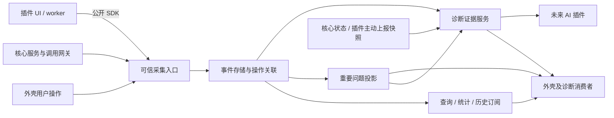

# 核心统一事件与诊断能力方案

更新日期：2026-10-27 · 修订：r5 · 文档就绪：核心与现有插件接入需求可评审；已获T-016实施确认
依据：[产品 P-53](../product.md) · 任务：[T-016](../tasks/T-016-observability.md)
相关：[架构](../architecture.md)、[通信](communication.md)、[调用记录](call-records.md)

当前已获实施确认，实测与逐项缺口见[T-016结果](../tasks/T-016-results.md)。以下设计基线中的“未实施”只表示当时阶段。

本轮入口：[代码修改方案r1](../technical/observability-implementation.md)及[接入需求r2](observability/integration.md)。用户要求先审阅代码方案、最终确定后再编码；本轮固定API4.10、观测schema2、模块/上下文/存储/预算和三插件修改点，连同78项本期规划验证提交确认。完整服务包括采集、关联、查询补读、现场/指标/本机证据与管理；问题/知悉/通知、AI及新诊断界面单独后续。T-019收束交付保持。

r2协调说明：后续[T-019通信监控](../tasks/T-019-connection-metrics.md)提出专用通信计量/历史profile、连接领域问题与主动测速。F-CORE-021/022 r2按该功能方案补充采样/留存/预算交叉引用；通用插件指标约束、无正文证据、公共存储职责与T-016原能力范围保持。通信界面及具体规则由T-019维护，依赖采用仍须统一代码方案和实施确认；本总览不代表这些服务已经可用。

## 1. 目标与当前差距

让用户和插件能够回答：谁发起了什么、程序经过哪些阶段、实际结果是什么、影响哪些对象、当时有哪些证据。未来 AI 使用相同的公开查询能力辅助定位问题，不需要读取核心数据库或理解每个插件的私有文本格式。

用户已确认这一方向并要求设计核心能力。本稿的能力划分、接口名称、预算和实施顺序为建议；尚未获得实施确认。不新增应用代码、原型、测试脚本、云端服务或 AI 插件。本轮只定义服务能力和可观察行为，不设计诊断页面布局、通知样式或设置页面；界面方案另按 UI 规范使用 apple-design。

当前工作区API为4.9.0，T-019已建立observability分区、调用事实/兼容投影、部分events查询、health/policy和通信历史；完整验证边界见该任务结果。仍缺通用插件类型/上报、跨UI/worker的操作关联、完整事件订阅和证据服务；worker console仍为空、stderr丢弃，网络/文件只有各自内存诊断。现有state feed允许合并，不能直接承担历史事件。接入需求列出核实路径，不把存在诊断表等同于问题/证据功能可用。

## 2. 核心应提供的能力

| 能力 | 解决的问题 | 规格与自己的测试 |
| --- | --- | --- |
| 统一采集与分级 | 用户操作、API调用、业务变化、运行日志采用可校验的统一信封 | [F-CORE-018](observability/events.md)，EV-01～11 |
| 操作链与因果关联 | 将一次操作经过的核心/插件阶段、资源及失败关联起来 | [F-CORE-018](observability/events.md)，EV-03/04/07 |
| 历史查询与统计 | 按时间、来源、对象、操作、类型、级别、结果定位信息 | [F-CORE-019](observability/history.md)，HQ-01～03 |
| 实时订阅与补读 | 重要事件及时可见，断开后知道如何补齐或明确缺口 | [F-CORE-019](observability/history.md)，HQ-04～09 |
| 重要问题管理 | 同一问题聚合、计数、恢复、确认，避免错误提示刷屏 | [F-CORE-020](observability/issues.md)，IS-01～06 |
| 状态、指标与证据包 | 保存必要现场、有限指标、版本与关联记录，供人和 AI 核对 | [F-CORE-021](observability/evidence.md)，DE-01～08 |
| 留存、脱敏与存储健康 | 明确保存范围、轮转、降级、启动失败和数据重建后的缺口 | [F-CORE-022](observability/storage.md)，ST-01～10 |
| 插件统一接入 | 宿主绑定身份，插件自描述领域事件，核心无需导入插件业务模型 | F-CORE-018/021；旧插件继续可运行但报告覆盖不足 |

上述能力组成一个完整的本地闭环。记录、发现问题、查证和导出均属于首个完整目标；AI 推理、自动修复、远程遥测和通用自动化引擎不包含在本轮。

## 3. 职责和通信边界

核心拥有信封、真实来源、时序、索引、留存、脱敏规则、订阅资源、问题投影和证据组装。插件拥有事件的业务含义、可公开字段、恢复条件和自己的状态；通过随包携带的版本化描述声明，普通插件新增业务事件无需修改核心源码。

第一阶段仍不开放插件互调。诊断历史允许跨来源读取，用于展示、统计和分析；它不是命令总线，也不承诺驱动业务状态机。禁止通过事件指定另一个插件执行动作、携带可转交资源句柄或构造隐藏命令队列。需要改变运行状态时调用已有明确核心 API；新的业务协作仍需专属公共契约。

现有最新状态订阅保持原保证。新增历史订阅有自己的游标和补读协议，不把 state.update 当成可靠历史。PTY/TCP/文件正文继续走有界字节流，不进入事件负载。

## 4. 统一认识几个对象

| 对象 | 含义与例子 |
| --- | --- |
| 事件 Event | 某一时刻发生的事实，如用户请求连接、连接断开、插件启动失败；已提交后不改写 |
| 日志 Log | 事件的一种，用于解释运行过程；具有明确级别、稳定类型和结构化字段 |
| 调用 Call | 一次公开 API 请求的接收/结果，沿用每次留痕要求；不等同一次用户操作 |
| 操作链 Trace | 一次用户或自动任务触发的过程；可包含多个调用、阶段和事件 |
| 问题 Issue | 持续或重复异常的可变投影，有发生、确认、恢复、再发生等历史 |
| 快照 Snapshot | 采集时刻的公开状态及版本；后取快照不能冒称故障当时状态 |
| 指标 Metric | 有单位、有采样区间的有限计数/耗时/资源量，用于判断趋势和影响 |
| 证据包 Evidence | 固定时间范围内的事件、问题、快照、版本、缺口及引用清单 |

类型、严重级别、结果分别建模。例如用户取消连接可以是 action/info/canceled；重试中的短暂连接故障可以是 domain/warn，恢复事件可以是 domain/info。不能把 failed 一律当 fatal，也不能以降低日志级别关闭操作/API留痕。

## 5. 贯穿场景

用户点击连接，宿主建立操作上下文；终端创建、核心连接、各跳板认证和 PTY 创建沿用该上下文。若第二跳认证失败，保存失败阶段及稳定错误码，连接结果由核心确认，终端只报告本插件受到的影响。问题聚合关联该路径与受影响资源，不凭时间接近把所有异常合成同一根因。

排查入口可取得：操作开始/结束、各阶段、来源版本、目标对象、失败事件、相关问题、故障附近快照、证据缺口。未来 AI 得到相同数据并引用 eventId/issueId/snapshotId；“可能的原因”和“已有记录证实的事实”分开。

记录用户意图只覆盖有业务意义的动作，首批为服务器配置、连接/取消/重连、终端创建/关闭、文件刷新/定位失败、隧道启停/检查、插件加载/更新、窗口/工作区生命周期、退出和数据库备份重建。鼠标移动、每个按键、每条流帧、频繁进度更新不逐条作为用户操作保存。终端中执行了什么命令不属于本轮用户操作采集。

## 6. 交付顺序与设计边界

当前T-016实施顺序、完整交付与验证关口以[代码方案r1 §9～10](../technical/observability-implementation.md)为准，等待用户最终确认。本期无新诊断界面，保留原生保存对话框；问题聚合/通知另行规划。以下T-019 r3和首次能力稿的顺序仅为历史背景，不覆盖本次边界。

T-019 r3具体采用范围见[代码方案r1 §6](../technical/communication-monitor-implementation.md)：本次拟交付可信内置事件/调用单源、查询/统计、问题、通信指标与有限快照、证据/本机导出、健康/留存/重建。可靠历史feed、任意插件描述/日志注册、console全面接管和全部业务采集目录仍由T-016后续完成，不发布其能力位，不将本公共子集完成记为T-016全部完成。该范围仍待用户最终确认，旧r1/r2能力设计不是实施事实。

进入任何编码前，先补齐具体代码修改方案、采集目录及配套界面规格并取得明确实施确认。完成这些前置后，建议按以下顺序交付能力：

1. 固定信封、可信来源、事件描述、存储/降级及调用审计兼容；接入启动和核心连接链。
2. 接入外壳、终端、文件、网络隧道的明确采集点，完成查询、实时补读和完整性报告。
3. 加入问题聚合/恢复、状态与指标、诊断包，完成全部服务用例和原生真实链路。
4. 按已确认的外壳诊断/通知界面方案接入上述服务，完成人可用的诊断闭环；未来 AI 插件另立任务。

这是实施准备顺序，不是自动授权分批编码。阶段1的日志设施不能单独宣布“完整功能完成”。T-015 的调用记录滚动和启动诊断继续按原任务处理；本设计不撤销其授权，不抢改正在实施的代码，也不擅自占用 API 4.8 版本号。

当前T-019已建立30天审计与512MiB分区预算，原r1“从7天扩为30天”的提案已成为这部分实际基线；不再次要求同一升级。通用运行日志/插件事件/快照的采集和调试策略仍待实施，沿用[F-CORE-022](observability/storage.md)并在代码方案统一核算，不能重复分配通信96MiB子额度。所有信息默认保存在本机；“上报”指送达核心服务。外部上传、模型提供商、费用和自动执行范围留待相应任务决定。

## 7. 文档与验证

本轮建立五项功能的测试流程，不执行尚未建立的测试，不把设计或链接检查当工程验证。服务规格中的数值为可评审建议；当前代码方案已固定模块、schema、API版本、采集覆盖和性能标准，仍须用户最终确认后编码；新UI独立后续设计。状态、文档检查及后续确认统一在 [T-016](../tasks/T-016-observability.md) 记录。
