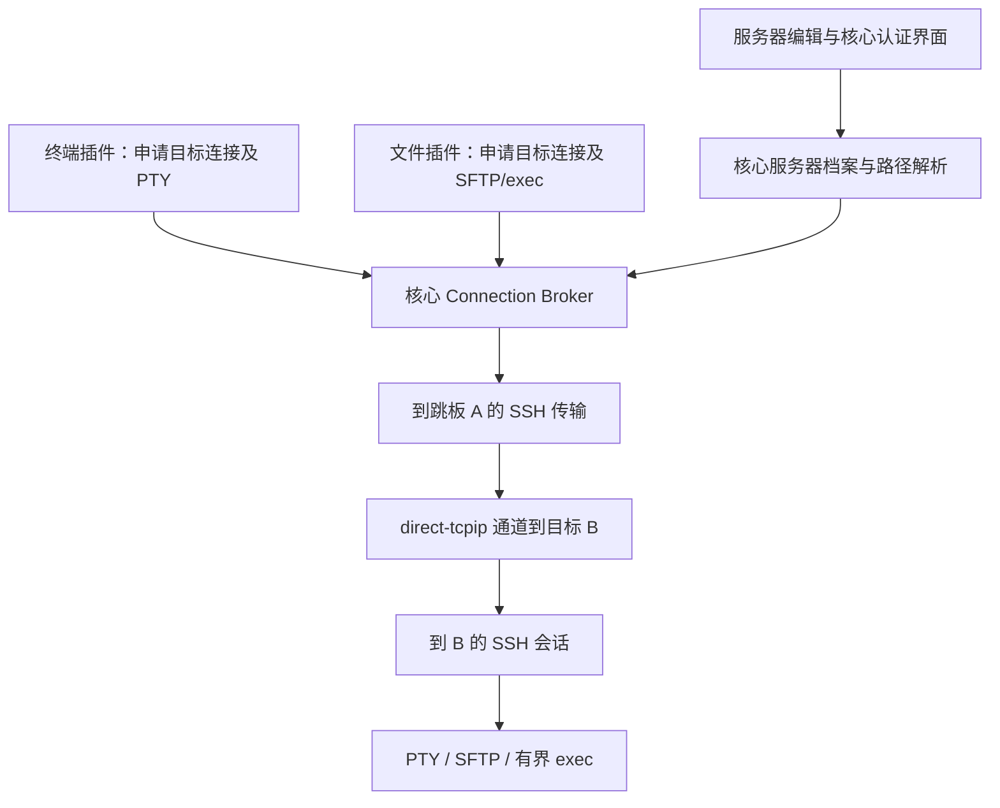

# F-CORE-014：核心 SSH 跳板连接

更新日期：2026-10-26 · 修订：r4（T-014消费者增量；r3多级基线不变） · 文档就绪：可评审
所属：Server Registry、Identity & Credentials、Connection Broker、Remote I/O
关联任务：[T-013](../tasks/T-013-ssh-jump.md) · 依据：[产品 P-42](../product.md)、[核心职责](README.md)、[SSH 基线](ssh.md)、[资源](resources.md)、[UI](../standards/ui.md)、[测试](../standards/testing.md)

> 当前提案为 §7 的任意有限级 SSH 路径，确认记录见 T-013 r2。§1～6 保留 r1 单层设计与测试基线；r1 已获确认并实施，其结果不代表 r3 多级方案已完成。两者有差异时，新方案以 §7 为准，未变化的行为沿用 r1。

> r2 接续事实保留：P-45 / [T-014](../tasks/T-014-network-proxy.md)要求多台 SSH 主机中转。随后用户直接指出 T-013 不应只支持一层，见 P-46。共用 SSH 路径的多级规则集中在本文 §7；T-014 继续拥有本机监听、固定转发和 HTTP/SOCKS 业务，不由本任务提前实现。

## 1. 目标、事实与建议范围

用户指出 v2 缺少 v1 的跳板连接，并明确其应属于核心基础功能；本轮要求理解意图并设计。推断目标：保存目标服务器时配置一次访问路径，打开目标后，终端、目录树及后续消费者通过核心访问同一目标；不要求先打开跳板终端或手动执行第二次 ssh。

只读核实：v1 的服务器档案引用一个 `jumpServerId`，只允许直接连接的服务器作为跳板；连接过程逐节点核对指纹、认证，通过 SSH 转发连接目标。v2 的核心职责已经包含跳板，T-003 暂缓实现；当前 Server 无路径字段，SSH 建连直接解析目标并建立 TCP，复用键只包含目标配置/凭据修订和工作区。此处是本轮源码观察，不把 v1 既有测试作为 v2 验证。

**本轮建议完整交付单层 SSH 跳板：本机 → 跳板 A → 目标 B。** 可让多个目标引用同一跳板档案；两端各自使用当前已支持的密码或私钥（含口令）。首个验证平台为 Windows 客户端与隔离 Linux/OpenSSH，两个节点都验证。

本轮不增加多层跳板、HTTP/SOCKS 代理、用户端口转发管理、SSH config 导入、Agent/MFA、v1 数据导入或自动故障切换。连接路径内部按有序节点建模，保留多跳扩展空间；不展示尚未支持的选项。跳板属于核心能力，首轮范围限制不改变此归属。

## 2. 用户流程与界面

### 2.1 配置路径

在既有添加/编辑服务器表单内增加“连接方式”分组，顺序为基本信息、连接路径、目标登录认证。默认“直接连接”；选“通过 SSH 跳板”后显示一个可搜索的已有服务器选择器。目标主机/端口始终填写从跳板可达的地址，用户名和密码始终属于目标 B。

```text
编辑服务器 · 内网应用机
主机地址  app.internal                端口 22

连接方式  ○ 直接连接  ● 通过 SSH 跳板
跳板服务器 [ 入口机 · ops@gateway.example:22  ▾ ]
本机 → 入口机 → 内网应用机
目标地址由跳板访问；两台服务器分别认证。

目标登录认证  deploy / 密码或私钥
                                  取消   保存服务器
```

- 跳板是普通服务器档案，无独立“跳板类型”或重复凭据。选项显示名称、账号和地址，重名可辨；隐藏自身、已有跳板的候选，后端仍须完整校验。
- 没有候选时，提供“添加跳板服务器”。同一弹层切换到直接连接档案子步骤，父表单及秘密草稿仅保留内存；主操作“保存并选用”，只保存档案/凭据，不创建跳板工作区、不连接。成功返回父步骤并选中，取消返回原草稿；关闭父表单清除其秘密草稿。已经保存的跳板不因父表单取消而删除。
- 跳板档案保存成功而凭据保存失败沿用 T-007 的部分成功语义：保留 ID/草稿，重试更新同一档案，不能假报完整成功或重复创建。
- 切换直接/跳板保留本次所选跳板草稿，保存直接时清除持久引用；字段错误在原位显示。切换路径不复制跳板密码到目标，不修改目标地址，不自动连接测试。
- 新增目标主按钮继续“保存并打开”，编辑继续“保存服务器”；保存档案与凭据全部完成后才交付打开动作。初始化仍按 T-009 只创建一个目标终端。
- 服务器选择器的目标行补次级“经由 入口机”；顶部 Tab 仍用目标名称。完整路径在连接状态/资源详情显示，不在每个 Tab 堆叠三段地址。

### 2.2 打开、认证与失败

用户只打开 B。核心依次连接 A、核对 A 身份、认证 A、建立到 B 的通路、核对 B 身份、认证 B，最后交付 B 的连接。无需打开 A 的工作区，不在 A 上创建 PTY、执行 ssh 命令或安装额外组件。

| 状态 | 用户看到的内容与下一步 |
| --- | --- |
| 正在连接 | “连接跳板 入口机”“通过入口机访问内网应用机”“登录内网应用机”；当前操作旁可取消，不显示伪造百分比 |
| 等待指纹/凭据 | 同一核心认证入口显示“跳板 1/2”或“目标 2/2”、当前节点名称/账号/地址、最终目标及完整路径；一次只处理当前必要步骤 |
| 已连接 | 显示目标已连接和“经由 入口机”；终端与文件各自取得租约 |
| 跳板无法访问/认证失败 | 明确标出入口机及失败阶段；允许修正后重试，无目标认证副作用 |
| 跳板拒绝转发/目标不可达 | 指出“入口机 → 内网应用机”这一段；服务端能区分的转发拒绝、解析或连接失败如实显示，不能把无法细分的失败一律说成密码错误 |
| 目标身份/认证错误 | 明确属于 B；不要求无故重输 A 凭据，不把“跳板已登录”显示成目标连接成功 |
| 取消或断线 | 保留目标页及明确重试入口；文件自动加载不重新唤起已取消认证；用户手动重试才创建新连接/PTY |

主机信任先于该节点认证。两节点分别使用当前认证策略：编辑器密码默认记住，连接时临时输入默认不记住。目标凭据保留在本机核心，不上传到跳板，不启用 agent forwarding。

认证交互归最终目标的发起操作/窗口，认证对象是当前节点，两个身份必须分开。跨窗口相同路径/修订的等待可协调；取消一个消费者只撤销其等待，全部等待者取消才终止共享建连。切换工作区不把 A 的认证弹到 A 的无关工作区，不抢后台窗口焦点；待处理状态仍可从发起页恢复。

### 2.3 配置改变与删除

- 修改 A 的地址/账号/认证/凭据后，新申请必须使用新路径快照；已经运行的 B 连接和终端继续使用原快照。状态提示“连接配置已修改，新连接生效”，可查看当前路径与保存路径。
- 修改 B 的跳板选择视为连接身份变化，清除 B 旧认证秘密，提示重新提供；避免相同私网地址在另一个网络中指向不同目标。修改 A 的传输身份会使依赖目标的新连接重新确认目标信任，并重新提供目标凭据；旧连接不被强制中断。只改显示名称不清除凭据或信任。凭据修订进入复用键，单纯更换 A 密码不改变 B 的主机身份。
- 档案引用与运行依赖分别检查。A 被任何保存的 B 引用时，禁止删除，列出依赖目标并引导先修改其连接方式；禁止自动把 B 改成直连。A 被用作跳板时，不允许为 A 再选跳板形成二层链。
- 目标已改走其他路径但旧运行连接仍依赖 A 时，删除 A 也必须显示这些运行依赖；沿用明确结束受影响会话后删除的流程。并发保存/删除必须在同一存储事务校验依赖，不能先检查后留下悬空引用。
- 新旧连接可以并存，但文件目录事件只能作用于相同服务器、路径/连接代次。若所选旧终端与文件连接不同，不在新目标上应用旧 cwd；显示“连接不同，暂不跟随”，待使用匹配连接后恢复。禁止以一次自动读取把旧文件句柄偷偷切换到新目标。

### 2.4 apple-design 的具体应用

使用技能的熟悉操作、渐进展开、即时反馈、可预测空间与可访问性原则：复用已有 Dialog、字段、列表和公开 UI 样式；只在选跳板后展开相关内容，路径紧邻选择器；主操作始终在底部，正文可滚动。子步骤返回时恢复草稿、滚动和焦点。按下立即反馈，状态变化不跳动布局，不用循环动画代替文字原因。

沿用 T-011 已确认的字号/间距/深浅主题和独立语义色；兼容主题协议，T-012 尚待确认的风格不作为本任务前置。完整键盘路径（Tab、方向键、Enter、Esc）、搜索输入法、长名/IPv6、900×600 窗口、200% 缩放、减少动态/透明度及高对比均验证；不增加手势或弹簧库。对应 JP-01/02/14。

## 3. 核心职责与运行模型



- Server Registry 拥有跳板引用、依赖校验及不可变路径快照。凭据/主机信任仍由核心专用服务保存。Connection Broker 拥有整条路径、传输、等待者和租约；Remote I/O 只使用最终 B 会话。
- 终端、文件插件不解析路径、不拿跳板密码、不自建 SSH，也不依赖另一个插件是否打开。只读文件界面独立发起的显式连接也必须可用；自动读取继续使用 `connections.observe` / `connections.acquireExisting`，不偷偷建连。
- 第一版在“同一工作区、同一完整路径与凭据修订”内复用目标连接，终端/文件持独立租约。不同目标 B/C 即使共用 A 档案，也各自持有到 A 的传输；A 自己的工作区连接同样独立。暂不做跨目标的全局跳板连接池，避免引入额外故障耦合。
- 一个目标路径拥有最多两个 SSH session 和一个内部转发通道；内部 A 依赖不伪造成 A 工作区或插件。关闭 B 的一个终端只释放其 PTY/租约；B 最后一份依赖释放后由内向外关闭 B、转发和 A。资源管理显示完整路径及持有者，显式停止路径才影响其全部消费者。
- A 网络/会话故障使该路径上的 B 消费者得到断线；B 单通道或文件查询失败不自动关闭整条路径。断线不自动回落直连、不切换其他跳板、不重放输入、命令或恢复原 PTY。托盘和移窗保持资源；明确退出全部回收。

### 3.1 传输实现建议与采用关口

沿用现有 Rust/ssh2 路线：先建立到 A 的 SSH 会话，通过 `direct-tcpip` 请求 A 访问 B 的原始主机名/端口，双向有界桥接给 B 的 SSH session。仅解析首个直连节点；B 的名称由 A 解析，不能提前做本机 DNS 或失败后本机直连。嵌套 SSH 保持 B 的身份和认证端到端验证，A 不代替 B 登录。

v2 当前 ssh2 入口绑定本机 socket，不能简单把 Channel 当 TcpStream；需要独立传输适配与 I/O 驱动。优先参考 v1 的 socket-pair/转发驱动设计，按 v2 生命周期重新实现；不搬入 v1 的全局业务状态、代理管理器或流量系统。若 Windows 实现需要短暂 loopback 配对，应只接收内部已验证的一对连接并立即关闭 listener，不形成可供用户或其他进程使用的代理端口。无法满足隔离或可取消性时停止采用并更新方案。

传输可行性是确认后的首个实施关口：验证密码/私钥、远端 DNS、无 PTY 跳板、双向背压、取消和释放，再接入 UI。实验及测试代码同样要等本方案确认。不能用终端内执行 ssh、外部 ssh 子进程或安装远端 helper 作为未确认替代路线。

预算建议：单路径内部桥每方向最多 256 KiB，达到上限停止相应读取；沿用已有目标连接/PTY 全局上限并另计内部资源，不能因内部节点逃逸限额。每段网络打开 15 秒、每节点握手/认证 30 秒，单次自动推进尝试总计至多 120 秒；等待用户输入不占网络计时，挑战 5 分钟过期，等待期间释放未交付路径。用户完成确认后可重建路径，已确认的有效节点不重复提示。取消在 UI 立即反馈，1 秒内撤销本次等待，5 秒内完成本机路径回收；未完成明确“正在清理/清理失败”，不得假报释放。阻塞的系统 DNS 结果不可交付到已取消操作，解析任务必须有并发上限。真实环境测试按这些预算判定，失败不能事后放宽预期。

## 4. 数据、契约与兼容

### 4.1 持久配置和路径身份

建议服务器增加 `connectionRoute: { kind: "direct" }` 或 `{ kind: "sshJump", jumpServerId }`。字段缺失的旧数据只解释为直连；未知类型拒绝执行，不按直连回退。保存校验自身引用、引用不存在、二层链、反向依赖及修订冲突，前后端一致，后端是权威。

一次申请固定 `routeSnapshot`：最终 serverId、按序节点 ID/配置修订/认证修订、工作区及创建代次、连接代次。`routeRevision` 是核心计算的完整依赖版本；B 档案没变化但 A 变化时也失效。复用、等待合并、仅复用接口和状态观察都比较完整依赖版本，旧的 active 不能掩盖新路径尚未连接。准备交付前再次校验依赖，配置已变则结束本次创建、提示重试；不在同一次尝试里混用新旧节点。

秘密按服务器及有效认证上下文保存，普通路径、日志、插件参数无正文。目标凭据额外绑定可达路径身份；改变网络路径时旧凭据可留给现有连接快照，不能给新路径自动使用。主机身份键与连接复用键分开：信任按节点地址/端口及到达该节点的路径上下文隔离，不含密码修订/显示名；上游已验证主机密钥参与下游信任上下文。避免两个网络中的 `10.0.0.5:22` 共用一条信任记录。A 的密钥变化必须先确认，随后 B 的新上下文也需核验；不能因信任 A 而自动信任 B。

旧直连信任只迁入对应直连上下文，不迁给跳板后目标。路径更改时不删除别的路径信任，未知路径按首次连接提示。挑战绑定 operationId、目标/当前节点、完整路径修订、指纹和有效期；取消、配置改变或窗口/工作区创建代次失效后，迟到确认不能写入新路径或继续建连。

### 4.2 公开能力与消费者

| 契约 | 本次建议 |
| --- | --- |
| 服务器配置 | 增量版本的服务器路径能力与 DTO；创建旧字段默认直连，旧更新省略路径时保留原路径，显式 direct 才清除。旧客户端不能静默擦掉跳板 |
| `connections.acquire` | 调用者仍只指定目标与工作区；核心解析路径并返回既有目标 lease/connection/generation，不要求插件传 hops 或凭据 |
| `connections.observe` / `acquireExisting` | 保持原响应形状；内部按最新完整依赖判断，仅复用不允许回退新建。观察修订必须随 A 改变推进，即使 B 修订未变 |
| 路径查询/状态 | 新增版本化只读路径快照/阶段主题（建议 `connections.route.v1`）；包含目标、节点、角色、修订、阶段、失败点和可重试标记，使用现有类型化通信/状态订阅 |
| 认证协调 | 保留原错误码及脱敏 message，在支持的新载荷中分离 targetServerId/workspaceId 与 hopServerId/role；宿主依据核心挑战解析当前节点，不能相信插件自报认证对象 |
| PTY/SFTP/exec | 请求/响应和资源归属维持原语；可查询关联 connection 的路径，插件没有跳板专用业务命令 |
| 调用记录 | 外部每次调用仍留痕；父操作关联各节点阶段、配置修订和结果；内部阶段不伪造插件调用，不记录密码、私钥、终端或文件正文 |

当前源码公共能力版本为 API 4.3.0；建议本次采用兼容的增量能力，不任意修改旧严格 DTO。具体新能力版本和生成文件由实施时与工作区基线核对，在编码前补入任务采用记录；如必须提升主版本或放弃旧包支持，属于方案变化须确认。原可用 API 4 终端/文件包必须验证：可用既有调用访问跳板目标，新增诊断可由外壳展示，不能因缺新路由字段而崩溃。旧核心没有本能力时，新增配置入口明确不支持，不发送会被忽略的路由字段。

### 4.3 存储升级与回退

旧服务器默认直连，增加独立路径信任存储，迁移在事务内完成；先通过 SQLite 一致性备份保存数据库（不能只复制活动 WAL 的主文件），同时备份凭据相关数据。失败保留可恢复原数据，不写出部分可用的路线。新档案读取拒绝未知 schema/kind。

旧核心可能忽略新 JSON 字段后直连，因此**不承诺旧核心读取新增跳板数据**。本次开发包使用独立数据目录，在副本验证升级；回退使用匹配旧核心的迁移前备份，禁止把新数据直接放回旧开发包。不能用新核心写 schema 号就宣称旧二进制会正确拒绝。v1 数据完全不读取或改写。

## 5. 验收标准

- JP-AC-01：只打开 B，即可经 A 使用真实终端与文件浏览；A 不要求交互 shell、本机不要求能解析/直连 B。
- JP-AC-02：路径、逐节点信任/认证与失败原因明确；秘密不交给插件或上传到 A，无静默直连回退。
- JP-AC-03：多消费者、取消、改配置、断线、移窗、托盘及退出无误伤、无旧结果复活；资源可核对回收。
- JP-AC-04：依赖校验、旧直连数据与插件兼容、路径身份隔离、迁移及回退均可验证。
- JP-AC-05：鼠标/键盘、深浅主题、小窗口/缩放及辅助功能可完成配置、连接、取消和修正错误。

## 6. 本功能测试流程

适用 r1。结果仅由 T-013 维护。已有核心/契约/UI/原生入口可作为框架；跳板专属脚本、环境与实际结果由 T-013-results 维护，不以本节流程代替已执行证据。准备独立 `.qa/t013/` 数据与测试凭据，Windows 客户端、可控 OpenSSH A/B/C（容器或隔离 VM）；仅 A 对客户端开放，B 仅 A 可达，另一个同地址网络用于身份隔离测试。B 提供 SFTP 和有限 exec；A 另设 `MaxSessions=0` 且允许到 B 的 TCP 转发，证明跳板不依赖 shell。不更改日常 VPN、防火墙、代理或业务服务器。

| 用例 / 验收 | 准备与步骤 | 预期 |
| --- | --- | --- |
| JP-01 / 04、05 配置 | 旧档案、重名/长名/IPv6、多台候选；切换路径、搜索选择、关闭重开、保存并打开/编辑保存；缺候选时进入添加子步骤再返回 | 草稿/焦点正确、两种主操作语义准确；仅新目标创建一个终端，添加跳板不打开 A；秘密不串填 |
| JP-02 / 04、05 校验和部分成功 | 自身/缺失/二层/环路、A 已被 B 引用、并发删除与保存；档案后凭据保存失败再重试；取消父草稿 | 后端拒绝无效关系且无悬空引用；删除列出依赖；重复重试保持 ID，取消不假回滚已保存档案 |
| JP-03 / 01 成功与 DNS | 本机无法访问/解析 B，A 可解析测试域名；B 开终端、输入唯一标记、用文件树读目录与挂载；A 禁用 session channel | 全流程成功，A 无 PTY/exec，B 的 DNS 在 A 侧；以访问日志/网络记录证明没有本机 B DNS/TCP 尝试 |
| JP-04 / 01、02 分别认证 | A/B 分别覆盖密码、加密/未加密私钥及混用，分别有/无保存凭据；第一节点成功、第二节点输错再修正 | 角色/地址准确，两节点分别校验与保存；不把 A 凭据发到 B 或反向保存；重试不重复弹有效 A 挑战 |
| JP-05 / 02、04 信任 | 两节点未知指纹先取消再确认，各自替换主机密钥；两个网络同一 B 私网地址；A 改地址/密钥再连接 | 当前节点验证前不发其凭据；旧确认拒绝；不同网络信任隔离，新路径不自动使用目标旧秘密 |
| JP-06 / 02 失败定位 | 注入 A TCP/认证故障、A 禁止转发、B 拒绝/解析失败、B 握手/认证故障、网络超时 | 阶段与节点准确，不能细分时如实报告；无自动直连、替代跳板、隐式重试风暴或伪成功 |
| JP-07 / 03 共享与隔离 | 同 B 两终端加文件；关闭一个终端、关闭文件、再关最后终端；B/C 共用 A 档案且 A 自己有终端 | 单消费者关闭不误断其他；B/C 和 A 工作区传输独立；最后引用后 B 完整路径释放 |
| JP-08 / 03 取消和迟到 | 在解析、TCP、转发、握手、等待认证及交付前取消；并发消费者取消一项/全部；UI 连点、跨窗口移出再确认 | 时限满足§3.1；一次副作用、等待者独立；无资源孤儿、迟到弹层/PTY、旧确认续连；取消通道不被饱和队列阻塞 |
| JP-09 / 03、04 改配置 | B 已运行后修改 A 地址/账号/凭据、B 跳板；并发申请新连接；新旧终端切换并观察文件跟随；只改名称 | 原连接不变，新连接用完整新快照；变化中的创建停止交付；旧 active 不被复用；不同路径 cwd 不串用；名称不触发秘密/信任清除 |
| JP-10 / 03 断线恢复 | 保持终端输出与文件读取，分别断 A、断 B、取消单次读取，手动重连并发送旧句柄/目录事件 | 故障范围正确；新代次拒绝旧输入/句柄，不恢复旧 PTY或重放操作；文件失败不误断终端 |
| JP-11 / 03 生命周期 | 切换/拆合目标工作区、托盘恢复、关闭跳板自己的 Tab、关闭目标工作区、明确退出/重启 | 呈现改变不重建连接；关闭 A Tab 不影响 B；退出所有内部会话/socket/worker 回基线；重启保留配置但无旧工作现场 |
| JP-12 / 03 负载/资源 | 桥双向慢读写、达到现有目标连接/PTY 上限、文件大目录、无进度连接与反复 50 次取消/开关；注入日志失败 | 每方向缓冲不超过256 KiB，有限等待和资源上限成立，取消/清理可调度；静止连接无忙等，最后计数回基线；日志缺口不阻止释放 |
| JP-13 / 04 兼容和迁移 | 旧直连数据/信任副本升级、重复升级、迁移中止；旧 API 4 插件原包接新核心，旧字段更新跳板档案；用备份恢复旧包 | 直连回归、路由不丢失；未知值拒绝；迁移原子；旧严格 DTO 不增字段；原包真实终端/文件可用；回退不让旧核心读新跳板数据 |
| JP-14 / 05 原生 UI | Windows 主/独立窗口，900×600/1280×800、100/200%缩放、已实现深浅主题；键盘/IME/长错误/高对比/减少动态 | 控件和底部操作可达，角色/路径可读、焦点返回正确；等待状态不抢别的窗口，真实截图可复核 |
| JP-15 / 02、04 记录/插件独立 | 两实际插件调用并检查资源/调用记录；禁用终端插件后文件显式连接；检查模拟秘密标记 | 核心独立提供路径；真实来源和各节点阶段可追溯，无插件互调/权限弹窗、无秘密正文或命令正文 |

每例清理：停止本例任务，关闭句柄/PTY并释放租约，核对客户端内部 A/B session、转发通道、socket/worker 和服务端通道计数；恢复测试 sshd/DNS/网络/密钥注入。最终停止测试 App/服务、删除测试秘密与副本，保留脱敏日志、计数和截图；不得仅凭本机资源表为空断言远端干净。浏览器模拟、真实协议服务、Linux/OpenSSH、Windows 原生、便携包启动分别记录；本任务不包含安装器或正式发布验收。

## 7. 多级路径修订方案（r3，替代 r1 的单层限制）

### 7.1 意图、范围与已核实缺口

用户明确指出“你只兼容了一层跳板，逻辑都是一样的，你为什么不做成无限跳板？”。单层是 AI 为首轮交付主动提出的范围收缩，不是 SSH 的能力限制；该约束现在应取消。目标是**任意有限级、无循环的 SSH 路径**，不设置 1、2、3 或其他固定业务跳数。保存路径与运行资源分开：有效长路径可以保存，建连仍受当前进程的实际资源预算约束；容量不足明确报告，不能伪称路径不合法。

本次包括核心解析、逐级传输、身份/凭据、依赖与资源、版本化契约、配置/认证/状态 UI、终端/文件回归及 Windows 开发包。保持当前总体架构和密码/私钥方式，不引入跨目标共享跳板池、替代路径自动切换或远端 helper。T-014 的隧道业务、其他客户端平台和正式发布保持各自范围。

2026-10-26 工作区核实：`route.rs` 限制 `nodes.len() <= 2`；`route_store.rs` 只取一层并禁止被引用节点再选跳板；服务器表单仅列直连候选；`connection-route-v1.schema.json` 将节点/认证索引写死为 2/1；`ssh.rs` 已按节点迭代建连，但指标只保留第一个桥；依赖查询及主机密钥变更后的下游秘密失效只考虑直接依赖/第一节点。必须共同修订，不能只删除长度判断。

### 7.2 配置模型与用户流程

每台服务器仍只保存一种连接方式：直接连接，或引用**到达自己之前的那台 SSH 服务器** `jumpServerId`。被引用的服务器也可引用另一台；不另存一份容易失步的完整链，不要求插件拼 hops。

```text
A：直接连接
B：通过 A
C：通过 B
D：通过 C

打开 D：本机 → A → B → C → D
```

1. 跳板选择器允许所有路径有效且不会产生循环的已存服务器；候选显示名称、账号/地址、已有跳板数量。只排除自身及选择后成环的后代，不再排除“已有跳板”的服务器。
2. 选择后在字段旁预览解析出的完整路径。短路径直接显示；长路径显示“经由 8 台跳板”和“查看完整路径”，展开为可滚动的编号列表，每项有角色、名称、账号和地址。目标/当前认证或失败节点始终可见，不靠横向溢出或只显示前两项表达完整性。
3. “添加跳板服务器”子步骤同样允许直接连接或选择已有跳板；继续使用可返回的表单步骤，不叠加无限弹窗。继续新建时用草稿步骤栈，从最上游开始“保存并选用”，逐步回到目标；无固定步骤深度。返回恢复草稿、滚动和焦点，关闭整份草稿清除未保存秘密。已保存档案及部分成功规则沿用 §2.1。
4. 修改某台已被引用服务器的路径是合法操作。保存前显示会影响哪些直接/间接依赖的后续连接，已有连接继续原快照；不增加一次普通保存的确认弹窗。删除仍阻止所有保存依赖，列表区分直接与间接依赖；运行依赖额外列出，不能自动改后代为直连。
5. 只打开最终目标工作区。认证显示“第 k/N 台 · 跳板/目标”、当前服务器及最终目标；错误明确到节点或“B → C”段。完整路径可展开，但用户无需先开任何中间工作区。取消、显式重试、移窗、托盘与首终端规则沿用 r1。

UI 使用已读取的 `apple-design`：保留熟悉表单、渐进展示长路径、稳定的返回位置/焦点和即时保存错误；复用当前 `@sodeck/ui` 与三主题，不重新定义主题参数。正文可滚动、底部操作稳定，长路径不会挡住取消/保存。覆盖键盘、IME、系统字体缩放、高对比、减少动态及透明度；不增加装饰动效库。

### 7.3 路径解析、依赖和身份

- **迭代解析**：从目标沿引用追溯到直连节点，使用已访问 ID 集合检测自身/间接环，最后反转成连接顺序。时间/空间随实际路径长度增长，不使用调用栈递归、不设置固定深度。不存在节点、未知类型、损坏数据和循环均拒绝并指出问题位置，绝不按直连处理。
- **原子保存**：在同一存储事务验证候选图和预期修订，再保存档案及引用；并发 A 选 B、B 选 A 只能有一个成功。预览来自候选配置，后端保存时再次验证，不能信任 UI 的过滤结果。删除也在事务内检查，不留下悬空引用。
- **完整依赖**：建立直接引用索引，以迭代遍历计算反向传递闭包；修改影响、删除阻止、秘密失效、连接观察都包含全部后代。运行依赖从不可变连接快照取，不能只查当前档案。结果分页、去重，保存依赖与运行依赖分开显示。
- **快照和复用**：核心固定全部节点与配置/凭据/相关信任修订，计算完整 `routeRevision`。同工作区、同完整修订的消费者才复用；交付前在配置协调锁内复核全链，任何中间变化都不能混合交付。旧连接保持原快照，新连接使用新快照；仅复用接口不偷偷创建连接。
- **前缀身份**：节点的凭据/信任只依赖到达该节点的路径前缀，不包含后续节点或其“跳板/目标”角色。`A → B` 与 `A → B → C` 中 B 的有效上下文相同；`X → B` 与之隔离。下游信任包含此前已验证的上游主机指纹；每个节点独立核验后才发送其认证信息，仍不启用 agent forwarding。
- **失效范围**：任意中间节点改地址、账号、认证方式或上游路径，都会使受影响下游的新连接上下文失效；任意中间节点主机密钥变化，经用户核验后也必须使该前缀下的下游信任重新验证、旧下游秘密不可自动使用。不得仅检查 `hopIndex == 0`。只换密码不等于更换网络身份；只改显示名不清秘密或信任。旧运行会话不强制断开，未受影响前缀不误清理。
- **挑战**：绑定目标/工作区及代次、来源操作、当前节点 ID/索引、完整路径修订、挑战类型/指纹和有效期；路径变化、取消、过期、来源销毁后迟到答复无写入或续连副作用。中间节点单独打开时也复用相同有效前缀的认证资料，避免重复保存矛盾凭据。

### 7.4 传输、计时和实际资源预算

复用已建立的嵌套 SSH 机制：本机只解析并 TCP 连接首节点；每个已认证节点通过 `direct-tcpip` 访问下一节点的原始主机名/端口，再建立下一层 SSH。所有中间节点只需 TCP 转发，不需 PTY、shell 或额外进程。最终 PTY/SFTP/exec 继续使用最后会话；不同最终目标的底层传输保持独立。

运行资源按实际数量计费，不能把含 20 个会话的路径记作一个普通 socket。保留全局 64 个目标连接（含创建中）、1024 租约及 8 PTY 上限；本提案增加全局 **256 个 SSH session、256 个内部桥**预算，含创建中预留，每桥每方向最多 256 KiB。该全局容量是运行保护，不写进路径 DTO 或保存校验作为最大跳数。预估 N 个 session、N−1 个桥，在开始网络 I/O 前原子预留整条路径，不持有半条链等待容量；不足返回“连接资源不足”及所需/可用数量，用户释放资源后可重试，不静默裁短路径。多个消费者复用同路径只占一次预算。

每段 TCP/转发打开 15 秒、每节点握手/认证各 30 秒。自动网络尝试总预算为 `120 + 75 × max(0, N−2)` 秒，保留直连/单跳 120 秒并随节点数增长；阶段失败立即结束，不自动无限重试。等待用户输入不消耗网络预算，挑战仍 5 分钟过期并释放未交付路径；确认后重新申请所需资源。取消 1 秒内撤销等待，整条链 5 秒内回收，不能按每个节点累加 5 秒。

任意中间桥失败使本路径不可用，汇总状态保留失败节点/边；单个目标 channel/query 失败保持既有隔离。释放先向全部桥/会话传播取消并打断阻塞 I/O，再按最内层到最外层回收和等待 worker；正常退出、建连失败、挑战等待、预算拒绝和日志失败都必须归还预留。状态同时提供每段指标与汇总，不能只报告第一个桥；父操作下记录每节点阶段，避免每次日志复制整个长路径。

### 7.5 契约、兼容和数据升级

API 主版本继续为 4，普通 `connections.acquire/observe/acquireExisting`、PTY、SFTP/exec 和目录连接查询保留严格 DTO；新核心按完整路径处理，旧终端/文件包仍可消费目标租约，认证由新外壳协调。

已交付的路由 v1 对节点数和认证索引有严格限制，**不能直接放宽原 schema 后称为兼容**。新增 `servers.routes.v2` / `connections.route.v2` 能力，方法使用独立 v2 命名空间，覆盖配置、候选路径预览、依赖、状态/资源及认证挑战。状态订阅新增 v2 路径主题。具体方法命名、生成文件组织属于确认范围内的实现细节，以下语义必须保持：

| 对象 | v2 行为与边界 |
| --- | --- |
| 保存配置 | 保留 direct / sshJump + jumpServerId 结构；允许有效嵌套引用，写请求不接受调用者伪造的展开路径 |
| 路径元数据 | 目标 ID、不可变修订、节点数量及路径引用；节点/段详情分页读取，每页最多 64 项且受 256 KiB 响应预算约束，页容量不等于路径深度限制 |
| 详情分页 | cursor 绑定来源、目标/工作区、保存/运行路径与修订；一次展示不混合多个修订。保存路径已变化则返回过期并重取；运行路径/挑战沿用其已有快照，有效期内不另复制无界快照 |
| 认证和状态 | 当前节点/边及安全整数索引、总数、路径引用、阶段/原因；校验 `index < nodeCount`，不再写死 index≤1。认证必需身份字段直接返回，不依赖加载完整列表才能确认 |
| 依赖/资源 | 直接/间接引用及运行持有者分页；每段桥指标、汇总用量和清理状态。资源详情不一次塞入全部路径数组 |
| 旧路由 v1 | 继续返回满足原 schema 的直连/单跳结果；遇到无法表达的多级路径时返回明确 `ROUTE_VERSION_REQUIRED`，不截断、不伪装直连、不遗漏后继续成功。v1 写入不能创建多级路径或无意清除既有多级引用；批量列表含无法表达项也显式失败 |
| 旧基础方法 | 旧服务器更新省略路径仍保留引用；删除始终按完整依赖检查。原 API 4 插件无需理解 v2 路由就可使用目标资源 |
| 新外壳接旧核心 | 按能力回退到原直连/单跳 UI；没有 v2 不显示可保存多级的选项，不发送旧核心可能忽略的新语义 |

路径保存不需要新增多份链数据，但多级语义超出 r1 旧核心能力。实施时将存储版本从 2 升至 3，沿用一致性数据库及凭据备份、事务迁移和未知版本拒绝；直连/单跳引用原样迁移。用真实 r1 二进制验证其拒绝 schema 3，不假设旧程序一定拒绝；回退恢复匹配旧包的 schema 2 备份，新多级数据不能交旧包猜测执行。v1 日常数据不参与。

### 7.6 多级验收与测试流程

JP-AC-01～05 扩展到任意有限级路径；新增 JP-AC-06：实现和保存契约无固定业务深度，深路径以迭代处理，循环与全局容量分别产生明确错误。r1 JP-01～15 仍作直连/单跳回归，其中“二层应拒绝”仅为历史断言，r3 对合法二层必须成功，错误测试改为真实循环/缺失引用。不能以修改断言掩盖未经验证的传输问题。

准备：独立 `.qa/t013-multihop/` 数据、专用凭据与受控 OpenSSH 拓扑 `本机 → A → B → C → D`；仅 A 可由客户端访问，每一后继仅从紧邻前驱可达且名称仅由前驱解析，所有中间节点设 `MaxSessions=0`。Windows 原生客户端及实际终端/文件包。可在隔离 VM 内使用网络命名空间/多个 sshd 建立，不改变主机日常网络。协议夹具覆盖更深路径、容量和故障注入；真实 OpenSSH 至少覆盖 0/1/2/3 层跳板，二者结果分开。

现有 `crates/core/tests/ssh_jump.rs`、`tests/core/ssh_jump_fixture.py` 及 `tests/desktop/ssh-jump*.mjs` 可扩展，本次实现入口为 `crates/core/tests/ssh_multihop.rs`、`tests/core/ssh_multihop_fixture.py`、`tests/linux/t013/multihop-setup.py` 和 `tests/desktop/ssh-multihop*.mjs`；实际结果见 [多级实施结果](../tasks/T-013-multihop-results.md)，测试层级分别记录。消费方的 RI-MH、TERM-MH、FILES-MH 另见各自功能规格。

| 用例 / 验收 | 准备与步骤 | 预期 |
| --- | --- | --- |
| MH-01 / 04、06 解析与保存 | 构造 0/1/2/3/16/1000 层配置；保存、重读、修改中间引用；注入自身/两点/长环、缺失和未知格式；并发互相引用/删除 | 合法深路径顺序与数量准确，1000 层解析无栈溢出且可保存；坏图拒绝并指出节点；事务无悬空引用，不把 1000 层配置检查称为实际网络通过 |
| MH-02 / 01、02 真连接 | 真实 0/1/2/3 层分别终端输入标记、SFTP 列目录和有限 exec；记录客户端 DNS/TCP 和每段服务端转发 | 只操作最终目标，无中间工作区/PTY/shell；DNS 在各前驱，无本机后继解析/直连；16 层协议夹具另行通过并注明验证层级 |
| MH-03 / 02、04 身份与挑战 | A/B/C/D 混合密码、私钥及加密私钥；逐节点缺秘密/输错/未知密钥/取消；B 独立打开再作为中间节点；更换入口网络后复用同私网地址 | 当前 k/N、对象/窗口正确，前缀相同时认证可复用，不同网络隔离；先验身份再发秘密，旧挑战/跨来源答复被拒绝 |
| MH-04 / 02、04 中间变化 | 已连 D 后修改 B 的地址/账号/路径/密码/显示名；分别替换 A/B/C 主机密钥；在握手和交付前并发更新 | 全链版本推进，旧会话快照不变，新连接不拿旧上下文秘密；只改名称不清秘密，密码不误清信任；中间密钥触发受影响下游复核，迟到确认无写入 |
| MH-05 / 02、03 故障与取消 | 每段逐一拒绝转发、超时、握手/认证错误、半关闭；在每阶段取消一项/全部等待；取消与交付竞态 | 节点/边定位准确，无回退/重放；单消费者不误伤；所有深度取消≤1秒、全链本地回收≤5秒，未完成不能显示已释放 |
| MH-06 / 03、06 预算与清理 | 16 节点夹具路径共占满 256 session，申请下一条；混合不同深度/同路径多消费者；双向慢读写、大输出；50 次开关和50次取消 | 原子预留不超额；下一条在网络前明确容量不足，复用不重复计费；每桥每方向≤256 KiB，段指标完整，计数归零；测试实际耗时/CPU/线程并保留证据 |
| MH-07 / 03、04 消费与依赖 | D 两终端+文件、E 共享 A/B 档案；B 自己开工作区；删除 B、D 改路后再删 B；移窗/托盘/退出 | 直接和间接保存依赖均列出，旧运行依赖不漏；独立目标相互隔离，改路后 cwd/句柄不串，停止/退出全部释放 |
| MH-08 / 04 兼容与回退 | 原 API 4 终端/文件原包消费多级目标；v1 客户端查询/更新直连、单跳、多级混合数据；新外壳接 r1 核心；schema 2 副本升级、失败注入、恢复 | 目标资源旧 DTO 无变化；v1 路由按§7.5显式拒绝无法表达项，引用不被擦除；旧核心不接受新多级配置；真实旧包拒绝 schema 3，恢复备份后可运行 |
| MH-09 / 04、06 长数据契约 | 1000 层路径分页、256 KiB 边界和长字段；翻页间保存中间配置、停止运行或使挑战过期；错 cursor/跨工作区；订阅慢消费者 | 没有整体节点数上限，单页/队列有界；索引/总数正确；过期明确，不混合新旧路径、不泄露其他来源；阶段日志不反复复制整条链 |
| MH-10 / 05 多级 UI | 选择已有多级跳板、连续添加与逐级返回、制造循环；3层及长路径/长名/IPv6；900×600和200%DPI，三主题、键盘/IME/辅助设置 | 路径预览、可用候选和保存结果一致；每层草稿/焦点恢复，取消不留下未保存秘密；当前节点与底部操作始终可达，完整路径能查阅；真实原生截图可复核 |

每例清理沿用 §6 并扩大到所有节点：关闭 I/O/PTY/租约，核对 session/桥/worker/socket/预算预留及各 sshd 进程/通道回基线；恢复专用网络、DNS和密钥故障。最终停止测试 App/服务/VM，按允许的清理操作处理专用秘密与副本，保留脱敏证据。既有 r1 测试文件清理限制不得通过改工具或混淆路径绕过；若新清理受限如实记未完成。开发包必须另设可辨认入口，不覆盖原 r1 包后仍用旧测试结果背书。

## 8. 修订与结果索引

- r4，2026-10-26：T-014新增网络TCP消费者，复用r3路径/身份/迁移。其network-data物理池与PTY/SFTP分开，每池按需至多4成员，全部计入既有64目标连接/256session及桥预算；单目标open超时用draining隔离，不能复用内部跳板失败即关闭gateway的行为。具体契约/资源/NT-01/02/06/08见[F-CORE-015 r6](dynamic-proxy.md)及[代码方案§4](../technical/network-tunnel-implementation.md#4-ssh通道超时与连接池)。这是待确认的新消费者方案，不改写T-013 r2的确认/结果、不改变其路径跳数与存储模型。

- r3，2026-10-26：按用户取消单层限制的要求提交多级完整修订；迭代引用、传递依赖、前缀身份、全链资源和 v2 契约及 MH-01～10。本次仅文档方案，确认/实现/实测分别由 T-013 r2 记录。
- r2，2026-10-26：增加 T-014 多机中转需求接续索引，保留 r1 单跳交付事实。

- r1，2026-10-26：根据用户要求建立核心跳板设计、逐节点身份/路径快照、UI、生命周期、兼容和 JP-01～15；完整实施建议待确认。本轮仅文档，实际结果及用户确认见 [T-013](../tasks/T-013-ssh-jump.md)。
