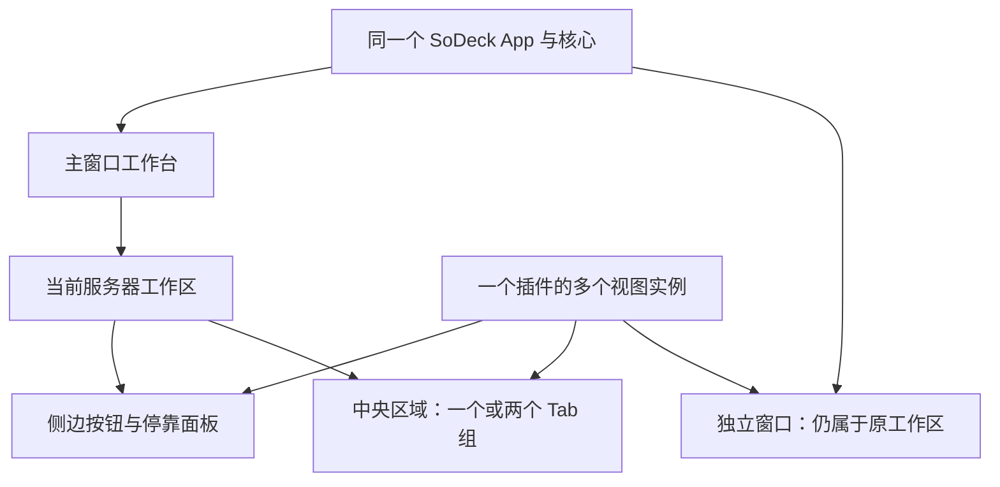

# F-CORE-004：工作台、插件视图与窗口

更新日期：2026-10-28 · 修订：r15 · 文档就绪：公共设计基线；各任务授权与结果依所属任务记录

### T-025增量：连接系统页、原生呈现与关闭预检

[F-CORE-029 r2](connection-home.md)与[代码方案r1 §3/7](../technical/connection-home-implementation.md)定义窗口权威选中对象：连接页不进入workspaces/views，选中时旧快照投影activeWorkspaceId/focusedViewId为空，原工作区的会话、目录来源和focus_target保留。新增原子系统页快照，不向旧workspace.v4结果添加未知字段。原生present/requestFocus按当前选择过滤，迟到几何不能覆盖系统页；独立视图窗口不跟随隐藏。

连接草稿和设置草稿参与两阶段关闭：收齐各窗口与原有插件关闭许可后才清稿/移动/销毁，任何取消保留所有未提交草稿。主窗×仍收托盘；子窗最后工作区移走/关闭前先处理可能丢失的草稿，不以系统页阻止原空窗回收。准备期间不持布局/配置锁等待UI，app.exit待决不能返回成功。

专属测试引用代码方案HCODE-01/02/08及CH-01/08/12：双窗开页/定位/移窗，延迟visible=true/认证/焦点，两个工作台加设置页一处取消退出，核对PTY/挂载/输入/草稿与最终释放。准备、步骤、预期及清理在上述用例维护，原生结果另由T-025记录；此增量未编码，不改变T-023/T-024授权事实。

### T-024增量：默认创建视图不抢占选择与焦点

[代码方案§5](../technical/server-monitor-implementation.md#5-工作台与连接状态机)为当前`workspaceEntries.openByDefault`补内部创建语义：按稳定pluginId/viewType顺序创建，重复命中只返回既有单实例；保留当前focusedViewId/focus_target和同边已有活动工具。空侧栏可显示新默认工具但不请求键盘焦点，之后照常运行首终端初始化。显式工具点击/open/activate仍激活用户选择。无manifest/DTO新字段、不按monitor ID特判；窗口移动和close规则不变。

本轮允许monitor在right/tab/window承载，同一逻辑视图移窗不重复创建业务实例，实际visible由核心统一发布。业务暂停/采样/缓存仍由插件处理。本节r13已随T-024获实施确认，不改写托盘、首终端等其他任务事实。

| 用例 | 准备/操作 | 预期 | 清理/方式 |
| --- | --- | --- | --- |
| WB-MON-01 | 三个默认工具声明共享right，空工作区创建，再重复初始化；另在已选工具/焦点存在时补默认视图 | 稳定首个默认工具显示；其他只创建不抢占；重复不增实例/夺焦点；新工作区首终端仍获正确输入 | 关闭夹具工作区；工作台单元+原生，MCODE-03 |
| WB-MON-02 | 四插件工作区中显式选工具、移动monitor到中央/独立窗再返回，失败回滚 | 显式选择立即生效；同一viewId/工作区，唯一有效呈现绑定，无第二采集器；失败保留原容器 | 关闭视图/工作区核对资源；原生+故障测试，MCODE-03/07 |

结果和实施确认归[T-024](../tasks/T-024-server-monitor.md)，实际单元/原生验证见[T-024结果](../tasks/T-024-results.md)。

本次托盘左键打开、右键菜单的行为、代码方案与专项测试见[§10 TRAY-001](#10-tray-001托盘单击与菜单代码方案)。用户已确认r1实施；进度与实测由§10.5维护，历史任务的确认与实测保持原记录。

T-015承载增量：[工作台交互r7](workbench-interaction.md)、[隧道侧栏r2](../plugins/proxy/features/tunnel-panel.md)及[代码方案r1 §3/5](../technical/workflow-polish-implementation.md)固定贡献v2、徽标与ui.dialog.v1。侧栏默认右停靠，隐藏不close；模态采用所属窗临时原生表面，核心仅管容器/焦点/屏障，插件持有表单/状态/提交，不新增逻辑视图/worker。绑定窗口/父view代次及独立endpoint/feed owner，来源关闭撤销；旧DTO保持投影，新包声明API4.8能力。WB-UX/TN及CODE-02/03/G4覆盖旧包、100次回收、认证挂起、初始化超时和迟到回执；本提案未实施。
所属模块：核心工作台、插件扩展点与平台窗口适配
关联任务：[T-002](../tasks/T-002-core-design.md)、[T-004 顶部服务器 Tab](../tasks/T-004-server-tabs.md)

新增 [T-010](../tasks/T-010-terminal-directory-follow.md) 的[目录上下文设计](directory-context.md)将“选中哪个目录来源”和“当前哪个控件获焦”分开，文件侧栏获焦不会清空终端来源；该增量尚待确认/实现，不改写本文已有焦点字段的现状。
上级：[核心设计 C-11](design.md) · 公共规则：[UI 规范](../standards/ui.md)
依赖：[通信](communication.md)、[资源生命周期](resources.md)、[调用记录](call-records.md)

本轮适用修订：[T-006](../tasks/T-006-workbench-interaction.md) / [F-CORE-008 r1](workbench-interaction.md) 根据最新 P-24/P-27 取消终端会话侧栏和左右/上下分屏，推荐单中央 Tab 组、终端仅中央/独立窗口；定义旧布局合并及菜单/主题公共服务。下文 r5 保留的双区域、列表、终端底部及相应用例是历史基线，受影响部分按 F-CORE-008 第 8 节替代，不能用旧预期恢复已取消入口。通用停靠、工作区归属、迁移/关闭与核心/插件职责继续有效；本轮方案尚待确认，历史实测保持原任务记录。

## 1. 目标、依据与范围

2026-10-26 启动规则修订：P-33 要求每次启动全新工作状态，[F-CORE-010 r2](clean-start.md) / [T-009](../tasks/T-009-clean-start.md) 定义配置与运行状态分离。本文第 4 节“存储故障与并发关闭补充”的布局落盘语义、§6.3 的跨启动恢复、WB-11/12 中旧布局/占位预期按新规格 §6 替代；旧段落保留历史依据。同次运行的切换、移窗、内存快照、表面恢复和资源规则继续适用。实施确认及新版本证据见 T-009，不改写旧任务验证。

提供类似 IDEA 的统一工作台：侧边工具按钮展开面板，中央通过 Tab 工作，适合的视图可以移入独立窗口。插件贡献内容，核心管理内容放在哪里、如何切换和如何关闭。

已确认约束以[产品 P-15 至 P-18](../product.md)为准：插件声明视图支持的展示方式和默认位置；每台服务器有自己的工作区；中央先支持左右或上下两个区域；关闭主窗口收起到系统托盘，独立窗口继续运行。P-11、P-12 的明确退出、默认关闭会话规则继续适用。

公共建议以具体任务的确认范围为准。T-003 已确认并运行 Windows 插件容器、终端与单视图窗口，实际结果和未验证项见[桌面结果](../tasks/T-003-desktop-results.md)；不再把它们统一描述为尚未验证。v1 迁移参考见[运行方案第 2.4 节](../technical/plugin-runtime.md)。本轮 P-20、P-21 的顶部服务器 Tab、无独立标题栏与完整工作区多窗口行为由 [F-CORE-006](server-tabs.md) 细化，尚待 T-004 方案确认，不能套用旧实测宣称已实现。

本文件维护外壳与插件职责及通用视图契约。任意嵌套分屏、将视图跨服务器迁移、多人共享布局仍不进入本次范围。r3 原先排除的“独立窗口中的完整工作台”由 F-CORE-006 提出新增设计：同一 App 中多个工作区窗口，每窗承载服务器 Tab；它与下文单视图弹窗是不同对象。

## 2. 核心 UI 与插件 UI 的边界

P-34 的 [F-CORE-010 r2](clean-start.md) 增加工作区创建后的通用初始化动作：核心按新工作区代次调度插件显式声明的动作并负责去重/取消；终端插件负责首终端业务、连接请求及视图。工作区定位、切换、移动和表面挂载不触发新初始化；不以所有 primary 命令作为自动执行清单，也不在核心硬编码终端业务。API 4 的字段/兼容由 [T-009 代码方案](../technical/clean-start-implementation.md)固定；流程见 CS-12 至 17，实际验证见任务。

| 内容 | 核心负责 | 插件负责 |
| --- | --- | --- |
| 工作台框架 | 工作区切换、侧边按钮栏、停靠区域、Tab 组、分隔条、窗口和托盘 | 声明视图类型及入口，不自行建立另一套外壳 |
| 视图容器 | Tab/面板标题与关闭/移动/弹出/返回操作、加载与故障外框、焦点和布局；窗口顶部按 F-CORE-006 融合，不另占标题行 | 标题、图标、未保存状态及内容区；业务内加载、空状态和错误 |
| 页面内容 | 提供主题协议与公共交互规则 | 终端画面、容器列表、节点详情、业务表单、业务工具栏和操作编排 |
| 共享界面服务 | 命令入口、菜单挂载点、通知、快捷键分派、认证交互 | 注册业务命令、菜单内容、快捷键意图和通知，不改写外壳内部组件树 |
| 核心管理页面 | 服务器与凭据、插件管理、连接/隧道/任务、调用记录、全局设置 | 提供用途标签和业务入口；核心不解析容器、节点等业务数据 |
| 状态与生命周期 | 工作区归属、布局、原生窗口、视图身份及资源关闭协调 | 业务模型、选择/筛选/滚动位置、未保存内容及可恢复视图状态 |

核心管理页面可复用同一套视图承载契约，仍随核心版本交付。服务器绑定页面按服务器工作区组织；插件管理、全局设置等 App 级页面明确标为全局入口，不伪装属于当前服务器。

核心能力边界看是否需要统一管理或提供通用原语；UI 边界看是否属于统一工作台行为。比如核心提供 PTY 和 Tab 容器，终端插件提供终端渲染及业务键盘规则。容器列表和重启容器按钮属于 Docker 插件，容器使用的连接和转发属于核心。

## 3. 一个插件可以有多个视图

必须区分以下对象，不能用一个“插件已打开”字段替代：

| 对象 | 含义及所有者 |
| --- | --- |
| 插件包与业务实例 | 插件管理器选择本次版本、管理业务运行；不因移到另一个窗口自动重启 |
| 视图类型 | 插件声明的某类页面，如容器列表、容器详情、日志；带稳定类型 ID |
| 逻辑视图实例 | 某工作区中的一份页面，如服务器 A 的日志页；核心分配稳定的本次运行 `viewId` |
| 展示容器与挂载代次 | 该逻辑视图当前所在的停靠面板、Tab 或原生窗口，以及当前有效的渲染绑定 |
| 业务会话与底层资源 | 业务实例管理业务状态，核心管理 PTY、连接租约及流；不绑定某个 DOM 或窗口句柄的寿命 |

同一插件例如可以提供侧边容器列表、中央详情 Tab 和可弹出的日志视图。这个例子用于说明结构，不承诺首期实现 Docker。首阶段这些视图由同一插件自己的业务实例协调；不借工作台增加跨插件业务互调。

三种形式是视图的展示位置，不是三种插件包。移动保留同一逻辑视图；“再打开一个”创建另一个实例，需满足该视图的多实例声明和自己的资源规则。

## 4. 工作区与布局

### 4.1 服务器工作区

建议首阶段同一服务器档案对应一个工作区；不同账号或连接路径需要区分时使用不同服务器档案。工作区可以离线打开，不要求先打开终端或建立连接。

- T-004 建议每个工作区窗口独立激活一个服务器工作区，顶部以 Tab 切换；对应的工具入口、展开面板、内部 Tab、分屏布局和最后焦点随之恢复。窗口归属与排序以 F-CORE-006 为准，T-003 旧实现仍是主窗口激活模型。
- 切换工作区只改变触发窗口展示；原工作区保持打开，其会话不因不可见而结束。隐藏状态仍受有界输出和资源预算约束。
- 每个视图绑定明确工作区/服务器；全局活动服务器不能替换它的业务目标。打开其他服务器页面必须在对应工作区新建或激活视图，不移动原会话去另一个目标。
- 全局插件安装与激活版本保持 App 级管理。工作区记录视图入口及打开状态，不等于每台服务器安装一套插件。
- 独立视图窗口保留原服务器归属并继续可见，其他窗口切换服务器不让它跟随换目标；融合顶部与系统标题提供服务器及视图名。点击该窗口命令只作用于它的上下文；返回时定位所属工作区当前承载窗口。
- “结束工作区”是独立操作：收集包括独立窗口在内的所属视图，先处理未保存内容及明确保留请求，再按资源规则结束。托管资源继续由核心管理；工作区配置与布局可保留。

### 4.2 三种展示形式

| 形式 | 建议行为 | 主要边界 |
| --- | --- | --- |
| 停靠工具面板 | 所在工作区的左、右及底部可有工具按钮；点选展开，再点收起；同一边首阶段只展开一个工具面板；按钮可排序或移到其他支持的边 | 收起或切到同边另一个工具不关闭逻辑视图；插件声明支持的边和最小尺寸 |
| 中央 Tab | 每组可有多个 Tab，支持选择、排序、关闭；Tab 可移到另一个组；允许左右或上下两组并调整比例 | 分屏移动同一视图，不自动复制会话；第二组为空时合并为单组，不创建第三组或嵌套树 |
| 独立视图窗口 | 弹出一个支持的逻辑视图；T-004 将“返回主窗口”更新为“返回所属工作区”；可移动到其他显示器 | 一窗口一视图，共用 App、插件版本和资源管理；完整工作区窗口是 F-CORE-006 的外层宿主，不是视图第四种展示形式 |

插件默认位置仅用于首次打开或缺少有效用户布局时。用户已保存的位置优先；插件更新后不强行覆盖它。所有移动、弹出和分屏操作都提供菜单/键盘路径，拖动是直接操作方式之一。

不支持的目标不出现在可用操作中；若调用直接请求该目标，返回明确的不支持结果且原视图保持可用。这是视图布局契约，不是插件核心 API 的权限清单。

### 4.3 视图移动与失败恢复

移动、弹出、返回、调整分屏不是关闭。保持 `viewId`、工作区、业务实例和有效资源关系；跨原生容器时允许重建渲染表面，但不自动重建业务会话或重放命令。

建议通过一次可追踪的布局操作完成：

1. 核心核对当前布局修订、目标形式和窗口状态，预留目标位置；源视图仍可恢复。
2. 获取视图的迁移状态，停止旧表面的新输入并交接焦点；未完成的输入法组合先提交或取消，不重放原始键盘事件。
3. 创建/绑定目标表面，分配新挂载代次并恢复状态；尚未提交时目标不获得业务输入权。
4. 目标就绪后提交布局并切换唯一有效输入绑定；撤销源表面的订阅/桥接，释放旧展示容器，不调用业务关闭流程。
5. 目标加载失败、用户取消或操作超时则回到源位置；使失败目标代次失效，保留原视图和资源。源表面也已不可用时，显示恢复入口并记录资源实际状态，不假装已关闭或已恢复。

需要有界输出缓冲、序号续接或快照恢复；能力不足导致输出缺口时必须可见。一次移动只允许一个有效输入表面；旧表面的迟到请求不能写入新目标。布局操作需可按操作 ID 查询，重复提交不产生重复窗口或视图。并发移动与关闭按同一视图串行处理；App 退出先取消迁移再统一清理。

上述是 v2 通用插件视图的行为要求。v1 已通过普通原生窗口、工作区快照、输出交接和归属提交实现迁移；优先抽取这一思路，不要求 DOM 或 WebView 原地无损搬移。是否采用独立子 WebView 仍是另一个容器选型问题，不能用其尚未验证来否定 v1 已验证的多窗口路径。

### T-003 存储故障与并发关闭补充（2026-10-25）

以下细化既有提交/回滚和关闭规则，属于已确认范围内的缺陷修复：

- 分屏配置、同窗口布局移动等尚未产生原生交接的操作，先验证并保存候选布局，成功后才替换当前内存布局。保存失败返回 `STORAGE_ERROR`，原布局、修订和磁盘文件保持。
- 跨窗口移动已经切换唯一输入绑定、结束源表面后，不能因布局文件保存失败声称移动失败。响应保留目标视图并明确 `committed: true`、`persisted: false` 及 `warning`；立即通知布局变化，通过现有提示区域告知“移动已完成，但布局未保存，重启后可能恢复原位置”。资源保持目标绑定，不再重放移动。
- 独立窗口在同一视图迁移期间收到关闭请求时，记录一次待关闭请求；迁移提交或回滚后，关闭这个逻辑视图及所属会话。重复点关闭不重复执行，待关闭期间的新移动明确拒绝。其他失败通过现有提示区域反馈，不能静默丢弃关闭意图。

定向验证：在隔离数据目录用同名目录占用 `workbench.pending`，分别调用配置和跨窗口移动，核对前者无修改、后者返回已提交及持久化警告且目标可用；清除故障后下一次正常保存成功。在迁移准备/交接期间关闭独立窗口，验证最终视图及资源只关闭一次、同伴仍可用。静态/模型测试与 Windows 原生执行分别记录，不将代码审查代替原生结果。

## 5. 隐藏、关闭与退出

T-014待确认增量：网络插件每服务器一个逻辑管理视图，中央Tab/独立视图窗口，默认不自动打开，具体内容见[插件总览§3](../plugins/proxy/README.md#3-v2-界面方向)。通用network group以稳定viewId/workspaceGeneration归属，宿主在关闭提交时撤销核心组，不依赖worker先成功清理；若用户取消关闭不撤销。移窗只改变挂载身份，组/流保持；旧workspace.v4严格Resource枚举不扩展，新资源查询走net.resources.*。NT-04及PF-05/NP-04覆盖移窗/关闭/崩溃竞态；不引入关闭后托管、不改主窗口×收起托盘语义。

本节“Tab”指内部插件视图 Tab，“独立视图窗口”指单页弹窗。新增服务器 Tab、完整工作区窗口及主窗口空态的具体规则见 [F-CORE-006 第 5 节](server-tabs.md#5-关闭收起与重启)；这部分属于 T-004 待确认方案。

| 操作 | 视图与资源行为 |
| --- | --- |
| 收起侧边面板、切换 Tab/工作区、最小化窗口 | 逻辑视图和会话仍在；可以暂停展示刷新，不能把输出无限积压 |
| 移动、分屏、弹出、返回主窗口 | 同一个逻辑视图变更展示容器；不触发默认关闭规则 |
| 明确关闭 Tab 或工具视图 | 按 P-12 默认结束所属会话，释放自己的租约；支持保留时须用户明确选择并完成托管；未保存数据先执行该功能已定义的关闭流程 |
| 点击独立视图窗口的“×” | 建议等同于关闭其中的视图；“返回主窗口”是另一明确操作，不能把关闭偷偷解释为移回 |
| 点击主窗口的“×” | 按 P-18 收起到托盘，保持 App、工作区、独立窗口及会话运行，不执行视图关闭流程 |
| 从托盘恢复主窗口 | 恢复原激活工作区及布局，不重建会话；重复恢复聚焦同一主窗口 |
| 结束工作区 | 关闭其所属视图（包括独立窗口），释放其范围资源；仅明确完成托管者保留 |
| 菜单或托盘选择“退出 SoDeck” | 按 P-11 停止全部窗口及 App 持有的连接、隧道和 PTY 通道，包括托管资源；取消退出则不进入清理 |

托盘至少提供“显示主窗口”和“退出 SoDeck”；主窗口首次收起给予克制的去向反馈。托盘无法建立或失效时保留或恢复可见主窗口并反馈原因，不能把所有入口都隐藏。主窗口隐藏不停止独立窗口渲染；最后一个独立窗口关闭也不隐式退出仍在托盘运行的 App。

P-58 本次增量：左键单击直接显示并聚焦已有主窗口，右键只打开原生菜单；建议保留“显示主窗口”和“退出 SoDeck”两项。隐藏、最小化、被遮挡和已经在前台的恢复行为，以及重复点击、退出期间的处理统一见§10，替代未明确鼠标按钮分工的旧约定；本轮仍为待确认方案。

批量关闭工作区或退出时，先收集未保存内容及已有功能规定的选择，在用户决定完成后再开始统一释放；取消不能发生在一半会话已被提前结束之后。普通退出不因此强制新增确认弹窗，是否需要交互取决于实际未保存内容及该功能已定义规则。

主窗口收起到托盘与独立视图窗口关闭有不同职责，标题与菜单应能辨认。任务栏预览、系统结束进程与关机的细节在平台实施规格中补齐；强制终止不能承诺完整执行关闭回调或保存最后状态。

## 6. 扩展点、状态与通信

### 6.1 视图声明

以下是待验证的契约字段含义，不是已经发布的 SDK schema：

| 声明信息 | 用途 |
| --- | --- |
| 稳定视图类型 ID、标题、图标、入口 | 标识一个插件提供哪类内容，显示与加载时使用 |
| `scope`：服务器工作区或 App | 明确是否要求服务器上下文，不在前端猜测当前服务器 |
| 支持的展示形式、允许停靠边、默认位置 | 决定可用移动目标；默认值必须属于支持范围 |
| 单实例/多实例及实例键 | 明确重复打开是聚焦已有视图还是创建新视图，例如每工作区一个列表、每对象一个详情 |
| 最小尺寸与内容适配 | 避免放到不适合的区域后内容不可用；小窗口可滚动或返回可容纳位置 |
| 可恢复视图状态版本与关闭协作 | 迁移状态、未保存提示及恢复失败；不包含有效会话句柄和认证秘密 |

声明由核心校验；真实插件、实例、视图及挂载来源由宿主通道绑定，不依赖页面自报身份。每次插件调用核心工作台 API 同样按 F-CORE-003 留痕；拖动的本地视觉刷新不是每帧一次业务 RPC，最终提交必须可追踪。

### 6.2 状态所有者与契约

当前实现与公共目标的差距由 [F-CORE-006 第 6 节](server-tabs.md#6-核心状态与插件边界)维护：一个长期运行的终端业务实例已支持多个会话/视图，但当前外壳仍包含终端专用新建、重命名和重连编排；不能将下述通用接口整体视作已实现。T-004 r3 建议补齐通用视图/命令/元数据/生命周期、窗口上下文与批量迁移，属于待确认方案。

- 核心持有工作区、布局修订、逻辑视图注册、Tab 组、窗口位置、焦点路径和当前有效挂载关系。
- T-004 增加每窗服务器 Tab 顺序、活动工作区与唯一承载归属，以及整工作区批次迁移；结构和测试由 F-CORE-006 维护。现有单视图迁移不能替代整工作区的原子归属提交。
- 插件业务实例持有业务状态及操作编排；视图持有筛选、选择、滚动和编辑草稿等展示状态。需要跨表面恢复的部分由插件提供版本化状态，核心只协调及保存不透明数据。
- 连接、PTY、流和租约由核心能力模块持有，迁移时不以 DOM 卸载作为释放信号。若原先绑定表面身份，由核心完成合法重绑定并撤销旧通道；不让插件复制其他消费者句柄。
- 命令以触发窗口、视图和工作区构造上下文；全局菜单也需明确目标。不能用“主窗口当前服务器”覆盖独立窗口的目标。按下快捷键时有一个明确路由，不把终端输入同时交给多个视图。
- 拟定请求包括打开/激活、收起、移动、关闭、分屏、查询布局；响应带操作 ID 和布局修订。事件描述已提交的视图、布局、可见性、焦点或窗口变化，订阅按工作区/窗口过滤并可恢复快照。
- 对不支持位置、过期布局、视图已关闭、迁移进行中、目标失败等分别返回可识别结果；取消或失败不能伪装已提交。参数、存活及代次检查只保证正确性，按 P-14 不增加插件授权。

具体传输、超时预算、字段名称和视图与业务实例通信方式在运行实验确定。新 API 必须补齐 schema 与契约测试后才能编码，不能直接把本节当作现成 SDK。

### 6.3 布局持久化与恢复

布局保存工作区标识、视图类型与可恢复实例键、位置、排序、分屏方向/比例、窗口可见位置和布局 schema 版本。业务秘密、原始终端输出、有效资源句柄不写入布局文件；插件状态按其数据与秘密规则另行处理。

App 重启可以恢复布局和视图占位，不能宣称 SSH、PTY 或旧租约仍在，也不能自动重放业务写操作。独立窗口只恢复到当前显示器可见范围；断开外接显示器时提供将窗口召回主屏的入口。

插件缺失、视图类型删除、支持位置变化或状态版本不兼容时，保留可诊断占位并提供关闭、重试或重置该视图布局的入口；按仍支持的默认位置回退，其他插件布局不受影响。布局损坏或磁盘写入失败明确反馈，避免下一次启动把损坏数据当作用户主动清空全部视图。

T-003 内实现细化（2026-10-25）：每个已保存视图携带 `stateVersion`，现有未带字段的布局按版本 1 读取。声明版本不匹配时保留 viewId/位置，状态为 `viewFailed`，`failureReason` 给出保存版本、当前版本及重新加载说明。明确点击重新加载才丢弃不兼容展示状态并采用当前声明版本；存在运行资源句柄时不得以重置绕过资源生命周期。重启后已结束的终端保留结束状态，不自动新建 SSH；会话列表等无远端句柄视图可重建。验证包括旧格式加载、版本变化占位、显式重置及再次保存/启动，实际原生结果见 T-003 插件记录。

## 7. apple-design 的具体应用

本次已读取并使用 `apple-design`；IDEA 提供工作台组织参考，视觉与操作质量遵循 [UI 规范](../standards/ui.md)。

- 点击按钮和 Tab 立即给出按下/选中反馈；加载业务内容另有状态，不让反馈等待网络。
- 拖动视图跟随指针并保留抓取偏移，落点预览与最终位置一致；无效目标清楚反馈，Esc 可撤回。跨原生窗口的拖动能力要实测，不以浏览器内效果代替。
- 收起、展开、弹出与返回具有可辨认的来源和去向；动画被反向或打断时从当前呈现状态继续，不突然跳回初始位置。弹性反馈克制，窗口与文本内容不作装饰性晃动。
- 层次优先突出当前服务器、活动 Tab 与内容；图标有可访问名称及提示。表格、终端等信息密集区域以清晰对比为先，透明材质不降低可读性。
- 支持键盘移动/弹出/返回、焦点可见、关闭后焦点返回相邻有效目标；拖动不能成为唯一方式。支持减少动态效果、透明度及高对比偏好。
- Windows 使用符合平台习惯的窗口操作、系统字体和输入法；多显示器不同缩放比例下验证尺寸、命中区域与输入定位。尺寸、字体和动效数值在首轮界面方案确定。

## 8. 验收与功能测试流程

验收项：AC-01 核心统一承载且遵循声明；AC-02 工作区/窗口上下文不串用；AC-03 移动保持会话且仅一个输入目标；AC-04 关闭、托盘及退出符合资源规则；AC-05 故障与布局恢复可见可处理；AC-06 指针、键盘及可访问行为一致。

准备：Windows 原生宿主、临时数据目录、两份隔离 SSH 服务器档案 A/B 和真实终端插件。会话列表验证单实例停靠视图，终端会话验证多实例、中央/底部/独立窗口及真实输入输出；用宿主夹具补充不支持位置、未保存草稿及加载/落盘失败，不制作测试插件。多屏项使用真实双显示器和不同缩放比例，PTY 连续输入、resize 和断线在本批真实 SSH 测试中完成。未实现的托管、其他插件及业务草稿不冒记为本批产品已支持。

迁移回归复用 v1 原生测试的设计资产：拆出/移回前后会话 ID 不变、真实 shell 数量不增加、目标销毁及部分冻结回滚、混合连接状态和历史不重复。v2 在此基础上增加通用插件视图与业务实例的分离、调用来源、状态版本和独立更新兼容验证；不以 v1 通过代填下面的 v2 执行结果，也不要求重做所有不受影响的 v1 功能测试。

| 用例 | 操作步骤 | 预期结果 | 关联 |
| --- | --- | --- | --- |
| WB-01 | 加载终端插件，打开会话列表及多个终端，分别放入底部、中央和独立窗口；重复打开会话列表；对列表请求不支持的位置 | 声明支持形式可用，列表重复打开聚焦原页，终端各有唯一 ID；列表没有不支持的移动操作，直接请求也不改变原位置；核心调用有记录 | AC-01 |
| WB-02 | 开启带序号流，点侧边按钮展开/收起、切到同边另一工具；移动按钮至声明支持的另一边并排序 | 状态与按钮位置一致；收起只改变可见性，会话及租约不误释放；输出缓冲受限；可用键盘完成等价操作 | AC-01、AC-04、AC-06 |
| WB-03 | 在单个中央 Tab 组打开三页，左右分屏并移一页，再切为上下并调整比例；移走第二组全部页 | 两组各自选页；移动不复制会话；空组回到单组，没有第三组；比例受最小尺寸约束 | AC-01、AC-03 |
| WB-04 | A/B 各打开同一视图类型，使用不同查询/草稿/会话；快速切工作区，延迟返回 A 的结果 | 工具、页面、布局及焦点各自恢复；A 的结果只更新 A，B 不串数据；切换不调用结束工作区 | AC-02、AC-04 |
| WB-05 | 对活动输入及连续输出视图执行弹出和返回，记录 viewId、租约、输入序号、输出序号及挂载代次 | 逻辑视图与会话保持；只有一个有效输入目标，无命令重放；旧表面迟到输入拒绝；输出连续或按契约明确提示缺口 | AC-03 |
| WB-06 | 在目标创建、就绪前、提交响应丢失时分别注入故障；取消移动；重复同一操作 ID 并并发请求关闭 | 未提交时原位置/会话可恢复；已提交可查询真实位置；不重复窗口、不双重输入；关闭与移动有确定顺序且无资源泄漏 | AC-03、AC-05 |
| WB-07 | A 的视图弹出后，主窗口切到 B；分别在两窗口触发命令、输入和通知；随后结束 A 工作区 | 独立窗口持续标明并操作 A，主窗口操作 B；结束 A 涉及其独立视图，不误伤 B，托管资源按规则处理 | AC-02、AC-04 |
| WB-08 | 比较收起面板、返回主窗口、关闭 Tab、关闭独立窗口；对支持的会话明确保留；模拟未保存内容取消关闭 | 收起/返回不结束；明确关闭默认结束所属会话；显式保留先成功托管；取消关闭保持原状态，共享连接其他消费者继续可用 | AC-03、AC-04 |
| WB-09 | 主窗口与独立窗口均工作时点击主窗口“×”，从托盘恢复两次；关闭最后独立窗口；再模拟托盘不可用 | 主窗口收起，独立窗口与会话继续；恢复同一主窗口；最后独立窗口关闭不退出托盘 App；托盘不可用时保留可访问主窗口 | AC-04、AC-05 |
| WB-10 | 有未保存草稿、普通/托管资源和迁移进行中时从托盘选择退出，在草稿关闭流程先取消再选择完成退出；另测无未保存内容；从 App 外检查进程、监听及窗口 | 取消不执行清理；完成选择后全部窗口关闭，App 持有资源实际结束，迁移不产生残留；普通退出无多余确认；远端结果不明如实记录 | AC-03、AC-04 |
| WB-11 | 保存两工作区布局及独立窗口后重启，再断开副屏、改变缩放并召回窗口 | 布局在可见区域恢复；配置与会话区分，旧句柄无效、写操作不重放；显示及命中不偏移 | AC-02、AC-05、AC-06 |
| WB-12 | 模拟插件缺失/加载失败、视图类型移除/支持位置变化、视图状态不兼容、布局损坏/落盘失败 | 有明确占位或回退及恢复操作，其他视图可用；核心资源管理入口可用；不静默删除全部布局或假报保存成功 | AC-01、AC-05 |
| WB-13 | 输入法组合期间移动视图，跨窗口切焦点；测试快捷键冲突、键盘关闭/移动/返回和焦点恢复 | 不重复提交组合文字；仅当前目标收输入；菜单与快捷键一致，关闭后焦点落在有效目标，操作不依赖拖动 | AC-02、AC-03、AC-06 |
| WB-14 | 快速反向展开/收起和拖动后 Esc；开启减少动态效果、高对比及减少透明偏好；测试长名称、小窗口 | 反馈及时、位置连续、取消回原处；偏好得到遵循，焦点/标签可辨认，内容可滚动而非无法操作；临时视觉值与测试环境记录 | AC-05、AC-06 |

清理：退出测试 App，从外部核对窗口、业务实例、监听和资源计数回到基线；清除故障注入，恢复屏幕/缩放与可访问性设置，保存必要证据后移除临时档案和布局。真实 SSH 复验需核查并清理远端测试进程。用例可按实际实验范围拆批，未覆盖项持续标记未验证，不能以 Mock 或浏览器通过代表原生/SSH 验证。

以上 14 项是计划流程，不能整项默认为通过；可执行入口、数字预算和通过阈值在具体方案中定义。T-003 的原生窗口、托盘、物理拖动、恢复及剩余子场景见[桌面结果](../tasks/T-003-desktop-results.md)，实际进度只由实施任务记录。

## 9. 实施前待收敛与修订

- r12，2026-10-28：按P-58增加TRAY-001轻量变更记录，细化左键单击、右键原生菜单、公共显示入口、退出竞态和Windows专项验证；仅提交文档方案，尚未编码。

- r6，2026-10-25：登记 T-006 对列表、分屏、菜单/主题及旧布局的适用覆盖；旧用例映射集中于 F-CORE-008，不改写历史结果，不调整整体架构。

2026-10-25，T-003已确认WB-12范围内的恢复落盘补查：视图格式重置及无运行句柄的结束占位使用候选布局先保存，写入失败返回STORAGE_ERROR且不改变内存；已经建立原生表面并切换PTY挂载代次后，保存失败按已提交操作处理，返回committed:true/persisted:false并提示保存失败，不能误报恢复失败让用户重复恢复。以实际workbench.pending目录冲突注入保存错误，分别核对未提交的版本/状态不变，及已恢复的同一PTY仍可输入、资源身份不变；恢复写入条件后重试保存并正常退出。

- 首批 T-003 使用实际终端的列表与会话视图，验证三种容器、双区域、迁移/回滚、焦点、输入法、托盘及调用归因；真实 SSH 在同批交付，不以样例平台作为前置。
- 既有窗口迁移承接 v1 实现和原生测试资产，重点验证通用插件接入增量；此前因未查 v1 而建议默认延期的判断不作为本规格的范围决定。
- 原生容器之间的挂载、跨窗口拖动、视图状态迁移、业务实例粒度与输出预算仍需实测；候选无法满足时回到技术方案比较，不能静默改为移动就断开会话。
- 独立窗口在切换工作区后继续显示原服务器、独立窗口“×”关闭视图、每边一个展开面板等为本规格建议，随具体方案评审确认；新增产品决定写回产品总览。
- r1，2026-10-25：根据 P-15 至 P-18 建立工作台与插件 UI 边界，区分插件/视图/容器/会话，细化工作区、移动、托盘、恢复及 14 项测试流程。
- r2，2026-10-25：按用户指出的 v1 既有实现核查源码与历史原生结果；补充继承依据，区分已有窗口机制和 v2 通用插件视图的增量验证。
- r3，2026-10-25：按 P-19 以真实终端列表和会话视图替换测试插件准备；补充夹具与实际产品验证的边界。
- r4，2026-10-25：按 P-20、P-21 衔接 F-CORE-006 / T-004；提出顶部服务器 Tab、窗口级激活及整工作区窗口，明确与单视图弹窗的区别。修正过时的容器未验证表述；新设计未获实施确认，历史 T-003 记录保持不变。
- r5，2026-10-25：链接本轮实例粒度与终端专用耦合的源码核实，区分公共契约目标和实际实现；建议增量及自己的测试集中在 F-CORE-006 r3。

## 10. TRAY-001：托盘单击与菜单代码方案

更新日期：2026-10-28 · 方案修订：r1 · 任务状态：待验收（工程验证已完成）。
依据：[产品P-58](../product.md)，本功能r12的AC-04/05/06；遵守[编码](../standards/coding.md)、[测试](../standards/testing.md)和[UI](../standards/ui.md)规范。

### 10.1 目标行为与范围

| 输入或状态 | 本次行为 |
| --- | --- |
| 左键单击托盘 | 鼠标松开即请求显示主窗口，不弹菜单，不等待双击判定 |
| 主窗口隐藏或最小化 | 显示、取消最小化并聚焦原来的`main`窗口，保持原尺寸及最大化状态 |
| 主窗口被遮挡或已在前台 | 带到前台或保持聚焦，不切换为隐藏，不重建窗口、工作区或会话 |
| 右键单击 | 系统在托盘图标处显示菜单，不附带显示主窗口；建议按原顺序保留“显示主窗口”“退出 SoDeck” |
| 菜单“显示主窗口” | 与左键单击走同一显示入口 |
| 菜单取消 | Esc或点击菜单外关闭；保持主窗口原可见性，不执行退出 |
| 双击或连续点击 | 允许重复请求显示同一窗口；不增加双击专属动作，不重复创建资源 |
| 主窗“×”及菜单退出 | “×”继续收托盘；退出沿用既有全局清理流程，释放全部App持有资源 |
| 已开始退出 | 忽略迟到的托盘打开请求，不在清理后再次显示窗口 |

Windows为本次验证平台。保持Tauri托盘及系统菜单，不改React、插件、主题或跨语言协议；数据库与插件版本不变，不增加设置开关、后台服务或通知功能。仅恢复`main`，不自动合并或唤出所有独立窗口。已有窗口级模态屏障及焦点规则继续生效，不利用托盘操作绕过模态。

已读取并使用[apple-design](C:/Users/bgaso/.codex/skills/apple-design/SKILL.md)：即时响应落实为单击松开立即触发、没有双击等待；熟悉性落实为Windows左右键分工及原生菜单；克制落实为不增加装饰动效。真实前台焦点、菜单取消及键盘操作由TRAY-02/03验证。

### 10.2 已核实的代码基线

基线为2026-10-28的`v2`未提交工作区，不把现有其他任务改动归入本次实现。

- `apps/desktop/src-tauri/src/app.rs`的setup已创建`sodeck`托盘及`show`/`exit`菜单；没有配置左键菜单开关，也没有托盘点击回调。`show`直接调用窗口操作，`exit`已在后台线程经`State::dispatch`调用`app.exit`。
- 同文件已有`app.show`：调用`show`、`unminimize`、`set_focus`，但缺少窗口时仍返回成功，后两步错误被忽略。`app.exit`经`shutdown()`释放插件、原生视图和核心资源，记录终态并flush后才调用Tauri退出。
- `State::request`已有`APP_STOPPING`检查；托盘内部调用`dispatch`不经过这一外层检查，需要在显示动作内补齐退出保护。`shutdown_lock`与`stopping`已存在，无需再引入生命周期状态机。
- `workbench_services.rs::show_window`供多个工作区窗口使用，返回`()`且忽略错误；本次不批量改造所有窗口入口，托盘统一复用专门的`app.show`。
- `Cargo.lock`固定Tauri 2.12.5、tray-icon 0.25.1。已核对本机依赖源码：`show_menu_on_left_click(false)`可用且默认值为true；Windows将`WM_LBUTTONUP`映射为`MouseButtonState::Up`，右键菜单由系统路径处理。Tauri的Up/Down注释与Windows映射不一致，本方案按实际映射选择Up，并以真实点击复核。

上述是只读源码核实，不代表本次原生操作已测试。

### 10.3 代码改动设计

生产逻辑集中在`apps/desktop/src-tauri/src/app.rs`，分三处修改：

1. **托盘初始化**：保留图标、tooltip和菜单，显式设置`show_menu_on_left_click(false)`；注册`on_tray_icon_event`，仅匹配`TrayIconEvent::Click`中的`MouseButton::Left`和`MouseButtonState::Up`。右键、中键、移动、进出及独立`DoubleClick`事件不触发打开。
2. **统一显示分发**：在本文件增加一个小型内部托盘显示入口，供左键回调及菜单`show`共用。取得`Arc<State>`，退出已开始则直接返回；通过已有Tauri后台执行能力调用`state.dispatch(&Caller::shell(), None, "app.show", json!({}))`，使调用记录沿用现有流程，避免记录写入和锁等待阻塞原生事件循环。不创建新RPC方法，不在前端监听或转发托盘事件。
3. **补齐`app.show`执行语义**：在后台执行上下文获取现有`shutdown_lock`，随后重查`stopping`；与`shutdown()`串行，已开始退出时返回既有`APP_STOPPING`。获取`main`，缺失返回`WINDOW_CLOSED`；显示窗口，检查最小化状态并仅在需要时执行`unminimize`，最后`set_focus`，不调用`unmaximize`。将各步失败映射为现有原生错误，保留失败阶段而不返回假成功。锁只覆盖这段短窗口操作，不持有工作区、插件、挂载或业务资源锁；不得在原生事件回调中同步等待此锁。

打开链路：托盘左键或菜单show → 内部显示入口 → 后台dispatch(`app.show`) → 退出检查 → 恢复同一main窗口 → 既有调用记录终态。

退出链路维持：菜单exit → 后台dispatch(`app.exit`) → shutdown统一释放 → 退出调用终态 → flush → Tauri退出。不得把菜单退出改成直接结束进程，也不增加普通退出确认框。本次不扩建草稿关闭或退出取消能力，不把旧规格中的未来能力视为当前实现。

异常处理：恢复任一步失败就返回实际失败并保留已完成的窗口状态，例如已显示但聚焦失败时保留可见窗口，用户可再次点击；不通过隐藏回滚、重建窗口或重连修复。失败经现有调用记录可查，本次不新增通知弹窗。重复打开只操作同一窗口；显示先于退出获得锁则先完成显示，退出先获得锁则后续显示拒绝，不产生退出后的复活。

### 10.4 功能测试与交付检查

准备：使用独立临时数据目录启动本次Windows原生构建，确认目标托盘图标属于测试实例；不操作日常实例。打开隔离SSH测试终端、一个工作区独立窗口及本机测试端口转发，记录主窗口句柄、工作区/会话标识、远端PTY及监听端口。托盘可能位于系统隐藏图标区，需分别记录实际位置。正常路径与退出分别使用可重建的测试实例。

| 用例 | 操作 | 可观察预期 |
| --- | --- | --- |
| TRAY-01 / AC-04 | 点击主窗×后真实左键单击托盘；隐藏/打开重复10次 | 单击直接恢复，不出现菜单；main句柄、活动工作区、PTY不变，测试终端继续输入输出 |
| TRAY-02 / AC-06 | 依次验证最小化、被其他窗口遮挡、已在前台、最大化后隐藏；快速连续点击10次并双击一次；另在所属窗已有模态时恢复 | 恢复可见且获得正确前台/输入焦点，最大化状态保持；不意外隐藏、不增开窗口或会话；模态继续可操作且屏障有效；没有人为双击等待 |
| TRAY-03 / AC-05/06 | 隐藏状态右键托盘，依次Esc取消、点击外部取消、键盘选择显示；可见状态右键重复；核对菜单文字 | 原生菜单包含显示/退出；仅打开或取消菜单不改变主窗口可见性、不触发退出；选择显示与左键结果一致；键盘可操作 |
| TRAY-04 / AC-04 | 终端和转发运行、独立窗口可用时收起主窗并恢复；然后从托盘菜单退出 | 收起期间SSH/PTY、转发、子窗继续工作；明确退出后窗口、App及插件进程、SSH通道和监听端口结束；退出码0，不靠强制结束判定成功 |
| TRAY-05 / AC-04/05 | 分别执行“点击显示后立即退出”和“退出开始后重复点击托盘”；每种顺序重复5次 | 无卡死、无清理后窗口复活；shutdown仍只执行一次实际清理；退出终态先记录再flush，迟到打开不会产生资源 |
| TRAY-06 / AC-05 | 在隔离调试实例验证缺少main、已进入stopping的app.show失败路径；审查各原生步骤错误传播及部分成功处理 | 分别得到WINDOW_CLOSED、APP_STOPPING，不返回成功或重建；原生步骤失败可归因，已可见窗口不被回滚隐藏；源码审查、注入和实际系统失败分别标记证据，不相互冒充 |

真实托盘输入优先通过桌面自动化或人工原生操作完成，并保存截图、窗口状态及调用/退出记录。`tests/desktop/windows.ps1`现有`click`/`doubleClick`会先聚焦App，不得用于证明托盘恢复焦点；直接调用`app.show`只证明命令路径，也不能代替TRAY-01/02/03。若需要可重复原生输入助手，只新增测试侧、无预先聚焦的托盘输入与前台句柄读取，不增加生产调试接口；其最小实现属于本方案验证范围；当前实现及实测见§10.5。

检查入口：`node scripts/cargo.mjs check -p sodeck-desktop`及`node scripts/cargo.mjs test -p sodeck-desktop`；`npm run desktop:build -- --debug`生成既有原生测试所需调试程序，`npm run desktop:build`生成Windows release可运行产物；复用既有`node tests/desktop/clean-start.mjs`验证同次运行托盘恢复不补建会话。原生专项执行以上TRAY-01～06，交付release程序实际复验左键、右键和正常退出；不以编译、RPC或旧测试结果代替真实托盘验证。必需条件缺失则保留未完成，不转交用户代替工程验证。

清理：正常退出测试实例，从App外核对进程、窗口、测试监听端口及远端测试PTY回到基线；移除测试注入、恢复系统显示/输入设置，保留脱敏证据后清理临时数据。不得终止日常实例。

交付拟提供新的独立本地Windows试用目录、运行文件哈希、本次差异与TRAY验证结果；旧开发目录及其数据保持。复用既有产物组成准备目录包，必要打包调整先记入本条目；不新增依赖或改变API/数据schema，不包含安装包、提交、推送或发布。

### 10.5 确认、结果与接续

- 方案提交（2026-10-28）：用户先要求理解托盘交互目的，再要求“看看代码部分如何设计。”据此提交F-CORE-004 r12 / TRAY-001 r1及TRAY-01～06；此时仅完成设计。
- 实施确认（2026-10-28）：用户随后明确“可以开始改了。”确认完整实施、验证及独立Windows试用目录，保留显示/退出两项菜单；不含Git提交、推送或发布。
- 工程结果（2026-10-28，未提交工作区）：已实现§10.3，完成Windows原生专项、退出竞态、错误注入、相关启动回归及release包两次普通启动验证。详见[TRAY-001结果](../tasks/TRAY-001-results.md)，交付入口为`.local/dev/SoDeck-v2-Tray/sodeck-desktop.exe`；当前待用户验收。
- 必要附带修复：重启验证发现观测目录大数字边界经JSON解析后误判历史描述变化，阻断本次重启回归和便携包重复使用。限定`observability/catalog.rs`，比较与save_type相同的确定性序列化，并新增重启不变/实际变更仍拒绝测试；修复前失败、修复后通过。未改变数据库、公开接口或插件，符合开发规范§2的阻塞缺陷处理。
- 测试实现：Computer Use窗口清单未提供托盘表面，采用本方案已确认的隔离测试输入助手。验证PID/EXE与Shell图标归属，真实点击且不预先聚焦App。Windows隐藏图标返回展开箭头矩形的问题已在助手中修复，重新获取展开后的实际图标位置；可见任务栏与隐藏图标区均有实测。未新增生产调试接口。
- 回归准备与限制：旧clean-start夹具仅支持SSH shell，通过既有设置关闭测试目录集成；全量脚本后段终端容量7/8仍失败，延长等待未解决且已撤回。新增`--tray-regression`选取已通过的托盘、拆合、渲染器恢复及普通/强制重启检查，不覆盖T009全量latest或把容量失败计入通过。
- 验证层次：TRAY-01～05为原生Windows实测；TRAY-06的缺窗/停止/部分失败/竞争为隔离单元注入，原生API失败传播另以源码核查，不混称系统故障实测。SSH/PTY及转发使用本地真实协议夹具，不代表外部Linux服务器验证。
- 下一步：用户按结果文档的4步验收交互；用户验收、安装验证、提交、推送和发布均未发生。旧开发目录保持，试用目录中的烟测数据已归档至`.qa/tray/delivery-test-data`。
