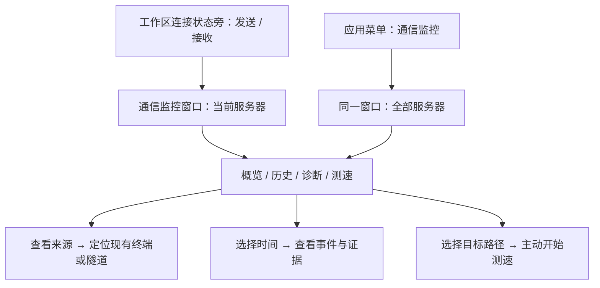

# 通信监控界面与交互方案

日期：2026-10-27 · 修订：r1 · 状态：功能界面可评审；文档示意，非已运行原型  
任务：[T-019](../tasks/T-019-connection-metrics.md) · 行为来源：[总方案](../core/connection-metrics.md)、[历史](../core/communication-history.md)、[诊断](../core/connection-quality.md)、[测速](../core/connection-speedtest.md)

## 1. 信息组织

采用“常驻摘要 + 一处完整监控窗口”。摘要方便工作中扫一眼；独立工具窗可和终端并看，不占用现有左右文件/隧道侧栏，也不增加服务器Tab中的按钮。它是核心App级管理窗口，每App单实例，标题始终为“通信监控 · 全部服务器/所选服务器”。

这是导航示意；不编写HTML/JS交互原型，数字示例不能描述为实测。

## 2. 工作区摘要

放在工作区底部已有连接状态区域，展示“↑ 24 KiB/s　↓ 1.2 MiB/s”（示例）。常规字体13px，等宽数字；容器按预留宽度更新，不每秒改变宽度。宽度不足时缩短单位/只显示图标+值，文字及完整口径可通过tooltip、焦点说明和可访问名称读取，不能用纯颜色代表方向。

该处默认是当前服务器本次所有连接的通道数据，不跟随单个终端Tab；tooltip说明范围、统计起点及累计。其旁保留现有连接状态/路径入口。未连接显示状态，部分覆盖有小型文字标记，不能以残留数字伪装正在通信。

点击或Enter/Space打开并定位监控窗，后台当前工作区切换不会自动改变已打开监控窗。再次点击别的工作区摘要属于显式切换。没有服务器时不显示虚构0速率；应用菜单仍可看历史。

## 3. 监控窗口布局

首次建议1000×720，允许缩小至720×520；200%文字缩放时可以纵向滚动，不硬压控件。主窗口继续遵循无独占标题栏要求，工具窗复用现有核心管理窗口的原生拖动、窗口控制和主题策略。此窗口“×”关闭监控，不执行主窗口收起托盘语义；主窗口“×”保持既有规则。

顶部：范围选择（全部服务器/搜索并选服务器）、实时/历史状态、必要时路径筛选；第二行四个分区“概览、历史、诊断、测速”，尾部“设置”。不增加省略号更多按钮，明确动作直接命名或进入相应详情。宽窗服务器选择可展示侧列，窄窗用相同选择控件，不改变范围语义。

概览顺序：

1. 双向当前速率与本次运行累计；连接状态/覆盖在同一摘要区，不把流量大小染成好坏状态。
2. 上下行时间曲线，默认5分钟，1/5/30/60分钟切换；鼠标悬停和键盘左右键可读时间/双向数值，提供表格切换。
3. 全局视角是服务器表；单服务器视角是来源表（终端/文件/网络隧道/核心），可展开到资源；默认发送+接收当前速率降序，手动切排序后保持选择。
4. 当前路径及连接列表，默认折叠，提示共享关系；多跳可换行/横向查看，长名字不使用省略号字符；详细地址在展开处可复制。

数值例子只用于排版：

| 来源 | 发送速率 | 接收速率 | 本次发送 / 接收 | 状态 |
| --- | --- | --- | --- | --- |
| 网络隧道 · 规则A | 20 KiB/s | 1.1 MiB/s | 6 MiB / 420 MiB | 运行中 |
| 终端 · 会话2 | 4 KiB/s | 100 KiB/s | 80 KiB / 12 MiB | 已连接 |
| 文件 | 0 B/s | 0 B/s | 12 KiB / 800 KiB | 空闲 |

表格不是三项总量完整示例，也不表示已实现文件传输。列表默认分页/窗口化，排序刷新不在用户正点击时挪动行；实际稳定选择和刷新节奏在代码稿固定。

## 4. 历史、诊断与测速

历史顶部是时间范围、口径和“对比”；下方总量/均值/峰值/覆盖、曲线、来源排名、事件。导出紧邻当前范围，开始前预览导出内容；清理放设置内，避免误把清理当刷新。选择缺口显示原因，选择事件切诊断并保留返回时间位置。

诊断顶部为实际连接与“检查响应”、持续探测开关；关闭时显示“未启用主动探测”，仍列被动事件。当前问题在前，后为时间线；每项可查看影响、知悉、前后5分钟和证据。提示只使用现有公共轻量反馈，不能抢终端焦点。连接慢阈值属于设置，常用查看不被配置表单包围。

测速无目标时先选服务器。开始页显示路径/方法、两档负载上限、方向和现有业务影响提示，主按钮“开始测速”；进行中主按钮变“取消测速”，阶段和累计字节持续可见。结果按发送/接收并列，完整性用文字标识；失败不能用成功色卡加一个小角标掩盖。测速中切分区保留顶部进行中提示；切服务器仍显示真实正在测速的目标，可定位回去。关闭窗口取消测速的行为在运行提示中明确，无第二层确认。

设置只包含速率单位、通信历史开关/空间/清理、选中服务器的主动探测与提醒阈值/应用内提醒开关。所有设置有恢复建议值，保存失败保留旧值并显示错误，不能界面假装已保存。

## 5. 状态与可访问性

| 情况 | 呈现与下一步 |
| --- | --- |
| 首次无连接/无记录 | 简洁空态，说明何时产生数据；不自动连接 |
| 采集中 | 显示状态与最近有效时间，不填0 |
| 已连接空闲 | 0速率，累计保留，空闲为正常状态 |
| 断线/重连 | 状态文字及事件标记；数字与数据时效分开 |
| 部分覆盖/历史缺口 | 明确提示与原因入口，图断线，不补造数值 |
| 查询/导出失败 | 保留范围和已有有效数据，错误旁给重试/取消；实时业务不阻塞 |
| 方法不支持/样本不足 | 解释具体能力或采样限制，仍可进入其他分区 |

按 `apple-design` 使用清晰层级、即时按下反馈、稳定空间与焦点返回、系统字体/文字缩放、可中断交互；无需新增弹簧库或玻璃装饰。沿用当前三主题与多巴胺无投影要求，图表方向/缺口/事件用公共语义令牌和实线/虚线/文字，不在插件内定义色值，不借用容量80%/90%等级。

公共组件承接指标摘要、分段导航、趋势/表格、图例和问题状态，输入均为显示数据与回调，不含SDK。颜色令牌和最终图表几何需在代码稿及主题来源细化，再经相应验证；本稿不新增未经批准的样式代码。

键盘：Tab访问范围/分区/按钮，方向键操作标准分区与图表焦点；Esc先关当前浮层，窗口关闭走明确关闭入口，不能误终止所有连接。返回业务入口时聚焦原资源；原窗口已关闭则安全定位现存所属窗口或提示资源已结束。每秒数值不使用持续aria-live播报，加载/失败/任务阶段变化适度播报；图表有文字摘要与表格等价。

## 6. 验证映射

公共入口/布局/多窗口：CM-06/07/12；历史范围/比较/导出：CH-09及CH-05/06；提示/焦点/阈值：CQ-08/09；测速操作/取消/方法状态：CSPEED-01/05/10。每项均覆盖三主题、原生窗口/焦点、缩放和键盘，模拟截图与真实SSH数据截图分开。

- r1，2026-10-27：T-019完整功能界面方案，使用apple-design，尚未创建交互原型或实际窗口。
