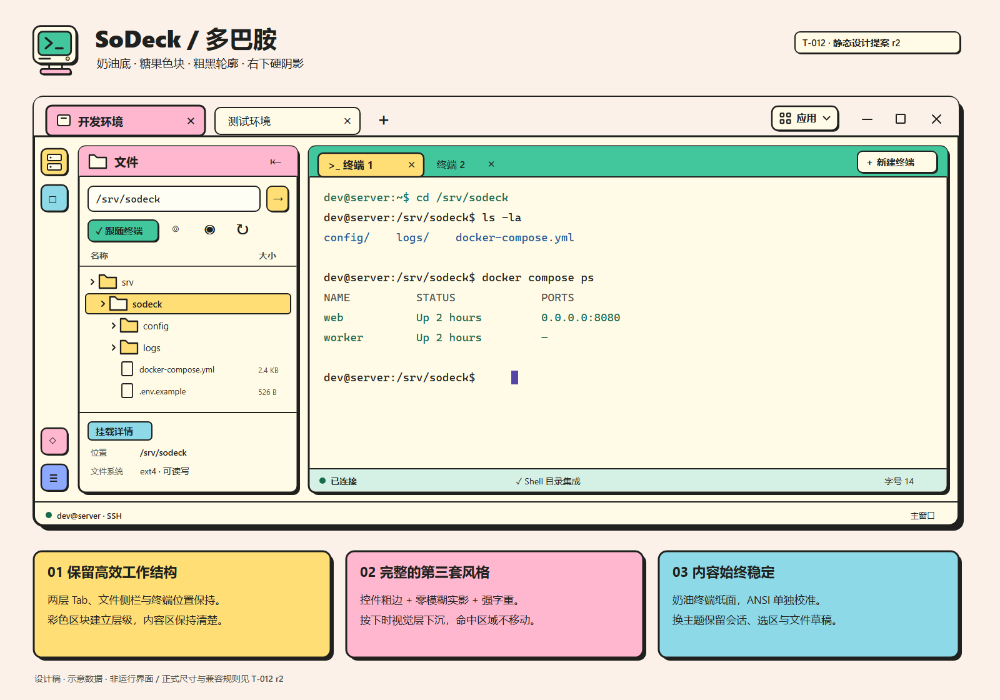
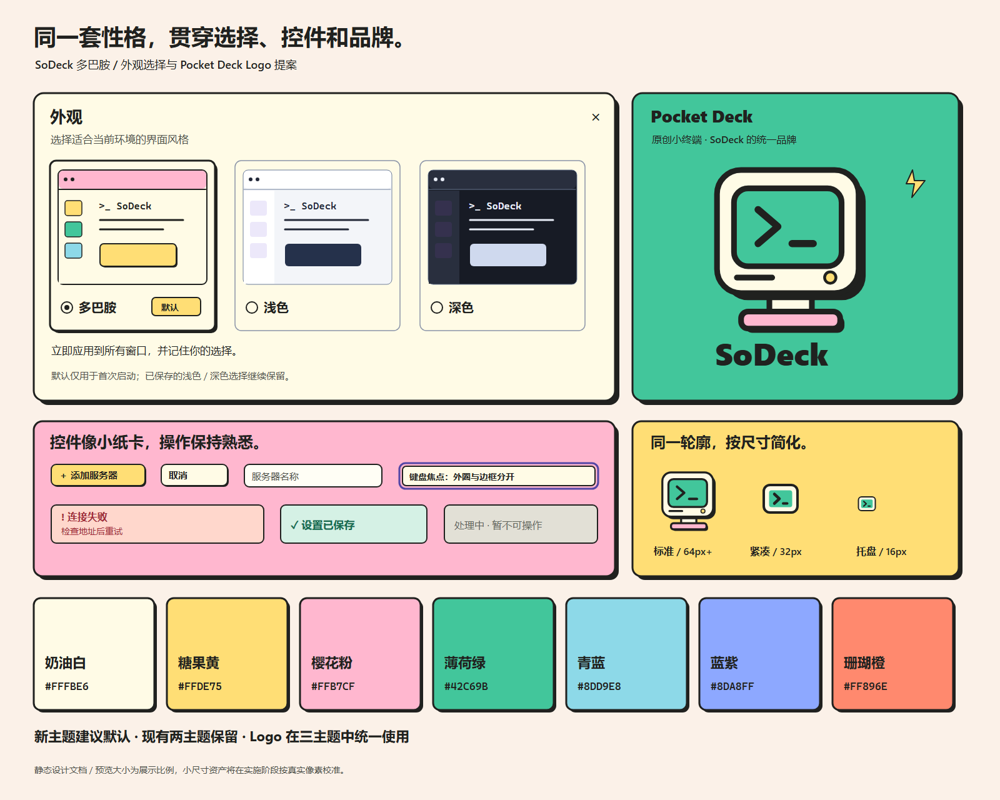
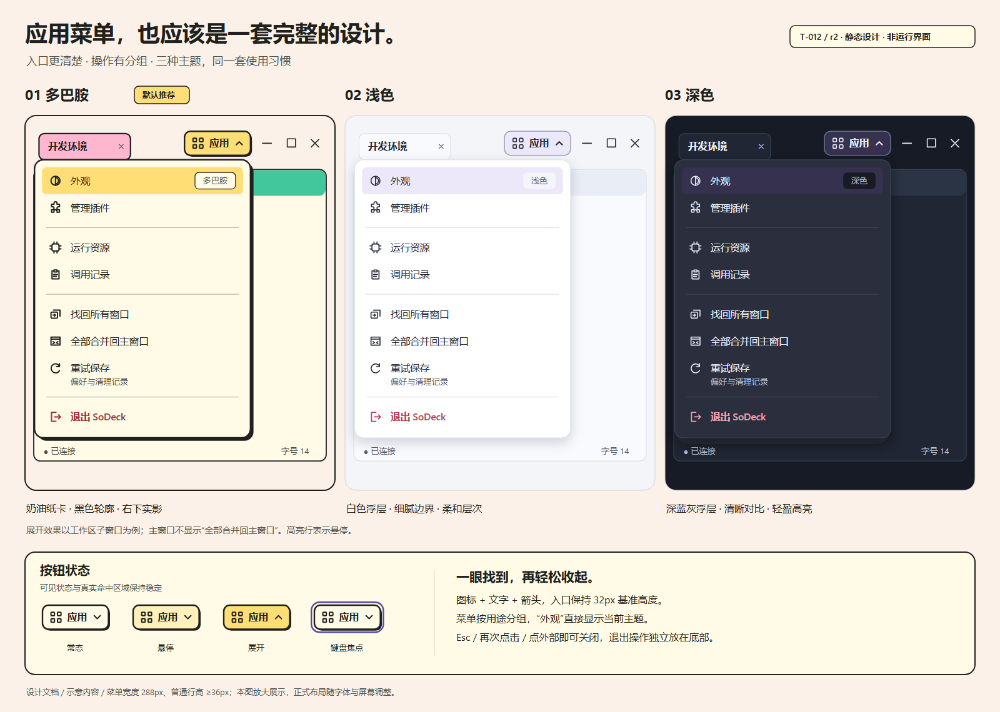

# SoDeck · 多巴胺主题设计

设计修订：r3 · 日期：2026-10-26 · 状态：用户明确要求的实施中调整
任务：[T-012 r3](../tasks/T-012-dopamine.md) · 行为：[外观规格 r4 §7](../core/appearance.md#7-t-012-第三主题增量方案) · 品牌：[F-CORE-013](../core/brand.md)

2026-10-26 用户要求多巴胺去掉阴影并修正头部留白、黑线错位；r3直接采用该要求，无需再次确认。下方旧静态SVG/PNG保留r2历史图稿，最终视觉以本修订和实际截图为准。

新增的样式前置、公共组件及插件职责由[代码设计方案 r1](../technical/design-system-implementation.md)承接；当前整体确认入口为T-012 r3。

## 1. 设计目标

新增独立的「多巴胺」主题，保留现有「浅色」「深色」。以用户提供的卡通拼贴参考图为视觉依据，形成奶油底、糖果色块、粗黑描边、无投影的平面色块和圆润插画的完整语言。参考图中的品牌、广告文案和产品功能不迁入 SoDeck。

参考：用户附件 `codex-clipboard-6ef5523e-471a-4b90-a4a6-a6989bb94e57.png`。色板为目视还原后的设计值，并非声称逐像素采样。对应关系：奶油背景→工作画布；粉色卡片→导航标题；黄色卡片→主要行动/选中；绿色卡片→终端工具区/连接反馈；深色轮廓→连续清晰的边界，最新决定取消右下投影。

用户已明确第三主题、默认优先、贴近截图及重设计 Logo；本稿中的具体尺寸、色值、Logo造型、升级保留偏好规则属于此次提交的建议，尚未被用户确认。

## 2. 静态设计稿

以下是用于审阅的原创静态视觉文档，内容为示意数据，不是运行界面、可交互原型或已完成的应用资源。应用编码及交互原型仍需 T-012 r3 的实施确认。

可编辑图稿：[工作台 SVG](assets/dopamine-workbench.svg)、[外观与品牌 SVG](assets/dopamine-components.svg)。图稿文字为评审可读性放大；正式实现的逻辑像素、布局伸缩和控件尺寸以下文及 UI 规范为准，不按图片像素直接套用。

## 3. 视觉语言

右上角应用入口和菜单已按最新反馈单独重设计，以下§4.7为最新规范：

[应用菜单SVG](assets/application-menu.svg)。工作台总图中的按钮同步更新；菜单图展示三套主题的展开效果，仍是静态设计文档。

| 维度 | 本方案 |
| --- | --- |
| 基础观感 | 温暖、清楚、平面，像带黑边的彩色纸卡；约65%中性色工作区、25%成块彩色区域、10%文字/轮廓，作为视觉重心指导，不是固定面积算法 |
| 配色 | 颜色唯一来源为[主题规范 §6](../standards/theme.md#6-t-012-多巴胺主题色板提案)。工作底奶油黄，外围浅桃白；黄色承担主要行动与选中，粉色用于服务器/文件标题，薄荷绿用于终端工具区，青色与蓝紫用于辅助标识和品牌图形 |
| 描边 | 普通控件2px；主要内容卡/对话框2px；品牌插画3px以上按画面比例调整。近黑色清楚连续；相邻面板避免双线叠成4px |
| 阴影 | 多巴胺按钮、卡片、菜单、弹窗、拖动反馈和Logo全部无投影；保留2px单描边，不使用偏移阴影或内阴影模拟重复轮廓 |
| 圆角 | 控件8px、Tab8px、内容卡12px、对话框16px；与厚轮廓共同形成卡通感，避免全部变成胶囊 |
| 排版 | 保留系统中英文字体；正文13px/400、辅助12px、Tab及工具标签600、对话框标题18px/700、欢迎标题28px/700。仅品牌字标采用800；终端14px等宽及现有字号功能保持 |
| 图标 | 延续相同动作图形，采用圆头圆角、约2.25px描边；常规16px，工具轨20px。导航容器可填彩色，文件/操作图标不使用随机彩虹色 |
| 装饰 | 欢迎页与品牌大图可出现轻微倾斜的贴纸、对话泡泡、星芒；实际控件和内容容器端正排列。渐变、玻璃模糊与柔光不作为第三主题的主要材料 |

多巴胺必须同时改变色彩、边线、字重及图标笔画。若最终只有原浅色界面换成黄色，则不满足本方案。

## 4. 各界面的具体效果

### 4.1 工作台与窗口

保留「服务器 Tab → 终端 Tab」两层导航、文件侧栏、工具轨和单中央内容区域。仍使用 Windows 的最小化、最大化、关闭按钮与原生拖动/贴靠；不添加假装可操作的三色圆点，不增加独立装饰标题栏。

服务器栏以浅桃白为底，当前服务器 Tab 为粉色黑边卡签，未选中项奶油底。终端栏为薄荷绿，当前终端 Tab 为黄色黑边卡签；用字重和轮廓共同指示当前项。关闭按钮始终可辨，悬停不改变 Tab 宽度。活动轨按钮使用独立彩色方块，但同一功能跨窗口保持相同色义。

主要内容卡有2px单轮廓，无外缘投影，保留原面板边界和命中区域。顶部44px、终端Tab36px、工具轨44px、底栏24px维持基准。外壳边框占用固定盒尺寸：浅/深主题对应位置保留等量透明边框预算，切换不改变插件可用矩形或PTY行列数。

主窗、工作区窗和单终端窗都使用同一外壳风格。整个工作区不得随 hover/按下发生位移或缩放，避免原生 WebView 与 DOM 错位。

### 4.2 文件区

顶部粉色标题区，奶油色路径输入，黑边图标按钮；「跟随终端」开启使用薄荷绿底＋原图标/可访问状态。目录正文奶油底，行保持连续；选中项黄色浅底＋近黑轮廓/字重，hover用淡黄色。路径长文本保留横向查看/编辑能力。

目录行仍以28px为基准，大小列对齐、数值等宽；主题不改变行高。挂载详情是底部奶油信息区，标题可用青色小标签，详细字段保持普通排版，不将每项字段做一张彩卡。切换保留路径草稿、选中、展开、滚动和跟随状态；不新增文件读取。

### 4.3 终端区

采用参考图上方命令窗口的奶油色纸面，深色等宽文字；不采用扫描线、曲面、CRT噪点或打字动效。绿色/红色等ANSI前景另取足够深的语义色，不能直接用糖果底色画小字；标准256色与远端真彩色不重写。

上方保留彩色Tab条，下方状态条可用浅青底，连接/错误仍同时有文字。终端内容、光标和选区无阴影、纹理或贴纸；字体与行高保持。通过现有xterm实例改主题，保持PTY、输出、选区、滚动位置和IME会话。

### 4.4 表单、管理页与错误

服务器选择器、编辑、认证、指纹、插件、资源、记录、已打开页面列表全部使用奶油弹窗、近黑2px单边，无投影。标题为粗体，少量粉色标题标签；输入36px高、2px黑边，主按钮黄色，次按钮奶油色。危险动作明确使用珊瑚底＋深色危险文字/图标，不能把所有珊瑚装饰都当成错误。

错误为淡珊瑚底＋深红文字＋错误图标；成功为淡绿底＋深绿文字＋勾；加载为文字状态和轻量指示，不做循环弹跳。禁用控件灰奶油底，保留标签而不只降低整体透明度。管理表格使用连续行、稳定列宽；高密度内容不强行套宣传海报的大卡片布局。

### 4.5 外观选择

顺序为「多巴胺」「浅色」「深色」，多巴胺卡片带「默认」标签；标签表达新安装默认，不代表当前已选中。当前项另有单选圆点、勾选与轮廓。

预览必须表现每种主题的轮廓与材质差异：多巴胺显示彩色标题、黑边且无投影；现有两套显示细边与柔和表面。预览完全局部作用，选项卡使用所在当前主题绘制外框。

对话框建议宽640px、三个等宽卡片；可用内容宽不足540px时改为一列紧凑预览卡，仍显示全部名称并可滚动。即选即保存，Esc/外部点击关闭；无需额外确认按钮。默认/迁移、冲突和失败语义见 F-CORE-012 §7。

### 4.6 欢迎页

以原创小终端Logo为中心，配一句「把服务器工作，放上你的桌面。」及现有添加服务器动作。可配两个不超过24px的静态星芒/气泡点缀，全部aria-hidden。空态主按钮黄色，辅文深灰；不增加远端功能承诺或营销仪表盘。

### 4.7 右上角“应用”按钮与下拉菜单

根据[产品§3应用菜单补充意图](../product.md#3-对意图的推断)，将应用入口和菜单作为完整组件重设计，覆盖多巴胺、浅色和深色。r1将所有菜单外轮廓交给Windows的建议在此收窄：**应用菜单采用可完整控制样式的专用浮层**；终端/Tab右键菜单、Windows系统菜单继续沿用既有机制。

| 部分 | 新设计 |
| --- | --- |
| 入口 | 16px四格图标＋“应用”＋向下箭头；基准32px高、约88px宽，8px圆角，字体13px/600。与右侧系统按钮间留8px，保留48px拖窗空白；文字放大时自适应，不挤掉系统按钮 |
| 多巴胺按钮 | 奶油底、2px近黑边、2px右下实影；hover淡黄，展开时黄色并保持按下感，箭头向上；视觉层反馈不移动命中盒 |
| 浅/深按钮 | 当前主题surface底、细边，hover/展开使用对应hover/selected色；与系统窗口按钮区分但不过度突出；展开状态和箭头规则一致 |
| 弹出位置 | 按钮下方6px，菜单右边与按钮右边对齐；按当前显示器可用区翻转/夹紧，距边至少8px |
| 菜单布局 | 建议288px宽、10px内边距、12px圆角、普通项36px最小高度；左16px线性图标，文字列统一对齐；组间8px留白和细分隔，不为每行加卡片描边 |
| 材质 | 多巴胺奶油底＋2px近黑单边，无投影；浅色白底细边与柔和阴影；深色抬升蓝灰底、清楚边界和柔和阴影；不以透明模糊为可读性前提 |
| 状态 | 外观行右侧小标签显示当前主题名；高对比时显示“高对比”，测试覆盖时显示“测试主题”。这是状态，不做假子菜单箭头；点击打开现有外观对话框 |
| 退出 | 独立末组，使用退出图标及主题error文字色，hover才加危险底；语义仍为“退出SoDeck并结束全部会话”，不混同窗口×收起到托盘 |

菜单分组：第一组「外观」「管理插件」；第二组「运行资源」「调用记录」；第三组「找回所有窗口」「全部合并回主窗口」（仅工作区子窗口）「重试保存」；最后「退出 SoDeck」。重试项保留原操作，附小字“偏好与清理记录”明确范围。其余项目单行，不增加不存在的快捷键或设置功能。

只点击/Enter/Space/向下键打开，hover不自动打开。再次点击同按钮、Esc、外部点击、失去所属App焦点、最小化/拖窗/换屏或主题切换均关闭。菜单内方向键、Home/End导航，Enter/Space执行，Tab关闭并按顶栏顺序继续；选中后先关闭，再打开对应弹窗。无操作关闭时回到触发入口，打开弹窗时焦点进入该弹窗。

需真实覆盖原生终端：不能仅提高网页z-index，也不能为显示菜单让终端消失。建议沿用核心菜单会话/关闭结果管理，在所属窗口上方提供宿主拥有的独立浮层，下面的PTY输出继续。浮层不进入任务栏/Alt+Tab，不成为工作区窗口，不抢其他App的最前层；失效来源或关闭后的迟到选择无效。实施与测试见[F-CORE-008 §10](../core/workbench-interaction.md#10-t-012-应用入口与菜单重设计)。

## 5. 交互与 apple-design

| 原则 | 对应设计 |
| --- | --- |
| 即时反馈 | Web按钮pointer-down即呈现按下状态：以底色变化反馈，不偏移视觉层。事件命中盒与布局不移动；菜单/拖动承载容器不使用此位移 |
| 可中断 | 松开或移出立即恢复；hover/按下不等待动画才能再次操作；装饰反馈约80–120ms，减少动态时仅切换底色 |
| 空间一致 | 菜单贴近触发点；弹窗进入/退出均仅短淡化，保留原焦点返回；不新增跨窗口飞行动画 |
| 清晰层次 | 固定色义、正文系统字体、标题粗体，重要色块建立区域归属；不用颜色代替文字/图标语义 |
| 可访问性 | 正文4.5:1、控件/焦点3:1；键盘使用2px蓝紫外圈＋奶油隔离线，不与黑边合并；高对比使用系统色，禁用装饰和阴影；无透明依赖 |

参考图决定外观，apple-design用于反馈、连贯性、可读性和操作控制。没有新增惯性手势，暂不引入弹簧动画依赖。

## 6. Logo 提案：Pocket Deck

建议采用「随身小终端」：一个正面小显示器，奶油圆角机身、近黑粗边，无偏移阴影；薄荷绿屏幕承载粗线 `>_`，底部粉色小底座和黄色状态灯。轮廓稳定端正，避免多层小插画在小尺寸丢失。名称保留 SoDeck，字标不另增产品名。

这是一个统一品牌标识：切换浅/深主题时保留同一个彩色Logo；深背景用自身奶油轮廓隔离。大欢迎插画可以让外部贴纸倾斜，应用图标本体不倾斜。

| 版本 | 用途与差异 |
| --- | --- |
| 标准彩色 | 64px及以上、欢迎与品牌页；机身、屏幕、底座、状态灯全部保留 |
| 紧凑彩色 | 24/32/48px；去状态灯，简化底座，保证 `>_` 间隙与轮廓 |
| 微型/托盘 | 16/20px；奶油/深色两到三色，去偏移阴影和底座，仅留屏幕轮廓与 `>` 识别；按真实像素网格重画，不直接缩小大图 |
| 单色/高对比 | 相同外轮廓和命令符；随系统前景适配，不额外依赖背景透明度 |

正式交付拟含可编辑SVG母版、透明PNG（16/20/24/32/48/64/128/256/512）和多尺寸ICO；覆盖EXE、Windows任务栏/Alt+Tab、所有应用窗口、托盘及欢迎页。原生标题空间不另塞一排品牌元素。详细功能、资产来源与测试见 F-CORE-013。

## 7. 设计验收口径

1. 同尺寸对比现有浅色：第三主题在粗边、实影、彩色标题、按钮与标题字重上明显不同；不是只靠Logo识别。
2. 与参考图并排审阅：奶油底、糖果色块、圆角黑边、右下实影四项必须同时成立；正文和操作区域端正、可读。
3. 首屏、工作台、外观、服务器编辑、认证、错误和两插件都有一致风格，无旧蓝紫软阴影残留。
4. Logo大图有性格、16px能辨认；窗口、托盘及EXE用同一品牌，不能遗留当前纯色方块托盘。
5. 应用按钮和菜单在三主题中整体重设计，展开状态清楚、分组易扫读，原生终端下方不空白。
6. 三主题切换不丢会话和编辑状态；高对比、缩放和键盘可用，具体用例见任务链接。

本稿只验证方案可读性与静态设计一致性。实际应用对比度、原生布局、性能和资产集成必须实施后实测；设计图不作为这些检查的通过证据。

### r3 头部与无阴影回归

外框占位统一：顶栏底部仅一条2px预算分界；服务器Tab和终端Tab边线用独立内部描边层，底部与条带基线贴齐，不叠加边框与inset阴影。面板标题/Tab工具条等高，共用底部基线。菜单、输入、弹窗轮廓位于外沿，不出现透明边预算加inset造成的奶油色缝。DS-02/05、AM-01/03增加三主题同尺寸前后比较、100/150/200%DPI顶部连接处与控件投影检查；多巴胺所有主题装饰shadow为零，浅/深原材质保留。
