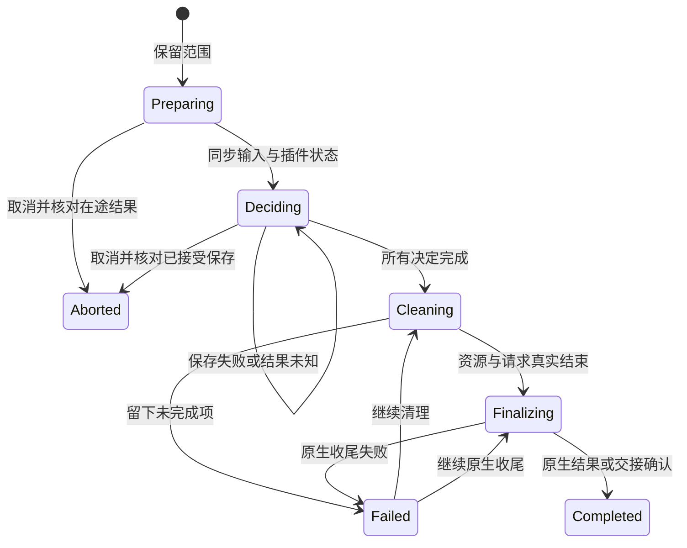

# 关闭生命周期整改实施与验收

日期：2026-11-08。基线提交：`752410e`；以下本机验收使用配置版本 0.11.0 的隔离构建，真实安装与用户服务器资料未替换。代码与 Windows x86_64 本机验收已完成，正式核心 0.12.0 的包来源、五平台结果与发布边界统一记录在 [版本说明](releases/v0.12.0.md)。

功能目标见 [生命周期设计](plan-close-lifecycle.md)，具体迁移见 [代码整改方案](plan-close-lifecycle-coding.md)。本次处理统一的输入、决定、取消、资源结束和原生收尾，不重写终端、文件、网络和状态采集的业务算法。

## 根因与修复成立条件

基线可确定性复现：旧 `ui_close_finish` 删除关闭计划后，前端刷新调用带副作用的 `ui_snapshot`，后台工作区逻辑 view 被重新创建；随后应用 `require_closed` 发现 view，拒绝退出。修复须同时保证快照只读、关闭保留覆盖到父级移除，以及原生资源实际结束。

回归 `closing_background_workspace_cannot_recreate_views_before_parent_removal` 检查连续 20 次快照身份不变，取消保留原后台 view，关闭完成后父工作区及 view 消失；测试与正常组件回归一起通过。

## 代码结构与实际调整

| 职责 | 实现与约束 |
| --- | --- |
| 唯一操作状态 | `lifecycle.rs` 管理目标、输入轮次、决定修订、范围保留、接管与重试。`Operation` 位于 `component_ui::Runtime.lifecycle`，与 view/resource admission 同锁 |
| 关闭执行 | `lifecycle/close.rs` 汇总插件状态、处理保存、取消、资源清理和 finalizer。成功步骤保留，清理开始后失败不恢复运行状态 |
| 宿主丢失 | `lifecycle/host.rs` 按实际归属收尾，移除失效 surface，停止缺失窗口资源；主窗口丢失转为应用中断并扩展全部窗口范围 |
| 真实任务结束 | `resource_tasks.rs` 以 RAII 登记 worker；取消封住新任务，active 清零才完成。SFTP 的库内 transport、网络 splice、本地文件选择也保留真实结束事实 |
| RPC 真实结果 | `plugins/mod.rs` 与 `process.rs` 把在途 guard 交给监督器；超时仅返回等待错误，原请求保留到回复或实际进程结束。dispose receipt 区分未知、成功与明确失败 |
| 工作区与连接接入 | `workspaces.rs` 的 prepare/commit 核对关闭范围；连接认证、已连接会话接纳及资源登记再次核对归属和 Context，拒绝迟到提交 |
| 后台初始化 | `component_ui/layout.rs` 在工作区/插件变化时 reconcile，快照纯读取；关闭暂停新 view，取消恢复原对象。插件后加载不抢已有工作区焦点 |
| 跨窗口页面身份 | surface 只属于实际 owner 或有效移动目标；提交/取消后旧窗口身份失效，迟到 mount 再核对 Context、实例、冻结及窗口归属 |
| 前端 | `close.ts` 收集输入并展示决定/进度，以事件与状态查询恢复；`components.ts` 单次 flush 使用总截止时间并等待真实 RPC 链；关闭完成后同步工作台 |
| 宿主草稿 | 服务器表单与全部设置页参加应用/窗口决定；设置关闭保存核对操作与窗口来源；已完成的相同设置请求直接返回原 receipt，不重写磁盘 |
| 原生收尾 | `main.rs` 通过有界内部通道执行窗口销毁、官方 updater 安装、退出/重启交接；安装尝试在途互斥，安装失败保留停止事实 |

方案中的独立生命周期 Mutex 改为与组件登记同锁，这是为了让保留范围与登记提交成为同一临界区。工作区归属与移动使用 `workspaces → component_ui`；更新准备在前，RPC 等待、资源排空及原生动作都在释放登记锁后执行。closing 原子值是应用级快速接入缓存，不能作为完整阶段事实。

旧生产 `prepareClose/pollClose/finishClose/allWorkspaces` 桌面 RPC 已移出普通构建。阻塞适配器只用于测试与包烟测，执行同一 `Lifecycle`，不再维护另一份关闭计划。旧 `prepare_restart` 与安装失败清 closing 的恢复入口已移除；低层 `shutdown` 用于已无 view 的非交互测试收尾。

## 生命周期与失败语义

Preparing/Deciding 可以取消，但已接受的 RPC、宿主保存或文件工作仍须先核对，不能收到 cancel ACK 就解冻。没有确认的写入不自动重发。已接受插件保存再决定时只查询 `beforeClose`，明确错误需在原页面处理或选择放弃。

Cleaning/Finalizing 失败保留范围、已停止资源及已成功步骤。明确失败的 dispose 在下一次用户重试发送一次；未知 dispose 继续等原请求，迟到成功直接完成，不能重复释放。局部失败可被全局操作接管；取消全局决定会恢复原局部失败状态。

surface 同步共用 45 秒截止时间。组件状态检查与保存分别使用操作级 125 秒机器预算，单次控制 RPC 最多 5 秒；用户阅读决定没有自动同意期限。插件进程与原生资源清理共用 6 秒阶段预算，连接另用 3 秒；超时保留 pending，用户继续原步骤。主窗口异常中断遇到已接受更新时等待其真实结束，不能在落盘任务仍执行时交接退出。

截止时间由已有后台监视循环统一检查，不为每轮关闭创建等待线程。终态记录由同一循环按 60 秒回收，失联窗口记录只保留到相关活动操作结束；前端仅保留当前输入轮次的回报。取消时在同一个登记临界区恢复应用接入并公布 `Aborted`，避免界面收到完成状态后仍被旧 closing 缓存拒绝。

宿主在决定期间挂起新的 iframe 请求，每个 surface 最多保留 64 项；同步输入时把此前等待请求并入原有串行链，取消后重新验证 surface/Context 再继续，卸载时回收队列。正常关闭不再被页面轮询显示成错误，也不会让待发请求跨过本轮输入同步。此行为复用现有 bridge，不要求业务插件增加关闭特例或修改协议。

系统状态等后台 view 不按插件 ID 设置豁免。关闭单页不等待共享 SSH 会话结束；关闭工作区、窗口或应用才释放其连接。窗口意外消失不保证恢复未持久化输入，核心明确记录风险并按归属中断。

## 本轮已完成验证

| 验证 | 本轮结果 |
| --- | --- |
| `npm run check` | 通过：TypeScript 与 Rust 格式 |
| `npm run web:build` | 通过：正式前端构建 |
| `npm run scripts:test` | 77 项通过；生命周期与任务追踪路径纳入检查选择 |
| `npm run test` | 最新 131 项非 ignored 测试通过；9 项远端专项、1 项 live GitHub 用例按原规则 ignored |
| 工作区 UI 单独回归 | 18 项流程通过，无页面脚本错误 |
| `npm run ui:test` | 最终前端全部通过：服务器、工作区、连接、交互、正式前端、桌面及设置；无页面脚本错误 |
| SSH / 四插件普通业务 | `ssh:test`、`terminal:test`、`files:test`、`network:test`、`system-status:test` 全部通过，使用隔离 localhost OpenSSH 与独立插件包；含真实 UI、SOCKS 协议与资源压力 |
| Windows x86_64 实际核心包 | 正式 NSIS 构建通过；解包程序的启动/资料重开、原生工作区/子窗口、真实 SSH、四插件组合关闭全部通过 |
| 其他四个原生平台包 | 本轮尚无结果 |

新增重点回归包括：跨窗口输入乱序不受进度 revision 影响、原生窗口失联不永久等待、主窗口失联扩展全局范围、全局接管取消恢复局部失败、无宿主启动中退出、收尾重试不重复清理、保存失败保留、设置重复请求在关闭期间确认、dispose 明确失败下一次重试成功，以及超时 dispose 不重发且迟到成功可完成。输入截止用例同时核对未知输入保留、取消完成即恢复接入，以及无需下一次关闭就能回收终态和失联窗口记录。

原生关闭/重启/工作区入口使用 `close_native_prepare` 为每次用户事件生成新请求；同一个活动目标仍合并。取消后再次点击不能复用上一次终态，相同外部请求编号改变目标则拒绝。关闭子窗口最后一个工作区时，在准备阶段即规范化为 `Window` 目标，一并保留窗口草稿、连接尝试和原生销毁范围；有待提交的入窗移动时按实际归属保留窗口。

工作区测试夹具现在声明真实 flush 并等待插件输入确认，取消后检查对话框消失和输入解冻；移窗等待实际归属提交。旧子窗口 surface 的退休和关闭成功后的工作台同步已通过该回归，不放宽草稿内容或生命周期断言。

终端、文件和网络 UI 夹具补齐 Tauri 事件监听注册/注销适配，关闭阶段仍查询真实核心；夹具未伪造保存或资源结束结果。Vite 的根目录限定在 `src`，共享事件脚本由各夹具显式提供路由。

包内 SSH 烟测已迁移到统一父级关闭，不再在 `ui_close_finish` 成功后重复删除工作区；包内模拟工作区的显式收尾也使用同一协调器。此差异由实际 NSIS 解包烟测发现并验证，未放宽“工作区消失”或退出码断言。

## Windows 实际包与组合证据

使用 `npm run build -- --bundles nsis -- --locked` 构建，7-Zip 解包到独立的 `artifacts/close-lifecycle/core-package/`，未执行安装器覆盖 `C:\Program Files\SoDeck`。包内程序经过两次常规烟测启动与持久资料重开、隔离 localhost OpenSSH 烟测，以及 `--close-native` 的真实 WebView2 交互。两种入口均先取消再再次关闭；取消保留同一组 viewId、文件正文和真实转发，重新编辑可用且无残留生命周期错误；放弃不写远端文件，实际进程退出码为 0，四个插件 PID 结束，转发连接断开且原端口可重绑。

组合使用独立包：终端 0.2.2、文件 0.4.2、网络隧道 0.2.2、系统状态 0.1.0。终端执行真实 PTY 命令，网络持有实际 SSH 转发连接，文件保持未保存草稿，系统状态有后台逻辑 view；不是只登记四个未使用的插件。资源专项另覆盖 SOCKS5 与 SFTP 保存/冲突/导出，实际关闭组合主要覆盖 TCP 转发。

本轮 NSIS SHA-256：`04f8d404ab07db5cec025ab08633b52adc93d5ffe126010560b9aaf392ab86ad`。解包 `sodeck.exe` SHA-256：`609ac2a4e042337f32f88f43715ff8ccebfeb395d30cfa2a43e367b698ba17f7`。构建为本机验收包，未提供正式更新签名，不作为新版本 Release。

本机证据保存在 `artifacts/close-lifecycle/verification.json`、`native-close.json`、`titlebar-cancel.png`、`native-cancel.png`，并保留同一安装包及隔离 smoke 报告。`verification.json` 记录基线完整提交、分支、未提交状态、58 个变更源文件摘要与包摘要；本轮没有可引用的 Actions run 或 Release。已查看截图，取消后的文件和网络页面未残留关闭错误。

## 未完成与交付限制

本轮完成验收前不发布中间核心版本。当前业务插件源码和版本均未改变；实际插件包契约与远程资源组合仍按本轮命令验证。既有发行结果不能替代本次源码验收。

五目标的实际原生包启动与退出仍是发行门槛。本机 Windows x86_64 结果不能替代 Windows ARM64、Linux x86_64/ARM64 或 macOS ARM64。本轮未进行真实核心在线安装升级；官方安装器失败/在途互斥的核心边界与实际包升级验收需分别报告。

可信插件自行脱离受管进程组的程序，以及已执行远端命令的不可撤销副作用，不承诺强制回滚。生命周期保证核心可观察的调用、资源与受管进程；不能把连接关闭当作所有远端子进程已结束。

返回 [整改方案](plan-close-lifecycle-coding.md) · [文档索引](README.md)
