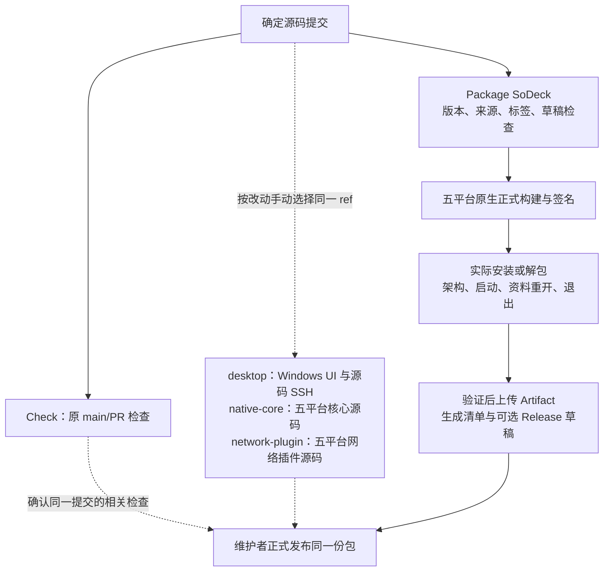

# 打包提速实施记录

2026-11-08。对应[分步方案](plan-release-performance.md)。第一、二步已完成相关验收；产品代码、版本及独立发布方式不变，第三、四步尚未开始。

## 第一步：源码测试移出打包

核心 preflight 只保留 checkout、Node 和原发行输入检查，不再安装 npm 依赖/Rust 或运行源码检查。五平台 package 移出核心 Rust 测试；Windows x86_64 另移出源码 SSH、完整 UI 和 Chromium 安装；三系统宿主脚本回归移到 Check。核心 npm 缓存统一使用根锁文件。网络插件 package 移出 `cargo test`，正式编译与归档继续由原脚本完成。

实际包的安装/解包、架构、签名、启动、资料重开、退出、Windows x86_64 包内 SSH、收集上传和草稿恢复流程保留。打包不依赖 Check，也不依赖业务插件构建。

Check 新增 `suite` 手动选择，不让每次 main/PR 自动跑五平台全量测试。`standard` 保持原检查范围，`desktop` 执行 Windows 完整 UI/SSH，`native-core` 执行五平台核心及原宿主脚本回归，`network-plugin` 只执行五平台网络插件测试，`all` 执行全部 job。原生任务先核对 Rust 宿主架构；Windows 同一 job 内顺序执行，避免 target 文件锁冲突。具体命令与补测原则仅维护在[开发指南](development.md)。

## 验证与证据

| 验证 | 结果 |
| --- | --- |
| 工作流语法 | 经官方 SHA-256 校验的 actionlint 1.7.12 检查五个工作流通过；三段 PowerShell 安装/环境步骤语法解析通过 |
| 职责与触发范围 | 静态核对 7 组自动/手动入口、5 个原生目标及各套件步骤选择；原 `format`/`network` 步骤、五平台正式构建及其后全部包验收/汇总步骤与修改前一致 |
| 类型、格式与脚本 | `npm ci`、`npm run check`、`npm run plugin:check` 通过；`npm run scripts:test` 65 项通过 |
| Windows 核心源码 | `npm run test` 107 项通过，8 项真实远端专项按原标记 ignored；另显式执行 `npm run ssh:test`，OpenSSH 互操作通过 |
| Windows 完整 UI | `npm run ui:test` 通过，包含正式前端构建、实际目录核心、交互、桌面策略、终端输入和设置回归 |
| Windows 实际核心包 | `npm run build -- --bundles nsis -- --locked` 通过，生成 0.9.4 x86_64 NSIS；解包后的实际程序通过架构、版本、原生移窗、保存、重开、退出及 `--packaged` SSH 烟测 |
| Windows 网络插件 | `cargo test --manifest-path plugins/network-proxy/Cargo.toml --locked` 13 项通过；独立打包 0.2.2 原生归档并验证架构，构建不运行测试 |
| 文档 | 102 个本地链接检查通过，新增流程图由 Mermaid 解析、渲染并目视检查；`git diff --check` 通过 |

本地日志、安装包、包内报告和结构核对保存在已忽略的 `artifacts/release-performance-step1/`。本机核心构建使用已存在的 release 依赖，耗时约 39 秒；它不是 GitHub runner、冷缓存或工作流对照结果。构建日志未包含 `test-fixtures` 编译。包烟测有 WebView2 窗口类注销错误 1412 输出，验收完成且进程均以 0 退出。

历史 Windows x86_64 package 样本中，Rust 测试/编译 328 秒、完整 UI 217 秒，合计约 9 分钟已移出串行定义；本轮 GitHub 候选实测见下一节。

## 提交与 GitHub 验收

实施提交 [`1febe73`](https://github.com/BgaSol/soDeck/commit/1febe734f678ae9ba2755353cb6adb2eff97f381) 已推送 main。以下运行均验证该提交；测试沿用核心 0.9.4 与网络插件 0.2.2，`publish=false`，只保留 Artifact，没有创建或覆盖 Release。

| 运行 | 结果 |
| --- | --- |
| [核心候选打包 42401346197](https://github.com/BgaSol/soDeck/actions/runs/42401346197) | 五目标正式构建、updater 签名、实际包安装/解包、架构、启动、重开、退出和汇总全部通过；Windows x86_64 包内 SSH 通过；五平台 Artifact 与更新清单齐全 |
| [网络插件打包 42401354278](https://github.com/BgaSol/soDeck/actions/runs/42401354278) | 五目标独立打包与架构检查全部通过，最长平台任务 107 秒；日志没有 `cargo test` 或测试夹具编译 |
| [Check all 42401358838](https://github.com/BgaSol/soDeck/actions/runs/42401358838) | 最终九个 job 全部通过：常规检查、五目标核心和网络插件源码、三系统宿主脚本、Windows 源码 SSH/完整 UI、两个 Linux 普通网络及 netem。netem 在第二步开始时结束，不计入核心出包时间 |

同一提交自动触发的 Check `42401292788` 已取消，避免与手动 `all` 重复执行。核心候选从触发（北京时间 02:27:01）到更新清单完成（02:35:58）共 **537 秒，即 8 分 57 秒**；前置任务 10 秒，汇总 13 秒，最慢平台为 Windows ARM64。

| 核心平台 job | 优化前历史样本 | 本轮 | 本轮正式构建步骤 |
| --- | --- | --- | --- |
| Windows x86_64 | 18 分 33 秒 | 6 分 17 秒 | 304 秒 |
| Windows ARM64 | 11 分 03 秒 | 8 分 24 秒 | 375 秒 |
| Linux x86_64 | 5 分 49 秒 | 4 分 17 秒 | 155 秒 |
| Linux ARM64 | 5 分 57 秒 | 4 分 35 秒 | 141 秒 |
| macOS ARM64 | 10 分 31 秒 | 8 分 05 秒 | 383 秒 |

历史样本为[核心运行 42355132557](https://github.com/BgaSol/soDeck/actions/runs/42355132557)。本轮与历史的 runner、缓存恢复和保存成本可能不同，这不是严格冷/热对照；不能把 Windows 全部差值都归因于移出测试。日志确认本轮五个平台 package 均未编译 `test-fixtures`，签名与实际包检查继续执行。

本轮 Windows 两目标和 macOS 没有找到 Rust 缓存；Linux 两目标从旧 `core-package` 回退键恢复成功，恢复分别耗时 22/35 秒。五目标均已按原配置保存 main 缓存，保存步骤分别约 18～47 秒。记录时仓库缓存为 51 条、约 13.81 GiB；Linux 保存的缓存每份约 1.4 GiB，仍可能携带旧混合缓存内容。本次只读取容量与日志，未迁移缓存族或删除条目，下一步再评估发行缓存容量和复用。

GitHub job 日志、候选清单、缓存快照及逐步耗时同样保存于 `artifacts/release-performance-step1/`；候选 Artifact 保留 30 天。此次验证的是明确提交的测试产物，不改变现有正式 0.9.4 的附件或发布结论。

## 第一步结束时的边界

- GitHub 五平台实际包与 Windows 系统安装登记已验证；真实设备的交互式 UAC、窗口拖动、混合 DPI 和安装升级仍需对应设备验收。
- 平台源码、完整 UI/SSH 和网络插件原生检查现在需要按改动选择手动入口；正式发布前确认相同提交的必要结果。自动按路径/模块选择留在第三步。
- 第一步未迁移 `core-package` 混合缓存；第二步的替换和清理见下节。
- Check 原 `network`/netem、真实包组合和跨版本升级入口保持现有行为；普通发布是否需要相关专项按实际改动判断。

## 第二步：正式编译缓存

核心打包切换为稳定的 `core-release-v2` 缓存族，避免继续恢复旧 `core-package` 的 debug/test 混合 target。沿用固定提交的 Swatinem/rust-cache 默认依赖清理，不缓存 workspace crate、incremental、node_modules、安装包或系统环境；main 成功构建保存，其他适用引用恢复，正式前端、核心源码与资源仍重新构建。

升级测试夹具从旧混合核心缓存改用 `check-tests`，与发行 target 分开。Linux 打包依赖安装复用 `configure-ubuntu-mirror.mjs` 和有限下载重试，依赖列表保持原样。

实施前新快照为 21 条、约 11.67 GiB，均在 main；此前的 tag 条目已经被 GitHub 淘汰。旧核心缓存 6 条约 5.61 GiB，其中 Linux 三份合计约 4.20 GiB。现存 Check/网络/插件缓存先保留；对应的新发行缓存验证成功后才按确认过的 ID 清理旧混合族。

实施提交 [`c8087ac`](https://github.com/BgaSol/soDeck/commit/c8087ac391b3a38b95888b6dc1d8b949ffbd4b0a) 已推送 main。工作流/文档提交使用 `[skip ci]` 避免重复无关 Check，相关 actionlint、类型/格式和 65 项脚本回归已通过；随后用手动核心候选工作流验证实际构建。

### 冷构建与缓存恢复

两轮均在 main 使用同一提交、固定工具链、相同 runner 标签、目标和打包参数，publish=false：

- [新族冷构建 42403986084](https://github.com/BgaSol/soDeck/actions/runs/42403986084)：五平台 Rust 缓存均未找到；五平台实际包、签名、启动/重开/退出与汇总全部通过，触发到清单完成 **695 秒，即 11 分 35 秒**。
- [缓存恢复构建 42405053784](https://github.com/BgaSol/soDeck/actions/runs/42405053784)：五平台精确命中上轮写入的 main 缓存；五平台实际包与汇总全部通过，触发到清单完成 **298 秒，即 4 分 58 秒**，减少 6 分 37 秒。

| 平台 | 冷构建 job | 恢复构建 job | 恢复耗时 | 冷：恢复+编译+保存 | 热：恢复+编译+保存 |
| --- | --- | --- | --- | --- | --- |
| Windows x86_64 | 11 分 02 秒 | 4 分 19 秒 | 23 秒 | 604 秒 | 200 秒 |
| Windows ARM64 | 7 分 33 秒 | 4 分 06 秒 | 37 秒 | 383 秒 | 173 秒 |
| Linux x86_64 | 8 分 04 秒 | 4 分 21 秒 | 12 秒 | 402 秒 | 161 秒 |
| Linux ARM64 | 6 分 23 秒 | 3 分 43 秒 | 6 秒 | 294 秒 | 144 秒 |
| macOS ARM64 | 6 分 51 秒 | 2 分 53 秒 | 10 秒 | 364 秒 | 136 秒 |

两轮日志均包含当前核心 `Compiling sodeck v0.0.0` 和正式 Vite 构建，不包含 `test-fixtures` 编译。固定 action 保存前仅保留依赖的 build/.fingerprint/deps，移除 workspace crate、bundle 和其他生成文件；当前源码、前端、安装包及签名继续重新生成。热构建精确命中后没有重复保存 Rust 缓存，五个缓存 ID 保持不变。

本对照使用相同配置，但云 runner 的实际负载仍会波动；4 分 58 秒是本轮实测，不是每次构建的保证。main 写入和后续 main 候选的跨运行恢复已验证；其他适用分支/标签沿用 GitHub 默认分支缓存作用域，本轮未额外创建测试标签。

### 容量与清理

先清理被较新有效副本替代的 Linux ARM64 缓存 ID `10138855337`。新族五平台写入及实际包验证通过后，再删除旧混合族 ID `10170191264`、`10170178789`、`10170145422`、`10170105203`、`10170098887`；每次删除前重新核对 key、ref、大小及新缓存存在。手动清理范围仅为这六条旧核心缓存，现存 Check/网络/插件缓存未手动删除。

最终实时条目合计 **21 条、7.53 GiB**；五平台 `core-release-v2` 合计约 **2.42 GiB**，单份约 466～526 MiB。Linux x86_64/ARM64 从约 1.43/1.39 GiB 降至约 0.51/0.50 GiB。旧 `core-package` 条目已清空，热构建后五平台缓存仍在。容量同时受 GitHub 自动淘汰影响，记录以实际条目求和，不能使用有延迟的 usage 统计声称立即释放全部容量。

冷/热 job 日志、平台缓存 ID、清理记录、容量快照和逐步耗时保存在 `artifacts/release-performance-step2/`。两轮候选 Artifact 保留 30 天，没有创建或覆盖正式 Release。

### 未完成项与风险

- 第三步的按改动选择测试、netem 按需化和第四步最终发布操作验收尚未实施；这不影响已验证的发行缓存。
- 缓存不是永久资源，超过 7 天未访问、容量淘汰或工具链/依赖变化仍可能导致冷编译；没有添加定时预热。
- 未重新执行历史版本对的升级专项；本次仅将其缓存消费者迁移到 Check，保留原验证命令和固定版本边界。
- 未修改生产源码或锁文件做额外探针；实际日志已验证当前核心与前端在精确命中后重新构建，新增源码/锁文件变化的代表平台验证留在最终验收。

## 第三步：按改动选择检查

Check 增加一个无生产依赖的 Node 范围选择脚本。push 比较 before/after，PR 比较 base/head 的 merge-base；完整 checkout、NUL 分隔与关闭重命名合并确保删除、移动、空格和 Unicode 路径不会漏掉旧侧影响。新分支/缺失提交、共享构建输入和未知路径扩大为完整相关源码及普通业务套件，不自动执行弱网。

纯文档只运行 Node 文档检查，核心前端保留类型/构建与 UI，单插件只选择自己的源码和普通业务，独立系统文件选择对应原生目标。共享客户端、工具链等扩大为五平台核心与三插件源码。已知平台无关模块仅使用一个 Linux 核心套件；其他核心系统模块按映射验证原生分支。精确规则、补测入口和既有 ignored 用例边界见[开发指南](development.md#版本与持续集成)，此处不重复规则表。

`format` 改为始终执行的汇总状态，分别列出执行和 skipped 任务。已选任务失败、取消、缺失或范围输出无效时失败；没有执行的测试不能当作通过。工作流本身继续响应 main/PR，不采用整体 paths 跳过。没有修改仓库分支保护设置；若要求历史网络矩阵状态，应由维护者切换到稳定的 `format`。

netem 单独保留为手动 `suite=netem`：Linux 两架构、原六组弱网配置及成功/失败报告不变，Artifact 保留 14 天。普通网络保留 curl/SOCKS/OpenSSH 和实际插件回归，去掉 namespace 工具、netem 和其报告上传；`standard`/`all` 均不启动弱网。核心/插件打包、发行缓存、版本及实际包验收未改动。

本机已通过核心/三插件/共享客户端格式、TypeScript 与前端构建，75 项脚本回归（原 65 项 + 新 10 项），以及当前 80 份已提交 Markdown 的本地文件链接/基本结构检查。新增回归涵盖纯文档、单插件/系统、共享/未知输入、手动覆盖、PR 上游分离、删除/重命名、新分支/缺失 base 和汇总失败传播；Windows 不支持换行文件名，相关实际 Git 路径用例在 Linux CI 执行。

首轮 GitHub 自动检查暴露了拆分时遗漏的隐式依赖：`settings:test` 构建 catalog 核心夹具，新 Linux checks 没有 GTK/WebKit 开发库，报 `gdk-3.0.pc` 缺失。完整 Windows `ui:test` 已包含该回归；修正为选中 desktop 时不在 Linux 重复，只有不含 desktop 的公共套件在 Linux 单跑，并保留系统库与 `check-tests` 依赖缓存。新增回归核对设置测试只执行一次及其必要环境，脚本总计 76 项。

首轮还发现此前未在常规 Check 运行的 Linux 终端 UI 夹具存在回调复用：HTTP 页面 reload 后 `transformCallback` 编号重置，旧 surface 的结束消息可能被送入新 Channel，状态变成“界面已关闭”，`exit` 后等不到恢复按钮。[单独 Linux 诊断 42410674327](https://github.com/BgaSol/soDeck/actions/runs/42410674327) 稳定复现；修复仅在测试页面用 sessionStorage 保留递增编号，回归断言新旧回调编号不重叠，原真实 PTY、退出和恢复验证继续执行。本机 Windows 和[修复后的 Linux 诊断 42411239926](https://github.com/BgaSol/soDeck/actions/runs/42411239926) 均通过；诊断分支已清理，没有修改生产核心/插件。

### GitHub 验收

初次提交 [`40dcead`](https://github.com/BgaSol/soDeck/commit/40dcead1d16ad369ac996b60f4da73a1285175cb) 的[自动检查 42409266056](https://github.com/BgaSol/soDeck/actions/runs/42409266056) 正确选择扩大范围，并跳过 netem；五平台源码、Windows UI/SSH、普通网络和文件均通过，但上述两个问题使 checks/terminal 及 `format` 明确失败，没有把失败计为成功。

终端夹具修复为 `119fdf9`；配置/范围修正提交 [`c497d40`](https://github.com/BgaSol/soDeck/commit/c497d403b34e374e8c2c0f35c08be41a7c82daf9) 已推送 main。本机最终 76 项脚本回归通过；额外直接运行选择脚本 CLI，5 个文档/UI/单插件/Windows/共享输入场景和全部 6 个手动选项通过，动态矩阵即使未选中也提供合法占位。四个核心/插件打包、实际包组合和升级工作流与第二步结束时逐字相同，actionlint 通过。

| 运行 | 源码与结果 | 从触发到最后任务完成 |
| --- | --- | --- |
| [自动 Check 42411321108](https://github.com/BgaSol/soDeck/actions/runs/42411321108) | c497d40；五平台核心/三插件源码，完整 Windows UI/SSH，Linux 两架构普通网络，x86_64 文件/终端，以及汇总全部成功；netem skipped | 11 分 56 秒 |
| [手动 standard 42411426706](https://github.com/BgaSol/soDeck/actions/runs/42411426706) | 同一 c497d40；Linux 公共核心/三插件、前端/脚本/输入/设置、普通网络与汇总全部成功；desktop/netem skipped | 9 分 26 秒 |
| [手动 network-plugin 42409406146](https://github.com/BgaSol/soDeck/actions/runs/42409406146) | 40dcead 时验证独立补测路由；五平台各 13 项网络插件测试成功，不编译核心夹具，其他业务/desktop/netem skipped | 1 分 40 秒 |

自动运行的 checks 仅 58 秒，settings 在 Windows 完整 UI 内验证，不在 Linux 重复编译夹具；`standard` 的 checks 201 秒，独立 settings 环境和回归通过。原生核心/插件任务分别 133～255 秒；本轮完整配置验证的最长路径为 x86_64 三插件普通业务（682 秒）。这些是开发检查时间，不是安装包时间；不能与核心热出包的 4 分 58 秒混为同一指标。网络普通协议/生命周期覆盖仍保留，未用跳过这些回归制造提速。

一次误启动的[重复 all 42411381016](https://github.com/BgaSol/soDeck/actions/runs/42411381016) 在约十几秒环境准备阶段取消；其已选任务为 cancelled，汇总拒绝通过，不计入验收。全部正式校验仍使用明确提交，无 Release/版本变更。

### 缓存与剩余范围

本轮只在成功的新原生测试缓存写入后，按 ID 清理同系统/工具链、相同 main 来源的旧副本：`10170113222`、`10170107586`、`10145446472`、`10170084396`、`10170173443`、`10170146404`，合计约 4.11 GiB。没有删除五份已验证的 `core-release-v2`；其 ID、键和约 2.42 GiB 总大小与第二步热构建一致。

最终快照 30 条、约 9.39 GiB；新增范围所需 debug/普通业务缓存补齐后，容量高于第二步快照，但仍保留发行缓存。约 8 GiB 是初始管理目标，不是发布门禁；当前余量有限，后续输入换代仍需检查淘汰和过时副本，不能把测试/发行缓存都当作永久资源。本轮没有增加缓存服务、预热、调试 profile 或 workspace crate 缓存。

运行状态、job 日志、真实 CLI 路由、诊断和按 ID 清理记录保存在 `artifacts/release-performance-step3/`。文档专用 main push 将随本次验收记录提交再验证；未建立真实 PR/fork 探针，PR merge-base、缺失提交、删除/重命名与换行文件名由实际 Git 临时仓库回归覆盖（Linux CI 执行换行路径用例）。六组 netem 没有重复跑，前一步完成的历史结果不能冒充新提交验收；新手动入口的命令/原生目标/报告由 actionlint、路由回归和原有诊断逻辑检查。

第三步完成。第四步同包发布收尾仍未实施；第三步减少的是无关测试和等待，不能把 netem 的约 25 分钟直接计为安装包编译提速。
