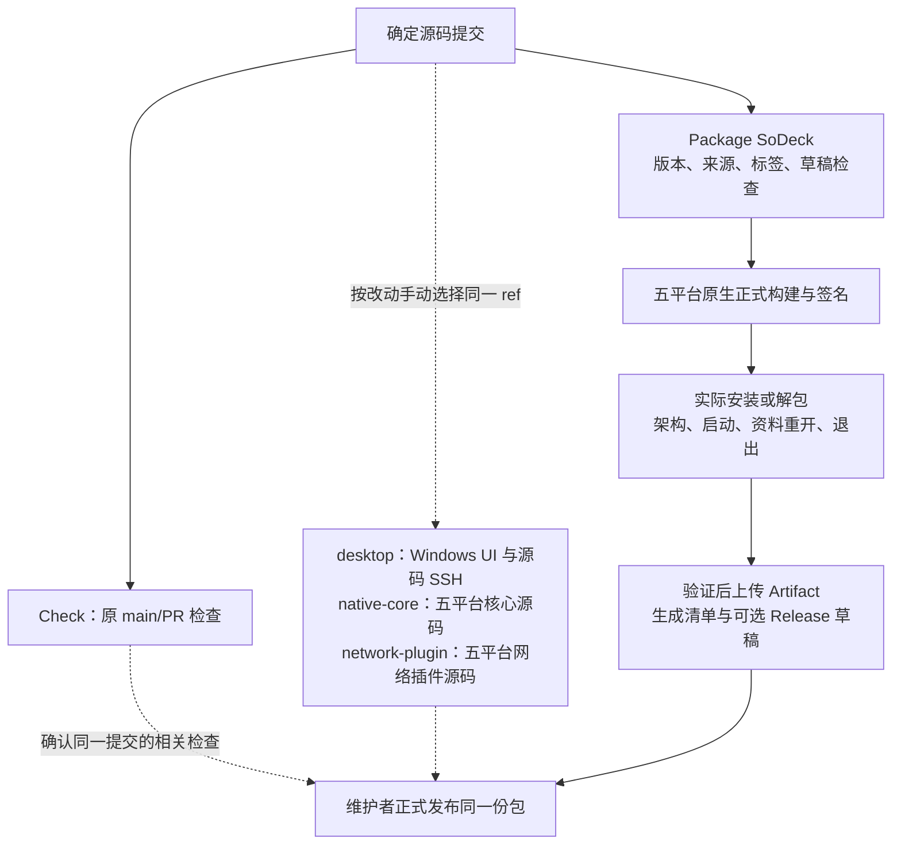

# 打包提速实施记录

2026-11-08。对应[分步方案](plan-release-performance.md)。第一步已完成相关验收，第二步发行缓存迁移正在实施；产品代码、版本及独立发布方式不变，第三、四步尚未开始。

## 第一步：源码测试移出打包

核心 preflight 只保留 checkout、Node 和原发行输入检查，不再安装 npm 依赖/Rust 或运行源码检查。五平台 package 移出核心 Rust 测试；Windows x86_64 另移出源码 SSH、完整 UI 和 Chromium 安装；三系统宿主脚本回归移到 Check。核心 npm 缓存统一使用根锁文件。网络插件 package 移出 `cargo test`，正式编译与归档继续由原脚本完成。

实际包的安装/解包、架构、签名、启动、资料重开、退出、Windows x86_64 包内 SSH、收集上传和草稿恢复流程保留。打包不依赖 Check，也不依赖业务插件构建。

Check 新增 `suite` 手动选择，不让每次 main/PR 自动跑五平台全量测试。`standard` 保持原检查范围，`desktop` 执行 Windows 完整 UI/SSH，`native-core` 执行五平台核心及原宿主脚本回归，`network-plugin` 只执行五平台网络插件测试，`all` 执行全部 job。原生任务先核对 Rust 宿主架构；Windows 同一 job 内顺序执行，避免 target 文件锁冲突。具体命令与补测原则仅维护在[开发指南](development.md)。

## 验证与证据

| 验证 | 结果 |
| --- | --- |
| 工作流语法 | 经官方 SHA-256 校验的 actionlint 1.7.12 检查五个工作流通过；三段 PowerShell 安装/环境步骤语法解析通过 |
| 职责与触发范围 | 静态核对 7 组自动/手动入口、5 个原生目标及各套件步骤选择；原 `format`/`network` 步骤、五平台正式构建及其后全部包验收/汇总步骤与修改前一致 |
| 类型、格式与脚本 | `npm ci`、`npm run check`、`npm run plugin:check` 通过；`npm run scripts:test` 65 项通过 |
| Windows 核心源码 | `npm run test` 107 项通过，8 项真实远端专项按原标记 ignored；另显式执行 `npm run ssh:test`，OpenSSH 互操作通过 |
| Windows 完整 UI | `npm run ui:test` 通过，包含正式前端构建、实际目录核心、交互、桌面策略、终端输入和设置回归 |
| Windows 实际核心包 | `npm run build -- --bundles nsis -- --locked` 通过，生成 0.9.4 x86_64 NSIS；解包后的实际程序通过架构、版本、原生移窗、保存、重开、退出及 `--packaged` SSH 烟测 |
| Windows 网络插件 | `cargo test --manifest-path plugins/network-proxy/Cargo.toml --locked` 13 项通过；独立打包 0.2.2 原生归档并验证架构，构建不运行测试 |
| 文档 | 102 个本地链接检查通过，新增流程图由 Mermaid 解析、渲染并目视检查；`git diff --check` 通过 |

本地日志、安装包、包内报告和结构核对保存在已忽略的 `artifacts/release-performance-step1/`。本机核心构建使用已存在的 release 依赖，耗时约 39 秒；它不是 GitHub runner、冷缓存或工作流对照结果。构建日志未包含 `test-fixtures` 编译。包烟测有 WebView2 窗口类注销错误 1412 输出，验收完成且进程均以 0 退出。

历史 Windows x86_64 package 样本中，Rust 测试/编译 328 秒、完整 UI 217 秒，合计约 9 分钟已移出串行定义；本轮 GitHub 候选实测见下一节。

## 提交与 GitHub 验收

实施提交 [`1febe73`](https://github.com/BgaSol/soDeck/commit/1febe734f678ae9ba2755353cb6adb2eff97f381) 已推送 main。以下运行均验证该提交；测试沿用核心 0.9.4 与网络插件 0.2.2，`publish=false`，只保留 Artifact，没有创建或覆盖 Release。

| 运行 | 结果 |
| --- | --- |
| [核心候选打包 42401346197](https://github.com/BgaSol/soDeck/actions/runs/42401346197) | 五目标正式构建、updater 签名、实际包安装/解包、架构、启动、重开、退出和汇总全部通过；Windows x86_64 包内 SSH 通过；五平台 Artifact 与更新清单齐全 |
| [网络插件打包 42401354278](https://github.com/BgaSol/soDeck/actions/runs/42401354278) | 五目标独立打包与架构检查全部通过，最长平台任务 107 秒；日志没有 `cargo test` 或测试夹具编译 |
| [Check all 42401358838](https://github.com/BgaSol/soDeck/actions/runs/42401358838) | `format`、五目标 `native`、Windows `desktop` 七个相关 job 全部通过；五目标核心和网络插件源码测试、三系统宿主脚本、源码 SSH 与完整 UI 入口已实际执行。记录时两目标普通网络互操作已通过，原 netem 仍在运行，不能记为整个 Check 已通过 |

同一提交自动触发的 Check `42401292788` 已取消，避免与手动 `all` 重复执行。核心候选从触发（18:27:01 UTC）到更新清单完成（18:35:58 UTC）共 **537 秒，即 8 分 57 秒**；前置任务 10 秒，汇总 13 秒，最慢平台为 Windows ARM64。

| 核心平台 job | 优化前历史样本 | 本轮 | 本轮正式构建步骤 |
| --- | --- | --- | --- |
| Windows x86_64 | 18 分 33 秒 | 6 分 17 秒 | 304 秒 |
| Windows ARM64 | 11 分 03 秒 | 8 分 24 秒 | 375 秒 |
| Linux x86_64 | 5 分 49 秒 | 4 分 17 秒 | 155 秒 |
| Linux ARM64 | 5 分 57 秒 | 4 分 35 秒 | 141 秒 |
| macOS ARM64 | 10 分 31 秒 | 8 分 05 秒 | 383 秒 |

历史样本为[核心运行 42355132557](https://github.com/BgaSol/soDeck/actions/runs/42355132557)。本轮与历史的 runner、缓存恢复和保存成本可能不同，这不是严格冷/热对照；不能把 Windows 全部差值都归因于移出测试。日志确认本轮五个平台 package 均未编译 `test-fixtures`，签名与实际包检查继续执行。

本轮 Windows 两目标和 macOS 没有找到 Rust 缓存；Linux 两目标从旧 `core-package` 回退键恢复成功，恢复分别耗时 22/35 秒。五目标均已按原配置保存 main 缓存，保存步骤分别约 18～47 秒。记录时仓库缓存为 51 条、约 13.81 GiB；Linux 保存的缓存每份约 1.4 GiB，仍可能携带旧混合缓存内容。本次只读取容量与日志，未迁移缓存族或删除条目，下一步再评估发行缓存容量和复用。

GitHub job 日志、候选清单、缓存快照及逐步耗时同样保存于 `artifacts/release-performance-step1/`；候选 Artifact 保留 30 天。此次验证的是明确提交的测试产物，不改变现有正式 0.9.4 的附件或发布结论。

## 未完成项与风险

- 记录时独立 Check 的原 netem 仍在执行，整个 Check 尚无最终结论；打包和本次迁出的七个相关检查 job 已通过，netem 不在核心打包依赖链中。
- GitHub 五平台实际包与 Windows 系统安装登记已验证；真实设备的交互式 UAC、窗口拖动、混合 DPI 和安装升级仍需对应设备验收。
- 平台源码、完整 UI/SSH 和网络插件原生检查现在需要按改动选择手动入口；正式发布前确认相同提交的必要结果。自动按路径/模块选择留在第三步。
- `core-package` 缓存键、保存条件和远端条目本轮未迁移；可能仍恢复包含 debug/test 依赖的旧缓存，第二步再优化。
- Check 原 `network`/netem、真实包组合和跨版本升级入口保持现有行为；普通发布是否需要相关专项按实际改动判断。

## 第二步：正式编译缓存

核心打包切换为稳定的 `core-release-v2` 缓存族，避免继续恢复旧 `core-package` 的 debug/test 混合 target。沿用固定提交的 Swatinem/rust-cache 默认依赖清理，不缓存 workspace crate、incremental、node_modules、安装包或系统环境；main 成功构建保存，其他适用引用恢复，正式前端、核心源码与资源仍重新构建。

升级测试夹具从旧混合核心缓存改用 `check-tests`，与发行 target 分开。Linux 打包依赖安装复用 `configure-ubuntu-mirror.mjs` 和有限下载重试，依赖列表保持原样。

实施前新快照为 21 条、约 11.67 GiB，均在 main；此前的 tag 条目已经被 GitHub 淘汰。旧核心缓存 6 条约 5.61 GiB，其中 Linux 三份合计约 4.20 GiB。现存 Check/网络/插件缓存先保留；对应的新发行缓存验证成功后才按确认过的 ID 清理旧混合族。

验证将用同一提交在 main 生成一次新族候选，再构建一次候选核对恢复、正式编译、缓存保存的总成本及五平台实际包结果。两轮都使用 publish=false；已有正式 0.9.4 不覆盖。本节随后补充运行、容量和耗时证据。
