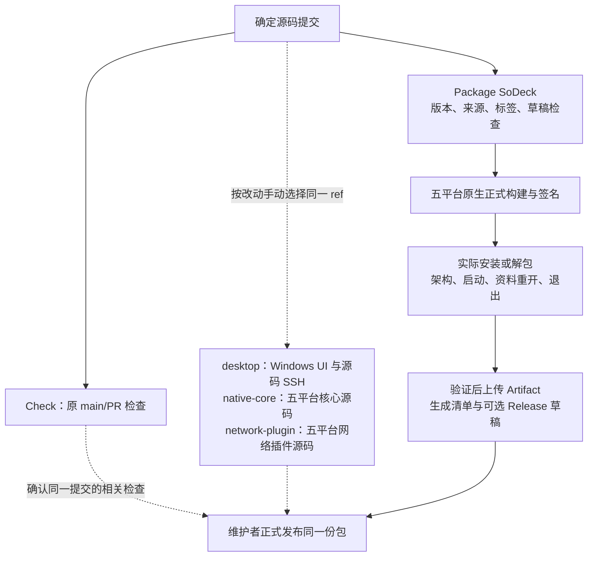

# 打包提速实施记录

2026-11-08。对应[分步方案](plan-release-performance.md)。本次只实施第一步，产品代码、版本及独立发布方式不变；第二至四步未开始。

## 第一步：源码测试移出打包

核心 preflight 只保留 checkout、Node 和原发行输入检查，不再安装 npm 依赖/Rust 或运行源码检查。五平台 package 移出核心 Rust 测试；Windows x86_64 另移出源码 SSH、完整 UI 和 Chromium 安装；三系统宿主脚本回归移到 Check。核心 npm 缓存统一使用根锁文件。网络插件 package 移出 `cargo test`，正式编译与归档继续由原脚本完成。

实际包的安装/解包、架构、签名、启动、资料重开、退出、Windows x86_64 包内 SSH、收集上传和草稿恢复流程保留。打包不依赖 Check，也不依赖业务插件构建。

Check 新增 `suite` 手动选择，不让每次 main/PR 自动跑五平台全量测试。`standard` 保持原检查范围，`desktop` 执行 Windows 完整 UI/SSH，`native-core` 执行五平台核心及原宿主脚本回归，`network-plugin` 只执行五平台网络插件测试，`all` 执行全部 job。原生任务先核对 Rust 宿主架构；Windows 同一 job 内顺序执行，避免 target 文件锁冲突。具体命令与补测原则仅维护在[开发指南](development.md)。

## 验证与证据

| 验证 | 结果 |
| --- | --- |
| 工作流语法 | 经官方 SHA-256 校验的 actionlint 1.7.12 检查五个工作流通过；三段 PowerShell 安装/环境步骤语法解析通过 |
| 职责与触发范围 | 静态核对 7 组自动/手动入口、5 个原生目标及各套件步骤选择；原 `format`/`network` 步骤、五平台正式构建及其后全部包验收/汇总步骤与修改前一致 |
| 类型、格式与脚本 | `npm ci`、`npm run check`、`npm run plugin:check` 通过；`npm run scripts:test` 65 项通过 |
| Windows 核心源码 | `npm run test` 107 项通过，8 项真实远端专项按原标记 ignored；另显式执行 `npm run ssh:test`，OpenSSH 互操作通过 |
| Windows 完整 UI | `npm run ui:test` 通过，包含正式前端构建、实际目录核心、交互、桌面策略、终端输入和设置回归 |
| Windows 实际核心包 | `npm run build -- --bundles nsis -- --locked` 通过，生成 0.9.4 x86_64 NSIS；解包后的实际程序通过架构、版本、原生移窗、保存、重开、退出及 `--packaged` SSH 烟测 |
| Windows 网络插件 | `cargo test --manifest-path plugins/network-proxy/Cargo.toml --locked` 13 项通过；独立打包 0.2.2 原生归档并验证架构，构建不运行测试 |
| 文档 | 102 个本地链接检查通过，新增流程图由 Mermaid 解析、渲染并目视检查；`git diff --check` 通过 |

本地日志、安装包、包内报告和结构核对保存在已忽略的 `artifacts/release-performance-step1/`。本机核心构建使用已存在的 release 依赖，耗时约 39 秒；它不是 GitHub runner、冷缓存或工作流对照结果。构建日志未包含 `test-fixtures` 编译。包烟测有 WebView2 窗口类注销错误 1412 输出，验收完成且进程均以 0 退出。

历史 Windows x86_64 package 样本中，Rust 测试/编译 328 秒、完整 UI 217 秒，合计约 9 分钟已移出串行定义；新的端到端提速仍待 GitHub 候选运行测量。

## 未完成项与风险

- 本轮尚未在 GitHub runner 执行修改后的工作流，五平台与新的端到端耗时仍需候选构建验证；历史结果不能代替本次提交。
- 本机使用普通本地 NSIS 配置，未生成正式 updater 签名，也未执行系统安装/UAC/HKLM 验证；GitHub 原正式签名与安装断言保持原样，后续原生候选运行仍需验证。未推送提交或创建 Release。
- 平台源码、完整 UI/SSH 和网络插件原生检查现在需要按改动选择手动入口；正式发布前确认相同提交的必要结果。自动按路径/模块选择留在第三步。
- `core-package` 缓存键、保存条件和远端条目本轮未迁移；可能仍恢复包含 debug/test 依赖的旧缓存，第二步再优化。
- Check 原 `network`/netem、真实包组合和跨版本升级入口保持现有行为；普通发布是否需要相关专项按实际改动判断。
