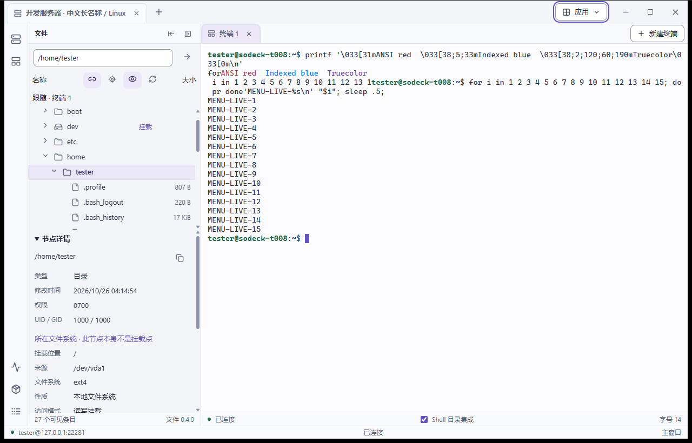

# 旧版功能与界面提取，以及第一版范围建议

日期：2026-11-05。状态：建议稿，供用户决定范围；不代表应用已经实现，也不自动替换当前产品基线。

最新交付约束：核心安装包不包含业务插件，支持独立安装和覆盖升级；插件从外部目录加载、卸载。发布流程采用简化版 `distribution.md`，不照搬旧版发布机制和验证门禁。

## 依据与核实边界

参考仓库：`C:\Users\bgaso\Documents\works\soDeck-v2`，读取时 HEAD 为 `e7959b2`，工作区有未提交的文档变更。本次只读查看旧仓库，未启动应用、访问服务器或重跑旧版测试；将六张已有测试截图复制到本仓库作为界面参考。

核对了旧版 README、`release/notes/stable.md`、产品与工作台文档、桌面入口、连接表单、四个插件清单及部分 worker/UI 实现、公共设计参数和历史截图。下面的“已有实现”表示找到源码及说明，不等于本次重新验证通过；没有进行全仓代码质量审计，因此不据此给全部代码作质量结论。

旧仓库的主要价值是已经成形的操作流程、信息布局和交互经验。新项目以这些行为为参考，重新组织实现；源码复用需要另行核实依赖和边界。

## 功能盘点

下表中的源码路径均相对于旧仓库根目录。

| 功能组 | 提取到的能力及实际边界 | 主要依据 | 第一版建议 |
| --- | --- | --- | --- |
| 服务器管理 | 保存、编辑、删除、搜索、分组；连接首页左目录右表单 | `apps/desktop/src/connection-home/` | 保留，限制为单份清晰表单，不搬历史草稿协调机制 |
| SSH 认证 | 密码、私钥、凭据记忆、主机指纹处理和失败交互 | `apps/desktop/src/auth-dialog.tsx`、`crates/core/src/ssh.rs` | 保留基础认证与错误提示；不新增插件权限系统 |
| 连接路径 | 直连、多级 SSH 跳板、已有 SOCKS5 代理、混合中转 | `apps/desktop/src/connection-home/access-path-fields.tsx`、`route-step-fields.tsx`、`docs/core/mixed-route.md` | 直连必做；建议支持单级 SSH 跳板，复杂混合链和上游 SOCKS5 接入后续独立做 |
| 服务器工作区 | 外层服务器标签页、独立视图上下文；切换不结束已有会话 | `apps/desktop/src/server-tabs.tsx`、`app.tsx` | 保留单窗口、多服务器、双层标签导航 |
| 布局与窗口 | 左右/底部停靠、视图移动、分屏和独立窗口、迁移恢复 | `docs/core/workbench.md`、`apps/desktop/src/app.tsx` | 保留可调宽的左右侧栏；分屏、跨窗拖拽与运行中视图迁移延后 |
| 终端插件 | 真实 SSH PTY、多终端、重命名、重连、复制粘贴、字号及终端设置 | `plugins/terminal/src/worker.ts`、`terminal-view.tsx` | 必做，作为第一个真实插件 |
| 文件插件 | 只读目录树、路径定位、元数据、挂载和容量；终端目录跟随有已知异常 | `plugins/files/src/view.tsx`、`worker.ts`、正式发行说明 | 保留树与路径设计；增加单文件传输、文本查看编辑及基础文件操作 |
| 资源监控插件 | CPU、内存、磁盘、网络及内存中的短期趋势，按远端能力降级 | `plugins/monitor/src/` | 第一版后加入；先做轻量快照，再评估完整趋势 |
| 网络代理插件 | 固定端口转发、HTTP/SOCKS 代理、规则保存启停、端口/连接状态 | `plugins/network-proxy/src/rules.ts`、`run.ts`、`protocol/` | 保留规则列表、详情和启停；首版实现本地端口转发、SOCKS5 |
| 插件管理 | 独立包、版本、启停、导入；旧版设置需完整重启后生效，在线更新另有流程 | `apps/desktop/src/settings/plugins.tsx`、`plugin-lifecycle.tsx` | 外部目录加载、卸载、故障重启；更新时卸载后替换文件；不要求重启核心 |
| 日志与诊断 | 调用记录、事件、状态、指标、证据、历史等多个子系统 | `apps/desktop/src/call-records-panel.tsx`、`crates/core/src/observability/` | 只做当前需要的结构化日志、重要消息与可复制错误详情，不复刻完整诊断平台 |
| 通信监控 | 发送接收速率、流量历史、诊断和设置界面 | `apps/desktop/src/communication-monitor/` | 延后，网络规则详情先显示自身运行状态 |
| 设置与主题 | 统一设置入口、插件设置；浅色、深色、多巴胺主题及公共 UI 组件 | `apps/desktop/src/settings/`、`packages/ui/src/`、`themes/` | 保留主题与基础设置，先在应用内呈现，不复制完整多窗口设置机制 |
| 打包与升级 | 发行工作流、独立插件更新、签名/更新信任与多代数据处理 | `.github/workflows/`、`release/notes/stable.md` | 落实五目标检查打包和手动升级；自动更新、TUF 分发和旧库迁移延后 |
| AI、Docker、NetBird | Docker、NetBird 不在现有正式版；AI 有需求草案，未找到对应应用插件实现 | `release/notes/stable.md`、`docs/plugins/ai/README.md`、`plugins/` | 保留为后续插件方向，不当作旧版已实现功能迁入 |

两个尤其需要避免的误读：

- 文件树能看见文件，不代表已经支持编辑和传输。旧版发行说明明确排除了编辑、上传、下载。
- 四个旧插件清单列出了五个 hostTargets，不代表五目标已经安装实测。旧 README 和发行说明只提供 Windows x64 安装包，并保留其他平台验证缺口。

## 值得保留的界面设计

### 信息结构

```text
顶部：连接首页 / 服务器 A / 服务器 B / ＋          设置、窗口控制
左侧工具栏 | 文件面板 | 终端 1 / 终端 2 / 文件编辑页 | 网络面板 | 右侧工具栏
底部：当前服务器、连接状态、任务状态、重要消息入口
```

连接首页继续使用“左侧找已有服务器、右侧新建或编辑”的结构；进入服务器后切换为工作区。外层标签决定服务器，内层标签决定该服务器的具体任务。每个视图绑定服务器 ID，切换外层标签不能把已有终端或编辑器重定向到另一个服务器。

侧栏的收起与关闭分开：收起文件或网络面板只改变显示，不结束传输或代理；关闭终端页结束其会话，停用插件则清理该插件实际持有的资源。点击其他工具直接切换，再点当前工具才收起。

### 视觉与交互规则

旧版公共参数可作为起点，最终根据三种系统的真实字体和缩放测量调整：

| 元素 | 提取值或设计规则 |
| --- | --- |
| 连接目录栏 | 基准约 280px，支持调整宽度 |
| 表单内容 | 最大约 720px，字段区独立滚动，底部动作条始终可达 |
| 排版 | 基准正文 13px、终端 14px；按平台优先使用系统字体，终端使用等宽字体 |
| 控件密度 | 常用按钮约 32px、输入框约 36px、文件树行约 28px |
| 间距与圆角 | 4/8/12/16/24px 间距；控件/卡片/对话框约 8/12/16px 圆角 |
| 浅色与深色 | 低饱和底色、清楚的层级和边界、紫色选中/焦点；减少无意义装饰 |
| 多巴胺 | 奶油底、粉色侧栏、黄色强调、深色粗边；沿用相同布局和命中尺寸 |
| 反馈 | 按下立即反馈；加载、失败、断线和禁用有文字状态，不只依赖颜色 |
| 桌面可用性 | 中文输入法、键盘导航、复制粘贴、文字缩放和减少动态作为基础要求 |

推荐保留三套主题的色板与视觉方向，用一套语义参数实现。公共 UI 组件只负责显示与交互，不调用核心或持有服务器业务状态；插件用组件组成页面，不另写一套通用控件样式。

本次使用 apple-design 的即时反馈、空间一致性、系统排版和可访问性原则检查上述取舍，未设计或实现新的动画、原型和页面。

### 已保存的界面参考

以下全部是旧仓库历史测试截图，可能来自不同版本、模拟或隔离测试环境，仅用于提取设计，不证明当前工作区或新项目运行结果。复制时校验了 SHA-256 一致。

| 图 | 旧仓库来源 |
| --- | --- |
| [连接首页 · 浅色](reference-v2/connection-light.png) | `.qa/t025/visual-1793180387422/home-soft-light-100.png` |
| [文件与终端工作台](reference-v2/workbench-light.png) | `.qa/t012/visual/light-100.png` |
| [连接首页 · 多巴胺](reference-v2/connection-dopamine.png) | `.qa/t025/visual-1793180387422/home-dopamine-100.png` |
| [文件面板](reference-v2/files-panel.png) | `.qa/t028/business-1793223765007/linux-files.png` |
| [网络隧道详情](reference-v2/network-panel.png) | `.qa/t025/socks-1793180631706/network.png` |
| [插件管理设置](reference-v2/plugin-settings.png) | `.qa/t028/native-1793223100427/plugins-soft-light.png` |



## 建议的第一版范围

第一版目标：运维人员可以添加服务器、执行命令、修改和传输文件，并临时访问服务器内网服务。交付一个稳定的核心和三个真实业务插件：终端、文件、网络隧道。

| 模块 | 第一版做到 | 边界 |
| --- | --- | --- |
| 连接管理（核心） | SSH 直连、密码/私钥、保存配置、搜索分组、主机指纹处理、取消/超时/重试；建议加入单级 SSH 跳板 | 复杂混合链、多级中转和上游 SOCKS5 接入后续做；单级跳板是本建议新增项，需最终确定 |
| 工作台（核心） | 连接首页、多服务器标签、服务器内多页、左右侧栏、宽度调整、底部状态和基础设置 | 暂不做分屏、跨窗拖拽、视图迁移、崩溃后恢复远端运行现场 |
| 终端插件 | 多终端、中文输入、复制粘贴、Ctrl-C、resize、滚动历史、字号、重命名和断线重连 | 不做终端录制回放、命令编排、AI 代执行 |
| 文件插件 | 目录浏览、路径跳转、刷新、元数据；单文件上传/下载、进度和取消；小型文本文件打开/编辑/保存；新建、重命名、删除 | 不做断点续传、目录同步、递归批量传输、大文件编辑；明确文件大小限制、覆盖及外部修改冲突 |
| 网络隧道插件 | 保存和管理本地端口转发、动态 SOCKS5；启动、停止、复制入口、端口冲突提示 | 核心管理隧道/代理及资源生命周期，插件提供规则和界面；HTTP 代理、反向转发、复杂路由后续做 |
| 插件宿主（核心） | 基本清单/API/目标检查、外部目录加载、卸载、故障重启、按实例回收资源 | 卸载保留文件和数据，替换文件后可重新加载；不做市场、安装事务和插件权限系统 |
| 日志与重要消息（核心） | 宿主记录生命周期、插件写入结构化日志；日志筛选/轮转；插件发布重要消息，核心集中展示、去重、保留历史 | 不复刻全量调用审计、链路追踪、证据包和指标存储平台 |
| 交付 | 五目标核心单独打包，核心和插件版本独立；核心可安装和覆盖升级 | 不内置业务插件，不让插件检查阻塞核心打包；只做相关必要验证 |

Windows x86_64/ARM64、Linux x86_64/ARM64、macOS ARM64 仍是已确定的五个交付目标；缩减业务功能不缩减平台要求。

### 第一版之后

1. 轻量资源监控插件：CPU、内存、磁盘和网络快照，再增加短期趋势。
2. Docker 插件：容器列表、日志、启动/停止，再考虑镜像与 Compose。
3. NetBird 插件：状态、节点和路由，再补管理操作。
4. 目录跟随、复杂连接链、反向转发、分屏/独立窗口、在线更新分别作为独立功能推进。

这些是排期建议；Docker 和 NetBird 的长期插件方向保持。终端与文件的目录联动先提供一次性的显式定位入口，自动跟随在基础文件功能稳定后再加入。

## 实现顺序与验收

第一版按四个可以交付的阶段推进；开发中可用小型测试插件验证协议，但对用户交付真实功能。

1. 核心与真实终端：建工程和五目标 CI、基础工作台、直连 SSH、终端插件、日志和重要消息；能下载试包连接测试服务器。
2. 文件：先做目录/文件读取，再接上传下载和文本保存；验证终端与文件共存、服务器切换不串目标、未保存内容不丢失。
3. 网络隧道：本地转发和 SOCKS5 管理；验证端口冲突、断线、停止插件和退出应用后的资源回收。单级跳板如纳入范围，应在该阶段前完成连接服务支持。
4. 整体交付：核心安装和覆盖升级、外置插件加载/卸载、必要业务回归和简短版本说明；平台构建与运行情况分别记录，不建立全平台全插件联动门禁。

完整验收流程：

1. 添加两台隔离服务器，在其中一台打开两个终端，切换服务器后原终端仍属于原目标，中文输入和 Ctrl-C 正常。
2. 浏览目录，上传并下载测试文件，校验内容；编辑配置后保存并重新读取；远端被其他程序修改时给出冲突反馈。
3. 启动本地端口转发和 SOCKS5，实际访问远端可达的测试服务；停止后监听和通道释放。
4. 模拟一个插件异常退出，其他插件仍可操作；日志与重要消息能看到对应来源，故障插件可以重启。
5. 核心无插件可启动，安装新版后保留配置和外部插件目录；五目标构建和实际运行记录分开，构建成功不冒充安装实测。

## 避免重建复杂度的具体约束

- 每个功能有一个实现入口、一份有效规格和清楚的状态归属；产品文档只维护当前决定，历史讨论留给 Git/少量决策记录，避免把几百条增量当作入口。
- 第一版固定单窗口和有限扩展点，核心提供稳定服务，插件持有自己的业务状态。先做真正需要的接口，不提前建立多运行时、任意布局或插件间工作流平台。
- 日志与通知不影响基本退出和资源清理；日志落盘失败要有清楚反馈和有界回退，不能让关闭流程无限等待。
- 旧版采用 QuickJS 通用 JS 包加独立宿主；当前新草案采用独立插件程序。运行形式在首个阶段前作一次明确决策：通用脚本插件可共用业务包，但宿主仍需五目标原生产物；带原生依赖的插件按目标分别打包。不能把两种方式同时默认为必须实现，也不能把旧清单的五目标声明当作通过证明。
- 提取通用 UI 参数与已经验证过的交互意图；不直接复制巨型入口、历史兼容层、生成契约链或发布状态机。
- 新应用使用独立数据身份，测试只使用隔离服务器与文件。旧版数据库、配置和凭据不自动导入；用户需要迁移时另行定义导入范围。

本次仅完成静态提取和建议文档，尚未确认最终第一版范围，未开始新应用实现。
