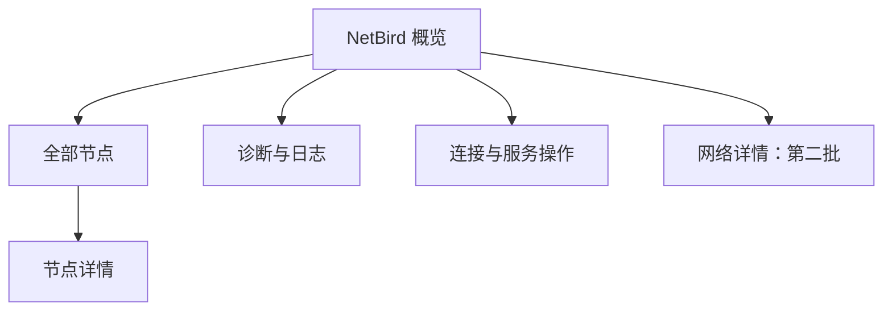

# 远端 NetBird 客户端功能设计

日期：2026-10-18。状态：功能方案，尚未修改业务代码。

用户已确认：管理每台 SSH 服务器上的 **NetBird 客户端**。目标是在 SoDeck 当前工作区内完成“查看连接 → 定位异常 → 简单操作 → 核对结果”。

## 1. 产品定位与接入范围

使用已有 SSH 连接路径访问远端客户端，适用于 NetBird Cloud 和自建 Management Service。只读取当前客户端已知的信息，不要求用户额外提供 NetBird 管理 API Token。

首版优先支持 Linux 上原生安装、作为系统服务运行的客户端。Docker 客户端放入第二批，延用现有 Docker 的引擎及容器身份核对。其他远端系统后续按实际验证扩展；SoDeck 本机系统不决定远端支持范围。

这里的节点列表指“当前客户端可见的对端”，不宣传为组织全网资产，也不把当前隧道状态直接解释成远端设备的开关机状态。自建 Dashboard、Management、Signal、Relay 服务的部署管理另行规划。

## 2. 当前项目可复用的基础

| 已有能力 | 本功能的使用方式 |
| --- | --- |
| `ServicePanel` 的“监控 / Docker”导航 | 增加“NetBird”页，保留右栏宽度、主题、键盘导航和布局习惯 |
| `SessionWorkspace` 的工作区快照 | 保存当前页、搜索、筛选、选中节点和滚动位置；移到独立窗口时恢复 |
| 已验证 SSH、跳板连接和窗口权限 | 查询、操作使用同一身份与路径，不能仅凭前端传入地址执行 |
| 共享监控、订阅与旧数据标识 | 同一连接身份共用采样；断线保留上次成功信息并标明时间 |
| 有界远端读取、后台任务模式 | 状态读取与写操作分离；慢查询不拖住 CPU、Docker 或终端 |
| 文件下载、Docker 日志与容器详情 | 后续下载诊断包、查看 Docker 客户端日志和定位容器 |

新业务保持独立模块；复用任务设计与公共连接能力，不让 NetBird 的状态依赖 Docker 任务管理器。

## 3. 信息架构

右侧主导航：**监控 / Docker / NetBird**。

NetBird 默认进入概览，详情在同一侧栏内前进和返回。首版不再增加一排常驻二级 Tabs。

### 3.1 概览

顶部只放 NetBird、综合状态、刷新和更多菜单。下面分为三组：

| 分组 | 内容 |
| --- | --- |
| 本机身份 | 主机名／FQDN、NetBird IPv4／IPv6、客户端与 daemon 版本；当前 Profile 在可获取时显示 |
| 连接状况 | daemon 可访问性、Management、Signal、Relay／STUN、DNS 的独立状态；管理端地址放在详情中 |
| 对端摘要 | 此客户端可见节点数、已连接／空闲／连接中数量；预览少量节点，进入全部列表 |

IP、主机名支持复制。显示最后成功更新时间。界面上的字段以当前版本能提供的内容为准，缺失显示“未提供”，不能变成 0 或正常。

单个综合状态只承担导航作用。Management 异常而已有对端连接仍存在时，显示“连接受限”并保留分项结果，不覆盖成“全部离线”。CLI 的结构化状态、详细状态及版本信息可用于这些展示。[S1]

### 3.2 节点列表和详情

列表每行两层：名称与连接状态；NetBird 地址与直连／中继方式。支持名称、FQDN、IPv4／IPv6 搜索，以及状态和连接方式筛选。刷新不改变用户的当前排序、焦点或滚动位置。

节点详情按可用性展示：连接状态、连接方式、最后状态变化、最近 WireGuard 握手、客户端报告的延迟、累计收发量、与该节点相关的网络；缺失字段保持未知。延迟注明来源和测量时间，不把握手时间当作在线时长。

需保留三条语义边界：

- **中继是连接方式。** 中继节点可以正常通信，不默认使用故障红色。[S2]
- **空闲可以是按需连接。** Lazy Connections 在需要流量时建立连接；空闲节点不直接算故障，也不通过后台轮询 ping 唤醒所有节点。[S3]
- **隧道已连接不等于应用端口可用。** 业务连通性由显式检测提供证据。[S2]

首版节点动作：复制地址、复制主机名、查看详情、单次连通性测试。测试明确显示“从当前远端服务器发起”；ICMP 无响应只说明未收到响应，不能单独判定节点离线。TCP 检测由用户输入一个端口，设置时限，不做端口扫描。

后续可增加“使用此服务器作为跳板连接节点”：预填新的 SSH 草稿，不默认本机可达，也不继承远端账号密码。多层跳板超出现有支持能力时给出明确说明。

### 3.3 诊断与日志

首版提供结构化检查结果、显式读取的状态原文、最近客户端日志、复制脱敏摘要。原文只在当前视图展示，不写入所有窗口共享快照。

检查分开呈现 daemon、控制面、对端隧道和单次业务连通性；每条结果包含来源和时间，按已有证据建议下一步，不用一个“修复网络”按钮执行多项配置修改。

原生客户端日志应按实际服务配置定位，支持有界尾部读取；缺少读取权限直接说明。官方默认 Linux 日志位置为 `/var/log/netbird/client.log`，但实现不能假定每台机器都使用默认路径。[S4]

第二批增加“生成并下载诊断包”：使用当前版本支持的 `debug bundle`，默认请求匿名化，生成后经 SSH 下载到用户选择的位置。只处理本次产生且核对过的文件；daemon 创建的文件可能需要额外读取权限，不能为了下载放宽整目录权限。默认不上传到第三方。[S4]

`debug for` 会改变日志级别并可能反复连接／断开，因此不作为普通只读诊断入口。[S4]

## 4. 操作设计

| 操作 | 预期用途 | 可用条件与反馈 | 批次 |
| --- | --- | --- | --- |
| 刷新状态 | 获取最新快照 | 进行中合并请求；失败保留旧值和错误 | 第一批 |
| 连接 NetBird | 使用现有身份恢复连接 | 已登录、daemon 可访问；执行后独立核对状态 | 第一批 |
| 断开 NetBird | 主动停止客户端网络连接 | 展示影响并核对 SSH 路径；依赖 NetBird 时受限 | 第一批 |
| 启动客户端服务 | daemon 已停止 | 服务实例明确，当前用户具备权限；启动后检查是否连接 | 第一批 |
| 重启客户端服务 | 排查 daemon 异常 | 放在更多菜单；需要确认并通过连接路径检查 | 第一批 |
| 单次节点检测 | 判断实际可达性 | 用户选择目标／端口；显示起点、耗时和检测局限 | 第一批 |
| 生成、下载诊断包 | 收集排障材料 | 功能及文件读取能力可用；带进度和取消 | 第二批 |
| 选择／取消网络 | 管理客户端接收的网络 | 展示变更前后，检查管理路径和管理员限制 | 第二批 |

“连接／断开网络”与“启动／重启 daemon”分开命名。`down` 后 daemon 可以继续处于 Idle；服务重启后是否自动连接还受客户端设置影响。因此两类操作均不能仅凭命令成功退出就显示“已连接”。[S1][S5]

不增加含义模糊的“重连”按钮；首版明确提供“重启客户端服务”。如果确需断开再连接，应后续实现具有独立执行与结果记录的流程，不能在同一 SSH 连接上先 down、再假定 up 一定能执行。

“连接”只复用当前身份和配置；遇到需要登录、认证失效或管理员限制时停止操作并显示对应原因，不默默改变 Management URL 或进入无人处理的认证等待。首次登录、Setup Key、切换账号留待单独设计。

### 4.1 SSH 可能被操作本身切断

这是本功能与普通服务管理最重要的区别。每次影响连接的操作前重新判断：

1. 当前 SSH 实际连接地址是否属于该客户端的 NetBird 地址。
2. 服务器返回当前 SSH 来源地址的路径是否经过 NetBird 接口或受本次变更影响的网络；包括 IPv4、IPv6 和策略路由证据。
3. 存在跳板时，评估实际连接的相关各段；Docker host 网络模式也应纳入判断。

只有“已知依赖”“未发现依赖且验证路径可用”“无法确认”三种结果，不凭 `100.x` 地址段或接口名称猜测，不承诺能识别所有间接依赖。

**第一批策略：** 已知依赖或无法确认时，阻止一键断开和重启，提示从不依赖 NetBird 的公网／局域网／控制台路径执行。后续可让用户选择并实际验证同一主机的备用连接，再执行操作。正常独立路径仍需针对中断型操作确认一次。

即使预检通过，网络也可能在执行时变化。收到提交确认但 SSH 随后断线时显示“结果待核对”，重连后只读检查，不自动重放断开、重启或网络变更。不得把网络中断直接认定为操作成功或失败。

### 4.2 权限与任务

沿用当前 SSH 用户权限。后台采样不交互式请求 sudo；权限不足时仍保留能读取的信息。服务管理需要提权时，第一批由已有 root 会话执行，或进入终端由用户处理；后续可支持按服务器显式配置的非交互 sudo 命令能力，不静默扩大权限。[S1]

同一客户端实例一次只允许一个写操作，多窗口共享结果。任务状态为：等待、执行中、正在核对、成功、失败、结果待核对。按钮立即反馈，但不提前改成“已连接”。只读采样与写操作使用独立连接，不阻塞用户终端。

## 5. 检测、兼容性和刷新

### 5.1 检测顺序

用户第一次进入 NetBird 页时检查 CLI 路径及版本、status 能力、daemon 地址及权限，再获取快照。找不到 CLI 显示“未检测到客户端”，提供重新检测和指定二进制路径；不扫描全盘或自动安装。

存在多个 daemon／Profile 时明确当前目标。绑定包含已验证 SSH 身份、CLI 路径、daemon 地址和可获取的 Profile 身份；目标改变后作废旧缓存和待确认操作。不能让环境变量变化把后续写命令导向另一个客户端。

状态模型分开存储：采集状态、安装／服务状态、认证状态、客户端连接状态、Management／Signal、Peer 状态。这样权限不足、查询超时和业务断开不会被混成同一类“离线”。

### 5.2 查询策略

- 优先使用 `netbird status --json`。探测当前 CLI 支持的能力，不只根据版本号猜测字段或命令。[S1]
- JSON 解析允许字段缺失、null、新增字段和未知枚举；必需身份无法核实时限制写操作。吸取 Docker 详情问题的教训，不让一个可选字段使整个页面失效。
- 不支持结构化输出时降级为只读状态原文和复制功能，不凭脆弱的文本解析启用操作。
- `service status`、网络查询、诊断参数分别探测；某一项不支持不影响基础状态显示。
- 健康探针不能替代连接状态判断；例如 `status --check ready` 允许 Idle／Connecting 等状态成功，不能将其退出码直接映射成绿色“已连接”。[S1]
- 对大节点列表设置输出和内存上限。超过上限明确提示结果不完整，不把截断的列表当作全部节点或据此计算全网数量。

### 5.3 刷新策略

| 场景 | 建议频率 |
| --- | --- |
| NetBird 页可见 | 15 秒；手动刷新即时触发 |
| 已订阅的工作区位于后台 | 60 秒 |
| 所有窗口均离开 NetBird 页且无任务 | 暂停 NetBird 专项采样 |
| 操作完成后的状态核对 | 短期加快刷新，达成目标或到时后恢复常态 |
| 查询失败 | 退避重试；认证／指纹错误交由原连接流程处理 |

同一身份和客户端实例共享一份采样。只读状态轮询不主动探测所有节点；日志、诊断包和 TCP／ICMP 测试都按需执行。

## 6. Docker 客户端与网络操作：第二批

### Docker 部署

官方支持容器化客户端，host 网络与隔离网络、rootless 的作用范围不同；展示时标明“系统客户端”或“容器客户端”，不能把容器地址直接当作宿主机 NetBird 地址。[S6]

允许从本地 Docker 引擎中选择目标容器，并实际验证其客户端能力，使用完整容器 ID 固定目标。不能仅凭镜像名含 netbird 就选中 Dashboard 或控制面组件。远程 Docker endpoint 不能自动视为当前 SSH 服务器。

容器内状态和 up／down 由专用适配层处理；服务重启映射到已选客户端容器的生命周期入口，不能在容器内假定 systemd 存在。host 网络客户端的停止／重启同样执行 SSH 依赖检查。

### 客户端网络

先提供当前可见网络、CIDR／域名、选择状态与路由信息。只改变客户端选择，不创建组织网络或修改服务端访问策略。

网络选择命令默认可能替换原选择；实现必须保存当前模式，预览完整变更，单项选择优先采用明确支持的追加语义。特别区分“自动接受全部（含未来网络）”与“明确选择固定集合”，不能用一个布尔勾选框丢失模式。[S1]

退出节点与默认路由后续单独设计；涉及当前 SSH 返回路径时遵循同样的限制。管理员禁止网络选择时显示“由管理员管理”，不尝试绕过。[S7]

## 7. 界面表现

遵循 apple-design，并以现有 SoDeck 控件和主题为准：系统字体、现有字号与间距、Lucide 图标、低饱和状态色、简洁分组；不新增独立的品牌色和大面积渐变卡片。

状态使用文字配合图标。绿色用于已确认连接，灰色用于正常空闲／主动断开，橙色表示受限或待核对，红色表示明确错误。中继使用中性色标签。

概览只保留一个符合当前状态的主操作：未连接时“连接”；服务停止且有权限时“启动服务”；连接中时显示进度。已连接时将“断开”“重启服务”放入更多菜单，避免紧贴刷新按钮。

320px 侧栏保持单列布局，长域名和 IPv6 能截断、查看及复制。节点详情在栏内替换列表并保留返回位置。沿用应用现有动效与减少动态效果设置，不引入新动画依赖。

空状态分别设计：尚未连接 SSH、未检测到客户端、daemon 不可访问、权限不足、需要登录、当前没有可见节点、查询失败但有旧数据。

## 8. 交付顺序与验收

**第一批：原生客户端日常查看与操作。** 完成概览、Peers、单节点检测、基础日志、连接／断开、服务启动／重启、路径依赖检查、任务核对、多窗口和后台刷新。先通过只读闭环验收，再开放写按钮。

**第二批：常用部署与排障补齐。** Docker 客户端适配、诊断包下载、网络列表与选择、从节点预填 SSH 草稿。

**后续候选：** 首次登录、Setup Key、Profile 切换、退出节点切换、短期连接趋势。安装升级、卸载、组织 ACL、用户和分组管理不纳入当前客户端首版。

主要验收场景：

| 类别 | 必须验证 |
| --- | --- |
| 数据与版本 | 不同版本真实 status 样本；缺字段、null、未知状态、CLI／daemon 版本不一致、大节点列表 |
| 状态语义 | 中继正常、Lazy 空闲、零节点、DNS 异常、控制面异常但已有隧道保留 |
| 操作 | 命令返回成功但尚未连上、需要登录、权限不足、重复提交、多窗口并发、操作中关闭视图 |
| 管理连接 | 直接使用 NetBird IP、经 NetBird 路由、跳板、IPv6、无法确认、操作导致 SSH 断开 |
| 界面 | 明暗主题、320px 侧栏、键盘导航、减少动态效果、窗口迁移及旧数据标识 |
| 真实集成 | 隔离 Linux 测试节点接入专用 NetBird 网络；从独立管理路径验证 up／down 与服务操作 |

仅用模拟 JSON 或 SSH fixture 不能证明真实客户端命令兼容。测试应同时覆盖原始 CLI 输出解析与隔离客户端实际行为，不在业务服务器上做断网回归。

## 9. 核对资料

功能行为按 2026-10-18 可访问的官方文档核对；具体远端版本仍需运行时能力探测。

- [S1] NetBird Agent CLI：`https://docs.netbird.io/get-started/cli`
- [S2] Troubleshooting relayed connections：`https://docs.netbird.io/help/troubleshooting-relayed-connections`
- [S3] Lazy Connections：`https://docs.netbird.io/manage/peers/lazy-connection`
- [S4] Troubleshooting client issues：`https://docs.netbird.io/help/troubleshooting-client`
- [S5] Connect on Startup：`https://docs.netbird.io/client/connect-on-startup`
- [S6] Docker Installation：`https://docs.netbird.io/get-started/install/docker`
- [S7] Configuring Exit Nodes：`https://docs.netbird.io/use-cases/remote-access/exit-nodes`

项目核对：`src/ServicePanel.tsx`、`src/SessionWorkspace.tsx`、`src/resourcePresentation.ts`、`src-tauri/src/monitor/`、`src-tauri/src/connection.rs`、`src-tauri/src/remote_read.rs`、`docs/resource-monitoring.md`。
