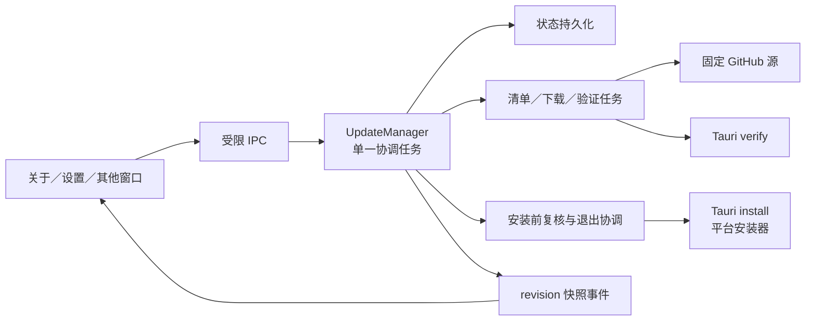

# SoDeck 1.0+ 在线更新代码设计方案

日期：2026-10-22 | 状态：已实施并完成本地自动化验证，正式安装包实机验收待完成

功能基线：[SoDeck 1.0+ 在线更新功能设计](online-update-1.0-design.md)。本文保留从 1.0.0 开始的设计基线；实际模块、接口取舍、验证结果和发版边界见[实施记录](online-update-1.0-implementation.md)。

## 1. 实施结论

1. 继续使用 GitHub Releases、固定稳定版清单和 Tauri Updater 的签名验证／平台安装器。Rust 统一管理更新，前端不直接调用 updater 插件。
2. 默认自动检查、后台下载；安装只由主窗口的显式确认发起。自动调度器没有安装权限，也不在普通退出时安装。
3. 将版本发现与安装能力分开。MSI、DEB 可以发现新版并打开对应安装包，但不能调用应用内安装；未知架构不能误报“已是最新”。
4. 使用一个应用级协调任务处理状态、偏好和调度，网络／验证／安装交给有归属的工作任务。每个任务携带操作编号，取消后迟到的结果不能恢复旧状态。
5. 下载使用有大小限制、可取消的 Rust HTTP 流；签名和版本绑定交给 Tauri `Update::verify`，安装继续使用 `Update::install`。不自行实现验签或安装器。
6. 安装确认使用后端签发的短期检查凭据，绑定目标版本、更新包、主窗口代次和受影响资源。真正停止工作前再次核验。
7. 下载包只保存在本进程内存中，不增加跨启动缓存或断点续传。关闭设置继续下载；退出后释放下载包，下次需要重新下载。
8. 本次方案不修改服务器数据库结构、应用 identifier 或数据目录；1.0.0 版本号在实施完成、准备发版时统一设置。

## 2. 已核实的代码与改造边界

| 当前文件／实现 | 已有能力或限制 | 本次处理 |
| --- | --- | --- |
| `src-tauri/src/updates.rs` | 单一管理器、自动检查、手动下载、验签、安装保护；`phase` 是字符串 | 拆分职责，增加类型化状态、后台下载策略和任务取消 |
| `Saved` / `update-state.json` | 保存自动检查、跳过版本、检查时间、待安装版本 | 增加后台下载、按版本抑制、提醒和安装结果字段 |
| `Core.bytes: Option<Arc<Vec<u8>>>` | 已下载包留在进程内存 | 保留内存方案，明确上限、验证标识和清理时机 |
| `update_target()` / `install_support()` | 安装能力与目标选择分开，MSI 检查仍借用 NSIS 目标 | 用统一的本地安装画像决定支持范围；版本发现先解析通用元信息 |
| `update_download()` | 等整个下载完成才返回 IPC；没有取消入口 | 命令启动任务后返回快照；任务进度和结果通过事件共享 |
| `update_install(confirmed: bool)` | 复核阻止项，但布尔值未绑定用户看到的中断列表 | 使用后端检查凭据，变化时返回新影响而不是继续安装 |
| `lib.rs` 的 `configuration`、`stopping`、`shutdown_work` | 已有新增工作闸门与退出清理 | 复用同一闸门，完善实际工作登记、原生退出路径与失败恢复，不建立第二套退出体系 |
| `src/updateApi.ts`、`useAppUpdate.ts` | 命令封装、全局快照、revision 防止旧响应覆盖 | 扩展 DTO、动作能力和取消；保留先订阅再取快照的次序 |
| `SoftwareUpdateSection.tsx` | 一个 `busy` 同时禁用全部操作 | 按动作分别控制；下载时取消和偏好仍可用 |
| `AppBrand.tsx`、`SystemSettingsDialog.tsx` | 关于入口、状态标记、主窗口设置跳转 | 保留入口；显式跳转聚焦更新区，后台状态不改变焦点 |
| `scripts/update-assets.mjs`、`publish-release.mjs` | 签名及签名版本验证、固定 tag URL、草稿校验后发布 | 扩充清单契约、手动下载映射、包体限制、统一版本说明 |
| `.github/workflows/check.yml` | Windows x64、macOS arm64、Linux x64；macOS 目前 ad-hoc 签名 | 维持平台范围；正式 macOS 分发接入 Developer ID 与公证验收 |
| `tests/updates-ui.spec.ts`、`scripts/release.test.mjs`、Rust 更新测试 | 现有正常流程和部分异常覆盖 | 扩充取消竞态、调度策略、确认过期、平台交接和发布契约测试 |

当前工作区有其他功能的未提交改动，尤其是 `lib.rs`、端口转发／代理、`Cargo.toml` 和 `package.json`。实施时按具体代码合并，不以旧文件覆盖当前内容。

## 3. 模块与任务归属

### 3.1 文件划分

将 `src-tauri/src/updates.rs` 移入同名模块目录，保留 `updates::initialize`、`UpdateManager` 和命令导出的调用位置：

```text
src-tauri/src/updates/
  mod.rs           # 初始化、UpdateManager 门面、公开导出
  model.rs         # 状态、命令 DTO、错误类别、安装结果
  manager.rs       # 协调任务、操作编号、事件、后台调度
  policy.rs        # SemVer、检查间隔、下载资格、按版本抑制
  store.rs         # update-state.json 的加载、串行原子保存
  platform.rs      # 安装画像、目标映射、路径和权限预检
  transport.rs     # 固定源、清单和包下载、重定向、大小限制
  install.rs       # 安装前检查、凭据、闸门、平台交接与恢复
  tests.rs         # 跨模块流程测试；纯函数测试就近放置

src/
  updateApi.ts                 # DTO 和受限 IPC 封装
  useAppUpdate.ts              # 应用快照订阅
  updatePresentation.ts        # 按钮能力、文案和进度派生
  SoftwareUpdateSection.tsx    # 更新状态、偏好、说明和动作
  UpdateInstallReview.tsx      # 安装阻止项／中断项与确认
  software-update.css          # 状态布局、焦点、对比度和减少动态效果
```

`UpdateInstallReview` 是设置中的内联区域，不再弹一层新的模态窗。无需增加前端状态库或动效依赖。

### 3.2 数据路径



### 3.3 执行与锁规则

- 一个 Tauri 异步协调任务独占 `Core`，通过有界 `mpsc` 接收命令和完成事件；容量初始为 64。用户动作有单独回复通道，队列已满返回可重试的 busy，不能静默丢失。
- `UpdateManager` 持有命令发送端和可快速读取的最新快照。读快照只克隆数据，不等待网络。协调任务生成快照后再广播，不持锁调用事件系统。
- 平台生命周期另有共享的原子安装阶段 `idle/preparing/committed/handedOff`。最终工作闸门内同步提交 committed，关闭／退出处理读取此标志，不依赖可能晚到的 UI 快照来判断能否取消。
- 清单请求、下载和验证各有操作编号、取消信号和登记的任务句柄。每次最多一个更新工作任务；检查、下载、验证和安装准备不能重叠启动。
- 进度使用独立的可覆盖通道，只保留最新值；每 150 ms 最多广播一次。完成、失败、取消和状态转换立即广播，不让进度填满控制队列。
- JSON 保存通过阻塞执行器完成，由协调任务串行提交；保存期间不持快照锁或应用工作锁。网络 I/O、验签、安装器和窗口操作也不持这些锁。
- `configuration` 仅覆盖工作登记、安装影响复核和设置 `stopping` 的短临界区。该锁内不得等待协调任务的回复；`quit_app` 读取已发布的安装状态即可。
- 程序退出时停止调度并取消网络任务。普通退出不调用安装；安装提交后的阻塞安装调用不能被当作可取消的下载任务中止。

工作任务的正常、错误、取消和 JoinError 都必须回送可终结当前操作的事件；协调任务不能因工作任务异常退出而永远停留在 busy。

## 4. 数据模型与持久化

### 4.1 对外状态

后端用 Rust enum，IPC 统一使用 camelCase。示意 DTO：

```ts
type UpdatePhase =
  | "idle" | "checking" | "upToDate" | "available"
  | "downloading" | "verifying" | "ready"
  | "preparing" | "installing" | "failed";

interface UpdateSnapshot {
  revision: number;
  phase: UpdatePhase;
  currentVersion: string;
  release: {
    id: string;                    // 后端生成的候选标识
    version: string;
    publishedAt: string | null;
    notes: string;                 // 纯文本
  } | null;
  install: {
    mode: "inApp" | "manual" | "unavailable";
    reason: string | null;         // 稳定原因码，由展示层映射文案
    target: string | null;
    manualFormat: "exe" | "msi" | "dmg" | "deb" | "appimage" | null;
  };
  operation: { id: string; source: "automatic" | "manual" } | null;
  progress: { downloaded: number; total: number | null } | null;
  preferences: { revision: number; autoCheck: boolean; autoDownload: boolean };
  lastSuccessfulCheckAt: number | null; // Unix 秒
  suppression: "cancelled" | "failed" | "skipped" | null;
  error: {
    stage: "check" | "download" | "verify" | "prepare" | "install" | "store";
    code: string;
    retry: "check" | "download" | "install" | "none";
  } | null;
  result: { id: string; targetVersion: string; outcome: "completed" | "incomplete" } | null;
}
```

用 `install.mode` 替换当前 `automaticInstall`，避免把“支持应用内安装”理解为“会自动安装”。包字节、签名、下载 URL、真实本地路径、完整资源列表和确认凭据不进入广播快照。

`Core` 另外持有 `Candidate { id, manifest, update: Option<Update>, fingerprint }`、`VerifiedPackage { candidateId, bytes: Arc<Vec<u8>> }`、活动任务和安装检查凭据。`fingerprint` 根据规范化版本、目标、官方包 URL 与签名计算，用于检查是否为同一个产物，不替代签名验证。

### 4.2 保存格式

继续使用应用配置目录的 `update-state.json`，不与 `settings.json` 或服务器库并写：

```rust
struct SavedUpdateState {
    schema_version: u32,                 // 从 1.0.0 定义为 1
    preferences_revision: u64,
    auto_check: bool,                    // 默认 true
    auto_download: bool,                 // 默认 true
    last_successful_check_at: Option<u64>,
    next_check_at: u64,
    consecutive_check_failures: u32,
    suppressed_download: Option<SuppressedDownload>,
    skipped_version: Option<String>,
    last_presented_version: Option<String>,
    pending_install: Option<PendingInstall>,
    unread_result: Option<InstallResult>,
}
```

`SuppressedDownload` 保存版本和原因 `cancelled/failed`；`PendingInstall` 保存尝试 ID、源版本、目标版本、阶段 `prepared/handedOff` 和时间；不保存包内容或可执行路径。

- 新文件使用默认偏好；字段扩展使用显式默认值。本文不增加 0.x 专用迁移流程；实施不读取旧发布状态来决定 1.0.0 的发布策略。
- 写入沿用同目录临时文件、flush／sync、原子替换。设置和安装记录均先成功保存再提交相应动作；后台任务不能用旧副本覆盖新偏好。
- 自动检查时间、抑制记录和结果均串行保存；下载进度不写盘。偏好 revision 单独递增，进度事件不会造成偏好保存冲突。
- 文件损坏、未知 schema 或不可读时保留原文件，停止自动任务并展示设置错误。手动检查和打开发布页仍可用；无法写入安装记录时禁止安装。
- 取消立即停止本次任务；如果取消抑制记录保存失败，本进程仍保持抑制并停用自动下载，显示设置未保存，不能继续重新下载。
- `Ready` 仅表示内存里有验证过的完整包；重启后不能从 JSON 中恢复成 Ready。

## 5. 状态、调度与取消

### 5.1 转换约束

| 触发 | 转换和不变量 |
| --- | --- |
| 手动／定时检查 | 进入 checking；忙时返回现有操作，不排队再查一次 |
| 有更高正式版本 | available；先保存检查时间，再计算后台下载资格 |
| 没有更高版本 | upToDate；无匹配目标与清单损坏另行报告，不能复用此状态 |
| 允许后台下载或用户点击下载 | downloading；绑定候选 ID 和操作 ID |
| 完整包接收完毕 | verifying；没有通过签名和签名版本绑定前不能 Ready |
| 验证通过 | ready；绑定候选和包，清除本版本失败抑制 |
| 用户取消下载／验证 | available；清除不完整包，保存本版本取消抑制 |
| 检查／下载／验证失败 | failed，保存阶段与恢复动作；下载失败抑制本版本自动重试 |
| Ready 点击“稍后”或关闭设置 | 仍为 ready，仅关闭安装检查区域；不能丢弃已经准备好的包 |
| 用户提交有效安装确认 | preparing，完成最终复核后进入 installing |
| 安装前发现新阻止项或影响变化 | 回到 ready，返回新的检查结果；尚未停止任何工作 |
| 平台返回可恢复安装错误 | 返回 ready 或 failed，取决于包与本机安装状态是否仍可用 |

功能图中的 `Blocked` 由安装检查结果呈现，不是包状态；`Completed` 由下次启动的 `result` 呈现。本方案将“稍后”细化为保留 Ready，避免把面板关闭误当成丢弃下载。

### 5.2 检查调度

使用共享异步运行时中的一个调度循环，启动宽限为 30 秒，成功检查间隔 24 小时，连续失败退避为 15 分钟／1 小时／6 小时。保存失败次数，重启不能把持续失败重新变成密集请求。

定时器使用单调时钟；持久化截止时间使用 Unix 秒。睡眠恢复或系统时间跳变只触发一次到期检查，不补跑错过的每个周期。异常未来时间在加载时限制到最长正常周期。偏好变化通过唤醒信号重新计算，不新建调度器。

手动检查绕过截止时间和“自动检查关闭”，但仍遵守单任务、平台来源校验和正式版本规则。开发构建不启动后台检查／下载；手动检查可读版本信息。

### 5.3 自动下载资格

资格判断放在 `policy.rs` 的纯函数，至少同时满足：存在更高正式版、正式构建、`autoDownload=true`、当前安装方式支持应用内更新、无活动任务、没有待安装包、未跳过该版本、该版本未被取消或失败抑制、存储健康、应用未退出。

- `autoCheck` 只控制周期发现。即使自动检查关闭，用户手动检查发现新版后，后台下载开关仍决定是否自动下载。
- 自动下载关闭时，新版停留在 Available。关闭开关会取消当前自动发起的下载／验证；手动发起的下载继续，用户可单独取消。
- 取消或下载失败后，同一个版本在后续检查和重启后仍不自动重试；新版本不继承该抑制。
- “下载更新／重新下载”允许用户主动覆盖抑制。把后台下载从关闭改为开启时清除取消／失败抑制，重新计算资格；重复设置为开启不清除抑制。
- 保留现有“跳过此版本／恢复版本提醒”。跳过同时阻止该版本的自动下载，手动检查仍显示版本；手动下载视为用户重新选择该版本，清除跳过与抑制。
- 下载失败只提供重试动作，不在一分钟调度循环里无限重试。检查失败退避与下载失败抑制分别管理。

### 5.4 取消竞态

`update_cancel_download(operationId)` 必须匹配当前任务。协调任务先标记取消、使该操作失去提交结果资格，再发出取消信号。网络循环用取消信号与读取操作竞争；丢弃请求后释放连接及不完整缓冲。

签名验证在阻塞任务中执行，不能声称能强行中止。验证期取消立即让界面返回 Available；后台验证结束后丢弃结果，待任务退出才允许新的下载启动。相应按钮短暂显示“正在结束下载”，不启动第二份缓冲。

所有进度和完成事件都比较操作 ID 与候选 ID。取消先提交则后到的成功无效；成功先提交、已进入 Ready 则取消命令幂等返回 Ready。取消是正常结果，不显示红色错误。

## 6. 清单、传输与平台能力

### 6.1 清单契约

固定入口继续是 `https://github.com/BgaSol/soDeck/releases/latest/download/latest.json`。在 Tauri 静态清单上增加命名空间字段，平台产物结构保持兼容：

```json
{
  "version": "1.0.1",
  "notes": "修复连接稳定性。",
  "pub_date": "2026-10-22T00:00:00Z",
  "platforms": {
    "windows-x86_64-nsis": { "url": "<固定 v1.0.1 的官方 EXE URL>", "signature": "<签名内容>" },
    "darwin-aarch64": { "url": "<固定 v1.0.1 的官方 app.tar.gz URL>", "signature": "<签名内容>" },
    "linux-x86_64": { "url": "<固定 v1.0.1 的官方 AppImage URL>", "signature": "<签名内容>" }
  },
  "sodeck": {
    "schemaVersion": 1,
    "manualAssets": {
      "windows-x86_64-nsis": "SoDeck_1.0.1_windows_x64-setup.exe",
      "windows-x86_64-msi": "SoDeck_1.0.1_windows_x64.msi",
      "linux-x86_64-deb": "SoDeck_1.0.1_linux_x64.deb",
      "linux-x86_64-appimage": "SoDeck_1.0.1_linux_x64.AppImage",
      "darwin-aarch64-dmg": "SoDeck_1.0.1_macos_arm64.dmg"
    }
  }
}
```

代码示例中的 URL 和签名是占位符；发布脚本生成真实值。手动附件只存受校验的文件名，由后端拼出同一个官方版本 tag URL，不接受前端输入 URL。

`transport.rs` 先获取并验证通用版本元信息，再决定是否需要 Tauri 更新对象。只有本地支持的目标才通过 `updater_builder().target(...).build()?.restore_update(raw_json)` 构建 `Update`。锁定版本已提供此 API，并对恢复对象强制要求签名携带版本；仍保留 `requireSignedVersion=true`。

这样 MSI／DEB 的新版发现不依赖 NSIS／AppImage 目标；清单缺少本机 updater 产物时可以保留新版说明并提供手动入口，同时明确报告缺包。未知架构只提供官方发布页，不推断其他架构可用。

### 6.2 网络与验证

- 显式增加 `reqwest 0.13` 直接依赖，启用所需 JSON／流和与 updater 一致的 TLS 配置；不依赖间接依赖可用。继续使用现有 Tokio、`sha2`、`uuid`，不新增签名算法库。
- 清单请求上限 1 MiB、超时 30 秒；包下载超时 30 分钟、上限 512 MiB。发布脚本同时拒绝超过此上限的升级包；调整上限须同时更新客户端、发布校验与测试。
- `Content-Length` 已知时提前检查；无长度时逐块累计并在扩容前检查上限，不能靠下载结束后的判断限制内存。缓冲分配失败映射为大小／资源错误，完整包移动进 Arc，不复制第二份。
- 下载完成后进入 Verifying，在阻塞执行器调用 `Update::verify`。安装前再次验证同一包，`Update::install` 自身也会验证；严禁以 hash、HTTPS 或本地 JSON 代替签名和签名版本绑定。
- 初始包地址必须精确匹配仓库、版本 tag、平台目标与预期附件名；保留当前拒绝用户信息、非 HTTPS、非默认端口、query 和 fragment 的规则。
- 支持 GitHub 的 HTTPS 重定向，跳数最多 5；重定向目标限定为核实过的 GitHub 及 Release 资产 CDN 主机，拒绝任意第三方和 HTTP 降级。不能把 CDN 带时效参数误用作初始地址校验，也不把签名 CDN URL 写入日志或设置。
- 使用系统正常网络／代理环境，不调用应用内 SSH 内网代理，不接受前端传入代理或任意镜像。TLS 校验不得关闭。
- 版本说明按纯文本显示，长度限制为 64 KiB；超限清单明确拒绝。打开链接统一经过后端受限命令。

### 6.3 本地安装画像

`platform.rs` 返回 `InstallProfile { platform, buildArch, bundle, mode, target, reason, manualFormat }`。使用构建架构和 Tauri bundle 类型，不能只用物理 CPU 或根据文件扩展名猜测来源。

| 本地安装 | updater 目标／行为 | 开放条件 |
| --- | --- | --- |
| Windows x64 NSIS | `windows-x86_64-nsis`，inApp | 正式构建、确认 NSIS 来源，并完成用户级／需提权安装验收 |
| Windows x64 MSI | manual，匹配 MSI 附件 | 不构造可执行 NSIS 的安装入口 |
| macOS arm64 App | `darwin-aarch64`，满足条件后 inApp | 正式签名／公证验收；当前应用位置可被官方机制更新，磁盘映像上的临时运行先要求安装到 Applications |
| Linux x64 AppImage | `linux-x86_64`，满足条件后 inApp | 实际 AppImage 路径及父目录满足替换／同文件系统临时目录要求，不把挂载内部路径当入口 |
| Linux x64 DEB | manual，匹配 DEB 附件 | 安装由用户交给 apt／dpkg，不由应用提权执行 |
| 开发、未知来源／架构 | manual 或 unavailable | 仅显示版本信息和发布页，不后台下载可执行包 |

发布资格使用编译进客户端的明确支持表，只有实机验收通过才启用，不由远端清单新增目标来自动放开。本地权限和路径条件在下载前与安装前各核验一次；遇到无权限给出手动入口，不自行修改系统目录权限。

### 6.4 稳定源变化

开始下载前重新获取稳定清单并比较候选指纹；版本或产物变化时更新候选，不继续下载已经过时的对象。安装前再次核验：更高新版出现或本候选已不再是稳定推荐版本时，保留解释并要求重新查看新版，不能借旧确认安装新包。

GitHub 静态源不具备实时撤销能力。发行故障时停止发布、将 latest 指向最近已知正常 Release，并尽快发布更高修复版；不覆盖原 tag 或附件。客户端复核可阻止随后发起的旧包下载／安装，不能撤回已经交接给系统的安装。为使功能设计中的“冻结后续下载”在静态源下有明确执行点，本方案增加这项约束：复核时离线则暂缓安装并提供重试，此版本不承诺离线安装。它会让已经下载好的包在离线状态下仍不能安装，界面需要明确说明正在等待联网复核。

## 7. IPC 与窗口权限

保留 `app-update-changed` 事件，DTO 与当前前端同时升级。检查、下载命令启动任务后立即返回，不让组件里的 Promise 等待整个下载。安装提交则等待有超时上限的最终复核，返回 accepted 或 reviewChanged，不等待系统安装器结束；等待期间界面显示 Preparing，协调任务仍能处理状态读取与其他合法请求。

| 命令 | 拟定请求／响应 | 窗口与约束 |
| --- | --- | --- |
| `update_snapshot` | 无参数 → Snapshot | 现有应用窗口可读 |
| `update_check` | 无参数 → Snapshot | 用户手动动作，可从现有关于入口触发；不接受任意源 |
| `update_preferences` | `expectedRevision, patch` → Snapshot | 主窗口；patch 只含 autoCheck／autoDownload，不覆盖其他状态 |
| `update_skip_version` | `releaseId, skipped` → Snapshot | 主窗口；只允许当前候选，跳过时取消自动下载 |
| `update_download` | `releaseId` → Snapshot | 主窗口；拒绝旧候选、未知来源及不支持的安装格式 |
| `update_cancel_download` | `operationId` → Snapshot | 主窗口；幂等，不能取消别人的新操作 |
| `update_preflight` | `releaseId` → InstallReview | 主窗口；只对当前 Ready 包签发凭据 |
| `update_install` | `reviewToken` → InstallSubmission | 主窗口；凭据单次使用，不能用布尔值绕过检查 |
| `update_ack_notice` | `releaseId` → Snapshot | 主窗口；只记录用户实际查看过的版本 |
| `update_ack_result` | `resultId` → Snapshot | 主窗口；只消费本次已经展示的安装结果 |
| `update_open_release` | `releaseId?` → void | 现有窗口；后端构造官方版本页 |
| `update_open_manual_asset` | `releaseId` → void | 主窗口；只打开后端匹配的安装包，不接受 format／URL／路径 |
| `update_focus_main` | 无参数 → void | 用户显式点击后聚焦主窗口并定位软件更新区 |

`InstallSubmission` 返回 `accepted` 或 `reviewChanged`；后者携带新的 InstallReview，不把正常的影响变化伪装成 IPC 故障。网络／设置错误通过 Snapshot 的结构化错误呈现；无权限、过期候选和错误参数仍拒绝命令。

新增命令同步注册到 `lib.rs` 和诊断命令 allowlist。继续不开放 updater/process 插件的前端权限。窗口 label 与生命周期校验由后端执行，前端隐藏按钮不构成权限检查。

## 8. 安装确认与平台交接

### 8.1 结构化影响与检查凭据

```ts
interface InstallReview {
  releaseId: string;
  reviewToken: string | null; // 有阻止项则不签发
  expiresAt: number;
  blockers: Array<{ kind: string; count: number; action: string | null }>;
  interruptions: Array<{ kind: string; count: number; connections?: number }>;
}
```

后端保存 token 对应的主窗口代次、包指纹、资源 ID／generation 集合和有效期（60 秒）。资源身份不广播，用户界面只接收可理解的类别和数量；定位操作使用既有窗口／任务入口的白名单动作。

安装阻止项继续覆盖所有打开的远程编辑器、未结束／待确认文件任务、仍在收尾的传输、Docker／NetBird 操作。即使编辑器暂时 clean，首版仍要求保存关闭，避免异步 dirty 标记与键入竞态。中断项覆盖 SSH／容器终端、日志、监控和端口转发／内网代理，代理连接也计入业务连接数。

token 比较实际资源身份和代次，不能只比较总数；旧会话退出、新会话进入而数量相同，也必须重新确认。关闭确认区只是放弃本次检查，不关闭会话；凭据在过期、候选替换、窗口代次变化或成功提交时失效。

### 8.2 提交流程

1. 主窗口提交 token，协调任务进入 Preparing，阻止重复安装。此时尚未关闭工作，也不把 token 当成对新影响的确认。
2. 在应用工作锁外完成包再次验签、稳定源复核、本地安装位置／权限预检，并核验 token 尚未过期。
3. 获取现有 `configuration` 闸门，检查 `ensure_running`，重新采集阻止项和中断资源；与凭据比较。变化则释放闸门，返回新的 Review，包保持 Ready。
4. 检查一致后，在同一临界区设置 `stopping=true` 并将共享安装阶段标记为 committed。所有新增连接、编辑器、文件任务、远端写操作、日志／监控和转发／代理启动，必须在实际登记资源的同一闸门内检查运行状态；仅在网络连接前检查一次不够。
5. 保存 `pendingInstall(prepared)`；保存失败立刻解除 stopping，返回 Ready，不能清理工作。此阶段不持 configuration 锁等待磁盘。
6. 将安装状态提交为 Installing，再调用现有 `shutdown_work` 关闭已确认的资源并落盘。此后普通退出与重复安装均被拒绝，界面说明“正在关闭连接并安装”。
7. 清理成功后保存 `pendingInstall(handedOff)`，刷出本地诊断和安装状态，调用平台安装分支。写入失败不启动安装器，并进入明确的恢复状态。

新增工作的登记点需覆盖 `connection.rs`、`files.rs`、传输与删除、Docker、NetBird、日志／监控和 `port_forwarding`，包括当前代理测试任务。无需在更新模块重写这些功能；复用它们的任务摘要、owner/generation、取消和退出接口，补齐实际登记时的闸门检查。

`lib.rs` 的窗口与运行生命周期也要接入同一状态：主窗口在 Preparing 的最终提交前关闭时，取消本次准备、使检查凭据失效；原子阶段达到 committed 后，对普通的原生 `CloseRequested`／退出请求阻止再次退出，即使前端 Installing 事件尚未到达也必须生效。避免仅禁用了 `quit_app` 却仍可从窗口关闭路径打断交接。应用自身确认过的更新退出／重启使用 handedOff 标记放行。其他工作窗口在复核前关闭会改变资源集合，由凭据核验处理；不限制操作系统强制结束进程。

### 8.3 平台分支

- **Windows NSIS**：`Update::install` 成功启动安装器后直接 `std::process::exit(0)`；依靠 updater 默认的 restart-after-install 传递重启参数。诊断刷新、pending 保存、清理都必须在调用前完成，不能写在 install 返回后的通用代码里。`on_before_exit` 可记录交接事件并 flush；不在这个回调执行异步业务清理或提前终止诊断服务。
- **macOS／AppImage**：在阻塞执行器调用 `Update::install`；成功返回后写入交接信息、结束诊断并使用 `AppHandle::restart()`。重启失败不能误报 Completed；实际结果由下次启动判断。
- **MSI／DEB**：没有应用内安装分支；命令层直接拒绝。手动安装入口仅打开对应附件或说明，不静默执行 `msiexec`／`sudo`／包管理器。

### 8.4 准备或安装失败

清理前失败，恢复 Ready、原子安装阶段 idle 和正常运行即可；清理后失败必须承认连接已经中断，不显示“更新取消，工作未受影响”。解除 stopping 前核对各 manager 是否仍能接受新工作；清掉失效订阅／意图，允许重新连接而不恢复远端进程或代理业务连接。

现有 `shutdown_work` 会关闭多个后台 manager，不能仅把 AtomicBool 改回 false 就认定恢复完整。实施时逐个验证 restart／reconnect 可用；若某组件含不可恢复的终止状态，增加明确的重新初始化入口，或将该错误定为需要重启恢复，避免把半关闭进程宣称为正常。

如果 updater 返回旧包无法恢复等严重文件替换错误，保留官方安装器的恢复信息，提供手动安装，不继续反复调用同一个坏状态；不承诺当前安装一定完整。系统安装器已接管后发生的取消／拒绝只能由再次启动时判断。

### 8.5 启动确认与数据

初始化读取 pending 时，以实际 `app.package_info().version` 比较目标：相等或已运行更高正式版才标为 Completed；仍是旧版则为 Incomplete。将 pending 原子转换为 unreadResult，不在后台检查中提前清除；主窗口实际展示后调用 ack。结果单独于 phase 保存，网络检查失败不会覆盖安装结果。

启动确认放在必要的应用状态／数据初始化成功之后。保持 `com.sshworkspace.desktop`、数据目录与用户配置位置稳定。本功能不调用当前 `reset_incompatible_database` 的重建入口；该入口会创建空库，不能用作升级迁移。

未来某次更新若改变数据 schema，必须在该版本的数据模块提供显式版本迁移、事务和迁移前一致性备份，测试失败时保留数据；不是在通用更新器里执行任意迁移脚本。未提供迁移实现的 schema 破坏性变更不得通过更新发布验收。

## 9. 前端与 Apple Design 落地

### 9.1 状态订阅与动作

- `useAppUpdate` 仍先订阅再读取快照，只接受更高 revision；异步命令的旧返回不能覆盖事件新状态。订阅失败允许重新建立，完整快照可补齐丢失事件。
- 后端开始任务即返回快照；移除覆盖整个下载期的 `acting`。命令自身用独立 pending 标记，按钮是否可用由 Snapshot 和 `updatePresentation.ts` 派生。
- 两个偏好是独立控件。除安装已经提交外，下载时可以关闭后台下载、取消或打开发布页；不能因为全局 busy 而同时禁用取消。
- “查看更新”显式打开并定位主窗口的软件更新区；普通进度事件不触发窗口 show、focus、滚动或设置展开。

### 9.2 展示规则

| 状态 | 主操作 | 其他反馈／操作 |
| --- | --- | --- |
| Idle／UpToDate | 检查更新 | 当前版本、上次成功时间 |
| Available，支持 inApp | 下载更新（自动策略暂未开始时） | 更新说明、跳过此版本、发布页 |
| Downloading | 取消下载 | 版本、已下载量；可靠总大小存在才显示百分比 |
| Verifying | 取消下载 | “正在验证更新”；不把下载 100% 显示为安装完成 |
| Ready | 安装并重启 | “稍后”仅收起检查区，包和状态保留 |
| Review 有阻止项 | 前往处理／重新检查 | 显示原因，无可执行的安装确认按钮 |
| Review 可继续 | 确认安装并重启 | 列出中断影响，提供“稍后” |
| Preparing／Installing | 禁止重复安装 | 准备状态／关闭连接与安装状态 |
| Manual | 下载对应安装包 | 解释由当前安装方式决定；发布页仍可用 |
| Failed | 按 error.retry 显示重试 | 文本原因和手动入口，不提供绕过签名 |

首版延续品牌轻量状态标记，不增加系统通知和全屏弹窗。版本首次进入主窗口更新区时记录 `lastPresentedVersion`；进入 Ready 可以更新持续标记，但不对同版本另发一次主动提醒。提醒记录、跳过版本与取消下载是三种不同意图。

### 9.3 交互细节

- 布局使用现有系统字体、主题变量和紧凑分组。一个更新区域加一个内联确认区，不增加卡片嵌套或模仿系统安全窗口。
- 按下即有反馈，状态立即变化；不为“动画完整”延迟取消、关闭或重试。布局状态优先即时切换，必要淡入不超过 150 ms，不为进度条加入追赶真实进度的动画。
- 首版不引入弹簧或手势。`prefers-reduced-motion` 下取消位移和过渡；高对比模式保留清晰边框和焦点轮廓。没有透明材料时无需为了风格增加 blur。
- `role=status` 只播报阶段、取消和完成，进度可按 10% 档位播报，不能每 150 ms 打断辅助技术。错误使用文本；键盘焦点不随后台更新变化。
- 用户主动打开确认区时聚焦其标题，收起后回到“安装并重启”；内容增长不把操作按钮挤出设置的可滚动区域。显示较大字号、窄窗口和长中文说明时保持可操作。

## 10. 发布链路与 1.0.0 基线

### 10.1 发布文件

| 文件 | 改动 |
| --- | --- |
| `scripts/update-assets.mjs` | 扩展清单 schema／manualAssets、校验包体上限、精确平台格式与签名版本绑定 |
| `scripts/release-assets.mjs` | 保留安装包＋updater 产物完整性校验；新增字段指向的手动附件必须真实存在 |
| `scripts/publish-release.mjs` | 从同一份版本说明生成 Release body 和 manifest notes；移除硬编码的历史签名状态文案，改由实际分发配置生成 |
| 新增 `docs/release-notes/<version>.md` | 面向用户的唯一变更说明源；发布时缺失则失败，不把构建／平台说明混入更新摘要 |
| `.github/workflows/check.yml` | 增加契约测试和平台签名检查；macOS 正式证书、公证 Secret 只在受保护发布 job 使用 |
| `.github/workflows/release.yml` | 保留 stable 全局串行、全平台构建通过后发布、禁止覆盖公开 Release；增加公开清单验证 |
| `scripts/release-version.mjs` | 复用五处元数据同步与校验，发版准备时统一设 1.0.0，不手工改其中一处 |
| `docs/releases.md` | 更新支持矩阵、签名状态、撤下稳定推荐版本和真实升级验收操作 |

签名私钥沿用现有配置，客户端保留当前可信公钥，不借 1.0.0 无计划地换钥。需要轮换时另做前置兼容发布；GitHub Secret 不能作为唯一密钥备份。

### 10.2 发布顺序与失败边界

1. 校验版本／tag／commit 和版本说明；确认新版本大于所有已发布正式版本。不能只比较 latest，因为故障时 latest 可能暂时指回正常旧版。
2. 在现有三个目标平台生成安装包和 updater 产物，完成平台代码签名／公证要求后对最终更新字节签名，不得签完 updater 后又修改包。
3. 收集并验证所有必要产物、`.sig`、版本、格式、大小和手动附件映射，生成 latest.json、SHA256SUMS。
4. 上传草稿并核验清单、附件数量、大小和可用摘要；任何失败维持草稿，旧 stable 不变。
5. 全部通过才公开并设置 latest；重新读取公开清单，核对版本、目标与官方 URL。公开后的验证失败触发发布故障处理，不能说旧 stable 自动保持不变。
6. 使用真实安装的基线客户端完成应用内升级并确认数据保留。跨平台编译成功与更新界面 mock 通过不能替代该项。

Windows NSIS、macOS arm64、Linux AppImage 各自有启用门槛。macOS 当前流水线仍是 ad-hoc，代码方案不能将 Developer ID／公证写成已完成事实；正式凭据未配置或实机未通过时，该平台保持手动策略，不开放不确定的应用内安装。

在隔离渠道使用两份真实正式语义版本客户端验证 1.0.0 → 后续版本；生产 tag 按正常发布顺序创建。测试不得把一个虚构的更高版本提前设为生产 latest，也不得替换用户当前安装进行无提示验收。

## 11. 错误与本地诊断

错误分类由 Rust 映射，不通过匹配英语错误文本控制 UI：`network`、`timeout`、`invalidManifest`、`targetMissing`、`unsupportedInstall`、`packageTooLarge`、`signatureInvalid`、`signedVersionMismatch`、`permission`、`space`、`stateWriteFailed`、`reviewExpired`、`reviewChanged`、`cleanupFailed`、`installerFailed`、`installationDamaged`。

面向 IPC 可以沿用现有 `AppError` 兼容外壳；细分错误保存在更新 Snapshot／InstallSubmission。内部保留源错误用于分类，但不把原始 URL、系统路径或凭据写进诊断；严重安装恢复信息只在本机受限详情展示。

诊断记录阶段、耗时、目标平台、当前／目标版本、是否自动及错误类别。需要在 `diagnostics/event.rs` 中为 `currentVersion`／`targetVersion` 增加严格 SemVer 校验，为 `updateTarget` 增加固定枚举白名单；当前过滤器会丢弃未允许字段，不能只调用 observe 就认为已经记录。新增命令同步更新 `commands_allowlist.rs`，阶段和进度日志沿用采样。

不记录服务器名、地址、文件路径、连接参数、清单全文、下载重定向参数和签名 Secret。不增加遥测上传服务。

## 12. 验证与实施顺序

### 12.1 必需验证

| 层级 | 重点案例 |
| --- | --- |
| Rust 纯策略与存储 | 正式 SemVer、默认偏好、检查退避、时间跳变、抑制跨重启、旧写入不能覆盖新偏好、损坏／不可写状态、Ready 不从 JSON 恢复 |
| Rust 协调与下载 | 自动／手动并发只启动一次、取消与完成竞争、旧进度不能复活包、验证中取消、无总大小、超大包、错误签名、签名版本不符、关闭设置后继续 |
| Rust 安装与生命周期 | token 过期／重放／跨窗口／代次变化、相同数量不同资源、闸门后的迟到资源登记、普通退出竞争、落盘失败不清理、清理后失败可重新连接 |
| 清单与发布脚本 | MSI／DEB 仅有手动附件仍发现新版、缺目标不是最新、非法附件名／源、错平台、缺签名、签名后包变更、超过上限、全附件验收、公开后探测失败、latest 回退后的版本高水位 |
| Vitest | `updatePresentation.ts` 的错误恢复动作、偏好可用性、取消可用性、revision 旧快照过滤 |
| Playwright | 自动下载／关闭设置／重新打开、两偏好独立、取消不立即重启、跳过与恢复、手动格式、安装影响变化、后台不抢焦点、键盘与减少动态效果 |
| 打包实机 | NSIS 用户级和提权、macOS 实际签名／位置、AppImage 替换权限、取消安装／安装失败／实际版本确认、数据前后对比 |

协调任务注入时钟和下载／安装适配器进行测试，生产只提供固定 GitHub 源。测试专用回环 HTTP 服务和测试签名 key 不进入产品设置。Windows 直接退出行为用子进程或隔离虚拟机验证，不能只断言 install 返回成功。

实施完成后执行现有 `npm test`、`npm run test:updates`、`npm run test:release`、`npm run build`、`cargo fmt --manifest-path src-tauri/Cargo.toml -- --check` 和 `cargo test --manifest-path src-tauri/Cargo.toml --locked`；同时按改动范围验证连接、文件任务和退出相关回归。本文仅新增设计文档，不在此阶段运行实现测试或声称上述验证已通过。

### 12.2 实施批次

1. **模型与后端协调**：模块拆分、类型、store、单一调度／命令、动作编号、偏好与抑制；先保持已有更新行为可用。
2. **可取消后台下载**：通用清单、安装画像、限制流、签名适配、后台策略和平台能力测试。
3. **安装保护**：结构化 Review、短期 token、实际工作登记闸门、Windows／Unix 分支、失败恢复和启动结果。
4. **界面与发布契约**：DTO、分动作按钮、可访问性、提醒记录、手动附件、版本说明、签名／发布校验与端到端测试。
5. **1.0.0 发版准备**：完成各拟开放平台实机升级；通过现有版本脚本同步为 1.0.0，重新构建最终安装包并按发布流程交付。

每批交付可审查的代码和对应验证，不在完成平台验收前仅凭按钮可点就宣称支持在线升级。

## 13. 主要依据

- [功能设计](online-update-1.0-design.md)、[当前实现记录](online-update-implementation.md)、[现有发布说明](releases.md)。
- 当前 `updates.rs`、`lib.rs`、前端更新组件、发布脚本与 GitHub workflow，核对日期：2026-10-22。
- 锁定 `tauri-plugin-updater 2.14.0` 源码中的 `restore_update`、`verify`、`install`、`on_before_exit`：核实恢复对象的签名版本约束、Windows 成功启动安装器后退出、macOS／Linux 安装后需重启；源码核对日期：2026-10-22。
- [Tauri Updater 官方文档](https://v2.tauri.app/plugin/updater/)；更换插件版本时需重新核对上述平台和安全契约。
