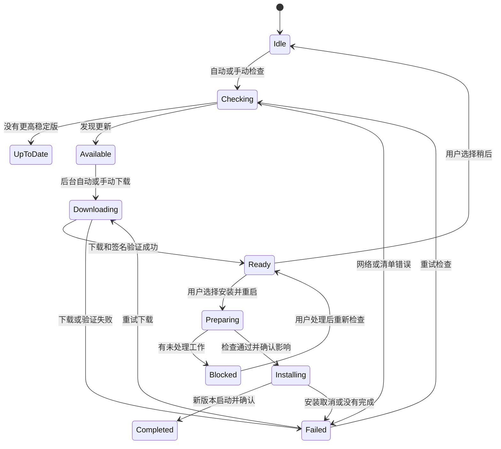

# SoDeck 1.0+ 在线更新功能设计

日期：2026-10-21 | 状态：已实施；本地验证与正式发版边界见[实施记录](online-update-1.0-implementation.md)
版本基线：SoDeck 1.0.0

## 1. 设计意图

从 1.0.0 开始，把 SoDeck 在线更新作为稳定版产品能力：用户能在应用里发现新版本、了解变化、取得更新，并在合适的时机完成安装。更新过程必须可信、可恢复，不能意外打断 SSH、文件操作或远端管理任务。

本文只定义 1.0.0 及以后版本的更新策略，不定义 0.x 到 1.0.0 的迁移行为。现有项目已经接入 Tauri Updater、GitHub Release 清单、签名包和应用内更新界面；实施时应在这条链路上调整策略和体验，不重新引入一套更新框架。

设计结论：

- 默认自动检查稳定版；检查不阻塞启动，也不抢夺窗口焦点。
- 默认在后台下载已发现的更新，用户可关闭此偏好或取消当前下载。
- 下载完成后不自动安装。用户选择“立即安装并重启”或稍后处理。
- 仅对验证过的安装格式开放应用内安装。其余安装方式提供明确的下载或包管理器入口。
- 更新包必须通过应用内置公钥验签；不能用 HTTPS 代替签名校验。

设计时的 0.x 实现已经能自动检查，并支持用户在应用内下载、验签和确认安装，下载由用户主动开始。本文定义的后台自动下载现已进入工作区代码，尚未作为正式版本发布。

## 2. 主流方案与技术选择

自分发桌面应用通常采用“更新清单 + 平台升级包 + 签名验证”的组合。应用可以后台检查和下载，但安装必须走与当前安装方式相符的流程；应用商店和系统包管理器管理的安装则应由原渠道负责升级。

| 方案 | 官方做法 | 对 SoDeck 的启示 |
| --- | --- | --- |
| Tauri Updater | 使用静态 JSON 或更新服务描述版本与平台产物；要求对升级包签名，客户端用公钥验证 | 与当前 Tauri 2 + GitHub Releases 发布链路匹配，继续沿用 |
| Sparkle（macOS） | 支持 EdDSA 更新签名、版本说明和后台定期检查；默认约每 24 小时检查一次 | 后台检查是常见做法；签名密钥需要单独保护，更新说明也应可信 |
| Electron Updater | 将检查、下载完成和退出安装分为不同阶段，下载后再重启安装 | 让下载状态和安装时机分开；不要把“检查到更新”误报成“更新已完成” |
| 应用商店／系统包管理器 | 由商店或包管理器持有安装和提权责任 | 不要让应用内更新器绕过 MSI、DEB 等系统安装管理方式 |

SoDeck 应继续使用 Tauri Updater，不因个别平台差异改成自建安装执行器。当前静态清单与签名发布模式适合现有规模；未来若需要灰度百分比、地区镜像或企业策略，再评估更新服务，不把这些复杂度放进 1.0.0 的首发要求。

## 3. 用户流程与策略

### 检查

- 默认开启自动检查。正式版启动约 30 秒后开始第一次检查，之后成功检查间隔为 24 小时；网络失败使用有上限的退避，不影响应用启动和正常工作。
- “检查更新”始终可手动触发。自动检查关闭后，手动检查仍然可用。
- 1.0.0 首发只使用稳定通道，只提示高于当前版本的正式语义版本。预发布、草稿、同版本和旧版本不进入稳定更新流程。
- 自动检查失败只更新状态，不弹错误对话框。用户手动检查失败时显示可理解的原因和重试入口。

### 通知与下载

- 新版通过关于窗口的轻量提示和系统设置中的版本状态呈现。每个版本最多主动提醒一次；不自动打开模态框，不改变终端焦点。
- 自动下载默认开启。下载在后台进行，设置窗口关闭后继续；用户可以取消下载。状态持续显示版本、已下载大小和进度；若服务端没有可靠总大小，只显示已下载量。
- 取消后保留“发现新版本”状态；本次版本不会被自动下载任务立即重启，用户可手动重试或重新开启后台下载。
- 提供“自动检查更新”和“后台下载更新”两个独立设置。关闭后台下载不影响检查、手动下载或打开发布页。
- 下载失败可以重试，也可打开该版本发布页。签名无效或目标平台不匹配时拒绝安装，不提供绕过校验的按钮。

### 安装与重启

- 下载和签名验证完成后进入“更新已准备好”。安装只由用户发起，不在下载完成、应用闲置或普通退出时自动安装。
- 用户选择“立即安装并重启”后，再执行安装前检查，并列出即将中断的工作。用户可以继续或选择“稍后”；安装器开始运行前不得关闭工作区。
- 未保存的远程编辑、未完成文件操作和结果待确认的 Docker／NetBird 操作阻止安装，提供返回处理入口。活动终端、日志接收和端口转发可以在明确告知影响后由用户确认关闭。
- 安装准备期间阻止新建连接和任务，后端复核一次活动状态并安全落盘。准备失败时解除更新锁，不启动安装器。
- 安装后只有在新进程实际运行目标版本时才显示成功。启动仍处于旧版本时显示“上次更新未完成”，保留重试与手动安装入口。

## 4. 安装格式支持范围

更新目标由运行平台、构建架构和安装来源共同决定，不能只按操作系统选择一个安装器。1.0.0 仅对完成真实安装升级验收的组合开放应用内安装。

| 安装方式 | 1.0.0 策略 | 说明 |
| --- | --- | --- |
| Windows x64 NSIS EXE | 支持应用内下载、验签、安装和重启 | 使用 NSIS 对应的 Tauri updater 目标；安装权限、路径覆盖及取消行为须实机验收 |
| Windows MSI | 在线检查并提供对应 MSI 下载；不由应用内 updater 安装 | 让 Windows Installer 或管理员控制安装；不把用户转换成 NSIS 安装 |
| macOS Apple Silicon `.app` | 条件支持应用内更新 | 使用 `.app.tar.gz` 升级归档；上线前验证应用位置和写入权限，并配置 Developer ID 签名与公证 |
| Linux x64 AppImage | 支持应用内更新 | 仅在 AppImage 文件可写且实际启动入口可替换时开放 |
| Linux DEB | 在线检查并提供对应 DEB 下载 | 安装和提权交给 apt／dpkg；不由普通应用进程替换系统包 |
| 开发构建、未知来源或无匹配架构 | 不提供应用内安装 | 显示发布页和安装方式说明，不猜测升级目标 |

应用内 updater 签名只验证更新包来自持有私钥的一方，不等同于 Windows Authenticode 或 Apple Developer ID 代码签名。系统代码签名与公证决定系统对发布者和安装包的信任提示；应作为 1.0.0 正式分发质量目标单独完成。

## 5. 安全、发布与版本策略

1. 更新清单只能从固定 HTTPS 稳定源读取。清单中的包地址绑定具体版本、平台、架构和安装格式；客户端拒绝任意来源、错误目标及非正式版本。
2. 所有应用内升级包必须使用对应私钥签名；客户端内置公钥并在安装前验签。私钥仅开放给受保护的正式发布 job，并在仓库外保留加密备份。签名密钥轮换必须提前发布兼容方案。
3. 发布 tag 和已公开附件不可覆盖。先完成全平台构建、签名与附件校验，再生成清单并公开稳定版本。清单不得指向草稿或会变更内容的通用下载地址。
4. `1.0.0` 是新支持策略的起点。后续遵循 SemVer，只接受更高稳定版本；不自动降级。若新版本有问题，冻结后续下载并发布更高版本修复，不把降级当作常规恢复流程。
5. 发布说明从单一来源生成清单和 Release 文案。App 内按纯文本或受限 Markdown 展示，不能执行 HTML、脚本或远程内容。
6. 升级保留应用标识、安装位置约定和用户数据目录。涉及数据库结构时执行显式版本迁移，失败不得清空数据；需要回滚的数据迁移必须先做本地一致性备份。
7. 更新状态可以进入本地诊断包，包含版本、阶段、耗时、目标平台和错误类别；默认不上传遥测，不记录服务器凭据、主机名或文件路径。

## 6. Apple Design 交互要求

- **目的与克制**：更新是设置中的常规能力。版本提示使用小型状态标记和短文案，不做营销式横幅、全屏弹窗或循环动画。
- **用户掌控**：自动检查和后台下载分别可关闭；下载可取消；安装明确询问并允许稍后。只有会关闭窗口、断开工作连接的安装动作需要确认。
- **及时反馈**：点击后立即进入检查、下载或准备状态；下载进度连续更新；失败直接说明下一步。状态变化不依赖等待动画结束才能继续操作。
- **空间与层级**：在现有系统设置中使用紧凑、可扫描的更新区；更新说明可展开，安装影响按阻止项与可中断项分组。避免卡片套卡片和无关装饰。
- **可访问性与动态设置**：进度和状态通过辅助技术播报；错误使用文本说明而不只依赖颜色；保持键盘焦点顺序。尊重减少动态效果和提高对比度偏好，状态转场可以退化为短淡入或静态切换。
- **系统一致性**：安装器、权限提示和应用重启行为遵循各平台惯例；不模拟系统权限窗口，也不隐藏发布者、安全或安装位置信息。

## 7. 失败行为

| 情况 | 行为 |
| --- | --- |
| 离线、超时、GitHub 暂不可用 | 保持应用可用，显示上次成功检查时间；支持手动重试和发布页 |
| 清单无效、版本回退或目标不匹配 | 拒绝更新，记录本地诊断信息，不显示安装操作 |
| 包下载中断或磁盘空间不足 | 保留当前应用可运行，提供重试或释放空间提示；损坏包不进入 Ready |
| 签名失败 | 明确说明无法验证来源，拒绝安装，不提供跳过校验 |
| 安装被用户取消或系统拒绝 | 保留当前已安装版本；下次启动依据实际运行版本判断结果 |
| 安装前有未保存或待确认工作 | 阻止安装并给出处理入口；不得静默丢弃或替用户确认 |
| 当前安装格式不支持 | 打开与当前平台匹配的 Release 资产或包管理器说明 |

## 8. 1.0.0 验收

- 从 1.0.0 的稳定客户端发现并完成后续稳定版本升级；版本比较、更新说明和目标产物一致。
- 每种开放应用内安装的操作系统、架构和安装格式都用真实打包客户端完成相邻版本升级。模拟前端测试不能替代安装器验收。
- 检查和下载期间可以正常使用 App；安装前能阻止未保存编辑、文件操作和远端管理待确认事项，并准确列出会断开的会话。
- 更新前后服务器配置、凭据、主机指纹、设置及历史数据保持可用；数据库迁移失败时不清空用户数据。
- 无更新、网络失败、取消下载、损坏清单、无效签名、无权限、磁盘不足、安装取消及重启未到目标版本均有独立结果和恢复入口。
- MSI、DEB、开发构建和未知来源不会出现误导性的“安装更新”按钮。
- 发布流程只有在所有必需平台包、签名和清单验证成功后才更新稳定通道；已发布 tag 与附件不可原地替换。
- 安装期间不强制退出远程工作；用户确认之前可以取消安装流程。

## 9. 不纳入 1.0.0

强制更新、下载后静默安装、预发布频道的普通用户入口、差分包、断点续传、自动降级、自动恢复 SSH／传输／端口转发、企业自建更新源和按用户百分比灰度。若用户量、包体或发布风险证明有需要，再单独设计。

## 10. 参考

- [Tauri 2 Updater 官方文档](https://v2.tauri.app/plugin/updater/)：更新清单、平台产物和强制签名要求。访问日期：2026-10-21。
- [Sparkle 官方文档](https://sparkle-project.org/documentation/)：macOS 更新签名、版本说明与后台检查策略。访问日期：2026-10-21。
- [Electron `autoUpdater` 官方文档](https://www.electronjs.org/docs/latest/api/auto-updater)：检查、下载完成和退出安装阶段。访问日期：2026-10-21。
- [当前实现记录](online-update-implementation.md)：SoDeck 已实现的 Tauri updater、签名发布和安装前工作保护。
