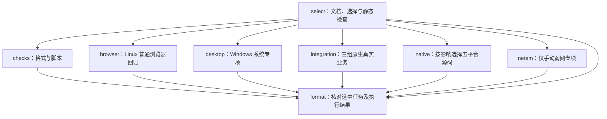

# CI 后续优化计划

日期：2026-11-10。状态：调研与待实施方案；本文件不表示工作流已经调整。

本轮目标是缩短相关改动的反馈时间、降低偶发失败和重复执行成本，同时保留核心与插件的独立交付、五平台原生验证和实际包验收。优先采用 GitHub Actions、Playwright 与现有 Rust 缓存的标准能力，每一步单独提交、验收和回退。

## 一、结论与优化顺序

推荐按以下顺序实施：

1. 补齐测试阶段计时、失败证据和工作流静态检查。
2. 将普通 Chromium 界面回归集中到 Linux，统一等待最终业务状态；Windows 保留系统相关检查。
3. 梳理现有缓存的范围与容量，给后续拆分任务留出预算。
4. 将 Linux 串行远程业务拆为三个原生矩阵任务，测量并行带来的收益和额外成本。
5. 收窄已经证明可以独立验证的路径，并前置插件已发布版本的检查，避免重复打包。
6. 只有测量仍显示瓶颈时，再试验官方 Playwright 容器或网络测试内部的有界并发。

当前成功全量 Check 的关键路径是 Linux x86_64 真实业务任务，不能把取消 Windows 普通 UI 回归描述为整体 CI 减半。缓存也已达到默认容量上限的量级，增加更多缓存副本不是当前首选。

## 二、本次证据与测量口径

### 2.1 当前耗时

本轮读取 GitHub Actions 的 run、attempt、job、step 时间及缓存清单。以下都是本次运行的实际数据，不使用旧版提速记录代替本次测量。

| 范围 | 本次耗时 | 依据与含义 |
| --- | --- | --- |
| 成功全量 Check | 12 分 18 秒 | [42766195900](https://github.com/BgaSol/soDeck/actions/runs/42766195900)，提交 `67c1fbc6debf8b72634a1e459c17893a38503f7a`，首次运行成功 |
| Linux x86_64 真实业务 | 11 分 48 秒 | 同一 Check 的关键路径；网络 279 秒、文件 104 秒、终端 10 秒、状态 47 秒、Docker 业务 71 秒、Docker UI/包 9 秒、组件通信 18 秒 |
| Linux ARM64 网络业务 | 7 分 23 秒 | 网络步骤 319 秒；原生依赖 53 秒、Rust 缓存恢复 29 秒、浏览器安装 20 秒 |
| Windows x86_64 desktop | 5 分 34 秒 | 普通 `ui:test` 160 秒、真实 SSH 84 秒；包含环境准备 |
| 五平台原生源码测试 | 最慢 4 分 59 秒 | Windows ARM64 为 299 秒；其余为 236～284 秒，各平台并行 |
| 公共 checks | 1 分 23 秒 | 浏览器依赖安装 43 秒；前端构建约 1 秒，脚本约 2 秒 |
| 核心原始包运行 | 最慢平台任务 5 分 18 秒 | [42763702817](https://github.com/BgaSol/soDeck/actions/runs/42763702817)，提交 `066df9ec5ed6a0d7fea9c4a4d41e25472995d32e`；首次 metadata 失败后只重跑 metadata，成功步骤 60 秒 |
| 终端独立打包 | 2 分 33 秒 | [42763703046](https://github.com/BgaSol/soDeck/actions/runs/42763703046)，包括等待、五平台任务与 Release 汇总 |
| 五平台实际包组合 | 2 分 13 秒 | [42764368478](https://github.com/BgaSol/soDeck/actions/runs/42764368478)，最长平台任务 94 秒 |

网络 job 日志进一步显示：`network_socks_protocol` 本身执行 138.04 秒，`network_socks_lifecycle` 执行 34.53 秒；该 job 首次核心测试编译 27.35 秒、随后 catalog 夹具编译 15.39 秒。网络步骤的 279 秒并非全部是编译，不能指望增加 Rust 缓存消除它。

成功 Check 的所有 job 运行时间合计约 48 分 27 秒。这个数字用于比较执行成本，不等于 GitHub 计费分钟；账单还取决于平台、runner 和仓库计划。工作流总耗时、job 运行耗时、等待 runner 的时间及失败恢复时间分别记录。第二次 attempt 返回的历史成功 job 时间不能再次算作重跑成本。

### 2.2 稳定性与缓存

首次 [Check 42763617373](https://github.com/BgaSol/soDeck/actions/runs/42763617373) 的公共浏览器安装步骤等待约 889 秒后取消，属于 Ubuntu 软件源长尾。现有软件源修正已经接入；仍需通过新样本验证稳定性，不能据一次通过宣称根除。

Windows 工作台测试的已确认原因是读取异步停靠/展开布局过早。延迟移侧 RPC 可以复现，等待实际状态后通过。Linux 迁移负责统一环境，状态等待负责消除这类竞争；两项工作都要做。

缓存快照共 56 项，约 9.61 GiB：

| 缓存用途 | 项数 | 容量 |
| --- | --- | --- |
| 日常 `check-tests` | 11 | 4.10 GiB |
| 真实业务 `network-tests` | 2 | 2.04 GiB |
| 核心 `core-release-v2` | 5 | 2.42 GiB |
| npm 下载 | 28 | 0.96 GiB |
| 插件发行依赖 | 10 | 0.08 GiB |

GitHub 官方默认缓存上限为 10 GB，允许配置更高上限并可能产生费用。本轮未读取仓库自定义配额，也未证明正在发生淘汰；9.61 GiB 与默认上限处于同一量级，足以要求新增缓存前先核算容量。过期分支、旧工具链及不同输入键可能有合理副本，不能只按名称相似删除。

已有发布优化继续保留：源码检查移出打包、稳定的 `core-release-v2`、按改动选检查、同一份包复用发布、只恢复失败平台或 metadata。详见 [既有方案](plan-release-performance.md) 和 [实施记录](implementation-release-performance.md)，不将它们重新列为待开发能力。

## 三、成熟项目提供的参考

| 来源 | 已核对的做法 | SoDeck 的采用方式 |
| --- | --- | --- |
| [Playwright CI](https://playwright.dev/docs/ci)、[断言](https://playwright.dev/docs/test-assertions) | CI 示例使用 Ubuntu，推荐单 worker；自动重试断言等待目标状态；通常不建议缓存浏览器二进制 | 普通浏览器回归在一个 Linux job 串行执行，使用自动等待，保留锁定版本 |
| [Playwright tracing](https://playwright.dev/docs/trace-viewer) | Library 可直接使用 `browserContext.tracing`；无需先迁移整套 Test Runner | 先给现有脚本增加失败 trace、截图和日志；首次失败仍算失败 |
| [Tauri 实际应用 E2E](https://github.com/tauri-apps/tauri/blob/dev/.github/workflows/test-api-e2e.yml) | Linux、Windows、macOS 分平台执行；Windows 处理 WebView2 driver/进程完整性，Linux 使用虚拟桌面 | 保留原生 WebView 和实际包测试，按系统适配，不把普通 Chromium 当原生验收 |
| [VS Code Windows 测试](https://github.com/microsoft/vscode/blob/main/.github/workflows/pr-win32-test.yml) | 浏览器、Electron/Node 与实际 smoke 分开；大型项目还使用大 runner 和分片 | 借鉴分层；不照搬大型 runner、复杂镜像与分片规模，也不声称其他项目不跑 Windows UI |
| [Electron Fiddle CI](https://github.com/electron/fiddle/blob/main/.github/workflows/ci.yml) | 多平台真实应用 E2E/打包烟测，保留截图和进程输出 | 保留平台包烟测并补齐失败产物 |
| [GitHub 矩阵](https://docs.github.com/en/actions/how-tos/write-workflows/choose-what-workflows-do/run-job-variations)、[官方 Artifact action](https://github.com/actions/upload-artifact) | 矩阵可限制并发；平台产物分名、不可变；可设置保留时间 | 用标准 job/matrix 拆分，分别输出结果和证据，不自建任务调度 |
| [actionlint](https://github.com/rhysd/actionlint) | 检查 Actions 语法、表达式、inputs、needs 和 runner 标签 | 增加固定版本的开发检查工具，提前发现工作流错误，不增加生产依赖 |

上述外部项目工作流读取于 2026-11-10，链接为其滚动分支，用于说明成熟做法；本项目的验收仍以具体提交和 run 为准。

## 四、目标检查分工与边界

| 层次 | 默认执行位置 | 验证内容 | 核心与插件边界 |
| --- | --- | --- | --- |
| 文档、工作流选择与静态检查 | Linux x86_64 | 文档链接、选择规则、工作流语法/表达式 | 工程工具，不加载插件，不构建产品 |
| 格式、类型、脚本 | Linux x86_64 | 受影响 Rust 格式、TypeScript、构建/发行脚本规则 | 按核心/各插件分别选择；共享输入才扩大 |
| 普通浏览器回归 | Linux x86_64 | DOM、模拟窗口/IPC、真实 catalog/workspace 夹具、正式 dist 的布局与交互 | 核心测工作台/宿主契约；插件 UI 用各自入口；测试夹具不发行 |
| 原生源码测试 | 五个原生目标，按影响选择 | 系统路径、进程、存储、连接与平台分支；选中插件的源码 | 核心与插件分别运行自己的测试，不让核心发布等待插件 |
| 真实 SSH/远程业务 | Windows 系统相关 SSH；Linux 网络两架构与其他业务 x86_64 | SSH、PTY、SFTP、SOCKS、状态、Docker、跨组件状态 | 实际业务插件独立打包后经核心 API 工作；跨插件通信仍经核心 |
| 实际发行包 | 五个原生目标 | 架构、核心更新签名、包内程序启动/退出、持久化及独立插件组合 | 核心包不包含业务插件；核心烟测与组合验收保持独立入口 |
| 系统指针、多屏与混合 DPI | 可交互的本机桌面专项 | 操作系统指针、原生跨窗拖动、真实显示器坐标 | 不用 hosted runner 的普通 Chromium 结果代替；受影响发行明确记录实测情况 |

第一轮调整后的 Check 结构如下，所有选中任务的结果仍进入现有稳定状态 `format`：

这张图只表示 Check。核心打包、插件打包、实际包组合和升级专项仍是独立工作流；不新增串联所有组件的发布门禁。正式发布前仍核对包来源提交的相关检查和五平台实际包证据。

## 五、分阶段实施

### 第一步：让失败和耗时可诊断

**可验收行为：** 失败时能看到失败套件、运行平台、准备/构建/执行阶段、关键断言和进程输出；选中的检查被跳过或丢失时，最终状态失败。

修改位置为 `.github/workflows/check.yml`、相关 `scripts/test-*.mjs`、`scripts/select-checks.mjs` 和其现有测试。

- 给长业务脚本输出结构化阶段耗时，先覆盖 `test-openssh.mjs` 的打包、Rust 构建/测试、浏览器与清理；汇总附 SHA、suite、平台、attempt。job 和队列时间使用 Actions 现有元数据，不创建常驻性能服务。
- 现有 Playwright Library 直接启用 `context.tracing`。失败导出 trace、截图、page/console 错误、相关核心/插件输出及结果 JSON；成功保留小结果并删除大 trace。清理资料之前导出，原始异常不能被截图或清理失败覆盖。
- 各 job 在 `if: always()` 下上传独立命名的诊断目录。CI 超时前尽量让脚本自己的有限超时退出并写报告；进程强杀可能没有完整 trace，需要保留已有输出。
- UI 诊断默认保留 14 天；发行来源和实际包报告沿用现有 30 天。仅收集隔离测试资料，不打包整个用户数据目录或真实认证资料。
- 增加固定版本 actionlint，在相关 CI 输入变动时检查所有工作流；纯文档改动仍只运行既有 Node 文档检查。工具从公开固定 Release 获取，适配现有 ARM runner 标签；现有本地 `scripts:test` 不因缺少 actionlint 而无法运行。
- 软件源准备复用现有 `configure-ubuntu-mirror.mjs`。重复的 Linux 依赖步骤可提取一个小 composite action，输入只表达所需库/工具，缓存与业务命令留在各 job；核心打包不能因此安装 OpenSSH、Chromium 或业务插件。

验收时分别故意触发浏览器断言失败、子进程非零退出、选中 job 缺失/取消和无效 workflow 表达式，确认有可读证据并保持失败。故障注入仅用于开发验收，不提交永久失败条件。此阶段可独立上线，发生诊断开销过大时先回退大 trace，保留结果与失败日志。

### 第二步：集中普通浏览器回归并统一状态等待

**可验收行为：** 相关前端改动默认在 Linux 完成既有普通 UI 覆盖；Windows 系统专项、五平台源码及实际包覆盖不因迁移减少。延迟 RPC 或动画完成时断言仍稳定，目标状态永远不出现时测试明确失败。

修改位置为 `check.yml`、`package.json`、`select-checks.mjs` / `select-checks.test.mjs` 和核心 UI 脚本。

- 增加 Linux x86_64 `browser` job，按实际选中的核心 UI/终端输入入口执行。格式和脚本检查不再为普通 UI 安装 Chromium。每个测试入口有一个默认 owner；交互、设置和终端输入的同一模式不重复执行，`--desktop-script` 等不同模式保留各自断言。
- 首轮继续沿用 Node 脚本、单 Chromium、顺序执行。已验证现有 `playwright@1.65.0` 的 `playwright/test` 导出 `expect`、`expect.poll` 和 `test`，可以先复用成熟断言，不必新增依赖或立即重写所有套件。
- 等待对象是 RPC 结果、业务状态、最终 DOM 投影、已完成的布局尺寸或明确事件。统一使用 locator 自动断言或有界 `expect.poll`；纯函数结果继续使用普通 assert。避免增加固定 sleep、缩减断言或无条件重跑整套来掩盖失败。
- Linux 环境必须包含 GTK/WebKit、Rust、实际目录核心夹具及其执行权限。核对 workspace 夹具复制后的 Unix 执行位、路径、归档工具、字体与平台分支；不能只安装浏览器就宣布迁移完成。
- 正式 dist 仍实际生成后加载。前端构建当前约 1 秒，不为省这 1 秒添加跨 job 的大 dist Artifact 传输；只有重复构建测出明显成本才提取准备步骤。
- Windows 自动 `desktop` 改为 SSH/系统适配等实际需要 Windows 的检查。迁移期保留手动 `desktop` 的完整 Windows 对照入口，明确标为额外验证；同步更新 `standard`、`all`、选择摘要和汇总预期，不能静默改变手动套件语义。
- 后续若 Library 脚本维护仍困难，按完整测试文件逐个迁移 Playwright Test 的 fixture、reporter 与 timeout。CI 初始 `workers: 1`；不先开 sharding、多浏览器或自动 retry。重试诊断不能把首次失败从记录中抹掉。

验收包括 Linux 全套、Windows 对照、移侧 RPC 延迟 800ms、展开尚未完成及目标状态永不完成。核对迁移前后测试清单；操作系统 API 专项仍在其原生平台。若出现未处理的平台差异，可单独恢复该文件的 Windows 默认执行，不回退已修复的状态等待。

### 第三步：梳理缓存预算与隔离

**可验收行为：** 空缓存可完整构建；热缓存只节省准备/依赖编译时间，不复用旧产品字节。新增任务没有制造失控的大缓存副本。

修改位置为 `check.yml` 和确实需要对齐的 cache 配置；发行缓存名称继续使用 `core-release-v2`。

- 对照当前工具链、OS、架构、Cargo 输入、缓存目录和最后访问时间，区分仍有用的分支缓存与旧配置副本。清理只针对确认不再使用的缓存 ID；本方案不执行删除。
- 核心发行、日常源码、真实业务和单插件缓存保持用途隔离。只有输入与编译用途相同的任务才对齐现有 key/workspaces/env；不把 release/debug、Windows ARM/x64 或不同 feature 的输出混用。
- 继续使用固定的 Swatinem/rust-cache，保留其工具链/环境/清单隔离，main 成功运行保存。新增 browser/integration job 优先复用适用的既有依赖键；共享键恢复到各 job 独立磁盘，不能多进程写同一 target。
- npm 缓存只包含下载内容，按实际锁文件配置；不缓存 `node_modules`。Rust 不因拆 job 就开启整个 workspace/incremental 缓存；不缓存测试数据、系统 APT 安装状态、发行包或签名结果。
- 初始管理目标为缓存占用约 8 GiB 以下，预留增长空间；这是待核对实际配额后的操作目标，不是 GitHub 的新限额。保留正式发行依赖的收益，不能为数量好看一次删掉核心热缓存。

用固定源码分别测冷/热恢复、失效后重建和多平台 key 隔离。若减小缓存导致编译增量成本超过恢复节省，恢复原范围。更高付费容量、sccache 或预热任务需要新的成本证据，本轮不默认采用。

### 第四步：拆分当前真实业务关键路径

**可验收行为：** 网络与其他业务可以并行，单项失败后只重跑对应矩阵任务；现有真实 SSH、PTY、SFTP、SOCKS、状态、Docker 和组件通信断言全部保留。

首轮只将现有 integration 矩阵调整为下列三行，用标准 `include`、`fail-fast: false` 和最多 3 个并发任务：

| 行 | runner | 内容 |
| --- | --- | --- |
| network-linux-x86_64 | ubuntu-22.04 | 现有完整网络业务与网络 UI |
| network-linux-aarch64 | ubuntu-22.04-arm | 同样的网络业务，原生 ARM64 |
| business-linux-x86_64 | ubuntu-22.04 | 被选中的文件、终端/shell、状态、Docker/UI/包及组件通信，组内顺序执行 |

修改位置为 `select-checks.mjs`、其测试和 `check.yml`；只有准备成本测出明显重复时才改 `test-openssh.mjs` / 打包夹具入口。

- 按选择结果生成实际矩阵；文件单插件变化不能额外拉起两个网络 job。通信仍使用真实的终端、文件和状态插件组合，经核心 API 验证。
- 每个 job 有独立端口、OpenSSH 数据、临时目录、核心实例和 Cargo target。业务脚本不在同一目录并行，Windows target 始终顺序使用。
- 依赖安装按组需求，Docker 只在 business 行安装/启动。网络 ARM64 不为不运行的业务恢复整套插件目录；减少范围前核对缓存恢复命中变化。
- 不新增统一“全部插件包”作为核心构建输入。若两个真实消费者确实需要同一测试夹具，才考虑按同 SHA/原生 target 输出小型只读 Artifact；必须测量传输成本、保留可执行权限/摘要，并重新核对各插件独立清单。

用本次步骤做初步估算：网络 x86_64 约为原准备成本加 279 秒；business 的业务执行合计约 260 秒，但需要重新承担首轮核心/夹具编译。原 ARM64 网络仍约 443 秒，因此全量 Check **可试验的目标为约 8～9 分钟**。这不是交付承诺，新增 job 排队、缓存命中和重复构建可能抵消收益。

阶段验收要求用 3～5 个可比成功样本确认全量中位耗时至少下降约 20%，同时 job 总运行时间增加不超过约 15%，失败恢复粒度和覆盖完整。若收益不足，回退三行拆分；保留计时和失败证据，不再继续把每个插件拆成大矩阵。

### 第五步：收窄检查选择与插件发布预检

**可验收行为：** 只改 CI 自身或某组件纯界面时，运行能证明该变化正确的检查；未知输入仍保守扩大。已正式发布的同版本同源码不会再启动五平台重复打包，也不会覆盖附件。

检查选择修改位置为 `select-checks.mjs` / `select-checks.test.mjs`、`check.yml`：

- 明确映射已知 `.github/workflows` 与本地 action。只改 Check 的 job 条件、矩阵或缓存时运行 actionlint、选择/汇总回归及实际受影响的手动套件；只改打包/验收工作流时运行相关脚本检查，并对该入口做匹配的打包或包验收。未映射脚本、锁文件和工具链继续扩大。
- 共享 CSS/字体/菜单可选择核心与相关插件 UI，而不必自动重跑所有后端业务；只能在纯 UI 入口能完整独立运行后收窄。无法脱离真实核心/插件的交互仍跑业务套件，不能按文件扩展名猜测无影响。
- 保留 Check 始终响应 PR/main，不使用 workflow 级 `paths` 跳过稳定 required status。`format` 的 `if: always()`、选中任务失败/取消/缺失即失败，以及未选中显示 skipped 的行为必须有回归。
- 选择规则继续放在现有脚本，不增加依赖图服务、组件注册中心或另一套 YAML 选择器。

插件发布修改位置为 `.github/workflows/plugin.yml` 与现有 `release-metadata.mjs` / 测试：

- 将当前 release job 才执行的“正式版本不可覆盖”检查前置到 select，在启动平台包之前查询精确 tag/Release。发布时 GitHub 补建 tag 曾触发 [重复包运行 42768600594](https://github.com/BgaSol/soDeck/actions/runs/42768600594)，该运行已取消，不是发行来源。
- tag 对应源码、插件版本、平台附件与清单都匹配且 Release 已正式发布时，输出已发布/跳过说明；任一冲突明确失败。查询失败也明确失败，不把网络错误当作未发布。
- 草稿继续允许完善，但不能静默替换不同来源的同名附件。复用核心现有的来源/摘要核对思路，所需逻辑放在发行脚本；不把插件业务引入核心 API 或运行时。
- 核心继续用现有精确原始 `core_run_id` 复用，不取“最近一次 run”。插件若以后确有失败平台恢复需求，先使用 Actions 原生失败任务重跑；不同时复制整套核心发布框架。

验收覆盖仅文档、核心 UI、插件 UI、平台适配、共享 Rust、工作流、自定义 action、删除/重命名和未知路径；发布预检覆盖不存在、草稿、已正式发布同源码、同版本不同源码、缺附件及 API 错误。回退时可以恢复保守选择或前置失败，正式附件仍不可覆盖。

### 第六步：只对剩余瓶颈做专项试验

此阶段不是第一轮必做项，前五步测量结果决定是否进入。

**官方 Playwright 容器：** 当前浏览器准备约 20～52 秒，曾有软件源长尾。先保留固定 Ubuntu runner 与镜像修正；若多个新样本仍显示安装不稳定，再用 [官方容器](https://playwright.dev/docs/docker) 做并列试验。镜像必须与锁文件的 Playwright `1.65.0` 精确匹配，并确认镜像/系统库/Rust 夹具可用；不能照抄网页示例 `1.64.1`。比较拉取时间、额外 GTK/WebKit/Rust 准备和失败率，收益明确后才切换。不先维护自定义镜像或镜像预热服务。

**网络测试内部并发：** 给 `network_socks_protocol` 增加子阶段计时，分清协议拒绝、传输、16/64 连接容量与回收的成本。如果确认顺序建立 64 条独立连接占主要时间，试验 Tokio `JoinSet` 等现有能力的有界并发，完整保留连接数量、全部回执、上限拒绝、释放后再接入以及清理断言。存在顺序业务前提的阶段不并发；34 秒级生命周期测试正在验证真实超时，不能缩短生产超时来换取 CI 数字，也不能用单进程虚拟时钟冒充跨进程网络验证。

如果仍需 UI 分片，先完成独立 fixture/临时目录和报告合并，再使用 Playwright Test 的标准 sharding；当前约 160 秒的普通 UI 不是首要拆分对象。

## 六、验证、交付与回退规则

每阶段一个主题提交。实施时同步受影响的 `docs/development.md` 或 `docs/distribution.md`，实际结果集中记录到对应 CI 实施记录，新增文件补文档索引。根 README、核心版本和插件版本不因纯 CI 优化变化。

| 改动 | 必须验证 |
| --- | --- |
| 仅方案文档 | 文档结构/本地链接检查、`git diff --check` |
| 工作流/选择脚本 | actionlint、选择与汇总测试、`scripts:test`，同一源码下实际运行受影响套件；若改打包入口还要验收对应原生包 |
| UI 测试迁移/等待 | Linux 全套、Windows 对照、延迟/未完成/失败注入，测试清单一致；相关格式、类型与正式前端构建 |
| 业务矩阵/夹具 | 两个原生 Linux 网络任务、被影响的真实业务、并行资源隔离及清理、冷/热准备；相关格式/构建/测试 |
| 发行预检 | 同源码/不同源码、草稿/正式/不存在、附件和查询失败回归；隔离测试草稿验收，核对正式附件未变 |
| 核心或插件打包行为改变 | 对受影响组件保留五个原生系统/架构的打包与实际包启动/退出；发行记录核对精确来源与实际范围 |

性能样本至少包括普通核心 UI 改动、单插件 UI/Rust、核心系统适配、共享输入全量和 docs-only；分别记录冷/热缓存，先报告 3～5 个可比样本的中位数与范围。尚无足够样本时不报告 P95、不宣称稳定性达到某个百分比。自动取消旧 Check 不记作测试通过，失败后的第二次成功与首次失败分别保留。

第一轮成功标准是：测试清单和平台覆盖完整、失败有证据、required status 不漏检、缓存增长可控、全量反馈有可测收益。若并行或缓存调整反而增加耗时/成本，回退该步骤，不删除真实业务断言。

## 七、当前不采用的方案与未完成项

当前不采用自建 Windows/ARM runner、专用环境镜像、sccache、全套浏览器三平台/多浏览器矩阵、盲目重试、定时缓存预热、自建发布调度服务或全组件联动门禁。已有 hosted 原生 runner、标准矩阵、官方缓存与 Artifact 足以完成第一轮；额外服务会增加维护和成本，当前证据尚不支持。

本次仅完成现状审计、成熟方案调研和规划。普通浏览器迁移、诊断上传、actionlint、缓存调整、三组业务并行、选择收窄和插件预检均未实施；也未删除缓存、修改仓库配额/分支保护、重跑产品发布或新增依赖。预计收益、镜像可用性、实际缓存上限与新样本稳定性留待各阶段验收。

相关入口：[开发与检查范围](development.md#版本与持续集成)、[发布流程](distribution.md)、[文档索引](README.md)。缓存规则参考 [GitHub 官方说明](https://docs.github.com/en/actions/reference/workflows-and-actions/dependency-caching)。
