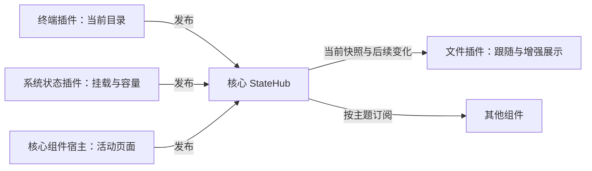

# 组件通信与共享状态功能设计

整理日期：2026-11-08。状态：已整体实现，本机验收与支持限制见[实施记录](implementation-component-communication.md)。本文保留目标行为和接口方向，当前可调用接口以插件 API 为准。

设计遵循 [开发约定](../AGENTS.md)、[架构边界](architecture.md)和[功能设计方法](plan-feature-design.md)。当前可调用接口仍以[插件 API](plugin-api.md)为准。

模块、线协议、分帧确认和具体调用点见[代码实施方案](plan-component-communication-coding.md)。

## 1. 对需求的理解

你希望组件能够共享它们已经知道的事实，并在事实变化时自动协作。例如终端知道当前目录，文件组件据此定位；系统状态插件知道挂载点和容量，文件组件据此补充展示。新增一个提供数据的插件，已有组件只要理解同一份数据约定，就能使用它。

因此，推荐由核心提供**共享状态服务（StateHub）**：保存当前状态、接受组件更新、按订阅分发变化。它类似 Vuex 的 store、commit 和 subscribe，但状态的权威副本位于核心进程，插件通过 RPC 访问，页面只持有展示所需的副本。

这里的“缓存”是可重新采集的运行时状态，不是数据库，也不是多个进程直接读写同一块内存。

希望获得的能力是：

- **后打开也能读取。** 系统状态插件先采集，文件面板之后打开，仍能立即取得当前挂载信息。
- **变化自动传播。** 消费者订阅关心的主题，不需要定时询问另一个插件。
- **共同提供数据。** 不同组件向同一共享空间贡献事实，各自保留明确来源。
- **组合可选。** 缺少终端或系统状态插件时，文件组件仍能独立工作。
- **连接边界可靠。** 多台服务器、同服务器多个工作区、重连和拆窗不会串用数据。

## 2. 首批用户行为与范围

### 2.1 终端目录与文件树联动

1. 用户在当前终端进入 `/var/log`，终端确认实际工作目录后发布新状态。
2. 同一工作区的文件面板开启“跟随终端”时，展开祖先目录和目标目录，并滚动定位到 `/var/log`。
3. 焦点留在终端，不打开文件、不切换中央编辑器、不弹出隐藏的文件侧栏。
4. 切换到另一个终端时，文件树跟随该终端最近一次有效目录；后台终端产生输出不改变跟随目标。
5. 文件面板晚于终端打开时，先读取当前目录，再接收后续变化。

推荐默认开启“跟随终端”，在文件面板提供开关。开关是文件插件已有设置体系中的用户偏好；当前跟随对象和最近处理版本是运行时状态。首次接入应使该行为和关闭入口可见。

用户手动浏览文件树不立即触发回跳，下一次有效的终端目录变化才继续跟随；关闭跟随后完全保留手动导航。重新开启时立即定位一次。中央切换到非终端组件时暂停跟随，保留当前目录；点击侧栏不算更换中央活动组件。

### 2.2 系统挂载信息增强文件展示

1. 系统状态插件在已有后台采集中获得挂载点、文件系统类型、设备及容量信息，发布适合其他组件消费的数据。
2. 文件组件读取并订阅这些状态，在对应目录或盘符旁显示挂载标识；详情按可用数据展示设备、类型、只读状态、总量、可用量和采集时间。
3. 后续采集更新后，仅更新相关信息，不重建整棵目录树，不改变选择和滚动位置。
4. 已确认卸载时移除挂载增强信息；目录是否存在仍由文件服务确认，不能因为挂载记录消失就删除目录节点。
5. 采集暂停、失败或信息过期时，显示“上次采集”或暂不显示数值；不能把未知容量显示成 0。

文件组件不为这项增强再扫描一遍系统，也不负责启动或控制系统状态插件。系统状态面板隐藏时，沿用已有后台采集；未安装、未启用或不支持目标系统时，文件浏览正常工作。

### 2.3 第一版交付内容

包含通用状态读写、当前快照、事件订阅、来源与连接隔离、释放清理，以及上述两个完整联动场景。终端目录自动识别的实际 shell 覆盖范围必须随实现明确验收，不能只完成状态 API 就宣布联动完成。

第一版不增加通用命令总线、跨插件函数调用、持久化 store、历史回放、分布式同步、任意脚本 reducer 或 Vue/Vuex 生产依赖。现有组件设置、文件传输任务、终端输出和日志继续使用各自接口。

## 3. 现状与需要补齐的部分

| 已核实的现状 | 对方案的影响 |
| --- | --- |
| [核心 RPC 分派](../src-tauri/src/plugins/dispatch.rs)已有 session、files、terminal、settings 等入口，没有通用共享状态读写与订阅入口 | 新增可选核心能力，不能把本文方法写成当前已支持 |
| [Context](../src-tauri/src/workspaces.rs)包含 `workspaceId/serverId/connectionId/generation`，重连递增 generation | 直接复用完整 Context，不单按 serverId 缓存 |
| [组件宿主](../src-tauri/src/component_ui/host.rs)与[页面宿主](../src/components.ts)已有逻辑 view、surface、移窗及 sender 绑定 | 运行时记录归逻辑 view；页面订阅和挂载相关的回调归 surface |
| [终端进程](../plugins/terminal/src/main.rs)目前管理 PTY 创建与关闭，[终端页面源码](../plugins/terminal/ui-src/view.js)管理输出呈现，没有发布当前目录的业务链路 | 目录识别、发布和恢复必须一起补齐；ui/ 为构建产物 |
| [系统状态调度器](../plugins/system-status/src/scheduler.rs)已有后台采集、Context 检查、分组时间和有界缓存 | 复用已接受的采集结果，不增加第二套采集调度 |
| [挂载解析](../plugins/system-status/src/collectors.rs)和[指标转换](../plugins/system-status/src/metrics.rs)当前只覆盖部分信息；Linux 挂载路径有文件系统类型筛选和 512 条上限，容量分批采集 | 不能直接把现有内部数组称为完整挂载清单；必须表达覆盖范围和每批数据时间 |
| [文件树](../plugins/files/ui/tree.js)已有定位、逐级展开和导航状态 | 为现有定位流程增加可取消的跟随入口，不另写目录浏览器 |
| 控制 RPC 有 64 KiB 帧上限，UI 控制事件有 24 KiB 上限，现有 SDK 使用请求/响应处理核心来信 | 状态必须小型化、分页、有界分发；不能直接广播完整监控快照或假定无 ID 通知已经可用 |

当前没有证据证明任意远程 shell 都能准确报告 cwd，也没有证明所有平台的挂载路径都与文件服务路径一一对应。这两项是业务适配与验收重点。

## 4. 职责与整体结构



| 层次 | 负责 | 不承担 |
| --- | --- | --- |
| 核心 StateHub | 记录保存、来源附加、Context 校验、修订号、订阅与有界分发、生命周期清理 | shell 解析、挂载扫描、容量计算、文件树展开规则 |
| 核心组件宿主 | 发布已提交的中央活动 view，维护逻辑 view 与页面归属 | 判断哪个业务插件“应该联动” |
| 数据生产插件 | 获得真实业务结果、转换公开数据、决定何时更新和失效 | 直接操作其他插件页面或内部状态 |
| 数据消费插件 | 选择相关数据、检查新鲜度、实现联动或展示 | 将缓存存在当成远程操作成功 |
| 插件页面 | 输入与渲染、使用已有宿主桥、清理页面订阅 | 持有跨窗口权威状态或伪造来源 |

核心不包含针对 `sodeck.terminal` 或 `sodeck.system-status` 的业务分支。公开主题约定可由其他插件实现；文件组件依赖数据语义，而非另一个插件的 RPC 方法。

## 5. 状态组织与“共同维护”

### 5.1 一条记录的身份

推荐身份为：

```text
完整 Context + topic + producer + key
producer = 核心绑定的 pluginInstanceId + viewId
```

`topic` 表示公开数据契约，如 `terminal.location.v1`；`key` 表示该来源贡献的一条记录，如 `current` 或一个挂载标识。核心自身发布的宿主事实使用核心来源。

核心附加 `pluginId/pluginInstanceId/viewId/receivedAt/revision`，不接受插件覆盖这些字段。插件提交业务值、观测时间和对应的预期修订号。记录只保存 JSON 值；禁止把连接对象、密码、私钥、文件正文或终端输出放入该空间。

第一版只支持工作区当前连接范围。一个工作区拆出或移回窗口，Context 与状态不变；同一服务器另开工作区不共享这份运行时状态。将来确有跨工作区复用需求，再单独定义服务器级缓存及其认证和文件系统视角。

### 5.2 共同维护采用“各来源贡献，同主题读取”

任意已加载插件都可以使用共享服务，没有权限声明、逐项授权或审批。一个主题可以有多个生产者；每个生产者维护自己的记录，读取方可以看到同主题的全部贡献。

例如终端 A、B 各自维护 cwd，系统状态插件维护挂载观测，文件插件可以维护自己的文件选择事实。它们共同组成共享状态，文件树的展开集合仍留在文件插件内部。

**第一版不允许一个插件直接覆盖另一个来源的事实。** 这是来源与资源生命周期规则：终端 B 不能把终端 A 的目录改掉；文件组件不能把系统采集结果改成自己的猜测。若用户所说的“共同维护”还包括多个插件修改同一业务字段，需要为那个具体业务定义唯一提交入口和冲突处理，作为另一个可验收场景补充，不能默认最后一个到达者覆盖。

多个生产者报告同一个挂载点时，文件组件保留来源区分。首批选择一个提供挂载契约的来源，同一次展示使用该来源的拓扑与容量；运行中不按更新时间来回切换。多个候选同时存在时允许用户选择，已选来源退出后显示不可用，不静默拼接冲突数据。

### 5.3 三类信息分开处理

| 信息 | 处理方式 | 例子 |
| --- | --- | --- |
| 当前事实 | 写入 StateHub，后来的订阅者也能读到 | cwd、挂载点、活动中央页面 |
| 一次性请求 | 使用相应核心动作 API，必须有结果与错误 | 打开页面、上传、删除、请求执行命令 |
| 组件局部状态 | 留在所属插件或已有设置服务 | 光标、展开节点、滚动位置、跟随开关 |

状态变化事件只是“当前事实改变了”的通知。第一版不另建任意事件发布 API，避免把“请删除文件”这样的动作存进可重放缓存。

## 6. 最小接口与一致性

以下名称是提案。通过核心可选 capability `sharedState.v1` 发现，沿用 API v1 主版本和现有 JSON-RPC，不改成同步进程共享内存。

| 接口方向 | 方法 | 语义 |
| --- | --- | --- |
| 插件 → 核心 | `state.get` | 按完整记录身份读取当前值或不存在状态及修订号 |
| 插件 → 核心 | `state.list` | 按主题、可选来源和 key 读取分页快照；使用不透明游标 |
| 插件 → 核心 | `state.put` | 以 `expectedRevision` 原子替换本来源的一条记录，返回提交后的记录修订号 |
| 插件 → 核心 | `state.remove` | 按预期修订号删除本来源记录，返回删除后的修订号 |
| 插件 → 核心 | `state.subscribe` | 原子建立订阅并取得初始快照第一页及基准修订号，后续页通过 `state.list` 读取；原订阅可通过相同客户端 ID 续订 |
| 插件 → 核心 | `state.unsubscribe` | 幂等释放订阅和未读快照 |
| 核心 → 插件 | `state.changed` | 带订阅 ID、Context、覆盖修订区间和变化条目的有界通知请求；插件入队后快速应答 |

进程调用携带自有 `viewId` 和 `expectedContext`，核心核对实际实例和完整 Context。跨来源读取不会变成跨插件调用。首批后台生产者复用已有后台逻辑 view，不为无 view 的全局服务预建新身份体系。

订阅过滤器只支持明确的主题集合、可选来源和 key，不支持任意表达式。读取与订阅返回当前范围状态 `active/frozen/disconnected`；范围关闭后返回 `scopeClosed`。这样，晚打开的消费者也能区分旧观测和当前可用事实，不依赖曾经收到过断线事件。

主要错误按现有结构化错误方式返回：`invalidParams/staleContext/workspaceClosing/revisionConflict/resourceLimit/snapshotExpired/subscriptionExpired/scopeClosed`。参数和版本错误修正后再调用；快照或订阅过期重新同步；旧 Context 结束当前联动；超限不立即无间隔重试。

页面通过既有宿主桥接入，宿主固定真实 surface/view/Context。页面订阅投影到同一核心服务，不在每个窗口另设 store；旧 surface 失效后，其写入及回调都不能生效。涉及后台业务的数据由插件进程订阅，不能要求 iframe 一直存在。

### 6.1 修订、重复写入与迟到结果

- 核心在每个 Context 内分配单调递增修订号，以十进制字符串跨 RPC 传递；不依赖 JavaScript 大整数精度。每条记录保存最后一次改变时的修订号。
- `expectedRevision` 匹配才提交，否则返回 `revisionConflict`。首次从未存在的记录使用 `0`；删除保留轻量修订标记直到来源或 Context 释放，防止旧创建请求复活已删除数据。
- 相同预期版本、相同业务值和相同观测时间的重复写入是无变化操作，不广播，也不刷新采集时间。已经提交后的重试可以发生版本冲突，调用方读取现值确认结果。
- 单条记录原子替换，不提供深层 merge、跨记录事务或字段级锁。生产插件先在本地计算完整记录，并按记录串行提交。
- 超时不表示未提交。调用方重新读取；只有仍为原版本才可以重试。发现新版本时丢弃过时意图或基于当前业务状态重新生成更新，不能给旧值套上新版本强行覆盖。
- 异步采集在启动及完成时核对 Context、view 生命周期和自身采集代次；后台旧任务不能因为拿到了新修订号就发布旧结果。

### 6.2 初始快照与订阅没有空档

不能先 `get` 再 `subscribe`：两次调用中间可能漏掉变化。

`subscribe` 在同一个短临界区内登记订阅并固定基准快照 R。消费者读完该快照所有页后确认 R，核心再投递 R 之后的变化；初始化期间的新变化进入有界待发区，超限则重新同步。核心保持快照不随翻页改变，只在完整初始快照建立后替换消费者原有投影。

调用方提供本实例内唯一的 `clientSubscriptionId` 用于关联和订阅重试；重复初始参数返回原订阅与仍有效的初始快照入口，改变过滤器或归属返回冲突。原快照已回收则明确返回已初始化或过期，不能默默新建。SDK 在发送请求前登记接收器，因为完成初始确认后，`state.changed` 可能先于确认响应抵达。

每个订阅最多一个未确认变化批次。后续变化按记录合并为最新状态；删除必须保留。批次携带前后修订游标，包含该区间全部匹配记录的最终变化；过大时分帧传输，收齐后才能推进批次游标。后一批的起点必须等于已确认终点，不要求数字逐一加一，因为其他主题也会使用修订号。消费者忽略已应用批次，发现游标不衔接则重新取得快照。合并允许跳过中间值，所以这里承诺最终当前状态，不承诺每次 `cd` 都触发一次业务动作。

订阅请求只负责将变化存入本地有界队列，不等待文件扫描或 UI 渲染。消费者处理数据时不得持有核心状态锁；核心提交写入也不等待订阅者确认。

### 6.3 慢消费者、过期与资源限额

初始建议：单记录完整编码不超过 16 KiB，单次返回或变化批次的完整 RPC 帧不超过 32 KiB；页面桥继续满足现有 24 KiB 上限并相应缩小批次。挂载列表按条目保存和分页读取，不能把 512 条记录一次塞入控制帧。

共享值建议限制为每个 Context 4 MiB、全局 32 MiB；每 Context 的当前记录和删除标记合计最多 4096 项。固定快照、待发变化和序列化缓冲另外计入全局 32 MiB 临时预算；每个实例最多 32 个订阅、单订阅最多 1 MiB 待发变化。额度属于实现验收初值，需要用多工作区场景验证，不能靠静默截断维持运行。

超过写入额度时明确返回 `resourceLimit`，保留旧值。写入来源记录可追踪的错误，已显示旧数据按原观测时间继续过期。核心不偷偷删除仍被使用的业务事实。

订阅快照在客户端确认完整接收、取消或空闲 30 秒后回收；普通分页查询在显式释放或空闲超时后回收，最后一页响应丢失也可重读。订阅积压超限时丢弃该投影的增量队列，保留一个必须重新同步的标记，通知 `resetRequired`；消费端本地队列溢出也必须放弃投影并重新同步，不能应答后静默丢弃。传输失败时重试同一批次；持续无应答按有限期限释放订阅。

SDK 完成初始快照后，通过相同 `clientSubscriptionId` 调用 subscribe 续订，以额外携带的最后确认游标区分初始请求重试；已有订阅返回当前游标和到期时间，不重复复制快照。过期或已标记失步的订阅明确返回错误，SDK 使用新客户端 ID 重新获取快照。建议租约 60 秒，30 秒续订，关闭等待期间允许既有订阅续订；这只检查订阅健康，不重新扫描远程数据。SDK 在本地租约到期时立即将投影标记为不可用，不能等下一次业务变化才发现断流。

通用服务维护记录存在性和来源生命周期。业务新鲜度由契约的 `observedAt/staleAfterMs` 表达，消费端按本机时间更新“已过期”展示，不要求生产者为了时间流逝不断重发相同数据。`receivedAt` 只用于传输诊断，不能替代采集时间。

## 7. 首批公开数据契约

主题名称描述数据含义，版本后缀表示结构主版本。核心校验通用身份、大小和 JSON 结构边界；生产与消费插件校验业务字段，不把各业务 JSON schema 注册成核心权限清单。

### 7.1 宿主活动页面与终端目录

`workspace.presentation.v1` 由核心发布，固定 key 为 `current`，最小值为 `{ activeEditorViewId: string | null }`。消费者只认核心附加的核心来源；插件使用同名主题产生的自有记录不代表宿主事实。从组件宿主已提交的中央选择状态派生，初始创建、切换、关闭替补和恢复均走同一更新入口；不能从另一个保留字段或浏览器焦点推断。

`terminal.location.v1` 由终端来源发布，固定 key 为 `current`：

```json
{
  "state": "known",
  "path": "/var/log",
  "pathStyle": "posix",
  "filesystemView": "session-default",
  "observedAt": 1794153600000,
  "method": "shell-integration"
}
```

无法确认当前目录时发布 `state: "unknown"` 和简短原因，`path` 为 null。`filesystemView` 表示生产者确认与当前连接默认文件浏览视角一致；不认识或不同的视角不可自动跟随。它不是 SSH 类型名，也不是要求插件选择传输实现。

文件组件只消费 `activeEditorViewId` 对应来源的已知目录。没有对应记录时保留当前位置，不沿用另一个终端的目录冒充当前状态。

**目录识别规则：**

- 首选 shell 明确上报当前目录，例如已正确配置的 OSC 7 或终端插件自己的 shell 集成；解析留在终端插件，核心只保存结果。
- 不解析提示符猜目录，不把用户输入的 `cd ...` 当作成功，不在另一条 exec 会话运行 `pwd` 代替交互式 shell 的 cwd。
- OSC 内容是终端数据，不能单靠它证明目标身份；需要核对来源和文件系统视角。首版通过「目录报告主机名」由用户确认 shell 与默认文件浏览视角一致，并拒绝不同主机。它无法自动识别同主机名的容器、chroot 或嵌套 shell，进入这些环境前须关闭跟随；这类映射不在第一版支持范围。
- 首批可以支持已正确上报的 shell，未集成的 shell 正常使用终端并显示目录不可用。若要提供默认 bash/zsh/PowerShell 集成，必须另外验证启动方式、现有配置兼容和退出行为，不默默改写远端启动文件。
- UI 可复用 xterm 的控制序列解析，通过绑定真实 surface 的共享状态桥提交观测；核心归属到所属插件和逻辑 view。恢复屏幕快照不得发布旧 cwd，原始输出追赶只保留最新有效观测，追赶完成并确认当前归属后提交一次。
- 页面隐藏或移窗不删除插件持有的 cwd；重新挂载先读取现值。如果输出缺口或会话变化使其无法确认，转为 unknown，等待新观测。

跟随定位复用文件插件的 `stat` 和远程路径规范化结果。Windows 盘符、UNC 等位置转换由核心远程文件适配统一提供；现有代码并未完整支持，需要按代码方案补充位置解析能力。无法可靠映射则显示不能定位，不能经过客户端 Windows `Path` 猜测。符号链接按文件服务的实际规范化结果定位。

每个跟随请求绑定 Context、活动 view 和本次导航序号。快速切换目录只应用最后目标；旧请求返回后可以补充仍有效的目录缓存，但不能再改选择、展开或滚动。用户手动导航、关闭跟随或组件关闭都会取消待应用的定位。无权限、目录消失和路径不兼容时，保留原位置并在文件面板提示，不发全局重要消息。

### 7.2 挂载拓扑与容量

推荐分为两个主题，因为拓扑与容量的采集周期、失败范围不同：

| 主题 | 每条业务记录 | 说明 |
| --- | --- | --- |
| `filesystem.mounts.v1` | `mountId/path/pathStyle/filesystemView/device?/filesystemType?/readOnly?/observedAt/staleAfterMs` | 一条挂载事实；未知字段为 null 或缺省，不填猜测值 |
| `filesystem.capacity.v1` | `mountId/totalBytes?/availableBytes?/observedAt/staleAfterMs` | 一次容量观测；字节数使用十进制字符串或 null |

同一来源内用 mountId 关联两者。mountId 必须能区分同路径卸载后挂载的新对象；来源有系统标识时复用，没有时由插件按实际挂载身份变化生成，不能只用路径字符串。无法确认身份延续时清除旧容量，等待重新采集。当前 Context 外不承诺 ID 稳定。

`filesystem.mounts.v1` 另有固定 key `scan-status`，值中用 `kind: "scanStatus"` 与普通 `kind: "mount"` 区分，包含采集状态、观测时间及 `coverage: "complete" | "partial" | "unsupported"` 和部分覆盖原因。complete 仅表示声明的文件系统视角内完整；不能将现有白名单过滤、条数上限或采集中断称为 complete。

生产者先确认整次拓扑结果，再发布新增和变化项；只有完整、同视角的成功扫描才能根据“本轮缺失”删除旧记录。部分结果只更新确认的项，其他项保留原时间并允许过期。容量分批成功仅更新本批挂载；单项失败不清空整个列表。

发布期间 scan-status 标记为更新中，全部条目提交后才标记完成；超限或提交失败时保留未同步状态和原因，并在恢复后重新协调当前记录。不能在共享空间只更新了一半时宣称已完整同步。扫描完整与共享发布完成分别表达。

单条记录原子可见，整个挂载集合允许逐条收敛，首批不承诺跨记录事务。文件组件允许暂时只有拓扑没有容量，只关联同一来源和相同 mountId，不显示无拓扑的游离容量；收到明确挂载删除时立即撤下相应容量展示。

系统状态插件在既有采集结果被接受后发布，暂停或失败更新 scan-status；隐藏面板不暂停发布。文件组件把只读、容量等作为展示提示，不能单凭缓存决定文件操作必然允许或必然失败。

## 8. 生命周期与失败处理

| 事件 | 核心与生产者行为 | 消费者行为 |
| --- | --- | --- |
| 工作区建立 | 创建空的当前 Context 状态范围，已有后台 view 按原规则启动 | 可先订阅空快照，后收到新增记录 |
| 组件晚打开 | 返回当前快照并建立无空档订阅 | 立即获得已有事实，不要求生产者重新采集 |
| 面板隐藏 | 逻辑 view 和进程订阅保留；页面可停止渲染 | 再显示时核对版本，必要时重同步 |
| 工作区移窗 | 状态仍归同一 Context；目标 surface 就绪后交接页面订阅 | 旧页面回调失效，目标从快照接续，不能重复触发定位 |
| 连接断开 | 冻结该 Context 的业务写入，通知范围失效；旧值可保留供历史展示 | 停止自动导航，显示断线及上次观测 |
| 重连成功 | 新 generation 使用空状态范围，旧范围释放，旧订阅结束 | 重新订阅，不能把旧挂载与旧终端目录带入新连接 |
| 关闭准备或等待用户决定 | 保留状态和订阅，禁止新订阅及业务写入；允许查询和幂等清理 | 保留当前展示，不启动新联动；取消后生产者重新发布准备期间积累的最新结果 |
| 取消关闭 | 恢复原身份和原订阅，核对当前版本 | 无需重建工作区，不重放已完成导航 |
| 逻辑 view 真正释放 | 删除该来源的记录、删除标记和订阅，发出移除变化 | 撤下对应增强信息或停止跟随 |
| 插件异常退出 | 按进程实例清理所有贡献及订阅；新实例不得继承旧写入身份 | 显示来源不可用，其他插件继续工作 |
| 工作区或应用退出 | 先禁止新增/提交，再释放订阅、快照和状态；迟到请求拒绝 | 结束回调和任务，不访问已销毁页面 |

失效原因随范围通知或移除变化传递，如 `disconnected/sourceStopped/viewClosed`。读取不存在的记录不能解释为“值是空集合”；从未采集、采集成功但没有挂载、来源退出需要区分。

StateHub 不落盘。应用重启后由当前插件重新产生事实；用户偏好仍由既有设置服务保存。核心应记录订阅失效、超限、重复冲突和来源异常等诊断摘要，默认不记录路径和业务值全文；普通状态变化不自动转成重要消息。

始终成立的规则：旧 Context 不能更新新连接；来源退出后的迟到写入不能复活记录；跨窗口只有一份权威状态；快照读取不会创建后台采集；消费者速度不会阻塞生产者；缓存变化不能自动触发写文件或执行命令。

## 9. 代码落点与兼容策略

| 改动位置 | 预期责任 |
| --- | --- |
| 新增 `src-tauri/src/shared_state.rs`，接入现有 AppCore | 内存记录、修订、分页快照、订阅和额度；先按一个模块实现，不提前拆框架 |
| [plugins/dispatch.rs](../src-tauri/src/plugins/dispatch.rs)、[plugins/process.rs](../src-tauri/src/plugins/process.rs)及[共享客户端](../crates/plugin-client/src/lib.rs) | 能力发现、状态调用、有界 changed 请求分发、冲突/超时/重订阅行为；保留现有双向 RPC 的响应优先级 |
| [组件布局](../src-tauri/src/component_ui/layout.rs)、[组件宿主](../src-tauri/src/component_ui/host.rs)、[工作区](../src-tauri/src/workspaces.rs)和 `src-tauri/src/lifecycle/` | 发布真实活动页面；在归属变化、关闭、断线和实例退出入口同步清理 |
| [components.ts](../src/components.ts)及相关插件 bridge | sender 绑定、页面订阅投影、移窗和 unmount 回调失效 |
| 终端插件进程及 UI | 目录识别、unknown 状态、发布与输出恢复检查 |
| 系统状态采集器、指标转换与调度器 | 公共挂载数据、覆盖范围、分组时间及发布；不能直接暴露整个私有 snapshot |
| 文件插件进程、UI 和设置声明 | 状态消费、跟随开关、可取消定位、挂载展示和来源选择 |
| 核心测试、宿主夹具、终端/文件/系统状态集成入口 | 状态契约、真实组合和异常生命周期回归 |

兼容原则：

- 旧插件继续运行；不接入共享状态就不收到新回调。
- 新插件在旧核心上检查能力，关闭联动和挂载增强，保持原有终端、浏览和采集能力；不能因可选增强缺失而整体拒绝启动。
- 主题 v1 允许增加可选字段，读取方忽略未知字段；改变字段含义或必填结构时使用新主题主版本。过渡时由生产插件按需要提供两种投影，核心不执行业务迁移。
- 首批不增加生产依赖、插件权限字段或插件间安装依赖。核心和插件仍独立构建、独立发布。
- 落地时同步更新插件 API、使用指南和受影响架构段落；实际证据进入单独实施记录。本次只提交方案与文档索引，不把提案写成已实现能力。

## 10. 实施顺序与验收条件

先完成共同契约，再按完整用户场景推进：

1. **共享服务闭环。** 用两个测试插件验证发布、晚订阅、变化、分页、冲突、断线和释放，明确所有错误语义及内存边界。
2. **挂载增强闭环。** 系统状态发布规范化拓扑与容量，文件树读取、展示、过期和撤下；真实验证部分扫描、挂载变化和后台采集。
3. **终端联动闭环。** 完成活动页面事实、目录来源支持表、跟随开关、定位取消及输出恢复；真实验证多个终端和文件树。
4. **组合交付。** 验证移窗、重连、取消关闭、异常退出和新旧版本组合，更新 API 与实际实施记录，再按既有发布流程交付。

| 验收场景 | 必须观察到的结果 |
| --- | --- |
| 先发布再订阅；快照读取期间又写入 | 初始快照与后续变化连续，最终没有漏项、旧值覆盖或遗漏删除 |
| 大挂载列表、慢消费者、队列超限 | 分页不超帧，内存有界，明确重同步，核心响应和退出仍能推进 |
| 两个工作区连接同一服务器；多个终端同时发布 | 按 Context 和来源隔离，只有当前中央终端改变本工作区文件定位 |
| cwd 连续 A→B→C，A 的目录请求最后返回 | 最终只定位 C；后台返回不能抢焦点、改变选择或滚动回 A |
| 文件面板后打开、隐藏再显示、拆窗再合回 | 能取得当前状态；不强制打开侧栏，不创建第二个采集器或重复订阅 |
| 无目录集成、无效 OSC、嵌套远程环境、路径不可访问 | 不猜 cwd、不执行补偿命令；普通终端与文件浏览仍可使用 |
| 完整拓扑确认卸载；部分扫描没有某条记录 | 前者撤下挂载增强，后者保留旧记录并标识新鲜度；文件节点由真实文件结果决定 |
| 容量分批采集、暂停、单项失败、相同路径重新挂载 | 仅本批更新采集时间；新挂载不继承旧容量，未知数值不显示成 0 |
| 提交超时后重试、旧版本写入、删除后迟到创建 | 可查询结果，冲突明确，旧意图不能覆盖或复活新状态 |
| 断线与重连同时收到旧采集结果 | 新 generation 不出现旧目录、旧挂载或错误的“采集成功” |
| 关闭取消、view 释放、插件崩溃、应用退出 | 取消保留原对象；实际释放后记录、快照、订阅归零，迟到请求无效 |
| 旧插件配新核心、新插件配旧核心、生产插件缺席 | 原有独立功能保留，增强可用性表达准确 |

实现后按受影响代码运行格式化、类型检查、核心/插件测试、正式构建及组合业务集成。五个正式支持目标仍需原生包启动、退出和实际组件联动验证；远程系统的路径和 shell 覆盖另外记录，不能用客户端五平台构建代替。

共享状态服务、终端目录报告和挂载增强已经接入。实际通过证据、尚未运行的五平台原生包验收、可靠 shell 配置要求及文件系统视角限制统一记录在[实施记录](implementation-component-communication.md)。

返回[文档索引](README.md)。
