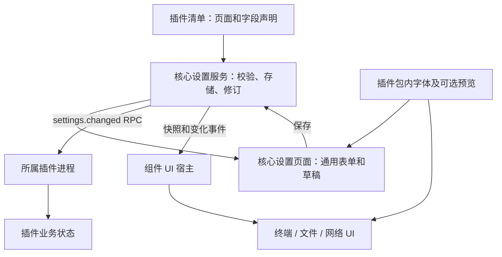

# 组件设置与终端外观：代码修改方案

状态：2026-11-06 已实施 A–F，G 的本机构建和工作流接入已完成；其他四个系统/架构的原生验证及正式发行尚未完成。依据 [功能设计](plan-component-settings.md) 整理。本文件保留编码范围和验收要求，实际实现、取舍和检查结果见 [实施记录](implementation-component-settings.md)。

## 1. 最终决策与交付范围

采用“插件声明设置，核心统一管理，插件负责生效”。设置入口统一在已有设置页面；每个组件类型有独立偏好，同类组件在所有服务器和窗口共享。首批为终端、文件列表、文件编辑器、网络隧道四页。

| 交付项 | 本轮编码结果 |
| --- | --- |
| 通用设置服务 | 静态声明、核心表单、基础校验、草稿、原子保存、修订冲突、变化通知 |
| 组件接入 | 一个插件可声明多个页，一个页可关联多个视图；关闭的插件也可配置静态偏好 |
| 终端外观 | 字体/字号/行高/底部留白/光标；14px、1.2 倍行高、左右 16px、顶部 12px、底部 24px |
| 字体资产 | JetBrains Mono、Source Code Pro、IBM Plex Mono 的 Regular/Bold；随插件包分发，离线加载；本机字体按名称使用 |
| 文件组件 | 列表隐藏条目、密度、字号；编辑器字体、字号、行高、自动换行、Tab 显示宽度 |
| 网络组件 | 新建规则默认类型和端口方式；不改现有规则和监听资源 |
| 升级兼容 | 保留用户值、补新增默认、移除字段备份、非法旧值回退、待重启旧声明和原有程序回退适配 |
| 分发与验证 | 核心/三插件分别构建；既有工作流接入新增检查；五目标实际包验证 |

本轮不增加生产代码依赖，不修改应用更新策略，不做权限声明、插件市场、字体下载市场、字体文件导入、完整 CJK/Nerd 字库、独立终端配色、按服务器/Tab 覆盖设置或通用迁移脚本引擎。具体业务操作、凭据、任务、规则内容和工作区布局不搬入设置。

现有未提交的桌面统一样式、文本菜单、更新等修改属于其他工作，实施时以实际基线合并，不整文件回退或覆盖它们。不得把其他工作混进本主题提交。

## 2. 当前代码约束

| 当前位置 | 核对结果 | 对修改的约束 |
| --- | --- | --- |
| `src/views.ts`、`src/main.ts` | 设置由字符串模板渲染，刷新会替换正文；只有应用设置页 | 组件草稿和挂载不能依赖被替换的 DOM；新逻辑独立管理 |
| `src-tauri/src/model.rs` | Manifest 尚无 settings 字段 | 增加可选字段，保留旧清单与未知扩展兼容 |
| `plugins/manifest.rs` | 清单总大小限 64 KiB，入口及 UI 路径已有检查 | 继续限长、目录内路径检查；设置错误就地报告，不新增插件许可检查 |
| `plugins/dispatch.rs`、`process.rs` | 有界双向 RPC；初始化有能力列表；帧限 64 KiB | 设置读取/变更复用现有请求通路，不发无 ID 的通知，不塞整套大快照 |
| `crates/plugin-client/src/lib.rs` | 接收核心方法后总会回复；4 个工作线程；调用等待 4 秒 | settings.changed 用带 ID 的 RPC 请求；插件处理必须在读取 viewId 前分派 |
| `component_ui/host.rs` | UI attach 调用 ui.mount；UI 资源依赖运行实例；支持 WOFF2 | 设置表单不调用 ui.mount；静态字体/预览需要独立的已安装资源读取 |
| `src/components.ts` | 保留 iframe，按真实 Window/source/surface 校验消息 | 添加设置快照与读取/应用回报，保持挂载身份和既有输入桥 |
| `storage.rs`、`servers.rs` | 已有同步写临时文件、rename、应用锁和目录备份模式 | 设置用独立文件与状态，复用写盘工具并验证各系统替换失败行为 |
| `core.rs::start_enabled`、`updates.rs` | 已启用插件重启切换；新版启动失败已有旧程序恢复 | 跟随实际生效版本选择声明，不增加程序回退框架 |
| `scripts/package-plugin.mjs` | 从 release.json 输出 plugin.json，只复制既有 ui 字段 | 输出 settings 声明，并复制声明所需字体/预览/辅助脚本 |
| 终端、文件 UI | 终端固定 13px；文件编辑器固定排版；新规则默认值写在业务 UI | 将显示/新建偏好接入设置，保留 PTY、草稿、分页及规则生命周期 |

所有接口和文件名以本方案实施时的实际源码为准；以下新文件只在对应批次有实现时创建，不先生成空模块。

## 3. 分层与代码落点



| 新增或修改位置 | 具体职责 |
| --- | --- |
| 新增 `src-tauri/src/settings.rs` | Settings 服务和 AppCore 门面；定义版本选择、读取、保存、重试应用和事件 |
| 新增 `src-tauri/src/settings/declaration.rs` | 声明类型、解析、基础检查、默认值/有效值计算、稳定声明标识 |
| 新增 `src-tauri/src/settings/store.rs` | 独立持久化、备份、修订、近期保存请求去重；不保存 UI DOM 或业务资源 |
| `model.rs`、`plugins/manifest.rs`、`lib.rs` | 可选清单字段与设置模块注册，静态设置声明诊断 |
| `core.rs`、`updates.rs` | 服务装配、存储错误投影、插件安装/切换/移除后的声明刷新 |
| `plugins/dispatch.rs`、`process.rs` | settings.get 路由、初始化能力与插件接入标记、settings.changed 的现有有界请求发送 |
| `component_ui/host.rs`、`main.rs` | 组件设置快照、独立静态资源路由、少量 Tauri 命令适配；业务逻辑留在 Settings |
| `src-tauri/tauri.conf.json` | CSP 增加仅用于本地插件字体的 font-src；不在规划阶段改版本或放开字体 CDN |
| 新增 `src/settings.ts` | 设置页面控制器、声明驱动字段、草稿、异步结果归属、跨窗更新 |
| 新增 `src/settings.css` | 组件设置布局与字段排列，复用 `ui.css`/主题令牌 |
| `src/core.ts`、`src/views.ts`、`src/main.ts`、`src/style.css` | 类型/API、组件导航、插件详情跳转、控制器挂载/销毁、样式入口 |
| `src/components.ts` | 快照转发、单页读取、设置应用结果与当前 surface 的绑定 |
| 第二个字体加载用例出现后新增 `src/font-loader.js` 及类型声明 | 仅提取字体加载、别名、回退和缓存；核心导入，插件构建复制这份普通辅助代码 |
| `plugins/terminal/release.json`、`src/main.rs`、`ui-src/appearance.js`、`view.js`、`style.css`、`build.mjs` | 终端声明、接收更新、字体和排版应用、PTY resize 与资源打包 |
| `plugins/files/release.json`、`src/main.rs`、`ui/view.js`、`ui/tree.js`、`ui/style.css` | 两页声明、列表过滤/密度、编辑器排版，保存逻辑不变 |
| `plugins/network-proxy/release.json`、`src/main.rs`、`ui/view.js` | 新建默认页、更新缓存和之后创建表单的初值 |
| 新增 `plugins/shared/fonts/` | 三款固定版本字体、许可证、来源/文件校验元数据；仅由需要它们的插件打包 |
| `scripts/package-plugin.mjs` | 输出 settings、拷贝所选插件所需资源、资源存在与路径检查 |
| 核心测试、UI 脚本、原生烟测和既有 `.github/workflows/` | 逐批接入对应回归，不创建新的发布系统 |

核心不会导入终端或文件的业务代码、xterm、字体二进制，也不调用插件构建。字体辅助代码与现有共享 CSS 一样作为普通运行资源复制到插件包，运行时不引用核心安装目录。

## 4. 声明契约与稳定身份

### 4.1 清单模型

在 Manifest 增加可选 `settings`。为兼容旧核心和未来设置版本，保留该字段的原始 JSON，单独解析成受支持的 SettingsDeclaration；不让未知设置类型在 Manifest 反序列化时阻断插件原业务。

清单总上限仍为 64 KiB。设置解析失败或要求新设置 API 时，组件设置页展示具体原因或升级提示；核心基本入口/API/平台检查继续按现有方式执行。资源路径必须包内存在且不能越过安装目录；不增加权限列表。

首批固定页面身份：

| pluginId | pageId | title | viewTypes | order |
| --- | --- | --- | --- | --- |
| sodeck.terminal | appearance | 终端 | terminal | 100 |
| sodeck.files | browser | 文件列表 | files | 200 |
| sodeck.files | editor | 文件编辑器 | editor | 210 |
| sodeck.network-proxy | defaults | 网络隧道 | manager、rule-editor | 300 |

宿主通用排序使用声明的 order，再以 pluginId/pageId 排序，不能写按插件 ID 决定表单内容的分支。第一版每个 viewType 最多关联一个设置页，一个页可以关联多个视图；一个插件可声明多个页。

终端声明示例（示例只列字体、字号和留白，正式声明还包含下文其他字段）：

```json
{
  "settings": {
    "apiVersion": "1",
    "schemaVersion": 1,
    "pages": [{
      "id": "appearance", "title": "终端", "icon": "terminal",
      "viewTypes": ["terminal"], "order": 100,
      "groups": [{
        "id": "text", "title": "文字",
        "fields": [{
          "key": "font", "type": "font", "title": "字体",
          "default": {"source": "preset", "id": "jetbrains-mono"},
          "presets": [{
            "id": "jetbrains-mono", "title": "JetBrains Mono",
            "regular": "ui/fonts/jetbrains-mono-regular.woff2",
            "bold": "ui/fonts/jetbrains-mono-bold.woff2"
          }],
          "apply": "live"
        }, {
          "key": "fontSize", "type": "number", "title": "字号",
          "default": 14, "min": 11, "max": 24, "step": 1,
          "unit": "px", "apply": "live"
        }]
      }, {
        "id": "spacing", "title": "间距",
        "fields": [{
          "key": "paddingBottom", "type": "number", "title": "底部留白",
          "default": 24, "min": 8, "max": 48, "step": 4,
          "unit": "px", "apply": "live"
        }]
      }]
    }]
  }
}
```

### 4.2 支持的字段及检查

第一版实现 boolean、number、string、select、font，apply 仅为 live/newInstance。字段包含 key/title/default/apply，可带简短 description；number 带 min/max/step/unit，string 带 maxLength，select 带稳定值与显示名称。

font 值为 `{source:"preset",id}` 或 `{source:"local",family}`。预置 ID 必须在声明中；本机字体名称非空、有限长，被当作名称使用。核心不保存 CSS 表达式、字体字节或安装绝对路径。

简单 `visibleWhen: {key, equals}` 只引用同页 boolean/select 字段，用于固定端口显隐等场景；不实现表达式语言、任意脚本、远端选项加载和可循环依赖。隐藏字段仍按声明校验，完整保存值中保留其有效初值。

建议首批上限：每插件 8 页、每页 8 组/64 字段、select/font 最多 32 个选项；ID/key 为 1–64 个 ASCII 标识字符，标题 256 字节、描述 1024 字节、普通字符串默认最多 1024 字节。本机字体 family 最多 128 个字符且 UTF-8 字节有限长。默认值也必须通过字段校验。

保存值和单页运行快照按最终 JSON 的 UTF-8 长度限 24 KiB；外层 RPC 帧继续检查 64 KiB。数字必须有限并符合范围/步长，小数步长按浮点误差容限比较；保存越界值报字段错误，不能悄悄 clamp。载入旧非法值的回退与用户保存的严格校验分开实现。

### 4.3 声明与修订标识

- `schemaVersion` 为插件声明的正整数，描述设置结构；插件程序版本独立。
- 页面命名空间为 pluginId/pageId，不包含版本和服务器 ID。
- `definitionToken` 为规范化声明、插件当前版本和页面 ID 的稳定摘要，复用已有 sha2；用于过期页面校验和静态资源缓存，不是权限凭证。
- `revision` 内部为 u64，跨 JavaScript/RPC 以十进制字符串传递，避免大数精度丢失；更新和声明切换保持单调。
- 静态声明来自当前有效版本，不从 pendingUpdate 读取候选声明用于表单或运行实例。

## 5. 核心存储与保存事务

独立文件建议为系统应用数据目录下的 `component-settings.json`。由 SettingsStore 持有，复用现有应用数据锁，不改变 preferences.json 的主题/更新字段，也不写插件自己的业务 settings.json。

磁盘示例：

```json
{
  "formatVersion": 1,
  "pages": [{
    "pluginId": "sodeck.terminal", "pageId": "appearance",
    "schemaVersion": 1, "revision": "7", "definitionToken": "<声明摘要>",
    "values": {"fontSize": 16, "paddingBottom": 24},
    "history": []
  }]
}
```

实际 values 保存本页完整的规范化用户值，上例省略其他字段。PageSnapshot 另提供 effectiveValues、warnings 和回退原因；有效值由当前声明计算，临时回退不覆盖原始用户选择。

历史每页最多保留两份之前结构的有效快照，替换同一结构重复历史；另保留上一份完整文件 `.bak`。删除字段从当前下发值移出，旧值随结构快照保留，不无限累积未知 key。总文件建议限 4 MiB，超限报保存错误，不清除旧用户数据腾空间。只承诺保留范围内的历史，不承诺任意久远版本都能完整恢复。

保存执行：

1. 桌面命令从真实 Window 得到发起窗口；读取当前有效插件版本/声明，不接受前端自行指定目录或调用者身份。
2. 检查定义 token、baseRevision、requestId、24 KiB 和所有字段；按顺序建立有界写操作。
3. 生成新值和下一修订，不在这里调用 SSH、PTY、文件任务或转发。
4. 保留上一份有效文件，写临时 JSON、flush/sync，再替换主文件；主文件成功后才更新内存有效状态。
5. 释放设置写锁及 AppCore 其他锁，发布变化并排队发送插件 RPC；不能持锁等待插件回包。
6. 返回 `{snapshot, persisted:true, application}`，application 可以仍在等待；界面后续按应用结果更新，不把持久化与实际显示成功混为一谈。

同一页近期 requestId 的重试返回原提交结果，不重复修订/广播；同 ID 携带不同正文拒绝。去重范围为当前应用会话，使用有界缓存；应用重启后前端重新读取有效快照，不重放上次保存请求。

两个窗口同时保存，只接受当前 baseRevision，过期保存返回 conflict 和最新快照；前端保留草稿，用户可载入最新值后重新调整，不自动合并字段。事件可以晚到，消费者按声明/修订忽略旧值。

主文件损坏时优先读取有效备份，保留损坏主文件；首次后续写入须先保留损坏副本，无法保留则只读并说明错误。不得通过一次读取失败把整份配置覆盖成默认。文件系统故障、备份写失败和替换失败均保留已成功保存值，纳入核心存储错误投影。

## 6. 桌面 API、插件 RPC 和 UI 桥

以下是本轮应实现的最小接口，均为新增提案，当前不可调用。

### 6.1 应用设置前端 → 核心

| Tauri 命令 | 参数 | 返回/作用 |
| --- | --- | --- |
| settings_catalog | 无 | 已安装组件页摘要、来源、可用状态、order、当前声明版本；不塞所有字段和值到全局 Snapshot |
| settings_page | pluginId、pageId | 声明、有效/保存值、修订、warnings、应用状态 |
| save_settings | pluginId、pageId、definitionToken、baseRevision、requestId、values | 后端检查并原子提交，返回有效快照及应用状态 |
| retry_settings_apply | pluginId、pageId、revision | 对当前已保存值重试应用；不再次写盘或增加修订，不自动重连或开启资源 |
| settings_for_surface | surfaceId | 按真实窗口/surface/所属插件/viewType 返回其设置页快照 |
| settings_applied | surfaceId、pageId、definitionToken、revision、error? | 当前业务 UI 对本修订报告成功或具体错误，不能报告其他插件/旧挂载的结果 |

main.rs 只做 Window/State 与阻塞写盘的适配；声明计算和业务中立存储放在 Settings。声明没有变化时复用缓存；不要求每次打开设置重新启动插件或扫操作系统字体目录。

### 6.2 核心 ↔ 插件进程

- 初始化 capabilities 增加 `settings.v1`；新插件回应可选 `settingsApiVersion:"1"` 表示实现设置 RPC。旧插件不需要增加方法，新核心不向它发送未知请求。
- 初始化最多带页面 ID/修订等紧凑索引。完整值按页通过 `settings.get({pageId})` 读取，不能把 8 页各 24 KiB 全塞进 64 KiB initialize 帧。
- `settings.get` 从真实 RPC 调用源确定 pluginId/instanceId，只返回该插件页面，读取不要求服务器连接。
- `settings.changed({pageId,definitionToken,revision,values})` 为带 request ID 的核心 → 插件请求，复用 Instance::request、已有队列和超时；不是无 ID 的 JSON-RPC notification。
- 新插件的 initialize、settings.changed 等全局方法在 `viewId` 读取和工作区业务分派之前处理。各插件缓存最新修订并短时返回应用结果，不能在回调中做字体加载或远端 IO。
- 首批后台主要接收/缓存偏好；终端 fit、编辑器排版和文件过滤由业务 UI 生效，新规则初值由网络插件使用。不得让核心代替插件解释字段。
- 首批字段全部静态可校验，不实现空置的 settings.validate/settings.migrate RPC。未来第一个真实业务校验/结构迁移案例出现时，再按功能设计补纯函数接口及回归。

### 6.3 核心事件与组件 UI

核心保存后发 `core-settings-changed`，包含 pluginId/pageId/definitionToken/revision。所有窗口收到事件后，设置窗口只更新已保存基线和状态，不覆盖本地草稿；组件宿主只给匹配该页关联视图的 surface 取得并转发新快照。

业务 iframe 增量收到 `mount.settings`、`settingsChanged`，继续使用原 `sodeck-ui-v1` 信封。当前四页每个视图仅关联一页，快照总量限制为 24 KiB；挂载竞态采用 subscribe/记录事件后再读快照，不能丢掉 attach 期间发生的保存。隐藏实例可延后字体/DOM 应用，但再次显示时重新核对最新快照；跨窗重挂载读取核心最新值。

`sodeck.request("settings", {op:"get"})` 通过 settings_for_surface 获取最新值；`op:"applied"` 通过 settings_applied 回报。宿主验证 source、origin、surfaceId，再由核心按窗口、当前插件实例、viewType 与定义绑定复核。设置读取不复用要求在线连接的 ui_data_writable，也不允许预览表面冒充业务 surface。

应用状态只在内存跟踪当前插件进程和可见 surface：等待、已应用、失败；隐藏/未创建实例标为下次显示/新建时使用。后端回应成功不能替代可见 UI 的字体/排版应用回报。旧实例退出时删除其应用状态；新实例靠最新快照恢复，不持久化一套实例状态机。

保存后如果后端或某个可见 UI 失败，显示“设置已保存，部分组件未应用”及原因，可重试当前修订。保存纯 newInstance 字段显示“已保存，用于新建规则”。字体资源缺失产生的是明确回退状态；不能显示正在使用原字体的假成功。

## 7. 静态字体资源与特殊预览

普通表单由核心生成，插件不自建整页设置 HTML。核心通用 font 控件提供预置选择、本机名称、字形样例和加载状态；终端网格留白等可选 preview 由插件提供纯展示页面。

资源 URL 复用 `convertFileSrc("", "sodeck-plugin")` 生成跨平台基址，不硬编码 Windows 的 URL 形式。静态设置资源增加含 definitionToken 的路径分支，绑定当前有效包目录；字体文件必须匹配声明路径，预览的 JS/CSS 位于声明的预览资源目录。路径解析与现有包内资源校验一致。

当前核心 CSP 的 font-src 继承 default-src self，不能直接加载不同源的插件字体。实施时在 tauri.conf.json 增量声明 `font-src 'self' sodeck-plugin: http://sodeck-plugin.localhost https://sodeck-plugin.localhost`，保留原 frame-src/IPC 规则及资源响应的 CORS；字体直接使用 URL，不需要开放网络字体站点或通过 fetch 读取二进制。正式包测试同时验证字体加载与 CSP 无拦截，不能只检查开发服务器。

原业务 UI 资源依然按运行实例读取。关闭插件的字体/预览从已安装有效清单读取，不要求存在 Instance；不读取 pendingUpdate 候选资源。查询携带的旧 token 失效时返回可识别的过期结果并刷新，避免升级后把同一路径的旧缓存当成新版字体。

预览信封单独标识来源与页面，只接收 draft、theme 与 ready；不提供 PTY/文件/网络调用方法。设置表单不建假 workspace，不调用 ui.mount；预览打开/关闭也不 resize 正在运行的终端。

字体加载通过 FontFace 及唯一内部别名，预置 URL 从声明解析、本机名称正确转义后用 local()。2.5 秒内未完成则展示加载失败，保持原运行字体；修订已变化、失效表面或关闭页面后返回的旧 Promise 不再应用。预置失败按指定回退，JetBrains Mono 本身不可用时最后回退系统 monospace 并报告资源错误。

本机字体不存在不能只靠 document.fonts.check 判断。选择新本机字体时必须实际加载并在预览验证；失败禁止保存这一新选择。已保存的本机字体后来不可用时，保持存档名称并回退显示。基础后端检查字体值格式与名称范围，不能承诺覆盖用户绕过 UI 后的系统字体可用性；运行端始终验证和回退。

本轮不枚举操作系统字体、不新增平台字体库依赖。若某个正式 WebView 不支持按名称可靠加载，先复现实际问题，再补核心平台适配或调整本机字体交付范围；不能用 Chromium 通过掩盖原生限制。

`plugins/shared/fonts/` 在字体资产提交时固定来源 Release、版本、Regular/Bold 文件、许可证和 SHA-256 元数据。使用完整拉丁/符号资源，避免只取 Latin 子集导致框线缺字。构建只复制并核验已提交文件，不从 latest、字体 CDN 或开发机字体目录获取资源。终端与文件各带自己使用的六个 WOFF2；字体按选择加载，记录各插件包的体积增加。

## 8. 四个组件的修改细节

### 8.1 终端

稳定字段为 font、fontSize、lineHeight、paddingBottom、cursorStyle、cursorBlink。默认与范围沿用功能设计：14px、1.2、24px，字号 11–24、行高 1.0–1.6/0.05、底部 8–48/4，方块/竖线/下划线，闪烁开。左右 16px、顶部 12px、字间距 0，字重 400，ANSI 粗体使用 700 资源；主题继续现有 tokens。

新增 appearance.js 承接有效设置、异步字体、修订/挂载检查和结果回报；view.js 仅接入生命周期、现有 xterm options 与 size。即使初始设置读取暂时失败也采用声明一致的默认显示，并报告问题；不停止 SSH 输入流程。

顺序为读取有效值 → 加载字体 → 验证本修订/表面仍有效 → 更新 xterm options 和正文 padding → 可见且就绪时 fit → 只在行列实际改变时通过原输入/尺寸串行通路 resize 原 PTY → 回报。连续调整合并到最新修订；恢复快照期间先按其行列回放，caughtUp 后再应用有效排版并 fit，避免损坏备用屏幕恢复。

底部空间必须在 xterm 网格外。scrollbar 区域随可用网格，不通过空行、平移、遮罩或远端输入制造留白。仅颜色/光标变化不 fit；字体/字号/行高/留白变化可能重排，保留已有输出和历史浏览意图，失效选区明确清理，不能复制错误文字。Ctrl+C、IME、异步粘贴、输入背压和跨窗快照保留原语义。

首个核心字体选择和终端运行字体加载形成两个实际用例后，将相同 FontFace 辅助代码提取；字体对 xterm 的应用及 resize 仍留在终端。

### 8.2 文件列表

字段为 showHidden=true、density=compact、fontSize=12。密度 compact/comfortable 对应 24/28px，名称字号 11–18px。

FileTree 保留原 nodes/children/cursor/loaded/pages，只在 render/visible/键盘目标生成时过滤以点开头的条目；根和当前导航路径仍保留定位上下文。过滤后重算 aria-posinset/setsize 与选择范围，清理不可见 selection/anchor，不把不可见文件作为下一次删除/移动目标。

分页的 more/loading/error 仍来自真实目录状态。过滤后当前页没有可见条目且仍有 more 时显示“暂无可见条目 · 加载更多”，不得伪装“空目录”，也不后台拉完整目录。切回显示隐藏文件时恢复已有节点，不重建会话或重复上传下载。

密度/字号只改列表 CSS 变量；状态/工具栏保持共享样式，避免所有 UI 文本随名称字号放大。已打开编辑器和进行中的任务不关闭。

### 8.3 文件编辑器

字段为 font、fontSize=14、lineHeight=1.5、wordWrap=false、tabSize=4。范围分别 11–24、1.2–1.8/0.05、布尔、2/4/8。字体选择规则与终端一致，各页独立保存。

有效设置只更新 textarea 的字体、行高、wrap/white-space/overflow 与 tab-size。更新前后保留 selectionStart/End、选区方向、滚动意图和已有 DOM；不重设 textarea.value、不触发 input/stage，不改本地草稿修订、编码/BOM/LF/CRLF 或保存冲突依据。Tab 只表示字符显示列宽，不把已有 Tab 替换为空格。

文件插件后端在全局方法分派处接收设置；业务 UI 在载入正文前采用有效排版，隐藏或移窗后取得最新快照。

### 8.4 网络隧道

字段为 defaultType=tcpForward、portMode=auto、fixedPort=1080。defaultType 只含 tcpForward/socks5，fixedPort 为 1–65535且只在 fixed 模式展示。所有字段 apply=newInstance。

修改 UI 的 create 分支，由最新偏好生成初始 rule：回环绑定 127.0.0.1；auto 时 bind.port=0，fixed 时为选定端口；TCP 默认 target 仍为空待用户填写，SOCKS 不增加 target。

只在用户点“新建”时取一次快照；已打开的新建草稿和编辑现有规则不被后续默认值覆盖。设置保存不调用 saveStart/start/stop，不分配端口，不改 rules 文件或正在运行的 listener。应用重启后规则仍按现有机制保持停止。

## 9. 升级、兼容和回退接点

### 9.1 声明生效时机

接入插件登记、启动选择、关闭状态下立即更新记录及新版启动失败恢复旧程序的现有接点。Settings 根据实际有效 Manifest/目录构建注册表；当前还运行的旧 Instance 必须使用自己的版本快照，不能读候选清单。

升级下载仅保存 pendingUpdate 时，settings_catalog/page、字体 URL 和运行快照都保持旧版。启动切换新目录后才激活新版定义；启动失败恢复旧程序时重新选择旧声明，并计算可用于该版的有效值。设置不另设插件启用门禁，不扩大原有程序回退机制。

### 9.2 值的演进

- 名称/说明/位置变化只重绘字段；用户值以稳定 key 关联。
- 新字段补默认，已保存字段不被新版 default 覆盖。
- 移除或未知字段不下发当前组件，在有界结构历史中保留。
- 范围/选项变窄时合法值保留；非法原值存档，运行端用有效默认并在设置页报告。
- 预置字体移除保留 ID并走字体回退，不能继续引用旧安装目录。
- 真正 key/type/单位含义变化不在本轮偷偷转型。首版插件作者保持兼容字段；后续真实变更必须有对应纯配置迁移、备份与失败回归，再扩展协议。
- 回退只恢复保留范围内的相应快照；兼容字段优先保留最新用户值，结构不兼容值取对应历史或默认并说明来源。修订不倒退，旧页面保存按 token/revision 拒绝。

### 9.3 新旧组合

新核心加载旧插件时保持原业务和旧 UI，不发送 settings.changed 未知方法；旧插件没有声明时展示现有版本提示页。新插件运行在旧核心时用默认值继续业务，不把缺少设置 UI 当成 SSH/文件/网络必需能力失败。

未知 settings API 或字段类型只让相关设置页不可编辑并提示所需核心能力，不能因一个可选偏好字段使所有业务插件加载失败。声明入口或字体缺失按实际页/字段报告，既有 Manifest 入口和核心 API 主版本错误仍按原机制拒绝。

## 10. 打包、测试与 GitHub Actions

### 10.1 打包

`scripts/package-plugin.mjs` 从所选 release.json 输出 settings 到 plugin.json，复制其声明的字体/预览及已使用辅助脚本，确认路径和许可证随包存在。只构建指定插件，不构建其他插件；核心包不引用 plugins/shared/fonts。

终端 build.mjs 继续 npm ci 锁定 xterm 并从 ui-src 生成 ui，加入 appearance.js/preview；文件/网络保留当前普通 UI 资源流程。字体复制和元数据检查可以加入既有打包脚本的独立函数，避免再引入构建框架。

核心版本仍只改 tauri.conf.json，插件版本只改各自 Cargo.toml；实际编码通过后按功能分别决定版本号，本方案不预占版本。Release、updater 签名和三个插件独立标签沿用 docs/distribution.md。

### 10.2 回归测试

| 测试位置 | 必须证明 |
| --- | --- |
| 新增 `src-tauri/tests/settings.rs` | 声明/默认/字段边界、后端越界拒绝、24/64 KiB、保存重开、冲突/去重、坏文件和写盘失败、原值/有效值分离 |
| 扩展 lifecycle/updates 及仅测试 fixtures | 待重启旧声明、未运行插件更新、新字段默认、删字段/旧选项、启动失败旧程序回退、过期实例回包、跨窗消息归属 |
| 新增 `scripts/test-settings-ui.mjs` 并接入 ui:test | 四页/未安装/关闭/失败/旧版本、草稿切页与关闭恢复、保存反馈/并发、三主题、720×480、125%/150%、断网字体 |
| 扩展 `scripts/test-production-ui.mjs` | 正式 Vite 产物能显示和保存声明式页面，CSS 层正确，不因全局刷新替换正在编辑的控件 |
| 扩展 terminal:input:test 与 terminal:test | 字体加载、最后一行距离、真实 stty 行列/PTY 未重建、vim/top 备用屏幕、中文/框线、快速改动/异步失效、复制/IME/跨窗恢复 |
| 扩展 files:test | 隐藏分页/空过滤/多选及键盘目标正确；编辑设置前后草稿和最终保存字节完全一致，包括 BOM/LF/CRLF |
| 扩展 network:test | 新规则取默认；现有/在编辑规则不被覆盖；保存设置前后实际 listener、端口、规则修订不变 |
| 新增打包脚本测试并接入 scripts:test | 声明随包输出、字体与许可证完整、缺文件拒绝、只打指定插件、核心不含字体资源 |
| 扩展原生 smoke/packaged remote 验收 | 实际包离线字体、原生本机字体、设置保存重开、主/子窗口同步、启动/退出和真实业务 |

测试夹具可以模拟静态声明、延迟/失败应用和版本切换，但字体测试需验证实际加载的字体资源；document.fonts.check 和“看起来像等宽”不足以证明离线字体。PTY 尺寸/不重建、文件字节、端口不变通过真实资源检查，不能只检查样式变量。

备用屏幕/光标/框线的持续回归用可控的 PTY 测试输出程序，不依赖各 runner 碰巧安装了 vim/top；真实 vim/top 场景使用已准备的远端验收环境补充。测试所需工具明确加入对应脚本或工作流，不能把开发机 PATH 当作前提。

现有命令继续使用：

```sh
npm run check
npm run plugin:check
npm run scripts:test
npm run test
npm run web:build
npm run ui:test
npm run terminal:input:test
npm run terminal:test
npm run files:test
npm run network:test
npm run build
npm run plugin:build -- --plugin terminal
npm run plugin:build -- --plugin files
npm run plugin:build -- --plugin network-proxy
```

插件后端实际新增逻辑时也运行对应 `cargo test --manifest-path plugins/<名称>/Cargo.toml --locked`。Node/Rust 版本和所有现有锁文件沿用固定工具链。新增 UI 脚本在实现并可运行后才接入 package.json/工作流，本轮文档不添加不存在的命令。

### 10.3 工作流调整

- Check 接入声明/存储/打包测试与通用设置 UI 的最小检查，复用现有 Node/Rust/Playwright 环境。
- Package SoDeck 继续只构建核心，运行核心设置持久化和原生壳烟测，不依赖业务插件包或字体构建。
- Package plugin 在所选插件的五个原生目标中检查设置清单、字体与许可证附件；不等待其他插件构建完成才产出。
- Verify native remote plugins 用既有实际包组合入口验证设置与真实终端/文件/网络，不增加跨平台联动发布门禁。

正式支持的 Windows x86_64/ARM64、Linux x86_64/ARM64、macOS ARM64 都要分别编译/打包，并运行包内程序启动/退出、有效设置保存重开、离线字体与业务流程。字体文件通用不等于各 WebView 表现一致；ARM64 必须原生产物，交叉编译/Chromium 模拟不能替代目标验证。日志和实施记录准确区分已执行检查、桌面设备字形/输入法验证及剩余限制。

## 11. 实施批次与提交边界

| 批次 | 一个完整可验证问题 | 完成条件 |
| --- | --- | --- |
| A | 核心能根据静态声明保存组件偏好 | 声明/存储/API/受支持版本与原值回退；仅测试夹具证明保存重开和失败保留 |
| B | 用户在现有设置中配置组件并获知生效结果 | 通用表单/导航/草稿/跨窗/桥/状态；夹具应用延迟失败和旧插件可验收 |
| C | 终端外观和字体在全部实例真实生效 | 三字体资产、声明、接收更新、留白/fit、断网/真实 PTY/原输入回归；终端独立包通过 |
| D | 文件列表显示偏好即时生效 | 多分支分页/过滤/选择语义和密度字号完整验收 |
| E | 文件编辑器排版可配置且正文保持一致 | 两页隔离、字体共享辅助、保存字节/草稿/移窗回归；文件独立包通过 |
| F | 网络新建规则遵循用户偏好 | 默认值仅用于之后新建；实际 listener 与现有草稿不变；网络独立包通过 |
| G | 本功能按既有分发流程交付并记录边界 | 核心和插件各自版本/包/工作流，五目标实际包验收与文档同步 |

每批相关检查通过后继续下一批，失败先定位并修复，不用自动重试掩盖竞态。A/B 可用仅测试夹具先闭环，C–F 接入真实官方插件；夹具始终不发行。每次提交只含一个主题，并用用户可见行为描述变更。

功能设计文档保留用户行为；本方案保留技术落点；实施另新增 `docs/implementation-component-settings.md`，记录实际完成、原因、运行命令/结果与未完成事项。API 实现时同步 docs/plugin-api.md，README/product/architecture/distribution 与真实状态一致，不把待实施协议写成已经可调用。

## 12. 风险、边界与本轮验证

需要在编码中解决的具体风险是：原生 WebView 本机字体加载差异、字体切换后的终端网格重排、刷新替换表单 DOM、应用成功回报竞态、升级时声明与程序版本错配，以及文件替换失败后是否保留旧快照。对应测试已明确列入各批次，不据此新增权限/审批流程。

破坏性结构迁移、无限历史回退、本机字体枚举和完整 CJK/Nerd 资源不在第一批实现；若后续出现真实需求，再以单独的完整问题实施，不能在这轮提前加入空接口/框架。

设计阶段只整理文档与源码接点，并检查 78 个本地链接和 3 个 JSON 示例。后续编码已接入核心设置服务、四个组件页、插件通知和字体资产；不再将这些协议描述为待实现。实际构建、测试、平台边界与剩余验收统一记录在 [实施记录](implementation-component-settings.md)。
