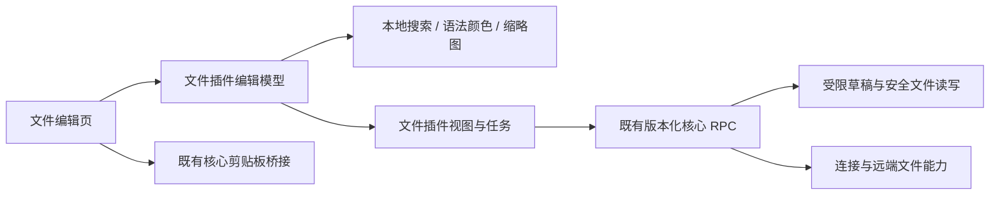

# 文件编辑器：搜索、侧边缩略图与语法高亮

整理日期：2026-11-10。状态：功能设计；当前实现与测试范围见[实施记录](implementation-file-editor-search.md)。本文基于设计时的文件插件打开、编辑、草稿、保存和页面交接代码；性能数字是验收目标，不是已测结果。

## 1. 需求理解与范围

用户希望追踪现有文件修改流程，并为它加入侧边缩略图、搜索和按文件类型高亮。用户进一步明确：不会修改大文件，超过 1 MB 不允许修改。

据此推断，目标是一个适合运维人员修改服务器配置和脚本的文件编辑器：打开文件后看清结构，找到要改的配置项，在正文和缩略图中定位它，修改后沿用现有安全保存流程。文件目录树仍负责找文件，中央编辑页负责阅读和修改一个文件。

本设计沿用当前源码的 **1 MiB，即 1,048,576 字节** 上限。大小以实际文件字节计算，包含 UTF-8 BOM 和原有换行符；不能用 JavaScript 字符串长度代替。界面统一显示“1 MiB”，避免把这个数与十进制 1,000,000 字节混用。

| 用户表达 | 本设计的理解 | 完成后的行为 |
| --- | --- | --- |
| 文件修改逻辑 | 文件树打开的远端文本编辑页 | 不改变文件树、远端路径、草稿与安全保存的职责 |
| 侧边缩略 | 编辑正文右侧的全文概览 | 持续显示带语法颜色的缩略图、当前视口和当前搜索命中位置，可点击和拖动定位 |
| 搜索 | 搜索当前文件正文，包含尚未保存的修改 | 输入关键词后定位上一处、下一处；搜索不需要服务器在线 |
| 按文件类型高亮 | 对正文进行语法着色 | YAML、JSON、Shell、Nginx 等显示各自的注释、字符串、关键字等颜色 |
| 超过 1 MB 不允许修改 | 继续使用现有小文本限制 | 超限文件只能下载；编辑操作也不能提交超过上限的正文 |

第一版包含行号、单文档文本搜索、大小写匹配、搜索循环导航、常驻右侧缩略图、语言自动识别与手动更正、现有字体和换行设置迁移，以及完整的保存、断线、重挂载和移窗行为。

第一版不增加全目录内容检索、跨文件搜索、搜索历史、正则表达式、替换、代码补全、格式化、语言服务器、配置正确性诊断、差异对比或大文件模式。终端历史检索是另一项功能，文件编辑器不复用终端历史存储和索引。语法着色不代表配置语义已经验证。

### 代表场景

1. 打开 `/etc/nginx/nginx.conf`，自动识别为 Nginx。搜索 `server_name`，用下一处切换多个站点，修改后保存；远端被其他程序改动时拒绝覆盖。
2. 打开 `compose.yaml`，缩略图显示注释、键和字符串的结构。点击靠后的区域跳到相应配置段，保留现有缩进与 LF/CRLF。
3. 打开没有扩展名、首行是 `#!/usr/bin/env bash` 的脚本，自动识别 Shell；识别不准时改为“纯文本”，正文不发生变化。
4. 修改文件后断线，仍能搜索当前草稿、浏览缩略图和导出草稿。重连后的保存继续核对远端版本。
5. 文件超过 1 MiB，提示“文件超过 1 MiB，无法编辑，请下载后查看”，不读取全文、不建立编辑模型，也不出现可编辑的空白正文。

## 2. 当前文件修改流程

### 2.1 已确认的调用链

| 阶段 | 当前行为 | 代码依据 |
| --- | --- | --- |
| 打开 | 文件树双击普通文件，调用 `openView`，以远端资源路径打开中央 `editor` 视图 | [tree.js](../plugins/files/ui/tree.js)、[release.json](../plugins/files/release.json) |
| 登记资源 | 文件插件创建视图，并通过核心登记文件资源、复用连接上下文 | [main.rs](../plugins/files/src/main.rs) |
| 读取 | 优先 `describe` 已有草稿；没有草稿才 `read` 远端文件。按 16 KiB 分块读取，每块核对大小与 revision；变化时最多重试三次 | [read-document.js](../plugins/files/ui/read-document.js) |
| 解码 | 只接受有效 UTF-8，可包含 BOM；拒绝 NUL 二进制内容、单独 CR 和混合 LF/CRLF | [view.js](../plugins/files/ui/view.js) |
| 编辑 | 正文使用普通 `textarea`，内部统一为 LF；输入触发完整草稿快照，最多一个快照正在传输，其间的新输入合并为下一份快照 | [view.js](../plugins/files/ui/view.js) |
| 草稿暂存 | 重新补回 BOM 和原始换行，按 16 KiB 顺序上传。核心收到完整快照后原子替换内存草稿，返回新的核心 revision | [remote_files.rs](../src-tauri/src/remote_files.rs) |
| 保存 | 前端等待草稿暂存完成，插件发起保存任务，前端轮询结果；成功以任务实际保存的 revision 更新状态 | [view.js](../plugins/files/ui/view.js)、[main.rs](../plugins/files/src/main.rs) |
| 安全写入 | 核对远端路径、链接目标、属性和内容版本，独占创建同目录临时文件并保留权限，再检查目标，使用 OpenSSH 原子替换提交 | [remote_files.rs](../src-tauri/src/remote_files.rs) |
| 导出与下载 | “下载远端”取服务器当前版本；“导出草稿”取此页已暂存的正文，包括未保存修改，断线仍可用 | [view.js](../plugins/files/ui/view.js) |
| 重挂载与交接 | 挂载先恢复核心草稿；交接等待草稿队列，未结束的输入法组合输入阻止交接，候选界面在激活前只读 | [view.js](../plugins/files/ui/view.js) |

当前核心远端正文读取和草稿均限制为 1 MiB。不能因为换成编辑器组件而顺带提高这个限制。

### 2.2 迁移必须处理的薄弱点

这些是源码确认的能力缺口或由调用顺序推导的风险，不是本轮已经复现和修复的缺陷：

- `textarea` 没有语法模型、行号、搜索导航和缩略图；在其下叠一层彩色文本会增加滚动、换行、光标和输入法同步负担。
- 视图只记录 `selectionStart` 和像素 `scrollTop`，没有完整选区、水平滚动、搜索状态和语言覆盖。当前也没有独立的正文滚动监听。
- 现有编辑器设置按 `textarea` 的样式与选区 API 应用，需要迁移到新引擎的模型、视图和布局接口。
- 插件的 `dirty` 状态主要比较已暂存的核心 revision 和已保存 revision。新输入仍在本地等待暂存时，迟到的保存或暂存结果不能把它误标为已保存，迁移时要补齐本地待暂存状态。
- 共享文本菜单识别 `input/textarea`，不能直接用编辑器内部的隐藏输入框代替正文选区。新编辑器需要自己的文本操作适配。
- 超限、非法编码、读取失败时必须显示明确的受限或失败状态，不能让用户误以为读到一个空文件。

已有真实文件流程回归位于 [test-files-ui.mjs](../scripts/test-files-ui.mjs)，草稿一致性读取回归位于 [file-document-read.test.mjs](../scripts/file-document-read.test.mjs)。本轮设计不改变这些已存在的保证。

## 3. 界面设计

保留工作台现有的紧凑工具界面、文件路径和保存入口，编辑器使用所在视图的空间，不新增独立侧栏面板。

```text
┌ 文件完整路径                         搜索  保存  下载远端  导出草稿 ┐
│ 下载远端：服务器当前版本 · 导出草稿：当前内容（含未保存更改）        │
├───────────────────────────────────────────────┬───────────────┤
│                     [ 查找文本   Aa  ↑ ↓  × ] │ 彩色全文缩略图 │
│ 行号  可编辑正文                              │               │
│       注释、字符串、关键字等语法颜色          │ 当前视口框    │
│       当前命中具有单独边框                    │ 当前命中标记  │
│                                               │               │
├───────────────────────────────────────────────┴───────────────┤
│ 未保存/正在保存/错误      行 24，列 8  UTF-8 · LF  YAML ▾        │
└───────────────────────────────────────────────────────────────┘
```

### 3.1 布局与入口

- 正文左侧显示行号，右侧显示缩略图和正常滚动条。缩略图默认开启，长短文件都采用相同位置。
- 工具栏增加“搜索”入口。搜索条贴在正文右上方，位于缩略图左侧，不遮挡保存按钮；搜索打开时为其保留局部阅读空间。
- 状态栏保留编码、换行和保存状态，增加当前行列与语言选择。保存错误优先显示，不被“找到 N 处”覆盖；搜索结果留在搜索条中。
- 字体、字号、行高、自动换行和 Tab 显示宽度继续使用文件插件现有设置页。新增“显示缩略图”，默认开启，可即时应用。
- 缩略图宽度目标为 80～112 CSS px，按编辑区尺寸调节；正文区域不足 360 CSS px 时压缩为约 12 px 的位置概览带。宽度恢复后恢复彩色缩略图，不改写用户设置。
- 极窄视图中，工具栏路径省略但可查看全文，次要操作进入现有样式的操作菜单；保存和搜索保持可达。搜索条换行或占用正文顶部一行，不能横向溢出。

### 3.2 可用性要求

正文支持常规选区、撤销、重做、Tab 输入、复制、剪切、粘贴和输入法。第一版保持单光标，不默认打开多光标、自动补全、自动闭合括号、自动格式化或自动空白清理；不能借引擎默认行为改变服务器文件的输入语义。

语法颜色取自主机主题对应的编辑器色板。注释仍可读，搜索匹配除颜色外有背景或边框，当前命中与普通命中不同。浅色、深色主题都验收正文与选择文本的对比度。缩略图不是唯一导航入口：用户始终能用正文滚动、键盘和搜索定位。

## 4. 当前文件搜索

### 4.1 搜索对象与操作

搜索始终针对当前编辑模型的完整正文，包括未保存修改，不针对首次打开时的快照，也不重新向服务器取内容。切换文件不会带入另一文件的关键词。

| 操作 | 行为 |
| --- | --- |
| 工具栏“搜索”或 `Ctrl+F` / macOS `⌘F` | 打开并聚焦搜索条；正文有短的单行选区时用选区预填，否则保留本页关键词 |
| 输入关键词 | 默认按文本、忽略大小写检索；空格是实际搜索字符，不自动 trim |
| `Aa` | 切换区分大小写，重新检索，正文不变 |
| Enter / Shift+Enter | 下一处 / 上一处，搜索条保持焦点 |
| F3 / Shift+F3 | 搜索条关闭但本页仍有关键词时也可继续导航；快捷键限定在当前编辑页 |
| 到达末尾或开头 | 循环到另一端，并在搜索条简短提示“已回到开头/末尾” |
| Esc / 关闭按钮 | 关闭搜索条与命中装饰，焦点回到正文；保留本页关键词用于再次打开 |
| 清空关键词 | 清除结果与标记，不移动正文选区，不产生修改 |
| 编辑正文 | 对新模型重新检索，旧结果不能继续导航到过期位置 |

第一版只支持单行搜索文本，不预填跨行选区。输入法组合期间不检索中间拼音，不用 Enter 截断组合输入，组合结束后执行一次检索。

新查询从当前光标附近寻找第一处命中，定位时让该行进入正文视口，不把每次键入都解释为跳到文件顶部。定位命中可以改变选区和滚动，但不会改变正文，也不会清空撤销历史。

### 4.2 命中很多时的明确规则

1 MiB 文本仍可能有几十万处单字符命中。第一版不为每处命中创建 DOM 元素或编辑器装饰，也不为得到精确总数阻塞输入。

- 查询结果收集上限定为 **1,001 处**：少于或等于 1,000 时显示准确数量；发现第 1,001 处时显示“1,000+ 处”，附带“命中过多，仅标记部分位置；仍可继续查找全文”。
- 总命中超过上限时，不显示未经计算的“第 N / 总数”，只显示“当前：行 X，列 Y · 1,000+ 处”。结果数不足上限时可显示准确的序号和总数。
- 上一处、下一处直接在整个当前模型中查找，不局限于已收集的前 1,000 处。首部、中部、尾部命中都必须可达。
- 非当前命中的正文装饰和缩略图标记共用这份有界结果，最多 1,000 处；超出这一批的当前命中另外显示一处。缩略图不能用局部标记假装展示了完整命中分布。
- 缩略图多个命中落在同一像素位置时合并标记。第一版不额外计算全文件精确密度或完整命中索引。
- 改词、改大小写、正文变更、关闭视图时作废旧查询。提交显示前核对查询编号和编辑模型版本；迟到结果不得覆盖当前结果。

查询调度采用短延迟合并连续输入，目标为约 120 ms；Enter 等明确导航立即处理最新查询。作废任务只保证旧结果不会提交，不能假装可以中断一个正在主线程执行的同步搜索。

## 5. 右侧彩色缩略图

缩略图反映当前编辑模型和相同的语法颜色，未保存修改也应出现。它表达全文结构和当前位置，不是可阅读的第二份正文，不生成一个隐藏的完整 HTML 文档。

| 行为 | 设计 |
| --- | --- |
| 默认显示 | 按全文适配高度，色块表达缩进、注释和内容结构；短文件不强行纵向拉伸 |
| 当前视口 | 视口框始终可辨认；正文滚动时随之变化 |
| 点击区域 | 滚动到对应逻辑行附近，保留正文光标和选区，正文不被修改 |
| 拖动视口 | 跟随拖动连续滚动；指针捕获，抬起、取消、失焦或视图交接时结束拖动 |
| 搜索导航 | 当前命中所在位置单独标记；导航到它时视口框同步更新 |
| 自动换行 | 导航用逻辑行和引擎实际视图映射；不以简单像素比例乘以总行数推算光标位置 |
| 长行 | 缩略图限制绘制列数，正文仍完整可编辑、可搜索，不截断模型 |
| 关闭设置 | 只移除概览呈现，不改变正文、选区、语言或搜索状态 |

缩略图使用引擎自身的视口和行布局信息，不自行维护第二套换行算法。重绘随布局和内容变化合并到下一帧，隐藏时暂停绘制，恢复可见后按当前正文重绘。

## 6. 文件类型与语法高亮

### 6.1 识别顺序

按“本页手动选择 → 特定文件名 → 最长匹配后缀 → 有限首行 shebang → 已知配置目录 → 纯文本”识别。自动识别只读取已经打开的文本与路径；不执行脚本、不请求远端工具、不扫描全文件猜语言。

扩展名可按大小写无关识别，远端路径仍保持原有大小写和资源身份。特定文件名按登记规则匹配，不能把所有 `.conf` 误判为同一种配置。

| 类型 | 典型识别依据 | 高亮范围 |
| --- | --- | --- |
| YAML | `.yaml`、`.yml` | 键、值、字符串、布尔/空值、数字、注释 |
| JSON / JSONC | `.json` / `.jsonc` | 键、字符串、数字、字面量；JSONC 额外识别注释，不自动接受为 JSON |
| Shell | `.sh`、`.bash`、`.zsh`，`.bashrc`、`.profile` 等，或已知 Shell shebang | 关键字、变量、字符串、注释、操作符；不承诺完整解析所有 Shell 方言 |
| PowerShell | `.ps1`、`.psm1`、`.psd1`，或对应 shebang | 关键字、变量、字符串、注释 |
| Nginx | `nginx.conf`；其他 `.conf` 位于已知 `/etc/nginx/` 配置目录；也可手动选择 | 指令、块、变量、字符串、注释；不是配置合法性校验 |
| INI / systemd unit | `.ini`、`.service`、`.socket`、`.timer`、`.target` 等 | 分组、键值、注释；systemd 指令按 INI 风格呈现 |
| TOML | `.toml` | 表、键、字符串、数值、日期字面量、注释 |
| 环境变量文件 | `.env`、`.env.*`、`*.env` | 键、赋值、字符串、变量引用、注释；不加载其中的环境变量 |
| Dockerfile | `Dockerfile`、`Dockerfile.*`、`Containerfile`、`Containerfile.*` | 指令、参数、变量、字符串、注释 |
| 常见文本/源码 | `.md`、`.xml`、`.html`、`.css`、`.js`、`.ts`、`.py`、`.sql` 等按需打包 | 只提供对应词法颜色，不开启语言服务 |
| 未知类型 | 通用 `.conf`、无可靠依据的无后缀文件、普通日志或 `.txt` | 纯文本；行号、搜索和缩略图照常工作 |

shebang 最多检查首行前 512 个字符，识别 `#!/bin/bash`、`#!/usr/bin/env bash` 等明确形式；未知解释器回退纯文本。没有手动覆盖时，首行完成一次编辑后可更新识别，不在每个字符输入时切换语言。

### 6.2 手动语言与一致性

状态栏点击语言名称可选择“自动”“纯文本”和实际随包提供的语言。选择只作用于当前文件视图，并随当前视图的移窗和重挂载恢复；不建立一个跨服务器、永久记住所有路径的语言数据库。

语言变化重新着色正文与缩略图，不改正文、缩进、BOM、换行或保存状态。语言资源加载失败时显示纯文本并提示，保留编辑和安全保存能力；未知语言永远不能阻止阅读。

## 7. 编辑与安全保存的不变量

### 7.1 大小、编码与文本变更

- 打开前由文件信息做快速大小检查；核心读取继续做权威上限检查，覆盖检查后远端文件变大的情况。超过上限只允许下载，不提供“强制编辑”。
- 文件恰好达到 1,048,576 字节时仍可打开。BOM、中文、emoji、CRLF 都计入字节上限。
- 编辑模型使用 LF，写回时按原始换行和 BOM 编码。新引擎的默认 EOL、自动缩进探测、保存时修剪空白等不能覆盖这份规则。
- 批量粘贴和程序化插入先计算事务完成后的编码大小；超过上限拒绝整次操作，显示“修改后将超过 1 MiB，已取消本次修改”。不截断粘贴内容。
- 普通输入和 IME 在完整输入事务边界执行相同检查；组合输入完成后若超限，撤回本次组合事务。原正文、选区和有效撤销历史必须保留，不能通过反复 `setValue` 清空历史来实现限制。
- 草稿暂存和保存前仍核对最终编码大小。这是防止适配遗漏的最后检查，不能上传超限数据后才依赖服务器报错。
- 搜索、语言、缩略图、主题、字号、换行显示、滚动和选区变化都不是正文修改，不触发草稿上传和远端写入。
- 文本输入、删除、粘贴、剪切、撤销和重做才触发正文变更。一次内容事务最多进入一次草稿调度，不为着色结果制造正文事务。

事务拒绝能力属于编辑器选型原型的必验项。若候选接法只能在变更后清空模型或破坏撤销栈，不作为正式接法交付。

### 7.2 版本与保存状态

| 状态 | 管理者 | 用途 |
| --- | --- | --- |
| 本地编辑版本 | 当前 UI 编辑模型 | 判断正文是否又被修改、搜索结果是否过期 |
| 已暂存的本地版本 | 文件插件编辑适配 | 表明哪一份本地正文已经完整进入核心草稿 |
| 核心草稿 revision | 核心文件资源 | 标识完整原子草稿快照，不能由 UI 自造 |
| 已保存 revision | 保存任务结果、文件插件视图 | 表明哪一份核心草稿已经写入远端 |
| 选区/视口/搜索/语言 | 文件插件视图 | 恢复编辑体验，不决定正文是否已保存 |

未保存状态由“存在未暂存的本地正文”或“核心草稿 revision 与已保存 revision 不同”共同决定。旧任务保存成功，只能宣布它保存的那一份成功；有新输入时，状态仍然显示未保存。

每份暂存快照带上它对应的本地编辑版本，完成后再更新对应的核心 revision。至少一个快照正在上传时，新输入合并为最新待上传版本；不保存无限多份完整正文队列。正文变化立即登记本地未保存状态，不能等远端保存失败才标记。

保存按钮和 `Ctrl+S` / `⌘S` 使用同一入口：结束输入事务 → 等待当前草稿队列 → 发起现有保存任务。IME 未完成时提示先完成输入，不保存半个组合输入。发起保存后仍可继续编辑；任务结果不会覆盖后续正文。

### 7.3 保留现有远端写入规则

编辑器库不直接读写 SFTP，不用自带保存插件绕过核心。现有版本/链接目标检查、同目录临时文件、权限保留和原子替换继续生效。

外部修改拒绝覆盖，保留本地草稿供用户核对或导出；不自动用远端内容覆盖模型。提交后失联仍显示“提交结果未知”，不自动重复写入。成功、失败、取消、未知结果都由实际核心任务结果决定。

“导出草稿”等待本地最新内容完整暂存再导出；失败不能默默导出上一版并声称导出了当前内容。“下载远端”继续下载服务器当前版本，不能拿当前编辑模型代替。

## 8. 生命周期与恢复

| 状态或事件 | 编辑器行为 | 结束与恢复 |
| --- | --- | --- |
| 初次读取 | 显示读取状态，禁止编辑；大小或编码不支持时显示受限状态 | 有效完整快照才建立模型，不混合不同 revision 的分块 |
| 候选挂载 | 可读取核心草稿并准备语言资源；输入、保存、剪贴板写入和可写事件保持关闭 | `surfaceReady` 后才成为活动界面 |
| 普通编辑 | 一个模型、一套输入处理、一份有界搜索结果 | 输入事务完成后暂存；着色失败不销毁正文 |
| 隐藏 | 保留模型与本页状态，暂停缩略图和布局重绘；不主动把模型替换成远端内容 | 再显示时按当前尺寸布局，恢复选区与视口 |
| 设置/主题变化 | 更新引擎选项与色板，保留完整选区和阅读锚点 | 字体异步加载用设置版本检查，旧字体结果不能覆盖新设置 |
| 断线/连接上下文变化 | 保留模型和核心草稿，本地搜索与导出继续可用 | 保存按现有连接和版本检查重新确认，不能自动重新读远端替换草稿 |
| 页面交接/移窗 | 拒绝未完成 IME；等待正文暂存；同步最新展示状态；停止拖动；冻结可写入口 | 冻结后候选界面读取同一草稿并恢复位置，激活后源界面释放 |
| 取消交接 | 恢复源界面的可写状态和焦点 | 源模型继续使用，不强行重建或重复暂存 |
| UI 重挂载 | 从核心当前草稿恢复正文，再恢复本页展示状态 | 不承诺恢复引擎撤销栈；正文与未保存状态必须恢复 |
| 保存并关闭 | 使用与保存按钮相同的暂存和安全保存流程 | 未暂存、保存失败或结果未知不能误报关闭成功，沿用现有关闭决策 |
| 明确丢弃并关闭 | 沿用文件插件和宿主现有的丢弃语义 | 不因搜索条或语言选择追加关闭提示 |
| 最终释放 | 作废查询/语言加载；解绑事件和观察器；释放编辑实例、模型、装饰和按归属创建的 worker | 迟到回调先查 disposed 和版本，不重新登记资源 |

搜索、着色、缩略图不是远程任务，交接不等待它们完成。交接只需要正文已暂存、展示状态已同步、旧界面不能继续写。目标界面重新生成这三项呈现即可。

同一视图只能有一个可写表面；多个不同文件可以各有模型，不能把搜索结果、语言或选区串到另一页。当前草稿与展示状态限于现有运行会话，不新增磁盘全文缓存，不承诺核心或插件进程崩溃后的未保存正文恢复。

## 9. 与核心的交互及兼容

**需要复用核心，但不需要把这三个功能做进核心。** 业务模型、检索、词法规则和缩略图留在外置文件插件。



| 交互 | 方案 |
| --- | --- |
| 文件读取/暂存/保存/导出 | 沿用 `files` 数据能力和现有任务；不新增编辑器专用远端能力 |
| 页面挂载、焦点、可见性、交接和释放 | 沿用组件 UI v2 生命周期；候选表面继续受现有写入归属限制 |
| 字体、路径和系统剪贴板 | 使用现有核心适配与桥接，不依赖开发机器配置 |
| 搜索与语言 | 无核心搜索 RPC、语言服务、索引服务或关键词存储 |
| 展示状态 | 在文件插件的 `position` 事件及 `ui.getView` 响应增加可选 `editorState`；这是插件自有数据，不增加核心业务分支 |
| worker/静态资源加载 | 优先在现有插件资源协议与 CSP 内工作；如原生 WebView 确认需要核心修正，仅修改通用资源/CSP适配 |

`editorState` 使用版本 1 的小型、显式字段：单选区的锚点与活动位置、顶部可见逻辑行及行内偏移、水平滚动、搜索条是否打开/关键词/大小写、语言覆盖。不能把整个 Monaco 内部状态、正文、token、搜索结果或撤销栈塞进 RPC。

状态使用逻辑行列恢复；旧的 `cursor`/`scroll` 字段保留兼容。新界面没有 `editorState` 时读取旧字段；已存位置超出当前正文时夹取到有效范围。状态总量限制为 8 KiB，搜索输入上限为 1,024 个 UTF-16 代码单元；超出时搜索条提示长度限制，不静默截断。

展示状态变更短延迟合并，在交接前同步最终版本；普通滚动不能每帧发送 RPC。查询结果与像素绘制数据只在 UI 内重建。日志记录操作错误和来源，不写入正文或搜索关键词。

新字段缺失时使用默认值，未知可选字段忽略，版本未知时忽略展示快照而继续恢复正文。它不改变核心 API 主版本，不要求旧文件插件为搜索升级。若通用资源适配确实需要核心升级，必须明确最低版本并实测旧核心行为，不能先承诺任意旧核心可用。

## 10. 编辑器选型与实现落点

### 10.1 推荐方案

优先选择 **Monaco Editor 的 ESM 编辑器核心 + 按需语言 + 文件插件自己的小型搜索条适配**。直接复用成熟的输入、选区、撤销、行布局、词法着色和 minimap，避免手写另一套编辑器。

截至 2026-11-10 的只读包信息中，`monaco-editor` 候选版本为 0.57.0，MIT 许可，2026-09-24 发布，维护方为 Microsoft。最终版本须在原型验证后固定并提交锁文件，本轮未安装依赖。

| 方案 | 优点 | 本需求的代价 | 结论 |
| --- | --- | --- | --- |
| Monaco | 官方自带 minimap、模型、词法着色与公开搜索 API，可减少自研编辑交互 | 首包和内存较大，需要控制贡献项、worker 与原生 WebView 加载 | 第一候选，先测包资源、输入和性能 |
| CodeMirror 6 | 模块化、增量编辑和解析，官方搜索扩展，资源通常更轻 | 官方没有直接覆盖本需求的内置 minimap，需额外实现全文概览和视口同步 | Monaco 原型不满足体积/平台要求时的备选 |
| textarea + 彩色镜像 | 不增加编辑器依赖 | 需要自行解决选区、换行、滚动、IME、撤销、搜索与缩略图同步 | 不采用 |

CodeMirror 的维护与许可也已有只读核对：`@codemirror/view`、`@codemirror/search`、`@codemirror/language` 为 MIT 且有近期版本。它是替代方案，不与 Monaco 同时加入生产包。

### 10.2 使用公开接口，限制默认能力

- 通过公开模型变更事件连接现有草稿队列，使用公开行列/offset 转换，不读隐藏输入框的 `value`。
- 搜索使用公开的 `findMatches` 结果上限和 `findNextMatch` / `findPreviousMatch` 全文导航。关闭默认查找入口以避免出现两套搜索条，并将快捷键统一交给本页搜索条。
- Monaco 自带查找实现本身也存在命中集合上限；不能把其内部上限或私有状态当成产品协议。本文定义的 1,000 处显示规则由插件适配负责。
- minimap 使用公开配置与布局接口，目标采用 `fit`、色块绘制和受限列数；不自行复制全文并生成一份彩色 DOM。
- 只打包用到的词法语言，不引入 JSON schema 下载、TypeScript 项目服务、补全、诊断等默认重能力。不请求 CDN 或远程字体/语言资源。
- 官方已提供 YAML、Shell、PowerShell、INI、Dockerfile 和多种常见源码语言。Nginx、TOML、环境变量文件没有在已核对的基础语言清单中直接覆盖，按插件内有限 Monarch 词法规则补齐并用真实配置样例验证；不误称引擎自带所有运维语法。
- 为当前模型设置独立的本地虚拟标识，不把远端文件当作浏览器可直接访问的 URL。

### 10.3 剪贴板与菜单适配

正文复制读取模型选区，粘贴使用现有 `sodeckClipboard`，把一次粘贴作为一次可撤销事务；剪切必须确认写入成功后再删除选区。异步剪贴板返回前核对活动表面、模型版本、选区与焦点，失效时不得写入新页面。

键盘与右键菜单共用同一组文本操作。编辑器区域需显式避开通用菜单对其内部输入框的处理，防止复制到空文本、粘贴两次或破坏撤销栈。复用现有菜单样式与定位机制，不新增核心菜单 API。

现有核心文本剪贴板桥接限制为 256 KiB，继续明确显示超限错误；文件上限 1 MiB 不意味着可以用剪贴板一次复制 1 MiB。原生 IME、macOS 快捷键和剪贴板桥接要在真实 WebView 验证。

### 10.4 代码与发行边界

| 落点 | 计划内容 |
| --- | --- |
| `plugins/files/ui/view.js` | 保留文件业务与生命周期入口，将编辑引擎操作移入文件插件内的 editor 适配；文件树分支保持既有职责 |
| 文件插件编辑 UI 模块 | 模型、搜索条、词法语言登记、菜单适配和有界展示状态；模块按实际职责拆分，不提取通用编辑器框架 |
| `plugins/files/src/main.rs` | 可选展示状态的保存/恢复，及本地未暂存与已保存状态的正确合并 |
| `plugins/files/release.json` | 缩略图设置与编辑器相关现有设置映射 |
| 文件插件的 `package.json` / 锁文件 / 构建脚本 | 固定编辑器依赖，生成本地 UI、语言资源和需要的 worker，并打包许可证 |
| 共享文本菜单资产 | 仅在确有冲突时增加通用的自定义文本区域排除标记，保持其他输入框和终端行为 |
| 文件 UI/读取测试 | 使用真实模型输入、选区、菜单和保存行为替代旧 textarea 专用断言，保留已有流程证据 |

当前 [package-plugin.mjs](../scripts/package-plugin.mjs) 已对拥有 `package.json` 的插件执行独立 `npm ci --ignore-scripts` 和 `npm run build`。文件插件可复用该入口，不再另造发布框架；依赖和资源不进入核心安装包。

本轮仅推荐依赖，遵守未明确要求不新增生产依赖的约定。实施阶段再说明最终固定版本、用途、维护状态、产物增量与替代方案。

## 11. 性能策略与验收目标

硬上限已经解决无限文件规模问题。本功能不建数据库、倒排索引、磁盘缓存、远端全文搜索或后台大文件扫描服务。优先依靠编辑器增量模型、词法缓存和有界搜索结果，把复杂度限定在一个最多 1 MiB 的正文中。

### 11.1 有界工作

1. 一个视图只有一个编辑模型，搜索和 minimap 共用它，不保留独立全文镜像。
2. 连续输入合并检索；每次检索最多物化 1,001 个结果，只绘制最多 1,000 个普通标记与一个当前标记。
3. 搜索准确性覆盖完整正文，性能限制作用于结果收集和绘制数量，不把尾部正文排除出搜索范围。
4. 长行着色设置明确的工作上限，超出词法上限的部分可以按纯文本呈现；正文和文本搜索仍完整，界面提示“长行部分未着色”。不为着色截断正文。
5. 缩略图只使用引擎的绘制数据，隐藏视图暂停动画与绘制，不在每次 pointermove 同步 RPC。
6. 草稿维持最多一个在途快照和一个最新待提交版本。语言/搜索延迟不会阻塞草稿完整暂存和安全保存。
7. 首先测公开同步搜索接口在 1 MiB 最坏样例下的耗时。若单次出现超过 50 ms 的 UI 阻塞，改为插件内可取消的分段检索或本地 worker；这是测量触发的改进，不提前增加一套全文索引。

### 11.2 目标与测量方法

时间从正文已在本地开始测，单独记录首次加载编辑器资源和 SSH 读取时间，不能用网络速度掩盖 UI 阻塞。记录每项样例、机器、系统、WebView 版本和 P95，不使用“感觉很快”作为验收。

| 项目 | 目标 |
| --- | --- |
| 本地 1 MiB 正文建立可编辑模型 | P95 ≤ 300 ms；语法颜色可渐进出现，不能等待全文着色才允许阅读 |
| 1 MiB 正文关键词结果 | 从最后一次输入到结果显示 P95 ≤ 200 ms，包含查询合并延迟 |
| 下一处/上一处导航 | P95 ≤ 50 ms，文件尾部和高密度命中同样验收 |
| 普通输入、滚动和缩略图拖动 | 持续交互期间无超过 50 ms 的主线程任务；P95 帧工作目标 ≤ 16.7 ms |
| 一个 1 MiB 模型的资源增量 | 相对同一引擎空文档，常规编辑与搜索后内存增量目标 ≤ 40 MiB；同时报告引擎基础开销 |
| 重复打开/关闭 | 连续 20 次后无遗留模型、装饰、观察器、视图 worker 或增长中的查询结果；允许引擎有界共享缓存 |
| 静态资源 | 记录文件插件压缩包增量、UI JS/CSS/worker 原始及压缩大小；只含实际使用资源 |

这些目标要在五个正式平台组合各自原生测试；不能拿开发机 Chrome 的一次结果代替原生 WebView 或 ARM64。

## 12. 可验收行为与失败矩阵

### 12.1 内容、交互与性能样例

| 样例 | 必须证明 |
| --- | --- |
| 0 字节、短文件、恰好 1 MiB、1 MiB + 1 字节 | 边界内能打开；超限不能修改，仍可下载；没有空白假成功 |
| 中文、emoji、BOM、CRLF | 以编码字节判断大小，编辑保存不改变 BOM 和换行 |
| 非法 UTF-8、NUL、单独 CR、混合换行 | 保持既有下载处理，搜索和高亮不能绕过限制 |
| 粘贴/IME/程序插入造成超限 | 拒绝完整事务，正文和有效撤销历史保留；没有超限草稿上传或远端保存 |
| YAML、JSON、Shell、Nginx、TOML、INI、env、Dockerfile | 特定样例的注释/字符串/键等颜色正确；语言选择和自动识别均不改字节 |
| 通用 `.conf`、未知后缀、无后缀 shebang | 不盲目猜语言；纯文本可用；手动覆盖在本页恢复 |
| 未保存文本中新增/删除关键词 | 结果来自当前模型，数量和导航更新；旧结果不覆盖新版本 |
| 连续改词、IME 搜索、大小写切换、无结果 | 调度可控，组合输入不中断，无匹配状态明确，焦点正确 |
| 1 MiB 重复字符及大量单字命中 | 有界标记和“1,000+ 处”；从中部仍能找到尾部，循环导航不局限首批结果 |
| 首行/末行、长行、10 万短行、自动换行 | 在总字节上限内导航正确；缩略图不把视觉行当逻辑行；长行处理不截断正文 |
| 搜索/语言/设置/缩略图开关 | 不改变正文、dirty、BOM/换行和有效撤销栈，不发起 stage/save |
| 深浅主题、窄分屏、字体延迟加载 | 搜索、正文和保存入口可用；选区、视口与语言保留 |
| 键盘与菜单复制/剪切/粘贴、256 KiB 边界 | 操作与真实正文选区一致；失败不剪掉正文，不重复粘贴，撤销一次恢复一次操作 |

### 12.2 保存、恢复与失败

| 场景 | 验收结果 |
| --- | --- |
| 保存上传期间继续输入 | 旧结果只更新已保存快照，后续正文仍 dirty；再保存写入最新完整正文 |
| 阻塞某个草稿块后移窗/关闭 | 等待或明确失败，不用上一版草稿替换当前正文 |
| UI 重挂载、视图移窗、整工作区迁移 | 核心草稿、完整选区、逻辑视口、搜索状态和语言覆盖恢复；搜索结果重新生成 |
| 页面交接中继续按键/异步粘贴返回 | 冻结界面不能写，候选未激活不能写，旧响应不得写入新模型 |
| 交接取消 | 原模型和有效撤销栈仍可使用，不重复加载远端正文 |
| 断线后搜索和导出，再重连保存 | 本地操作仍可用；导出当前最新草稿；保存重新检查远端 |
| 远端外部修改、链接目标改变 | 核心拒绝覆盖，模型保留，失败说明可见 |
| 保存提交后断线/取消 | 保留“提交结果未知”，无自动重放，没有“已保存”假状态 |
| 语言资源/worker 初始化失败 | 语法可降级纯文本；必要的编辑器资源失败则显示错误，不假装打开成功 |
| 导出、草稿暂存或剪贴板失败 | 保留有效正文；显示当前操作错误，不以过时快照冒充当前结果 |
| 最终关闭/插件停用/进程退出 | 现有资源清理契约保留；编辑模型、事件和自建 worker 不遗留 |

## 13. 实施顺序与交付门槛

### 第一阶段：编辑器接入原型

使用真实文件插件包，验证 Monaco ESM 本地加载、minimap、选区/撤销、IME、硬大小上限、现有剪贴板和设置适配。先跑 1 MiB 最坏检索与资源测量，再确定依赖版本和正式接法。

原型必须检查现有 [tauri.conf.json](../src-tauri/tauri.conf.json) 的 CSP 与插件资源协议。worker 采用本地资源，五平台验证实际启动；不以放宽为 `unsafe-eval`、通配网络来源、远程 CDN 或直接关闭 CSP 解决集成问题。如需修正核心，只做被实测证明需要的通用加载适配。

### 第二阶段：完整小文本编辑流程迁移

接入现有读取、编码、草稿、保存、导出、菜单与关闭流程，补齐本地待暂存状态和版本关联。先通过现有 BOM/CRLF、保存冲突、离线导出和移窗回归，才能把搜索及高亮当作正式能力。

### 第三阶段：搜索、语法与缩略图

接入有界搜索、全文导航、运行中语言识别与覆盖、minimap、窄视图布局及有界展示快照。验收高密度命中、长行、快速改词、IME 和旧查询失效。

### 第四阶段：实际包与交付记录

运行与改动相关的格式化、JS 类型/静态检查、Rust 检查、脚本测试、真实 OpenSSH 文件集成测试和独立插件构建。现有测试中的 textarea 专用操作改成对真实编辑模型与用户输入行为的断言，不能只换选择器后削减保存和恢复验证。

通过现有 GitHub Actions 文件插件流程生成五个原生包：Windows x86_64、Windows ARM64、Linux x86_64、Linux ARM64、macOS ARM64。分别启动实际包，验证打开、输入、搜索、minimap、剪贴板、worker、移窗、保存和退出；ARM64 使用原生 ARM64 产物。若核心通用资源适配变化，增加其相关检查和核心实际包验证。

后续实施记录写入对应 `docs/implementation-*.md`，维护实际版本、相关测试、性能样例、包来源与未完成平台；实际使用行为更新使用指南和文件插件说明。本方案只维护目标，不把未经测试的能力或测量写成已完成。

设计阶段交付为本文及文档索引。编辑器硬上限事务接法、实际产物体积、原生 CSP/worker 加载和性能目标的验证结果，以及新增业务实现与依赖，统一见[实施记录](implementation-file-editor-search.md)。

## 参考

- [文件插件说明](../plugins/files/README.md)、[文件管理实施记录](implementation-file-management.md)、[真实插件实施记录](implementation-remote-plugins.md)。
- [插件 API](plugin-api.md)、[架构与边界](architecture.md)、[功能设计方法](plan-feature-design.md)。
- [Monaco Editor 官方仓库](https://github.com/microsoft/monaco-editor)、[公开 API](https://microsoft.github.io/monaco-editor/typedoc/)。
- [Monaco 0.57.0 公开类型声明](https://cdn.jsdelivr.net/npm/monaco-editor@0.57.0/monaco.d.ts)、[基础语言登记清单](https://cdn.jsdelivr.net/npm/monaco-editor@0.57.0/esm/vs/basic-languages/monaco.contribution.js)、[内置查找实现](https://cdn.jsdelivr.net/npm/monaco-editor@0.57.0/esm/vs/editor/contrib/find/browser/findModel.js)。只作为选型依据，不依赖私有接口。
- [CodeMirror 官方仓库](https://github.com/codemirror/dev)、[官方模块文档](https://codemirror.net/docs/)。

返回 [文档索引](README.md)
