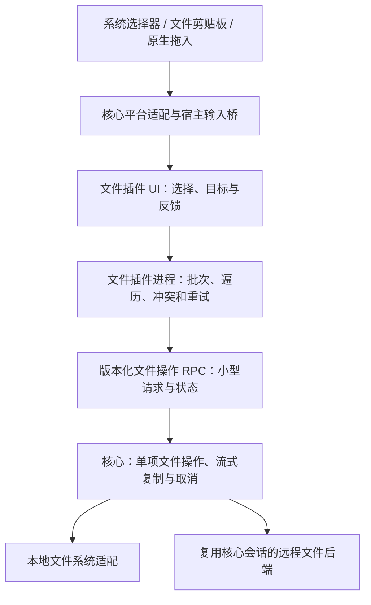

# 文件管理编码方案

状态：2026-11-06 已进入源码实施，尚未发行。依据 [功能范围](plan-file-management.md) 制定；实际接口、验证及未完成事项以 [实施记录](implementation-file-management.md) 为准。下文保留设计目标，不将未验证项视为完成。

## 1. 交付范围与验收入口

| 入口 | 本次实现 | 最小验收行为 |
| --- | --- | --- |
| 上传按钮 / 菜单 | 选择本地文件或文件夹，上传到远程目录 | 单文件、整目录和混合多选按统一规则落地 |
| 本地系统复制 → SoDeck 粘贴 | 读取系统文件条目后上传 | 文件、文件夹、中文名；文字输入框不触发上传 |
| 本地系统拖入 | 原生拖放命中远程目录后上传 | 主窗口、独立窗口、目录悬停展开、边缘滚动 |
| 下载按钮 / 菜单 | 单文件保存；目录或多选选择本地目录 | 保留顶层名称、空目录、二进制及大文件 |
| 远程日常管理 | 新建、重命名、删除、同服务器复制与移动 | 批量操作、冲突处理、编辑器协调和明确结果 |

所有传输入口共用队列、冲突策略、进度、取消和失败项重试。远程复制后在系统粘贴、远程拖到系统目录均已移出范围，不设计相关实现、缓存或验收。断点续传、跨服务器复制和应用重启后的任务恢复不在本轮。

## 2. 当前代码对设计的约束

| 现状 | 设计处理 |
| --- | --- |
| `remote_files.rs` 将目录会话、编辑草稿和一个 `job` 放在同一视图资源中，保存与下载互斥 | 保留旧 API；新增独立、可取消的文件操作资源，批量任务不占编辑器保存槽 |
| 文件 UI 在 iframe 内，现有剪贴板桥仅为文本服务 | 新增本地文件输入桥；不改变终端文本剪贴板语义 |
| 插件 `Client::call` 等待 4 秒，控制帧最多 64 KiB；普通 UI 事件最多 24 KiB | 耗时操作立即返回 ID，再查询状态；正文留在核心 IO，大量路径及结果分页 |
| iframe 桥普通请求等待 8 秒，`data` 请求等待 45 秒 | 文件选择和关闭确认使用交互票据立即应答，不让用户操作受请求超时限制 |
| 视图资源已有插件实例、视图、Context 归属检查；隐藏和移窗并不等于销毁视图 | 复用归属检查，区分 surface 生命周期与任务生命周期 |
| 插件异常退出、实际视图销毁和应用退出已有文件资源清理入口 | 新资源进入同一清理链，并补连接失效时的操作取消 |

核对代码包括 `src-tauri/src/remote_files.rs`、`src-tauri/src/resource_owner.rs`、`src-tauri/src/component_ui/host.rs`、`src-tauri/src/component_ui/close.rs`、`src/components.ts`、`src/component-data.ts`、`src/clipboard.ts`、`plugins/files/src/main.rs`、`plugins/files/ui/bridge.js` 和 `crates/plugin-client/src/lib.rs`。

## 3. 分层与代码落点



文件内容只在核心本地 IO 与远程 IO 之间流动，不经过 iframe、插件进程、普通事件或控制 RPC。插件仍决定传哪些条目、递归顺序、是否覆盖、是否重试及何时删除源。

| 位置 | 计划改动 |
| --- | --- |
| `src-tauri/src/remote_files.rs` | 保留 `files.v1` 和草稿行为，接入新操作分派与统一清理；逐步抽出被新旧流程实际复用的单文件 IO |
| `src-tauri/src/remote_files/io.rs` | 远程 stat/lstat、分页枚举、创建、删除、重命名、临时文件提交；隐藏 SFTP 类型与状态码 |
| `src-tauri/src/remote_files/operations.rs` | 有界操作注册表、去重、状态、取消、结果领取和资源回收 |
| `src-tauri/src/remote_files/copy.rs` | 单个普通文件的流式复制：本地→远程、远程→本地、同服务器远程→远程 |
| `src-tauri/src/local_files.rs` | 本地 PathBuf、非跟随链接枚举、目标名称检查、临时文件与平台提交差异 |
| `src-tauri/src/desktop_files.rs` 及其平台子模块 | 系统文件剪贴板读取、剪贴板修订、原生拖入来源和系统选择器结果登记 |
| `src-tauri/src/main.rs`、`windows.rs` | 原生命令和事件组合；覆盖主窗口及动态创建窗口，业务逻辑不继续堆入入口 |
| `src-tauri/src/plugins/dispatch.rs`、`process.rs` | 新能力与操作分派；进程退出和竞态后的二次清理继续有效 |
| `src-tauri/src/component_ui/close.rs`、`host.rs` | 批量编辑页关闭协调、在途操作的等待/取消、旧 surface 失效检查 |
| `src/local-files.ts`、`src/components.ts` | 宿主本地输入桥、拖入坐标命中、交互票据和 iframe 消息转发 |
| `plugins/files/src/tasks.rs`、`walk.rs`、`mutations.rs` | 批次调度、目录遍历、冲突/重试、远程修改及编辑器协调；`main.rs` 保留协议入口 |
| `plugins/files/ui/selection.js`、`transfer.js`、`tree.js`、`view.js` | 多选、拖放目标、上传下载入口、任务列表和冲突选择 |

模块随相应功能加入，不先搭建全应用任务框架或远程文件系统插件体系。公开接口使用通用文件语义；SFTP、OpenSSH 扩展及远程 Windows 路径差异留在核心后端。

## 4. API 与兼容策略

新增核心能力 `files.operations.v1`、`files.localInputs.v1`。旧 `files.v1`、`files.directoryCursors.v1`、编辑正文桥、文本剪贴板桥保持原义。新文件插件初始化检查新能力，缺失时明确提示先升级核心；旧插件仍在新核心运行。

### 4.1 本地输入桥

`mount.capabilities.localFiles` 报告输入桥版本及 `picker`、`clipboard`、`drop` 是否可用；这是能力发现，不是权限声明。插件 UI 使用 `sodeck.request("localFiles", request)`。

| 操作 | 输入与结果 |
| --- | --- |
| `pickUpload` | 文件或目录选择模式；立即返回 `interactionId`，系统选择器结束后发送 `localFilesResult` |
| `pickDownload` | 单文件保存或目录选择模式；立即返回票据，结果为本地目标引用 |
| `readClipboard` | 读取真实本地文件列表；结果为来源引用和剪贴板修订，无文件内容 |
| `claimDrop` | 使用宿主发来的 `dropId` 领取本次拖入来源；同一来源只能提交一次 |
| `release` | 放弃尚未提交的来源或目标引用，幂等 |

结果中的本地条目使用 `inputId`、`rootId` 和分页摘要。真实路径保存在核心，显示名称与可选显示路径仅供展示，不能拿显示字符串重新拼接真实路径。文件和目录选择器因平台限制可以分两个菜单入口，多选混合批次由拖入、粘贴或多次追加完成。

输入引用绑定发起的窗口、插件实例、view 和 Context，未提交时 60 秒失效；选择器打开期间不计此期限。任务接受后引用转为该任务可使用的资源，surface 卸载不使已接受任务失效。未提交引用在切换 Context、失去目标视图或移窗后作废，重新选择即可。

选择器与粘贴均在结果返回后再次核对目标 view、Context 和手势序号；粘贴还核对焦点序号。系统对话框允许正常接管焦点，不把对话框引起的失焦当作用户切换目标。取消选择不创建批次。

### 4.2 插件调用核心文件操作

继续使用 `files.request`，新增 `op.start`、`op.poll`、`op.result`、`op.cancel`、`op.release`、`op.lookup`。`op.start` 只检查并入队，立即返回 `operationId`；不在 4 秒 RPC 内等网络 IO 完成。

```json
{
  "action": "op.start",
  "id": "<现有 fileResourceId>",
  "requestId": "<batch/item/attempt 的稳定键>",
  "sequence": "<该文件资源内递增的提交序号>",
  "expectedContext": "<当前 Context 快照>",
  "operation": {
    "kind": "copyFile",
    "source": {"side": "local", "inputId": "...", "rootId": "...", "relative": ["配置", "app.conf"]},
    "destination": {"side": "remote", "path": "/srv/app/app.conf"},
    "sourceStamp": "<枚举所得版本标记>",
    "destinationGuard": {"kind": "absent"}
  }
}
```

示例中的 Context 和 stamp 是结构化值，实际 Rust 类型在实现时定义；不能把字符串占位符当成最终协议。字节数、时间高精度值与计数使用既有十进制字符串约定，避免 JavaScript 数值精度损失。

有限的操作种类：`inspect`、`list`、`next`、`closeCursor`、`mkdir`、`createEmpty`、`copyFile`、`rename`、`removeFile`、`removeDirectory`。枚举结果始终返回不跟随链接的类型；需要检查链接父目录时另行返回解析信息。

- `copyFile` 只处理一个普通文件及其临时提交，不递归、不弹冲突框、不删除源。
- `rename` 不自行降级成递归复制后删除；跨设备等结果交回插件处理。
- `removeDirectory` 只删除空目录；递归删除顺序由插件决定。
- 本地端点是引用及独立路径分量，核心拒绝 `.`、`..`、NUL、含分隔符的单个分量及伪装成分量的绝对路径，并重新检查父目录/链接类型。远程端点是服务器命名空间中的路径，禁止用本地 PathBuf、盘符或 shell 规则解释。
- `destinationGuard` 为 `absent` 或 `match(stamp)`。核心在执行及提交前重新检查，发生变化返回 `targetChanged`，不能沿用旧的覆盖选择。
- 相同资源、Context、`sequence` 和 `requestId` 的重复提交返回同一操作；同键不同参数返回错误。插件按资源顺序提交，超时后先 `lookup`，不能盲目重发写操作。领取并确认结果后推进连续序号水位，核心只保留未确认窗口；低于已退役水位的请求返回 `operationExpired`，绝不重新执行。这样无需随目录规模永久保存所有去重记录。
- `poll` 只返回状态、阶段、进度和结构化错误；`result` 分页领取元数据，单帧预算 16 KiB。目录每页沿用 100 项并增加字节预算，长名称可能使一页少于 100 项。
- 最终结果由插件确认后释放；操作数量有界，不能为了腾位置丢弃尚未领取的完成结果。

新接口使用结构化错误：`code`、`message`、`phase`、`operationId`、`retryable` 和可选的观察值。至少区分取消、权限不足、空间不足、名称无效、目标存在、源/目标变化、会话失效、不支持原子提交、提交结果未知。旧 API 继续返回原有错误形式。

### 4.3 UI 到文件插件的业务命令

通过既有 `ui.event` 增量加入选择集合提交、`startBatch`、`resolveConflict`、`cancelBatch`、`retryFailed`、`readTasks`、`readItems` 和远程复制记录。一次消息按实际序列化 UTF-8 大小控制在 16 KiB 内；多选路径使用 begin/append/commit 提交，不能把整个集合塞进一帧。

插件接受批次后立即返回 `batchId`。UI 快照带 `revision`，在任务区域可见时最多每秒更新 4 次；隐藏后停止 UI 查询，插件工作线程继续运行。重挂载重新获取快照，不依赖前一个 iframe 的轮询继续任务。

## 5. 三个本地入口如何复用上传

### 5.1 系统文件选择

复用已有 Tauri dialog。单文件下载保留保存对话框，文件夹和多选下载使用目录选择器；统一返回核心目标引用。所有选择器使用交互票据，用户停留超过 8 秒或 45 秒不会触发重复任务。票据结果只能由仍有效的发起 surface 消费。

### 5.2 本地复制后粘贴

当前固定的 clipboard-manager 提供文本、图片及 HTML，不提供文件列表，不能扩展现有文本分块协议来冒充文件输入。增加核心平台适配：

| 平台 | 原生读取方式 | 线程与格式处理 |
| --- | --- | --- |
| Windows | `CF_HDROP`、`DragQueryFileW`，剪贴板修订用系统序号 | 阻塞工作线程读取 UTF-16；锁被占用时有限重试；复制和剪切来源均按复制上传 |
| macOS | NSPasteboard 的文件 URL 对象，修订用 `changeCount` | 在 AppKit 规定线程执行，使用 URL 的本地文件路径，不读取普通字符串作为文件 |
| Linux | GTK/GDK clipboard 的 `text/uri-list`、`x-special/gnome-copied-files`；结合 owner-change 修订 | 在 GTK 主循环发起异步读取，不能同步等待主线程；保留 URI 字节及正确解码分隔符 |

只接受本地文件引用；URI 中的换行注释、百分号编码、非本地 authority、畸形编码和剪切动作分别处理。系统承认的本地网络路径依实际可访问性处理；不把普通 URL 当下载链接，不从任意文本猜路径。

默认复用既有 `windows-sys` 并只补所需 feature；macOS 和 Linux 原生调用集中在小型系统 ABI 适配层，不使用 PowerShell、osascript、xclip 或开发机命令。原生对象、回调和内存释放有独立封装与目标平台测试。若实际绑定成本需要新的 Rust 绑定库，在实现前列明用途、维护状态和直接系统 ABI 方案的取舍，不在本次方案中擅自加入生产依赖。

远程内部复制存放在文件插件进程，记录原服务器/连接、条目、复制或剪切意图及当时系统剪贴板修订。粘贴时，修订一致才优先使用内部记录；系统内容被更新则清除内部优先级，使用新的本地来源。不能确定修订时提示重新选择粘贴来源，不能把旧的远程记录盖过用户刚复制的本地文件。跨窗口使用同一插件进程记录。

### 5.3 原生拖入和 iframe 命中

1. 在核心统一接收 Tauri `DragDrop` 的 enter/over/drop/leave，直接保存事件中的 PathBuf；同一事件只注册一次，避免窗口与 webview 重复订阅产生双任务。
2. 宿主只向当前窗口发送 `dropId`、位置和条目摘要，原始本地路径不广播给各插件。
3. Tauri 位置是相对 webview 的物理像素；宿主按实际页面像素比例换成 CSS 坐标，再减去 iframe 内容区域偏移，转发给命中的可见文件 surface。缩放或换屏时更新映射，不能重复应用 DPI 系数。
4. 插件用 `elementFromPoint` 命中目录行或目录空白区域，显示目标并处理悬停展开和边缘滚动；普通文件行不可作为拖放目录。
5. drop 到达后固定最终远程目录，领取来源并创建同一个上传批次；leave、Escape、失效 surface 或落到其他区域时释放来源且不创建任务。
6. 一次原生 drop 只有一个 `requestId`。插件不再用 DOM drop 重复创建本地上传；同服务器内部拖动使用独立的内部 MIME 和远程条目引用。

原生接收可能影响 WebView HTML5 拖拽，需要在首批实际包验证页签排序与文件内部拖动。保留 Tauri 原生文件接收；若某平台不能同时使用内部 HTML5 拖动，文件内部移动改用 pointer 手势，不关闭本地拖入，也不改动其他窗口拖动语义。

## 6. 插件任务模型与有界资源

### 6.1 状态和生命周期

插件持有 `TaskManager`，按 workspace/Context 汇总批次，批次另记发起 view。状态为 `queued → scanning/running → awaitingConflict → running → completed/partial/failed/cancelled/needsReview`；取消先进入 `cancelling`，等核心确认后进入终态。

核心只持有单项操作：`queued/running/committing/completed/failed/cancelled/unknown`。`unknown` 对应提交已发出但不能确定结果；插件批次进入 `needsReview`，不自动重试或删除源。

任务绑定插件实例、发起 view 及提交时的 Context，不绑定具体 surface 或窗口。隐藏、切页和移窗继续执行；实际关闭发起视图要协调任务。重连生成新 Context，旧任务不能自动复用，新重试批次必须显式取得新连接。

编辑器保存继续使用现有草稿和提交流程，但新插件的 Ctrl+S、保存按钮及宿主 `ui.save` 都先经过插件路径写入协调，再启动原保存任务并查询状态，不能继续直接绕过协调调用 `data("save")`。新增下载和上传使用独立操作资源；编辑器中的“下载远端”也转为插件批次，但旧版核心下载 API 继续兼容。批次不占用草稿保存槽，同一路径写入进入插件级串行协调。

### 6.2 初始限制

| 资源 | 首轮实现值 |
| --- | --- |
| 插件活跃批次 | 全实例最多 2 个，每 workspace 最多 1 个；其余排队 |
| 等待批次 | 全实例最多 64 个，达到上限明确返回忙 |
| 单批顶层选择 | 最多 4096 项；按页提交，超限整次不启动 |
| 核心未释放操作 | 每文件资源最多 16 个、实例最多 128 个；控制操作和取消使用保留通道 |
| 单项复制 | 每活跃批次串行复制一个文件，初始 64 KiB 缓冲；后端按实际 SFTP 包限制分块 |
| 目录与结果 | 每页最多 100 项且序列化结果不超过 16 KiB |

以上为集中常量，不散落在各平台分支中；若性能测试需要调整，保持有界并更新验收。单个文件总大小不设编辑器式上限；每次 IO 有超时，整个大文件传输不套 35 秒或 120 秒总时限。

目录枚举使用迭代遍历、分页游标和有界待处理缓存。大目录的待遍历目录及逐项结果写入插件初始化给定 `dataDirectory` 下的本次运行临时 JSONL 文件，不把整棵目录树留在内存或同步给 UI。复制按父目录先创建，删除按子条目先处理；删除所需目录清单按遍历结果逆序读取，不一边枚举一边无记录地删除。

临时记录保存源/目标引用、稳定 itemId、结果和重试所需信息，不保存文件正文。磁盘写入失败时停止接收新条目并报告，不继续无记录写入。批次结果按游标分页读取，重试流式读取失败项，不重做已成功条目；未知结果先核对。临时记录在结果清理或下次进程启动时按本插件运行目录清理，不承诺崩溃恢复。

## 7. 递归、冲突与单文件提交

### 7.1 递归与路径

- 插件先对顶层选择做父子去重，保留原顶层文件夹名称。空目录也创建，隐藏条目正常参与，零字节和二进制走同一 IO。
- 核心枚举返回 lstat 类型；插件默认跳过符号链接和特殊条目并计入结果，同服务器直接重命名或删除链接只操作链接本身。
- 本地输入保留原生 PathBuf/OsString；显示用字符串不作为资源标识。当前远程后端使用 UTF-8 路径，无法表示的源名称明确失败，不用替换字符生成错误目标名。
- 本地目标非法字符、保留名、大小写及规范化冲突由核心平台适配判断，插件提供改名或跳过。远程名称检查以远程命名空间为准，不套用开发机 Windows 规则。
- 判断目录自身和子目录时核对已解析父目录及逻辑路径边界，不能用裸字符串前缀或把 `/app2` 当 `/app` 的子目录。枚举不跟随目录链接；外部竞态造成父目录变化时终止相应操作。

### 7.2 冲突决策归插件

开始单项操作前取得源 stamp 和目标存在情况。冲突票据绑定 batchId、itemId、当时源/目标 stamp，用户选择仅作用于本项或本批同类冲突。

普通文件支持覆盖、跳过、保留两份；同名目录合并，内部条目继续判冲突；文件/目录类型冲突只提供改名、跳过或取消。保留两份由插件产生候选名称，再以排他创建或不覆盖提交确认，不能“先判断不存在，再无条件覆盖”。目录与名称被并发改变后重新询问。

等待冲突时关闭文件句柄和临时文件，只保留业务票据，不长期持有 IO 锁。新核心操作使用新的 requestId/attempt，旧冲突票据不能再次提交。整批策略不扩展到另一批次或另一类冲突。

### 7.3 核心单文件复制

1. 校验实例、view、Context、输入引用、类型和版本；取得源读句柄及必要属性。
2. 在目标同目录排他创建 `.sodeck-<operationId>.part`，以流式缓冲读写，并记录真正远程读/写的业务流量。
3. 检查字节数、源句柄前后属性和可观察的路径变化；设置可保留的修改时间，flush/close。远程 fsync 仅在后端支持时使用，不以缺少 fsync 就宣称数据已落到稳定介质。
4. 重新检查目标 guard、目标父目录和类型，再进入 `committing`。不存在目标使用不覆盖提交；覆盖现有远程文件要求 `posix-rename` 等后端明确提供的原子替换能力，不支持时失败且保留旧目标。
5. 本地提交由平台适配实现无覆盖或替换语义，不先删除原文件；不能用跨平台含义不同的 rename 假定所有模式都安全。新文件采用目的端正常创建权限，覆盖尽可能保留目标权限，其他元数据差异明确反馈。
6. 提交确认后报告成功并清理临时项。提交前失败或取消只清临时文件；提交请求发出后不靠取消 future 猜测结果，等待确认或标记 `unknown`，绝不清理正式目标。

stamp 检查只能发现可观察的变化；SFTP 不提供通用文件快照或比较后原子替换，检查与提交之间仍有竞态，不能承诺完全排除外部并发写入。验收用传输前后 SHA-256 核对已知稳定样本；首轮不默认对所有大文件进行双倍远程重读。

失败后关闭本操作自己的后端句柄；不要为取消传输关闭共享的目录浏览或编辑会话。每个活跃批次使用独立数据通道，复用核心 SSH 连接认证，避免新传输阻塞侧栏和终端。

## 8. 远程管理及编辑器协调

新建文件使用排他创建，新建目录调用 mkdir；重命名及同机移动先尝试后端 rename。跨设备移动由插件编排“复制完整源条目 → 确认全部成功且源未变化 → 删除源”；出现跳过、失败、取消或未知结果时不删除该源顶层条目，保留结果供用户处理。同服务器复制首轮用核心流式读写，不调用远程 `cp`、`mv`、`rm`，也不要求 shell 工具存在。

递归删除由插件枚举并展示顶层范围，经用户确认后逐项删除；目录最后删除。操作期间出现新条目时非空目录删除应失败，不能追着新出现的内容继续扩大删除范围。操作前后按源 stamp 检查可观察变化，无远程回收站时明确为直接删除。

文件插件维护 workspace 内路径写入与编辑状态协调：

1. 对重命名、移动、删除和会覆盖目标的传输，找出受影响路径及子路径的编辑页和在途写入；先 flush 草稿并取得协调票据，期间不让新编辑器或同路径写操作插入。
2. 扩展宿主现有关闭协调，支持同插件、同工作区的一组 viewId；通过 `closeViews` 返回交互票据，宿主使用既有保存/放弃/取消流程并异步通知结果。普通 RPC 不等待用户决定。
3. 首轮不为打开的编辑资源增加路径重绑定协议：用户完成关闭后再执行文件修改；重命名/移动成功后按新规范路径重新打开原先干净或已保存的编辑页，删除成功则保持关闭。取消关闭就取消该修改。
4. 实际执行前重新校验路径、stamp、Context 和协调票据。关闭成功但文件修改失败时显示原因并尽可能重开原位置；不能自动放弃草稿，只有用户明确选择放弃时才丢弃对应内容。
5. 从未保存编辑页执行“下载远端”仍下载远程已保存版本；导出草稿继续使用原入口。复制远程条目同样不把未保存文本混入传输。

宿主只提供通用视图关闭与状态协调，文件路径影响范围由文件插件判断；不让核心理解重命名等业务策略，也不让插件直接调用终端等其他插件。

## 9. 关闭、断线和取消

- `ui.beforeClose` 汇总当前 view 的草稿与批次状态，保持快速返回；`busy` 不依赖 iframe 当前是否仍轮询。
- 关闭确认区分“等待任务并保存”“取消任务并关闭”“返回”；等待期间可撤回关闭，不能把大文件套用编辑保存的固定 125 秒完成上限。
- 等待关闭改为可查询进度的异步协调，不在控制 RPC、UI 线程或资源注册表锁内循环等待；保持旧插件保存协议兼容。
- 同一个关闭计划冻结新任务及新的修改决定，已有队列中被选择等待的任务可以继续提交后续单项操作；使用核心签发、限定实例/view/Context/批次的关闭继续票据。不能因通用 `frozen` 检查阻断已有批次，也不能给任意新任务开例外。
- 取消批次同时停止遍历、取消当前操作并取消待提交项；等到当前操作确认状态后再汇总。若已开始提交，按实际成功或未知结果处理，不能提前显示“已取消且未修改”。
- 连接失效立即阻止后续单项提交，清理当前操作，插件记录失败项。原连接 Context 的来源、游标、冲突票据和内部复制记录失效；重试由用户基于重连后的新 Context 发起。
- 视图真实销毁、插件进程退出、应用退出进入既有清理链；异步资源创建完成后再核对所有者，防止退出时产生漏回收。插件崩溃时核心仍能取消单项操作并记录阶段和未知结果，用户可以从日志/重要消息查看原因。

## 10. UI 行为落点

- 文件树多选保存为 `selectedPaths + anchorPath + focusedPath`，保留既有展开和滚动状态。全选先定义为“当前已加载可见条目”，菜单和状态明确此范围；整目录传输通过选目录递归，不依赖加载完所有分页。
- 点击文件行选中、双击打开保持；右键选中集合内条目不丢多选。路径栏始终表示明确导航位置，跨目录多选时上传先展示目标目录。
- 工具栏与菜单加入上传文件、上传文件夹、下载、新建、重命名、删除、远程复制/剪切/粘贴；状态按连接、选择类型及任务互斥情况启用。
- 新建/重命名输入框、路径输入框、编辑器以及输入法组合状态不被文件快捷键抢占。系统粘贴与原生 drop 分别去重，终端快捷键继续由终端插件处理。
- 在文件插件内显示紧凑任务摘要，可展开批次详情和失败列表，沿用现有主题；窄侧栏详情使用已有宿主 dialog 容器，不在核心底栏加入文件业务。
- 任务快照驱动完成数量、当前条目、字节进度、速度和剩余时间；扫描未完成时总量未知。批次结束统一发布一条重要消息，目录树只刷新受影响分支并保留可恢复选择。

## 11. 实施批次

| 批次 | 完整改动 | 验收后再进入下一批 |
| --- | --- | --- |
| A：平台入口验证 | 新输入能力、系统来源读取、来源登记与原生拖入目标命中；先由隔离测试夹具消费，现有插件继续运行 | 五目标实际包中验证本地文件/目录来源；主窗/独立窗；页面缩放、混合 DPI；不影响终端及页签拖动 |
| B：显式批量传输 | 核心单项操作、插件队列、目录遍历、多选、按钮上传和下载 | 文件/目录/混合批次、大文件、空目录；无需系统粘贴或拖拽也可完成双向传输 |
| C：冲突与恢复 | guard、临时提交、统一冲突、取消、失败重试和未知结果 | 原件保护、部分成功、并发修改、断线、重复请求、空间及权限失败 |
| D：系统入口完成 | 粘贴、拖入接入同一批次流程；剪贴板内部复制修订；快捷键和焦点 | 系统多选、文件夹、普通文本不上传；跨窗口、切服务器和异步结果不串目标 |
| E：远程管理 | 新建、改名、删除、同机复制/移动、编辑页协调 | 链接不跟随、自身子目录拒绝、跨设备移动失败保源、草稿不丢失 |
| F：交付 | 五目标原生实际包组合验收、文档与独立 Release | 核心及文件插件各自构建、打包和分发，验收入口均可在干净环境运行 |

每批再按一个完整问题拆提交，例如“可通过按钮上传单文件并取消”“可下载包含空目录的文件夹”“同名文件可保留两份”。A 中测试通路不作为全部产品功能完成的依据。

## 12. 测试与发布

| 层次 | 具体覆盖 |
| --- | --- |
| 核心单元 | 原生 URI/名称解析、操作去重、归属和 Context、取消/提交竞争、原子与无覆盖提交、句柄和临时文件清理 |
| 插件单元 | 父子去重、遍历顺序、空目录、链接/特殊项、冲突作用域、失败重试、批次终态、队列/结果容量 |
| 真实 OpenSSH 集成 | 本地→远程、远程→本地、远程→远程；多页目录；原子扩展支持/缺失；断网及提交确认丢失；字节与 SHA-256 |
| 实际插件 UI | 多选、快捷键、目标、冲突选择、进度、草稿协调、三主题、窄侧栏、隐藏/重挂载/移窗 |
| 原生桌面互操作 | 系统文件管理器真实复制后粘贴及拖入；目录、多选、剪切来源保源；主/独立窗口、不同 DPI 和缩放 |
| 生命周期 | 关闭等待、取消关闭、取消任务、重连、插件异常退出、应用退出及资源创建清理竞态 |

复用并扩展 `src-tauri/tests/fixtures/files_flow.rs`、`scripts/test-files-ui.mjs`、`scripts/test-openssh.mjs` 及原生 packaged 测试入口。需要新增的故障注入仅放在 `test-fixtures`，不进入发行行为。真实系统拖入不能用浏览器模拟 drop 或注入路径代替；无法在无头 runner 执行的桌面组合需记录目标系统上的人工验收结果。

实施阶段相关检查入口：`npm run check`、`npm run plugin:check`、`npm run scripts:test`、`npm run test`、`cargo test --manifest-path plugins/files/Cargo.toml --locked`、`npm run files:test`、`npm run ui:test`、`npm run terminal:input:test`。核心执行 `npm run build`，文件插件单独执行 `npm run plugin:build -- --plugin files`；共享输入或生命周期有改动时回归终端与网络实际包流程。

GitHub Actions 复用 `check.yml`、`build.yml`、`plugin.yml`、`remote-integration.yml`；实现测试和命令后再接入工作流，不在文档阶段添加不可执行的步骤。五目标均使用原生架构产物，Linux 至少明确支持的文件管理器及 X11/Wayland 组合；Xvfb 下通过不等于 Wayland 通过。

版本不在本方案预定：发行时核心只修改 `src-tauri/tauri.conf.json`，文件插件只修改自身 Cargo.toml，更新锁文件及发行说明；核心先提供新能力，文件插件独立发布并提示最低核心版本。核心打包不依赖插件构建或验收。

## 13. 实施前需实测的风险

1. GTK 原生文件剪贴板格式、Wayland 会话和文件管理器差异，及远程内部复制所需的修订判断；先完成 A 的平台验证，上传按钮不作为缺少粘贴/拖入支持的验收替代。
2. 原生拖入与现有 WebView 内部拖动的共存，以及混合 DPI 下 iframe 命中；必须测试正式 WebView，不能只测 Chromium。
3. 核心与插件之间的提交/取消/关闭竞争；未知结果不得自动重做，更不能触发移动后的源删除。
4. 大目录结果临时记录、排队输入和句柄数量；使用固定预算与分页，不以小样本成功代替规模测试。
5. 远程后端无法提供通用快照、CAS 及所有系统的相同权限语义；按本方案的可观察变化检测和元数据限制交付，不声称完整克隆。

实现与设计的具体差异、依赖选择、平台实测结果和每批通过情况见 [实施记录](implementation-file-management.md)。
