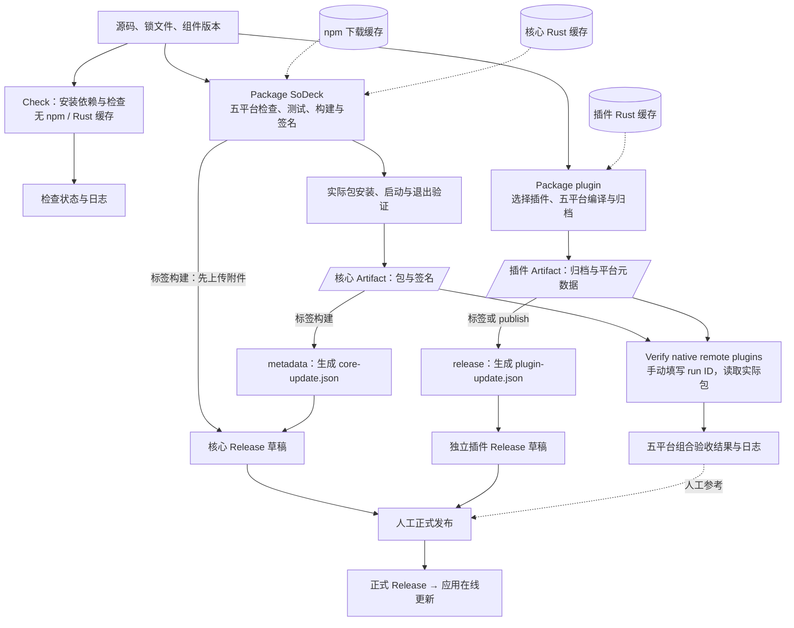
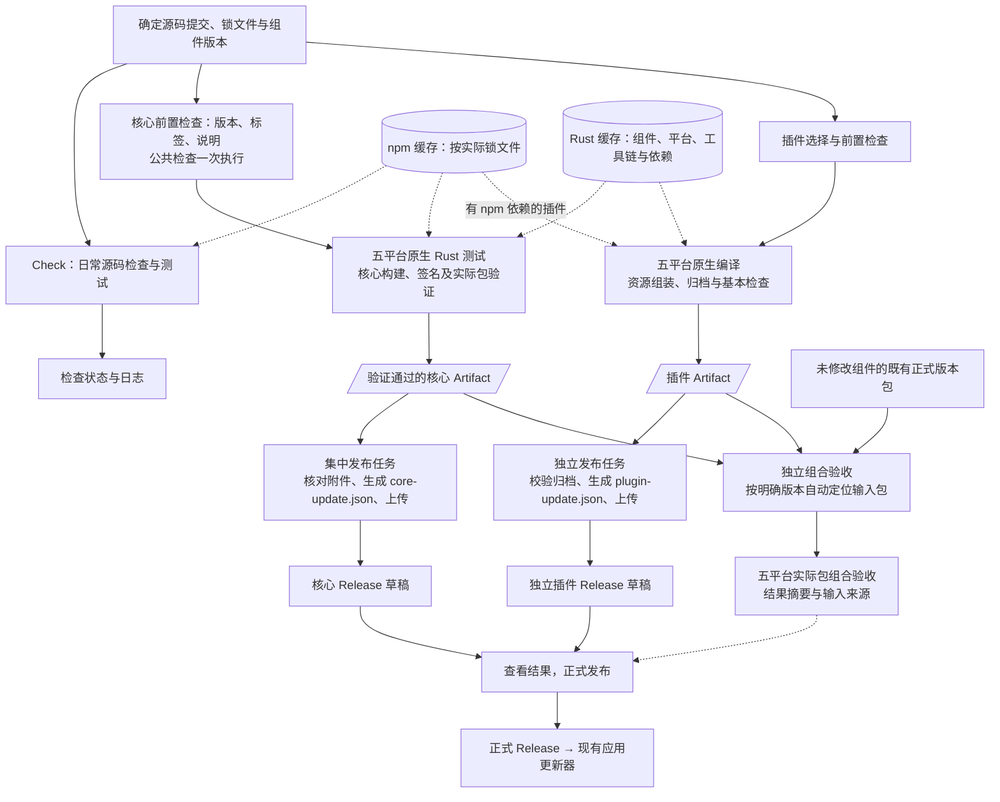

# 打包工作流优化与分步验证计划

2026-11-06。第一批已实施并完成打包与草稿收尾验证，实际结果统一见 [实施记录](implementation-packaging-workflows.md)；第二批和第三批尚未开始。配置调查基于提交 `5b5e5ae3a6dc`；本文保留目标流程和验收条件，不作为验收结果。

本计划聚焦 GitHub Actions 的打包、产物流转、缓存和验收衔接。现有在线升级流程作为交付约定继续使用。当前操作规则见[分发文档](distribution.md)，命令与环境见[开发指南](development.md)，项目边界见[开发约定](../AGENTS.md)。

## 1. 最终目的

让维护者决定发布哪个组件和版本后，工作流能够生成可追溯、经过验证的实际安装包，完成更新清单和 Release 草稿准备，并明确显示失败原因与重试入口。

完成后的可观察结果：

1. 核心、终端、文件和网络隧道继续独立版本、独立打包、独立发布；修改一个组件不要求所有组件同时发版。
2. 错误标签、缺少发布说明等问题在昂贵的编译步骤前发现。
3. 与平台无关的检查减少重复；五个平台的原生编译、相关测试和实际包启动、退出验证仍然执行。
4. Release 草稿中的核心附件来自已通过实际包验证的产物，更新清单与这些附件一致。
5. 发布收尾失败可以复用本次已验证产物重试；组合验收能够自动定位明确版本的输入包。
6. 缓存减少重复下载和编译，并能通过耗时、命中情况和存储量证明收益。
7. 正式发布后，用户仍通过现有更新功能完成发现、下载、校验及重启应用更新。

本计划优先改善流程可靠性和维护成本，不预设“缩短多少百分比”的性能目标。保留普通标签、Release 和 Tauri 官方 updater；不增加发布批次系统、组件联动发版要求或全平台联动门禁。

## 2. 工程范围与交付约定

### 2.1 需要按实际依赖确定影响范围

| 输入 | 影响范围 |
| --- | --- |
| `src/`、`src-tauri/`、根前端依赖与核心 Cargo 文件 | 核心；涉及连接、RPC、插件生命周期时还需要组合验收 |
| `plugins/<名称>/` 的源码、清单和依赖 | 对应插件 |
| `crates/plugin-client/` | 使用该客户端的三个 Rust 插件 |
| `src/ui.css`、`src/text-menu.js`、`plugins/shared/clipboard.js` | 打包脚本复制这些文件的插件，以及对应核心功能 |
| `src/font-loader.js`、`plugins/shared/font-presets.js`、`plugins/shared/fonts/` | 声明字体设置并通过资源脚本组装的插件 |
| `scripts/package-plugin.mjs`、`scripts/plugin-settings-assets.mjs` | 使用这些脚本生成的插件包 |
| 工作流、收集与发布脚本 | 对应构建、归档、发布和验收过程 |

不能只凭顶层目录决定是否需要检查或打包。共享资源仍从本次确定的源码提交组装，不能因为依赖缓存命中而跳过复制。

### 2.2 各阶段都必须维持的约定

- 核心版本唯一来源是 `src-tauri/tauri.conf.json`；插件版本来自各自 `Cargo.toml`。核心标签为 `v*`，插件标签为 `plugin-<名称>-v*`。
- 核心包不包含业务插件，核心打包不依赖插件构建或组合验收成功。
- Windows x86_64 / ARM64、Linux x86_64 / ARM64、macOS ARM64 都是正式支持目标。ARM64 使用原生程序，在对应原生 runner 上验证。
- 核心更新使用 `core-update.json` 和 Tauri 更新签名；插件使用 `plugin-update.json`、组件 ID、API 版本、目标平台和 SHA-256。
- 清单地址必须对应实际发布附件，签名和哈希必须对应附件字节。特别核对 macOS 更新归档的版本化文件名与 Linux AppImage 的选择。
- 只有正式 Release 供应用发现。草稿可以补齐、重试；已经发布的同版本附件不覆盖，修正应发布新版本。
- 成功平台的产物可以保留和下载；失败或未验证的平台必须明确显示，不能写入有效更新清单，也不能记为五平台验收完成。
- 安装包和更新包继续从 Release 分发。临时 Artifact 到期、缓存淘汰不应使已发布版本失去更新下载地址。

第一批和第二批预计主要修改工作流及构建、发布脚本；第三批主要修改验收工作流和产物选择逻辑。现有更新模块、远程业务代码和插件运行时通常无需因此修改。若实施发现必须改变升级契约，应先补充具体原因和验收方案，再纳入对应改动。

## 3. 当前流程、输入输出与缓存

| 工作流 | 触发与输入 | 主要步骤 | 输出与消费者 | 当前缓存 |
| --- | --- | --- | --- | --- |
| [Check](../.github/workflows/check.yml) | `main` 提交、PR；源码及锁文件 | 类型、格式、文件与网络插件测试、前端构建、脚本和部分界2面回归 | 检查状态、日志；未作为打包的直接依赖 | 未配置 npm / Rust 缓存 |
| [Package SoDeck](../.github/workflows/build.yml) | 核心标签或手动；核心源码、版本、发布说明 | 五平台检查、Rust 测试、构建与签名、实际包验证 | 核心 Artifact 供清单汇总与组合验收；标签构建准备 Release 草稿 | npm 下载缓存；核心 Rust 依赖与编译结果缓存 |
| [Package plugin](../.github/workflows/plugin.yml) | 插件标签或手动选择插件；插件及共享资源 | 选择组件、五平台格式检查、原生编译、归档和架构检查；终端另构建前端 | 插件 Artifact 供发布与组合验收；标签或 `publish` 准备独立草稿 | 插件 Rust 缓存；未配置 npm 缓存 |
| [Verify native remote plugins](../.github/workflows/remote-integration.yml) | 手动输入核心、终端、文件 run ID，可选网络 run ID | 五平台下载、安装实际包，启动隔离 OpenSSH，执行远程业务与窗口验收 | 验收状态与日志，供维护者判断 | 未配置构建依赖缓存；下载 Artifact 是读取输入包 |

当前核心由 `tauri-action` 上传草稿附件，然后才进行实际包验证；核心 Artifact 则在验证后上传。插件打包工作流检查归档和二进制架构，真实业务及运行退出由独立验收覆盖。工作流存在不等于该版本已经通过全部验收。

### 3.1 Artifact、缓存与 Release 的区别

| 对象 | 用途 | 后续输入 | 保留方式 |
| --- | --- | --- | --- |
| npm / Rust 缓存 | 加速依赖获取和编译 | 后续构建任务 | 按缓存规则与容量淘汰；不能作为发行包来源 |
| 核心 / 插件 Artifact | 传递本次构建的确定产物 | 发布收尾、实际包组合验收 | 调查时为 90 天；后续可评估缩短到覆盖验收需要的 14～30 天 |
| Release 附件与更新清单 | 供用户安装、更新 | 应用更新器、用户下载 | 独立于 Artifact 和缓存；已发布附件不覆盖 |

每个 runner 从干净环境开始。现有缓存不保存完整系统环境，也不包含完整 Rust 工具链、APT 安装结果和 Playwright 浏览器。缓存恢复后安装、编译命令仍然执行，由 npm / Cargo 判断可复用内容。

### 3.2 已观察的耗时基线

2026-11-06 的一次成功[核心构建](https://github.com/BgaSol/soDeck/actions/runs/42206361218)中，五个平台任务约 5～8 分钟；原生 Rust 测试约 87～139 秒，安装包构建约 124～168 秒。Windows ARM64 恢复 Rust 缓存用了 86 秒。[终端插件构建](https://github.com/BgaSol/soDeck/actions/runs/42206368841)各平台任务约 25～60 秒。

这些是单次运行的 job / step 时长，不能直接推断缓存命中率、冷构建耗时或预计提速比例。后续比较必须记录提交、运行尝试、平台、工具链、缓存恢复情况及队列等待时间。

## 4. 目标流程

先沿用四个工作流，调整内部任务和产物交接。核心与各插件的原生构建并行进行，Release 收尾按组件集中处理。组合验收独立消费已生成的包。

图中的缓存表示多份按规则区分的缓存条目，不表示不同系统、架构或组件可以无条件共用编译文件。发布收尾只在需要准备 Release 时执行；分支上的手动构建继续提供 Artifact。标签引用沿用标签构建行为。

## 5. 第一批：核心实际包验证后集中准备 Release

### 5.1 要完成的问题

将核心草稿附件上传移动到实际包验证之后，并集中完成附件、更新清单和说明的准备，使发布收尾能独立重试。

预计修改范围：`build.yml`、`collect-core.mjs`、`release-metadata.mjs` 及必要的发布辅助脚本和相关测试。具体文件以实施时的最小改动为准。

### 5.2 实践步骤

1. 记录现有五平台产物名称、目录、签名对应关系及生成清单；复用已有收集、清单回归作为基线。
2. 增加轻量前置任务，校验唯一版本来源、标签、发布说明和已有 Release 状态。鉴权或网络错误不能当作“Release 不存在”。
3. 原生任务继续执行测试、构建、签名和实际包验证；构建步骤仅生成本机文件，验证通过后才上传供发布使用的 Artifact。
4. 集中任务读取同一源码提交、组件版本对应的已验证 Artifact，核对平台、名称和完整性，生成清单并准备草稿附件与说明。兼容现有 macOS 更新归档命名、AppImage 选择及签名格式。
5. 草稿写入按同一组件和版本串行执行，上传前再次检查草稿状态，避免并发运行交错写入。通过普通 Actions 任务依赖和并发控制完成。
6. 输出各平台结果、Artifact 和草稿链接。汇总仅包含已验证平台，并明确列出失败、跳过或缺少产物的目标。
7. 验证后更新分发文档中的实际操作；新的命令只有实现并验证后才加入开发指南。

### 5.3 验收条件

- 标签与版本不匹配、说明缺失、同版本已正式发布时，在原生编译前失败。
- 分支手动构建能生成五平台 Artifact，不意外创建正式 Release。
- 五个平台分别完成原生编译和实际包安装或解包、启动、退出验证。
- 某目标失败不抹掉其他成功产物；未验证附件不进入本次有效清单，缺项明确可见。
- 草稿的包名、下载 URL、签名和哈希与已验证 Artifact 对应；生成清单能由现有更新器解析并校验对应包。
- 发布收尾失败后，复用仍有效的本次 Artifact 重试，不重复编译。过期或缺失时明确要求重新构建，不静默换用其他运行的包。
- 重新执行失败平台和发布任务时，不混入其他提交或同版本的旧产物；重用草稿前核对已有附件来源与内容。
- 测试覆盖缺失或重复平台、包与签名缺失、错误版本或组件、失败上传重试，以及已有正式 Release 的拒绝写入。

单个平台产物可用与“五平台验收完成”分别记录。当前批次结束后仍沿用普通 Release 发布流程，不把组合验收变成核心构建的前置条件。

## 6. 第二批：减少重复检查并调整缓存

### 6.1 要完成的问题

减少跨平台重复的公共检查和无关依赖变化造成的缓存浪费，同时使普通提交更早发现核心测试失败。

预计修改范围：`check.yml`、`build.yml`、`plugin.yml`，必要时调整 `package.json` 或提取已有检查入口。业务代码不因缓存优化而改写。

### 6.2 实践步骤

1. 分类现有检查：类型、格式等确与平台无关的检查在每次打包中统一执行一次；涉及进程、路径、打包、安装和原生行为的检查保留在相应平台。脚本测试先检查是否存在平台分支，不能整体假定为平台无关。
2. 在日常 Check 中补充核心常规 Rust 测试；打包继续保留五平台原生测试和实际包验证。Check 与标签构建各自执行的检查是否值得复用，按收益决定，不引入跨工作流状态查询框架。
3. 为同分支或同 PR 的 Check 配置新运行取消旧运行，并设置合理超时。发布写入采用串行策略，避免在附件上传中途因新运行而被自动取消。
4. 为 Check 和具有前端依赖的插件配置 npm 缓存，明确实际使用的锁文件；执行终端前端测试的任务也要考虑终端锁文件。
5. 核对 Rust action 实际生成的 key、恢复范围和清理行为，再决定组件区分、共享范围、保存时机以及是否缓存整个依赖编译目录。
6. 记录恢复耗时、编译耗时、缓存大小和总任务时长，比较冷缓存、热缓存、源码变化和依赖变化。先优化核心，再判断小插件是否值得增加更多缓存步骤。
7. 评估 Artifact 保留期，建议范围 14～30 天，以覆盖实际验收与重试窗口为准。缩短保留期对新 Artifact 生效；不连带清理正式 Release。

### 6.3 缓存规则

GitHub Actions 缓存保存目录；缓存命中后仍然执行安装和编译命令。它更接近 Docker 的 cache mount，而非命中后直接跳过构建指令的镜像层缓存。

| 缓存 | 应考虑的输入 | 自动完成的工作 | 需要明确的配置 |
| --- | --- | --- | --- |
| npm | 平台、包管理器、该任务实际使用的锁文件 | `setup-node` 计算锁文件哈希、恢复并保存下载缓存 | `cache: npm` 和正确的 `cache-dependency-path`；不缓存 `node_modules` |
| 核心 Rust | 原生平台、工具链、相关编译配置、核心依赖文件 | `rust-cache` 生成 key 并尝试恢复依赖缓存；Cargo 判断需要重新编译的内容 | workspace、共享边界、保存策略和缓存体积 |
| 插件 Rust | 对应插件及 `plugin-client` 的依赖、平台、工具链和相关编译配置 | action 计算 key，Cargo 复用适用依赖 | 区分组件，核对共享路径依赖与配置输入 |

配置调查时，`rust-cache` 默认会把仓库中所有 `Cargo.toml` / `Cargo.lock` 纳入 key；`workspaces` 指定目录并不会自动缩小哈希范围。插件改动可能改变核心缓存的精确 key，但 action 仍可能回退读取旧依赖缓存，不能把 key 变化等同于完全重新编译。

实施时遵守以下规则：

- 优先使用 action 的自动 key，不要求维护者逐版本手工更新字符串。
- 依赖缓存不主动追加每次提交 SHA 或应用发行版本。源码和版本仍由构建工具读取，本次安装包必须重新按确定源码生成。
- 若缩小 Rust key 的范围或关闭默认环境哈希，必须完整覆盖实际依赖、工具链和相关编译配置；不能只加一个插件名就宣称已经隔离依赖变化。
- 核对默认分支、PR、标签之间的缓存可访问范围；名称相同不保证不同引用之间能够恢复。
- 依赖发生变化时允许利用适用旧缓存补充构建，不允许把旧最终安装包当作新版本输出。
- 缓存未命中、被删除或保存失败时，干净构建仍应成功。缓存不决定测试是否执行，也不承担正确性保证。
- 维持现有免费缓存容量边界，优先减少重复和低收益条目；不通过付费扩容掩盖配置问题。

### 6.4 验收条件

| 场景 | 要观察的结果 |
| --- | --- |
| 冷缓存构建 | 在干净 runner 完成检查、构建和实际包验证 |
| 同提交再次运行 | 记录精确命中或回退恢复情况，以及恢复和构建耗时；不能只凭“Cache restored”判断更快 |
| 只修改源码或插件静态资源 | 可复用适用依赖；最终产物包含新代码或资源，相关测试照常执行 |
| 修改组件依赖或工具链 | key 和构建行为反映实际变化；适用依赖可以继续复用 |
| 修改另一独立插件 | 核对是否仍影响无关组件的精确命中；如保留默认行为，写明原因和成本 |
| 缓存淘汰或无法保存 | 构建正确性不受影响，结果中能区分缓存问题和编译失败 |
| 连续推送同一 PR | 旧 Check 取消，新 Check 完整执行；其他分支和发布任务不被误取消 |

前后比较分别记录队列等待、runner 运行时间、缓存恢复与保存时间及用量。若增加一个准备任务或恢复大缓存反而更慢，应缩小方案；不预先承诺前端跨平台只构建一次，额外传输和等待需要实测收益。

## 7. 第三批：自动定位组合验收输入

### 7.1 要完成的问题

将手工寻找多个 run ID 改为选择明确的核心和插件版本，由工作流定位、校验并记录实际输入包。

预计修改范围：`remote-integration.yml`、必要的产物选择辅助脚本及回归。先实现一键验收，是否在打包后自动触发作为本阶段后续小步，根据实际发版习惯决定。

### 7.2 实践步骤

1. 定义输入：核心版本、终端和文件插件版本、可选网络版本；保留精确 run ID 作为排查或重试时的覆盖入口。
2. 按组件、版本、对应源码提交、平台及成功产物定位包；逐个组件核对来源，不能只取最近一次成功运行或全仓库 Latest。
3. 新组件优先使用本次已验证 Artifact；未改动组件可读取明确版本的正式 Release。各组件允许来自不同提交，但每个包必须对应它自己声明的版本和提交。
4. 对下载输入检查组件 ID、版本、API、平台、清单和完整性。输入缺失、过期或歧义时明确失败，不能静默替换另一个版本。
5. 用同一组明确组件版本执行五平台原生组合验收，记录测试脚本的提交和使用的实际包。旧核心缺少当前验收入口时，应明确说明验证限制，不能把没有执行当作通过。
6. 生成结果摘要：各组件版本、来源 run / Release、提交、平台、包信息、验收结果与日志链接。

### 7.3 验收条件

- 首次使用只需选择组件版本，不再人工逐个寻找 run ID。
- 相同输入重复执行能够定位同一组可核对的包。
- 新核心配既有插件、新插件配既有兼容核心均有明确测试案例；无须为了同一提交重发未修改组件。
- 错误组件、版本、平台、API、损坏或歧义产物被拒绝，并显示具体原因。
- 终端、文件、可选网络业务以及实际进程退出按五个原生目标分别验证；网络输入为空与提供网络输入均有覆盖。
- 组合验收失败保留原有打包产物，结果清楚可见；核心与插件的独立构建、草稿准备不被绑定为全组件事务。

## 8. 每批如何验证和交付

每批按“定义验收行为 → 最小实现 → 本地相关检查 → 原生工作流验证 → 核对实际产物 → 记录结果”的顺序推进。一个完整问题一个提交，批次是本计划的实施顺序，不是新增的产品发布机制。

### 8.1 检查范围

- **本轮文档整理：**检查 Markdown 结构、相对链接、索引和差异，不以文档提交触发五平台发行验收。
- **工作流或发布脚本变更：**执行受影响的格式、类型和脚本检查，运行 `npm run scripts:test`，为版本、附件与重试等行为增加必要回归；按开发指南执行相关构建测试。
- **核心打包变更：**在五个平台分别原生构建、安装或解包并验证实际包启动和退出；不能把本机通过外推成五平台通过。
- **插件打包或产物选择变更：**按受影响插件执行独立打包与真实宿主组合验收，核对归档内程序、资源、清单及架构。
- **升级交付约定：**复用已有更新模块回归验证清单解析、包校验和重启应用；实际发行验收沿普通发版流程检查发布地址，并记录实际安装版本升级后的版本和配置结果。源码夹具通过、包内烟测通过、真实跨版本升级通过分别记录。

五个平台的安装器和更新形式继续以分发文档为准：Windows NSIS、Linux DEB / AppImage、macOS DMG / app 更新归档。DEB 核心继续使用系统安装方式，不能记为已完成应用内核心更新。

### 8.2 结果记录

开始第一批实施时，建立对应的 `docs/implementation-packaging-workflows.md` 并加入文档索引；全部实际结果只在该实施记录维护。本文保留目标、步骤和验收条件，不重复维护每次运行结果。

每次验证记录以下字段：

| 字段 | 内容 |
| --- | --- |
| 范围 | 对应批次、验收条件和受影响组件 |
| 输入 | 源码提交、组件版本、测试脚本提交、工具链和平台 |
| 执行 | 本地命令或工作流链接、run ID、运行尝试 |
| 产物 | Artifact / Release、文件名、平台及校验信息 |
| 结果 | 通过、失败、未执行或受限；失败原因与日志位置 |
| 性能 | 涉及缓存时记录冷 / 热状态、恢复、构建、等待耗时与存储量 |
| 后续 | 未完成项目、已知风险及下一步 |

无法读取详细日志或缺少目标平台执行条件时，明确保留未验证项；不依据工作流定义、历史成功运行或缓存占用推断本次通过。

### 8.3 重试与恢复

- 本次有效 Artifact 尚在时，发布收尾优先读取同一组已验证产物重试。
- 某平台需重建时，继续固定本次源码、组件版本和工具链，并重新执行该平台验证。
- 改动出现问题时可以回退对应工作流或脚本提交；已正式发布附件仍遵守不可覆盖规则，产品包需要修正则升版本。
- 每批把可用结果、未完成项和风险说明清楚，再推进下一批。这个检查点用于协作验收，不增加 GitHub 上的多层审批流程。

## 9. 当前落点与下一步

第一批按本文验收条件实施，执行结果、提交和工作流链接维护在 [实施记录](implementation-packaging-workflows.md)。第二批、第三批在各自进入实施时补齐具体改动与验证证据。

## 参考

- [现有收集脚本](../scripts/collect-core.mjs)、[更新清单脚本](../scripts/release-metadata.mjs)、[插件打包脚本](../scripts/package-plugin.mjs)。
- [更新体验实施记录](implementation-update-experience.md)：现有客户端行为和验证边界。
- [setup-node 缓存说明](https://github.com/actions/setup-node#caching-global-packages-data)。
- [rust-cache 行为与 key 说明](https://github.com/Swatinem/rust-cache)。
- [GitHub 缓存匹配与作用域](https://docs.github.com/en/actions/reference/workflows-and-actions/dependency-caching)。
- [Docker cache mount](https://docs.docker.com/build/cache/optimize/#use-cache-mounts)。

返回 [文档索引](README.md)
