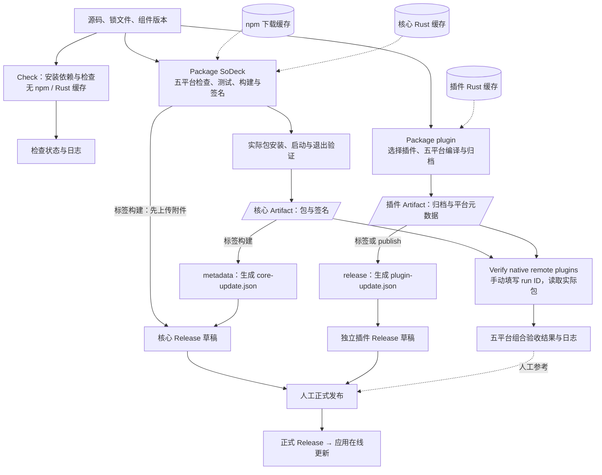
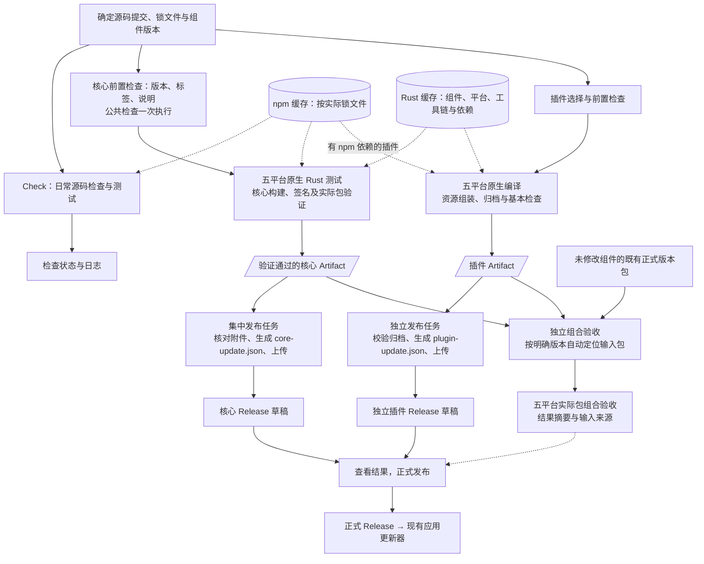

# 打包工作流优化与分步验证计划

2026-11-06。第一批已实施并完成打包与草稿收尾验证，实际结果统一见 [实施记录](implementation-packaging-workflows.md)；第二批和第三批尚未开始。配置调查基于提交 `5b5e5ae3a6dc`；本文保留目标流程和验收条件，不作为验收结果。

本计划聚焦 GitHub Actions 的打包、产物流转、缓存和验收衔接。现有在线升级流程作为交付约定继续使用。当前操作规则见[分发文档](distribution.md)，命令与环境见[开发指南](development.md)，项目边界见[开发约定](../AGENTS.md)。

## 1. 最终目的

让维护者决定发布哪个组件和版本后，工作流能够生成可追溯、经过验证的实际安装包，完成更新清单和 Release 草稿准备，并明确显示失败原因与重试入口。

完成后的可观察结果：

1. 核心、终端、文件和网络隧道继续独立版本、独立打包、独立发布；修改一个组件不要求所有组件同时发版。
2. 错误标签、缺少发布说明等问题在昂贵的编译步骤前发现。
3. 与平台无关的检查减少重复；五个平台的原生编译、相关测试和实际包启动、退出验证仍然执行。
4. Release 草稿中的核心附件来自已通过实际包验证的产物，更新清单与这些附件一致。
5. 发布收尾失败可以复用本次已验证产物重试；组合验收能够自动定位明确版本的输入包。
6. 缓存减少重复下载和编译，并能通过耗时、命中情况和存储量证明收益。
7. 正式发布后，用户仍通过现有更新功能完成发现、下载、校验及重启应用更新。

本计划优先改善流程可靠性和维护成本，不预设“缩短多少百分比”的性能目标。保留普通标签、Release 和 Tauri 官方 updater；不增加发布批次系统、组件联动发版要求或全平台联动门禁。

## 2. 工程范围与交付约定

### 2.1 需要按实际依赖确定影响范围

| 输入 | 影响范围 |
| --- | --- |
| `src/`、`src-tauri/`、根前端依赖与核心 Cargo 文件 | 核心；涉及连接、RPC、插件生命周期时还需要组合验收 |
| `plugins/<名称>/` 的源码、清单和依赖 | 对应插件 |
| `crates/plugin-client/` | 使用该客户端的三个 Rust 插件 |
| `src/ui.css`、`src/text-menu.js`、`plugins/shared/clipboard.js` | 打包脚本复制这些文件的插件，以及对应核心功能 |
| `src/font-loader.js`、`plugins/shared/font-presets.js`、`plugins/shared/fonts/` | 声明字体设置并通过资源脚本组装的插件 |
| `scripts/package-plugin.mjs`、`scripts/plugin-settings-assets.mjs` | 使用这些脚本生成的插件包 |
| 工作流、收集与发布脚本 | 对应构建、归档、发布和验收过程 |

不能只凭顶层目录决定是否需要检查或打包。共享资源仍从本次确定的源码提交组装，不能因为依赖缓存命中而跳过复制。

### 2.2 各阶段都必须维持的约定

- 核心版本唯一来源是 `src-tauri/tauri.conf.json`；插件版本来自各自 `Cargo.toml`。核心标签为 `v*`，插件标签为 `plugin-<名称>-v*`。
- 核心包不包含业务插件，核心打包不依赖插件构建或组合验收成功。
- Windows x86_64 / ARM64、Linux x86_64 / ARM64、macOS ARM64 都是正式支持目标。ARM64 使用原生程序，在对应原生 runner 上验证。
- 核心更新使用 `core-update.json` 和 Tauri 更新签名；插件使用 `plugin-update.json`、组件 ID、API 版本、目标平台和 SHA-256。
- 清单地址必须对应实际发布附件，签名和哈希必须对应附件字节。特别核对 macOS 更新归档的版本化文件名与 Linux AppImage 的选择。
- 只有正式 Release 供应用发现。草稿可以补齐、重试；已经发布的同版本附件不覆盖，修正应发布新版本。
- 成功平台的产物可以保留和下载；失败或未验证的平台必须明确显示，不能写入有效更新清单，也不能记为五平台验收完成。
- 安装包和更新包继续从 Release 分发。临时 Artifact 到期、缓存淘汰不应使已发布版本失去更新下载地址。

第一批和第二批预计主要修改工作流及构建、发布脚本；第三批主要修改验收工作流和产物选择逻辑。现有更新模块、远程业务代码和插件运行时通常无需因此修改。若实施发现必须改变升级契约，应先补充具体原因和验收方案，再纳入对应改动。

## 3. 当前流程、输入输出与缓存

| 工作流 | 触发与输入 | 主要步骤 | 输出与消费者 | 当前缓存 |
| --- | --- | --- | --- | --- |
| [Check](../.github/workflows/check.yml) | `main` 提交、PR；源码及锁文件 | 类型、格式、文件与网络插件测试、前端构建、脚本和部分界2面回归 | 检查状态、日志；未作为打包的直接依赖 | 未配置 npm / Rust 缓存 |
| [Package SoDeck](../.github/workflows/build.yml) | 核心标签或手动；核心源码、版本、发布说明 | 五平台检查、Rust 测试、构建与签名、实际包验证 | 核心 Artifact 供清单汇总与组合验收；标签构建准备 Release 草稿 | npm 下载缓存；核心 Rust 依赖与编译结果缓存 |
| [Package plugin](../.github/workflows/plugin.yml) | 插件标签或手动选择插件；插件及共享资源 | 选择组件、五平台格式检查、原生编译、归档和架构检查；终端另构建前端 | 插件 Artifact 供发布与组合验收；标签或 `publish` 准备独立草稿 | 插件 Rust 缓存；未配置 npm 缓存 |
| [Verify native remote plugins](../.github/workflows/remote-integration.yml) | 手动输入核心、终端、文件 run ID，可选网络 run ID | 五平台下载、安装实际包，启动隔离 OpenSSH，执行远程业务与窗口验收 | 验收状态与日志，供维护者判断 | 未配置构建依赖缓存；下载 Artifact 是读取输入包 |

当前核心由 `tauri-action` 上传草稿附件，然后才进行实际包验证；核心 Artifact 则在验证后上传。插件打包工作流检查归档和二进制架构，真实业务及运行退出由独立验收覆盖。工作流存在不等于该版本已经通过全部验收。

### 3.1 Artifact、缓存与 Release 的区别

| 对象 | 用途 | 后续输入 | 保留方式 |
| --- | --- | --- | --- |
| npm / Rust 缓存 | 加速依赖获取和编译 | 后续构建任务 | 按缓存规则与容量淘汰；不能作为发行包来源 |
| 核心 / 插件 Artifact | 传递本次构建的确定产物 | 发布收尾、实际包组合验收 | 调查时为 90 天；后续可评估缩短到覆盖验收需要的 14～30 天 |
| Release 附件与更新清单 | 供用户安装、更新 | 应用更新器、用户下载 | 独立于 Artifact 和缓存；已发布附件不覆盖 |

每个 runner 从干净环境开始。现有缓存不保存完整系统环境，也不包含完整 Rust 工具链、APT 安装结果和 Playwright 浏览器。缓存恢复后安装、编译命令仍然执行，由 npm / Cargo 判断可复用内容。

### 3.2 已观察的耗时基线

2026-11-06 的一次成功[核心构建](https://github.com/BgaSol/soDeck/actions/runs/42206361218)中，五个平台任务约 5～8 分钟；原生 Rust 测试约 87～139 秒，安装包构建约 124～168 秒。Windows ARM64 恢复 Rust 缓存用了 86 秒。[终端插件构建](https://github.com/BgaSol/soDeck/actions/runs/42206368841)各平台任务约 25～60 秒。

这些是单次运行的 job / step 时长，不能直接推断缓存命中率、冷构建耗时或预计提速比例。后续比较必须记录提交、运行尝试、平台、工具链、缓存恢复情况及队列等待时间。

## 4. 目标流程

先沿用四个工作流，调整内部任务和产物交接。核心与各插件的原生构建并行进行，Release 收尾按组件集中处理。组合验收独立消费已生成的包。

图中的缓存表示多份按规则区分的缓存条目，不表示不同系统、架构或组件可以无条件共用编译文件。发布收尾只在需要准备 Release 时执行；分支上的手动构建继续提供 Artifact。标签引用沿用标签构建行为。

## 5. 第一批：核心实际包验证后集中准备 Release

### 5.1 要完成的问题

将核心草稿附件上传移动到实际包验证之后，并集中完成附件、更新清单和说明的准备，使发布收尾能独立重试。

预计修改范围：`build.yml`、`collect-core.mjs`、`release-metadata.mjs` 及必要的发布辅助脚本和相关测试。具体文件以实施时的最小改动为准。

### 5.2 实践步骤

1. 记录现有五平台产物名称、目录、签名对应关系及生成清单；复用已有收集、清单回归作为基线。
2. 增加轻量前置任务，校验唯一版本来源、标签、发布说明和已有 Release 状态。鉴权或网络错误不能当作“Release 不存在”。
3. 原生任务继续执行测试、构建、签名和实际包验证；构建步骤仅生成本机文件，验证通过后才上传供发布使用的 Artifact。
4. 集中任务读取同一源码提交、组件版本对应的已验证 Artifact，核对平台、名称和完整性，生成清单并准备草稿附件与说明。兼容现有 macOS 更新归档命名、AppImage 选择及签名格式。
5. 草稿写入按同一组件和版本串行执行，上传前再次检查草稿状态，避免并发运行交错写入。通过普通 Actions 任务依赖和并发控制完成。
6. 输出各平台结果、Artifact 和草稿链接。汇总仅包含已验证平台，并明确列出失败、跳过或缺少产物的目标。
7. 验证后更新分发文档中的实际操作；新的命令只有实现并验证后才加入开发指南。

### 5.3 验收条件

- 标签与版本不匹配、说明缺失、同版本已正式发布时，在原生编译前失败。
- 分支手动构建能生成五平台 Artifact，不意外创建正式 Release。
- 五个平台分别完成原生编译和实际包安装或解包、启动、退出验证。
- 某目标失败不抹掉其他成功产物；未验证附件不进入本次有效清单，缺项明确可见。
- 草稿的包名、下载 URL、签名和哈希与已验证 Artifact 对应；生成清单能由现有更新器解析并校验对应包。
- 发布收尾失败后，复用仍有效的本次 Artifact 重试，不重复编译。过期或缺失时明确要求重新构建，不静默换用其他运行的包。
- 重新执行失败平台和发布任务时，不混入其他提交或同版本的旧产物；重用草稿前核对已有附件来源与内容。
- 测试覆盖缺失或重复平台、包与签名缺失、错误版本或组件、失败上传重试，以及已有正式 Release 的拒绝写入。

单个平台产物可用与“五平台验收完成”分别记录。当前批次结束后仍沿用普通 Release 发布流程，不把组合验收变成核心构建的前置条件。

## 6. 第二批：减少重复检查并调整缓存

### 6.1 本批目标与边界

让普通提交更早发现核心测试失败，减少打包重复检查，并在现有免费缓存额度内提高可复用依赖的收益。2026-11-07 补充本节详细计划；以下均为待实施工作，不代表已经通过验收。

本批交付四项结果：

1. 日常 Check 包含核心常规 Rust 测试；同一分支或 PR 的旧 Check 能被新运行取消。
2. 核心和所选插件的公共类型、格式检查在各自打包工作流前置执行；五平台原生测试、编译、资源组装、架构检查及实际包验证继续执行。
3. npm 缓存按实际锁文件配置；Rust 缓存明确组件、用途、平台、依赖边界和保存策略，并有耗时及体积的对照证据。
4. 新的核心包、插件包和核心清单 Artifact 保留 30 天；分发文档说明重试窗口和过期处理。

预计修改 `check.yml`、`build.yml`、`plugin.yml`，同步 `docs/development.md`、`docs/distribution.md` 和既有实施记录。只有确需缩小 Rust 哈希范围时才增加轻量辅助脚本及其回归；优先保留现有 npm 命令，不为移动步骤增加命令层级。

本批不修改业务功能、组件版本、在线更新契约和组合验收的 run ID 输入；不正式发布核心 0.9.1 或文件插件，不新增生产依赖，不引入付费 runner、付费缓存扩容或自动清理服务。已验证的 0.9.1 草稿、附件与原始 Artifact 保留为基线。

### 6.2 实施前调查基线

调查源码为 `2772f7b`，实际包基线和第一批结果见 [实施记录](implementation-packaging-workflows.md)。实施时先保存原始 job/step 耗时和缓存列表，避免将不同源码、工具链、运行尝试混在一起比较。

| 当前事实 | 对本批的影响 |
| --- | --- |
| Check 在 Linux 单任务执行，尚未运行 `npm run test`，也未配置 npm/Rust 缓存和超时 | 补齐常规核心测试；先执行便宜检查，再安装系统依赖并编译；先维持单任务，保留现有检查状态名称 |
| 核心 preflight 已运行完整脚本测试，五个 package job 又各自运行 `check`、`test`、`scripts:test` | 类型与格式可前置；核心 Rust 测试保留五次；脚本按真实宿主行为分类后移动 |
| 完整核心 UI、源码 OpenSSH 和包内 OpenSSH 专项在 Windows x86_64 执行 | 保持这些覆盖；不能把浏览器模拟平台视为其他原生平台验收 |
| 三个插件共用 package job ID，均依赖 `crates/plugin-client`；终端另有 npm 前端 | 插件格式前置；缓存应区分所选插件并覆盖客户端依赖；终端独立使用自己的锁文件 |
| 实施核对的 action `d1527c8f67ef9af357290475d4af4b0fab8f12e0` 按配置 workspace 的成员清单、锁文件及配置生成 key | 已具备组件范围；插件 workspace 外的 plugin-client 清单需要显式覆盖。先前全仓库哈希的调查描述已据实际源码修正 |
| GitHub API 返回 22 个缓存、11,097,061,407 字节，约 10.33 GiB；其中 9 个大 Rust 条目占约 10.06 GiB，npm 7 个、约 245 MiB，小 Rust 6 个、约 37 MiB | 优先减少大 Rust 条目的重复与低收益保存；不因插件条目小而先增加复杂缓存策略 |
| 当次核心的五个主分支 Rust 条目合计约 5.68 GiB；另有旧依赖和不同引用条目 | Check 不直接复制一套包含 debug/release 的大缓存；缓存作用域和存储周转需要单独核对 |
| 现有上传步骤未指定保留期，已查询包的创建/到期时间对应 90 天 | 为新 Artifact 显式设置 30 天，不更改既有包的期限 |

仓库为公开仓库；当前五个 runner 标签属于 GitHub 官方列出的公开仓库免费标准 runner。缓存另有每仓库 10 GiB 的免费额度，超出额度的计费以是否配置扩容等条件为准。读取本仓库缓存上限和保留配置的接口均返回 HTTP 402，要求有效支付方式；因此本次调查不能确认具体上限或账单，不能仅凭瞬时用量认定已经收费。实施不修改支付、预算或扩容设置。

### 6.3 检查放置与任务依赖

| 检查或步骤 | Check | 核心打包 | 插件打包 |
| --- | --- | --- | --- |
| TypeScript、核心 Rust 格式 | 保留 `npm run check` | 移入既有 preflight，版本/标签校验先执行；从五个平台移除重复步骤 | 不引入核心检查 |
| 插件和 plugin-client 格式 | 保留三个插件及客户端检查 | 不新增插件构建依赖 | 选择组件后在 select 中执行所选插件格式一次 |
| 核心常规 Rust 测试 | 新增 `npm run test`，包含 `test-fixtures`，不自动执行 ignored 远程专项 | 五个平台继续 `npm run test` | 不作为插件打包前置依赖 |
| 文件、网络插件现有 Rust 测试 | 保留 | 不引入 | 本批不改变各插件的业务测试范围 |
| 纯逻辑脚本测试 | 保留完整 `scripts:test` | preflight 执行完整套件；平台任务仅保留需要原生宿主覆盖的子集 | 不要求所有插件重复完整根脚本套件 |
| 前端构建 | 保留 `web:build` | 各平台 Tauri 的 `beforeBuildCommand` 继续构建本次前端 | 终端在各平台继续独立安装锁定依赖并构建 UI |
| 浏览器交互、终端输入和设置回归 | 保留现有覆盖 | Windows x86_64 的完整 UI 覆盖保留 | 不挪入每个插件平台任务 |
| OpenSSH、进程、路径、安装/解包和包内启动退出 | 不把普通 Rust 测试写成远程专项通过 | 按现有原生平台步骤继续执行 | 归档/架构检查保留，真实业务沿用独立组合验收 |

现有 `scripts:test` 包含 8 个测试文件。`clipboard`、`file-document-read`、`update-notes` 主要验证逻辑；`smoke` 会启动真实 Node 子进程并处理报告路径，`plugin-settings-assets` 涉及 Git 换行策略和文件复制，`collect-core`、`release-metadata`、`core-release` 包含路径和子进程入口测试。初始安排是完整套件在 preflight 早运行一次，后五个文件在 Windows x86_64、Linux x86_64、macOS ARM64 各运行一次；两种 ARM64 Windows/Linux 的原生包烟测和 Rust 测试不减。实施再核对遗漏的宿主分支，必要时保留更多覆盖，不以文件名判断平台无关。

核心继续使用 `preflight → 五平台 package → metadata`；不查询另一工作流的 Check 状态，也不传输一份前端产物供五平台共用。既有 `core_run_id` 恢复仍运行当前发布脚本回归、跳过原生构建，并保持原始包来源 SHA。

Check 使用按工作流与 PR 编号/分支引用区分的 concurrency group，开启 `cancel-in-progress: true`，保留跨分支隔离。初始超时建议：Check 30 分钟、核心 preflight 10 分钟、插件 select 10 分钟、插件 release 10 分钟；核心 package 40 分钟、metadata 10 分钟、插件 package 20 分钟沿用，实测后再调整。

仅 Check 自动取消旧运行。核心 metadata 的同版本串行策略保持；插件 release 补上按组件和标签区分、`cancel-in-progress: false` 的 job concurrency。本批不改插件发布脚本的附件上传和草稿恢复逻辑。

### 6.4 npm 缓存配置

全部使用 `setup-node` 的 npm 下载缓存，命中后仍执行 `npm ci`；不保存 `node_modules`、前端 dist 或已组装插件目录。

| 任务 | `cache-dependency-path` | 原因 |
| --- | --- | --- |
| Check | 根 `package-lock.json` 和 `plugins/terminal/package-lock.json` | `terminal:input:test` 会独立安装终端依赖 |
| 核心 preflight | 根 `package-lock.json` | 公共检查只安装根依赖 |
| 核心 Windows x86_64 package | 根锁文件和终端锁文件 | 完整 UI 中的 desktop/terminal 测试会安装终端依赖 |
| 核心其他四个平台 package | 根 `package-lock.json` | 不因不使用的终端 npm 依赖改变下载缓存 key |
| 终端插件 package | `plugins/terminal/package-lock.json` | 独立前端由插件打包脚本安装与构建，不依赖根前端安装 |
| 文件、网络插件 package；metadata/release/select | 不增加 npm 缓存 | 不执行需要安装 npm 依赖的步骤 |

本批保持终端安装入口的现有行为；若发现同一个 job 多次 `npm ci` 的耗时值得优化，再用测量证据决定是否单独调整。Playwright 浏览器、APT 包和 Rust 工具链暂不新增缓存，避免扩大存储范围。

### 6.5 Rust 缓存配置与决策顺序

先利用 `rust-cache` 自动处理编译器、平台、依赖清理和回退恢复，再依据对照结果决定是否自定义哈希。缓存 key 不追加提交 SHA 或发行版本，最终程序和资源始终由本次确定的源码生成。

**第一步：明确目录和用途。** 核心打包缓存只覆盖 `src-tauri -> target`，插件按所选 `plugins/<名称> -> target` 区分命名。不同系统、架构、核心测试与发行构建不强行共用 target；插件缓存不能因相同 package job ID 就视为同一个组件。默认不缓存 workspace 自身、incremental 和最终安装包，继续采用 action 的清理行为。

**第二步：控制保存体积。** Check 新增 Rust 缓存先试 `cache-targets: false`，只加速 Cargo 下载；与只缓存 Check 的 debug 依赖做一次 Linux 对照。不能直接共享核心打包的大条目：它同时有宿主 debug、显式 target release 及不同 features，路径/内容也影响缓存版本。只有 debug 缓存确实减少总运行耗时且容量允许时才保留。

**第三步：控制保存来源。** 初始策略是成功的 main 运行保存 Rust 缓存，PR/标签/其他分支尝试恢复而不重复保存；实验分支使用短期隔离前缀并允许保存用于测量。保留失败不保存的默认行为。核对标签能否从 main 恢复适用条目，以及不保存标签专属新依赖的时间成本；若需要放宽，记录原因和新增体积，不自动复制五平台缓存。

**第四步：评估依赖边界。** 以实际使用的 action 源码和日志为准；当前版本已按配置 workspace 限定 Cargo 成员清单和锁文件，并忽略清单注释、当前包版本等与依赖无关的字段。保留自动环境 key，将 workspace 外的 plugin-client 清单摘要通过额外环境变量及 `env-vars` 纳入插件和相应 Check 缓存，不再自建全套摘要逻辑。该 action 设置 `shared-key` 时忽略单独的 `key`，不能将两者当作可相加的输入。核对无关组件、共享客户端和编译配置变化的命中/回退行为；固定已验证的 action 提交，避免将 README 的旧行为描述作为实施依据。

若关闭 `add-rust-environment-hash-key`，不能只改成 `hashFiles('<组件>/Cargo.lock')`。候选实现必须覆盖：

| 输入 | 核心 | 每个插件 |
| --- | --- | --- |
| 实际依赖 | 核心 Cargo.toml / Cargo.lock 及未来真实 path 依赖 | 该插件 Cargo.toml / Cargo.lock、plugin-client Cargo.toml，以及未来真实 path 依赖 |
| 工具链和平台 | 重新纳入 rustc/host 和仓库工具链配置及目标；关闭此开关会失去自动环境摘要 | 同左，仍区分系统、架构与组件 |
| 编译配置 | 适用 `.cargo/config*`、profile、features、target 和影响依赖编译的环境 | 同左，以插件实际构建参数为准 |
| 环境变量 | 补回关闭自动哈希同时失去的 `CARGO`、`CC`、`CFLAGS`、`CXX`、`CMAKE`、`RUST` 等相关前缀值 | 同左，不把签名密钥或 token 纳入缓存日志/key |

如需辅助脚本，职责只限输入清单和稳定摘要，不接管构建或发布；测试验证组件依赖、共享客户端、工具链和编译环境变化会改变 key，普通源码/静态资源及无关组件变化符合约定。源码不纳入依赖 key 不代表跳过其编译；必须从日志和实际产物证明更新内容被重建/组装。

不全量删除现有缓存制造冷构建。实验使用本批专用前缀；读取缓存列表区分当前有效条目、旧依赖条目和不同引用重复条目。旧缓存按现有淘汰策略退出，短期实验缓存按明确 ID 清理；不增加定时清理工作流。核对 main、PR merge ref、标签的访问范围，不能以 key 名称相同推断互相可用。

### 6.6 Artifact 保留与发布基线保护

核心五平台包、独立插件五平台包和 `Core-update-manifest` 的上传步骤统一显式 `retention-days: 30`，给实际验收和发布恢复留下一个月窗口。先选 30 天，只有实际使用记录证明足够时再考虑 14 天。

保留期只作用于新增 Artifact。第一批的 0.9.1 包、草稿和附件不清理、不覆盖；Release 附件仍是正式安装与更新的长期下载来源。分发文档说明：超过窗口需要重新构建并重新验证；核心可在 Artifact 有效时使用 `core_run_id` 恢复；插件沿用已有操作，不承诺未实现的插件恢复入口。

核心和插件的实验均手动运行 `publish=false`。核心缓存/打包对照必须让 `core_run_id` 留空，否则只测到发布汇总，没有原生编译数据；恢复回归才指定第一批原始运行。每次实验记录提交和版本，不能因为同为 0.9.1 就将新实验字节补进既有草稿。

### 6.7 对照实验与验收清单

实验前固定代码提交、Node/Rust、runner 标签、签名和构建参数；记录 GitHub 实际 runner 镜像版本。同提交重跑也可能遇到镜像更新或队列变化，这些情况单独注明。性能不承诺固定提速百分比，至少同时记录 cache restore/save、安装、测试、编译打包、实际包验证、总 job 时间、队列时间和缓存压缩大小。

| 场景 | 执行与验收证据 |
| --- | --- |
| 日常 Check | 核心常规测试、现有插件测试、类型/格式/脚本、前端构建和界面回归全部执行；ignored 远程专项明确列出 |
| 连续更新同一 PR | 用实验 PR 的两个连续提交确认旧 Check 取消、新 Check 完整执行；另一个引用的运行不被取消，发布写入未配置自动取消 |
| 核心冷/热缓存 | 同一实验提交用隔离缓存完整五平台运行一次，再重跑同提交一次；分别记录命中情况和全部原生测试、实际包启动退出、更新签名与篡改拒绝结果 |
| Check Rust 方案对照 | Linux 比较 registry-only 与 debug 依赖缓存的完整 Check 总耗时及压缩体积；保存较简单且实际有收益的配置 |
| 插件打包 | 三个插件分别五平台独立构建，核对架构、清单、资源与归档；终端热缓存至少比较 Windows/Linux 的恢复与 UI 构建耗时，不仅看 npm 命中日志 |
| 实际插件运行 | 使用上述确定的核心、终端、文件、网络 run ID 执行现有五平台组合验收，覆盖实际包业务和进程退出；保留手动输入入口 |
| 只改源码或资源 | 实验分支做可核对的最小源码/资源变化；依赖适用缓存仍可恢复，Cargo 重建或资源组装执行，解包核对本次资源；实验改动不进入发行 |
| 修改本组件依赖或工具链 | 对 key 输入作对照；若引入自定义摘要，增加必要回归，并选择一个原生平台验证实际恢复/补充编译。测试变更不升级生产依赖或正式版本 |
| 修改无关插件或共享客户端 | 分别观察核心与所选插件 key；客户端变化影响依赖它的三个插件，无关插件变化按最终采用策略精确命中或回退，说明成本 |
| 缓存缺失或无法保存 | 隔离冷缓存证明构建不依赖缓存；只恢复不保存的运行证明不保存仍能完成交付，不人为破坏 GitHub 服务模拟网络故障 |
| Artifact 和恢复 | 查询新包到期时间对应 30 天；publish=false 生成包和清单；复用原始 run 的汇总仍成功，既有 0.9.1 草稿附件 ID、大小和摘要保持不变 |

先执行必要的核心两次五平台运行、三个插件各一次五平台运行和一次包含网络插件的五平台组合验收，再对低收益或异常平台进行定向重跑。额外缺省网络输入不因缓存改动重复验收；不为每个源码/依赖组合重复全部矩阵。若只改检查放置/缓存却出现平台失败，先定位并补证据，不能用第一批历史成功替代本次验证。

缓存容量按“当前有效五平台核心条目 + 必要 Check/插件/npm 条目 + 一次依赖变化的周转空间”核算。目标是在 10 GiB 免费边界内保留实际有收益的缓存；若大条目仍频繁互相淘汰，应缩小 debug/target 或保存范围，而非扩容。短期快照可以因淘汰延迟超出阈值，是否达成需结合访问、保存与淘汰记录判断；不把单次快照当作费用证明。

### 6.8 实施顺序、提交与收尾

| 顺序 | 完整主题 | 主要交付与检查点 |
| --- | --- | --- |
| 1 | 日常提交更早发现核心测试失败 | 补核心测试、Check concurrency/超时和下载缓存，先运行完整 Check；保留现有 job 状态名称 |
| 2 | 打包前统一执行公共检查 | 核心 preflight 与插件 select 调整、脚本宿主覆盖、发布串行/超时；验证错误前置输入仍阻止原生打包，恢复仍跳过构建 |
| 3 | 缓存按实际组件和用途复用 | npm 锁文件配置、Rust 命名/保存范围、必要的摘要辅助及回归；以对照数据确定最终 Rust 策略 |
| 4 | 保留明确的包验收和重试窗口 | 新 Artifact 30 天与对应分发操作说明，查询到期时间和既有草稿不变 |
| 5 | 记录本批实际验收 | 在既有实施记录统一登记运行链接、提交、冷/热状态、耗时、容量、失败原因与未完成项；不重复写入 README |

每个代码主题先本地运行受影响的类型/格式、`npm run scripts:test` 和 actionlint，再执行相应 Rust、前端构建及界面回归；打包与运行正确性由上表原生工作流补齐。文档按最终行为同步，不把未实现的命令写入开发指南。

本批完成需同时满足：检查覆盖可逐项核对、五平台核心与三个插件的实际产物验收通过、缓存失效不影响正确性、取消范围正确、新 Artifact 期限正确、原草稿基线未变，并提供可解释的性能/存储数据。若自定义 key 或更大 Check 缓存收益不足，可以保留较简单配置，但必须写明取舍和剩余代价。

回退以对应工作流/脚本主题提交为单位，先恢复可用配置再复跑；缓存可丢弃并冷构建，实验 Artifact 可以到期。正式发布、真实跨版本升级、物理设备交互验收和第三批自动选包仍单独记录为后续工作。

## 7. 第三批：自动定位组合验收输入

### 7.1 要完成的问题

将手工寻找多个 run ID 改为选择明确的核心和插件版本，由工作流定位、校验并记录实际输入包。

预计修改范围：`remote-integration.yml`、必要的产物选择辅助脚本及回归。先实现一键验收，是否在打包后自动触发作为本阶段后续小步，根据实际发版习惯决定。

### 7.2 实践步骤

1. 定义输入：核心版本、终端和文件插件版本、可选网络版本；保留精确 run ID 作为排查或重试时的覆盖入口。
2. 按组件、版本、对应源码提交、平台及成功产物定位包；逐个组件核对来源，不能只取最近一次成功运行或全仓库 Latest。
3. 新组件优先使用本次已验证 Artifact；未改动组件可读取明确版本的正式 Release。各组件允许来自不同提交，但每个包必须对应它自己声明的版本和提交。
4. 对下载输入检查组件 ID、版本、API、平台、清单和完整性。输入缺失、过期或歧义时明确失败，不能静默替换另一个版本。
5. 用同一组明确组件版本执行五平台原生组合验收，记录测试脚本的提交和使用的实际包。旧核心缺少当前验收入口时，应明确说明验证限制，不能把没有执行当作通过。
6. 生成结果摘要：各组件版本、来源 run / Release、提交、平台、包信息、验收结果与日志链接。

### 7.3 验收条件

- 首次使用只需选择组件版本，不再人工逐个寻找 run ID。
- 相同输入重复执行能够定位同一组可核对的包。
- 新核心配既有插件、新插件配既有兼容核心均有明确测试案例；无须为了同一提交重发未修改组件。
- 错误组件、版本、平台、API、损坏或歧义产物被拒绝，并显示具体原因。
- 终端、文件、可选网络业务以及实际进程退出按五个原生目标分别验证；网络输入为空与提供网络输入均有覆盖。
- 组合验收失败保留原有打包产物，结果清楚可见；核心与插件的独立构建、草稿准备不被绑定为全组件事务。

## 8. 每批如何验证和交付

每批按“定义验收行为 → 最小实现 → 本地相关检查 → 原生工作流验证 → 核对实际产物 → 记录结果”的顺序推进。一个完整问题一个提交，批次是本计划的实施顺序，不是新增的产品发布机制。

### 8.1 检查范围

- **本轮文档整理：**检查 Markdown 结构、相对链接、索引和差异，不以文档提交触发五平台发行验收。
- **工作流或发布脚本变更：**执行受影响的格式、类型和脚本检查，运行 `npm run scripts:test`，为版本、附件与重试等行为增加必要回归；按开发指南执行相关构建测试。
- **核心打包变更：**在五个平台分别原生构建、安装或解包并验证实际包启动和退出；不能把本机通过外推成五平台通过。
- **插件打包或产物选择变更：**按受影响插件执行独立打包与真实宿主组合验收，核对归档内程序、资源、清单及架构。
- **升级交付约定：**复用已有更新模块回归验证清单解析、包校验和重启应用；实际发行验收沿普通发版流程检查发布地址，并记录实际安装版本升级后的版本和配置结果。源码夹具通过、包内烟测通过、真实跨版本升级通过分别记录。

五个平台的安装器和更新形式继续以分发文档为准：Windows NSIS、Linux DEB / AppImage、macOS DMG / app 更新归档。DEB 核心继续使用系统安装方式，不能记为已完成应用内核心更新。

### 8.2 结果记录

开始第一批实施时，建立对应的 `docs/implementation-packaging-workflows.md` 并加入文档索引；全部实际结果只在该实施记录维护。本文保留目标、步骤和验收条件，不重复维护每次运行结果。

每次验证记录以下字段：

| 字段 | 内容 |
| --- | --- |
| 范围 | 对应批次、验收条件和受影响组件 |
| 输入 | 源码提交、组件版本、测试脚本提交、工具链和平台 |
| 执行 | 本地命令或工作流链接、run ID、运行尝试 |
| 产物 | Artifact / Release、文件名、平台及校验信息 |
| 结果 | 通过、失败、未执行或受限；失败原因与日志位置 |
| 性能 | 涉及缓存时记录冷 / 热状态、恢复、构建、等待耗时与存储量 |
| 后续 | 未完成项目、已知风险及下一步 |

无法读取详细日志或缺少目标平台执行条件时，明确保留未验证项；不依据工作流定义、历史成功运行或缓存占用推断本次通过。

### 8.3 重试与恢复

- 本次有效 Artifact 尚在时，发布收尾优先读取同一组已验证产物重试。
- 某平台需重建时，继续固定本次源码、组件版本和工具链，并重新执行该平台验证。
- 改动出现问题时可以回退对应工作流或脚本提交；已正式发布附件仍遵守不可覆盖规则，产品包需要修正则升版本。
- 每批把可用结果、未完成项和风险说明清楚，再推进下一批。这个检查点用于协作验收，不增加 GitHub 上的多层审批流程。

## 9. 当前落点与下一步

第一批按本文验收条件实施，执行结果、提交和工作流链接维护在 [实施记录](implementation-packaging-workflows.md)。第二批、第三批在各自进入实施时补齐具体改动与验证证据。

## 参考

- [现有收集脚本](../scripts/collect-core.mjs)、[更新清单脚本](../scripts/release-metadata.mjs)、[插件打包脚本](../scripts/package-plugin.mjs)。
- [更新体验实施记录](implementation-update-experience.md)：现有客户端行为和验证边界。
- [setup-node 缓存说明](https://github.com/actions/setup-node#caching-global-packages-data)。
- [rust-cache 行为与 key 说明](https://github.com/Swatinem/rust-cache)。
- [GitHub 缓存匹配与作用域](https://docs.github.com/en/actions/reference/workflows-and-actions/dependency-caching)。
- [GitHub 标准原生 runner 与公开仓库规格](https://docs.github.com/en/actions/reference/runners/github-hosted-runners)。
- [GitHub Actions 计费与缓存免费额度](https://docs.github.com/en/billing/concepts/product-billing/github-actions)。
- [缓存用量、上限和保留配置 API](https://docs.github.com/en/rest/actions/cache)。
- [Docker cache mount](https://docs.docker.com/build/cache/optimize/#use-cache-mounts)。

返回 [文档索引](README.md)
