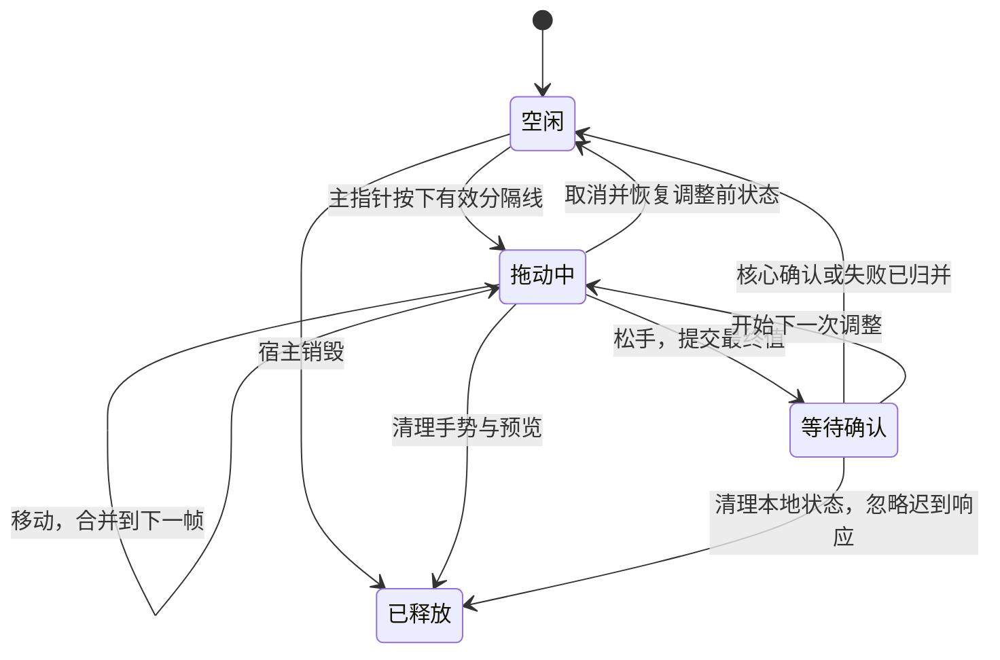

# 工作台左右面板拖拽与终端尺寸同步方案

设计日期：2026-11-08。状态：方案已进入源码，本次实现、验证与平台边界见[实施记录](implementation-panel-resize.md)。分析基线为核心 0.12.2、提交 `8770130ae825879e85a335b1b6fdd0d4046f52af`。方法沿用[功能设计方法](plan-feature-design.md)，与[组件 UI](plan-component-ui.md)、[关闭生命周期](plan-close-lifecycle.md)保持一致。

## 1. 对需求的理解

这里将“终端左右侧拖动”理解为拖动中央终端两侧的面板分隔线，调整文件、系统状态等侧栏与终端的宽度。

用户想要的是一个完整、稳定的调整尺寸行为：按下后连续跟手，左右往返不抖动；松手后停在最终位置；后台更新不抢回旧宽度；取消、失焦、切换工作区、移窗和关闭都有确定的结束方式。终端仍是原来的终端，输出、滚动位置和输入不会因调整布局而丢失。

“一劳永逸”在这里落实为：集中解决布局状态归属、拖拽生命周期及尺寸同步的共同规则，并用回归覆盖所有入口。不能保证以后没有任何缺陷，但新增侧栏插件不应再要求给终端或每个插件单独补拖拽特例。

本次范围包括左右分隔线、键盘调宽、窗口缩放、侧栏显隐、工作区刷新、插件视图定位，以及终端本地适配和 PTY 尺寸通知。保持现有主题、外置插件、连接认证和独立发布方式；不增加生产依赖。

## 2. 当前原因与证据

### 2.1 已复现：刷新覆盖正在拖动的宽度

调用链是：

1. `src/workspaces.ts` 的 `resize()` 在按住期间只写工作台节点的 `--left-width` 或 `--right-width`，核心仍保存原值。
2. `workspaces-changed` 触发 `Workspaces.refresh()`；组件元数据变化等操作也会发布这个事件。
3. `Components.sync()` 无条件把快照里的宽度写回工作台节点。
4. 下一次 `position()` 使用刚写回的旧宽度计算实际布局。

使用现有 `Workspaces`、`Components` 和正式 CSS，在 Chromium 中通过真实鼠标事件复现：两侧初始各 280px，按住左分隔线拖到 350px，触发一次 `manager.refresh()`，等待下一帧后，偏好宽度和实际宽度都回到 280px，指针捕获仍在。再次移动又会写入拖拽宽度。

因此回弹的直接原因已确认：本地手势与核心快照同时写同一份展示状态，缺少“正在调整／等待确认”的归属规则。暂停全部刷新或给旧宽度回写加延迟不能闭合这个问题。

### 2.2 已复现：空间策略隐藏正在拖的面板

`Components.position()` 用工作台宽度减去 84px 工具条和 320px 中央区作为两侧可用空间。只要两侧偏好宽度之和超过这个空间，就按 `lastUsed` 隐藏一侧，而不是先限制拖拽宽度或压缩到两侧可用的范围。

在 1000px 工作台中，两侧各 280px 可以同时显示；右侧最近使用，左侧拖到 350px 后，总宽 630px 超过可用的 596px，左侧立即被隐藏。Chromium 本次仍保留捕获并收到了松手事件，不能把面板隐藏等同于所有平台必然丢失捕获。

另一个状态冲突是：`paint()` 先按逻辑打开状态设置两侧显隐，`position()` 随后再按空间改显隐。两处拥有不同的显隐判断，刷新时可能重复切换布局和视图可见性。

### 2.3 已复现：终端适配被异步尺寸请求挡住

`plugins/terminal/ui-src/view.js` 中，`ResizeObserver` 每次调用 `enqueueSize()`，把包含 `fit.fit()` 和尺寸请求的整个操作追加到 `inputChain`；键盘输入也使用这条链。

对现有 `view.js` 做可控测试，替换终端对象与请求端、隔离外观加载：初始 fit 2 次；阻塞一次尺寸请求，然后让容器连续变化 20 次。等待期间 fit 只增加到 3 次，输入尚未发送；放行后 fit 总数变成 22 次，尺寸请求为初始 50 列、阻塞时 51 列、最终 70 列，最后才发送输入。

这说明本地适配依赖前一次异步请求结束，待处理 fit 会堆积，输入也受到影响。现有代码会读取执行时的最新尺寸并去重，因此不能说每个旧尺寸都发往 PTY，也不能把每次 fit 都说成清屏。本次没有测量真实 xterm 的渲染帧率或 SSH 延迟。

### 2.4 源码确认的流程缺口

| 位置 | 当前缺口 | 影响 |
| --- | --- | --- |
| `Workspaces.resize()` | 手势只存在于局部闭包，没有统一登记；缺少失焦、捕获丢失、Esc、工作区变化和销毁收尾 | 中断后如何恢复、释放监听和处置迟到松手不明确 |
| 松手提交 | 使用按下时捕获的整份 `w.layout`；没有待确认宽度状态 | 可以覆盖另一侧的新值；提交等待期间旧快照仍能覆盖画面 |
| `resizePanels()`、观察器、`paint()` | 直接定位、观察器定位和逐次 RAF 并存 | 同一次变化可能多次读写布局，还会遍历无关工作区 |
| `windows.rs::workspace_layout()` | 先保存全局默认宽度，再由 `workspaces.layout()` 检查移动状态并修改工作区 | 移动中的请求可能写入默认偏好后才被拒绝，成功与失败边界不一致 |
| 终端尺寸失败 | 观察器入口吞掉错误；最终尺寸失败后不一定再有尺寸变化触发同步 | 画面与 PTY 尺寸可能长期不一致 |
| 工作台测试夹具 | `workspace_layout` 直接修改内存工作区，不经过正式偏好保存路径 | 现有拖拽测试不能证明落盘和提交失败语义 |

当前 iframe 按 view ID 保持节点，普通宽度调整没有重建终端的路径。因此证据不支持为了这次故障重写整个终端实例生命周期。需要补全的是布局调整和尺寸同步的生命周期，并继续保护已有的终端实例生命周期。

回弹和面板消失已在源码基线复现；用户设备上的闪烁可能包含布局往返、终端延后适配和原生 WebView 合成因素。不能把上述局部测试当作已安装程序的完整性能诊断。

## 3. 完成后的行为与不变量

1. 拖动期间只允许当前手势改变该侧的展示宽度；普通刷新继续更新其他状态，不覆盖手势预览。
2. 松手后最终宽度保持可见，直到对应提交确认；旧快照和旧请求结果不能覆盖更新的操作。
3. 正常调宽不隐藏当前面板。达到可用空间上限时停止增宽，中央区域保持可用；取消才恢复调整前的展示状态。
4. 左右拖拽、键盘调宽和窗口缩放使用同一套尺寸约束与布局结果。
5. 每个可见工作台一帧最多执行一次有效布局；插件 iframe 与分隔线在这次布局中对齐。
6. 调宽不重建 iframe、终端对象、view、数据流或 PTY，不触发终端 reset／重新接续。
7. 终端本地 fit 不等待尺寸 RPC；输入保持原有序号和顺序，尺寸工作不会无限堆到输入前。
8. 正常松手、取消、失焦、失去捕获、工作区移除和宿主销毁都恰好结束手势一次。
9. 被核心拒绝的布局操作不修改工作区宽度或默认偏好；成功返回代表偏好已落盘且内存已更新。

## 4. 状态和资源归属

| 对象 | 唯一管理者 | 规则 |
| --- | --- | --- |
| 已确认的工作区宽度、下一工作区的默认宽度 | 核心布局服务 | 保持现有配置文件和取值范围；原子接受或拒绝修改 |
| 展示宽度、当前预览、待提交值 | `Workspaces` 的布局状态 | 按 workspace ID 保存；由快照、手势和确认结果归并产生，不让各入口直接写 CSS |
| 当前指针手势、捕获、监听 | 当前窗口的 `Workspaces` | 同时只有一个分隔线手势；固定工作区、侧、指针 ID 和调整前展示值 |
| 受空间约束后的宽度与实际显隐 | `Components` 的统一布局计算 | 唯一决定 Grid 和视图可见性；逻辑打开不等于当前有空间显示 |
| iframe 位置、可见性与挂载 | `Components` | 继续复用现有 surface；只在状态真的变化时通知插件 |
| 终端本地行列、尺寸调度 | 终端 UI | 当前挂载代次内有效；隐藏暂停，恢复后按当前尺寸适配 |
| PTY 会话和 resize 接收队列 | 核心终端服务 | 继续检查归属、连接代次和资源状态，不引入插件授权 |

布局 DOM 是状态的输出，不再是推断当前偏好或手势是否存在的来源。核心仍是持久状态的权威；前端持有的是有明确期限和确认方式的交互状态。

## 5. 一条布局计算与应用路径

### 5.1 尺寸约束

保留偏好宽度 160–480 CSS px 和现有中央区最小宽度策略，把规则集中到同一计算入口。工具条尺寸使用现有样式定义对应的实际尺寸；所有输入均为 CSS 逻辑像素。

- 两侧打开且空间足够：采用当前展示宽度。
- 两侧偏好总和放不下、但两侧最小宽度可以放下：按最近使用侧优先约束两侧实际宽度，继续显示两侧。
- 正在拖动：固定另一侧当前实际宽度，将被拖侧限制在剩余空间内。例如 1000px 工作台、另一侧 280px 时，被拖侧上限为 316px，继续拖不会把该面板藏起来。
- 窗口外部缩小到两侧最小宽度都放不下：按既有最近使用规则保留一侧；若将隐藏当前手势侧，先取消手势，再应用布局。
- 连一侧最小宽度也放不下：侧栏暂时隐藏，保留偏好，空间恢复后重新显示。实际窗口连中央最小宽度也无法容纳时，以当前可用宽度为准。

窗口缩小、临时隐藏或自动压缩只改变实际布局，不落盘改写用户偏好。重新开始拖动时，以当前可见的实际宽度作为移动基线，避免首个移动事件跳到之前更大的偏好值；取消恢复调整前的偏好和展示关系。

### 5.2 一帧的处理顺序

指针、快照、窗口缩放、侧栏选择和槽位观察器只更新状态并请求布局。同一个 shell 已有待执行 RAF 时合并请求，不再直接对所有 shell 调用 `position()`。

一帧内读取容器与展示状态，计算一次宽度和显隐，写入一次 Grid；在必要的一次布局确认后批量读取槽位矩形，再批量写入 surface 矩形。避免每个 surface 都交替读写。比较上次结果，相同几何不重复写样式、发可见性消息或引出下一轮有效布局。

`paint()` 负责按钮、标题和页面选择；不再抢先设置最终空间显隐。`Workspaces.render()`、`Components.sync()` 和拖拽处理不再分别写同一宽度变量。CSS 只消费统一的实际宽度；清理被覆盖的旧宽度公式时先确认没有调用者。

## 6. 拖拽的完整生命周期

手势状态和保存状态分开：再次拖动不必等上次保存结束；旧提交确认只更新已确认底值，不覆盖新预览。

| 事件 | 行为 | 结束与清理 |
| --- | --- | --- |
| 按下 | 检查主按钮、活动工作区、侧栏存在、未被关闭／移窗冻结；记录实际宽度基线与调整前偏好，获取捕获 | 所有监听关联同一个手势；过滤 pointer ID |
| 移动 | 计算最新期望宽度，统一约束后请求布局 | 不请求核心保存，不逐事件排 fit |
| 松手 | 使用松手坐标完成最后一次计算和布局，再提交变更侧 | 先标记已结束，再释放捕获，避免随后的 lostpointercapture 二次结束 |
| 无实际变化 | 恢复空闲 | 不提交、不改写偏好 |
| Esc、pointercancel、非正常 lostpointercapture、窗口失焦 | 恢复调整前状态 | 不提交这次预览；清理监听、捕获、光标和待执行手势任务 |
| 切换工作区、收起手势侧、开始移窗／关闭 | 先结束当前手势，再执行原操作 | 操作固定在原 workspace ID，迟到松手不得影响新工作区 |
| 工作区移除、宿主 dispose／pagehide | 清理所有本地手势及布局任务 | 不再发保存；已发请求的迟到结果不得写已销毁节点 |

捕获丢失不是正常提交。全程统一处理选择抑制与拖动光标，并在所有出口恢复；保留分隔线键盘可达性和宽度 ARIA 值。键盘箭头沿用现有 16px 步长，以当前展示宽度递增；连按与拖拽进入同一提交路径，不能每次使用未更新的快照基线。

连接断开本身不改变工作区宽度，也不要求销毁手势；终端远程输入与尺寸发送按连接状态停止。

## 7. 提交、快照、失败和移窗

### 7.1 前端归并

每个工作区保留已确认底值、当前预览、一个在途提交和最多一份合并后的待提交变更。新操作替换尚未发送的同侧值；另一侧变更合并到待提交值，不建立无限请求队列。

每次本地修改有顺序号。快照正常更新连接、标题和组件状态；有较新预览或待确认修改的字段继续使用本地值。核心确认带布局与投影 revision，只结束对应的提交；较早响应、较低 revision 或已转移归属的结果不能覆盖当前展示状态。

松手时若保存仍在途，保持最终画面。成功确认后去掉已完成的本地覆盖；下一帧应用同一结果，所以不会发生“先退回原值，再跳到最终值”。

### 7.2 核心提交边界

将宿主内部 `workspace_layout` 从提交整份旧 `layout` 改为提交 `{ id, side, width }`，返回本次已确认布局和投影 revision。前端与核心一同交付，迁移全部内部调用者；插件 UI v1 不受影响，不增加双重布局命令。

核心服务按现有锁约定持有所需状态，先验证参数、当前窗口归属、工作区存在、移动状态和关闭冻结状态，再计算变更后的工作区宽度与默认偏好。只修改请求侧，保留各自另一侧的最新值。使用已有原子文件写入方式保存偏好，成功后完成已预检且不会再被并发改变的内存更新与 revision 递增，最后发布事件并返回结果。

校验失败或保存失败时两份状态都不改变。移动、关闭的归属变化不得发生在“已经写盘、尚未完成内存更新”的间隙；锁顺序、冻结检查和失败注入需要实际测试，不能仅调换两行调用。

### 7.3 失败与恢复

| 情况 | 最终行为 |
| --- | --- |
| 核心明确拒绝／保存失败 | 结束对应提交，恢复最近确认状态，使用现有轻量错误提示说明宽度未保存；保留之后的新预览 |
| 响应中断，无法判断是否已提交 | 重新读取快照核对布局；已接受则确认，否则归并核心状态；不因超时就发送整份旧布局 |
| 核对快照也失败 | 保留当前展示值并提示保存状态未确认，释放手势和请求占用；后续快照或下一次布局操作完成核对，不无限等待 |
| 新调整在旧提交后发生 | 旧确认更新底值，继续显示新调整，随后只发送最新待提交值 |
| 工作区已移动、关闭或宿主已销毁 | 清理该宿主的本地覆盖与任务，迟到响应不重建节点、不向目标窗口写预览 |

移窗交接前取消未提交的手势，并归并已发送的布局操作；交接使用核心确认的布局。无法确认归属与提交状态时，移窗进入现有失败路径，不假装完成。关闭入口也先结束手势；宽度偏好失败使用普通错误提示，不新增终端／文件“未保存内容”确认。关闭取消后恢复核心确认布局与仍存在的视图，已发请求只按原归属核对。

## 8. 终端本地适配与远程通知

### 8.1 分离两个职责

本地渲染按当前容器 fit，远程尺寸通过现有数据接口通知 PTY。两者不能都包在等待 RPC 的 `inputChain.then(size)` 中。

观察器、恢复可见、焦点、外观应用和接续完成进入同一个终端尺寸调度入口：下一帧只执行一次有效本地 fit；记录最新有效 cols／rows，相同尺寸不再次通知。设置应用需要等待对应本地几何生效时，等待这一帧的结果，不能把“请求已安排”当作字体与尺寸已应用。

远程通知最多有一个在途 resize 和一个等待 resize 节点。等待节点执行时使用最新期望尺寸，之后的变化只替换待处理值。继续复用输入顺序链：已经排队的输入不会被源源不断的新 resize 插队；输入前已安排的必要 resize 仍在输入前，输入序号不变。不要在分离本地 fit 时把远程 write 与 resize 改成任意并发。

忙碌等可重试失败保留最新未同步值，进行有界重试；停止、隐藏、断线或代次变化时撤销相应任务。永久失败提示一次并结束旧同步任务，不能吞掉最终尺寸失败，也不能阻断后续本地绘制。

当前核心 resize 成功仅表示尺寸已通过检查并进入核心队列，不表示远端程序已完成重绘。这里继续保留这个协议语义；远端实际收到最终行列数通过真实 SSH 流程验证。

### 8.2 生命周期边界

| 状态 | 本地适配 | 远程尺寸通知 |
| --- | --- | --- |
| 挂载、快照恢复中 | 保留恢复顺序，待接续完成后按当前容器适配 | 不抢在恢复或归属就绪之前发送 |
| 可见、已接续且会话有效 | 下一帧适配 | 按最新行列同步，保持输入顺序 |
| 隐藏或零尺寸 | 暂停有效 fit，记住需要重新测量 | 不发送 0 行列或旧尺寸积压 |
| 重新显示／外观变化 | 用当前容器与字体测量一次 | 有效且行列变化时同步 |
| PTY 退出或连接断开、原输出仍显示 | 允许对保留输出做本地适配 | 停止旧会话尺寸请求 |
| 移窗重挂载、连接代次改变 | 旧任务失效；新挂载按现有接续协议处理 | 只允许当前 owner／surface／连接代次发请求 |
| unmount／dispose | 取消 RAF、重试和等待项，断开观察器 | 忽略迟到结果，不访问已 dispose 的终端 |

正常调整使用 xterm 的 resize／reflow 能力，不主动 clear、reset 或重建终端。检查滚动历史、选区和光标遵循 xterm 的尺寸变化语义；不为保持旧像素位置而恢复一张过期截图。

## 9. 代码落点与实施顺序

| 完整主题 | 主要落点 | 同步迁移和验证 |
| --- | --- | --- |
| 布局状态与完整拖拽 | `src/workspaces.ts`、`src/components.ts`、`src/workspaces.css`、`src/components.css` | 左右手势、键盘、刷新、空间约束、RAF、surface 对齐及所有结束事件 |
| 布局提交一致性 | `src-tauri/src/windows.rs`、`src-tauri/src/workspaces.rs`、`src-tauri/src/component_ui/layout.rs` | 宿主命令、正式核心服务、`src-tauri/tests/fixtures/catalog.rs` 和全部布局调用者 |
| 终端尺寸同步 | `plugins/terminal/ui-src/view.js`、`appearance.js` 及受影响测试 | fit 调度、输入顺序、失败重试、接续／隐藏／销毁；如需调整核心 resize 接收，单独验证该边界 |
| 生命周期交接与验收 | 现有关闭、移窗入口及工作台／终端测试 | 布局手势收尾、在途保存归并、原生 WebView 与真实 SSH |

先加入能稳定失败的回归与可控同步点；随后完成核心提交服务与夹具，再迁移前端状态、布局和手势，最后完成终端调度及端到端验收。每个提交只包含一个完整主题；整体行为验收通过前，不把中间步骤作为“拖拽问题已解决”交付。

优先在现有模块调整职责。两侧面板、键盘和窗口缩放已经是同一规则的真实调用者，可以共用布局计算；不建设通用手势框架或插件专用适配表。实施后只更新受影响的组件布局、操作与开发文档；实际证据写入对应实施记录，核心与终端的发行结果分别记录。

## 10. 验收与交付条件

### 10.1 必须自动验证

- 真实 `mouse.down → 多次 move → 工作区刷新 → move → mouse.up`，两侧均覆盖；逐帧宽度不被旧快照覆盖，最终展示、核心值和偏好文件一致，未变化时不保存。
- 提交被阻塞期间刷新、再次拖动及键盘连按；旧确认不得回弹，新操作最终生效，另一侧不被旧副本覆盖，请求数量有界。
- 1000px 两侧各 280px 的边界用例：左侧增宽最多 316px，两侧仍显示；缩小窗口触发隐藏时先结束手势，放大后恢复偏好。
- Esc、pointercancel、意外捕获丢失、失焦、收起、切换工作区、移窗、关闭取消和 dispose；每次结束只发生一次，没有残留捕获、光标、监听或 RAF。
- 正式提交服务的保存失败、关闭冻结、移动竞争与响应中断；拒绝时偏好文件及内存均不变化。夹具调用同一个服务，不绕过落盘路径。
- 宿主压力刷新下分隔线、iframe、终端 view、数据流与 PTY 身份保持；尺寸对齐，普通拖拽不发 mount／unmount／reset。
- 使用真实 xterm 验证 fit；阻塞尺寸请求并连续调整，确认本地行列仍继续变化、等待 resize 节点不超过一个、输入 FIFO 和序号正确；放行后最终尺寸一致。
- 隐藏、零尺寸、字体变更、接续、断线、PTY 退出、移窗和 unmount 时的迟到 fit／resize；无旧任务写入新会话，失败后的最终尺寸能重新同步。
- 真实 SSH 下用 `stty size` 等读取最终行列，覆盖持续输出、滚动历史、中文输入及交互程序重绘；不要以 mocked RPC 成功代替远端验证。

记录拖动期间有效布局次数、fit 次数、等待尺寸任务数、主线程耗时与逐帧宽度。当地主线程未阻塞时，本地调整应在下一次绘制机会生效；60Hz 基准设备上观察帧预算与连续性，不能用固定延迟动画掩盖旧宽度往返。正常终端重排与程序自身重绘需要分别辨认。

### 10.2 命令与原生范围

实施时运行 `npm run check`、`npm run scripts:test`、`npm run test`、`npm run web:build`，以及现有工作台 UI、正式前端、终端输入、组件设置和真实终端流程回归。核心使用 `npm run build`；终端使用 `npm run plugin:build -- --plugin terminal` 独立打包，必要时运行相关插件格式检查。命令及环境按[开发指南](development.md)，发布按[分发文档](distribution.md)。

浏览器覆盖三主题、1100×720／1000×720／720×480、主窗口和拆出窗口，以及不同字体和显示比例。Windows x86_64／ARM64、Linux x86_64／ARM64、macOS ARM64 均须验证原生包启动退出和实际 WebView 拖拽；覆盖 100%／150%／200%、跨显示器与失焦。Chromium 通过和交叉编译不代替目标系统验证。

### 10.3 设计分析的证据边界

设计阶段完成源码链路分析、工作台回弹与面板隐藏复现，以及终端队列的可控验证。当时还没有修改代码或验证安装包，不能把设计阶段的局部复现当作实施后的结果。后续代码与实际验证统一维护在[实施记录](implementation-panel-resize.md)。

设计阶段未确认用户已安装程序的构建来源、真实 xterm 的闪烁程度、远端交互程序重绘及五平台原生表现。实施时须保存本次源码对应的回归和原生证据，再判断症状是否消失；残余闪烁若属于 WebView／xterm 渲染，按测量结果继续处理，不用“状态修好了”代替最终验收。

返回 [文档索引](README.md)
