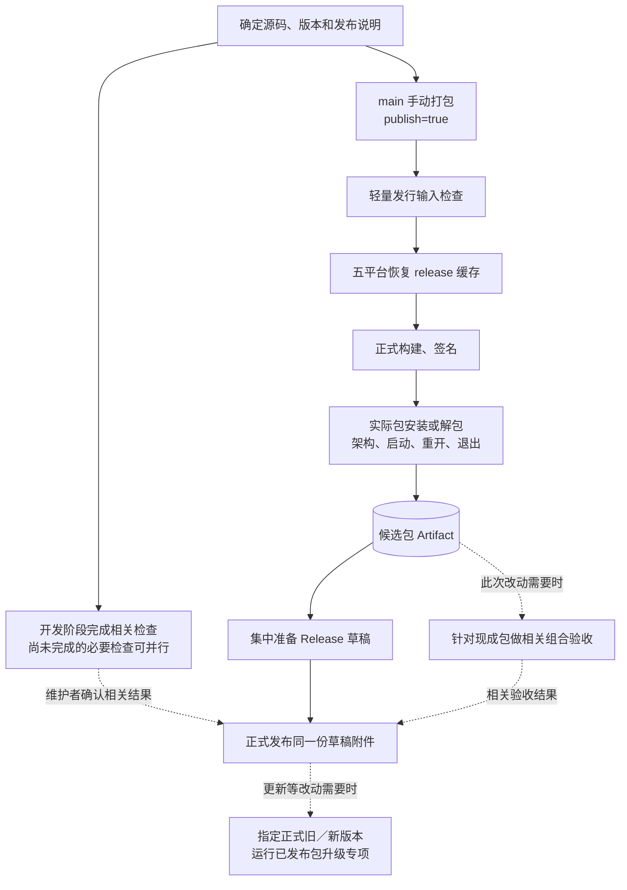

# 打包提速实施方案

2026-11-08 修订。状态：第一、二步已完成；同一提交五平台冷/热候选构建均通过，缓存命中的完整核心出包及清单完成实测 4 分 58 秒，仓库缓存降至约 7.53 GiB，详见[实施记录](implementation-release-performance.md)。第三、四步待实施。

## 1. 本次目标和实施顺序

唯一主目标：缩短确定源码后到取得可用安装包的时间。先减少打包链路里的额外工作，再让必要的编译命中合适缓存，最后减少重复构建。

确定分四步执行：

1. **收窄打包职责：移出源码测试和完整 UI 回归。**
2. **优化发行构建缓存：容量优先留给五平台 release，建立可复用的 main 来源。**
3. **按实际改动选择测试：专项不再默认伴随每次提交或发布。**
4. **复用一次生成的包完成发布，并实测完整出包时间。**

这替代上一版“先整理 netem，再把五平台全量测试搬进日常 Check”的安排。netem 不在核心打包的 needs 链上，不能将移出它的 25 分钟计为安装包提速。也不采用上一版的 main 版本／依赖变更自动打包：本轮先沿用现有手动和标签入口，避免增加预热构建、重复候选和触发规则。

现状和历史证据见[工作流全景图](workflows-current.md)、[既有打包实施记录](implementation-packaging-workflows.md)。此前已实现的签名、产物收集、草稿汇总、失败重试和核心产物复用继续使用。

## 2. 什么必须走，什么不跟着打包走

| 步骤 | 核心打包时 | 其他归属或理由 |
| --- | --- | --- |
| 版本、标签、发布说明、既有草稿／源码绑定检查 | 保留 | 直接决定本次发行输入是否正确 |
| npm ci、Tauri 正式前端构建、Cargo release 编译 | 保留并用缓存加速 | 属于生成当前源码产物的必要步骤 |
| 五平台原生构建 | 保留 | Windows x86_64 / ARM64、Linux x86_64 / ARM64、macOS ARM64 |
| 签名、架构、预期文件、大小／摘要检查 | 保留 | 确保交付的字节和目标正确 |
| 实际安装／解包后的启动、重开、退出 | 保留 | 验证实际产物，历史样本约数秒至十几秒 |
| 当前 Windows 包内 SSH 烟测 | 第一阶段保留 | 已包含在很短的实际包步骤中；没有必要先为此拆改夹具 |
| cargo fmt、独立 TypeScript 检查、完整 scripts:test | 移至 Check | 正式前端构建自带的 tsc 仍执行，不另重复一轮 |
| 五平台全套 npm run test | 从 package 移出 | 公共逻辑一次验证；平台差异按对应改动验证，见第 5 节 |
| 源码侧 ssh:test、完整 ui:test、原生宿主脚本回归 | 从 package 移出 | 在开发检查中执行需要的套件和平台 |
| 真实核心 + 全部插件组合验收 | 保持独立、按影响运行 | 连接、RPC、生命周期或对应插件行为发生变化时需要 |
| 跨版本真实升级验收 | 保持独立、按影响运行 | 更新、安装器、数据迁移、激活／重启相关改动需要 |
| netem 延迟、随机丢包和黑洞矩阵 | 不进入打包或常规发布流程 | 具体弱网问题的按需诊断 |

已有相同源码的适用测试结果可以使用；不能用另一提交的通过结果代替。打包可以与尚在执行的必要检查并行，正式发布前确认相关检查和验收结果。不给 package 增加跨工作流轮询，也不建立核心与全部插件联动发版门禁。

## 3. 第一步：先去掉打包里的重复测试编译

### 3.1 修改范围

主要修改 .github/workflows/build.yml、check.yml；插件打包里的源代码测试同步按所选插件处理，不重构插件打包脚本。

核心具体调整：

1. preflight 只保留 checkout、Node 和发行输入检查。完整 npm 检查、脚本测试与 rustfmt 放到 Check；原包恢复所需的版本、来源和草稿核对全部保留。
2. 五平台 package 删除 npm run test。
3. Windows x86_64 package 删除源码 ssh:test、Chromium 安装和 ui:test。
4. 三系统宿主脚本回归移到对应的 Check 入口，不在每次出包时再执行。
5. 核心 npm 缓存只声明根锁文件，不再为了 UI 回归携带终端锁文件。
6. 保留正式构建、Tauri updater 签名、现有实际包验证、收集和上传步骤。OpenSSH 环境只保留实际包烟测仍使用的部分。

源码回归必须有明确去向：公共核心 Rust 测试沿用 Check 中已有的 Linux 执行；完整 UI 回归和源码 SSH 保留对应检查入口；平台相关测试列出模块与原生目标。先采用现有测试文件／命令，不为了选择测试重写测试框架。无法可靠分割的相关改动，允许执行该模块甚至完整套件，不能直接跳过。

插件 package 中 network-proxy 的 cargo test 移到网络插件检查入口；平台覆盖按网络、原生依赖和共享客户端的变化触发。插件正式编译、共享资源组装、归档和架构验证保留。

### 3.2 完成标准

- 核心 package 不再编译 test-fixtures、不运行完整 UI，不安装终端前端测试依赖。
- 源码测试的触发方式、命令和平台去向明确，可手动对同一 ref 补做检查。
- 先验证 Windows x86_64 最慢路径，确认实际包可启动、重开和退出；五平台最终验证与后面的缓存验收共用候选产物。
- 基线 Windows 的 Rust 测试及编译 328 秒、完整 UI 217 秒，合计约 9 分钟被移出串行路径。实际提速仍以构建结果为准，因为安装、缓存和编译开销会变化。

## 4. 第二步：把缓存用在正式编译上

### 4.1 保持简单的缓存组成

| 缓存 | 安排 | 优先级 |
| --- | --- | --- |
| 核心 release 编译依赖 | 五个平台分别保存，包含 target 和宿主构建依赖 | 最高 |
| npm 下载内容 | 核心仅根锁文件；终端构建再包含终端锁文件 | 保留 |
| 各插件 release 依赖 | 继续按插件隔离，沿用标准 action | 保留 |
| Check 的 debug/test 依赖 | 与发行缓存分离，只保存确有净收益的条目 | 次于发行缓存 |

继续使用已经固定提交的 Swatinem/rust-cache。沿用它对工具链、编译环境和 Cargo 输入的处理，不引入 sccache、第三方缓存服务、自建 runner 或自定义编译缓存协议。

### 4.2 避免新构建继续恢复旧的大缓存

当前 core-package 会同时包含测试与 release 依赖。移出测试后，第一次迁移为一个新的稳定缓存族，例如 core-release-v2；避免旧键精确命中后仍一直下载混合缓存，而 action 又不覆盖原条目。

这个迁移标识只改一次，不随提交、应用版本或 run ID 变化。不同系统基线、架构、工具链和编译参数必须隔离；插件共享客户端清单继续参与相关键，不能因错误命中忽略真实依赖变化。

只保留默认的依赖编译结果，不开启无差别的 workspace crate、incremental 或整个工作目录缓存。恢复后仍执行 npm ci、Cargo 和当前源码的 UI／资源组装。

### 4.3 main 写入，后续打包恢复

采用现有能力，不增加自动预热工作流：

- 常用入口改为：在 **main** 手动运行 Package SoDeck，选择 publish=true。一次运行生成五平台候选和 Release 草稿，并按现有 main 保存条件写入 release 依赖缓存。
- 需要仅生成候选包时选择 publish=false；这次产生的包同样保留，可随后使用 core_run_id 发布。
- 后续 main 候选及版本标签构建恢复适用的默认分支缓存。标签不写可供下个不同标签共享的缓存；不能只把 save-if 改成 true 就认为问题解决。
- 对 feature 分支或旧标签构建，只有适用的缓存才能恢复；新依赖或不兼容环境缺失时正常冷编译。
- 第一次补齐缺失的 Windows／macOS 缓存会有成本。与其单独做一轮无用预热，优先让它产出本次真正需要的候选包。

缓存不是永久可用。官方目前会清理超过 7 天未访问的条目，容量也可能触发淘汰；长期未发布后的首次构建仍可能是冷构建。本轮不增加定时空跑来维持缓存。

### 4.4 空间和下载成本

本次会话的快照是 37 条、约 9.89 GiB，核心只列出两份 Linux 缓存。实施时重新列出当前条目，核对有效键、最近访问和容量，不能直接照抄旧删除清单。

1. 先按 ID 清理确认过时的旧依赖版本；当前有效缓存保留。
2. 优先为五平台 core-release 留出空间。新缓存验证成功后再替换对应旧混合条目；容量不足就分平台迁移。
3. 总压缩缓存以约 8 GiB 为初始管理目标，保留换代余量，不把容量变成新的发布门禁。
4. 若测试缓存仍挤占发行缓存，才评估减少 CI 调试符号或降低低收益测试 target 的保存范围；不在第一轮就改所有测试编译参数。
5. 升级夹具不能继续被当成新 release 缓存的消费者。需要运行该专项时使用兼容的 debug 缓存或正常编译，不为保留旧混合缓存而拖慢日常出包。

不缓存 node_modules、安装器输出、APT 安装状态、测试资料或私钥。Playwright 和整套系统环境不作为本轮优化对象。前端本身较快，继续每平台构建，避免新增跨平台前端 Artifact 传递链路。

核心 Linux 构建复用已有的软件源修正和有限下载重试，降低环境准备的长尾等待；不建立系统镜像缓存。

### 4.5 完成标准

- 五个平台都有可识别的 release 缓存来源，main 成功构建确实能保存，下一次构建确实能恢复。
- 记录精确命中、回退恢复和完全缺失，不能把 cache-hit=false 一律视为未恢复。
- 对比“恢复 + 编译 + 保存”的总成本，确认缓存节省了时间。
- 源码和共享资源修改后仍进入新包；未修改的依赖可以复用。
- Cache 不含 test-fixtures 的大份构建结果，原生包与签名验证照常通过。

## 5. 第三步：让测试只覆盖当前改动需要的范围

测试选择影响“发布前等多久”，不直接算入安装包构建时间。整理它的目的是避免打包之外又无条件等一套无关专项。

| 改动 | 源码检查 | 原生／实际包专项 |
| --- | --- | --- |
| 纯说明文档 | 文档格式、链接 | 不启动产品构建和业务专项 |
| 标题栏样式、颜色、布局 | 类型、前端构建、受影响 UI 回归 | 发行时保留五平台实际包烟测；不因此跑网络丢包和旧版升级 |
| 已确认与平台无关的核心逻辑 | 公共 Rust 套件或相关测试文件，通常一次 Linux 执行 | 相关功能回归；正式包仍做五平台启动退出 |
| 本地路径、进程、凭据、窗口或桌面系统适配 | 相关模块测试 | 对应系统的原生目标；共享实现或原生依赖变化覆盖五目标 |
| SSH、网络、RPC、插件生命周期 | 连接／生命周期／网络的已有回归 | 对应实际包组合验收；必要的五平台原生差异验证 |
| 单个插件 | 该插件与受影响共享资源检查 | 该插件在既有核心上的必要业务验收；不要求其他插件发新版 |
| 更新、安装器、资料迁移、插件激活 | 更新相关源码测试 | 明确旧／新版本的实际升级验收 |
| 弱网缺陷 | 具体问题的定向回归 | 需要时单独运行 netem |

实施约束：

- 先实现可靠的“纯文档跳过”和明确的组件／平台范围；不建完整依赖分析系统。
- 共享客户端、公共 UI 资源、锁文件、工具链、构建脚本和未知输入采用保守的扩大检查。
- 源码里已有 Windows／Unix 分支，例如 platform、desktop_files、updates、lifecycle 等；不能把“公共测试一次”误写为不再验证这些原生分支。
- 相关模块无法独立执行时，保留该改动所需的较大套件。第一阶段不承诺每个 Rust 用例都能精确增量选择。
- main/PR 仍产生明确检查状态；若有必需检查，不能整条 workflow 被 paths 跳过后永久等待。
- Check 增加手动入口，支持对明确 ref 补做完整或原生覆盖。没有实际执行的测试不能显示为通过。
- netem 从常规 Check 中移出，保留按需诊断命令；普通网络回归保留。
- 完整组合和升级验收继续独立。尤其不能把当前脚本固定的 0.9.2 → 0.9.3 结果当作新版本已验收。

自动判断只负责明显范围；跨模块影响不确定时执行扩大后的相关回归。存在已知失败时先处理失败，不能用“与打包分离”作为忽略它的理由。

## 6. 第四步：用同一份包完成验收、发布与提速验证

### 6.1 正常发布只构建一次

推荐常用流程：

已发布包升级专项按现有入口在正式发布后执行，不作为所有草稿发布的前置条件。开发阶段的更新服务回归和实际包签名验证照常安排。

- 已有核心候选时：填写 core_run_id、publish=true，复用原包只做收尾。
- 没有候选时：可以直接推标签构建；已经有候选则不用同版本标签再触发第二轮。
- 插件也可在首次构建就准备草稿，验收后发布同一份归档。
- 失败只重跑失败平台或发布汇总。Artifact 沿用 30 天窗口；过期时重新构建明确源码。
- 正式发布后的同版本附件保持不可覆盖，来源、版本与摘要检查保持原有规则。

这些复用能力现在就能使用，不必等前面三步全部实现才开始。

### 6.2 提速怎样验收

主要指标是：**打包触发 → 前置检查 → 最慢平台 → 产物／草稿汇总完成**。记录每个平台耗时，不能只用最快平台或单个编译步骤宣称提速。

- 现有约 18 分半的 Windows package 作为历史参考。
- 首先验证移出测试后的 Windows 路径；随后使用真正需要的五平台候选检查缓存缺失／恢复和实际产物。
- 最终配置做一次相同源码、工具链、runner 和参数的冷／热对照；排队时间单列，冷缓存优先通过新缓存族取得，不清空整个仓库缓存。
- main → 候选／标签的跨运行恢复须有日志证据。源码／资源改变和锁文件改变各选择一个代表平台补验证，不为每个条件重跑全部矩阵。
- 核心五平台原生实际包验证与缓存测量共用这一轮产物；不每一步都重新发行一版。
- 工作流修改运行 actionlint；脚本修改执行对应回归；测试选择逻辑需覆盖纯文档、共享输入、未知输入等会影响漏测的路径。

目标是把缓存命中的完整核心出包控制在约 **5～8 分钟**，已有包的发布收尾约 **1～2 分钟**。这些是待测目标；实际恢复、编译、下载与 runner 排队会影响结果，不能将“移出 9 分钟测试”和旧缓存对照收益直接相加。

## 7. 每一步的交付范围

| 步骤 | 交付 | 结束条件 |
| --- | --- | --- |
| 1. 打包移出重测试 | 工作流职责调整、测试去向、Windows 出包对照 | package 无 test-fixtures／完整 UI／终端测试依赖，必要回归有入口 |
| 2. 发行缓存 | 稳定缓存族、main 写入与恢复证据、按 ID 的必要清理 | 五平台 release 缓存可用、净提速成立、实际包验证通过 |
| 3. 按改动选择测试 | 明确触发范围、手动补测、netem 改为按需 | 相关回归保留，无关专项不默认执行，未知输入不会漏掉 |
| 4. 复用与总体验收 | 候选到发布的操作流程、冷／热耗时、未完成项 | 同包复用、只重试失败部分、五平台和耗时证据完整 |

每一步单独实施、记录结果，再推进下一步。若前两步已经达到出包目标，不继续添加更复杂的缓存或构建基础设施。

本方案只更新相关开发／分发文档与实施记录，不改产品版本、根 README 首页或历史发布结论。现状图仍作为优化前快照保留。

参考：[GitHub 缓存作用域与淘汰规则](https://docs.github.com/en/actions/using-workflows/caching-dependencies-to-speed-up-workflows)、[锁定 rust-cache 配置](https://github.com/Swatinem/rust-cache/blob/d1527c8f67ef9af357290475d4af4b0fab8f12e0/action.yml)、[分发约定](distribution.md)。
