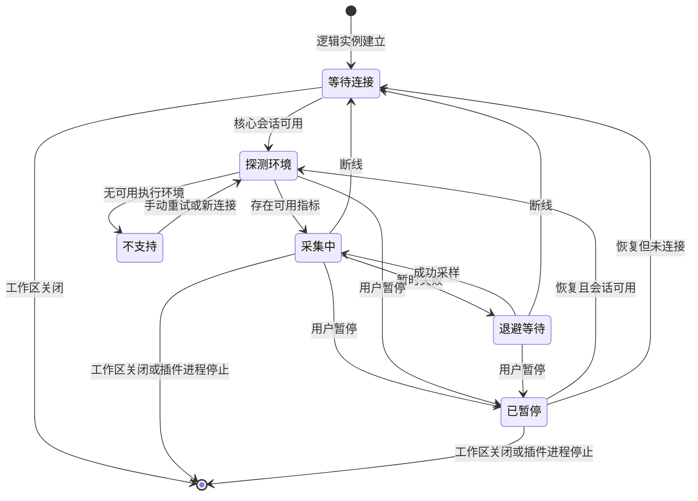

# 系统状态插件功能设计

日期：2026-11-08。本文保留详细设计目标；实际实现、差异与验证范围见[实施记录](implementation-system-status.md)。本文的接口名称、能力字段及验收表不代表发行版本已经提供或全部验收通过。

功能设计最初基于 `3a415ca6821ce45552933d5cc3cf1561d3a8d5e6` 编写，本次按用户要求迁入原仓库 `main`，并基于 `455a55ca54e8602ff06ac54fb9c1baa4b012ec18` 核对代码。具体文件改动、RPC 契约、调度和测试落点见[编码方案](plan-system-status-coding.md)；当前真实接口仍以 [插件 API](plugin-api.md) 为准，交付规则见 [开发约定](../AGENTS.md)。

## 1. 要解决的问题

运维人员在终端、文件和网络隧道之间工作时，需要随时知道：当前连接的设备是什么配置、已经运行多久，以及 CPU、内存、存储和网络是否繁忙。入口应和现有插件一致，不要求再打开一个监控网站或先部署远端服务。

插件名称定为「系统状态」，建议 ID 为 `sodeck.system-status`，目录为 `plugins/system-status`。首版是只读侧栏，面向当前服务器工作区，不是服务器资产平台或集中监控服务。

本设计采用以下明确行为：

1. 插件安装、启用并重启生效后，新工作区默认在右侧展开「系统状态」，固定右侧工具条入口。文件仍可在左侧显示，终端继续使用中央区域。
2. 采集归属于工作区内的插件逻辑实例。收起、换同侧面板、切服务器、最小化窗口、移侧和移窗均不停止采集。
3. 已连接工作区即使从未显示过此面板，也建立一个采集实例。目录中没有打开工作区的服务器不连接、不采集。
4. 尽量覆盖更多远端系统，以系统家族和运行时能力检测选择采集器；不把客户端的五个构建目标当作远端支持范围。
5. 只读、复用核心会话，不要求安装远端 Agent，不上传二进制、不安装软件、不写配置、不请求提权。
6. 缺少一个指标只影响该指标；未知、不可读、采样中与真正的零必须可区分。
7. 按信息变化速度与查询成本分别调度：动态指标默认 5 秒，负载和接口信息 30 秒，容量 60 秒；设备规格按连接和显式刷新读取。面板隐藏不改变这些频率。

## 2. 首版范围

| 模块 | 展示内容 | 使用方式 |
| --- | --- | --- |
| 设备与系统 | 主机名、操作系统及版本、内核、架构、CPU 型号与逻辑核数、可读取的设备型号 | 用于确认连接目标和设备规格 |
| 运行概况 | CPU 使用率、内存占用、运行时长、最近成功采样时间 | 常驻首屏，判断当前状态 |
| CPU 与负载 | 总使用率、Unix 1/5/15 分钟负载、来源与口径 | 负载只在系统提供时显示 |
| 内存 | 物理内存总量、可用/已用量、系统提供的缓存细节；交换区或 Windows 页面文件 | 不用一个通用「Swap」标签掩盖系统差异 |
| 文件系统 | 挂载点或卷、类型、容量、已用、可用、使用比例、只读状态（可获得时） | 容量按文件系统查看，不把分区和物理盘混为一谈 |
| 磁盘 I/O | 可可靠获得的块设备读写速率 | 独立于文件系统容量，缺失时容量仍可用 |
| 网络 | 网卡、状态、IPv4/IPv6、累计收发字节、收发速率 | 默认按网卡展示，支持选择一块网卡看趋势 |
| 短期趋势 | CPU、内存、选中网卡，以及可用的选中磁盘 I/O，最近 5 分钟 | 仅内存保存，隐藏面板期间继续积累 |

首版不包括进程排行、服务管理、杀进程、GPU、SMART、温度/风扇、完整硬件资产、容器业务状态、路由器配置、阈值告警、历史数据库、报表与导出。基础系统状态不应因这些扩展的权限或依赖而无法工作。

高使用率通过数值和趋势表达，不自动宣称「设备故障」或弹出通知。未来增加告警需要另行定义持续时间、去抖、恢复和通知策略。

## 3. 远端兼容范围

### 3.1 支持以实际指标为单位

「支持某个系统」至少需要说明系统版本、登录环境、账号权限、可用指标和实测证据。SSH 连接成功只证明传输与认证可用，不证明远端有通用 shell、CIM、`/proc` 或所需计数器。

| 系统家族 / 示例 | 设计覆盖范围 | 首版验收要求与边界 |
| --- | --- | --- |
| Linux 常规发行版：Debian、Ubuntu、RHEL 系、Fedora、SUSE、Arch 等 | 完整基础指标；优先 procfs/sysfs | 至少实测 Debian/Ubuntu 与一个 RPM 系发行版；其他发行版按相同能力路径适配，不逐个硬编码名称 |
| 轻量 Linux：Alpine、BusyBox、OpenWrt、其他嵌入式 Linux | CPU、内存、运行时长、文件系统、网卡；I/O 和型号按设备能力 | 实测 Alpine 与 OpenWrt/Dropbear；不要求 Bash、Python、SFTP、GNU 工具、systemd 或 ubus |
| Linux 衍生设备：Synology DSM、QNAP、TrueNAS SCALE 等 | 优先复用 Linux 采集器，反映登录会话可见的系统 | NAS 存储池业务、厂商专用服务不在范围；品牌与具体型号不能仅凭发行版名推断 |
| Windows Server / Windows 桌面 | Windows 原生系统、CPU、内存、卷、网卡；性能计数器可用时提供速率 | 实测 Windows Server 2022 或 2025，以及 Windows 11；较旧系统仅在 PowerShell/CIM/SSH 能力满足时兼容，不预先声称全部可用 |
| macOS / Darwin | 系统、CPU、内存、挂载卷、网卡、运行时长；磁盘 I/O 按可验证来源提供 | 实测 Apple Silicon macOS；Intel 远端可走同一命令路径，但不能以 ARM 测试替代 Intel 实测 |
| FreeBSD 及衍生系统，如部分 pfSense、OPNsense、TrueNAS CORE | 系统、CPU、内存、负载、文件系统、网卡；设备 I/O 按能力 | 实测 FreeBSD；衍生设备需开启正常 SSH shell，厂商裁剪和 jailed 环境单独记录 |
| OpenBSD、NetBSD | 专门的 BSD 子适配；先保证系统、运行时长、负载、文件系统，逐项提供 CPU/内存/网卡 | 首版覆盖基础路径并各取一套环境验证；不得把 FreeBSD 的 sysctl 键与解析器原样视为兼容 |
| illumos / Solaris、AIX、其他类 Unix、ESXi SSH shell | 通用 Unix 基础回退，识别可运行的 `uname`、`hostname`、`uptime`、`df` | 不阻止显示已经获得的基础信息；CPU/内存/速率在没有可靠适配器时明确不可用。完整专用采集器属于后续扩展 |
| 厂商网络 CLI、RouterOS、只有 SFTP 的账号、无 shell 的受限 SSH | 识别执行能力不足并给出原因 | 首版不把它们强行当 Unix 执行命令；仍可继续使用 SoDeck 其他可用能力 |

这里的「实测」是实施验收要求，当前均未执行。发布时支持列表必须由真实验收结果生成说明；基础回退与完整支持分别标注。扩展系统范围不增加客户端发行目标，也不为每种远端架构编译 Agent。

Linux 的 ARM32/ARM64、x86、MIPS/MIPS64、RISC-V 等只要提供需要的内核接口，就可使用文本采集路径。32 位计数器、精简内核、大小端和 64 位数值精度需有样本与实机验证，不能仅凭架构无关的脚本就宣称全面验证。

### 3.2 虚拟化与容器

- 显示当前登录环境可见的指标。虚拟机展示 guest，不能读到的物理宿主机规格不填猜测值。
- WSL、容器、jail、chroot 可能出现内核、CPU 和内存范围不一致。确定存在限制时显示「当前登录环境；部分指标可能为宿主机范围」。
- 首版不构造一套跨 cgroup v1/v2 的容器资源看板。不把宿主机内存当作容器配额，也不假装 CPU 分母已经按配额调整。
- 宿主检测与品牌判断都是尽力而为，不能仅用 hostname 推断虚拟化类型。

## 4. 面板与交互

### 4.1 默认位置及偏好

建议视图声明如下；`backgroundOnWorkspace` 是第 10 节拟议的新字段，其余沿用当前 UI 声明：

```json
{
  "id": "overview",
  "title": "系统状态",
  "icon": "activity",
  "container": "sidebar",
  "instancePolicy": "perWorkspace",
  "defaultSide": "right",
  "defaultPinned": true,
  "openOnWorkspace": "reveal",
  "startupOrder": 40,
  "backgroundOnWorkspace": true
}
```

系统状态不声明中央页签或独立弹窗，不和文件、网络插件互相调用。入口图标沿用宿主线性图标体系；如果 `activity` 尚无对应图标，只补一个通用图标映射，不按插件 ID 特判。

| 情况 | 可见行为 | 采集行为 |
| --- | --- | --- |
| 首次安装后重启并打开工作区，尚无该组件偏好 | 默认固定右侧并展开 | 建连后自动采集 |
| 用户已把它移左、收起或从工具条隐藏 | 保留已保存偏好 | 仍采集 |
| 同侧另一组件按已有偏好优先展开 | 保留现有同侧占用，不抢焦点；系统状态入口可打开 | 后台实例仍建立 |
| 插件初始化晚到或用户恢复插件 | 不突然替换正在使用的面板 | 为现存有效工作区补齐缺失采集实例 |
| 用户切换到网络隧道 | 显示网络隧道，系统状态收起 | 系统状态继续采集 |
| 因窗口太窄由宿主临时收起 | 复用宿主空间策略 | 系统状态继续采集 |

「默认展开」是未设置偏好时的推荐行为，不在每次连接、刷新和重绘时强制展开。当前 `layout.rs` 对首次出现的定义已经采用清单默认值，与旧文档中「新增插件只进更多入口」的描述有差异；本次设计按当前源码和上述需求明确行为，实施时同步修正受影响的 UI/API 描述，不顺带重做其他插件的布局策略。

### 4.2 内容结构

沿用当前文件和网络隧道的 Operate 界面：宿主负责标题、停靠、宽度和收起，插件负责正文。采用紧凑的数值行、小趋势和分组列表，不做四个大圆形仪表盘。

```text
右侧工具条  [系统状态] [网络隧道]
┌──────────────────────────┐
│ 系统状态             ⋯ 收起 │  宿主标题
├──────────────────────────┤
│ 主机与连接状态       刷新 暂停 │
│ 系统、架构、规格与运行时间    │
│ CPU                  18% │
│  最近 5 分钟趋势            │
│ 内存       2.1 / 8.0 GiB  │
│ 运行时间          12 天 3 小时│
├──────────────────────────┤
│ 网络                     │
│ [eth0 · 全部 IP 地址    ▾] │
│ 接收 1.2 MiB/s  发送 86 KiB/s│
│  最近 5 分钟趋势            │
├──────────────────────────┤
│ ▾ 文件系统                │
│ /       18 / 40 GiB  45%  │
│ ▸ 磁盘 I/O                │
│ ▸ CPU 与内存详情           │
│ ▸ 设备与系统               │
│ ▸ 采集详情                 │
└──────────────────────────┘
```

默认展开运行概况、网络摘要和文件系统；硬件细节、详细计数与采集诊断折叠。文件系统默认显示根文件系统/系统卷及占用最高的其余两项，提供「查看全部」；不能把排序最高的三个当作全部设备。

默认网络项取第一块已启用的非 loopback 网卡并保存本工作区选择，明确显示名称，不把它称为 WAN 或默认出口。用户可选择虚拟网卡、桥、隧道和 loopback；不默认将所有接口求和，避免物理网卡、桥和 VLAN 重复统计。

插件正文不再重复宿主的“系统状态”标题，服务器概况与刷新/暂停合并在固定顶部。网卡选择器占满内容宽度，当前项和展开选项均显示名称及该接口的全部已采集 IP，不在曲线下另设地址行。长地址换行，多接口列表纵向滚动；无地址、未映射的计数器实例和已移除设备保留明确说明。键盘支持方向键、Home/End、Enter/空格、Escape，后台地址更新不丢失选项焦点。

宽度沿用宿主当前默认 280px 和 160–480px 范围。280px 时保持一列，160px 时数值和标签允许换行，480px 时增加详情列；不为了本插件改全局默认宽度。长设备名、Windows 卷标、IPv6 和挂载点可换行并完整复制。列表内容纵向滚动，工具栏保持可达，刷新不跳滚动位置。

### 4.3 操作与反馈

- 「刷新」将动态、状态、容量与设备/能力各组标记为待刷新一次，按调度顺序返回结果；已有任务时合并为一次请求，不能多次点击堆积进程。显示「正在刷新」及各组自己的更新时间，不等待最慢一项才交付全部结果，也不将各组改成相同的后续刷新周期。
- 「暂停采集」只暂停当前工作区，取消在途采集并清除待办，不断开服务器；文字改为「恢复采集」。手动刷新在暂停时执行一次，之后继续暂停。暂停标记保存在插件内存，移窗、重挂载和重连保留；关闭工作区后清除。
- 组件设置复用现有 `settings.v1`：「动态指标采样间隔」提供 3/5/10/30 秒，默认 5 秒，全实例即时应用，仅影响 CPU 使用率、内存/交换区使用量和网络/磁盘 I/O 计数。负载、接口信息、容量和设备规格保持各自策略；首版不增加逐字段或逐服务器的频率设置。界面同时显示实际采样间隔，不能把设置值当作执行保证。
- 内存/CPU 比例用数字和文本表达；状态不只依赖颜色。使用现有浅色、深色、多巴胺 tokens、字体、滚动条和文本菜单，禁止外部 CDN 与新图表生产依赖。
- 趋势保留文本当前值、时间和可聚焦的数据点说明；键盘能展开详情、选择设备、刷新与暂停。后台采样不抢焦点，不每 5 秒向读屏器播报全部数字。
- 重要连接错误在概况显示，具体缺失字段在对应行显示原因。系统状态插件不重复弹出核心已有的断线通知。

## 5. 采集生命周期

### 5.1 状态与转换



这是主状态示意，任意状态都允许工作区销毁。连接状态与用户暂停标记独立保存：暂停期间断线仍保留暂停意图，不因重新连接而恢复采集。

「部分可用」是指标集合的质量状态，不意味着整个采集任务失败。隐藏面板没有状态转换。

| 生命周期事件 | 明确处理 |
| --- | --- |
| 新建/恢复已连接工作区 | 每个 `workspaceId` 一个逻辑视图、一个调度器；后台初始化不需要 iframe |
| `ui.mount` 重复调用 | 返回原快照和视图状态，不重复创建线程、计时器或远端任务 |
| 页面 `visibilityChanged` / `unmount` | 只停绘图和页面快照轮询；进程调度继续 |
| 同一服务器拆出/移回窗口 | 保持 `viewId`、样本、选择和暂停标记；旧 `surfaceId` 不再接收页面操作 |
| 当前连接断开 | 立即取消该连接在途执行，保留最后值与时间；不自行请求凭据或建立新连接 |
| 用户通过核心重连成功 | 查询到新的 `connectionId/generation` 后重探测、清计数基线；非暂停实例自动恢复只读采集 |
| 关闭服务器工作区/所在窗口 | 取消调度和任务、销毁趋势、释放所有资源；不为只读采样弹出保存确认 |
| 在设置中关闭/升级插件 | 沿用重启生效；重启前当前实例继续运行，界面明确待重启 |
| 插件崩溃/应用退出 | 核心回收任务资源；恢复后重新采样，不伪造丢失历史 |
| 主机睡眠/休眠后恢复 | 不能在睡眠期间采集；发现时间缺口后断开曲线、重建速率基线，不补跑漏掉的定时任务 |

### 5.2 分层采集与资源预算

远端采集、插件缓存更新、页面绘制是三件不同的事。只有需要连续观察的动态指标采用短周期；不能因为面板每秒刷新显示，就每秒查询远端，也不能把所有字段放进 5 秒采样脚本。

| 任务 | 默认频率或触发条件 | 超时目标 | 说明 |
| --- | --- | --- | --- |
| CPU 使用率、内存/交换区使用量、网卡累计字节、块设备 I/O 计数 | 5 秒，可设置 3/5/10/30 秒 | 单次最长 10 秒 | 快速批次只查询这些动态来源及必要时间基准，用计数差值计算速率 |
| Unix 负载、接口状态/IP、网卡与块设备列表 | 30 秒；快速采样发现设备身份增删时提前刷新相关列表 | 单次最长 10 秒 | 地址和拓扑不必随流量每 5 秒完整枚举；新增/消失设备仍及时反馈 |
| 文件系统挂载清单与容量 | 60 秒；手动刷新时提前读取 | 单次最长 20 秒 | 单独低频任务，不随 I/O 计数刷新容量，也不清空已有动态结果 |
| 系统/内核版本、主机名、CPU/设备型号、架构与规格 | 首次连接、重连、手动刷新；明确发现硬件变化时只刷新受影响规格 | 单项探测 5 秒，探测总预算 30 秒 | 成功后缓存，不定时重复读取整套设备信息 |
| 运行时长与启动标识 | 首次、重连、恢复采集/休眠后读取，之后每 60 秒校准 | 单次最长 5 秒 | 在线且数据有效时，本地按单调时间递增显示；不为显示秒数单独逐秒发命令 |
| 采集能力 | 首次连接、重连、手动刷新；已明确缺失的能力最多每 10 分钟复核一次 | 单项探测 5 秒，探测总预算 30 秒 | 可用能力不周期性重跑完整探测；无可用执行环境时只等待新连接或手动重试 |
| 核心连接状态查询 | 目标每 5 秒一次，本地 RPC | 不等待远程 I/O | 即使页面隐藏也能发现新连接；停止旧任务由核心即时取消保证，高负载延迟须显示 |
| 可见页面读取插件快照、更新运行时长显示 | 约 1 秒，未变化仅返回版本号 | 快速本地返回 | 仅读缓存和本地时间；不可见页面可完全停止绘制 |

各组首次连接后都尽快读取一次，不先等满 30/60 秒；之后各有下次到期时间。每工作区仍只用一个调度器，不为每个字段建立计时器。只查询已经到期或被变化事件标记的组；可阻塞的容量查询保持独立任务，不塞进快速批次。手动刷新、设备变化等触发合并处理。

同一工作区最多一项远端采集在执行，定时点遇到未完成任务直接跳过，不排队补跑。手动刷新只保留一份待办；动态任务优先，慢任务须公平获得机会。频率按单调时钟调度，不用系统墙上时间计算间隔。收起面板或切服务器不改变任何远端采集组的到期时间。

分层约束的是远端查询成本，不要求丢弃同一廉价来源顺带返回的数据。例如读取 `/proc/meminfo` 时可以同时更新总内存，快速计数中已经包含的接口状态/负载可直接利用；Linux `/proc/uptime` 若用作速率的单调时间基准，也可随快速批次附带。不能因此额外每 5 秒执行 `df`、型号查询、完整 IP 枚举或 Windows 的所有 CIM 类查询。总量或 CPU 数量确有变化时更新相应规格，并重建依赖它的比例/计数基线。

运行时长采用「最近远端值 + 本地经过时间」显示，采集详情保留远端校准时间。暂停、断线或校准超过两个周期未成功时停止递增并标为最后已知值；休眠后先重新校准，不把睡眠前的本地基准继续当实时值。该显示推算不进入 CPU/网络/磁盘差值计算，也不能冒充一条新的远端采样记录。

插件最多同时采集 4 个工作区，其他工作区公平轮转并错开启动时刻；核心通用执行服务初始全局最多 8 个在途任务，每插件最多 4 个。待调度项与已打开工作区一一对应，不形成无界任务队列。达到容量时报告「等待采集」和实际时间，不悄悄只采当前可见服务器。

瞬时失败按数据源独立退避，等待 5、10、30、60 秒后重试，并且不短于该组正常周期：例如动态组默认从 5 秒开始，容量组至少间隔 60 秒。按连接读取的设备/能力初次失败可有界重试，连续 3 次失败后等待手动刷新、新连接或适用的低频复核。成功后恢复该组正常策略，不能让慢组失败带动整机反复探测。明确缺失的命令/权限不每轮重试；远端不支持时停止高频探测，保留重试入口。

若命令超时且无法确认远端查询已经结束，暂停该数据源的自动重试，显示「采集超时，等待重试」，由手动重试或新连接重新评估；其他独立数据源继续。尤其不能每分钟在同一个卡住的网络挂载上再启动一条 `df`，累积无法退出的远端进程。

首版保留 5 分钟内最多 100 个有效点/序列，默认 5 秒约 60 点；CPU、内存固定保留，网卡和磁盘最多各 32 条趋势。当前已选设备优先，未保留的设备在选中后从该时刻积累，明示尚无此前历史。最新设备列表最多各 256 项、文件系统最多 512 项，超出时显示截断计数。

每工作区样本缓存预算 2 MiB、插件总样本预算 64 MiB；这是需压测验证的初始限制。达到总预算时统一缩短保留时长并显示实际范围，保留最新值；不得根据面板可见性删除后台服务器的当前状态。缓存不包含长期原始命令输出。

## 6. 环境探测与执行原则

### 6.1 先识别环境，再读指标

1. 查询核心的当前工作区会话状态与执行能力。没有通用命令执行能力时，直接显示「当前连接不支持远程命令执行」。
2. 用独立、有界的小命令探测 `uname`/POSIX shell，或 `powershell.exe`、`pwsh` 的有效执行与 Windows CIM 环境；要求正向识别结果，不能因为某个命令报错就推断为 Windows。
3. `uname` 为 Linux 时探测 procfs，再读发行版信息；Darwin、FreeBSD、OpenBSD、NetBSD 各选独立路径；CYGWIN/MSYS 等环境优先探测 Windows 原生能力。WSL 的 Linux 登录环境仍按 Linux 处理。
4. 未识别但有 POSIX shell 时进入基础回退。已识别系统的单项能力失败时，可使用该系统明确验证过的替代来源。
5. 缓存所选采集器及字段能力，绑定完整连接 Context。每次重连重新确认，避免服务器资料指向另一设备后复用旧假设。

探测从少到多，正常识别后不再尝试所有系统命令。无正确的系统/协议标记、只有 banner 或语法错误时不能当成功。首轮控制总命令数和时间，超时先显示已获得的部分结果。

### 6.2 执行环境与输出

- 通过非交互、无 PTY 的通用远程执行能力发起命令，不借用终端插件输入，不干扰用户的终端会话。
- Unix 优先 `sh`/POSIX 语法、固定命令及 `LC_ALL=C`，不依赖 `bash` 数组、GNU `date`、`grep -P`、`systemctl` 或本地 shell 配置。发行版文件按数据读取，禁止 `source /etc/os-release`。
- Windows 显式调用 PowerShell `-NoProfile -NonInteractive`，使用预置只读脚本；固定脚本可通过 UTF-16LE `EncodedCommand` 避免 cmd/PowerShell 的嵌套引号问题，输出显式 UTF-8 压缩 JSON。先探测执行环境，不依赖默认 SSH shell 恰好是哪一种。
- 不依赖本地开发机器的 PowerShell、PATH、WMI 或系统命令；所有远端命令由插件选取，核心只负责执行与资源管理。
- 远端脚本只读固定路径、固定类和固定属性，不把远端返回的主机名、接口名、挂载点插入 shell 代码。必要的路径参数按所选远端 shell 转义，并与本机路径完全分离。
- 优先把原始计数交给本机 Rust 解析。不能用 BusyBox awk 的浮点数先计算大字节差值，否则超过 `2^53` 会损失精度。
- Windows 使用带 schemaVersion 的 JSON；Unix 使用版本化分段文本，明确段边界及本段成功/失败，遇到不完整段丢弃本段。字段数量、字符串长度、数组数量均设上限。
- 标准输出与标准错误分开；有界识别登录 banner，不按任意一段看似 JSON 的文本猜结果。成功退出但格式不符属于解析失败。
- 界面通过文本节点显示远端字符串；远端数据不作为 HTML、脚本、日志指令或可执行模板。

## 7. 各系统的数据来源

### 7.1 Linux、OpenWrt 与 BusyBox

| 数据 | 首选来源 | 回退和注意点 |
| --- | --- | --- |
| 系统、架构 | `uname`、`/etc/os-release` | OpenWrt 增补 `/etc/openwrt_release`；只读数据，不执行文件 |
| 主机名、运行时长 | `/proc/sys/kernel/hostname`、`/proc/uptime` | 命令回退必须验证格式；启动标识可用 `/proc/sys/kernel/random/boot_id`，缺失时用 uptime 倒退判断 |
| CPU 型号与核数 | `/proc/cpuinfo`、可用的 CPU 在线信息 | ARM/MIPS 不保证有 `model name`；区分硬件线程数、插槽数和设备型号 |
| CPU 时间、负载 | `/proc/stat`、`/proc/loadavg` | 不解析面向人类的 `top` 屏幕；guest 字段不得重复累加 |
| 内存、交换区 | `/proc/meminfo` | `MemAvailable` 缺失时可按第 8 节提供估算标记；未启用 swap 是 0，读不到是不可用 |
| 文件系统与容量 | `/proc/self/mountinfo` + 有界 `df -Pk` 或已探测的 BusyBox 变体 | 处理转义、空格、bind mount、只读与伪文件系统；不要向全系统挂载点无限逐个查询 |
| 块设备 I/O | `/proc/diskstats`、可读的 `/sys/block` 关联信息 | sector 计数按该接口规定的 512 字节单位，不用物理扇区大小替换 |
| 接口流量 | `/proc/net/dev` 或 sysfs 计数 | 不依赖 `ip -j`；64 位整数保留原样 |
| 接口与 IP | 可用的 `ip` 输出；否则 `ifconfig`、`/proc/net/if_inet6` 等已验证路径 | 地址获取失败不能让流量也不可用；接口重建清基线 |
| 型号 | 可读 DMI、device-tree/model；OpenWrt 的 `ubus call system board` 仅增强 | 不要求 root；无 ubus、json 工具或 DMI 时保留基础信息 |

OpenWrt 特别处理：

- 优先读取 procfs，不逐周期调用 `ubus` 或启动一组外部工具；CPU 型号为空不阻止采集。
- 将 `/rom` 标为只读固件，将可写 overlay 作为主要可写空间；tmpfs 标记为内存文件系统。不能把 `/` 的 overlay、其后端和 `/rom` 累加成「磁盘总容量」。
- 某些路由器没有可用块设备 I/O，显示「此设备未提供块设备统计」；不要拿闪存分区容量推导 I/O。
- DSA、VLAN、bridge、PPPoE、无线接口可能同一流量出现多次。默认展示选中接口，接口列表保留类型和名称，不自动合计。
- MIPS 等 32 位系统的回绕、计数器重置及设备重启按第 8 节处理；不需要远端安装 SoDeck ARM/MIPS 程序。

### 7.2 Windows

Windows SSH 服务由用户配置，系统状态插件不安装 SSH 服务或更改执行策略。首选系统内置 Windows PowerShell 5.1 + CIM；存在兼容的 PowerShell 7 时可采用，但不得把下载安装它变成使用前置步骤。

| 数据 | 首选来源 | 边界 |
| --- | --- | --- |
| 系统、内核、启动时间 | `Win32_OperatingSystem` | 保留系统版本与 build；墙上时间变化不得直接制造速率 |
| 设备、CPU | `Win32_ComputerSystem`、`Win32_Processor` | 多插槽型号去重、逻辑核数求和；物理内存以操作系统可见总量为准 |
| CPU 总使用率 | `Win32_PerfRawData_PerfOS_Processor` 的 `_Total` | 按计数器类型及原始时间戳计算；多处理器组的大核数机器单独验证，不简单平均每核百分比 |
| 内存 | OS 可见总量 + 可获得的 AvailableBytes 性能数据 | Windows available 包括可回收待机页；与 Unix free 不等价，来源降级需标记 |
| 页面文件 | `Win32_PageFileUsage` | 单独显示「页面文件」，不作为 Linux swap 的等价物，也不冒充全部提交内存 |
| 本地卷 | `Win32_Volume`，失败时 `Win32_LogicalDisk` 本地卷 | 用卷标识/挂载点，不依赖盘符必然存在；容量为 null 的离线卷保持未知 |
| 接口与字节 | 可用时使用 NetAdapter 相关 CIM 类/`Get-NetAdapterStatistics`，IP 使用对应网络类 | 缺少 NetTCPIP 模块时回退 CIM 网络配置；接口按 GUID/ifIndex 关联，不能靠本地化显示名模糊匹配 |
| 磁盘 I/O | `Win32_PerfRawData_PerfDisk_PhysicalDisk` | 排除 `_Total` 重复累加，用原始字节计数与时间；映射不到物理设备时明确为性能计数器实例 |

不依赖已弃用的 `wmic`，不解析 Task Manager 界面或本地化 `typeperf`/`Get-Counter` 路径，不为了兼容先打开 WinRM/DCOM。CIM 查询发生在远端机器本地，通过已有 SSH 传输结果。

按第 5.2 节分组查询固定属性并设置查询超时，每个到期批次一次 PowerShell 执行。5 秒快速批次只读性能计数与动态内存，不能顺带每次查询 `Win32_Processor`、设备型号、完整卷清单和 IP 配置；这些数据使用缓存及各自的到期时间。PowerShell 启动和 CIM 可能在低配设备上耗时，首版先验证快速采样的实际负担；任务重叠时跳过采样并显示实际间隔。只有实测证明这一方式不能满足目标，再单独设计有界常驻采集会话，不预先建立远端服务。

### 7.3 macOS 与 BSD

这些系统不提供 Linux procfs，必须有自己的数据来源与解析样本：

| 家族 | 系统/运行时长 | CPU/负载 | 内存 | 文件系统/网络/I/O |
| --- | --- | --- | --- | --- |
| macOS | `sw_vers`、`uname`、`sysctl kern.boottime`，可用单调源优先 | `top -l 2 -s 1 -n 0` 的第二次采样；负载与核数使用对应 sysctl | `vm_stat` 的实际页大小、`hw.memsize` 等；保留 wired/compressed/缓存语义 | `df`、`ifconfig`、`netstat -ibn`；磁盘吞吐只有验证了可区分读写的来源才提供 |
| FreeBSD | `uname`、`kern.boottime` | `kern.cp_time`、`vm.loadavg` | 对应 `vm.stats.vm.*` 与物理内存 sysctl | `df`、`ifconfig`、`netstat`；I/O 能力探测，不将只有总吞吐的数据拆成读/写 |
| OpenBSD | `uname`、本系统启动/uptime 来源 | 本系统 `kern.cp_time` 或经验证的 vmstat 路径 | 本系统 sysctl/vmstat 定义 | 独立 netstat/df 解析，缺失字段保留原因 |
| NetBSD | `uname`、本系统启动/uptime 来源 | 本系统 CPU 时间与负载来源 | 本系统 sysctl/vmstat 定义 | 独立 netstat/df 解析，缺失字段保留原因 |

macOS CPU 采样约有 1 秒内部观察窗口，它与 Linux 的前后两轮累计差值不是相同时间窗；结果保留 `windowMs/source`，不能伪装为统一的精确 5 秒平均值。`vm_stat` 页大小可能为 16 KiB，不能写死 4 KiB。

BSD/macOS 网卡输出常因多个 IP 重复出现同一接口，应取可靠的 link 层计数一次。内存 available 没有等价来源时展示系统原始分类，未知的统一「可用内存」保持未知，不能用 `total - free` 直接宣称使用率异常。

macOS/OpenBSD/NetBSD 的某些动态字段在实施前需用真实样本锁定命令及字段语义；本设计不以一组未经运行的通用命令保证所有 BSD 版本。基础信息可先返回，额外指标逐项降级。

### 7.4 通用 Unix 回退

分别探测 `uname`、`hostname`、`uptime` 和 POSIX `df -Pk` 等可用能力。只解析确定的字段；不识别的发行版可显示内核名称和版本，无可验证的运行时长/负载解析时保留「暂不支持」。

回退不遍历整机文件、不执行 `sudo`、不扫描安装软件，也不尝试厂商 CLI 的配置命令。识别到 Solaris、AIX、ESXi 等名称后保留该系统信息；以后可以增加对应采集文件，不需要修改核心业务接口。

## 8. 指标口径与正确性

### 8.1 CPU、时间和计数器

- Linux 总 CPU 时间为 user、nice、system、idle、iowait、irq、softirq、steal 的和，不重复加 guest/guest_nice；使用率为 `100 × (Δtotal - Δidle - Δiowait) / Δtotal`，标注该口径将 iowait 排除在忙碌之外。
- Windows RawData 必须按对应计数器定义使用同一条记录的时间戳和计数值，不能把原始 `PercentProcessorTime` 当最终百分比。典型 inverse timer 公式是 `100 × (1 - ΔN / ΔD)`，实现前用已知负载样本验证 `_Total` 与多核语义。
- 负载均值不是百分比。Unix 显示 1/5/15 分钟原值并列出逻辑核数；Windows 显示「此系统不提供 Unix 负载」。
- CPU/网络/磁盘需要差值时，首次显示「采样中」。前后快照需来自相同连接代次、启动标识及设备身份。
- 速率使用来源的单调采样时间；可获得远端 uptime/性能时间戳时优先使用。只有本地时间时使用命令执行时间范围的中点与耗时说明，标记为近似，不用固定 5 秒作分母。
- 计数倒退、uptime 倒退、设备更换、长时间缺口（超过当前有效周期三倍）或时间差非正时清基线。本轮速率未知，下一对有效点恢复；不产生负速率、巨峰或跨睡眠平均线。
- 无法确定计数器宽度的 32 位回绕也清基线，不猜测补上 `2^32`。经过证实的计数器类型才可使用专门回绕计算。
- 百分比明显越界、容量负数、NaN、分母为零属于数据异常；只允许对浮点舍入误差做极小钳制，不能用强制压到 0–100% 掩盖解析错误。

### 8.2 内存、容量和流量

- Linux 主值 `used = MemTotal - MemAvailable`。旧内核没有 MemAvailable 时可用 `MemFree + Buffers + Cached + SReclaimable - Shmem` 作有界估算，明确标记「估算」；缺少必要字段就不算。缓存不是必然不可回收的已用内存。
- Windows、macOS、BSD 保留原生口径和来源。没有可信 available 时显示总量与已知分类，主比例显示不可用，禁止为了填满首屏编造同一公式。
- 容量内部统一字节，界面默认 KiB/MiB/GiB/TiB；使用率保留整数或一位小数。网络为 B/s，必要时可提示对应 bit/s，但不无标记混用。
- 文件系统的 total、used、available 分别来自同一来源。Unix 保留块可能导致 `total != used + available`；显示保留/不可分配差额，不强行补齐。使用比例说明分母，不用三个来源混算。
- 默认排除 proc/sys/cgroup 等伪文件系统，tmpfs、只读固件与网络文件系统在详情中分组。先从不查询容量的挂载清单筛出本地目标，再用该平台已验证的本地文件系统选项或安全路径参数查询容量；不能默认无差别运行全盘 `df`。无法区分的 Unix 回退保持容量未知。网络挂载首版只列挂载信息，避免一个卡住的 NFS 持续阻塞采集。
- bind mount、overlay、ZFS 数据集、APFS 共享容器、thin volume 可能共享容量；不把所有条目直接求和成「整机磁盘」。I/O 按块设备/计数器实例显示，不加总父盘与分区、dm 与底层盘。
- 网络累计字节表示该接口计数器的当前累计量，未必从本次登录或整机开机开始。标签使用「接口累计」，不写「本次会话流量」。它与核心记录的 SoDeck socket/插件有效载荷是不同数据。
- 网卡/IP 列表保存稳定身份、显示名和地址，允许多个 IPv4/IPv6；不能以数组下标保存选择。可识别的接口重建必须断开历史；来源没有可靠身份且未观测到消失时，无法保证识别同名快速替换，需在采集详情说明该限制。

## 9. 数据结构、缓存和页面更新

插件内部按工作区保存以下概念，不向核心引入系统监控业务模型：

| 对象 | 必要字段 / 作用 |
| --- | --- |
| 采集实例 | `viewId`、`workspaceId`、完整 Context、用户暂停、采集器家族、任务句柄、各组下次采集时间与独立失败状态 |
| 设备快照 | 系统/CPU/设备信息、接口和存储身份、每组采集时间及能力说明 |
| 指标值 | `value/unit/state/source/observedAt/windowMs`；可选 reason 与 estimated |
| 当前采样 | 单调序号、连接代次、启动标识、原始计数和采样时间；用于差值计算 |
| 趋势 | 有界环形缓冲、真实时间与断点；按设备身份分开 |
| 页面状态 | 选中接口/磁盘、分组展开、滚动位置；移窗可恢复 |

指标状态为 `ok`、`warmingUp`、`unsupported`、`unavailable`、`stale`；`unavailable` 的原因区分权限、缺少工具、超时、解析失败和资源限制。值未知用 null 加原因，不用零、空字符串或 -1 代替。旧值可保留，但须携带旧时间与 stale 状态。

对所有原始 64 位累计计数、容量和纳秒/高精度时间采用整数运算；跨 JSON 边界用十进制字符串。Rust 用检查溢出的整数/足够宽的中间类型，浏览器在需要算术时用 BigInt，最后仅将用于绘图的有限速率转换为 Number。

采集进程按序号发布小快照。UI `snapshot` 仅读取缓存，返回当前概况、列表页或选中曲线；大列表分页，曲线按需请求，单次业务响应控制在 24 KiB 内并检查完整 RPC 帧不超过 64 KiB。不能一次把所有设备 5 分钟原始数据放入 `ui.mount`。

隐藏 UI 停止快照轮询、动画和 DOM 更新；恢复可见时一次获取最新快照及选中序列。不得让 UI 的 `setInterval`、浏览器节流或 `visibilityChanged` 决定远端采样是否运行。

周期采集组按自身正常周期的两倍判定过期：默认动态值 10 秒、负载/接口信息 60 秒、容量 120 秒；动态周期调整后仅更新动态组阈值。失败退避或排队不延长新鲜度阈值。各组展示自己的最近远端采集时间；默认工具栏的时间仅指动态指标，不能暗示所有信息刚刚读取。设备规格没有周期性过期倒计时，显示「本次连接读取于…」；核心断线立即标记为断线前记录，新连接确认前不能称为当前规格。

## 10. 核心需要提供的最小增量

### 10.1 当前源码已经具备与尚缺的部分

| 现有实现 | 可以复用 | 需要补足 |
| --- | --- | --- |
| `component_ui/layout.rs` 与 `host.rs` | 单工作区侧栏、默认展开、移侧、幂等挂载、实例与表面区分 | 逻辑初始化现在随 `ui_attach` 的 `ui.mount` 发生，不能保证无页面时已经开始采集 |
| `connections/route.rs` | 已认证最终会话、打开非交互 channel、混合跳板路径 | 没有生产插件可调用的通用远程执行服务 |
| `connections/validation.rs` | 测试用执行入口可以参考传输处理 | 仅测试夹具功能，不能直接当生产 API；缺任务所有权、取消、分流输出等契约 |
| `resource_owner.rs` | 插件实例、view、Context 归属及关闭检查 | 新任务要纳入同一清理路径 |
| `plugins/dispatch.rs`、`crates/plugin-client` | 64 KiB 控制 RPC、有界分派、持续响应读取 | 客户端调用超时约 4 秒；长命令不能直接同步等待返回 |
| UI `connectionChanged` | 更新可见状态 | 页面通知不能作为后台采集得知重连的唯一来源 |

### 10.2 后台工作区实例

拟增加可选 `ui.background.v1` 能力和 `backgroundOnWorkspace: true` 视图声明，首版仅用于 `sidebar + perWorkspace`。字段表达运行时初始化意图，不是权限，也不意味着插件可以修改其他组件。

核心在有效工作区出现、插件登记就绪时建立逻辑 view，使用既有 `ui.mount` 在后台做一次幂等初始化；此时没有 `surfaceId`，插件必须快速返回缓存/空状态并异步开始探测。之后页面挂载仍可重复调用同一 `ui.mount`。不新增一套插件服务管理器或后台任务声明系统。

后台建立 view 不改变左右栏 activeView、不抢焦点、不依赖调用 `ui_snapshot` 的页面轮询，也不能仅因目标侧已占用而省略创建。默认展开继续走现有布局规则。工作区关闭和插件停止必须包含这些从未显示的逻辑 view；移窗等待只针对需要挂载的页面，不因不可见的后台实例永久等待 `target_ready`。

后台初始化、页面挂载和插件恢复可能并发，要按 viewId 去重。初始化失败只记录实例错误与重试，不以重建整个工作区解决。后台状态是可重建的只读缓存，`dirty=false`，周期采样不长期设置 `busy=true`，避免关闭时出现保存或无限等待。

### 10.3 通用远程执行与状态

拟增加 `session.exec.v1` 和 `session.state.v1`。核心只提供所属工作区的连接状态和有界命令执行，不提供 CPU/Linux/Windows 等业务方法；插件不引用 russh 类型或自行保存凭据。

采用立即返回任务票据、非阻塞轮询、取消及释放的短命令模型。任务固定到 pluginInstance/view/完整 Context，接收时核对预期连接；同请求重试不能重复执行，结果过期后也不能重放旧命令。stdout/stderr 分开并限制总量，退出码、信号、断线、超时与缺退出状态分别处理。取消只清理本任务，不关闭其他插件共享的连接。

具体方法、参数、错误码、序号防重放、输出分块、额度、SDK 结构化错误和远端退出确认语义统一维护在[编码方案第 5 节](plan-system-status-coding.md#5-核心-rpc会话状态与短命令任务)，避免两份提案重复维护协议。现有插件 API 文档待实现后再更新。

远端命令文本由采集器按目标系统构造；核心不承诺所有未来协议都支持 shell/argv 转换，不支持时明确返回不可用。控制 RPC 不等待远端结束，也不延长整个 SDK 的调用超时。任务接入现有资源回收和插件有效载荷计量。

关闭 channel、发送终止信号不能保证所有 SSH 服务都能杀死脱离的远端子进程。采集脚本必须是一次性只读查询，不启动 daemon；未确认退出的来源暂停自动重试。需要分别在 OpenSSH、Windows OpenSSH 和 Dropbear 上验证实际收尾。

### 10.4 兼容规则

仍使用 API/UI 主版本 1，采用可选能力增量；旧插件忽略新增能力，继续原有行为。新插件 initialize 时检查 `ui.background.v1`、`session.exec.v1`、`session.state.v1` 及需要的 `settings.v1`，缺少时提示升级核心，不能静默降级成「只有面板打开才采集」。

核心只校验声明组合、版本、参数、实例和资源状态，不增加插件权限清单、逐项授权或审批流程。操作系统拒绝查询时如实展示；不自动请求 root/Administrator。

## 11. 错误、日志与诊断

| 场景 | 用户看到的状态 | 后续动作 |
| --- | --- | --- |
| 初次等待有效计数差值 | 采样中 | 第二次有效数据后显示速率 |
| 不存在某个计数器或工具 | 此系统未提供 / 缺少工具 | 其他指标继续；低频复核或手动刷新 |
| 普通账号无权读取型号/性能信息 | 当前账号无法读取 | 不提权，保留基本指标 |
| SSH 在线但命令被限制 | 当前账号不允许执行采集命令 | 停止无效高频采集，可查看采集详情 |
| 暂时超时/输出解析失败 | 保留旧值、注明时间和失败原因 | 有界退避，不填 0 |
| 服务器断线 | 连接已断开，展示最后结果时间 | 等待核心重连，不重复弹通知 |
| 网卡/磁盘消失 | 原选择标为已移除 | 原曲线终止，用户选择新设备；不自动接到同名新设备 |
| 输出/列表/缓存达上限 | 部分信息未显示，注明原因和数量 | 保留可用数据，避免内存膨胀 |
| 插件进程崩溃 | 沿用宿主插件不可用提示 | 核心清理任务，按现有方式恢复 |

「采集详情」展示系统家族、连接代次、数据范围、可用/缺失指标、各组成功时间、耗时、当前周期、下次重试及简短原因。只展示诊断所需数据，不把 RPC、命令行和内核文件路径塞进默认用户流程。

日志只在状态变化、探测选择、失败/恢复和异常清理时记录；连续同类错误去重并附次数，不每次成功采样记一条日志。普通 warn/error 不自动升级为重要消息。

## 12. 代码、文档和交付落点

| 位置 | 实施职责 |
| --- | --- |
| `plugins/system-status/` | 独立 Rust 进程、发行元数据、Cargo.lock、CHANGELOG、UI、指标解析和调度 |
| 插件内部 `collectors/` | Linux、Windows、Darwin、各 BSD 与 Unix 回退；先用具体模块/枚举，确有重复再提取共享解析 |
| 插件 UI | 复用现有 bridge、共享主题/文本菜单、原生 DOM 和小型 SVG/canvas 数据趋势，不新增生产图表依赖 |
| `src-tauri/src/connections/` 与新增通用执行模块 | 会话状态、异步执行、限额、取消、输出与计量；不放设备采集逻辑 |
| `component_ui.rs`、`component_ui/layout.rs`、`host.rs` | 声明验证、后台逻辑初始化、可见布局分离、移窗协调 |
| `plugins/dispatch.rs`、`plugins/process.rs`、`core.rs`、关闭协调 | 能力登记、通用 RPC 路由、退出与资源回收 |
| `crates/plugin-client` | 只按正式 API 补必要调用/数据支持；不放系统状态业务 |
| `official_plugins.rs`、现有打包脚本与工作流 | 增加官方来源及测试覆盖；打包仍独立于核心 |
| `docs/plugin-api.md`、`usage.md`、`development.md`、`distribution.md` | 在对应功能实现后记录真实接口、操作、命令和发行方式 |

插件独立版本从 `0.1.0` 起，建议 Release 标签 `plugin-system-status-v0.1.0`；实际版本源沿用插件 Cargo.toml。核心版本仍只在 `src-tauri/tauri.conf.json` 修改。本轮文档设计不改任何版本。

实施后复用 `npm run plugin:build -- --plugin system-status`；当前目录不存在，该命令尚不能用于本插件。现有 `plugin.yml` 已按插件目录输入构建，应以补元数据/测试为主，不复制一套发布框架。核心安装包继续不包含业务插件，新增插件也不进入核心构建依赖。

客户端正式产物仍是 Windows x86_64/ARM64、Linux x86_64/ARM64、macOS ARM64 五个目标，原生 ARM64 产物需在对应系统架构启动退出。远端 OpenWrt/MIPS、BSD、Windows 等测试是另一个维度：不要求机械组合成五乘所有系统，但每个客户端需实际包烟测，每条采集器路径需真实远端集成测试，不能互相替代。

## 13. 分步实施与验收

每步先锁定可验收行为，再提交单一主题；当前只交付设计，不运行不存在的命令或生成占位工作流。

| 步骤 | 完整交付 | 通过标准 |
| --- | --- | --- |
| 1. 采集可行性样本 | 各系统只读探测、原始样本和字段口径 | Linux、BusyBox/OpenWrt、Windows、macOS、FreeBSD 可重复取样；OpenBSD/NetBSD 验证基础路径；未知 Unix 能安全回退 |
| 2. 核心通用能力 | 异步执行/状态 API 与后台逻辑实例 | 无页面能执行；超时/取消/限额/清理正确；旧插件不受影响 |
| 3. 插件采集 | 各适配器、差值、缓存、退避与暂停 | 同一工作区只有一条采集调度；字段独立失败，不污染其他服务器 |
| 4. 右侧界面 | 默认展开、概况、列表、趋势、设置与完整状态 | 文件、终端、网络隧道并行使用；隐藏后历史连续，重挂载不重置 |
| 5. 兼容与负载验收 | 真远端矩阵、样本回归、资源压测 | 符合下表；限制明确记录，不能将无设备验证标为通过 |
| 6. 独立分发 | 五目标插件包、在线安装升级与文档 | 各实际包加载/启动/退出通过；核心无插件仍可构建和安装 |

必须验收的行为：

| 编号 | 测试 | 验收结果要求 |
| --- | --- | --- |
| L1 | 新插件 + 新工作区 + 默认偏好 | 右侧展开，左侧文件和中央终端可用 |
| L2 | 同侧被其他组件占用，系统状态从未创建 iframe | 后台仍采集，不抢焦点 |
| L3 | 隐藏面板 2 分钟再打开 | CPU/网卡趋势包含隐藏期间的真实样本，没有重新探测和重复调度 |
| L4 | 切服务器、最小化、移侧、跨窗连续操作 | 采集实例不重复，viewId 与历史保持，旧 surface 请求被拒绝 |
| L5 | 断线后保持面板隐藏并通过核心重连 | 自动识别新 Context、清旧基线、恢复采集；暂停实例继续暂停 |
| L6 | 关闭工作区、崩溃插件、退出应用 | 在途任务取消，核心资源归零，不影响其他插件会话，不弹采样保存框 |
| L7 | 主机休眠或系统时间跳变 | 不补跑，不出现负速率/尖峰，缺口可见 |
| D1 | 大于 `2^53` 的字节值、回绕、零时间差、计数重置 | 整数精度保持；无效差值不变成 0 或极大速率 |
| D2 | 多网卡/IPv6/桥/VLAN、同名接口重建 | 不重复加总，不把新设备曲线接到旧身份 |
| D3 | overlay/tmpfs/只读固件/bind mount、APFS/ZFS 共享空间 | 标记语义，无虚构整机总容量 |
| D4 | 缺 MemAvailable、缺 CIM 性能类、普通账号权限不足 | 按字段回退或说明缺失，CPU/内存来源口径正确 |
| D5 | Windows 中文/英文环境、不同 SSH 默认 shell；BusyBox 无 GNU 工具 | 结构化解析不依赖本地化名称，无 Bash/Python/WMIC 前置要求 |
| D6 | 带空格/非 ASCII/换行转义的路径、长 banner、坏 JSON、缺退出码、超量输出 | 有界处理，不执行返回数据，不把不完整输出判成功 |
| R1 | 命令耗时超过周期、快速连点刷新、20 个在线工作区 | 不重叠/不堆积，公平采样，UI 与核心控制 RPC 可响应 |
| R2 | 持续运行至少 1 小时、超出缓存预算、多次断线重连 | 内存受限、资源回收，日志无每采样刷屏 |
| R3 | OpenSSH / Dropbear / Windows OpenSSH 超时与取消 | 实际执行验证退出/释放行为；不能只用 mock 证明远端清理 |
| R4 | 容量查询挂起，服务端未确认命令退出 | 暂停该源自动重试，其他指标继续；不累积重复远端查询 |
| R5 | 默认采集持续 5 分钟，随后将动态周期改为 3 秒并隐藏面板 | 记录远端查询调用：动态、状态、容量遵守各自周期；规格仅首次读取或明确触发；修改周期与隐藏面板不带动慢组高频查询 |
| R6 | 运行时长本地递增，随后暂停、断线、校准失败或休眠 | 不为页面秒数额外发起逐秒远端查询；失效时停止递增，恢复先校准；本地显示不修改远端采样时间或速率基线 |
| P1 | 旧核心加载新插件、新核心运行旧插件 | 前者明确提示升级，后者行为保持；无新增插件权限流程 |
| P2 | 五客户端实际发行包安装、加载、退出及插件独立升级 | 原生目标匹配；无手工复制和本机绝对路径依赖 |

采集成本也纳入验收：记录快速/慢速任务的 p50/p95 耗时、输出字节、远端新增 CPU 时间、插件内存以及多工作区公平性。默认 5 秒时，普通环境快速采样 p95 目标低于 2 秒；OpenWrt/低配 Windows 的结果单独报告。连续超时或明显干扰交互时不能仅标成「兼容」，必须降低成本或明确给出实际可用周期。

实现阶段运行受影响的格式化、类型检查、构建和测试，包括现有 `npm run check`、`npm run scripts:test`、`npm run test`、核心构建及新增插件自身格式/测试/打包。采集器增加固定样本回归；生命周期优先用真实插件进程与核心集成测试，界面用现有生产 UI 测试方式。新测试命令存在后才写入工作流和开发文档。

## 14. 当前交付与需要实测的风险

本次交付是详细设计及文档入口，不包含插件实现、核心 API 改动、生产依赖、版本调整或发布操作。

主要待验证项为：Windows 普通账号与 CIM 性能计数器可用性；多处理器组 CPU；OpenWrt 精简内核和 32 位计数器；BSD/macOS 指标语义与真实样本；慢挂载导致的命令阻塞；不同 SSH 服务的取消效果；后台逻辑实例对移窗就绪条件的影响。

扩大支持范围的原则是新增可信数据来源和真实验收，不是先给所有系统贴完整支持标签。只要部分信息能可靠读取就显示，无法读取的项目明确原因；只有经过目标环境验证的指标才能写入正式支持承诺。
