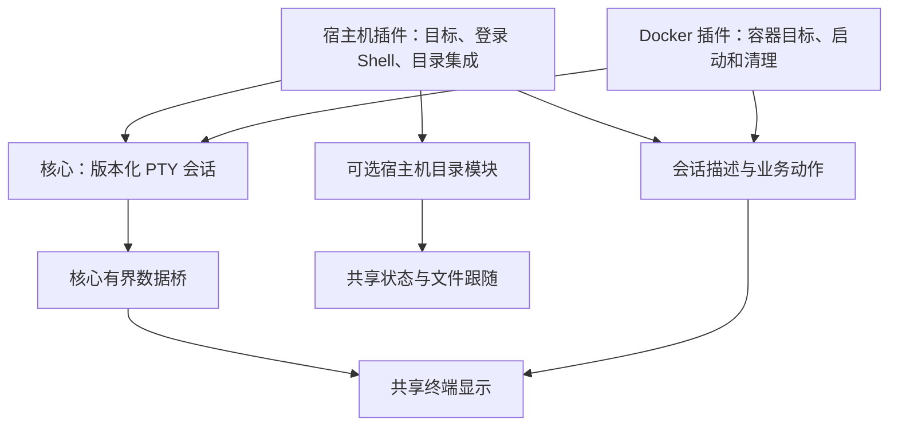

# 终端会话与显示能力抽象设计

2026-11-09。状态：终端抽象已进入实现，实际验收与发行来源见[实施记录](implementation-terminal-abstraction.md)。用户明确要求先重构现有终端并发布，Docker 留到后续。设计基线为 `97d473c`，当时核心为 0.14.0、终端插件为 0.4.0。

依据：[开发约定](../AGENTS.md)、[功能设计方法](plan-feature-design.md)、[现有插件 API](plugin-api.md)、[终端目录设计](plan-terminal-directory.md)和[统一关闭设计](plan-close-lifecycle.md)。本文件维护抽象目标、接口和验收要求；实施证据在实施时另行记录。

## 1. 目标与首批场景

将现有终端拆成通用 PTY 执行能力、插件会话策略和共享终端显示。调用方明确声明使用哪次核心连接、怎样启动、请求哪些功能；实际能力和运行状态由提供方确认。扩展场景不要求在共享显示或核心中增加 Docker 等业务分支。

首批真实场景是现有宿主机终端和后续 Docker 容器终端。宿主机保留登录 Shell、自动目录集成、手工 OSC 7 兼容和文件跟随；容器复用显示、输入、尺寸和移窗能力，但自行选择 Shell、执行用户、初始目录以及重开和清理策略。

| 场景 | 完成后的行为 |
| --- | --- |
| 新建宿主机终端 | 使用当前工作区连接，保持现有 Shell 配置、集成和目录跟随行为 |
| 新建容器终端 | Docker 插件在同一服务器工作台创建自己的二级页面，目标、运行条件和启动结果明确；不影响已有宿主机终端 |
| 使用同一显示层 | 字体、主题、剪贴板、输入序号、尺寸调度、输出和快照逻辑只有一份源码 |
| 终端提供的功能不同 | 不支持目录定位的会话不安装目录模块，也不显示“正在识别”或“识别失败” |
| 隐藏、移窗、结束后再查看 | 保留逻辑会话和有界历史，重挂载显示层不重新执行启动命令 |
| 插件独立安装和更新 | Docker 包包含自身需要的共享代码和资源，不要求运行或安装终端插件 |

本次实施范围应包括宿主机终端迁移、核心会话契约、共享显示模块、文件跟随的能力识别，以及测试夹具证明第二种会话可以接入。真实 Docker 的探测、exec 创建和进程清理属于 Docker 编码设计及实施；不能用夹具结果宣称已支持 Docker。

本设计不增加终端提供方市场、运行时适配器注册、通用工作流引擎或插件权限系统；不实现本地终端、断线续接、退出后恢复、容器文件服务、自动提权和自动安装 Shell。一级 Tab 继续表示服务器工作区，抽象不依赖改变导航层级。

## 2. 已核实的现状与约束

| 当前代码 | 事实 | 对抽象的影响 |
| --- | --- | --- |
| [终端进程](../plugins/terminal/src/main.rs) | 在 ui.mount 内创建 PTY，同时读取宿主机目录设置、准备 Shell 集成；同 view 重挂载复用原记录 | 需要分离会话策略与 RPC 入口，保留按 view 幂等的规则 |
| [Shell 集成](../plugins/terminal/src/integration.rs) | 通过短命令读取服务器的 SHELL 和 uname；为 Linux Bash/Zsh 准备启动脚本 | 属于宿主机策略，不能用于推断容器环境 |
| [终端页面](../plugins/terminal/ui-src/view.js) | xterm、数据桥、输入队列、尺寸、目录模块、退出文案和新建动作在同一入口 | 共享显示不能继续固定创建普通终端或自动安装目录模块 |
| [目录报告](../plugins/terminal/ui-src/location.js) | 自动报告与手工 OSC 7 有不同验证和文件系统语义 | 保留既有语义，不因代码共享而放宽验证 |
| [核心终端](../src-tauri/src/terminal.rs) | 统一管理 Owner、PTY、输入、取消和 Replay；已支持可选 command | 能复用执行底座，但需补明确启动状态、结果和终态记录归属 |
| [输出流](../src-tauri/src/streams.rs) | 快照与追赶用于显示恢复，caughtUp 不证明远端启动完成 | 显示就绪和执行就绪必须分别表达 |
| [文件共享状态](../plugins/files/ui/shared-state.js) | 使用 sodeck.terminal 来源和活动 view 判断目录跟随 | 新消费者需要识别会话声明及位置能力；旧版本兼容单独处理 |
| [资源归属](../src-tauri/src/resource_owner.rs) | 核心从插件实例与 view 推导 Context，不由请求者自行指定归属 | 新接口仍以核心绑定为准，expectedContext 仅用于校验 |
| [组件宿主](../src-tauri/src/component_ui/host.rs) | view 的 params 已传到插件，页面只能 openView 本插件的视图 | 可由 Docker 自行创建容器页面，无需新增跨插件开页总线 |
| [共享状态](../src-tauri/src/shared_state.rs) | 已有版本化主题、来源、修订、订阅与 Context 隔离 | 小型状态复用此服务；终端正文仍走原数据桥 |

以上为静态代码核对，没有执行缺陷复现或 Docker 实机验收。特别是关闭 SSH 通道后容器内 exec 是否仍运行，不能从本机 worker 已结束推断。

## 3. 结构与唯一职责



| 对象或事实 | 唯一管理者 | 引用者与限制 |
| --- | --- | --- |
| 工作区、认证会话、连接代次 | 核心连接与工作区服务 | 插件只复用引用，不读取或另存凭据 |
| view、插件实例、窗口和 surface 身份 | 核心组件宿主 | 插件会话归 view；显示适配器归 surface |
| PTY、启动请求、输入队列、原生 worker | 核心终端服务 | 插件创建、查询和关闭其自有资源 |
| 具体业务目标与启动计划 | 所属插件 | 共享代码不解释容器 ID、Docker context 或登录配置 |
| 目标就绪、目标变化、重开及业务清理结果 | 所属插件 | 核心 PTY 成功不代替业务成功 |
| xterm、输入调度、尺寸调度、显示快照 | 共享显示模块 | 不创建连接，不生成启动命令，不主动关闭逻辑会话 |
| Shell 钩子、目录报告与文件系统对应事实 | 宿主机策略及目录模块 | 可选接入，不是所有终端的默认行为 |
| 字体、字号和外观偏好值 | 各插件的组件设置 | 共享字段和加载实现，各插件独立保存；不隐式读取另一插件设置 |

终端插件是宿主机会话的提供方，Docker 插件是容器会话的提供方；二者在构建时使用同一共享模块，运行时不互相调用。核心不保存业务提供方名单。

## 4. 调用参数的四个层次

### 4.1 连接归属

继续使用现有 Context：workspaceId、serverId、connectionId、generation。新建入口从核心提供的 view 取得它；业务异步操作携带当时的完整快照，不读取全局“当前服务器”。

开启 PTY 时传 viewId 和 expectedContext。核心推导 Owner 后核对二者；它们不允许调用者把资源绑定到其他连接。查询和清理旧资源校验原归属，但不要求旧连接仍在线，避免重连后无法收尾。

Context 不包含 SSH 类型、主机密码、容器用户或业务目标。后续其他传输由核心实现相同能力；插件不依赖 SSH channel。当前没有本地连接引用，不能提前用空 Context 表示本地终端。

### 4.2 启动意图

启动方式使用互斥结构，禁止“指定命令失败便进入默认 Shell”。以下是拟新增接口的类型示意，不是现有 RPC：

```ts
type PtyLaunch =
  | { kind: "loginShell" }
  | { kind: "command"; command: string };

type PtyOpenRequest = {
  viewId: string;
  expectedContext: Context;
  launch: PtyLaunch;
  cols: number;
  rows: number;
};
```

loginShell 表示请求核心当前连接的默认交互 Shell；command 表示在同一个 PTY 执行插件准备的远端启动命令。这里的命令仍按远端执行环境解释，不是跨系统通用 argv；核心不根据字符串推断 Docker、Bash 或系统类型。

宿主机插件根据其目录模式生成集成命令，或明确选择 loginShell。Docker 插件依据远端调用环境及容器环境构造命令；Shell、用户、目录和环境参数由 Docker 自己验证和编码，不使用开发机 PowerShell 拼接远端参数。

命令沿用非空、无 NUL、UTF-8 不超过 32 KiB 的上限；尺寸沿用有效范围和现有边界。无效启动类型、缺少 command 或类型与字段矛盾，均在发出远端请求前拒绝。

### 4.3 功能请求

请求放在插件创建参数或设置解析后的策略中，不进入通用 PTY RPC。首版只抽取已有实际功能，不建立任意字符串功能注册表：

| 功能 | 请求来源 | 请求如何生效 |
| --- | --- | --- |
| 目录识别 | 宿主机 directoryMode：auto/manual/off | auto 为尽力集成；manual 保留原 OSC 7 契约；off 不安装目录模块 |
| 交互输入及尺寸 | 当前会话提供方 | 启动前确认所需执行能力；不支持时明确失败或声明不提供该行为 |
| 外观 | 所属插件设置快照 | 共享显示实时应用，不影响业务目标和 Shell 生命周期 |
| 重开 | 所属插件定义的动作 | 重新检查目标并创建新 view、新会话；不在共享代码中固定为普通终端 |

Docker 首版不请求宿主机目录集成；没有位置功能是正常能力差异，不是初始化失败。必需的 PTY 能力不可用时不能悄悄降级成非交互执行。

### 4.4 实际能力与状态

请求、支持能力和运行状态必须分开。auto 不证明目录已取得；支持输入不证明当前能输入；输出已追赶不证明启动已成功。

会话提供方输出下述可序列化描述。session 身份复用 viewId，PTY 的 id 由核心分配，不再为相同对象引入额外业务 session ID：

```ts
type TerminalDescriptor = {
  schemaVersion: 1;
  revision: string;
  viewId: string;
  context: Context;
  ptyId: string | null;
  title: string;
  targetLabel: string;
  details: string[];
  preparation: "preparing" | "prepared" | "failed";
  targetReadiness: "pending" | "ready" | "failed";
  capabilities: {
    input: boolean;
    resize: boolean;
    location: { supported: boolean; reason?: string };
  };
  actions: Array<{ id: string; label: string; enabled: boolean }>;
  error?: { code: string; message: string; phase: string };
};
```

details 仅提供真实可确认的展示信息，例如 Shell 和执行用户；不携带凭据或原始大段启动脚本。容器身份及运行代次等完整业务目标仍保存在 Docker 会话记录中。请求参数固定后不允许通过标题修改或位置报告更换目标。

capabilities 表示提供方实际支持的操作，不是权限列表。location.supported 为 false 时不创建目录模块；为 true 时目录是否 ready/busy/unavailable 仍读取已有位置状态。

preparation 表示插件的准备流程，targetReadiness 表示业务目标就绪。宿主机准备完成后可标 ready，由核心运行状态决定能否交互；Docker 不得仅因宿主机已接收 Docker 启动命令就标 ready，需在 Docker 设计中给出自己的就绪证据。

## 5. 核心拟新增的最小会话契约

新增可选能力 terminal.session.v1，保留原 terminal.v1、terminal.launch.v1 和原方法的行为。新方法与新元数据均是提案，实施前不加入现有 API 文档的“可调用”列表。

| 拟新增方法 | 输入 | 结果和语义 |
| --- | --- | --- |
| terminal.session.open | PtyOpenRequest | 返回 id 和初始运行快照；快速接受并登记，启动异步执行 |
| terminal.session.status | id | 读取原会话运行快照；断线、结束和关闭中均可由原所属实例查询，不启动任何工作 |
| terminal.session.close | id | 幂等请求关闭；返回 closing 或 closed，不能把接受取消等同于结束 |

新方法复用现有数据操作 attach/ack/write/resize/checkpoint/detach。数据桥的 id 对应 ptyId；不新建第二条正文协议，不经 JSON 控制 RPC 或 StateHub 传正文。

### 5.1 运行快照

```ts
type PtyRuntime = {
  id: string;
  viewId: string;
  pluginId: string;
  pluginInstanceId: string;
  context: Context;
  revision: string;
  state: "opening" | "running" | "closing" | "closed";
  startRequest: "notSent" | "sent" | "accepted" | "rejected" | "unknown";
  outcome?: {
    reason: "exited" | "cancelled" | "connectionLost"
      | "startFailed" | "transportFailed";
    exitCode?: number;
    exitSignal?: string;
    error?: { code: string; message: string; phase: string };
    remoteProcess: "notStarted" | "exitConfirmed" | "unknown";
  };
};
```

running 必须建立在协议适配层确认 PTY 和启动请求成功之后。发送函数返回、channel 已打开或收到 caughtUp 均不足；SSH 适配需处理各启动请求的成功/失败响应，并保留打开总期限。协议无可靠确认时不得捏造 accepted。

remoteProcess 描述核心直接启动的远端执行对象。执行对象是 Docker CLI 时，它的退出不证明容器内部进程已退出；插件另外记录和展示业务清理结果。仅看到 EOF 或关闭 channel 时为 unknown；只有可靠退出状态/信号或相应协议证据才为 exitConfirmed。

close 后 closed 表示核心执行 worker 和输入队列已收尾，原生通道已释放。Replay 历史和只读显示订阅归原 view 的历史记录，仍可用于查看和移窗；它们在逻辑 view 关闭时另行结束和回收。closed 不等于整个 view 的全部资源已删除。业务远端进程结果 unknown 不改变为“已终止”，也不据此自动重放。

### 5.2 状态投递

复用现有 StateHub，拟新增两个小型主题，禁止包含终端正文：

| 主题 / key | 来源 | 内容 |
| --- | --- | --- |
| terminal.runtime.v1 / PTY id | 核心 | PtyRuntime；附加实际归属 view 和插件实例标识，使用工作区 Context 作用域 |
| terminal.session.v1 / current | 所属插件的 view | TerminalDescriptor；来源按核心登记附加，准备和业务就绪变化时更新 |

共享适配器同时核对 Context、viewId、ptyId 和来源，只消费匹配记录，按 StateHub 修订提交。核心原生状态与插件目标状态各有一个事实来源，页面只计算展示阶段，不反向改写运行状态。

两种快照中的 revision 分别由其唯一管理者在同一记录内递增，采用十进制字符串；用于合并直接查询和订阅的结果，防止较早发出的 status 回复覆盖后来收到的 closing/closed 状态。StateHub 自身的修订继续负责批次和订阅顺序，不替代这个跨投递方式的比较；修订不是另一套会话身份。

ui.mount 返回当前描述和可取得的运行快照，随后订阅既有 StateHub。订阅失效或记录超限时停止据缓存宣称可输入；可通过所属插件的状态事件读取 core status 并重建当前投影。回退查询仅在初始化、失步和显式恢复时使用，有界重试，不给所有运行终端增加常驻轮询。

共享状态同步与清理必须保留不同核心主题各自的归属，不能因为更新 workspace.presentation 而覆盖 terminal.runtime。原数据桥 end 仍是有序输出的终点：页面不得因状态先到 closed 而丢弃尚未显示的末尾输出。状态与正文没有共同修订号，各自确认与排序。

晚到的状态提交核对原 view、插件实例与 Context；原作用域结束后不创建新作用域或复活已删除的记录。关闭中的实际结果留在原清理任务内跟踪，不能靠重建 StateHub 记录完成收尾。

### 5.3 幂等与上限

1. 一个 view 只创建一个逻辑终端会话。新 open 在短临界区先登记 Owner 与启动计划，再执行网络请求。
2. 同 view、同 Context 和同启动计划的重复请求返回原资源及状态；启动计划改变返回 operationConflict。初始尺寸是首次创建参数，后续调整走 resize，不通过重复 open 更换。
3. 终态 view 再次挂载只读取原终态；open 不创建新执行。重新进入或新建终端必须由用户动作创建新 view。
4. 关闭中、插件实例过期或 Context 变化后拒绝新启动；原请求的查询与清理仍允许。启动结果提交时再次核对归属和关闭状态。
5. 同一记录内保留启动是否发出及实际结果。超时后继续核实原请求或清理它，不因为超时自动生成另一条启动请求。
6. 控制命令仍遵守现有 RPC 帧和等待上限；open 快速返回，原生打开总期限保持 30 秒。Shell 集成探测沿用自身较短期限，不占用一整条同步 ui.mount 等待。
7. 全局核心 PTY 记录上限建议保持 128，并明确包含仍被 view 持有的终态历史。达到上限时提示关闭不用的页面，不自动丢弃旧页历史；这一计数语义与当前清除 finished entries 的实现不同，需验收。插件准备记录按 view 唯一，并受现有 view 范围及短命令任务上限约束；不设置无界后台准备队列。历史随 view 回收后查询返回 resourceReleased，不伪造已经丢失的远端结果；重复关闭由现有关闭协调的原请求记录收尾。
8. 保留原正文块 16 KiB、Replay 待追赶字节 512 KiB、显示快照 2 MiB、页面待发送输入 256 KiB 的有界规则。描述最多 8 KiB、原生状态最多 4 KiB，并继续受 StateHub 的整体预算约束。
9. 启动 worker 完成与历史记录回收分开。历史随原 view 关闭回收，不因另一个终端 open 而删除仍可重挂载的终态会话。128 份已提交快照及 Replay 待追赶字节的理论上限约 320 MiB，不含前端 xterm、输入队列和临时上传；实施验收需测量实际内存，不能将“有界”描述成“低内存”。

## 6. 共享显示与插件适配接口

### 6.1 共享显示

接口示意采用 TypeScript 表达约束；实际沿用插件现有 JavaScript 与构建方式，不因此新增框架或迁移工具链：

```ts
type TerminalViewOptions = {
  session: TerminalSessionAdapter;
  appearance: AppearanceSnapshot;
  createLocation?: () => TerminalLocationFeature;
};

type SessionSnapshot = {
  descriptor: TerminalDescriptor;
  runtime: PtyRuntime | null;
};

type TerminalSessionAdapter = {
  current(): SessionSnapshot;
  subscribe(listener: (snapshot: SessionSnapshot) => void): () => void;
  invokeAction(id: string): Promise<void>;
  data: TerminalDataAdapter;
};
```

TerminalDataAdapter 复用当前数据桥，负责 attach、确认、顺序输入、resize、checkpoint 和 surface detach；输出监听、输入和快照必须绑定本次 surface 与 Context。它不负责业务目标准备、重开或关闭容器进程。SessionSnapshot 就是 current 返回的二元投影，订阅变化不创建新的会话。

TerminalLocationFeature 保留现有自动/手工解析模块所需的 mount、frame、completed、ready、input、invalidate 和 dispose 钩子。宿主机页面提供本地工厂，描述从 preparing 变成已确认支持位置后才安装模块；失去能力时清理原模块并使旧报告失效。Docker 不提供该工厂。共享显示不读取 directoryMode 决定安装哪种功能；钩子异常隔离到位置功能，不能中断普通终端输出和输入。

invokeAction 将已声明的动作 ID 交给本插件 ui.event，不传函数、命令或任意插件 ID。共享显示根据状态渲染 label/enabled，并防重复点击；业务代码决定创建参数和具体目标。

重开可由本插件事件校验目标并返回自身开页参数，再由页面适配器调用既有 openView；校验阶段不创建执行。实际开页继续使用核心 action requestId，桥接重试保留原编号，不能在响应超时后自动换编号重复创建；结果未知先查询/定位原动作。该规则需连同现有组件开页桥接一并验收。

### 6.2 显示与执行的就绪条件

页面计算的阶段包括准备中、打开中、可交互、关闭中、已结束和失败；这不是另一份后端状态机。可交互必须同时满足：

- 描述准备完成、目标 ready，核心状态 running。
- 本次 surface 已获核心就绪确认、输出已追赶、没有正在恢复快照。
- 页面拥有当前输入资格、Context 有效、页面可见且输入能力可用。

尺寸同步也核对 resize 能力、运行状态和表面资格。输入排队过程中目标失效，丢弃未发部分并明确反馈，不在新 Context 或新目标继续发送。复制历史在结束后仍可用，粘贴和命令输入不可用。

核心可以先开放输入而 Shell 集成仍在等待握手；目录模块的 ready 不作为普通终端可交互的必要条件。Docker 业务就绪由 Docker 适配实现，其等待不能用目录握手代替。

挂载握手仍区分 mounted 和 surfaceReady。首次挂载使用 ui.mount 返回的快照初始化只读界面；尚无 ptyId 时可以先显示准备中并发送 mounted，不能等远端启动后才完成页面握手。已有 PTY 的移窗表面先恢复所需显示快照与已产生输出，再发送 mounted。StateHub 的受保护订阅和输入在核心 surfaceReady 后进行，不能因等待它们而阻塞 mounted，形成互相等待。

准备完成后首次取得 ptyId，数据适配器为本 surface 只 attach 一次并追赶输出。mounted、surfaceReady 和 caughtUp 都是展示/归属条件，不写成“远端目标已启动”；无输出的会话也必须依靠运行状态明确进入可交互或失败。

### 6.3 生命周期分离

| 操作 | 显示层 | 逻辑会话 / 核心 |
| --- | --- | --- |
| 隐藏、切 Tab、最小化 | 按原规则保留显示与有界输出接续，暂停无效尺寸提交 | 不重新启动或结束会话 |
| 移窗 | 源停止输入，目标恢复快照与后续输出；归属提交后接手输入 | viewId、ptyId、目标、启动次数保持不变 |
| surface 卸载 | 移除监听、计时器、xterm 和表面订阅 | 不调用逻辑 close |
| 用户关闭页面 | 参加现有 flush 和关闭决定 | 由 ui.disposeView 与核心关闭协调执行实际收尾 |
| 用户取消关闭 | 不提前销毁显示或输入状态 | 释放阶段之前取消，保留原会话，不重新 open |
| Shell 正常退出 | 显示全部末尾输出和结果，允许复制和业务重开 | 保留终态记录至 view 关闭 |
| 连接断开或代次变化 | 禁止输入，保留历史与真实原因 | 原会话结束或收尾；旧目标结果不应用到新会话 |
| 插件退出 / 应用退出 | 表面失效 | 核心清理原 Owner 的资源；不能把远端 unknown 写成已终止 |

## 7. 两个提供方怎样使用同一契约

### 7.1 宿主机终端

ui.mount 首次为 view 登记会话记录和准备任务，快速返回 preparing 描述；重复 mount 读取同一记录。准备任务在不持有终端全局锁的情况下读取设置、探测默认 Shell 并生成计划，然后用新 PTY 接口启动。

auto 模式保持现有支持范围、登录配置顺序、提示符钩子、退出状态、随机临时目录和文件系统标记规则。探测失败时由宿主机策略明确选择普通 loginShell，并声明目录能力的降级原因；核心和共享显示不实现这个回退。

manual 模式保持已有 OSC 7 和 hostname 设置；off 不接入目录报告。外观设置由共享实现应用，目录偏好只在宿主机策略中使用。

重开动作仍创建普通宿主机终端的新 view。准备、集成、PTY 和位置结果都绑定原 view 与 Context；准备期间关闭覆盖探测任务和尚未完成的启动，不允许迟到准备结果注册新资源。

### 7.2 Docker 容器终端

Docker 在其清单声明自己的容器终端 editor view，通过现有 openView 传递自身创建参数。其会话控制器保存当前引擎、完整容器 ID、运行身份快照、Shell 及本次执行选项；这些字段不进入核心的业务判断。

首版 location.supported 为 false，不接入宿主机 Shell 脚本、OSC 7 兼容或目录 witness。没有 Shell、容器暂停、权限不足和目标改变由 Docker 提供具体失败信息。执行用户、环境和目录按容器配置及本次选项处理，不能套用 SSH 登录默认值。

底层 PTY 成功只证明远端启动请求被接受。Docker 需要明确其容器 exec 已创建/启动的证据、失败前后是否已有进程，以及关闭后的进程状态；CLI 或 Engine API 方案留在 Docker 编码设计中选择。本抽象对它们都要求同一实际就绪与结果契约，不把尚未验证的方案写成已支持。

容器停止或重启使原 exec 会话结束；重新进入重新校验同一完整 ID 和当前运行状态。仅名称相同但 ID 改变的容器不是原目标。容器重启不会恢复原 exec，不能自动重放用户命令。

共享显示沿用两层 TTY 需要的尺寸和输入原语，Docker 自己定义脱离快捷键、关闭连接与结束 exec 的区别。关闭页面不得调用停止或杀死整个容器来代替 exec 清理。

## 8. 目录与文件能力的协作

新文件消费者优先读取当前活动 view 的 terminal.session.v1 描述，识别这是终端页面以及是否提供 location。位置候选还必须匹配同 view、同 Context、合法位置字段和原有偏移/文件系统证据；不能仅因为 input/resize 为 true 就跟随目录。

terminal.location.v1 的已有含义保持不变：session-default 表示当前文件服务视角；shell-reported 必须验证原 witness 再 realpath/stat。位置模块不能把容器同名路径发布为这两种宿主机可用事实。

兼容旧终端时，文件插件在一个独立兼容入口中继续按原官方来源和旧位置契约读取；新会话消费者不依赖提供方 ID。缺少新描述且不满足旧协议的来源不猜测其文件系统对应关系。

新消费者的正常文案区分“当前不是终端”“当前终端不提供可浏览目录”“等待目录报告”“终端忙碌”“无法浏览已报告目录”。无能力不提示升级或启动失败；旧位置查询和动作一律受最新活动 view 与导航序号约束。

迁移后的宿主机在集成关闭或不可用时仍由宿主机装配层发布原 terminal.location.v1 的 unknown 原因记录，供旧文件插件按原行为反馈；它不安装报告解析模块，也不发布假的 known 目录。这样新描述不会让旧消费者一直等待一份永远不会出现的位置。

未来容器文件浏览需要明确提供容器文件服务或可验证映射，再定义对应位置契约；本次不新增虚构的容器 filesystemId，也不通过扩大现有枚举声称已经可浏览。

## 9. 状态、关闭与失败处理

| 事件或阶段 | 必须处理的结果 | 重试与恢复 |
| --- | --- | --- |
| 参数无效 / 能力不足 | 不发出启动请求，记录具体阶段和原因 | 用户修正参数或升级后新建；不默认回退 |
| 插件准备中关闭 | 取消探测和准备，保留清理记录直至任务结束 | 原关闭继续等待；重复关闭不再探测 |
| PTY 或启动请求被拒绝 | failed，确认哪些请求已经发出；释放原通道 | 新 view 才是新的启动；同请求只查询 |
| 打开超时且发出状态不明 | 显示结果未知，核实或清理原尝试 | 不自动重放 command |
| 原生 running，业务目标尚未 ready | 显示打开中，保留已经取得的输出 | 所属插件提供业务证据；不能用 caughtUp 代替 |
| 目录准备或握手失败 | 目录不可用，普通终端可继续使用 | 只重试已有契约允许的定位；不重启用户 Shell 安装钩子 |
| 正常退出 / 退出信号 | 停止输入，保留退出结果、快照及末尾输出 | 业务重开创建新 view；不是恢复旧 Shell |
| 连接失联 / 插件异常 | 禁止旧输入，核心资源按原 Owner 收尾 | 原输出保留；不自动重连并执行业务 |
| close 已接受但 worker 未结束 | closing，保留原清理任务和实际进度 | 查询同一任务，不能以 cancel ACK 宣布 closed |
| 本地资源结束但远端进程未知 | closed 的本地事实与远端 unknown 同时保留 | 显示结果边界；由插件后续核实，禁止显示“远端已终止” |
| 状态订阅超限 / 租约失效 | 不消费过期状态，不改变目标或启动次数 | 有界重新订阅 / 读取状态；正文桥独立运行 |
| 显示快照损坏或超限 | 明确显示恢复问题，不创建新会话 | 只恢复显示，不能通过重开执行来补偿 |

关闭沿用核心现有 prepare/decision/cleanup/finish 流程，不新增终端自己的审批或确认层。ui.beforeClose 只反映业务需要，ui.disposeView 幂等发起/确认实际清理，核心继续追踪取消后的原生 worker。准备任务也必须登记并被 dispose 覆盖，不能留在 detached 线程中。

默认页面关闭释放此 view 的核心资源；不承诺通过 PTY 关闭杀死所有远端子进程。提供方如要求更强的业务清理，必须有可验证的实现与结果；实现前不得声明“远端进程已确认结束”。实际实施不得为获得确认而自动停止整个容器或杀死无明确归属的进程。

## 10. 代码落点与迁移边界

| 代码位置 | 拟调整内容 |
| --- | --- |
| plugins/shared/terminal/（新增共享源码目录） | 共享 viewport、数据适配、input、clipboard、appearance；只抽取本次两个场景需要的共同代码 |
| plugins/terminal/ui-src/view.js | 缩为宿主机页面装配；注入会话、外观、目录模块；删除固定普通终端动作的公共层耦合 |
| plugins/terminal/ui-src/location.js | 保持宿主机可选功能与原解析语义，改为明确安装/卸载；不默认接入所有会话 |
| plugins/terminal/src/main.rs 与新增会话模块 | RPC 入口与宿主机准备、目标记录、启动及清理分离；准备异步、按 view 幂等，等待不持有全局锁 |
| plugins/terminal/src/integration.rs 与 shell/ | 保留宿主机脚本策略，仅调整输入/返回结构与取消接入；不迁入核心或通用显示 |
| src-tauri/src/terminal.rs | 统一类型化启动计划、新状态与结果、按 Owner 关闭；区分执行 worker 与历史记录生命周期 |
| src-tauri/src/plugins/dispatch.rs | 新能力方法分派和参数验证；旧请求在单一兼容入口规范化到同一执行底座 |
| src-tauri/src/core.rs、shared_state.rs 及相关模块 | 能力公告、原生状态事实发布与归属清理；新增主题不覆盖其他核心事实 |
| crates/plugin-client | 复用已有 RPC、StateHub 和取消语义；本次不增加只有一个调用方的类型包装 |
| plugins/files/ui/shared-state.js | 根据活动会话描述和位置能力跟随，保留集中旧协议兼容；不增加 Docker ID 特判 |
| src/components.ts 与组件开页桥接 | 保留开页动作的 requestId，验证超时/重试及迟到响应；二级加号仍创建产品默认宿主机终端，不由活动容器页面改变 |
| plugins/terminal/build.mjs、清单与锁文件 | 打包共同源码及本插件资源，拆分外观与宿主机策略的接入；保持当前设置键兼容 |
| 后续 plugins/docker | 实现自己的 view、会话控制器、设置和独立打包，消费共享模块 |

具体文件可按现有组织命名；不为每个字段新建模块。共享 JS 的桥接依旧使用本插件页面及核心登记的 surface，不能从另一插件的已安装目录动态加载代码。

字体和固定版本 xterm 资源随需要它们的插件独立打包。共享打包辅助接收调用插件的根目录和资源来源，不读取 plugins/terminal/node_modules 作为 Docker 的隐式依赖。每个消费者从已声明锁文件构建，包内不需要 Node、CDN 或已安装终端插件。

不新增外部生产依赖，不迁移到 React、不创建通用终端提供方注册系统。核心构建不依赖插件构建或共享终端 UI 资源，独立版本和分发保持原规则。

## 11. 版本兼容与文档责任

1. 核心 API 主版本保持 1，通过 terminal.session.v1 公告新增契约。现有 terminal.open/close 和数据桥保持原调用及返回语义，旧插件仍可运行。
2. 核心只保留一套执行与清理实现。旧参数的 command 有无在分派边界转换为明确启动类型，不在会话内部散布新旧分支。
3. 迁移后的新终端插件需要 terminal.session.v1、viewData.v1 和 sharedState.v1；缺少时在初始化明确提示升级核心，沿用现有初始化失败/回退机制。不在新插件里维护两套宿主机会话控制器。
4. 前后端、共享代码及 schemaVersion 与各自插件包一起发行；旧插件包继续携带原代码，不因另一插件升级而改变。
5. 新文件插件兼容旧位置发布方；旧文件插件继续接受原宿主机来源，忽略 Docker 插件，不能被抽象改动诱导导航到容器路径。
6. 应用版本仅在发行时按既有规则修改 tauri.conf.json。设计阶段不改版本、不创建发布标签或调用尚不存在命令的工作流。
7. 实施时同步 plugin-api.md 的实际接口、architecture.md 的职责变化、usage.md 的实际行为及 development.md 的真实命令；验证统一写入 implementation 文档，发行范围写入版本说明或插件 CHANGELOG。

## 12. 实施顺序与可验收交付

### 第一步：固定当前行为和第二种会话反例

先利用现有终端、输入、Shell、组件通信和关闭夹具固定行为；测试专用的第二种会话提供不同目标标签、无目录模块、不同重开动作以及显式 command 失败，证明共同显示不需要宿主机策略。夹具不发行，不宣称模拟数据证明 Docker 可用。

### 第二步：实现核心会话契约

实现新 open/status/close、明确启动响应和结果、状态事实、幂等及历史生命周期；旧调用通过同一底座。单独证明取消、超时、关闭、重连和迟到结果的规则，不能先交付只有 open 的接口。

### 第三步：提取共享显示并迁移宿主机

宿主机提供方接入新接口，移动共同显示和输入代码，保留原 Shell/目录语义与设置值；文件跟随改为能力识别。真实宿主机流程通过后移除原重复显示路径和过渡代码。该步结束才可称“现有终端抽象完成”。

### 第四步：独立包验证，随后接入真实 Docker

核心与终端分别打包，终端包只使用自身声明资源；五个正式系统架构组合原生编译、打包并启动退出。Docker 在其独立任务中用真实容器验证启动、输入、尺寸、Shell 缺失、停止/重启和清理，不因共享代码验收通过而跳过。

| 验收主题 | 必须证明的行为 |
| --- | --- |
| 旧调用兼容 | 旧 loginShell / command、原数据帧及旧插件组合保持正常；新接口非法参数不执行 |
| 创建与重试 | 并发 mount/open 只有一个启动；计划冲突拒绝；准备中关闭、启动超时和迟到回复不会产生第二个会话 |
| 就绪 | caughtUp 先于启动确认时不可输入；明确启动失败不出现宿主机提示符；没有目录握手仍可普通交互 |
| 目标与输入 | 切服务器、移窗、重连和延迟剪贴板读取不串目标；旧输入队列不会落入新会话 |
| 显示能力 | 相同渲染器支持不同动作和无目录能力；字体、字号、主题、复制/粘贴和全屏程序保持 |
| 快照与尾部输出 | 输出压力和恢复保持有界；结束后的页面可移窗；新建其他终端不删旧页记录；closed 先到不丢末尾数据 |
| 宿主机集成 | Bash/Zsh 配置顺序、历史与退出状态、首次目录、特殊路径、busy、手动浏览不回跳、手工 OSC 7 和 off 保持 |
| 文件跟随 | 新/旧终端与新/旧文件兼容；无位置能力正常暂停；不按容器同名路径导航 |
| 关闭 | 取消关闭保留原会话；dispose 重复、插件异常、全局退出等待原资源结束；远端 unknown 不标成已终止 |
| 状态丢失 | 修订乱序、租约失效、超限和重订阅不创建执行、不恢复旧输入、不改变目标 |
| 独立发行 | 干净环境可构建终端；包内字体/vendor 完整；核心无插件仍可构建和启动；不存在终端安装目录依赖 |

相关现有入口包括 npm run check、npm run scripts:test、npm run test、npm run terminal:input:test、npm run terminal:test、npm run communication:test、npm run desktop:test、npm run plugin:check、npm run plugin:build -- --plugin terminal 和 npm run build；Shell 专项沿用 test-terminal-shell.py 的已有环境入口。按实际变更和 development.md 选择检查，公共连接/流/生命周期以及共享 UI 改动扩大到已有相关插件回归；五目标原生包与真实界面验收保持。

设计阶段只做文档检查；现已进入产品实现，验收表是要求，不能视作全部通过。实际执行、结果和未覆盖范围统一记录在实施记录及发行说明。

## 13. 扩展边界与仍需后续证明的事项

| 后续需求 | 本次保留的接入点 | 本次不提前实现的内容 |
| --- | --- | --- |
| 指定远端命令 / 其他交互工具 | command 启动、插件自己的准备/就绪和动作、共同显示 | 任意命令编排及统一参数语言 |
| 其他远程协议 | 核心 Context 和 PTY 语义 | 插件直接选择或实现具体传输 |
| 不同 Shell 或 Windows 容器 | 所属插件策略和可选功能模块 | 把 Linux Bash/Zsh 集成当作全平台方案 |
| 容器文件浏览 | 位置能力可以不提供，已有文件系统证据契约 | 字符串路径跨文件系统映射或虚构文件服务 |
| 本地终端 | 显示与业务动作可复用 | 本地 PTY、空连接引用、本地进程适配 |
| 会话恢复 / Docker 脱离后重接 | 已明确区分 surface detach、会话 close 与业务结果 | 持久会话、恢复进程或自动重放 |

抽象完成的判断是新增实际场景可以实现自己的目标和会话策略，并直接使用同一显示与核心原语；不以枚举了多少未来类型为标准。关键待证明项是新核心启动确认的协议实现、终态历史与内存边界、两类事实投递的时序，以及真实 Docker 的就绪和远端进程清理。它们分别进入对应实施验收，不能以本设计文档代替证据。
