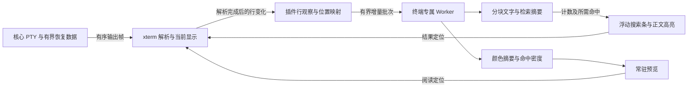

# 终端历史搜索与常驻预览设计

2026-11-10。状态：第一版源码已实现，本机验证与未验证范围见[实施记录](implementation-terminal-search.md)。本文保留行为与性能验收要求；设计目标与实测结果分开记录，不代表五平台已经验收或正式发行。

## 1. 已确认的需求

面向运维人员，在当前终端查找已经出现的命令回显和输出，包括滚出屏幕的内容。用户已确认：

- 当前终端保留 **100,000 行滚动历史**；搜索覆盖这些历史和当前屏幕。
- 采用终端内的**浮动搜索条**。
- 右侧**常驻内容预览（minimap）**，保留终端输出的颜色；搜索时叠加全部命中的分布和当前命中。
- 点击、拖动预览可以浏览历史；关闭搜索后预览仍显示。
- 数据量大时检索仍要快，搜索、预览和历史维护不能拖慢终端输入与持续输出。

交互方向沿用已选择的[原型](codex://threads/01a1c3fd-f3fd-7cd2-8906-9e81bb895b0d)，不再重新选择布局。原型使用示例数据，不能作为正式性能证据。

这里的“历史”是当前终端仍保留的显示内容。第一版不读取远端 shell 的 history 文件，不保存已经关闭终端或应用重启前的可检索档案，不跨终端搜索，不引入命令历史数据库。若远端关闭回显，输入过的命令不一定出现在搜索范围里。

## 2. 现状和必须一起解决的问题

| 设计开始时的现状 | 对本功能的约束 | 代码位置 |
| --- | --- | --- |
| xterm 6.0.0，显式设置 `scrollback:1000` | 改为 100,000 后，窗口重排、内存、恢复成本都随内容增长 | [终端页面](../plugins/terminal/ui-src/view.js)、[依赖清单](../plugins/terminal/package.json) |
| 已使用 fit、serialize 插件，没有搜索插件 | 可复用解析后的缓冲和既有序列化格式；本轮设计不增加生产依赖 | [资源构建](../plugins/terminal/build.mjs) |
| 输出链等待 xterm 写入、ACK，然后调用全量 checkpoint；阈值为 128 KiB 或约 250 ms，另有 500 ms 定时检查 | 不能在这条链上增加全历史搜索、预览重绘或更大的同步序列化 | [终端页面](../plugins/terminal/ui-src/view.js) |
| 前后端显示快照上限均为 2 MiB，每块最多 16 KiB | 10 万行普通文本就可能超过快照上限；颜色控制序列还会放大数据 | [终端页面](../plugins/terminal/ui-src/view.js)、[流管理](../src-tauri/src/streams.rs) |
| 原始输出保留 512 KiB；清理同时受读者 ACK 和已提交快照 offset 限制 | 仅 ACK 输出不能推进快照水位。快照持续失败时，保留队列最终填满，PTY 读取等待 | [流管理](../src-tauri/src/streams.rs) |
| 只在输出 offset 改变时保存 checkpoint | 搜索词、阅读位置等纯 UI 变化需要独立保存入口 | [终端页面](../plugins/terminal/ui-src/view.js) |
| 移窗保留原 PTY，重建页面并恢复快照；退出、断线页保留输出 | 搜索状态跟随 view，恢复不能重复输入或重启命令 | [终端插件](../plugins/terminal/src/main.rs)、[宿主页面](../src/components.ts) |

这份基线已被本轮实现替换：正常 ACK 与快照解耦，新增临时恢复日志、128 MiB 显示快照与独立 UI 元数据。旧的有界流仍保留兼容实现；恢复、故障和性能实测统一见实施记录。

因此本功能包含三个共同交付项：**10 万行历史的可靠维护、可取消的快速检索、低成本常驻预览**。恢复机制是前置依赖，不能只修改 scrollback 并增加搜索按钮。

## 3. 用户行为与搜索语义

### 3.1 保留和清理

100,000 指 xterm 的滚动历史屏幕行，当前屏幕另计。长文本软换行会占多行，因此窗口列数变化可能改变历史能容纳的实际文本量。界面范围提示为 `当前终端 · 最多 10 万行历史`；淘汰旧行时只保留剩余内容，不承诺永久保存。

- 达到上限后淘汰最旧行，并同步清理索引、预览和命中计数。正在阅读的行被淘汰时，定位到最早仍保留的位置，并提示 `较早内容已超出保留范围`。
- 普通清屏若仅清除屏幕，已有滚动历史仍可搜索。明确删除滚动历史的控制序列或终端重置，必须同步失效相关索引；不能搜索到已经消失的文字。
- 重连、新建或重新打开终端创建新的 PTY 和历史，不把原页输出拼到新页。原退出页仍可独立查找。
- 启用备用屏幕的程序，例如 vim、top，只搜索当前备用屏幕；搜索条说明 `当前应用屏幕`。返回普通屏幕后恢复原历史查询和阅读锚点，不把每次全屏刷新收集成历史。

### 3.2 匹配规则

第一版提供普通文本查找和“区分大小写”开关，默认不区分。暂不增加正则、模糊查找、整词开关和跨终端结果面板。

| 内容 | 匹配规则 |
| --- | --- |
| 命令回显、提示符、普通输出 | 搜索 xterm 最终解析后的显示文字 |
| ANSI/OSC 控制序列 | 控制字节本身不参与搜索；颜色不改变匹配结果 |
| 同一文本的自动换行 | 按逻辑行拼接，可跨软换行匹配 |
| 真正的换行 | 为匹配边界；第一版不匹配跨硬换行的短语 |
| 回车、退格、进度条覆盖 | 匹配最后仍显示的内容，不匹配被覆盖的旧字符 |
| 中文、emoji、组合字符、全角字符 | 以显示字符串匹配，再映射回实际单元格；不能把字符串下标当终端列号 |
| 大小写转换 | 使用一致的 Unicode 小写转换，不额外做重音或规范化等价匹配；长度变化必须保留位置映射 |
| 空格与 tab | 搜索最终展开后的空格；保留实际写入的空格，不把缓冲中未写入的空单元当成大量文本 |
| 重复或重叠文本 | 同一逻辑行从左到右记录非重叠匹配，如 `aaaa` 查 `aa` 为两处 |

若保留窗口从一个软换行段中间开始，只拼接仍保留的部分，不读取已经淘汰的前缀。超长逻辑行允许分块存储和跨块匹配，不能为了方便截断成不可检索的尾部。

## 4. 浮动搜索条与结果定位

搜索条浮在正文右上方，右边界避开常驻预览。正文保留原滚动区域，不因打开搜索改变 PTY 列数。窄分屏下将计数等次要信息移到条内第二行，输入框、前后定位、关闭始终可操作。

内容顺序：关键词输入 → 大小写开关 → `当前序号 / 总数` → 上一处、下一处 → 关闭。回到最新输出是正文历史阅读态的独立按钮，搜索关闭后仍可出现。

输入框与按钮统一为 32 px 高，方形按钮内的文字和图标居中，计数沿同一中线排列。很窄的分屏中输入框独占一行，四个按钮在下一行均匀排列，保留点击面积。

- Windows/Linux 使用 `Ctrl+Shift+F`，macOS 使用 `Cmd+F`；右键菜单增加“查找”。仅在活动终端响应，保持 shell 的 `Ctrl+F`、`Ctrl+R` 原行为。
- 必须接入现有 `installTerminalInput` 的单一按键分发，不能第二次安装 `attachCustomKeyEventHandler` 覆盖剪贴板处理。
- 打开时聚焦输入框并选中上次查询。若正文有单行选择，长度不超过查询上限时以选择文本初始化；否则沿用上次词。
- 输入法组合期间不提交检索；组合结束后提交。查询限制为 1,024 个 UTF-16 代码单元，超限就地说明，不静默截断。
- Enter 下一处，Shift+Enter 上一处，Esc 关闭并把焦点还给终端。搜索输入框内的编辑按键不发送到 PTY。
- 首次查询从当前阅读位置寻找下一处；没有后续命中时回到最早命中。到边界循环时给出轻量 `已回到第一处` / `已回到最后一处` 提示。
- 定位优先让匹配行落在阅读区域中部；靠近历史首尾时取合法位置。搜索条覆盖的顶端区域不作为目标落点。
- 全部可见匹配使用搜索高亮，当前匹配加独立边框；不占用 xterm 的用户选择，不破坏复制内容。
- 关闭时清除搜索高亮和分布叠加，保留关键词、大小写偏好、阅读位置和预览。按钮点击不意外把焦点交回 PTY；显式关闭或点击正文才恢复终端输入焦点。

无障碍要求：按钮具备名称、焦点可见、命中状态通过文字表达；计数用节流的 polite 状态播报，不能每条输出都播报。跳转不做长距离滚动动画。

### 4.1 反馈状态

| 状态 | 用户看到的反馈 | 可以做什么 |
| --- | --- | --- |
| 空查询 | `搜索当前终端历史` | 输入、关闭 |
| 查询进行中 | 短查询不闪烁；超过 100 ms 显示 `正在查找…` | 继续输入、取消；已有验证命中可定位 |
| 部分历史已检索 | `3 / 120+ · 正在查找`，`+` 表示尚未完成 | 浏览已确认部分；不能把部分数量当最终总数 |
| 完成且有命中 | `3 / 126` | 前后定位、预览跳转 |
| 没有命中 | `没有匹配`；与“正在查找”明确区分 | 修改词、关闭 |
| 追赶输出中 | `结果更新中`，保留已验证的旧历史命中 | 继续浏览；滞后的新输出区域不能声称没有命中 |
| 重排或历史重建 | `正在更新历史索引…` | 输入、关闭；禁用尚无可靠位置的跳转 |
| 检索任务失败 | `搜索暂不可用` 和“重试” | 普通输入输出继续；重试只重建索引 |
| 终端退出、断线 | 保留原终端状态提示，搜索继续可用 | 查找、复制；不为搜索要求重新连接 |

### 4.2 持续输出

搜索和滚动阅读时保持阅读锚点，不被新输出拉回底部。新增命中更新计数和预览，但不能自动把当前结果换成新的最后一处。

“回到最新输出”恢复底部跟随；搜索条可继续打开。随后用户再次跳转到历史命中，恢复历史阅读态。旧行淘汰、当前行被覆盖时重新验证锚点，不能继续高亮已经失效的命中。

## 5. 常驻彩色预览

预览放在终端布局的独立右侧窄轨中，默认宽度目标约 96 CSS px，窄分屏缩为约 40 px；保留点击区域，不新增可拖动宽度配置。宽度最终按既有界面实测调整。它占用空间但不遮盖正文，关闭搜索不会隐藏它。

预览包含三个分别维护的图层：

1. **内容层**：整段保留历史的文字密度和原始前景/背景颜色。是缩略纹理，不要求读清字符。
2. **阅读框**：当前正文可见行对应的范围。内部保持完全透明，使用细轮廓和左侧窄位置标记，不遮住内容与搜索分布；悬停、拖动及键盘聚焦增强边缘提示，焦点轮廓保持在轨道内。历史很多时绘制最小可点击高度，但定位计算仍用真实范围。
3. **搜索层**：全部命中聚合为黄色分布；当前命中以紫色和位置线突出。沿用原型方向，同时在浅深主题分别验证辨识度，正文匹配边框不只靠颜色。

10 万行压到几百像素时，一条像素行可能代表数百行。不能只采样某一行，也不能简单平均颜色后让少数错误输出消失。每个聚合桶保留文字占用率、基础颜色分布和少量显著颜色摘要；具体取色规则用含少量红色/黄色行的样本验收，不依靠固定错误关键词。

- 正文滚动只更新阅读框，不能重算整段内容或搜索结果。
- 搜索词变化只更新搜索层。基础颜色纹理不会因查词被重建。
- 输出追加更新尾部摘要，历史淘汰移除头部摘要；尺寸变化从已有摘要重采样，避免遍历全部单元格。
- 点击有命中的像素桶：定位到该桶内最接近点击位置的命中；同桶多命中由前后按钮精确遍历。没有命中的位置：按历史比例滚动。
- 拖动阅读框保留抓取偏移；支持 pointer capture、松手、取消、失焦和卸载收尾，不向终端程序发送鼠标报告。
- 主题切换重映射调色板颜色；true color 保留原值。不能为了换主题重新搜索。
- DPI 改变更新 canvas 像素尺寸；以 CSS 坐标做命中定位。给出可聚焦的阅读滑块，方向键/PageUp/PageDown/Home/End 可替代鼠标浏览，并通过文字说明位置。

## 6. 数据与资源归属

| 对象 | 唯一管理者 | 保留内容和结束条件 |
| --- | --- | --- |
| PTY、输出顺序、恢复水位、恢复存储 | 核心 | 按既有 view/插件实例/Context 管理；关闭流释放 |
| 100,000 行真实终端单元格 | 插件页面的 xterm | 显示事实的来源；淘汰、重置、卸载按真实缓冲处理 |
| 行身份和坐标映射 | 插件页面的行观察模块 | 指向当前缓冲；移窗重新建立，不能跨 PTY 复用 |
| 检索文字、分块索引、计数 | 每个挂载页一个专属 Worker | 可重建派生数据；隐藏时限速，卸载终止 |
| 预览摘要 | 同一 Worker | 复用行变化来源；不维护第二份完整终端网格 |
| 查询、阅读锚点、当前匹配 | 该 view 的 UI 状态 | 移窗随 view，旧挂载不可提交新状态 |
| DOM 高亮、canvas、拖动状态 | 插件 UI | 只为可见区域分配；隐藏暂停绘制，卸载清理 |

核心保持通用传输和恢复职责，不实现关键词、颜色分析、命中计数或终端业务索引。插件进程也不再单独解析同一份 SSH 输出。第一版的 Worker 使用本地打包模块，不引入服务端检索服务。

## 7. 行模型与正确性

### 7.1 用显示文字建索引

索引必须在 `terminal.write` 解析完成之后更新。禁止直接对原始 SSH 字节做字符串搜索；那会把颜色序列、旧进度条内容、分段 UTF-8 和备用屏幕刷新当成可见历史。

实现按屏幕行保存递增身份 `head + physicalIndex`、原文字和软换行标记；扫描器按软换行串接，硬换行清空后缀。head 随环形缓冲淘汰推进；重排或结构性变化启动新 epoch。匹配锚点保存行身份和 UTF-16 文字范围，使用前再次读取真实单元格核验；可见高亮按需转换为宽字符/组合字符单元格坐标。

### 7.2 历史与活动屏幕分别维护

- 已离开活动屏幕的历史按小块保存文本和摘要；追加时只处理新进入历史的行。
- 活动屏幕允许任意光标移动和覆盖，按脏区域重新读取。不能把“收到了换行”当成唯一变化来源。
- 普通追加、头部淘汰、屏幕覆盖走增量更新；列数变化导致重排、reset、清历史、缓冲切换走明确的重建/切换流程。
- `onRender` 只报告渲染区域，不能证明不可见历史没有变化；`onWriteParsed` 只表明解析批次完成，不能提供完整脏行列表。行观察必须用真实缓冲状态与结构变化共同校验。
- 长输出批次可能在一次回调前就滚出很多行，缓冲满时 `baseY` 也不再增长。要正确记录新增/淘汰数量，不能用 `baseY` 差值猜测全部变化。

公开 API 无法报告满历史时的准确淘汰数量，因此采用固定版本适配：`history.js` 集中读取 xterm 6.0.0 的环形行 trim/insert/delete 结构事件，结构事件只记脏状态，解析完成后合并重建；`snapshot.js` 封装冻结缓冲、样式和回收行的写时复制。适配器不修改真实缓冲或已加载的 addon。构建入口校验 xterm 6.0.0 / SerializeAddon 0.14.0，升级必须先通过真实缓冲和序列化对照测试。

重建期间按 epoch 收集有界变化。逐片读取时检查 revision，提交前合并其后的变动；不能把不同时间的切片冒充同一快照。持续变动超出追赶预算时丢弃派生索引并重新安排重建，不丢弃真实终端输出。

## 8. 快速检索方案

### 8.1 推荐选择

第一版选择 **Worker 分片子串扫描 + 每行计数 + 每 256 行扫描状态检查点**。本机 100 次查询与海量命中测试作为直接扫描的测量依据，暂不增加 Bloom 摘要或折叠字符串缓存。三元过滤是原生测量未满足目标时的备选加速，不能代替精确匹配，也不能加速所有短词。

| 方案 | 本场景判断 |
| --- | --- |
| 主线程每次扫描 xterm 全历史 | 读取和匹配都争抢输入、绘制时间，不采用 |
| 直接接搜索 addon | 可参考匹配和定位语义；单独使用不能解决大历史增量索引、海量命中和预览，不作为完整方案 |
| 完整字符位置倒排索引 | 子串索引维护、重排和数百万位置占用较大；当前 10 万行范围先不采用 |
| 数据库全文搜索/分词搜索 | 对 IP、路径、片段和中文短串的任意子串语义不直接匹配，还增加依赖和同步成本，第一版不采用 |
| Worker 分块扫描与三元过滤 | 精确语义简单，内存有界，能优先返回当前阅读附近的结果；推荐 |

这里的“索引”包括文字分块、逻辑行位置、字符摘要、命中计数和颜色摘要，不是再造一个通用搜索引擎。

### 8.2 可选的分块过滤

本节是后续加速备选，当前未启用。实际代码只维护文字行、64 行颜色块、每行命中计数和 256 行扫描检查点。

初始参数：每块最多 256 个屏幕行，同时限制约 64 KiB 的文本；任一条件到达即封块。超长逻辑行可跨块，每块保留其逻辑行范围。

- 封闭块保存原文本、行边界和三元字符 Bloom 摘要；尾块可变，重算尾块摘要，不能每次改词重建整份索引。
- 大小写敏感和不敏感各有摘要；初始各 8 KiB/块。按 120 列密集文本估算，通常约 400 块，摘要约 6.25 MiB；字节限额或特殊文本会增加块数，必须实测。
- 不敏感匹配的折叠文本按需生成，使用约 8 MiB 的 LRU 缓存，避免永久保存两份完整文字；摘要建好后释放临时折叠字符串。
- 长度至少 3 个 UTF-16 代码单元的关键词先检查三元摘要，再扫描候选块。哈希碰撞只能带来额外扫描，不能造成漏检。
- 跨块匹配维护最多 `查询长度 - 1` 的有效后缀；硬换行清空后缀，匹配按起点归属计数，避免跨块重复计算。
- 1～2 个代码单元的查询不能被三元摘要加速，明确走 Worker 分片扫描。中文两字通常也走这条路径，不限制用户必须输入三个字。
- 高频关键词、重复文本或高熵内容可能使过滤效果很差。最坏情况仍是 O(保留文字量) 扫描，不能宣称所有查询都有常数延迟。

若正确的 Worker 直接扫描已达到性能目标，第一步可以先交付分块与计数，再通过同一套基准决定是否启用 Bloom 加速。不能用增加索引复杂度代替实测，也不能删掉短词性能验收。

### 8.3 海量命中不全量物化

`a` 可能在 10 万行里命中数百万次。不能为每一处创建 JS 对象、DOM 或传回前端数组。

保存每个屏幕行起点归属的命中数量。全局计数 O(行数) 空间；结果范围和前后定位按需在目标行重算。主线程分批接收当前可见高亮，每条消息最多 128 处。

查第 n 处：累加行计数定位起点行 → 从前一个 256 行扫描状态检查点恢复 → 精确重算目标范围。跨检查点的软换行匹配保留有效后缀及其位置，并只按起点行计一次。

高亮仅覆盖当前视口。预览接收与像素高度相近的密度数组，不接收全部匹配坐标。同一处匹配映射到多屏幕行时，预览可标出覆盖范围，但计数仍是一处。

### 8.4 调度与取消

输入默认约 60 ms 合并。第一版完成精确计数后，从当前阅读位置定位首处；尚未返回部分计数或独立的提前命中。Worker 每约 4 ms 让出任务，处理新查询和取消，避免一个长同步循环使取消消息无法执行。后续原生验收若超过首处目标，再加入附近优先扫描或候选块过滤。

每个请求与结果携带 `mountEpoch`、`bufferEpoch`、`queryRevision`、`indexedRevision`。新查询替代旧查询，主线程拒绝迟到结果。不能只用“输入框文字仍相同”判断结果有效，因为同一关键词可能在重置后再次输入。

新增/修改行只更新当前查询受影响的计数；封闭块原计数继续有效。主线程的增量抽取每片目标不超过 2 ms，Worker 消息初始不超过 64 KiB，采用可转移缓冲减少复制。待发送预算初始 1 MiB；积压时合并脏区域或安排重建，不向 PTY 输出链等待 Worker。

## 9. 预览的数据成本

每行生成 32 个水平颜色采样格，同色区段以游程压缩存储，按 64 行合成颜色块。全量 canvas 重采样只读取块摘要与行计数，不读取 10 万行完整字符；搜索密度聚合仍为 O(行数)。处理 ANSI16/256、true color、反色、加粗亮色和背景色，默认颜色在绘制时由主题解释。

预览摘要、文本索引共享第 7 节的行变化来源。垂直缩放使用聚合层，保留少数显著颜色，不能仅跳行采样。新增/删除影响尾块、头块和相应上层节点；整段比例变化时可重新绘制 canvas，但不能重新读取每个字符。

内容层输出时最多约 10 Hz 更新，搜索层与计数最多约 10 Hz 更新；阅读框可按 requestAnimationFrame 跟随手势。页面隐藏后不绘制 canvas、不计算可见高亮，索引合并维护；再次显示先对齐水位再展示结果。

## 10. 恢复机制：扩大历史前的必要改造

### 10.1 必须成立的规则

1. 输出 ACK 表示 xterm 已解析该帧，不表示整份历史已保存。搜索和预览任务不参与 ACK 的前置等待。
2. checkpoint 只提交与其内容一致的输出水位；不得用最新 offset 标记较旧的快照。
3. 普通快照失败不能令当前终端因旧 checkpoint 水位永久停止输出。
4. 移窗必须拥有完整显示快照加后续输出；输入只发送一次。目标真正就绪后才回收源页面。
5. 不能靠减小历史、丢弃颜色或扩大一个内存常量掩盖失败；不足时显示真实恢复状态。

### 10.2 推荐恢复方向

在核心通用流管理中将“实时投递”和“可恢复数据保留”解耦，采用**有界临时恢复日志 + 已提交的显示快照**：

- 原始输出依序保留到当前流的临时日志，实时内存队列仍有界。正常 ACK 推进实时队列，不再必须等一次全量快照才能释放它。
- 快照水位以前的恢复日志只有在新快照原子提交后才能清理。挂载恢复读取该快照与水位后的字节；序号缺口是明确错误。
- 临时日志属于当前 view/PTY 的恢复资源，不是用户可搜索的历史档案。路径由核心系统适配层给出，按流关闭清理，启动时回收崩溃遗留，内容不写入普通日志。
- 单流和全局磁盘额度、写入队列、快照上传 staging 都有硬上限。初始候选为日志 128 MiB/流、快照 128 MiB/流、恢复文件总计 1 GiB；这些仅供试验，正式值须用 120/240 列彩色 10 万行样本确定。
- 临时日志 IO 失败或容量耗尽时，标记 `恢复保障不可用`。当前活页继续有序显示、输入；阻止会丢失该显示状态的移窗，允许在存储恢复后重建快照。不能谎报完整重挂载，也不能悄悄淘汰仍承诺可恢复的字节。

失败后实时投递与恢复保障有两个独立水位。无可用恢复链时，自动重挂载必须说明无法完整恢复；已有活页面保持原内容。日志失败状态下释放已确认实时队列属于明确降级，不代表恢复数据已安全保存。恢复成功需要提交一个新完整快照后才能重新声明有保障。

核心只保存插件提供的不透明显示数据，不理解搜索或 xterm 网格；通用 API 扩展通过新的 capability 协商，沿用 API v1。旧插件仍使用原 checkpoint 行为，新终端在缺少新能力时明确要求升级核心，不能在旧 2 MiB 路径上宣称支持完整 10 万行恢复。

### 10.3 序列化成本不能回避

临时日志解决频繁快照与背压耦合，**不自动解决** `serialize.serialize()` 在主线程遍历 10 万行的长任务。原 addon 的同步全量序列化不能直接被称为后台任务；包一层 Promise 也不会释放主线程。

实施前必须分别测量文本抽取、序列化、编码、上传、恢复解析和窗口重排。优先保留既有 ANSI 快照格式，降低非必要全量快照频率，并用恢复日志覆盖快照间隙；不能每 250 ms 序列化全部历史。

若全量序列化在 10 万行下超过主线程长任务门槛，正式实现必须改为可分片且具有一致水位的快照生成。需要明确记录冻结点、并发写入的副本/日志、屏幕与模式状态、软换行和颜色的恢复语义，并与现有 serializer 做输出恢复对照。分片期间继续变动的 xterm 缓冲不能直接当成不变快照。

本设计**不预先承诺**复制 serializer 私有实现、增加 headless 解析器或自建终端快照格式。这些会带来版本和内存成本。第一个技术试验若发现必须采用其中一种，先在本文补齐具体选择和资源预算，再实施依赖它的恢复代码。**这一项未验证前，10 万行功能不能作为可交付版本。**

### 10.4 UI 状态单独保存

搜索词、开关、阅读锚点和当前匹配走有界 UI 元数据，不触发全量显示快照。仅 UI 变化也可提交；元数据不得推进显示快照水位。关闭、移窗 flush 等待已有输入和必要的显示同步，不等待一轮完整查询或预览绘制。

迁移目标从快照恢复真实显示，再重建派生索引。查询词和阅读位置立即恢复，计数显示更新中，旧索引绝不冒充新挂载数据。

## 11. 生命周期、不变量与失败收尾

| 事件 | 搜索与预览行为 | 恢复与资源行为 |
| --- | --- | --- |
| 首次挂载 | 初始化 Worker，解析恢复帧后按水位建索引 | 不在 reset/snapshot 阶段误提交新快照 |
| 隐藏或后台 Tab | 停止绘制，合并增量，不抢焦点 | PTY 继续，恢复数据继续维护 |
| 再次显示 | 核对 epoch 和水位，先修复脏块，再启用结果定位 | 不重新创建 PTY |
| 窗口 resize/字体变化 | 一次合并重排；重新计算位置映射、预览投影 | 区分文字与几何 revision，保留可验证阅读锚点 |
| 移窗开始 | 冻结 UI 提交和拖动；取消查询，保存小元数据 | 使用既有所有权与 flush 协议确认显示可恢复 |
| 移窗取消 | 原挂载继续更新；只恢复一次调度 | 释放目标 staging，不切换 PTY |
| 移窗成功 | 目标新 epoch，重建索引；源卸载清理 | 目标 ready 后提交所有权，禁止旧源 checkpoint |
| 断线/命令退出 | 保留文字、计数、预览，可搜索和复制 | 正常收齐最后输出，不重复运行命令 |
| Worker 崩溃 | 取消旧结果，就地提示重试；终端继续运行 | 不关闭 PTY，不因索引失败重放输出 |
| 重置/清历史/缓冲切换 | 失效旧任务和坐标；按真实缓冲重建或切换 | 保留正确显示水位和模式状态 |
| view 关闭/应用退出 | 取消任务、拖动、观察器和定时器，terminate Worker，释放缓存 | 核心按既有关闭流程结束 PTY，清理恢复文件 |

始终成立的规则：

- 检索结果只能定位到当前仍存在、文字仍匹配的单元格。
- 已淘汰内容不继续计数，旧 epoch 的结果不能修改新页面。
- 普通搜索不发送任何终端输入、不改变连接、不创建远端任务。
- 输入链、解析 ACK 链与派生索引任务各自有界；取消后不存在无限积压。
- 每个 view 的数据互相独立，退出页不与新 PTY 共享索引。
- 核心关闭真实流和页面销毁均有清理入口；关闭取消后可继续使用原状态。

## 12. 内存、性能目标与测量方式

### 12.1 先按字节量评估

10 万行不是固定数据量。120 列时，xterm 字符单元若按每单元约 12 字节粗估，仅网格就约 **137 MiB**；240 列约 **275 MiB**，还不包括对象、渲染、字符串、模式、快照和迁移期间双页面。1000 列是现有尺寸校验上限，并非“1000 列 × 10 万行依然低内存”的承诺。

搜索副本只保存文字和紧凑位置，颜色用摘要；不再复制一份完整 xterm。结果存计数，不存全部位置对象。原文本、折叠缓存、块摘要、行映射、计数、预览、消息队列分别统计内存。

初始附加内存目标：120 列标准样本下，搜索与预览稳态合计不超过 64 MiB；240 列密集 Unicode 样本不超过 128 MiB。核心恢复存储、xterm 本体和移窗峰值另报，不能从“附加内存”口径中隐藏总进程增长。

超过资源预算要先停止可重建任务、释放折叠缓存和取消过期查询；不能自动把 10 万行降成 1000 行。极宽、逐字 true color、巨型逻辑行和大量并行终端的正式资源边界由基准确定，并在实施记录中列明。

### 12.2 延迟目标

在五个正式平台原生包上记录硬件、WebView 版本、列数、字节量和输入速率。下面以暖索引、120 列标准 10 万行数据为基线，用至少 100 次不同查询统计 P95；输入延迟包含 60 ms 合并时间。

| 指标 | 设计目标 |
| --- | --- |
| 搜索条打开、关闭和输入 | 下一帧有反馈，P95 ≤ 50 ms |
| 至少 3 代码单元的普通子串，首处验证命中 | 输入到可定位结果 P95 ≤ 100 ms |
| 普通子串，无命中确认/完整精确计数 | P95 ≤ 200 ms |
| 1～2 单元、常见字符、过滤退化的完整计数 | P95 ≤ 500 ms；先返回当前位置附近的结果 |
| 已完成查询的上一处/下一处 | 操作到高亮 P95 ≤ 50 ms |
| 取消/替换查询 | 旧任务在 50 ms 内停止有效计算，迟到结果永不生效 |
| 正文滚动和预览拖动 | 目标 60 fps；搜索/预览不新增 > 50 ms 主线程任务 |
| 初次/重排后全量索引 | 标准样本目标 ≤ 2 s，过程可取消且不冻结输入 |
| 正常持续输出的派生索引落后 | 1 MiB/s 输入样本下目标 ≤ 500 ms；追不上明确显示更新中 |
| 搜索开启对输入响应的影响 | 相对相同 10 万行、不搜索基线，P95 增量 ≤ 10 ms |

高负载另跑 5 MiB/s 突发、240 列、逐字颜色和四个并行终端；可以追赶，但队列必须有界、取消有效、输出不能因搜索永久停止。列宽重排和大快照的耗时独立记录，不混入“搜索只需几十毫秒”的结论。

## 13. 验收矩阵

先建立朴素完整扫描作为**测试基准**，与增量索引结果逐个对照。它只用于正确性验证，不作为正式 UI 查询实现。

| 类别 | 必须覆盖的样本与断言 |
| --- | --- |
| 匹配正确性 | ASCII、中文两字、emoji、组合字符、宽字符、大小写长度变化、IP/路径、前后空格、无命中、重叠规则 |
| 终端控制 | UTF-8 与 ANSI 跨输出帧、CR/退格覆盖、光标移动、滚动区、插入删除行、软换行、清屏、清历史、备用屏幕进入退出 |
| 大历史维护 | 达到及超过 100,000 行，单批大量换行，满缓冲后 `baseY` 不变，淘汰软换行前缀，巨型逻辑行跨块 |
| 高频结果 | 每行多处、数百万命中，计数精确，结果内存不随每处对象增长，前后定位和跨块去重正确 |
| 并发 | 连续改词、同词重置后再查、旧 Worker 回包、resize 中输出、索引积压、隐藏显示、缓冲切换 |
| 预览 | 一条红色行夹在大量普通行中仍有可辨摘要，密集命中聚合，主题/DPI 切换，点击同桶、拖动取消与键盘定位 |
| 真实交互 | 复制/粘贴、Ctrl+C、shell Ctrl+F/Ctrl+R、中文输入法、鼠标报告程序、搜索关闭后焦点、窄分屏 |
| 恢复 | 超过旧 2 MiB 的彩色历史，输出中移窗与取消，只改变 UI 后移窗，退出页重挂载，最后输出无后续帧 |
| 故障 | Worker 退出、快照上传中断、存储满/失败、旧 surface 迟到提交、关闭时在途 IO；数据不串页，不重复命令，状态真实 |
| 平台 | Windows x86_64/ARM64、Linux x86_64/ARM64、macOS ARM64 的真实包与原生 Worker/字体/IME/输入/移窗验证 |

性能报告至少保留纯数字数据，不只给截图：文本字节量、逻辑行/屏幕行、字符列数、命中数量、候选块比例、抽取/索引/查询耗时、主线程长任务、输入响应、Worker/页面/核心内存、恢复文件大小和移窗峰值。

## 14. 代码落点与实施顺序

下表对应第一版实际落点。后续优化与平台验收沿用这些职责，具体完成范围见实施记录。

| 范围 | 预计落点与职责 |
| --- | --- |
| 行观察 | `plugins/terminal/ui-src/history.js`：真实缓冲变化、逻辑行身份、位置映射、分片与 epoch |
| 检索和摘要 | `plugins/terminal/ui-src/history-worker.js`：块存储、过滤、精确计数、定位、颜色聚合、可取消调度 |
| 搜索交互 | `plugins/terminal/ui-src/search.js`：输入、状态、焦点、有限可见高亮；与既有 input.js 协作 |
| 预览交互 | `plugins/terminal/ui-src/minimap.js`：canvas 图层、阅读框、鼠标/键盘映射 |
| 主页面整合 | 既有 view.js、index.html、style.css、appearance.js、input.js：挂载/恢复/重排/键盘/清理入口 |
| 通用恢复 | 核心 streams.rs、terminal.rs 及正文桥的相关类型：实时/恢复水位、临时日志、快照提交、小元数据与兼容协商 |
| 本地打包 | 既有 terminal/build.mjs 与清单：打包本地 Worker，校验各 WebView 的加载/CSP；不依赖 CDN |
| 回归 | 既有 terminal 输入/UI、核心流测试和原生组合验收扩展；另加可重复数据生成与检索对照/性能专项 |

按依赖顺序推进，每一步都先定义可验收行为：

1. **技术试验与收敛**：证明行观察不会漏改动；测 10 万行重排和全量快照；验证真实包内 Worker。确定快照生成方式、最终存储额度和附加内存预算。发现超预算先改设计。
2. **大历史与恢复**：先解决快照/实时队列耦合、UI 元数据独立保存与完整移窗；此步相关原生验收通过后扩大默认历史。
3. **搜索完整流程**：分块文字、取消、精确计数、定位、大小写和退出页查找；按基准决定 Bloom 加速，不只测一个稀有关键词。
4. **常驻预览**：复用已验证行模型，加入颜色摘要、搜索叠加、阅读和拖动/键盘联动。
5. **组合与五平台验收**：大输出、重排、关闭/移窗、故障和并行终端共同验证，按独立核心/插件发布规则交付。

后续实施运行相关格式、类型、构建、测试入口，范围按[开发指南](development.md#版本与持续集成)选择；核心通用流变化须覆盖相关插件调用者，不能只跑终端 UI。五平台原生包与实际业务验证按[分发流程](distribution.md)执行。

本轮已同步终端使用说明、受影响的 API 文档、实施记录与插件未发布 CHANGELOG；正式发行前继续完成原生包验收，不修改根 README。

## 15. 实现收敛与待验收范围

已确定：历史范围和 10 万行目标、浮动条/常驻预览、精确子串语义、短词和海量命中处理、Worker 调度、增量数据归属、恢复前置要求、性能与五平台验收标准。

固定版本行适配与冻结快照已通过本机真实 xterm 测试。快照不再对完整缓冲同步序列化：按 64 行附近的重叠片段生成，最后一片包含整个屏幕及一行历史，避免序列化器省略尾部空行；输出继续运行，页面尺寸变化等到快照结束后合并处理。

容量确定为：每流临时原始字节日志 128 MiB、每份显示快照 128 MiB，日志文件与所有在途/已提交快照分配共用 1 GiB 全局额度。显示快照在核心内存中共享保存，日志使用 1 MiB 临时文件分段；并未新增快照文件或应用重启后的档案。

五平台原生 WebView、240/1000 列极宽数据、四终端并行、1/5 MiB/s 组合负载、真实 IME 和全部交互延迟仍须专项验收。xterm 本身的重排/当前光标行裁剪与内存成本仍存在；Worker 只能隔离检索计算。各项性能目标继续保留，本机 Chromium/Node 数字不能替代原生包通过记录。

返回 [文档索引](README.md)
