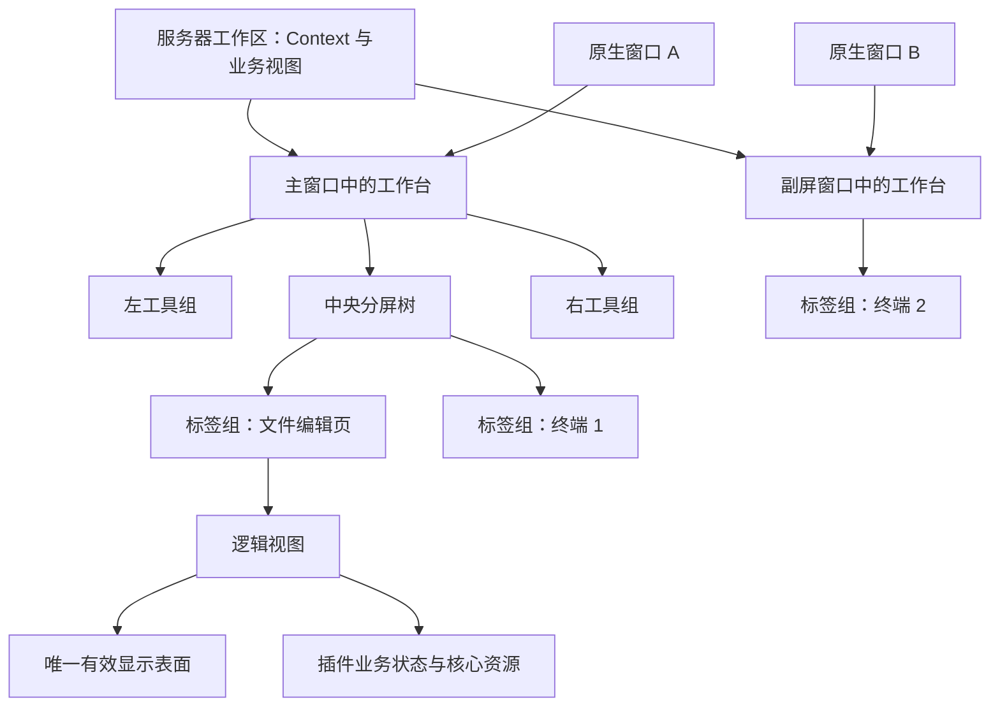

# 工作台布局、分屏与多窗口：完整功能设计

设计日期：2026-11-09。状态：已进入实施验收；本文保留完整目标设计，实际实现、差异与验证范围以[实施记录](implementation-workbench-layout.md)为准，不能由本文推断已完成发布或五目标原生验收。

分析基线为核心 `0.16.0`、HEAD `dd0335c12a1c82d626d489613101b875eb0a13fe` 与设计调研时的实际工作区。已阅读核心工作区、组件宿主、原生窗口、关闭协调器、数据流、共享状态及四个官方插件的相关源码。现状结论来自当时的代码检查；设计调研阶段没有启动应用复现或做原生手势验收，后续源码与运行结果单独记录。

遵循[开发约定](../AGENTS.md)、[功能设计方法](plan-feature-design.md)与[架构边界](architecture.md)。本文整体替换既有方案中“中央只有一个标签组、服务器工作区只归一个窗口、组件容器固定”的目标限制；既有实现和发行证据仍保留在原文档。当前可调用接口以[插件 API](plugin-api.md)为准。

## 1. 对需求的理解与设计结论

用户明确要求：主区域支持左右、上下拆分，内容可直接拖出成为独立窗口；功能须形成完整体系，允许当前插件随体系调整。

这里的“完整”落实为一套贯穿创建、布局、定位、输入、迁移、隐藏、恢复、关闭和资源释放的共同契约。新增插件通过这套契约参与工作台，核心不通过识别终端、文件或其他插件 ID 来补行为。

本方案作出以下产品选择，供整体评审：

1. **服务器工作区负责业务上下文，窗口负责显示。** 同一工作区可以分布在多个窗口，仍只有原来的一份服务器连接上下文。
2. **中央区由可嵌套的分屏树组成。** 每个叶子是一组标签，每组独立切换，左右和上下可以组合。
3. **页面、标签组和本窗口中的服务器工作台都可以移动。** 同窗调整与跨窗交接使用同一套归属规则；跨窗移动保留业务实例。
4. **工具面板也接入同一视图与迁移体系。** 文件树、系统状态、网络隧道可以停在侧栏、中央或独立窗口，后台任务不受隐藏影响。
5. **一个逻辑视图只有一个有效输入表面。** 移动保留实例；新建执行插件声明的行为；本期不提供同一终端或编辑器的双份同步显示。
6. **窗口局部关闭与整个服务器关闭明确区分。** 关闭一个显示部分，不应结束另一窗口中仍在使用的服务器任务。
7. **布局记忆与业务恢复分开。** 保存结构、尺寸和停靠意图，不自动重连服务器、重放命令或恢复运行任务。

中央标签组仍属于一台服务器；不把不同服务器的页面放进同一个组。比较两台服务器通过两个窗口完成，避免本轮同时引入混合服务器的中央导航。这是本方案的范围选择，不是用户已经逐字指定的限制。

## 2. 当前架构与需要整体解决的问题

### 2.1 已有基础

| 当前结构 | 源码依据 | 可以复用的能力 |
| --- | --- | --- |
| 稳定服务器上下文 | [workspaces.rs](../src-tauri/src/workspaces.rs) 的 `Context` | `workspaceId/serverId/connectionId/generation` 不依赖当前活动标签，也不含窗口 ID |
| 逻辑视图与显示表面分离 | [component_ui.rs](../src-tauri/src/component_ui.rs) 的 `View/Surface` | `viewId`、插件实例、资源键、草稿与状态已有核心登记；表面有独立 token |
| 原生移窗先准备后提交 | [windows.rs](../src-tauri/src/windows.rs) 的 `move_to` | 隐藏目标窗口、就绪检查、失败保留源窗口、空窗口回收 |
| 共同关闭协调器 | [lifecycle.rs](../src-tauri/src/lifecycle.rs) 及 [close.rs](../src-tauri/src/lifecycle/close.rs) | 输入同步、保存或放弃、清理结果跟踪、真实资源结束与原生收尾 |
| 流式正文和终端显示检查点 | [streams.rs](../src-tauri/src/streams.rs)、[terminal.rs](../src-tauri/src/terminal.rs) | 有界输出、分块、ACK、显示检查点、重挂载后的输出接续 |
| 插件声明动作和主动创建页面 | [actions.rs](../src-tauri/src/component_ui/actions.rs) | 默认新建行为、请求去重、固定 Context、插件自行确定业务参数 |
| 同窗保留 iframe | [components.ts](../src/components.ts) | 普通切换与尺寸变化不重建已挂载页面；已有主题、设置、剪贴板与本地文件桥 |

### 2.2 当前模型的限制

| 现状 | 为什么不能只增加分屏按钮 |
| --- | --- |
| `Workspace.window_id` 是服务器工作区的唯一窗口归属 | 单个页面拆出去后，服务器在两个窗口同时有业务页面，原来的归属检查不再成立 |
| `WorkspaceUi` 只有 `left/right/editor`，`views` 同时承载实例与顺序 | 无法表达多组标签、每组活动页、嵌套分屏和跨窗口的页面位置 |
| `ui_attach/ui_event/ui_data_writable` 依赖整个工作区属于该窗口 | 只修改 DOM 会导致新窗口请求被拒绝；放宽为“窗口里有这台服务器”又不能拒绝旧表面的写入 |
| 终端与文件在 `ui.mount` 中创建 PTY、文件资源 | 逻辑创建、后台运行与显示准备混在同一接口；完整体系需要把资源创建与界面读取分开 |
| 表面的 `ready` 布尔值没有表达候选、输入所有者与迁移阶段 | 目标可以已经恢复显示，但尚不应该输入、调整 PTY 尺寸或提交显示检查点 |
| `Target::Window` 按窗口包含的工作区收集全部视图 | 新体系里只关闭一个窗口，不能据此关闭同工作区其他窗口的视图 |
| 关闭冻结与动作失效主要按整个 workspace 判断 | 关闭一个编辑器可能阻止同服务器另一窗口的新建与操作，需要把冻结范围具体化 |
| `shared_state::sync_ui` 发布单个 `activeEditorViewId` | 两个终端同时可见后，“活动”必须来自真实焦点与交互，不能继续等于单组当前标签 |
| 文件跟随在 [shared-state.js](../plugins/files/ui/shared-state.js) 读取活动编辑页 | 切到编辑器或另一窗口后，目录跟随目标需要明确规则，不能由窗口的局部活动页碰巧决定 |
| 面板宽度存在工作区布局和组件全局偏好，正式组件宿主按工作区建立表面层 | 需要统一计算整个 Host 的有效布局，并让页面表面在同一个窗口内独立于 Host DOM 存活 |

这些是从源码确认的模型限制；本次没有证明当前发行版已经出现单页移窗、双表面输入等缺陷，因为这些目标功能尚未实现。

## 3. 完成后的代表场景与功能范围

| 场景 | 可验收结果 |
| --- | --- |
| 左边编辑配置，右边执行命令 | 两组标签同时显示，各自切换；文件与终端都绑定原服务器 |
| 左边文件编辑器，右上终端，右下另一个终端 | 左右、上下组合；任意分隔线可调整；两个 PTY 是分别新建的业务实例 |
| 将一个持续输出的终端拖到副屏 | 原 PTY 和命令继续；主窗口其他页面可操作；新窗口接续输出后获得输入权 |
| 将整组编辑页移至另一个窗口 | 顺序、活动页、草稿、光标与滚动状态保持；组内任何页面准备失败则整组留在原处 |
| 同服务器在两个窗口中各有一个终端 | 两个窗口分别显示同工作区的不同实例，服务器状态一致，任务彼此独立 |
| 系统状态从右侧移到中央或副屏 | 仍只有一个采集实例；隐藏继续采集；返回后不重复启动采样 |
| 文件树移到副屏，点击主窗口里的文件入口 | 定位已有文件树；只有用户明确选择“移到这里”才搬回，不复制导航实例 |
| 关闭拆出的一个终端窗口 | 关闭窗口内页面并结束对应 PTY；原服务器其他窗口继续工作 |
| 关闭服务器工作区（所有窗口） | 一次收集该工作区所有草稿、视图、后台任务和连接引用，统一决定与清理 |
| 缩小窗口，再恢复大小 | 临时采用紧凑显示；原分屏树、比例与侧栏展开意图保留，扩大后恢复 |

首批完整范围包括：嵌套分屏、组内排序、跨组移动、组移动、单页/整组/Host 原生移窗、跨窗合并和返回、工具停靠、焦点路由、布局记忆、关闭与故障恢复、四个官方插件适配和五目标原生验收。

本期不增加第三方 Dock 框架、插件权限系统、同步镜像编辑器、共享终端输入、跨服务器混合标签组、底部额外停靠区、布局模板市场或命令恢复系统。现有 DOM/TypeScript、Tauri、JSON-RPC 和流式桥继续使用；没有新增生产依赖的前提。

## 4. 统一对象模型与唯一归属

### 4.1 工作区、窗口与显示部分

引入 `WorkspaceHost`，表示“某台服务器工作区在某个窗口中的显示部分”。产品界面仍称服务器工作台，不向用户展示 Host 术语。



| 对象 | 核心持有的事实 | 生命周期与约束 |
| --- | --- | --- |
| `Workspace` | Context、名称、端点、连接状态、Host 集合、默认返回 Host | 真实连接接纳后建立；可以跨窗；最后一个 Host 完成关闭后释放整个工作区 |
| `Window` | 原生身份、角色、Host 标签顺序、当前 Host、就绪状态 | 主窗口固定保留管理入口；普通窗口可以容纳多台服务器的 Host |
| `WorkspaceHost` | workspaceId、windowId、中央树、两侧工具组、局部活动组 | 每个 workspace/window 组合最多一个；代表该窗口中的显示部分 |
| `LayoutNode` | 标签组叶子，或左右/上下二分节点与比例 | 仅描述布局；不创建任务或连接 |
| `ViewGroup` | 类型、视图顺序、活动视图 | 中央组可有多页；每侧工具组也维护工具顺序与活动项 |
| `View` | 定义、插件实例、Context、resourceKey、params、运行状态和元数据 | 所属服务器与插件固定；布局位置不决定资源归属 |
| `Surface` | viewId、Host/窗口、挂载身份、阶段、输入代次 | 一个 view 最多一个有效表面，迁移期间最多再有一个只读候选 |
| 原生资源 | 既有 Owner：插件、实例、view、Context | PTY、文件任务、流与隧道不归某个 Window 或 Group 所有 |
| 布局操作 | 请求编号、目标对象、基准修订、阶段、结果 | 核心接受并保留；重复查询不能再次移动或创建 |

窗口最小化、托盘隐藏和标签切换不改变上述业务归属。默认返回 Host 只是定位与回收规则，不拥有比其他 Host 更多的插件能力，也不是资源释放的判断依据。

### 4.2 分屏树

中央节点只有两类：

```ts
type CenterNode =
  | { type: "group"; groupId: string }
  | { type: "split"; id: string; axis: "x" | "y";
      ratio: number; first: CenterNode; second: CenterNode };
```

`x` 对应左右，`y` 对应上下。每个节点和组有稳定 ID，操作不使用数组下标表示目标。组保存标签顺序；视图登记表保存业务身份。位置索引由布局生成并在同一次提交维护，不能让布局和 `View` 的独立位置字段各自接受修改。

空的工作台保留一个中央组，供新建和拖入。显式拆分创建的空组保留到用户关闭；因页面移走或关闭而变空的普通源组自动收缩。删除分屏的一个子节点时提升另一个子节点，保留剩余子树内部比例。

### 4.3 状态一致性的组织方式

当前工作区与组件 Runtime 分别持锁。目标是把窗口投影、Host、布局、视图归属、Surface 输入归属、布局事务及关闭保留收进一个核心工作台状态域，使用一个短时状态锁完成检查与提交。

这不是把连接、插件进程、终端缓冲或全部业务放进一个大锁。连接和资源服务继续各自持有真实资源；插件 RPC、磁盘 IO、原生窗口调用和任务等待均在工作台锁外执行，完成时重新核对状态。

代码按对象、布局、迁移、宿主、关闭与持久化分模块。旧 `workspaces` 和 `component_ui` 调用点迁入同一状态域后移除旧的可写归属路径，不能长期保留两套真相，再靠事件互相纠正。

## 5. 界面结构与操作入口

### 5.1 服务器层与中央层

顶部继续是服务器管理、服务器标签和全局工具。服务器标签表示本窗口中的 Host；同一服务器出现在两个窗口时，每个窗口展示自己的那部分内容。

每个中央组包含同样的标签栏、默认新建“＋”、组菜单和内容区。活动组有清楚的焦点边界；仅当前有焦点的组使用较强强调，其他可见组仍显示自己的活动标签。标签名称、未保存状态和错误状态沿用公共主题规范。

组菜单提供：向右拆分、向下拆分、合并到相邻组、移至新窗口、移至其他窗口、最大化此组、还原布局、关闭此组。视图标签菜单提供：向左/右/上/下移动到新组、移至现有组、移至新窗口、移至其他窗口、返回来源、关闭此页。

工具视图的菜单使用“隐藏”代替“关闭此页”，并提供“停靠左侧 / 停靠右侧 / 放入主区域”。不适用或无法满足尺寸的动作禁用并显示原因。没有后台创建或布局能力的插件，不靠名称推断菜单。

服务器标签菜单提供：移动此工作台、合并到其他窗口、返回主窗口、定位其他窗口中的页面、关闭此工作台、关闭服务器工作区（所有窗口）。有多个 Host 时显示其数量；关闭入口说明本次范围。

### 5.2 工具与页面

页面的默认位置是中央组；工具的默认位置是侧栏。工具也可以进入中央组、参与分屏或拆窗，仍保留“隐藏不结束后台业务”的性质。

一个工具在同一工作区只有一个逻辑实例和一个可交互位置。其他 Host 的工具入口显示“位于其他窗口”，点击定位原处；菜单“移到这里”执行显式移动。同侧工具切换只是隐藏前一个工具，后台工作继续。

侧栏本期每侧一组工具，不嵌套分屏；中央树负责需要同时观看多个工具的布局。侧栏工具与中央页面共用视图身份、主题、Surface、迁移和关闭检查，不共用业务生命周期的假设。

### 5.3 新建、拆分与合并的区别

| 动作 | 结果 |
| --- | --- |
| 组菜单“向右/下拆分” | 保留当前内容，新建一个空组并聚焦空组；不复制任务，也不自动运行默认动作 |
| 空组或标签栏“＋” | 执行已经保存的插件默认新建行为；新页面落在发起组 |
| 页面“移到右侧新组” | 移动已有页面；源组还有其他页面时形成分屏 |
| 单页组拖到自身边缘 | 不产生净布局变化，不提交；用户可用拆分菜单先建立空组 |
| “合并到相邻组” | 移动标签并追加到目标，源组消失；不关闭业务实例 |
| “关闭此组” | 汇总该组页面的关闭检查；工具隐藏或停回可保留的 Host；不是合并 |
| “最大化此组” | 当前 Host 临时只显示此组，完整布局保留；还原后恢复，不修改偏好 |

默认新建继续使用 0.16.0 的动作声明，不恢复“核心直接创建官方终端”的路径。资源型页面再次打开时定位已有实例；不因为另一个组可见就再打开同一文件。

组内关闭活动页后，优先选择原位置的后一页，没有则选前一页；移走非活动页不改变原活动页。拖入目标组后激活被移动页面，整组合并时保持源活动页为本次定位目标，但用户在等待期间改变焦点则不抢回。方向性合并按当前有效矩形寻找同方向最近的可见组，重叠距离相同时使用树的阅读顺序；菜单列出实际目标名称，无相邻组则禁用。

## 6. 拖拽、尺寸与有效布局

### 6.1 命中规则

| 拖动对象与落点 | 意图与结果 |
| --- | --- |
| 页面 → 同组标签栏 | 按插入线排序 |
| 页面 → 其他组标签栏 | 在明确插入位置移动 |
| 页面 → 其他组正文中央 | 加入该组并激活 |
| 页面 → 中央组的左/右/上/下边缘 | 用目标组和新组组成二分节点；页面进入新组 |
| 组标题拖动柄 → 其他组正文中央 | 合并组，按源顺序追加标签 |
| 组拖动柄 → 组边缘 | 移动整组作为一个新分屏子节点 |
| 工具 → 左/右侧栏 | 停靠并激活；同侧已有工具保留为隐藏项 |
| 工具 → 中央组 | 作为工具标签加入，同样可以再拆出 |
| 页面或组 → 其他原生窗口同服务器 Host | 在目标树或组中移动 |
| 页面或组 → 其他窗口服务器标签栏空白处 | 选用该窗口已有的同服务器 Host；没有则建立，自动激活 |
| 页面或组 → 另一服务器的内容区 | 无效，显示目标属于另一台服务器；不更改原 Context |
| 页面、组或服务器标签 → 应用窗口外 | 新建原生窗口并移动对应对象 |
| 任意对象 → 系统按钮、弹窗、无效区域或被遮挡的窗口 | 无效，不提交，不当作拖出 |

服务器标签拖动移动的是本窗口的 Host 及其布局，不收走该服务器其他窗口的页面。只有“关闭服务器工作区（所有窗口）”或明确的“集中此服务器到主窗口”操作才跨全部 Host。

拖动超过约 8 CSS px 才开始，保留抓取偏移。标签拖动、组拖动柄和标题栏窗口拖动命中分开。显示源对象预览、目标高亮和插入位置；只高亮最终会接受的落点。Esc 取消；无效落点原位保留。

窗口失焦、页面隐藏、捕获丢失与窗口销毁必须经过统一手势收尾。对于跨窗拖拽，正常离开源窗口或目标窗口激活不能直接被当作取消；原生拖拽适配器持续持有手势，只有平台报告中断或来源失效才取消。源窗口指针事件与原生采样不能各自重复提交。

### 6.2 分隔线与最小尺寸

中央组初始最小宽度为 280 CSS px、最小高度为 180 CSS px（含组标签栏），中央分隔线视觉宽度沿用主题边界，交互命中宽度为 6 CSS px。侧栏继续采用 160–480 CSS px 的宽度范围，工具条和服务器层沿用现有尺寸。值在实施时通过三主题和真实插件验证；若调整，应同步验收值。

布局计算递归求子树最小尺寸，按当前实际空间夹紧比例。左右分屏沿宽度计算，上下分屏沿高度计算。新拆分不能在关闭侧栏后仍无法满足两个子组最小尺寸时提交；菜单解释需扩大窗口，不创建不可操作的碎片。

分隔线双击恢复两个子树各占一半；获得焦点后方向键调整，Shift 加快，Home/End 到可用边界。拖动一帧最多计算一次有效布局，本地预览不等待 RPC。松手保持预览直到对应提交结果，普通快照不能回写旧比例。

侧栏、中央树、窗口缩放、紧凑显示和组最大化都经过同一有效布局计算。插件 Surface 只接收实际矩形与可见性；没有第二套位置计算。

### 6.3 空间不足与结构保留

依次临时收起较早使用的侧栏；仍无法满足整棵中央树时进入紧凑显示：保留当前焦点组，使用组选择入口访问其他组。其余组仅隐藏，任务继续。扩大窗口后恢复原树及展开意图。

临时收起、紧凑显示和组最大化不写回布局树或保存比例。隐去组中出现错误、未保存状态或任务结束时更新组选择入口的标记，不抢走当前焦点。

建议首批固定工程上限：每 Host 最多 16 个中央组，树深度最多 8；每工作区最多 64 个逻辑视图、8 个 Host；应用最多 32 个原生窗口。超过上限拒绝创建并给出原因。限制用于使递归、投影和关闭集合有界，不能通过截断已存在的视图解决。

## 7. 独立窗口、合回与返回位置

### 7.1 拆出

单页拖出：新窗口建立同工作区的 Host 与一个中央组，仅移动该页。工具拖出：作为新窗口中央组中的工具页展示。整组拖出：保留标签顺序和活动项。Host 拖出：保留中央子树、侧栏及所有本地工具位置。

新窗口仍采用 SoDeck 公共窗口壳、服务器标题、连接状态和全局入口，不生成一套插件专属浏览器窗口。初始大小参考源组实际大小并满足原生最小尺寸；位置使用平台物理坐标与目标显示器工作区。新窗口在提交前保持不可输入的准备状态。

同一窗口可以接收多个服务器 Host；每个 workspace/window 组合仍只有一个 Host。向已有同服务器 Host 拖入时合并布局，不再复制一个同名服务器标签。

### 7.2 返回与合并

每次跨窗移动保存一个运行期返回书签：原 Host、组 ID、前后邻接标签 ID；书签不包含凭据，也不作为页面真实归属。

“返回来源”依次尝试：原组仍存在则按邻接标签插入；原 Host 存在则进其当前有效中央组；原窗口关闭则返回该工作区的默认返回 Host；都不存在则在主窗口建立 Host。工具优先恢复原停靠位置。

单页可以指定插入位置；整组和 Host 合并保留源子树，不把多组压平成一长串标签。目标已有内容时，以一个新二分节点连接两棵树；优先左右，空间不够用上下，再不足则保留结构并紧凑显示。目标是空根组时直接替换。

两侧工具归并到目标同侧工具组，保持顺序；每个工具实例只移动一次。默认返回 Host 被关闭时，从剩余 Host 的创建顺序选择新的默认值，不能用 HashMap 顺序决定。

“返回主窗口”作用于当前 Host；窗口菜单“全部返回主窗口”作用于该窗口所有 Host。主窗口隐藏时先显示并取消最小化，这是明确的用户导航意图。全部返回是一笔布局事务，任一必需页面不能准备时整体保留原位。

### 7.3 空 Host 与空窗口

工作区最后一个有效 Host 保留空中央组，供继续新建，不依据它最初在哪个窗口创建来判断。因拆出建立的额外 Host，最后一个布局项移走后移除；若仍有工具停靠（即使隐藏）、待恢复错误页或待提交操作，就不算空。

最后一个 Host 从普通窗口移走时回收空窗口，不执行视图关闭或断连。主窗口保留服务器管理。用户关闭额外 Host 的最后一个页面并完成清理后，额外 Host 和空窗口同样回收。

## 8. 焦点、创建位置、定位与跨插件协作

### 8.1 焦点模型

核心记录窗口焦点、每 Host 的最近组与最近页面、工作区最近的真实页面交互及单调递增的焦点序号。焦点变化与标签激活分开：可见标签并不必然持有键盘焦点。

点击组、进入插件 iframe、键盘切组及明确定位更新焦点；采样、元数据刷新和后台创建不更新。失焦不会把另一窗口的页面伪装成仍在接收输入。真正的输入资格由 Surface 阶段与输入代次检查，不由“当前活动服务器”决定。

快捷键仅在工作台 chrome 有焦点时直接处理；插件 iframe 中保留终端控制键和编辑快捷键。需要全窗口动作时，通过 UI v2 的宿主动作消息协作，并约定先让业务消费其自己的键。首批至少提供键盘切组、移动当前页、拆分、还原和关闭的菜单等价入口，不硬占已有终端组合键。

### 8.2 创建位置与迟到结果

点击“＋”时固定 Context、发起 Host/组、用户焦点序号与 requestId。核心保留展示意图，插件 `ui.action` 继续只接收业务 Context、动作和业务 data；它不需要保存窗口或组 ID。

插件由同一动作 requestId 调用 `ui.openView` 时，核心使用已经保留的展示意图放置结果。插件 UI 的直接 openView 从真实源 Surface 绑定 Host；工具打开编辑页使用该 Host 最近的中央组。纯后台进程无发起 Surface 时使用本工作区最近有效 Host，默认后台打开。

发起组在结果返回前消失时，只在同工作区的有效 Host 中回退，不创建第二个业务实例；工作区关闭、连接代次变化或发起 Host 的明确关闭使该意图失效。已创建而随后失效的实例进入对应收尾，不能遗留在不可见窗口外。

同一 requestId 重试读取原结果，不重跑插件动作。用户已经转到其他任务时新页只后台出现，不抢回焦点。动作可以返回无页面结果，核心不补建页面。

### 8.3 去重与定位

`perWorkspace` 在整个工作区去重，不按 Host 去重；`perResource` 在整个工作区按插件、定义和远程 resourceKey 去重；`multiple` 每次真正新建才创建新实例。

已有实例位于另一窗口时，明确“打开/定位”显示、取消最小化并激活它的窗口、Host、组和页。后台事件只更新状态，不能弹出窗口。各入口共用核心按 viewId 定位的方法，不能各自扫描本窗口的标签后判断“没有打开”。

### 8.4 活动终端与目录跟随

用版本化的工作台展示状态替代单个 `activeEditorViewId`：包含所有 Host/组的活动页、真实最近焦点页、最近真实交互页及顺序号。它是通用视图事实，不在核心识别终端插件。

终端插件使用自身 `terminal.location.v1` 等已有业务主题，关联 viewId 发布路径；文件插件选择同工作区中最近获得真实焦点/输入的终端作为跟随来源。切到文件编辑器或查看状态不清空最近终端；真的切到另一个终端才更换来源。多个窗口都可见时，不能用刷新顺序或元数据 lastUsed 选择。

文件树显示正在跟随的终端标题与窗口位置；手动导航继续按文件插件现有暂停/恢复规则工作。来源关闭或重连后失效，等待新的有效终端事实，不将另一台服务器的路径替代。文件系统对应检查、远程路径语义仍由既有接口负责。

旧展示主题如需保留，由新焦点事实生成兼容投影，不再读取已经删除的单组 editor 字段。插件之间仍只经核心 API 或共享状态协作。

## 9. 视图、显示表面与迁移生命周期

### 9.1 逻辑视图生命周期

```text
reserved → creating → ready → closing → disposed
                 ↘ createFailed
```

核心先登记逻辑身份、插件实例、Context 和资源 Owner，再向插件发送创建请求。`creating` 已占位置，显示加载或错误状态；读取快照与挂载界面不再次触发创建。

创建 RPC 超时表示结果待确认，保留同一回执；迟到成功只能登记到仍有效的 view。已关闭或代次变化时，迟到资源进入清理。明确创建失败保留错误页与原因，插件确认部分资源已结束后才接受新一次重试；不得把结果未知当成可以再开一个 PTY。

`ready` 指逻辑实例就绪，不等于某个 iframe 已显示。隐藏、切换、拆分、移窗或 Surface 重建不会进入 `disposed`。工具实例可以在没有 Surface 时继续运行。

### 9.2 Surface 生命周期与输入代次

```text
loading → prepared → active ↔ hidden
                     ↓
                  draining → detached
```

`prepared` 仅允许读取恢复数据、接收输出及 ACK，不允许业务输入、保存、发布位置事实、PTY resize 或提交新的显示检查点。`active/hidden` 是已提交的唯一所有者；hidden 禁止用户输入，但可以接收输出、维护必要检查点和后台呈现状态。

每次更换有效 Surface 增加一个视图输入代次，独立于连接 generation。请求携带真实 surfaceId 与输入代次；核心同时核对插件实例、完整 Context、视图是否存活、Surface 阶段和该操作冻结范围。只检查 Host 是否拥有服务器是不充分的。

旧 Surface 在提交后不可写，即使它的窗口仍有该工作区的其他页面。候选表面的输出订阅也有期限；失败或取消必须解除订阅、上传缓存和临时资源，不能通过保留旧 token 持续占输出缓冲。

服务器断线不阻止现有页面分屏、停靠、移窗或关闭。布局命令核对的是仍有效的工作区身份；需要连接的业务请求另行核对 connected。断线迁移读取已保留的草稿、终端显示和工具缓存，不要求重新登录；恢复显示后继续呈现真实断线/终端结束状态。

### 9.3 同窗布局变化

同窗排序、跨组移动、分屏和合并只改变布局登记与实际矩形，复用同一个 Surface、iframe、终端对象与数据通道。表面层按 viewId 在窗口级管理，独立于 Host/组 chrome 的 DOM 生命周期。

一笔同窗操作只冻结相关布局节点，不冻结整台服务器的输入与后台业务。页面保持焦点时不打断中文组合输入；必须改变焦点的动作等待组合结束或取消该动作。快照、主题和设置更新继续正常处理。

### 9.4 跨窗交接

跨窗操作使用同一核心布局事务，对一个页面、一组页面、Host 或多 Host 选择不同对象集合，流程固定：

1. **保留目标。** 核对来源、目标、Context、修订与关闭范围；登记 requestId 和涉及的节点/视图。来源保持可用，不先删除页面。
2. **准备窗口与静态界面。** 新窗口隐藏建立，目标加载宿主和插件资源；不创建新的业务实例。已有目标窗口只准备接收区域。
3. **同步来源输入。** 仅暂停本次迁移视图的新输入，等待组合输入结束、输入队列与草稿同步；把恢复所需的业务修订、显示检查点和小界面状态提交到相应核心/插件状态。
4. **建立候选 Surface。** 从已同步状态恢复，读取输出与必要数据；输入、resize 和检查点写入保持禁用。目标只追到一个固定输出水位，不要求持续输出停止。
5. **确认可接管。** 目标报告 ready，带原操作身份、Context 和状态修订；核心确认全部必需表面已准备，来源未关闭、代次未变化。
6. **一次提交。** 布局位置、Host/窗口标签顺序、输入 Surface、输入代次和焦点意图在短锁内同时更新。源表面此刻失去写入权，目标获得写入权。
7. **收尾。** 显示目标、发送激活状态与实际尺寸，解除源订阅并卸载源 Surface，回收空 Host/窗口。提交结果持续可查询。

目标只需要准备当前要显示或必须输入同步的视图；未挂载的隐藏页面保留业务状态，提交后按需首次挂载。整组移动仍须同步该组中已挂载且有未同步状态的页面，不能只检查活动标签。

来源同步的水位必须覆盖已经接受的业务输入、草稿队列和尺寸请求。已接受输入要执行完成或返回明确失败，不能在交接时因旧 Surface 失效而静默丢弃；提交前确保旧尺寸工作已结束或按代次被明确作废，不能在目标 resize 后又执行迟到的旧尺寸。迁移等待与新请求拒绝是不同事实，候选 ready 不代替这些结束证据。

提交前任何失败或 Esc 都撤销候选与临时窗口，来源恢复输入、顺序和位置。提交后的原生显示/焦点/销毁失败进入恢复收尾，保留已经提交的归属；不能返回“移动失败”后让调用端再移动一次。

恢复状态已同步但目标无法显示时，在来源或其他有效 Host 重新建立该 view 的 Surface，并以新输入代次提交恢复位置。此时保留原业务实例，明确告知恢复位置；恢复本身不自动执行命令。

## 10. 插件 UI v2 契约与四个插件的调整

### 10.1 版本策略

核心通用 RPC 主版本保留 `1`，不因布局强迫连接、文件与网络原语整体改名。新增 UI 主版本 `2` 与 `ui.workbench.v2` 能力；清单 `ui.apiVersion`、初始化支持响应和 UI 信封必须一致。全部官方 UI 插件按新契约调整。

UI v2 是明确的契约升级，不把无法保证的迁移行为藏在 UI v1 的可选字段里。清单需要基础的版本、参数与平台检查，不增加插件权限、逐项授权或角色模型。

### 10.2 声明

页面/工具声明包含以下目标字段：

| 字段 | 含义 |
| --- | --- |
| `id/title/icon` | 插件内稳定定义身份与显示信息 |
| `kind: page/tool/dialog` | 页面关闭、工具隐藏和瞬时弹窗的界面语义 |
| `instancePolicy` | 继续使用 perWorkspace/perResource/multiple；tool 为 perWorkspace |
| `placements` | page 为 center；tool 可以声明 sidebar/center；dialog 为 dialog |
| `defaultPlacement` | 初次位置与侧；不改变已有用户停靠偏好 |
| `startup` | 新工作区一次初始化的 none/reveal/createOne，以及是否后台建立 |
| `restoreStateVersion` | 界面小状态版本；升级后不误读旧状态 |
| `actions` | 继续使用已实现的独立行为声明；不把默认“＋”绑定到某个 view |

`placements` 表达宿主可呈现的容器，是布局约束，不是插件权限声明。工具进入中央后仍是 tool；位置不改变关闭语义。dialog 必须绑定发起 view 或工作区，并参加相应范围的关闭检查。

### 10.3 进程与核心接口

以下为拟定接口，实施后才进入正式 API 文档：

| 方向/接口 | 契约 |
| --- | --- |
| 核心 → 插件 `ui.createView` | 固定 viewId、定义、Context、resourceKey、params、requestId；幂等创建业务实例，返回元数据与就绪/失败信息 |
| 核心 → 插件 `ui.getView` | 读取已有实例快照和恢复数据，不创建 PTY、文件句柄、采集器或远程副作用 |
| 核心 → 插件 `ui.event` | 已有效表面的业务事件；来源身份由核心绑定，不信任 UI 自填窗口目标 |
| 核心 → 插件 `ui.beforeClose/ui.save/ui.disposeView` | 保留共同关闭链；beforeClose 可报告 dirty/busy/confirm/summary，dispose 幂等并跟踪真实结束 |
| 插件 → 核心 `ui.openView/ui.updateView` | 保留自有定义、实例策略、完整 Context 与请求回执；展示位置由核心绑定的意图决定 |
| 插件 → 核心 `ui.locateView` | 明确用户触发的定位请求；只定位自身实例；后台原因不弹窗 |
| 工作台 → 核心布局命令 | Split/MoveView/MoveGroup/MoveHost/Merge/Resize/Return/Reveal；按稳定 ID 与修订检查，不接受插件提交任意树 |

业务创建不受页面挂载次数影响，失败结果和回执有界保存。核心后台初始化也使用 createView，不再借 ui.mount 创建隐藏业务。插件读取快照可有必要的查询，但不得借“读取”偷偷重建逻辑实例。

### 10.4 UI 与宿主接口

UI 信封使用 `sodeck-ui-v2`。初始化顺序是 ready → mount-existing → prepared → activate；首次普通挂载也走同一顺序，只是没有旧表面。

mount-existing 包含 viewId、surfaceId、完整 Context、输入代次、逻辑快照、小状态、主题、设置、实际可见性和容器类型。prepared 明确表示恢复完成；核心 activate 后 UI 才允许输入与尺寸写入。

宿主提供 visibility、geometry、focus、connection、theme、settings、prepareTransfer、activate、deactivate、unmount 等版本化消息。插件监听实际容器变化，不假设自己永远在左侧或固定宽度。

prepareTransfer 要等待尚未同步的界面输入，并提交已存在的业务草稿与小状态。小状态仅包含光标、选区、滚动、展开、筛选等显示信息；正文和终端显示检查点继续走分块数据桥，不进入控制消息。未结束的中文组合输入不能被当作已经同步。

小状态默认限制为 64 KiB，超限明确失败，不截断。控制 RPC 仍遵循既有 64 KiB 帧和控制事件上限，较大的小状态分块传递；终端继续使用现有 2 MiB 显示检查点和 512 KiB 输出保留边界，文件正文遵守文件插件的既有上限。prepared 表面不准提交终端检查点，避免覆盖有效源状态。

### 10.5 官方插件迁移要求

| 插件 | 需要改变的行为 | 专属验收 |
| --- | --- | --- |
| 终端 | PTY 创建从 mount 移到 createView；getView 只返回原 PTY 与创建参数；迁移准备保存显示检查点、选区/滚动和输入水位；只有有效 Surface 发输入与 resize | 持续输出、中文/UTF-8 与 ANSI 分段、vim/top 等全屏程序、多终端、混合 DPI 移窗；不重放键盘输入或重建 PTY |
| 文件 | 文件资源从 mount 移到 createView；编辑正文与修订留在插件/核心正文服务；prepareTransfer 等待草稿队列并同步位置；文件树作为可停靠 tool | 两窗口同文件去重、保存中移窗、修改后拖回、BOM/换行保留、导航和选择、上传下载继续、目录跟随来源正确 |
| 网络隧道 | manager 为 tool，规则与运行服务留在插件；隐藏或移窗不调用 stop；rule-editor 为明确父级 dialog，当前打开时阻止父 view 移窗并提示先完成或关闭编辑 | 已启用 TCP/SOCKS5 移窗继续监听、计量持续、编辑取消、关闭工具不关隧道、关闭工作区真实释放端口 |
| 系统状态 | 后台实例由 createView 建立，getView 读取缓存；tool 可在中央/副屏显示，只有一个调度器；可见性只调整绘制 | 移窗采集不断、隐藏继续、窗口关闭后回停靠位置、Context 重连后旧采样不覆盖新数据 |

对 dialog 本期选择明确阻止父级移窗，而非在多个原生窗口间搬运模态关系；这条规则适用于所有插件，没有网络专属宿主判断。关闭父 view/Host 时，dialog 先参加输入和关闭检查，不能直接销毁丢掉表单。

## 11. 关闭、隐藏、退出与资源释放

### 11.1 关闭范围

| 入口 | 收集范围与结果 |
| --- | --- |
| 页面标签 × | 仅此逻辑 view；同步、保存/放弃、确认必要终止，释放对应业务资源 |
| 工具 × 或收起 | 隐藏；中央工具恢复到可保留的停靠位置；后台实例与任务继续 |
| 关闭中央组 | 关闭组内页面；工具隐藏/返回；全部检查通过后移除组，不关闭其他组 |
| 服务器标签 × / 关闭此工作台 | 关闭本 Host 页面并处理父级 dialog；其他 Host 存在时工具移到剩余 Host 并隐藏；这是最后一个 Host 时扩展为整个工作区关闭 |
| 普通原生窗口 × | 汇总其 Host；同工作区还有其他 Host 时仅处理本窗口页面，最后 Host 则清理全工作区；一次决定后才释放 |
| 关闭服务器工作区（所有窗口） | 收集该 workspace 的所有 Host、view、后台工具、dialog、创建中请求和连接引用 |
| 主窗口系统关闭 | 由桌面关闭策略决定隐藏或全局退出；布局层不重新定义托盘策略 |
| 明确退出、重启、安装更新 | 全局关闭范围，所有窗口和工作区统一收尾，确认真实结束后执行原生 finalizer |

核心 0.16.0 源码目前主窗口关闭走退出。托盘后台驻留属于独立待实施设计，其隐藏规则不能写成当前能力。本体系同时适用于这两种桌面策略：隐藏完全不释放，真正退出才全局清理。

额外 Host 只因一个 tool 拆出而存在时，工具隐藏或关闭其窗口会把 tool 返回有效 Host 并隐藏，再回收空窗口。页面关闭仍会释放页面资源；二者的菜单文案与关闭摘要要表达差异。

### 11.2 共同关闭协议

所有入口使用现有生命周期操作扩展出的具体集合：`views/groups/hosts/workspaces/window/application`。接受时确定受影响的 view 与布局节点，登记冻结；输入同步覆盖这些视图真正所在的窗口。

关闭单页或组时不冻结同工作区无关组。Host 关闭冻结该 Host 的新布局与发起动作；工作区关闭才冻结所有 Host、后台创建、重连与相关资源。应用关闭覆盖全局。资源 admission 按 view 与 Context 检查真实保留范围。

先汇总 dirty/busy/confirm/summary，显示来源服务器、页面、窗口和终止后果。普通日志级别不决定弹窗。活跃 PTY 在 beforeClose 提供“终端会话将结束”的确认说明；无法可靠判断前台命令时不虚构“无任务”。

关闭计划同时保留“待释放页面、待返回工具、待移除 Host/窗口及工具目标组”。工具返回的候选表面在资源清理前准备完毕；不能准备时保留整个关闭计划供重试或取消，不把工具任务停止当作自动回退。用户决定、必要保存均完成后，按同一关闭操作提交工具位置并开始页面清理；此后失败沿原计划继续收尾，不恢复已经释放的页面。不能另发一笔不受关闭保留约束的普通移窗命令搬工具。

取消发生在资源释放前，保留全部原页面与布局。确认后保存结果可能已经产生远程副作用；后续清理失败继续原操作，不回滚已保存文件、不自动再发保存。只有资源 worker、进程或传输确实结束才算释放完成。

工具本地隐藏不走 disposeView；全工作区、插件停止或应用退出必须 dispose。插件异常退出时仍由核心清理其资源，不因“窗口还在”保留失效资源。

## 12. 并发、回执与始终成立的规则

### 12.1 操作边界

布局命令包含 requestId、Context、来源 Host/节点、目标 Host/节点和对应布局修订。元数据变化不修改布局修订，避免高频采样让正常拖放一直冲突。

同一视图或重叠子树不能同时被两笔移动/关闭保留；同工作区不相交的组可以继续操作。接受和最终提交均检查目标身份、修订、插件实例、连接 generation、关闭状态与操作所有权。

布局回执保存原输入指纹、阶段、已提交位置和错误。相同 requestId/参数读取原结果；不同参数返回冲突。超时不能被解释为尚未提交；源 UI 必须查询原回执，不能生成新 ID 重做。终态回执建议保留 5 分钟并限制总量，过期返回明确的 expired，不能重放。

### 12.2 并发处理表

| 并发事件 | 处理 |
| --- | --- |
| 拖动中普通快照或后台指标刷新 | 只更新其他事实；本地手势/待确认预览覆盖对应旧布局值 |
| 两窗口同时移动同一 view | 首个保留者继续，另一笔得到冲突并重新读取位置 |
| 移动提交前关闭源 view/Host | 关闭保留使移动失效；先撤销候选，再按源归属继续关闭 |
| 移动提交后用户关闭源 Host | 关闭收集的是提交后仍在源 Host 的页面；已移走页面不误关闭 |
| 目标组在准备期间被关闭 | 目标保留使关闭冲突，或关闭已先保留则移动拒绝；不靠迟到数组下标落入另一组 |
| 移窗过程中重连 | generation 变化使旧准备失效，候选撤销；按原插件断线/重连规则重新建立表面，不延用旧任务请求 |
| 全局退出遇到移动 | 提交前取消移动；已提交则按新位置收集全局输入，禁止再建恢复窗口 |
| 保存中移窗 | 已接受保存不重发，任务留在原业务实例；迁移同步其状态并继续查询原保存结果 |
| 新建动作未完成时关闭发起 Host | 使展示意图失效，已创建/迟到视图被收尾；不在另一窗口突然出现新终端 |
| 插件更新/重启更换实例 | 旧 Surface、创建、布局准备和业务请求全部按实例失效，数据按原更新规则保留 |

### 12.3 可转成断言的不变量

1. 每个 Host 同时属于一个窗口和一个工作区；同窗口同工作区只有一个 Host。
2. 每个已经展示的 view 只有一个布局位置；没有 Surface 的后台 tool 可以只有逻辑登记。
3. 每个 view 最多一个有效输入 Surface；候选不能写业务、PTY 尺寸或终端检查点。
4. 移动前后 viewId、resourceKey、pluginInstanceId 和完整 Context 保持，重连另行改变 generation。
5. 同窗分屏、排序、移组与尺寸变化不创建/释放业务实例、不重建 iframe。
6. 任何关闭或迁移的已失效结果不能重新登记到已关闭父级。
7. 关闭一个局部 Host 不释放另一 Host 的 view；最后 Host 才关闭整个工作区。
8. 隐藏、最小化、托盘收起、临时紧凑显示都不 dispose 业务。
9. 快照、绘制、ui.getView 和元数据读取不创建资源、运行命令或改变归属。
10. 去重、定位、创建与关闭覆盖全工作区，不能只扫描本窗口。
11. 提交前失败保留来源；提交后失败继续恢复/收尾，不能假装没有提交。
12. 布局偏好不保存凭据、活连接、任务、Surface token 或待确认操作。

## 13. 失败、异常窗口与恢复

| 失败点 | 可观察结果 | 恢复与资源处理 |
| --- | --- | --- |
| 无效落点、尺寸不足、版本不支持 | 原位置保留，显示具体原因 | 不创建目标窗口或业务资源 |
| 目标窗口创建或资源加载失败 | 移动未提交，原页面可操作 | 删除候选与临时空窗口 |
| 来源草稿/组合输入不能同步 | 原位置与草稿保留，提示处理后重试 | 不激活目标；绝不将 unsynced 显示成已同步 |
| 恢复状态超限/版本不支持 | 指出无法恢复的页面，整笔移动不提交 | 不能丢掉状态后继续移动；可由用户先完成保存或清理历史再试 |
| 持续输出下候选恢复过慢 | 8 秒准备期限到达后留在原处 | 固定水位、有限候选 reader 与背压；解除候选，来源继续消费 |
| 源原生窗口在提交前意外消失 | 有已同步状态的 view 返回有效 Host，未同步输入标记可能丢失 | 保留任务，重建显示表面；不要先关闭整个服务器 |
| 目标窗口在提交后意外消失 | 恢复已提交 view 到有效 Host，提示恢复位置 | 重新分配 Surface 与输入代次，不复用失效 token |
| 插件进程异常退出 | 该插件所有相关视图显示错误与日志入口 | 由进程监督器和核心清理真实资源；工作区及其他插件继续 |
| 单 Surface 失联，核心和插件存活 | 对该 view 提供恢复显示；其他组可用 | 使旧 lease 失效，停止其订阅，重建表面而不是重建业务 |
| 保存或资源清理超时 | 原关闭操作显示结果未确认/未完成 | 跟踪原回执，继续查询或重试明确失败步骤，不重放远程副作用 |
| 布局偏好写盘失败 | 当前布局保留，明确“布局已调整，偏好未保存” | 可重试偏好保存，不能撤销已经完成的移窗 |

原生窗口意外 Destroyed 与用户已确认关闭是不同事件。意外消失时，逻辑 view 先进入失去显示位置的恢复状态；只要不是全局退出，就在同工作区其他 Host 或主窗口重建可见恢复入口。不得因为一时没有 Host 就立即释放全部任务。

异常恢复不承诺挽回尚未离开失联 UI 的输入。正常交接保证已确认同步的状态连续；插件进程、应用崩溃和机器断电的草稿恢复需要业务持久化，不能用布局系统声称已经解决。

核心记录创建、拆分、迁移准备/提交/取消/恢复、Surface 丢失、Host/窗口收尾与偏好失败。记录 workspaceId/hostId/viewId/windowId/operationId 和阶段，不记录正文、终端输入、密码或恢复快照。常规布局成功不发重要消息；失败、恢复和确需用户处理的信息走既有重要消息接口。

## 14. 持久化、恢复布局与旧数据

### 14.1 保存哪些事实

| 数据 | 保存位置与规则 |
| --- | --- |
| 插件固定入口、启动偏好、默认新建动作和全局侧栏默认宽度 | 继续由既有 `ui-layout.json` 管理，不新建第二份相同偏好 |
| 每个服务器的中央树形状、比例、工具停靠、Host 布局槽与浮窗尺寸/显示器意图 | 新增 `workbench-layout.json`，版本化布局快照，以 serverId 和稳定布局槽标识 |
| 当前 view、标签内容、Context、连接、PTY、临时返回书签和 Surface | 只在运行内存；不是重启恢复凭证 |
| 临时组最大化、空间不足折叠、拖动预览、关闭/迁移中间态 | 不持久化 |
| 文件正文/草稿、采样历史、业务规则 | 按各插件已有数据责任管理，不进入宿主布局文件 |

布局快照保存的是下一次可重建的容器意图，不保存运行期 viewId/windowId/hostId。中央组重新建立为空组，工具定义可按偏好停靠；任何插件初始业务仍只在新工作区执行一次，不按 Host 次数重复。

### 14.2 重启后的行为

启动继续显示服务器管理，不自动连接。用户主动连接服务器后，优先恢复首个 Host 的中央结构与侧栏偏好；原来的终端命令、编辑文件和任务不自动重开。

另设“恢复上次窗口布局”显式入口：创建保存的额外窗口/Host 空容器并恢复尺寸、树和工具位置。只为目前有效的工作区恢复显示壳，不自动建立其他服务器连接；缺少插件的工具位置显示可恢复的不可用项，不安装或执行插件。

显示器缺失、缩放改变、边界超出工作区时，将浮窗夹到当前显示器可用区域；保存的原意图继续保留。布局损坏或版本未知时使用一个默认组并保留原文件，显示可理解的恢复失败原因，不覆盖无法解释的记录。

### 14.3 写盘与退出

运行布局在核心内存提交后即生效，偏好保存是单独可观察结果。采用单写入者、修订检查、原子替换与上一份有效备份；合并短时间内连续比例调整，不让旧保存覆盖新树。

应用退出/重启在开始清理前捕获最后一份已提交布局，避免关闭清理将偏好写成空工作台。偏好保存失败不阻止已经明确要求的退出，但必须在仍可交互阶段提示，且保留原有效文件。

既有 `ui-layout.json` 保持兼容；旧版核心忽略新的布局文件，不破坏它。旧版的单组工作台在新模型中成为一个 Host、一个中央组、原左右工具组；没有持久化的运行连接需要迁移，也不从旧 `active_view_id` 空槽猜真实页面。

## 15. 平台行为、性能与可访问性

五个正式目标仍是 Windows x86_64/ARM64、Linux x86_64/ARM64、macOS ARM64。每个目标使用原生 ARM64/x86_64 产物，交叉编译和浏览器模拟不能替代实际包启动、退出和手势验证。

同窗拖拽只使用当前 WebView 坐标；跨原生窗口由核心桌面适配处理物理坐标、显示器缩放、原生窗口可见性和真实遮挡。不能继续把“最近聚焦窗口”当作已经证明的 OS 遮挡顺序，也不能在未知坐标时把无效区域误判成桌面。

Windows 验证多 DPI、负坐标副屏、跨屏松手与 WebView2；macOS 验证 Overlay、系统窗口按钮、全屏/Spaces 与原生拖拽；Linux 分开验证 X11 与 Wayland。当前代码在原生 Wayland 明确拒绝跨窗拖动；实施需先验证可用的原生拖放路径。若仍受桌面协议限制，同窗分屏和菜单移窗可用，限制如实提示；菜单成功不能冒充拖拽成功。

标题栏、插件内容和拖动预览遵循现有三主题和减少动态偏好。不通过窗口移动触发浏览器刷新、导航或缩放；新窗口与新 iframe 沿用[桌面一致性规则](plan-desktop-consistency.md)。

插件自适应按实际容器尺寸执行，隐藏时不发零尺寸 PTY 请求。终端本地 fit 不等待网络 resize，保留现有合并和序号规则；激活新 Surface 后只用它的最新实际尺寸更新 PTY。

每帧统一测量/定位本窗口变化部分，不为每个插件注册另一套全局拖拽和布局循环。普通数据输出不经过布局事件队列；两个迁移候选的最慢 reader 必须有期限，避免无限增加内存或长期阻塞原终端。

分隔线有 separator 角色、方向、值、键盘动作；菜单和关闭交互可由键盘操作；移动后焦点跟随原页，取消后返回原入口。焦点组、拖入位置、隐藏组和未保存状态不能只靠颜色区别。

## 16. 旧插件兼容与独立更新

新核心保留无 UI 的 API v1 插件能力。UI v1 定义由兼容适配映射到同一工作台模型，不建立第二套布局、归属或关闭 Runtime：sidebar 映射为 tool，editor 为 page，dialog 为瞬时弹窗。

旧 UI v1 继续提供原有单组、侧栏和同窗显示能力；可在同窗保留原 Surface 的排序/移组/分屏使用统一布局命令。兼容适配按旧版幂等 ui.mount 约定取得实例数据，不声称旧插件已经实现 v2 的纯读取与激活保证；这条适配只在协议边界存在，不按插件 ID 分支。UI v1 没有完整的候选激活和状态恢复契约，跨窗高级迁移不默认解锁。Host/组含此类页面时，跨窗入口指出需要升级的页面；不冒称任意旧插件都能无损搬迁。

这一兼容选择会限制尚未升级的 UI v1 插件原有整工作区移窗能力，必须写入核心版本说明并在插件管理显示原因。四个官方 UI 插件均升级为 v2 后，整工作台与单页移窗使用完整能力。评审若要求保留所有第三方 UI v1 原生移窗，需要另行证明可满足相同输入和恢复契约，不以绕过检查实现。

新版 v2 插件不在旧核心中冒用 UI v1。新核心的更新发现、手动安装和启动前基本清单检查均核对 UI 主版本，不兼容时保留旧插件并提示先更新核心。必要的 UI 支持信息加入插件发行元数据，公开发行说明明确最低可用核心版本。

已检查 0.16.0 的 plugins::read_manifest 在注册/更新切换前调用 ui.validate，当前只接受 UI 主版本 1；updates 的下载准备也通过同一检查。因此 UI v2 包会在切换前被旧核心拒绝并保留旧插件。不过旧核心的发现阶段不识别新的 UI 元数据，可能先显示可更新、下载后才给出通用清单错误；本方案不能追溯修改已安装旧核心，也不承诺它会提前给出“先更新核心”的专属提示。独立插件 Release 必须说明这一已知边界。

核心与插件继续独立构建、独立版本、独立 Release；不建立全组件同版本门禁。新核心可先发行并兼容旧插件基础功能，随后分别发行四个 v2 插件；“四个官方插件全部支持完整体系”是本功能交付条件，不能只交核心按钮就宣布完成。

插件启用、停用和已启用插件升级仍在重启后生效；运行时不热切换 UI 契约。升级启动阶段以实际切换成功的插件版本加载，初始化失败按原流程恢复旧程序；旧 v1 恢复后使用其基础能力，原偏好和新布局文件保留。

## 17. 代码落点与实施顺序

以下为实现职责建议，具体文件名可在代码方案中微调，但职责与迁移范围不能遗漏。

| 现有范围 | 目标改动 |
| --- | --- |
| `workspaces.rs`、`component_ui.rs/layout.rs` | 重建统一工作台状态域；引入 Host、Group、树、布局修订；移除 workspace.window_id 与单 editor 真相 |
| 新工作台 layout/transfer/projection 模块 | 纯布局变换、不变量、保留/提交/回执、窗口投影与返回规则；不实现插件业务 |
| `windows.rs`、`main.rs`、平台适配 | 通用原生窗口角色、页面/组/Host 移窗、跨窗手势、可见性恢复、真实销毁与失联恢复 |
| `component_ui/host.rs/background.rs/actions.rs` | create/get 分离、Surface 阶段与输入代次、后台逻辑创建、创建位置保留与跨窗定位 |
| `lifecycle.rs` 及 close/host 子模块 | 精确关闭集合与冻结、跨实际 Surface 输入同步、局部/最后 Host/全局收尾、窗口丢失区分 |
| `resource_owner.rs`、terminal/remote_files/network/session_exec | 资源 admission 使用 view/Context 和精确冻结；有效 Surface 写入检查；保留真实 worker 结束证据 |
| `streams.rs`、shared_state/host 与 delivery | 只读候选、有期限订阅、检查点所有者、真实焦点投影、旧主题兼容 |
| `connections/desktop.rs/admission.rs` | 接纳新工作区时创建首 Host；定位有效 Host；重连不按单一 window_id 遗漏其他窗口 |
| `src/workspaces.ts/components.ts/panel-layout.ts` | 窗口/Host/组 chrome、递归有效布局、窗口级 Surface 层、统一手势与待确认预览 |
| `src/component-data.ts/component-state.ts/clipboard.ts/local-files.ts/close.ts` | 新 Surface 身份与激活、旧订阅收尾、精确命中、迟到剪贴板拒绝、各窗口关闭输入汇报 |
| `src/main.ts/core.ts`、服务器选择与全局导航 | 新投影与命令桥、局部 Host 导航、动作位置、窗口关闭策略不误触全局退出 |
| `plugins/terminal/files/network-proxy/system-status` | UI v2 声明、create/get、bridge、适配容器、迁移准备、关闭语义与各自业务回归 |
| 插件清单/更新选择/发行元数据 | 基础 UI 版本检查、旧插件基础能力原因与兼容安装；不改变独立发布规则 |
| 测试 fixture、UI/Rust/原生 smoke、select-checks | 从单窗口工作区假设迁移；真实插件和通用夹具均验收；新增模块映射到共享工作台检查范围 |

实施按可验证主题推进：

1. **统一身份、归属与投影。** 将旧工作台等价迁为一个 Host/组，所有正式入口改用新状态；现有连接、插件、关闭和整工作台交互先不回退。
2. **逻辑创建与 Surface 契约。** 实现 UI v2、create/get、输入代次和官方插件迁移；用现有真实终端/文件证明挂载次数不决定资源次数。
3. **同窗树与工具停靠。** 完成嵌套拆分、组操作、比例、紧凑显示、焦点和动作位置；所有同窗操作不重挂载。
4. **跨窗通用交接。** 单页、组、Host、返回和合并走同一事务，补输出、草稿、异常窗口与原生手势适配。
5. **关闭与协作闭合。** 精确范围、后台工具、dialog、共享状态、目录跟随、连接重连与全局退出完整联动。
6. **布局记忆、兼容与交付。** 旧数据、保存失败、窗口几何、旧插件能力说明、五目标实际包与官方插件组合验收。

每步可以分提交，但不能把迁移中仍有旧绕行入口的状态作为“完整体系”发行。布局相关入口只经过新共同命令，删除旧直写字段与重复资源创建分支；不为了每个功能再造一套窗口或事件总线。

## 18. 验收矩阵与完成条件

### 18.1 核心契约与界面

| 编号 | 操作/扰动 | 必须证明 |
| --- | --- | --- |
| L01 | 左右/上下/混合拆分，移动、合并与移除空组 | 树无重复/环，顺序与活动页正确，剩余比例保持，显式空组仍可用 |
| L02 | 拖分隔线期间连续刷新、另一窗口元数据更新 | 预览不回弹，待提交值不被旧快照覆盖，取消只还原本次变更 |
| L03 | 三主题、720×480 至大屏、100/125/150/200% 缩放 | 入口可达、边界与 Surface 对齐、紧凑显示可切组、扩大恢复原布局 |
| L04 | 同窗多次排序、移组、拆分、停靠、主题/设置更新 | iframe/Surface/PTY/文件资源计数不变，焦点与输入连续 |
| L05 | 单页、整组、Host、全部返回，注入各阶段失败 | 提交前不丢来源；提交后状态可查询，恢复不重复移动和创建 |
| L06 | 候选同时存在，发送输入、resize、checkpoint、共享位置写入 | 候选写入全部拒绝；提交后旧 Surface 写入拒绝，新 Surface 可写 |
| L07 | 同 view 重复拖动、目标关闭、源关闭、全局退出、重连 | 确定冲突或取消，迟到回包不复活父级，无悬空 Host/视图/候选订阅 |
| L07b | 服务器断线后分屏、移窗、合回和关闭 | 布局可用，草稿与历史显示保留；不自动登录、重开 PTY 或冒充连接恢复 |
| L08 | 创建动作迟到、组移走、Host 关闭、用户焦点改变 | 只创建一次，位置回退在原 Context，失效实例收尾，后台结果不抢焦点 |
| L09 | 两窗口打开同一个远程文件或单例工具 | 唯一逻辑实例，正确定位与窗口显示，显式移动后归属正确 |
| L10 | 关闭组、Host、混合窗口、最后 Host、整个服务器、应用 | 一次范围检查，取消全保留；其他 Host 继续；真实 worker 与连接引用释放 |
| L11 | 隐藏工具、托盘隐藏、最小化、紧凑显示 | 不 dispose，后台任务继续；恢复不重复初始化 |
| L12 | 源/目标异常 Destroyed，单 Surface 失联，插件退出 | 显示丢失与业务丢失区分；可恢复入口出现，旧输入失效，资源收尾有证据 |
| L13 | 偏好写盘失败、坏文件、旧数据、未知版本、显示器缺失 | 当前布局稳定、原文件保留、降级可操作、不会持久化运行凭据 |
| L14 | UI v1、UI v2、无 UI 插件，升级失败回退 | 明确基础/完整能力；核心无业务插件可启动打包；旧数据不损坏 |

### 18.2 四个真实插件组合

至少完成一次真实组合流程：连接一台 SSH 服务器，打开文件树、未保存编辑页、两个真实终端、运行中 SOCKS5 与系统状态；建立“左编辑、右上终端、右下工具”的布局，将其中终端和整组分别拖到副屏，改变焦点并验证目录跟随，再合回、取消关闭、保存关闭一个 Host，最后关闭全工作区。

分别证明：终端命令/输出没有重复或被新 PTY 替换；文件草稿、光标与正文修订保持；上传下载或保存任务持续且不重放；SOCKS5 实际可访问且最终端口释放；系统状态只有一个调度器并拒绝旧代次采样。

测试夹具覆盖状态和竞态，真实插件覆盖业务连续性；不能用 fixture 的 mounted 信号替代真实终端输出接续或文件保存结果。

### 18.3 原生平台与交付

五目标分别原生编译、打包并验证实际包的启动与退出。三个桌面系统分别验收真实指针拖出/拖回、窗口大小、模态阻止、标题栏和显示器缩放；Windows/Linux 两种架构继续做各自产物运行验证。Wayland 的可用/受限路径单列，不能以 X11 结果代表。

代码实施后按影响运行 `npm run check`、`npm run plugin:check`、`npm run scripts:test`、`npm run test`、`npm run ui:test`、`npm run terminal:input:test`、`npm run communication:test` 与相关 `terminal:test/files:test/network:test/system-status:test`；核心通过 `npm run build` 独立打包，四个插件各自通过现有 `plugin:build` 入口打包。新增回归接入现有入口与 GitHub Actions，不在设计阶段增加不存在的命令。

布局/Surface/生命周期是共享变化，更新检查选择范围覆盖五目标核心与四插件的相关普通业务；netem 仍仅专项手动，不为此功能运行。发布继续遵循[分发流程](distribution.md)，不增加全组件联动门禁或重复构建。

完成条件是：统一对象与入口落地、所有官方 UI 插件适配、上述契约/业务/平台证据齐全、旧路径移除、兼容与限制可见。源码测试、浏览器 UI、原生几何 smoke 和实际指针手势分别记录，不能互相冒充。

## 19. 设计阶段记录与实施入口

设计阶段完成架构读取与功能提案，新增本文并更新文档索引。当时没有修改生产代码、插件版本、清单或发行流程，也没有执行分屏/移窗实现与原生包验收。用户随后授权实施，当前源码、已完成能力、验证与未完成项统一维护在[实施记录](implementation-workbench-layout.md)，本节保留设计阶段的证据，不作为当前实现状态。

本次文档验证：既有 109 份 tracked Markdown 的本地链接、末尾换行与冲突标记检查通过；本文与索引另行检查通过；文档检查器的 2 项回归通过；`npm run scripts:test` 的 90 项脚本测试通过。完整脚本测试先因当前 shell 未找到 Cargo 失败，使用已安装 Cargo 的临时进程 PATH 后通过，没有改变系统工具配置。此次只有文档改动，未运行产品类型检查、Rust 构建、业务集成或原生打包；这些列在第 18 节的实施验收中。

实施前最先验证的技术风险是：三系统跨原生窗口手势（尤其 Wayland 与真实遮挡）、终端有界输出/检查点下的候选恢复、精确关闭冻结与资源 admission 的一致性、UI v1/v2 独立更新的可解释行为。它们需要实际代码和设备证据，不以方案文字当作已经解决。

评审重点为第 1 节的范围选择、第 5–8 节的交互与定位、第 11 节的局部关闭和最后 Host 语义、第 14 节的布局恢复，以及第 16 节旧 UI 插件的兼容边界。其他技术细节应服务于这些行为，不反过来改变用户已确认的目标。

返回 [文档索引](README.md)
