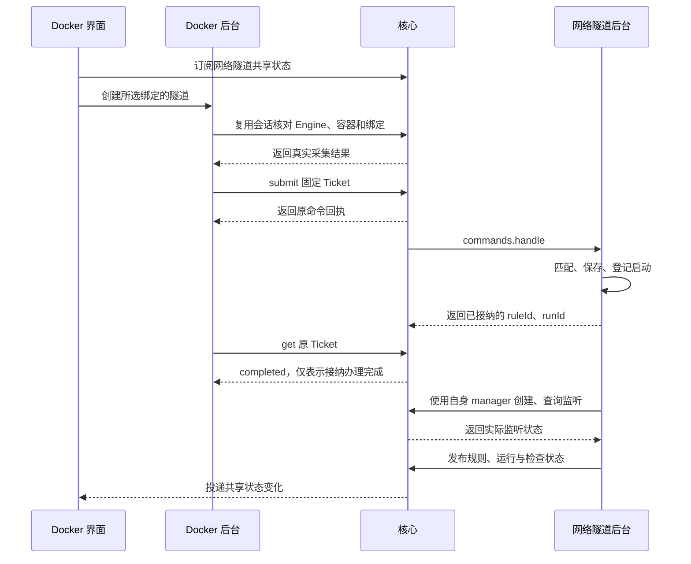

# Docker 端口一键创建网络隧道

状态：2026-11-21，功能与代码设计方案，尚未实现。用户已确认目标及沿用现有组件通讯机制，允许为此做范围受控的重构。本文合并功能、模块设计、业务契约、并发与生命周期、实施步骤及验收；不代表当前版本已经提供，也未指定发行版本。本次只编写方案，不修改产品代码。代码设计见第 15 节。

## 1. 目标与完成标准

面向正在排查或使用远端容器服务的运维人员。用户已经知道要访问哪个容器端口，应当能够在 Docker 页面直接建立本机入口，不再切换插件、记忆端口、手工填写同一台服务器及目标地址。

典型例子：远端容器 `web` 的 `80/tcp` 发布为服务器的 `0.0.0.0:8080`。用户点击对应端口行的「创建隧道」，得到本机实际入口，例如 `127.0.0.1:49152`。访问该入口，经当前服务器连接 `127.0.0.1:8080`，再由 Docker 已有映射进入容器。

正常路径的完成标准：

1. 从已展示的实际端口绑定出发，一次点击完成规则创建与启动，无需填写表单或再次确认。
2. 明确显示实际本机入口、远端目标和运行状态，支持复制入口。
3. 使用当前服务器已有认证会话及完整跳板链，不另存凭据。
4. 同目标已有可用规则时复用，重复点击不生成重复监听或规则。
5. 新规则出现在网络隧道插件中，后续启停、编辑、删除在那里完成。
6. Docker 来源页面关闭后，已经建立的隧道继续存在；断线及工作区结束按现有规则清理。

## 2. 第一版产品取舍

| 项目 | 本方案建议 |
| --- | --- |
| 「快捷键」的含义 | 端口旁的快捷按钮，以及容器对象菜单中的导航入口；首版不增加全局组合键 |
| 转发类型 | 只创建 TCP 转发，不创建 SOCKS5，也不把 UDP 当成 TCP |
| 容器范围 | 当前连接、当前 Engine 中，正在运行且存在实际发布绑定的容器 |
| 创建结果 | 保存规则并启动；只保存一条未运行配置不算一键流程成功 |
| 新规则的本机监听 | 固定默认 `127.0.0.1`，本机端口自动分配 |
| 远端目标 | 根据 Docker 实际发布地址和宿主机端口推导，不使用容器端口替代宿主机端口 |
| 正常路径确认 | 不增加确认框、授权或审批 |
| 创建后的页面 | 留在 Docker 当前页面，原行显示结果，不主动切换侧栏 |
| 连通性 | 启动后自动检查一次实际入口到目标的 TCP 可达性，分别显示监听与检查结果 |
| 规则保存 | 普通持久 TCP 规则；重连、重新打开工作区或重启后手动启动 |
| 已有规则 | 优先复用符合条件的规则，不改写其名称、配置或已运行监听 |
| 管理归属 | 网络隧道插件拥有规则和监听，Docker 提供入口及状态摘要 |

本机端口不优先占用容器端口或宿主机端口。多个服务器都运行 `8080`、本机已有同名服务时，自动分配可以直接使用。需要固定本机端口的用户，创建后通过「查看隧道」进入既有编辑流程。

此快捷入口明确创建 TCP 转发并自动分配本机端口，不继承网络隧道「手动新建」中可能配置的 SOCKS5 类型或固定端口默认值。复用既有规则时保留其原监听配置。

## 3. 入口与页面内容

### 3.1 主入口：容器详情的「端口」分区

将端口分区中的实际绑定整理为可读的端口行。保留容器端口、协议和服务器发布地址，增加本机隧道摘要与动作。不再要求用户从一段 inspect JSON 中识别 HostIp 和 HostPort。

示意内容，地址均用于说明：

| 容器端口 | 服务器发布地址 | 本机隧道 | 动作 |
| --- | --- | --- | --- |
| `80/tcp` | `0.0.0.0:8080` | 尚未创建 | 创建隧道 |
| `443/tcp` | `127.0.0.1:8443` | `127.0.0.1:49153` · 运行中 · TCP 可达 | 复制入口；查看隧道 |
| `5432/tcp` | 未发布 | 无法快捷转发 | 显示原因 |
| `53/udp` | `0.0.0.0:5353` | 不支持 UDP 隧道 | 显示原因 |

规则：

- 一条实际绑定对应一个动作。一个容器端口发布到多个地址或端口时分别列出，不替用户选其中一个。
- 同一实际绑定重复出现在采集结果中时去重。IPv4 和 IPv6 是不同绑定，不合并成一个自动选择目标。
- 点「创建隧道」前即可看到服务器发布地址；必要时通过紧邻说明展示规范化后的远端连接目标。
- 启动后本机入口可以选中、复制，使用等宽展示；不能复制尚未获得的端口 `0` 或旧运行实例的地址。
- 不根据 `80`、`443` 等端口号猜测 HTTP/HTTPS。首版只复制 `host:port`，不自动打开浏览器、不自动添加 URL 协议。
- 无实际绑定时明确显示原因，不用一个没有解释的禁用图标代替。
- 原始端口字段仍可作为只读信息查看，不能从已截断的展示文本反向解析操作参数。

### 3.2 辅入口：Docker 容器对象菜单

容器右键菜单、选中行「更多」和 Shift+F10 的同一对象菜单中增加「端口隧道…」。点击后打开或定位该容器详情的「端口」分区。

该入口负责定位，不会自动选择第一个端口并启动。即使只有一个端口，也保持一致的导航语义；真正的一键动作始终位于明确的端口行上。

没有发布端口的运行中容器仍可进入查看原因。未运行容器显示状态限制，不能借此自动启动容器。

### 3.3 结果与管理入口

- 正常创建不打开编辑表单，也不展开网络隧道侧栏抢占 Docker 所在位置。
- 已保存规则后提供「查看隧道」，用户主动点击时才展开网络隧道插件并定位该规则。
- 定位能够找到分页之外的规则；已有侧栏、选择和滚动状态按明确导航更新，未保存的编辑草稿不被覆盖。
- Docker 首版不复制网络隧道的编辑、删除、停止、流量图表与连接明细。需要这些操作时进入已有管理界面。

## 4. 远端目标推导

### 4.1 使用实际发布绑定

以当前容器 inspect 中的实际 `NetworkSettings.Ports` 绑定为准。`Config.ExposedPorts` 仅表示声明，`HostConfig.PortBindings` 仅有配置意图，都不能单独证明当前存在可用发布入口。

例如 `80/tcp → HostPort 8080`，目标端口为服务器的 `8080`。不得自动改用容器的 `80`、容器 IP、Docker 网桥地址或 Docker Engine 的 API 地址。

| Docker 实际 HostIp | 隧道的远端目标地址 | 说明 |
| --- | --- | --- |
| `0.0.0.0` | `127.0.0.1` | 从当前服务器回环访问 IPv4 发布入口 |
| 空字符串，且是有效实际发布绑定 | `127.0.0.1` | 按 Docker 空地址的 IPv4 通配绑定语义处理，须在真实环境覆盖验证 |
| `::` | `::1` | 从当前服务器回环访问 IPv6 发布入口 |
| 明确 IPv4 地址，如 `127.0.0.1`、`10.0.0.5` | 保留该地址 | 指定网卡发布不能一律改写为回环 |
| 明确 IPv6 地址 | 保留该地址 | 连接参数与显示格式分开处理 |
| 缺失、非法、需要但未提供作用域的地址 | 不提供快捷创建 | 明确提示绑定信息不可用于快捷转发 |

远端目标的地址族与本机监听地址族相互独立。例如本机 `127.0.0.1:49152` 可以通过服务器连接远端 `::1:8080`。

IPv6 对用户显示为 `[::1]:8080`；连接参数中的 host 不包含显示用方括号。不使用 `localhost` 替代明确 IP，以免解析到不同地址族。

### 4.2 多绑定与双栈

同一个 `80/tcp` 同时绑定 `0.0.0.0:8080` 和 `[::]:8080` 时展示两行，用户点哪一行就使用哪一种远端目标。选中 IPv6 后检查失败，也不自动回退到 IPv4；失败原因与对应绑定保持一致。

同一个容器端口发布为多个 HostPort 时同样分别展示。首版不提供「转发全部端口」或批量创建。

### 4.3 创建前重新核对

界面快照只用于展示，不能代替执行前核对。实际提交给网络隧道插件前，由 Docker 后台重新读取并确认：

1. 当前完整连接 Context 仍与用户点击时一致。
2. Docker endpoint、Engine ID、完整容器 ID 与点击时一致。
3. 容器仍处于允许创建的运行状态。
4. 用户选中的容器端口、协议、原 HostIp 和 HostPort 绑定仍然存在。

任一项变化则本次操作失败并要求刷新，不换成同名容器、不追随外部 Docker Context、不使用新分配的 HostPort 自动补建。端口绑定展示有截断、缺失或无法完整解析时，不允许从不完整条目创建；其他已完整读取的独立条目可以继续展示。

核对与最终 TCP 使用之间仍可能发生远端变化。隧道保证固定目标端点，不保证该端点之后始终由同一个容器或服务占用。

## 5. 新规则的内容与保存

| 内容 | 行为 |
| --- | --- |
| 服务器 | 当前工作区所属的保存服务器身份，不从表单重新选择 |
| 类型 | TCP 转发 |
| 本机监听 | `127.0.0.1`，配置端口为自动分配，运行后展示实际端口 |
| 远端目标 | 第 4 节计算并重新核对的明确地址与 HostPort |
| 名称 | `Docker · <容器名称> · <容器端口>/tcp → <HostPort>` |
| 持久化 | 使用网络隧道插件现有普通规则文件和保存机制，不保存认证资料及运行状态 |

名称过长按现有规则允许长度截取；名称不作为去重键、容器身份或规则身份。复用手工创建的规则时，不自动改名。

首版不增加 Docker 专用规则类型、不维护第二份规则存储，也不建立容器与规则的强制绑定。自动名称用于识别来源，规则本质仍是固定服务器端点的普通 TCP 转发。

规则详情说明：「此规则转发固定服务器端口；容器端口变化后不会自动更新。」容器停止、改名、删除或重建不会自动修改、停止或删除该规则。用户可以按普通规则编辑和删除。

创建次序为：准备网络隧道自己的管理归属 → 保存规则 → 提交启动 → 确认实际运行 → 检查一次 TCP 可达性。保存失败时不得启动；保存成功而启动失败时保留规则，并明确显示「规则已保存，启动失败」。

## 6. 已有规则的匹配与复用

### 6.1 候选条件

自动复用的规则须同时满足：

- 属于当前服务器，类型为 TCP 转发。
- 远端目标地址规范化后完全相同，目标端口相同。
- 本机绑定地址为明确回环 IP。可以复用固定本机端口，也可以复用自动分配端口。
- 保存的类型、bind 和 target 与实际运行配置相符，且运行实例属于当前完整连接 Context；仅名称修改不改变转发目标。

目标 IPv4 与 IPv6 不视为等价，`localhost` 与 `127.0.0.1` 不通过 DNS 推测等价，服务器不同也不复用。名称不同不影响匹配。

绑定 `0.0.0.0`、`::` 或其他非回环本机地址的既有规则不属于快捷自动复用候选。保持原规则运行，快捷创建可以另建默认回环规则；反馈中说明「已有非回环监听规则，本次使用独立本机入口」，不暗中扩大新入口的监听范围。

### 6.2 决策顺序

| 现有情况 | 快捷入口行为 |
| --- | --- |
| 唯一符合条件、已确认运行的规则 | 显示并复用实际入口，不新增、不重启 |
| 多个符合条件、已确认运行的规则 | 显示「选择已有隧道」，列出名称、本机入口与运行状态，用户选择，不按名称或列表顺序猜测 |
| 没有运行项，但有启动中、停止中、状态待确认或尚未清理完成的相关规则 | 显示其现有状态并引导查看，不补建另一条规则绕过未确认操作 |
| 相关规则仍由另一个工作区或连接代次持有 | 显示「规则正在其他连接上下文运行」，不能接管、重启或把旧入口作为本次连接结果；先在原归属处理并确认释放 |
| 没有运行项，唯一符合条件且已停止、清理完成的规则 | 显示「启动隧道」，点击后启动原规则，不新增 |
| 没有运行项，多个符合条件且已停止的规则 | 显示「选择已有隧道」，选择后明确启动该规则 |
| 没有候选，也不存在相关未确认启动意图 | 显示「创建隧道」，保存并启动新规则 |

存在已确认的运行规则时优先使用它，不因为另有已停止规则而要求选择。若可选运行规则不止一个，才需要用户选择。

多个候选选择属于已有配置歧义处理，不属于授权或审批。选择界面保留明确的服务器目标和本机入口；Esc 关闭并返回原端口按钮，不产生操作。

### 6.3 配置编辑与运行配置不一致

网络隧道允许保存新配置而不改变现有监听。因此匹配必须同时识别保存配置和实际运行配置：

- 保存目标已经变更，但旧运行仍指向当前端点时，不能假装该规则配置仍一致。
- 保存目标匹配，但当前监听仍使用另一份旧目标或旧绑定时，不能直接把该入口当成正确结果。
- 上述情况显示「配置已修改，需在网络隧道中处理」，提供定位入口；不自动停止、重启、覆盖草稿或创建替代规则。
- 编辑后的本机绑定为非回环地址时，不通过快捷入口启动它。

在多个窗口或页面同时点击同目标时，匹配、规则保存及启动意图登记必须作为同一目标的串行决策。两次不同请求也不能各自在旧快照上判断「不存在」而创建两条规则。

## 7. 正常操作流程

### 7.1 首次创建

1. 用户进入容器详情「端口」，看到实际发布绑定与「创建隧道」。
2. 点击后，当前行立即显示「正在核对端口…」，禁用重复提交，其他已读内容仍可浏览。
3. Docker 后台完成第 4.3 节核对，经核心命令将固定目标交给网络隧道插件。
4. 网络隧道插件重新判断候选，必要时保存规则并启动；UI 依实际阶段显示「正在保存规则…」「正在启动…」。不添加人为等待。
5. 只有实际监听确认运行且获得真实地址时，显示本机入口，启用「复制入口」和「查看隧道」。
6. 同时自动进行一次实际入口的 TCP 检查。检查结果更新当前行，不阻塞已取得入口的复制。
7. Docker 保持当前页面、端口、滚动位置和焦点。普通成功使用行内反馈，不弹系统通知。

### 7.2 启动或复用已有规则

已停止规则点击「启动隧道」仍需先核对当前 Docker 身份和端口，再由网络隧道插件判断原监听已清理后启动。新一次自动端口分配可能得到不同本机端口，界面只展示本次实际地址。

规则已经运行时，展示实际入口与「复制入口」；复制不创建、不启动，不会因为用户复制而对 Docker 再执行业务命令。创建请求抵达时恰好发现其他页面已经启动同目标规则，应返回复用结果。

### 7.3 调整本机端口

通过「查看隧道」进入普通管理界面后，用户可以编辑名称、监听地址或固定端口。继续遵守当前产品的「保存只改配置；停止并确认清理后再启动才应用」规则，不增加隐式保存并重启。

如果用户将目标或本机监听改成不再符合快捷复用条件的配置，Docker 下次刷新按真实状态重新匹配，不依赖旧名称或旧 ruleId 强行关联。

## 8. 状态与反馈

| 行内状态 | 显示及允许操作 |
| --- | --- |
| 尚未创建 | 显示实际目标与「创建隧道」 |
| 已保存、未运行 | 「启动隧道」「查看隧道」 |
| 核对中／保存中／启动中 | 显示实际阶段，禁止同一意图重复提交；已知 ruleId 后可查看 |
| 运行中、检查中 | 显示实际入口，「复制入口」「查看隧道」，说明「正在检查目标 TCP…」 |
| 运行中、TCP 可达 | 显示「隧道运行中 · TCP 可达」及检查时间 |
| 运行中、检查失败 | 显示「隧道已启动，目标暂不可达」及原因；保留入口、规则和监听，可在管理界面重新检查 |
| 启动失败，已确认清理 | 显示失败原因与「重试启动」「查看隧道」，重试使用原规则 |
| 启动或运行状态待确认 | 保留已知规则和最后观测信息，停用入口复制及创建／启动，提供「查询状态」「查看隧道」 |
| 停止中、清理未完成 | 显示真实状态；不得启动第二次、删除或视为已释放 |
| 已停止并清理完成 | 清除可用入口，显示「启动隧道」；原地址如作为历史信息展示，必须标为已失效 |
| Docker 信息待刷新 | 禁止创建和重新启动；已确认仍运行的隧道可查看、复制，但标注「Docker 端口信息待刷新」 |
| 容器已停止／已删除／绑定已变化 | 禁止根据旧绑定创建或重启；已运行固定端点规则仍可查看，不能标成容器服务仍可用 |

本机监听运行、远端 TCP 可达、容器应用健康是三个不同事实。TCP 检查不验证 HTTP 响应、数据库登录、TLS 证书或应用健康；「检查未完成」不能展示成「服务可用」。

自动检查每次明确创建或启动执行一次。复用已运行规则展示最近检查及时间，没有检查则标为「未检查」；普通刷新不重复探测。复制失败只报告剪贴板错误，不改变隧道状态或重建规则。

行内状态沿用核心 `sharedState.v1` 的读取和订阅，由网络隧道插件发布、Docker 按完整 Context 消费。首次进入或投影失效时重同步，不为每一行创建独立常驻轮询，也不为每次状态刷新提交新的业务命令。隐藏 Docker 页面后停止界面消费并释放不再需要的页面订阅；后台已接纳的启动与隧道继续运行。状态更新保留端口行、焦点及用户选择，不反复宣布相同成功信息。

## 9. 重复点击、超时与并发

- 一次点击对应一个固定请求编号和完整输入，贯穿提交、等待、查询及 Surface 重挂载。
- 按钮连点、网络超时后的查询、页面重新挂载不得生成新意图补执行。
- 通信超时显示「创建结果待确认」，查询原请求并核对网络隧道中的真实规则和运行状态。
- 明确未发送、或已确认原动作结束且监听清理完成后，用户才可发起新的重试。仍按目标匹配，避免重复配置。
- 请求回执完成与实际监听状态分开解释。规则登记或启动请求被接纳，不得提前显示「隧道已启动」。
- 核心命令的原编号、输入一致性、连接代次和关闭保留规则继续适用，不增加离线队列、自动重放或插件自动启动机制。
- 网络隧道规则在其他页面被编辑、删除或启动时，提交前重新检查规则修订及运行事实，返回实际复用结果或明确冲突。
- 同一个目标有待确认操作时，不提供「换个本机端口再试」绕过它。

## 10. 生命周期与资源归属

| 事件 | 预期行为 |
| --- | --- |
| 收起 Docker、切换标签或卸载 Docker 的 Surface | 已接纳任务和运行隧道保持；回到页面查询原结果 |
| 关闭创建来源的 Docker 详情 | 已完成交接的隧道归网络隧道插件继续管理，不随来源关闭 |
| 来源在交接前关闭 | 核心尚未分发的命令可被撤销；处理者已接收并开始办理后，按已交接操作处理，不承诺撤销副作用或用迟到回调补建 |
| Docker 插件异常退出或停用生效 | 网络隧道插件已经拥有的规则和监听继续按其自身生命周期运行 |
| 收起网络隧道侧栏或移窗 | 不结束逻辑管理视图，保留原监听与实际本机端口 |
| 关闭网络隧道所属逻辑管理视图 | 按其现有生命周期停止所属监听，Docker 下次查询显示真实停止／清理状态 |
| 容器停止、暂停、删除、重建或绑定改变 | 不自动操作普通隧道规则；Docker 显示来源变化，既有端点可能不可达或由其他服务占用 |
| 当前连接断开 | 释放本次运行资源，规则配置保留；旧本机入口失效 |
| 重连、工作区重开或应用重启 | 不自动启动，用户重新操作时核对新 Context 和当前容器绑定 |
| 工作区关闭、网络隧道插件退出或应用退出 | 按既有生命周期释放监听、连接、转发与探测资源 |

网络隧道插件创建和运行所需的逻辑管理视图必须能在后台存在。用户此前从未打开该侧栏，也应完成一键流程。运行资源不能登记在 Docker view 下，也不能依赖网络隧道 iframe 保持挂载。

核心把命令交给网络隧道处理者、处理者核对自身 manager 归属并接纳办理后，即进入交接后的阶段。现有协议不向处理者提供来源关闭的逐阶段取消令牌，因此不能承诺「关闭 Docker 时，尚未落盘就一定取消」。关闭 Docker 不等于取消已经交接的副作用；若回执因关闭失效，用户仍能在网络隧道中找到实际已保存规则和状态。网络隧道自身的 manager 或 Context 关闭仍须阻止新监听接纳并清理已有资源。

## 11. 不可用与失败处理

| 情况 | 产品行为与建议文案 |
| --- | --- |
| 未安装／未启用网络隧道插件 | 保留可解释的入口，显示「需要启用网络隧道插件，重启后可用」；实际识别为未安装时提示安装，不自动安装或启用 |
| 已启用，但提供者未就绪或已退出 | 「网络隧道插件当前不可用，请检查插件状态」；允许重查，不转投其他实例 |
| 旧版插件没有所需命令，或核心缺少必要能力 | 「当前版本不支持从 Docker 创建隧道，请升级对应组件」；Docker 其他功能继续使用，不降级为自行创建监听 |
| 命令存在多个处理者 | 明确报告提供者不唯一，不按加载顺序选择 |
| 服务器未连接／连接代次改变 | 「连接已变化，请刷新后重试」；不把旧意图迁移到新连接 |
| 容器非运行状态 | 显示「容器未运行，无法创建端口隧道」；不自动启动或恢复容器 |
| 仅有 EXPOSE，实际没有发布 | 「此端口未发布到服务器，暂不支持快捷创建」 |
| UDP、SCTP 等非 TCP 协议 | 「当前快捷隧道仅支持 TCP」 |
| host 网络、macvlan／ipvlan、共享网络命名空间等没有实际发布绑定 | 解释「没有可用于快捷创建的发布绑定」；不猜测进程端口、其他容器的映射或容器 IP |
| Docker Desktop／rootless 的发布入口无法由当前服务器访问 | 保留真实启动和检查结果，不自动进入 WSL、不切换网络、提权或改 Docker 配置 |
| 容器或端口绑定在点击后变化 | 「端口绑定已变化，请刷新后重新选择」；不自动换目标 |
| 规则文件损坏、只读、达到数量或容量限制 | 保存失败时不启动、不覆盖原文件；说明实际原因。已存在且可安全复用的运行规则仍可显示 |
| 本机监听失败 | 新规则保留；说明真实原因。复用固定端口规则发生占用时，不改成随机端口绕过原配置 |
| 启动后目标 TCP 不可达／检查超时 | 「隧道已启动，目标暂不可达／检查未完成」；不删除规则、不关闭正常监听，不自动换地址族或端口 |
| 停止或启动结果待确认 | 显示待确认，查询原状态；未确认清理前禁止再次启动或删除 |
| 对应规则已在其他页面删除 | 清除旧规则关联，重新匹配；用户再次明确点击才允许新建 |

原始错误提供可读摘要，避免把凭据、整份 inspect、环境变量或完整容器日志放入提示或普通日志。重要消息继续使用现有机制，普通行内失败不自动触发系统通知。

## 12. 插件协作与兼容边界

### 12.1 职责

| 组件 | 本功能承担的职责 |
| --- | --- |
| Docker 插件 | 展示端口；解析绑定；核对 Engine、容器、连接及绑定身份；提交明确目标；展示规则摘要和原请求结果 |
| 网络隧道插件 | 提供创建／复用并启动、状态读取和管理定位行为；管理目标去重、规则持久化、监听、检查与清理 |
| 核心 | 提供版本化命令路由、真实来源及 Context、逻辑视图与显示定位、通用网络资源和生命周期保护 |

插件之间通过核心 API／命令协作，不直接调用对方进程、不读取对方配置文件。Docker 不发 SSH 转发命令、不自行持有监听，也不直接依赖某一种远程传输实现。

网络隧道接受的是普通 TCP 目标及建议名称，不理解 Docker inspect、不解析容器，也不需要依赖 Docker 插件。规则和通用创建行为不以 Docker 专用接口命名。

### 12.2 后续实现需要明确的业务契约

本方案定义三类协作行为，复用现有命令、共享状态和视图能力；具体业务字段、主题及版本在实施时写入正式插件 API 文档：

1. 创建或复用并启动：输入固定目标及建议名称，返回原请求标识、规则标识、创建或复用结果、真实启动阶段和可用时的实际本机入口。
2. 读取与订阅：网络隧道通过 `sharedState.v1` 发布规则摘要、实际运行与检查状态，以及必要的修订和观测信息，Docker 按目标或规则匹配；读取不得产生规则、启动监听或触发探测。持续状态不用 `commands.get` 代替，也不通过不断提交新命令来轮询。
3. 查看：在用户主动操作时定位网络隧道自己的管理视图和对应规则，不覆盖编辑草稿，不通过刷新自动夺取焦点。

原命令回执只表示该次动作，持续状态由网络隧道自己的真实运行记录提供。完整 Context 来自核心绑定，不信任调用方自报来源插件身份。

### 12.3 与当前实现的差距

2026-11-21 进一步核对源码后，现有通讯与工作台机制可以承接本方案，无需另建组件通讯框架：

- `commands.v1` 已支持业务命令发现、异步路由、原请求去重及结果查询，Docker 的 `terminal.open.v1` 是既有用例。网络隧道需要新增普通 TCP 转发的业务处理接口；不同来源请求的同目标去重仍由网络隧道负责，不能误认为核心按 requestId 去重已经覆盖。
- `sharedState.v1` 已支持按完整 Context 发布、读取与订阅自定义主题。网络隧道需要定义并发布自己的状态摘要，Docker 消费；不把一次命令回执当成持续运行状态，也不不断创建查询命令消耗命令回执额度。
- `ui.background.v1` 与 `backgroundOnWorkspace` 已支持不显示页面的 sidebar + perWorkspace 逻辑视图。网络隧道 manager 需要启用并接入该模式，在自己的后台视图上运行隧道；后台初始化先于业务启动，尚未就绪时保留原意图等待或明确返回未就绪，不在等待时持有整个插件状态锁。
- `ui.openView` 已支持处理插件打开或定位自己的单例视图。仅在用户主动点击「查看隧道」时使用，规则选择由网络隧道自己的导航状态完成；创建主路径使用后台逻辑视图，不通过打开侧栏完成初始化。

主要工作在两个插件的业务接口、状态契约和界面接入。后台视图初始化时序、来源关闭、单例已位于其他窗口时的主动定位及移窗衔接仍需集成验证；只有复现现有通用能力的具体缺口时才调整核心，不把 Docker 规则移入核心。

新入口按实际能力发现启用。缺少支持时清楚说明升级需求，Docker 其他功能及未升级网络隧道插件的手动功能保持。新版网络隧道明确要求本方案使用的核心能力，不另做古老核心降级实现；当前核心已经提供这些能力。插件仍独立发行，不要求所有插件或核心联动更新。

## 13. 首版范围之外

- 容器未发布端口的直接访问，包括自动连接容器 IP、创建中转容器、修改 Docker publish 或重新创建容器。
- host 网络进程发现、Compose 服务推断、Swarm ingress 或其他调度系统的服务发现。
- UDP、SCTP、反向转发、HTTP 代理、系统代理和自动重连。
- 一次转发整个容器／Compose 项目、端口批量操作和全局组合键。
- 根据端口猜测协议、自动打开浏览器、修改 HTTP Host／TLS SNI 或处理证书。
- 容器生命周期与隧道自动联动、规则自动迁移／删除、永久保活及服务健康监控。
- Docker 内完整的网络隧道管理器，以及插件权限、审批、市场或新的生产依赖。

## 14. 验收场景

验收以可观察行为为准。源码或模拟测试不能替代真实网络字节传输和目标平台包启动。

| 编号 | 场景 | 必须满足的结果 |
| --- | --- | --- |
| A01 | 运行中容器 `80/tcp` 发布至 `0.0.0.0:8080`，首次点击 | 只保存一条 TCP 规则；远端目标为 `127.0.0.1:8080`；本机为回环随机端口；通过实际入口收发测试数据 |
| A02 | 网络隧道侧栏从未打开 | 一次点击仍可运行；管理归属属于网络隧道；Docker 页面、侧栏位置和焦点保持 |
| A03 | 发布至远端特定 IPv4 地址 | 保留指定地址，不误写为回环，不修改远端发布配置 |
| A04 | IPv6 通配／特定绑定、双栈及空 HostIp | 分别验证目标推导、正确显示和实际传输；双栈不合并或自动回退；不支持的真实环境如实记录 |
| A05 | 多个 HostPort、多个容器端口 | 对应行创建对应目标，不能总是选择第一个绑定 |
| A06 | EXPOSE 未发布、非 TCP、host 网络无发布绑定 | 解释具体原因，不启动监听，不猜测端口或容器 IP |
| A07 | 已停止、暂停、正在重启或删除的容器 | 禁止新建／重启快捷规则，不自动改变容器状态 |
| A08 | 旧快照之后容器重建、Engine 更换、绑定改动 | 执行前拒绝旧输入，不操作同名新容器或新绑定 |
| A09 | 同目标唯一运行规则、唯一已停止规则，或其他连接上下文仍持有的规则 | 当前上下文运行项复用入口，已停止项启动原规则；其他上下文不得接管，规则数保持不变 |
| A10 | 多条可用规则 | 确认运行项优先；同优先级有歧义时明确选择，不任意猜测 |
| A11 | 手工固定回环端口规则及非回环监听规则 | 前者满足条件即可复用且不改配置；后者不自动启动或复用，新的快捷规则仍仅监听回环 |
| A12 | 保存配置与实际运行版本不一致 | 提示在管理界面处理，不把旧监听误认为新配置，不自动重启 |
| A13 | 连点、两个窗口同时创建同目标 | 最终只有一条新规则与一个监听；其他请求明确复用、加入已有启动，或因配置写入繁忙拒绝且不执行 |
| A14 | 保存失败／规则文件损坏或达到限制 | 不创建新监听、不覆盖原文件；已有运行规则的状态仍真实可见 |
| A15 | 已保存但本机绑定失败 | 保留一条规则，显示启动失败；确定清理后可按原规则重试，不新增重复规则 |
| A16 | 监听正常而目标拒绝连接、检查超时或应用未就绪 | 区分启动与检查状态，保留入口；TCP 可达也不能报告应用健康 |
| A17 | 提交回执丢失、超时、重挂载 | 查询同一请求，不能自动用新编号补建；状态未知时禁止新启动 |
| A18 | 未安装、未启用、旧版本、退出或多处理者 | 明确不可用原因，Docker 其他功能正常，不直接绕过插件执行转发 |
| A19 | 关闭 Docker 页面或 Docker 插件退出 | 已交接隧道继续使用，在网络隧道中能定位、停止和删除 |
| A20 | 收起网络隧道、同窗切换、跨窗移动 | 隧道及实际本机端口保持，不因 Surface 变化重复建立 |
| A21 | 连接断开、重连、关闭工作区及网络隧道退出 | 资源按实际清理完成释放；旧端口不能继续显示为可用；重连不自动启动 |
| A22 | 在网络隧道中编辑、停止、删除对应规则 | Docker 摘要随真实状态更新，旧入口和旧关联不继续可操作 |
| A23 | 容器停止、重建并占用原 HostPort | 普通规则不自动迁移或删除；页面明确固定端点语义，不承诺持续绑定原容器 |
| A24 | 查看分页之外的规则，且存在编辑草稿 | 正确定位目标规则，不覆盖草稿；重复查看不重复创建管理视图 |
| A25 | 三主题、窄页面、键盘和辅助技术 | 表格或堆叠行可读；完整地址可获得；Tab、Enter／Space 和 Esc 可用；状态不只依靠颜色，更新不丢焦点 |
| A26 | 本机与远端地址族不同、真实跳板连接 | 通过实际本机入口收发数据，复用当前跳板链，不另建认证路径 |
| A27 | 升级前后及旧插件组合 | 新能力按可用性启用，既有规则仍可读写，手动新建／编辑／启停语义保持 |

客户端交付覆盖 Windows x86_64／ARM64、Linux x86_64／ARM64、Apple Silicon macOS ARM64 五种正式目标，核心与受影响插件分别编译、打包，并验证实际包内程序启动与退出；ARM64 使用原生 ARM64 产物。

远端兼容单独记录 Linux Engine、rootless、Docker Desktop 发布端口及 Windows Engine 的真实验证范围。已有客户端包验收或其他 Docker 功能通过，不能替代本功能的远端发布入口和字节传输验证；未取得环境的组合保留为未完成项。

## 15. 代码方案设计

### 15.1 总体决定与重构边界

沿用 `commands.v1`、`sharedState.v1`、`ui.background.v1` 和 `ui.openView`。创建是命令，当前事实是共享状态，监听归网络隧道自己的后台 manager；这四种职责不混用。

本次范围重构解决两个现存耦合点：

1. 网络隧道的手动操作目前直接在 `main.rs` 中读写 `App`，持久化和启动逻辑依赖 UI 处理分支。抽出插件内部的统一业务服务，手动界面和跨插件命令必须走同一入口。
2. Docker 的 `runtime::Job` 通过动作字符串及 `terminal_input`、`terminal_ticket` 等专用字段承载终端协作。把终端和隧道的命令办理提取为有类型的协作任务，整理任务载荷，避免继续堆叠字符串分支和互斥可选字段。

不重写核心路由、不新增事件总线、数据库、通用工作流、插件 RPC 框架或跨插件服务容器。不把网络隧道业务放进通用 `plugin-client`，两个插件也不相互引用 crate 或源码。现有 SDK、Rust 标准库和已声明依赖足够；网络隧道内部的类型使用手工 JSON 边界转换，不为本次重构新增 serde 等生产依赖。

正常路径的时序如下。图中的网络隧道后台包含 Service 和现有 runtime；发布的记录由 publication 线程发送。



### 15.2 模块结构

网络隧道拟调整为：

| 文件 | 职责及变化 |
| --- | --- |
| `plugins/network-proxy/src/main.rs` | 初始化、能力识别、启动已有运行线程与固定发布线程、分发到 UI／业务命令；不包含具体规则变更逻辑 |
| `plugins/network-proxy/src/service.rs`，新增 | 统一拥有状态并办理保存、删除、启动、停止、检查、ensure 和 manager 生命周期；候选选择与副作用次序的唯一权威 |
| `plugins/network-proxy/src/rules.rs` | 规则、绑定和目标的类型及校验；配置快照的读取与原子写入；保留文件 schema 1、数量／容量限制及损坏保留行为 |
| `plugins/network-proxy/src/runtime.rs`，由 `manager.rs` 收束迁移 | `Run`、`Peer`、监听生命周期与 TCP／SOCKS5 驱动；保留当前 tick 和 request 身份核对，不处理 UI 草稿或 Docker 信息 |
| `plugins/network-proxy/src/ui.rs`，新增 | 既有 `ui.*` 协议、草稿、分页、导航和 metadata 投影，所有业务变更调用 Service |
| `plugins/network-proxy/src/commands.rs`，新增 | 两个业务命令的名称、输入解析、输出编码及错误映射；调用 Service，不另存规则或运行状态 |
| `plugins/network-proxy/src/publication.rs`，新增 | 从 Service 投影共享状态，合并待发布变化，处理 CAS、超时与生产者结束；不参与匹配或启动决策 |
| `checks.rs`、`socks5.rs` | 继续提供现有探测与 SOCKS5 状态机；检查调度统一进入 Service，不重新实现探测 |

Docker 拟调整为：

| 文件 | 职责及变化 |
| --- | --- |
| `plugins/docker/src/ports.rs`，新增 | 完整 inspect 到结构化端口的纯解析、规范化、绑定身份与不可用原因；无 RPC 和监听逻辑 |
| `plugins/docker/src/collaboration.rs`，新增 | 终端／隧道两类协作意图、固定 Ticket、提交／查询与结果解释；复用既有容器核对和任务线程 |
| `plugins/docker/src/runtime.rs` | 保存有界端口目录和协作意图；用有类型任务调用解析、核对及协作模块；保留现有采集、维护和刷新职责 |
| `plugins/docker/src/main.rs` | 接入端口事件、协作事件及详情分区导航；不直接发送网络能力调用 |
| `plugins/docker/ui/ports.js`，新增 | 端口行、候选选择、共享状态订阅、行内反馈与生命周期；调用既有 UI 桥 |
| `plugins/docker/ui/view.js`、`browser.js` | 挂接端口控制器和菜单导航；其余详情、树、日志交互保持原职责 |

清单、HTML、CSS、打包资源列表、回归夹具与正式文档随实际受影响范围修改。新增模块只服务当前明确职责，不按每个类型或方法继续拆文件。

### 15.3 类型与单一事实来源

网络隧道内部引入少量明确类型：

- `Rule`：持久配置，包含 id、serverId、revision、name、类型、bind，以及 TCP 的 target；SOCKS5 没有固定 target。
- `BindAddress`：本机 IP 与配置端口，端口 0 只在这里表示自动分配。
- `TcpTarget`：明确目标 host 与非零端口。手动规则继续支持现有域名；ensure v1 只接收明确 IP，不做 DNS 等价推断。
- `TargetKey`：serverId、规范化 IP、目标端口，用于本次快捷协作匹配；运行复用另外核对完整 Context。
- `Run`：所属 manager／Context、启动时固定的 Rule、核心操作身份、真实监听快照、停止意图及查询错误；不把这些字段压缩成一个猜测状态。
- `EnsureDecision`：纯决策结果，表示复用、加入已接纳启动、启动原规则、新建、需要选择或不可执行。

`State` 中的规则与运行记录是唯一业务事实。文件只是配置持久副本，共享状态和 UI catalog 都是投影，不能反向驱动业务决策。核心返回的不透明网络快照继续保留为 JSON；不为重构把每个核心字段重新建一套类型。

新规则 ID 使用插件本地的受检序号及启动时唯一前缀，并在变更门内对持久规则查重；不使用容器名、目标端点或截断 commandId 充当 ID。runId 在当前 producer／Context 内唯一，所有关联同时核对 producer、Context 和 runId，不单独信任一个字符串。

持久规则只在 JSON 边界解码和校验一次，内部不再到处使用 `r["target"]["port"]`。旧文件、旧 UI 草稿、现有检查和手工操作的校验迁移到同一套类型，不保留新旧两条保存路径。

### 15.4 Service 的并发与持久化

采用现有同步线程模型，不引入 async runtime 或 actor 框架。Service 使用两个职责明确的锁：

1. `state: Mutex<State>`：保护短时内存读取与提交；任何磁盘操作、RPC 和等待都不能持有它。
2. `change_gate: Mutex<()>`：串行化规则保存、删除、ensure，以及明确的启动接纳。办理入口使用 `try_lock`；已有配置事务时返回 `changeBusy`，不让全部 SDK worker 排队等待磁盘。

持久化写入使用以下固定次序：取得变更门 → 在 state 下核对规则修订和归属、构造完整候选配置 → 释放 state → 按当前原子保存机制写候选 → 重新取得 state 提交已落盘规则 → 再核对 manager／Context／停止意图，登记启动 → 释放变更门。

磁盘写失败时内存配置不改变，也不启动监听。磁盘已成功、但 manager 在此期间结束时，提交已经落盘的普通规则，返回「已保存但未启动」，不能丢掉落盘事实或启动到另一个 Context。写入期间登记有界的当前变更信息供关闭／busy 处理，结束后清除，不建立持久任务队列。

停止、manager 关闭标记与核心清理回执使用短时 state 操作，不等待 `change_gate`。它们必须能在磁盘写入或后台 RPC 阻塞时登记；写入后的启动阶段再次核对这些标记。删除只能在原监听明确 cleanupComplete、release 已确认且查询没有错误后办理。

运行 tick 继续使用现有「锁内取得固定请求 → 锁外 RPC → 锁内按同一 request 身份合并」模式。配置修改不改写 Run 内固定的启动配置。`start` 的状态检查、操作序号、request 登记在同一次 state 临界区完成；两个来源不能同时看到「尚未运行」再各自启动。

编辑草稿另有本地 draftRevision。保存捕获固定草稿，落盘后只有草稿仍为同一版本才清除 dirty；用户在写入期间输入的新草稿不能被旧保存回执覆盖或标成已保存。文件修订、草稿修订与 Run 启动修订各有职责，不混为一个计数。

这样同目标并发由网络插件自身串行决定，手动保存／启动也在同一范围内；不另外维护易失步的目标索引。现有最多 256 条规则，直接有界扫描足够。

### 15.5 创建命令契约

拟新增 `network.tcpForward.ensure.v1`，以 `commands.v1` 承载。输入为：

```json
{
  "version": 1,
  "target": {"host": "127.0.0.1", "port": 8080},
  "suggestedName": "Docker · web · 80/tcp → 8080",
  "selectedRule": null
}
```

存在用户明确选择时，selectedRule 为 `{id,revision}`。完整 Context、commandId 与真实来源由核心信封提供；payload 不包含 serverId、凭据、Docker 命令、Engine socket 或需要网络插件解释的容器信息。

校验规则：已知字段类型错误、未知 version、非法／通配／缺少必要作用域的目标 IP、零端口及超长名称明确拒绝；名称使用既有 128 字符限制。总 payload、结果继续遵守现有 16 KiB 限制。未知可选字段忽略，不将其解释为行为开关。

创建命令只完成本地业务接纳，不在 handler 内调用网络 RPC 或等待约 11 秒的 TCP 检查。正常结果例如：

```json
{
  "version": 1,
  "outcome": "accepted",
  "disposition": "created",
  "ruleId": "opaque-rule-id",
  "ruleRevision": 1,
  "runId": "opaque-run-id",
  "state": "starting"
}
```

disposition 为 `created`、`started`、`reused` 或 `joined`。`joined` 只表示加入已有、已明确登记且没有查询错误的同目标启动，不发出第二次 create。`runId` 是用于关联本次运行的 opaque 标识，不能当成资源操作权限；核心实际监听／操作身份仍由网络插件私有持有。

`commands.get` 的 completed 表示上述接纳或决策已经办理，不等于 listener running，也不等于 TCP 可达。实际监听失败和检查失败随后进入共享状态。ensure 不打开页面，不能在结果顶层返回 `viewId`，因为核心会把它解释为该命令已经关联登记的页面。

另外两种有业务意义的结果也使用对象返回：

- `outcome:"selectionRequired"`：含目标与候选数量，不执行副作用。Docker 从共享规则摘要展示候选，用户带 selectedRule 发起新的明确意图；不把最多 256 条候选塞进命令结果。
- `outcome:"savedNotStarted"`：含 ruleId、revision、reasonCode 和可读说明，表示保存已经发生但启动未接纳。UI 不把它显示为成功运行，也不根据失败错误码猜测是否落盘。

没有副作用的参数、版本、存储或状态拒绝使用结构化错误 code/message，例如 invalidParams、managerNotReady、changeBusy、ruleConflict、tunnelBusy、tunnelStateUnknown、storageUnavailable、resourceLimit。错误映射遵循核心现有转发行为，不依赖它目前不会透传的任意 error.data 附加字段。

同一 Ticket 的重复 submit/get 由核心返回原回执。通信超时保留原 Ticket；不得把缺少回执解释为没有保存，也不生成新 requestId 自动执行。若无法用原回执和实际规则事实证明结果，就保留 unknown 并引导核对，不能声称所有通信中断都可自动恢复。

### 15.6 候选决策与重试

Service 的纯匹配函数同时读取持久配置和固定运行配置，按第 6 节顺序给出 EnsureDecision。命令和 UI 提示可以显示相同概念，但只有 Service 的再次判断能够接纳副作用。

selectedRule 不是跳过匹配的后门：其 id、revision、服务器、目标、回环绑定和当前运行配置都须重新核对。保存的类型／bind／target 与运行配置不一致、其他 Context 仍持有、停止中、cleanup 未完成或查询未知时明确拒绝；名称变化不要求重启，但 selectedRule 的 revision 仍须是最新值。

没有 selectedRule 而候选发生歧义时返回 selectionRequired；明确选择已经失效则返回 ruleConflict，不另选一条或新建。唯一正在运行的合格规则优先于停止项。唯一已接纳且无查询错误的启动可以 joined；其后停止或失败仍如实通过状态更新。

changeBusy 是明确未办理该次变更，不是排队成功。Docker 保留原目标、说明繁忙，等待已有状态更新或用户重试，不自动连发新命令。后续显式重试也必须从最新持久配置重新扫描。

已经 cleanupComplete 且 release 确认、查询正常的旧 Run 只作为历史展示，不再作为旧目标占用参与阻塞。规则改过目标并按要求停止清理后，应能按最新保存配置正常启动，不能被保留的历史 Run 永久锁住。

### 15.7 管理定位命令

拟新增 `network.rule.reveal.v1`，输入 `{version:1,ruleId}`。处理步骤为：Service 确认规则属于当前服务器 → 锁外使用带 commandId 的 `ui.openView` 打开或定位本插件 manager → 成功后在同一 manager／Context 中设置选中规则及实际分页偏移。

这个命令允许返回核心已经关联的 `viewId`。未保存的 rule-editor 草稿不修改，不借 openView 的 params 覆盖既有 manager 的业务状态。规则在定位期间被删除时显示已删除，不再创建。

沿用工作台既有单例位置：manager 位于另一窗口时不擅自移动它，也不新增强制激活操作系统窗口的机制。遵守原布局／交接拒绝与焦点规则；必要时提示用户切换对应窗口。跨窗真实行为列入集成验收，不把「已登记视图」写成「系统窗口已置前」。

### 15.8 共享状态契约与发布

拟定义两个版本化 topic，使用网络隧道 manager 作为唯一 producer：

| topic／key | 值与用途 |
| --- | --- |
| `network.tunnelService.v1`／`current` | version、ready、storage 状态、publishState（publishing／synced／limited）、observedAt；区分提供者未就绪、发布不完整及规则确实没有匹配项 |
| `network.tunnelRules.v1`／ruleId | 保存规则的 id／revision／name／type／bind／target，以及 runId、运行 Context 摘要、固定运行配置、真实状态、实际入口、canStart、cleanupComplete、released、queryError、最后观测时间与最近检查 |

只发布 Docker 做候选提示及状态显示所需的摘要，不发布凭据、客户端流、转发字节、跳板私密信息、整份 Docker inspect 或普通日志。单条摘要须满足 16 KiB 上限；过长错误只截取说明文本，不截断操作地址和身份字段后继续使用。

规则记录按 manager 的完整 Context 发布，最多对应现有 256 条配置；其他 Context 持有同一规则时只标注 ownedElsewhere，不发布其入口让当前上下文误用。SOCKS5 可以只发布类型及必要身份，不能成为 TCP 候选。配置写入错误与现有运行事实分开表达，存储不可写不抹掉仍有效的入口。

增加一个固定 publication 线程，使用容量 1 的唤醒通道合并变化，不为规则、View 或订阅各建线程。它从 State 截取有版本的只读发布计划，锁外调用 state.put/remove，再按本地版本确认是否已经同步；发生新变化时继续发布最新值，不重放中间历史。运行 tick 不因状态发布 RPC 变慢而停止处理已有监听。

发布者只保存每个仍存活记录的已知共享 revision／内容和待发布标记。put 回包丢失或 revisionConflict 后读取自己的记录：值已相同则采纳当前 revision，否则重取最新本地投影再写；不盲目递增 CAS。状态／配置改变立即唤醒，服务心跳每 5 秒，消费者 15 秒未见有效服务观测则标为过期；流量计量不触发面向 Docker 的高频广播。新契约的时间统一为 Unix 毫秒；存活服务的心跳不能替代某条 Run 的真实观测时间，旧观测仍标为过期。

sharedState 没有跨记录事务。本方案不另建多记录提交协议：共享记录用于展示和候选提示，最终创建／选择仍回 Service 做最新判断。初始快照、分页、分片、租约、ACK 和重同步直接复用现有 SDK。publishState 非 synced、投影失效、scope 断开／冻结或 producer 消失时，不以「没有记录」推断可以安全再启动。

命令的已知接纳结果不能因为共享副本暂未同步就被撤回或改成失败；先展示已保存／启动登记，实际入口等待真实 run 更新。不把 commandId 为 key 的长期操作历史复制到共享状态，命令历史留在核心回执中。

### 15.9 后台 manager 与生命周期

网络隧道清单为 manager 增加 `backgroundOnWorkspace:true`。后台只初始化状态、加载已有配置并准备服务，不自动启动任何已保存规则，也不调用 ui.openView 显示侧栏。

Service 通过核心实际 `ui.createView` 收到 manager 的 viewId 与完整 Context，建立 manager 归属；跨插件命令不能临时捏造一个 viewId 传给 net.*。核心后台初始化尚未完成时返回 managerNotReady，Docker 可在用户这次尚未提交的意图内等待就绪后重新 resolve；已 submit 的 Ticket 不能更换 requestId 偷偷重试。

`ui.beforeClose` 标记对应 manager／editor 冻结，UI 返回 busy／dirty 的真实信息；冻结阻止新用户变更，但不能拒绝核心关闭流程随后发起的 ui.save、状态读取及停止／清理。取消关闭后通过现有恢复事件接入 Service 解除冻结。隐藏、Surface 卸载不冻结或删除逻辑 manager。dispose 先阻止新的启动，再为其 Run 登记停止，清理确认前不释放运行记录或复用监听身份。

Context 更新必须是一个显式 Service 方法：停止旧 Context 的运行与待接纳启动、清除旧发布归属，再建立新代 manager 状态；不直接覆盖 View.context 后让旧 Run 接管新连接。网络插件重启后只加载配置、不恢复运行，后台重新建立的身份不能继承旧启动序号或监听 ID。

来源关闭的边界以第 10 节为准：未分发由核心撤销，已交接的 ensure 不依赖 Docker 存活。reveal 仍使用核心命令关联视图的来源检查；不能为追求取消所有本地步骤而绕过现有机制添加一套来源租约。

### 15.10 Docker 端口模型与核对

`ports.rs` 输出有界 `PortCatalog`，每条 `PortRow` 包含容器端口／协议、完整 BindingIdentity、服务器发布显示、可选 TcpTarget 及不可用原因。

BindingIdentity 保存容器端口、协议、原 HostIp 语义和 HostPort，不使用行号、截断 JSON 或容器名称。目标计算使用第 4 节规则。实际发布绑定与仅声明端口分开解码；非法字段不能因字符串默认值而变成 `127.0.0.1`。重复绑定按完整规范身份去重，IPv4／IPv6 不合并。

建议初版目录上限为 100 条完整绑定、编码后 64 KiB，分页每页 20 条，并继续服从现有全 View 16 MiB 与 UI 响应 24 KiB 预算；原始 inspect 沿用现有 1 MiB 限制。超限明确 partial，完整保留的条目可操作，无法完整保留的条目只说明限制。实际大小以编码预算裁剪，不能只用行数假定帧一定足够。

创建事件提交完整绑定身份、当前 endpoint／Engine／Context 及新的明确 requestId。后台先用既有 target／alive 保护检查来源，再通过同一个远端执行器重新读取 Engine 和完整容器 inspect，确认 State.Running 且非 Paused／Restarting、完整容器 ID 与所选绑定一致。新 inspect 的解析复用 ports.rs，验证和显示不会各写一份推导规则。

核对成功后构造普通 ensure payload，再固定 Ticket。首次 submit 以后，get／原编号恢复只查这次既定意图，不因为容器后来变化而修改 payload 或重新解释成另一个绑定。运行时不把 Docker Engine 的路径当成本机路径，也不绕过已有 POSIX／Windows 程序适配。

### 15.11 Docker 协作任务的范围重构

在 collaboration.rs 中定义 `CommandIntent`，保存不变的输入、可选 Ticket、原回执及下次查询时间；意图类别只包含 Terminal 和 Tunnel。每 View 每类别最多一个未确认意图，不为每个端口建立无限命令表。端口运行状态来自共享记录，与短时创建意图分开。

现有终端的 `terminal_input`、`terminal_ticket`、`terminal_receipt` 合并到上述结构；终端的 shell 校验、启动命令构造与原有去重语义保持。现在有两个真实命令调用者，可以共享 Ticket 的 resolve／submit／get 及超时处理；容器终端如何构造命令、Docker 端口如何推导目标仍各自明确办理，不使用泛型回调链。

整理 runtime 的 JobAction 为枚举：Refresh、Stats、Connection、ContainerOperation、Browser、ResourceRemove、Collaboration。各类专用数据放入其载荷，移除仅供另一个动作使用的 terminal、browser、delete_scan 等平行可选字段；共同 Context、view、epoch、固定目标及期限继续由 Job 持有。

这是同一任务队列内的数据结构整理，不重写 Docker 全部采集器、日志、拉取服务或执行器。保持现有 16 个排队请求、有界视图和 worker；协作回执查询优先于后台列表刷新，但仍采用有界轮转，不让多条命令查询永久挤掉用户主动请求。

同一 View 的首轮核对仍服从 busy／frozen；网络插件已接纳后不让 Docker 任务线程等待监听或 probe。只有原命令回执 pending 时调度其 get，completed 后转交 sharedState 显示；unknown 保留原票据及提示，不按 completed 处理，也不对新连接续查旧 Context。

连接变更核对、关闭／移窗 flush、统计缓存预算等原来检查 terminal pending 的位置，统一检查未结束的协作意图，避免只加入口却漏掉后台生命周期调用者。

### 15.12 Docker UI 和状态合成

ports.js 持有当前完整 Context／Surface epoch、PortCatalog 页、原创建意图摘要和一个 SharedState 实例。使用已有 `plugins/shared/state.js`，每个可见端口控制器只建一个包含两个明确 topic 的 watch；回调中验证 producer.pluginId 为网络隧道，并把服务记录与规则记录绑定到同一个有效 instance／view，不只按 ruleId 接受其他来源。核心 producer 过滤要求完整身份，不向接口传入只含 pluginId 的不合法部分过滤器；初始发现用 topics 过滤并在本地验证来源。

状态合成顺序：scope／租约与提供者有效性 → 原命令状态 → 保存配置与固定 Run 的一致性 → 实际运行／清理状态 → 检查结果。不同 runId 的检查结果不套到新入口；命令 completed 但 run 尚未确认时仍显示「正在启动」。容器状态与普通隧道状态分别展示，不以旧容器快照推断实际隧道已经结束。

进入端口分区且输入 Surface 生效后订阅；离开分区、隐藏、Context 改变或 unmount 时 dispose watch，恢复时重新建立，不复制旧 lease／subscriptionId。只读候选 Surface 不建业务订阅或提交命令；切换为有效 Surface 后再接入。JS SDK 自身负责分页、续租、ACK 和失效重同步，不在 ports.js 复制这些机制。

候选选择及客户端匹配只用于交互提示，selectedRule 与绑定身份最终交后台重新核对。复制只使用当前有效 producer／Context／runId 的实际 address，成功文案由剪贴板回执决定。规则和端口节点使用稳定身份协调更新，保留焦点、原生选区与滚动。

对象菜单的「端口隧道…」只导航到现有容器详情并选中 ports 分区。详情已存在时，导航由 Docker 后台 View 状态登记，不依赖 openView 会重放 params；不增加新的容器详情实例策略。

### 15.13 检查与错误处理复用

手动检查与快捷启动后的自动检查走同一 Service 方法，继续使用 checks.rs 的实际入口探测、约 11 秒 TCP 期限及现有最多 4 个并行检查。自动检查固定 ruleId／runId／listener 身份，每次新接纳启动最多一次；joined 或 reused 不补开探测。

运行变更、停止或 manager 结束后，迟到检查不能更新新 Run；清理仍由核心确认所有 probe／流／转发任务结束。单次目标不可达只更新检查结果，不把规则状态改成 failed，不清理正常监听。

RPC、存储、业务拒绝、状态查询错误和 TCP 检查错误分开编码和展示。保留当前普通日志与重要消息接口、来源附加及去重规则；新建失败默认行内反馈，不通过日志级别推断弹通知。当前代码若在重构中迁移相应分支，错误处理与保护条件必须一起迁移。

### 15.14 兼容与资源接入

网络隧道通过 run_with_commands 登记两个名称，清单与初始化握手保持一致。新版明确检查 commands／sharedState／background 及原有网络能力，缺少必要能力时提示升级核心，不另做没有后台视图或共享状态的降级实现。当前核心已具备这些能力，因此正常升级不要求改核心协议或联动发布核心。

manager 只增加现有后台声明，不设置要求 editor + multiple 的 createActionId，也不把 ensure 注册成中央「新建页面」动作；业务命令与 UI 默认创建保持各自现有边界。

Docker 保持现有 commands 能力要求，对共享状态和业务命令按实际能力禁用新入口，不让旧网络插件导致整个 Docker 无法使用。版本不匹配不回退到直接调用 net.* 或拼 SSH 命令。

network-rules.json 继续使用 schema 1，不添加容器专用元数据和第二份索引；不因本次类型重构顺手迁移凭据、规则 ID、修订或自动启动策略。协议兼容更新追加可选字段，不兼容业务变化才新增业务主版本。

打包脚本需确认 Docker 包含 ports.js 和 shared/state.js，网络隧道包含其现有 UI 及必要资源；使用已有共享资源复制机制，缺少资源应在干净环境构建中失败。不得依赖仓库外绝对路径或测试夹具作为发行运行资源。

### 15.15 重构验证与实施切分

先建立现有行为基线，再按以下顺序形成可审阅提交；各提交只处理一个完整主题，不把纯改名、功能变更和发行混在一起：

| 步骤 | 交付内容 | 验证重点 |
| --- | --- | --- |
| D1 | 网络隧道统一 Service、规则类型／存储边界及 runtime／UI 分离，暂不暴露新命令 | 原手动保存不启动、编辑不改运行、SOCKS5、停止回执／真实清理、写入失败、UI 草稿与关闭全部保持 |
| D2 | 后台 manager、ensure／reveal 命令、共享投影 | 不开 UI 也能办理；并发和原请求恢复；来源关闭；状态发布不影响已有转发；旧插件组合 |
| D3 | Docker 纯端口模型及协作任务整理 | malformed／截断／双栈／多绑定；终端、连接识别、资源树／删除及容器维护随 Job 整理回归；任务公平性与旧 Context 拒绝 |
| D4 | Docker 端口 UI、菜单导航与两个真实插件联通 | A01–A27；真实核心路由、实际本机入口字节传输、分页定位、焦点／主题／窄屏／跨窗 |
| D5 | 正式文档同步、实际包验收与独立发行记录 | 两个插件五平台原生包；核心仅在确有修改时独立版本／打包，不要求业务插件联动发行 |

单元测试只覆盖有分支的实际逻辑：ports 解析、EnsureDecision、规则修订与持久化提交、发布冲突及状态合成。不为简单字段转发建立镜像测试。跨插件 wire 示例放在测试 fixture 中供双方验证，正式字段定义仍只维护在插件 API 文档，不新建共享生产 crate。

沿用并扩展以下入口：

- `scripts/test-network-process.mjs`：真实网络插件进程，增加后台 manager、两个命令、存储阻塞期间可停止、并发 ensure、状态发布／失败恢复。
- `scripts/test-docker-process.mjs`：端口核对、原 Ticket、失联与 Context 改变，并保留原终端矩阵。
- `src-tauri/tests/fixtures/network_flow.rs`、`docker_flow.rs`：在同一真实核心下同时加载两个插件，覆盖首次后台创建、回执、共享记录、实际字节、关闭来源和释放端口；避免只在两个模拟 RPC 端之间证明协议自洽。
- `scripts/test-network-ui.mjs`、`test-docker-ui.mjs`／`test-docker-tree-ui.mjs`：现有手动操作、端口界面、候选选择、Surface 生命周期、三主题、窄屏及键盘。
- `scripts/package-plugin.mjs` 与既有实际包验证：确认资源完整、独立构建和程序启动／退出。

实施时至少运行相关两个插件的 cargo fmt／cargo test（--locked）、`npm run check`、`npm run scripts:test`、相关核心集成测试及现有 network／docker process 和 UI 入口，并分别执行 `npm run plugin:build -- --plugin network-proxy` 与 `--plugin docker`。具体测试环境、test:prepare、npm 别名和 CI 路由依照当时 package.json／开发指南接入；新增命令必须与工作流同步，不添加没有实现入口的 CI。只有新增核心产品代码时才增加对应核心构建／发行范围，新增测试夹具仍需构建并运行。

### 15.16 重点回归与完成条件

除 A01–A27 外，代码层必须验证：

1. 两个 ensure 与手动保存／启动交错时，没有双写覆盖、重复规则、重复 create 或旧 revision 接管。
2. 真实磁盘写阻塞时，snapshot、停止和关闭标记可办理；失败不改内存，成功但归属结束只留下已保存规则。
3. 核心已登记启动但 create 回包丢失时只 lookup 原操作；cleanupComplete 与 release 未同时确认前不可再次启动或删除。
4. 命令回执早于共享记录、运行失败晚于接纳回执、检查回包属于旧 runId、发布 RPC 丢失、订阅失效时均无假成功或新意图重放。
5. 服务 publication 不能在持有业务 state 时等待 RPC；共享发布失败不阻止原转发与停止。
6. Docker 终端提取前后，同请求参数冲突、容器 shell、Windows／POSIX 编码、回执查询优先级、关闭来源后终端独立存活保持原行为。
7. 后台初始化先后、取消关闭、manager 在其他窗口、移窗中调用、重连与插件退出后，资源／订阅／逻辑 View 归属一致。
8. 规则 schema、正常手动编辑与 SOCKS5 不因新增 TCP 快捷入口改变。

完成条件还包括：生产代码中没有新旧两套业务保存／启动路径、没有为兼容新功能保留死的终端专用任务字段、没有未受预算约束的订阅／线程／状态记录、正式文档已接收已实现行为，并如实保留尚未验收的真实远端和平台范围。

## 16. 实施顺序与文档归属

后续获准实施时按以下顺序完成，每步围绕同一个用户问题，不新增并行计划文档：

1. 在现有 commands／sharedState／background view 能力上明确普通 TCP 目标的创建／复用、状态发布和管理定位契约，验证 manager 后台初始化与显示定位的衔接。
2. 完成网络隧道端的匹配、保存与启动串行决策、原请求查询、状态及清理接入，先验收不用 Docker UI 也能正确执行契约。
3. Docker 增加完整结构化端口绑定、提交前身份核对、端口行操作与对象菜单导航，接入真实状态和版本降级。
4. 补齐重复提交、并发、超时、配置修订差异、来源关闭、断线及端口释放回归；用真实服务从实际本机入口验收字节传输。
5. 同步正式文档并完成相关格式化、类型检查、构建、测试、五平台原生包及实际运行验证。具体检查命令以当时工程入口和[开发指南](../development.md)为准，发行遵守[发布流程](../distribution.md)。

完成后的正式归属：

| 内容 | 文档 |
| --- | --- |
| Docker 入口、操作、端口推导与容器限制 | [Docker](../features/docker.md) |
| 普通规则的跨插件创建／复用、运行、管理与失败语义 | [网络隧道](../features/network-proxy.md) |
| 命令字段、版本、回执及兼容要求 | [插件 API](../plugin-api.md) |
| 如有通用逻辑视图或生命周期变化 | [架构](../architecture.md)，仅记录实际改动 |
| 插件版本、原始包 run、Release 和真实验证／跳过范围 | 各自插件 CHANGELOG；核心如有版本变化则进入 `docs/releases/` |

本方案当前通过 [文档索引](../README.md) 的「临时计划」目录入口进入，不新增正式功能入口、不更改根 README，也不把拟议行为提前写成当前功能。实施部分完成时，将实际已实现行为迁入对应正式文档，本文只保留剩余范围及必要上下文；全部验收和归档要求完成后删除本文，不另建完成计划归档。

## 17. 当前核对与尚未验证

本次已阅读 Docker 和网络隧道正式功能说明，核对端口字段、容器终端命令及 runtime 任务调度、网络规则保存／运行／检查、核心命令的分发和完成条件、共享状态 SDK、后台视图与 UI 打开，以及当前 process／UI／集成测试入口。源码核对用于约束代码方案，不能替代重构前后的运行结果。

尚未实施任何入口、协作命令或运行逻辑，也未进行真实容器／网络实验、UI 渲染和五平台包验收。空 HostIp、IPv6、Desktop、rootless、Windows Engine 的真实发布入口，以及已有后台单例视图、状态订阅与主动定位能力在本流程中的衔接，均须由后续实现与验收给出证据。本文中的示例端口、状态和页面内容不构成测试结果。

返回[文档索引](../README.md)。
