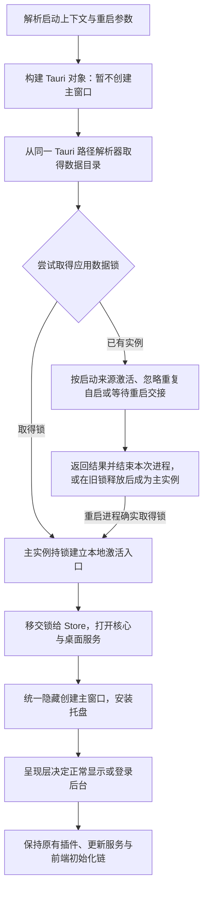

# 开机后台启动功能设计

状态：2026-11-26，用户已确认需求方向；本文包含待实施的功能设计与[代码整改方案](#12-代码整改方案)，尚未修改产品代码或完成平台验收。

## 1. 目标与核心决定

SoDeck 可以由用户选择，在每次登录系统桌面后自动运行并驻留后台，需要使用时再打开主窗口。主要服务希望 SoDeck 随时可用、又不希望登录后被主窗口打断的运维人员。

本次确定以下行为：

1. 只增加一个默认关闭的开关：**开机启动并驻留托盘**。
2. 系统自启进入后台；用户手动打开显示主窗口。
3. 已经运行时再次打开，显示已有主窗口，保留当前页面、布局和草稿。
4. 与“关闭主窗口时”的设置独立，不互相修改。
5. 使用当前用户的系统自启机制；不安装常驻服务或额外守护进程。

“开机”指当前用户登录图形桌面之后，也包括注销后重新登录；不是通电后、登录前运行。其他用户的设置独立，系统可以延迟或限制自启，不承诺固定启动秒数。

## 2. 设置入口与交互

### 2.1 页面布局与文案

入口沿用“设置 → 应用与数据”，将现有“窗口行为”小节改为“启动与窗口”。新增开关放在原有关闭行为选项之前，继续使用现有设置行、开关、提示和主题样式，不增加页面或导航。

| 项目 | 设计 |
| --- | --- |
| 开关名称 | 开机启动并驻留托盘 |
| 默认值 | 关闭；首次获得本功能的旧版本升级后也默认关闭，不在安装或更新时自动开启 |
| Windows 说明 | 登录系统后自动在后台运行，不打开主窗口。可从托盘打开 SoDeck。 |
| macOS 说明 | 登录系统后自动在后台运行，不打开主窗口。可从屏幕顶部菜单栏打开 SoDeck。 |
| Linux 说明 | 登录系统后自动最小化运行。可从任务栏、窗口切换或可用的托盘打开 SoDeck。 |
| 保存方式 | 切换后立即应用，无需另点保存，无需重启应用 |
| 开启成功反馈 | 已开启，下次登录系统时生效。 |
| 关闭成功反馈 | 已关闭，不影响当前运行。 |

正常状态只显示开关和一段平台说明，不常驻额外状态卡片、帮助弹窗或高级设置。开启开关不立即收起当前窗口，也不启动第二个进程。

保留原有“关闭主窗口时”选择及其说明。两项设置各自即时生效，切换其中一项不会自动改变另一项。

### 2.2 读取、保存与失败

| 状态 | 界面行为 |
| --- | --- |
| 初次读取 | 在该行显示“正在读取启动设置…”，临时禁用开关；不先显示一个猜测的关闭值 |
| 正常 | 显示已读取的状态，允许切换 |
| 正在修改 | 显示“正在开启…”或“正在关闭…”，临时禁用该开关，其他设置继续可用 |
| 修改失败 | 就地显示具体原因，重新核对实际状态；能够核对时恢复为实际值，提供“重试” |
| 状态暂时无法确认 | 显示“暂时无法确认启动设置”，暂时禁用开关，提供“重新读取”；不把未知显示成关闭或成功 |
| 系统明确阻止或要求确认 | 显示一行原因与系统设置中的操作位置；系统支持可靠直达入口时提供“打开系统设置” |

重复点击、切换页面和多个设置窗口不能造成重复自启项。修改由核心统一处理，所有窗口在操作结束后显示同一实际结果。失败后没有自动反复写入；重试沿同一设置项进行。

使用现有键盘开关交互，标签与说明关联；读取、成功和错误反馈可被读屏获知，不只靠颜色。窄窗口中说明自然换行，开关仍可见、可操作。

## 3. 启动与再次打开

### 3.1 行为表

| 入口与当前状态 | 预期结果 |
| --- | --- |
| 登录系统，自启已开启，当前未运行 | 启动一个实例，按平台进入后台 |
| 登录系统，自启已关闭 | 不由本功能启动 SoDeck |
| 用户通过快捷方式、开始菜单、Finder 等正常打开，当前未运行 | 正常显示主窗口，与开关状态无关 |
| 用户再次打开，已有后台实例 | 唤出已有主窗口，恢复正常系统窗口入口 |
| 用户再次打开，已有可见实例 | 显示并尽可能聚焦已有主窗口，保留原页面 |
| 重复收到系统自启请求，已有实例 | 保留现状，不新建实例，也不隐藏或唤出已有窗口 |
| 自启尚未完成时用户手动打开 | 以手动打开为准，显示同一主窗口；迟到的后台初始化不得再次把窗口收起 |
| 普通重启或更新后的重启 | 沿用现有重启行为，不因为开启本选项就一律隐藏启动 |

后台启动只由系统自启入口明确表达。不记忆“上次退出时隐藏”来决定下次是否显示，也不把开关作为所有启动入口共用的隐藏规则。

### 3.2 无闪窗与可返回

Windows 和 macOS 的正常自启路径，从启动开始就不展示主窗口、启动欢迎页或加载画面，避免先弹出再隐藏。后台入口就绪后保持后台，不抢键盘焦点。

启动阶段收到手动打开、必要交互或致命错误时，转为显示主窗口。普通日志、未读消息、插件一般启动失败不主动唤出窗口，继续沿用现有日志和消息入口。

Linux 按现有桌面策略最小化启动，始终保留系统窗口入口，不依赖托盘图标是否实际展示。以真实桌面验证最小化效果，不用离屏窗口或透明窗口伪装后台。

自启不触发现有“首次关闭到后台”的确认框；该确认仍只属于用户手动关闭主窗口的流程。

### 3.3 一个实例与已有数据锁

再次打开属于本次完整功能范围：用户不用先寻找托盘，也能通过原来的应用入口返回。

只有当前系统用户、同一应用数据目录的有效实例可以接收“显示主窗口”请求。第二次启动在创建业务资源和加载插件之前完成转交，然后结束，不重复执行初始化。

继续保留原有数据锁。无法确认实例身份、实例不可达或正在退出时，不删除锁、不绕过保护，也不偷偷新开实例；给出可理解的结果，例如“应用正在退出，请稍后重新打开”。退出清理已经开始后，不因新的打开请求撤销清理或复活资源。

范围只限应用激活与显示已有窗口，不扩展成通用实例间命令系统。

## 4. 后台实际运行什么

核心按正常启动规则读取已保存配置，启动已启用插件，提供现有核心服务。后台启动不等于只留下一个没有功能的托盘图标。

本功能不增加服务器自动连接、SSH 重连、终端会话恢复、隧道重建或任务重放。关机前的远端连接和进程不能因打开开关就被承诺恢复。插件自身已有的启动行为仍按各自规则执行，不在本功能中增加一套插件启动顺序或配置。

进入后台后，通过本次进程建立的连接和任务按现有规则运行；系统休眠、断网、注销和关机的边界继续见[设置](../features/settings.md#托盘与后台运行)与[生命周期](../features/lifecycle.md)。

## 5. 与关闭、退出和重启的关系

### 5.1 两个设置独立

| “关闭主窗口时”的值 | 登录后的启动 | 用户之后关闭主窗口 |
| --- | --- | --- |
| 在后台继续运行 | 开机启动开关开启时进入后台 | 按现有规则收起，保留连接与任务 |
| 退出应用 | 开机启动开关开启时仍进入后台 | 按现有退出流程处理草稿、任务与资源，再结束进程 |

第二种组合允许用户“登录时先备好，需要时打开，用完关闭即退出”，不需要纠正或弹出冲突提示。

### 5.2 明确退出

托盘“退出 SoDeck”、Cmd+Q 和应用退出动作继续走现有关闭协调器。需要处理草稿或失败时先显示相关窗口；取消退出后保留可见窗口，不自动重新收起。

主动退出不会关闭开机启动设置，但本次登录期间不自动再次启动。下次登录仍按开关执行。应用崩溃也不由此功能循环拉起，不增加“退出后继续守护”的后台程序。

### 5.3 开关变更与重启

关闭开关只取消后续登录启动，不断开当前连接、不停止插件、不关闭当前窗口。正常和更新重启不修改开关；继续复用已有生命周期，不引入另一套退出或重启流程。

## 6. 平台方案与安装边界

### 6.1 三个平台的体验

| 平台 | 当前用户自启方式 | 正常后台形态 | 无法建立后台入口时 |
| --- | --- | --- | --- |
| Windows x86_64 / ARM64 | 标准当前用户登录启动项 | 建立托盘，主窗口保持隐藏，不占任务栏 | 显示主窗口，保留返回与退出能力，并提示原因 |
| macOS ARM64 | 标准当前用户登录项 | 仅菜单栏入口，无工作窗口时沿用现有 Dock / Cmd+Tab 策略 | 恢复普通应用窗口与系统入口，并提示原因 |
| Linux x86_64 / ARM64 | 标准图形桌面当前用户自启动项 | 最小化，保留任务栏或窗口切换入口，托盘可用时同时提供 | 保留可见窗口或系统窗口入口，并提示原因 |

Linux 桌面没有托盘是正常兼容场景，保留最小化窗口入口即可，不因此显示故障警告；只有无法保留返回入口时才显示主窗口并提示。

macOS 手动返回时恢复正常工作窗口和 Dock / Cmd+Tab 入口。系统固定或最近使用的 Dock 快捷方式仍由 macOS 管理，应用不删除它们。

自启不请求管理员权限，不写全机自启项。Windows 即使安装为“所有用户”，也只为当前操作用户开启；其他账户不会被顺带开启。系统自身要求用户确认登录项时，按系统要求处理，不额外设计 SoDeck 审批流程。

### 6.2 稳定启动位置

自启登记必须指向正式、可持续使用的启动位置，正确处理空格、中文和特殊字符，不依赖工作目录或开发机器环境。

- Windows 使用当前正式安装位置；两种安装范围均需验证。
- macOS 使用已安装到本机的应用，不登记 DMG 中的临时副本。
- Linux DEB 使用安装后的启动位置；AppImage 使用用户实际保存的 AppImage 文件，不能登记临时挂载中的内部程序。
- 尚未安装到稳定位置、启动位置无法可靠确定的情形，拒绝开启并就地说明，例如“请先将 SoDeck 安装到本机，再开启此选项”。不增加文件选择或自动搬迁向导。
- 开发、测试和临时解包验收不自动修改真实用户的登录项；测试须使用隔离环境或替身。

### 6.3 更新、迁移与卸载

正常原地更新保留同一项设置，不能生成按版本累积的自启项。已有有效登记且仍指向同一安装身份时，必要的位置维护沿用该登记；已关闭或被系统禁用的项目不能借更新自动重新开启。

手动搬迁 AppImage、移动应用或更换 Windows 安装范围，可能使原登记失效。重新打开设置时，能够识别的失效登记须明确说明，用户重新开启即可登记当前有效位置。不扫描磁盘寻找程序，不承诺跨路径自动迁移。

标准卸载流程清理它能访问的、属于当前用户且指向本次安装的自启登记，不能删除另一安装或其他程序的记录。卸载全部用户安装不承诺进入每个用户配置清理；手动删除 macOS 应用或 AppImage 没有可靠卸载回调，建议先关闭开关。残留项不包含独立辅助程序，不会额外维持后台服务。

## 7. 系统状态、失败与恢复

### 7.1 状态以系统为准

不在本地配置再保存一份与系统相互竞争的“希望开启”值。开关依据当前用户的有效自启登记显示；系统明确报告禁用、阻止或待确认时，同时显示该事实，不能把“已登记”当作“必定能够自启”。

可确认系统禁用时，显示关闭并注明“已被系统禁用”。登记已添加但仍需系统确认时，开关显示开启位置并紧邻注明“待系统允许”，不显示“已开启”的成功反馈；此时仍允许关闭以撤销登记。连登记是否存在都无法确认时，按未知状态处理，不猜测开关值。

进入本页、从系统设置返回以及本次修改结束后重新读取状态。用户在系统设置中关闭或删除自启项后，SoDeck 不在启动、更新或页面刷新时擅自重新开启。

系统策略无法可靠查询时，不显示虚假的已获准状态，也不承诺识别所有第三方管理工具或桌面策略。正常界面只展示可确认的事实，附必要的一行说明。

### 7.2 失败处理

| 情形 | 用户结果与恢复 |
| --- | --- |
| 自启登记写入失败 | 当前窗口不变，显示实际状态和原因，用户可重试 |
| 请求结束但结果无法确认 | 重新读取系统状态；仍未知时显示待确认，不宣称成功或已经回退 |
| 系统禁止、禁用或要求确认 | 显示系统原因和可操作指引，不反复覆盖系统设置 |
| Windows/macOS 托盘不可用，或任何平台无法保留返回入口 | 显示可达窗口并说明；Linux 正常无托盘按第 6 节处理 |
| 业务配置、数据锁等致命启动错误 | 显示原有错误界面或必要对话框，不能为了隐藏启动吞掉错误 |
| 一般插件启动失败 | 记入现有插件日志和重要消息，其他可用部分继续运行，不仅因此抢焦点 |
| 自启与手动打开并发 | 最终只有一个实例，手动显示意图优先 |
| 程序路径失效或程序被直接删除 | 不承诺还能自启；再次从有效位置打开时提供重新开启的明确操作 |

只记录必要的设置变更、失败、启动来源和实例转交结果，复用现有核心日志。正常自启不发成功通知，不增加独立日志页、故障面板或反复提示。

## 8. 实现边界与复杂度控制

本次逻辑全部属于核心桌面能力：系统自启适配、启动来源判断、已有实例激活和窗口呈现。前端只负责设置行与反馈，插件不用新增接口，也不能直接管理核心登录项。

复用现有托盘、桌面呈现、应用数据锁、配置加载、插件生命周期和关闭协调器。平台差异收在核心适配层，不泄漏给插件或通过 shell 脚本临时拼接。

本设计不预先指定新增生产依赖。实现时先评估现有能力与标准系统机制；确需新增依赖时，按开发约定说明用途、维护情况及替代方案。

本次不增加以下功能：

- 独立的“开机启动”和“启动时隐藏”两个开关，以及更多启动模式。
- 延迟启动、计划启动、网络就绪触发或多个自启配置。
- 自动恢复服务器、终端、隧道和远端任务。
- 系统服务、登录前运行、崩溃自恢复或强制防退出。
- 全局快捷键、插件自定义托盘菜单、系统桌面通知。
- 通用进程间命令框架、跨用户唤醒和跨用户配置管理。

## 9. 实施顺序

以下是功能实施顺序，具体代码边界、依赖和分步退出条件见[代码整改方案](#12-代码整改方案)。本次仅交付设计文档。

1. **系统自启与设置**：确认各发行形式的正式启动位置和系统状态查询能力；实现当前用户登记、取消、实际状态反馈及一行设置界面。
2. **后台启动**：区分系统自启与正常打开；接入现有呈现层，完成不闪窗、Linux 最小化和入口失败回退。
3. **已有实例激活**：在原数据锁保护下转交显示意图，处理重复启动、启动并发和退出中的再次打开。
4. **集成与交付**：补充相关回归，完成五目标原生包、真实登录桌面及安装更新路径验收，再同步正式文档。

按实际改动运行相关格式化、类型、构建、脚本与核心测试。测试重点覆盖系统副作用、实例与可见性，而不是只测试开关能否改变外观。

## 10. 验收标准

下表中的平台适用范围必须在结果中逐项注明，未执行不得计为通过。

| 编号 | 场景 | 可验收结果 |
| --- | --- | --- |
| 1 | 新安装、从旧版本升级 | 开关默认关闭；安装、更新和普通首次启动不自行登记 |
| 2 | 在可见主窗口开启 | 显示成功反馈，当前窗口不隐藏、不重启；系统只有一个本应用登记 |
| 3 | 真正注销后登录或重启后登录 | 通过系统登记实际启动；Windows/macOS 不闪主窗口、不抢焦点，Linux 保留最小化系统入口 |
| 4 | 使用后台入口 | 托盘或菜单栏可显示主窗口、打开消息和设置、退出；Linux 无托盘也能返回 |
| 5 | 完全退出后手动打开 | 无论开关状态如何，均显示主窗口 |
| 6 | 后台运行时再次正常打开 | 显示已有主窗口，保留布局、草稿和当前业务；不重复插件或弹出数据锁冲突 |
| 7 | 自启重复、手动打开交错 | 一个有效实例；重复自启不改变可见性，手动显示不被迟到的隐藏覆盖 |
| 8 | 两种关闭行为组合 | 分别符合第 5 节；开机启动开关不改写关闭偏好 |
| 9 | 运行中关闭开关 | 系统取消登记，当前窗口、连接和插件不受影响；下次登录不自启 |
| 10 | 主动退出、取消退出和再次打开 | 正常清理或保留草稿；退出后本次登录不自动拉起，设置仍保留；退出中的请求不能绕过清理 |
| 11 | 系统外部禁用与策略阻止 | 能查询到的状态如实显示；启动、刷新、更新不擅自恢复；不可查询范围明确记录 |
| 12 | 读写失败、结果未知和重试 | 没有虚假成功，显示实际或未知状态；可恢复，不重复登记、不损坏其他设置 |
| 13 | 插件和远端行为 | 已启用插件按正常配置加载；不因本功能新建 SSH、终端或隧道，不重放远端任务 |
| 14 | 托盘与系统呈现失败 | 窗口保持可达并说明原因；macOS 可恢复普通窗口与应用身份 |
| 15 | 正式路径、空格中文、临时副本 | 正式路径有效；AppImage 不引用临时挂载；不稳定副本开启失败有明确指引 |
| 16 | 更新、重装与清理 | 原地更新不重复登记、不重新启用禁用项；卸载不清理错误归属；路径迁移限制有实际记录 |
| 17 | Windows 安装范围与普通用户 | 当前用户/所有用户安装均可按用户设置；操作无需管理员权限，不影响其他账户 |
| 18 | 界面与可访问性 | 现有主题、720×480 小窗口、键盘与读屏反馈可用；加载、错误和说明不挤掉开关 |

五目标都必须完成原生构建、打包、实际包启动和退出，ARM64 使用原生产物。功能专项另需覆盖真实 Windows 登录与托盘、macOS 登录项与菜单栏/Dock、Linux 有/无托盘桌面以及 DEB/AppImage；不能仅通过传入模拟启动参数就宣称系统自启已验收。

可以用隔离适配测试覆盖登记失败、未知状态、实例竞争和无入口回退，但必须与真实系统登录结果分开记录。测试产生的登录项须清理，不修改开发者现有启动偏好。发布与证据要求沿用[分发流程](../distribution.md)和[开发检查范围](../development.md#版本与持续集成)，不增加新的发布框架。

## 11. 文档归属与当前验证

本文是该主题唯一计划。已实施行为及时迁入正式文档，本文逐步只保留未完成范围；完成全部约定验收、迁出必要证据并修复引用后删除，不另建完成归档。

| 内容 | 最终归属 |
| --- | --- |
| 开关、启动方式、系统差异、失败与限制 | [设置与桌面行为](../features/settings.md) |
| 必要的核心适配和已有实例激活职责 | [架构](../architecture.md) |
| 退出与重启的契约确有变化时 | [生命周期](../features/lifecycle.md)；已有规则只链接，不复制定义 |
| 新增开发检查入口和持续集成范围 | [开发指南](../development.md) |
| 实际安装位置、更新或卸载流程变化 | [分发流程](../distribution.md) |
| 组件版本、来源、包与专项实际结果 | 对应核心版本记录，记录通过与跳过范围 |

现有[托盘专项](system-tray.md)继续负责既有托盘功能的剩余设备验收；本功能的新增登录启动与实例激活由本文负责。相同设备结果可按实际覆盖引用，但旧版托盘通过不能替代新功能验收。

当前仅完成现有文档核对与功能设计，尚未执行系统登记试验、代码检查、构建、真实登录或五目标验收。主要实施风险是系统登录策略的可查询性、Linux 桌面差异和正式安装路径维护；均已给出用户行为与验收边界，不将它们计为已实现能力。

## 12. 代码整改方案

### 12.1 整改结论与边界

按一项完整的桌面启动能力调整代码，包含启动来源、数据独占、已有实例激活、首次呈现、系统登记和重启交接。允许对这些直接相关的职责做范围重构，不在现有事件回调中逐处增加隐藏判断。

保留三条边界：

- **数据层保证独占**，不负责唤醒窗口、选择启动方式或等待用户决定。
- **桌面层处理启动与呈现**，不拥有第二套业务生命周期或连接恢复逻辑。
- **系统登记是系统事实**，不塞入应用偏好 JSON 作为另一个真相来源。

不重写 SSH、插件进程监督、工作区迁移或关闭协调器。现有 `AppCore::open(directory, version)` 作为测试与无界面夹具的完整入口保留，但其内部也必须先取得数据锁，再启动任何后台工作。

### 12.2 已追踪的真实链路与问题

以下是当前源码事实，后面的整改逐项对应这些连接点。提到的风险不等于已经通过实机复现。

| 链路 | 当前源码事实 | 对本次功能的影响 |
| --- | --- | --- |
| 自动创建主窗口 → setup | [Tauri 配置](../../src-tauri/tauri.conf.json)保留默认自动创建与可见窗口；[main](../../src-tauri/src/main.rs)在 setup 中初始化核心。固定 Tauri 2.12.5 源码显示：配置窗口先于用户 setup 创建 | 在 setup 最后调用隐藏会先闪窗；重复打开也可能先创建窗口才撞上数据锁 |
| 核心打开 → 临时文件清理 → 存储锁 | [core](../../src-tauri/src/core.rs)的 `AppCore::open` 先启动两条 streams 清理线程，然后才调用 `Store::open`；[storage](../../src-tauri/src/storage.rs)自己取得 `app.lock`，最多轮询两秒 | 数据所有权与启动角色混在存储打开中；第二实例在被拒绝前已安排清理工作。现有清理有 PID 检查，不能据此直接宣称删除了活动数据 |
| 关闭按钮 → 首次提示 → 前端确认 → 原生收起 | [desktop_shell](../../src-tauri/src/desktop_shell.rs)的 `close_requested`、`prepare_background`、`finish_background_on_main` 同时处理关闭偏好、首次说明、文档代次、认证/模态保护与隐藏动作 | 不能让登录自启伪装为关闭请求；否则关闭偏好为退出时行为错误，也会多出首次提示和草稿 flush |
| 原生呈现 → macOS 身份 → 恢复主窗口 | [presentation](../../src-tauri/src/desktop_shell/presentation.rs)已经统一主线程显示、呈现序号、实际应用策略和恢复；[windows](../../src-tauri/src/windows.rs)的 `ensure_main_display` 已从配置隐藏创建主窗口 | 这里应成为正常首次创建与恢复的共同入口，无需建立第二个窗口管理器 |
| 初始前端状态 → 插件可见性 | [Shell](../../src/shell.ts)默认 `windowVisible = true`；[console](../../src/console.ts)先启动 workspaces 等读取，最后才 `desktop.ready()`；[DesktopUi](../../src/desktop.ts)把原生快照传到 Shell | 隐藏冷启动的初始可见性必须前移，避免挂载阶段短暂把后台 Surface 当成可见；保持原有 `visibilityChanged` 协议 |
| 系统设置 UI → 核心偏好 | [views](../../src/views.ts)在 `about()` 拼接关闭行为；[console](../../src/console.ts)通过通用 action 捕获为临时 toast；[core.ts](../../src/core.ts)中偏好来自应用快照 | 自启需要就地的读取、实际结果、重试和外部状态刷新，不宜照搬“改一个 preferences 布尔值” |
| setup 托盘失败 → 前端事件 | [desktop_shell](../../src-tauri/src/desktop_shell.rs)的 `report` 写日志并发 `core-desktop-error`，桌面快照没有保存具体错误 | setup 期间发生的错误可能早于订阅；隐藏启动需要可重新读取的反馈与原生可达性恢复 |
| 关闭协调器 → 原生 finalizer → 官方 updater → 重启 | `attach_finalizer` 在 `updater.install()` 之后关闭 desktop files、停止 updates、handoff，再调用 `request_restart` | 固定 updater 2.14.1 的 Windows 成功安装路径会直接 `process::exit(0)`；不能把 install 后的代码视为 Windows 也必执行的收尾 |
| 重启参数 → 替换进程 → 数据锁 | 固定 Tauri 2.12.5 的 `process::restart` 重放 `Env.args_os`；固定 Windows updater 2.14.1 也从 `app.env().args_os` 生成安装后启动参数；当前 Store 的两秒等待就是为旧进程释放锁而加 | 系统自启标记若不归一化，会跨普通/更新重启继续隐藏；替换进程若走普通“已有实例激活”，可能转交给即将退出的旧实例后自己结束 |

依赖行为按仓库锁定版本查阅了本机 Cargo 源码；实施时通过版本锁与原生测试固定这些假设，不复制依赖源码或修改 Cargo 缓存。

### 12.3 目标启动链路



推荐在 `Builder::build` 后、`app.run` 前做实例准入：此时可以复用 `app.path().app_data_dir()`，而配置窗口尚未创建。主实例把仅消费一次的启动准备结果交给 setup；第二实例直接结束，不进入业务 setup。该顺序应以固定 Tauri 的实际运行测试确认。

配置中的主窗口作为尺寸、装饰、macOS 按钮位置等唯一模板保留，关闭自动创建。主窗口由 setup 完成状态管理后调用 `ensure_main_display` 隐藏创建；不再同时维护“配置自动创建”和“异常时另一条创建链”。同时调整默认及 macOS 覆盖配置，防止 JSON 数组覆盖使 `create` 设置丢失。

初始启动失败不能只落在 `.build(...).expect(...)` 或前端事件里。启动层用明确错误结果结束，并用不依赖业务前端订阅的必要原生反馈呈现原因；不能为了展示错误，带着未取得的锁继续打开核心。

### 12.4 数据锁与实例准入

新增一个小的 `app_data.rs`，只提供不依赖 Tauri 的 `AppDataLease`：保存规范化目录和实际锁句柄，区分“已被占用”与真实 IO 失败。仍使用同一个 `app.lock`，不创建另一把与存储竞争的主锁。

建议的调用关系如下，名称可以随现有代码风格微调，但不能放宽不变量：

```text
AppDataLease::try_acquire(root) -> 已取得 / 已占用 / IO 错误
Store::open_locked(lease)      -> 加载配置并持有 lease
AppCore::open_locked(lease, version) -> 从已独占的目录初始化核心
AppCore::open(root, version)   -> 取得 lease 后复用同一打开路径
```

- 不暴露接受普通目录、却跳过锁的构造函数。锁从启动准入移入 Store，连续持有，中间没有释放再重取的空隙。
- 两条 streams 清理以及配置迁移、工作台/会话存储、更新缓存恢复、后台投递线程都必须位于独占取得之后。
- 从 Store 删除重启专用轮询；等待预算由知道启动来源的准入层处理。无界面测试入口遇到占用直接返回，不发激活请求。
- 锁至少持有到旧进程实际退出，不能在 `core.shutdown()` 或业务资源清理完成时提前释放；旧进程仍可能写日志、消息和配置。
- 目录身份复用规范化后的真实数据目录，处理各系统路径语义。不得一处按 app identifier、一处按未经归一化的字符串，各自认定“同一实例”。

已有调用 `AppCore::open` 的 fixtures 和测试无需全面改签名；新增的持锁路径专供桌面启动准入。这属于锁的职责移动，不引入存储容器或新的数据迁移框架。

### 12.5 启动上下文与已有实例激活

在 `desktop_startup.rs` 一次解析 `args_os`，集中保存三种来源：普通打开、登录自启、进程替换重启。smoke/interactive 等现有验收模式作为独立运行模式保留，不能被普通快捷方式或系统自启项带入。

登录登记只传递一个专用内部标记，例如 `--login-start`。路径和值保留 `OsString`，不把命令行拼成 shell 字符串。前端和插件不自行读取启动参数。

本地激活放在 `desktop_startup/instance.rs`，边界固定为“查询本实例是否可接收”与“显示主窗口”，不传服务器、文件、命令、凭据或任意 RPC。建议使用现有平台能力：Windows 当前用户限定的命名管道，Unix 私有目录下的 Unix domain socket。复用已声明的 `windows-sys` / `libc`，仅启用实际需要的系统 API feature；不新增监听公网或回环 HTTP 的服务。

具体约束：

1. 端点身份由当前用户和规范化数据目录共同确定；校验对端所属用户，Unix 目录/端点限制为当前用户访问，Windows 明确设置当前用户 ACL。Unix 端点放入可控的短路径，避免用户数据目录过长超过 socket 路径上限。
2. 只持有真实数据锁的进程建立主端点；残留端点只有在取得该锁并确认归属后才能清理。不存在“连接失败就删 app.lock”的逻辑。
3. 协议只有固定版本、有限消息、有限长度和有限等待。回执区分已接受显示、仍在启动、正在退出和不兼容；已接受不伪称窗口已经得到系统焦点。
4. 核心未就绪时最多合并一个待显示意图，setup 后交给 DesktopShell；不启动消息队列、重试服务或独立后台守护。主线程不可阻塞等待依赖主线程完成的回执。
5. 普通第二次打开收到有效实例回执后结束；重复系统自启不改变窗口。旧版本或其他无界面夹具只持有锁、没有兼容端点时，明确告知正在使用，不绕过保护。
6. 实例端点不维护另一份业务 closing 状态。运行阶段从现有核心关闭状态与 DesktopShell handoff 判断能否显示；退出准备/决定可展示已有决定窗口，清理/交接阶段拒绝新显示。

macOS 已有 `RunEvent::Reopen` 合入同一激活入口，不再通过伪造托盘菜单 ID 分发。实施时必须实测区分登录启动的初始系统事件与用户对已有应用的 Reopen，不能用固定延时忽略事件，进而吞掉真实手动打开。

### 12.6 统一窗口呈现，保留关闭预检

对 `desktop_shell.rs` 的整改重点是拆清两个阶段，而非重写完整桌面状态：

- **进入后台的业务前置**：用户关闭继续检查关闭偏好、首次说明、输入 flush、正在连接的问题、模态交互与页面交接；登录冷启动不执行这些关闭动作。
- **执行后台呈现**：移入现有 `presentation.rs` 的一个共同原生入口，负责 Linux 最小化、Windows/macOS 隐藏、平台身份核对、实际可见状态和失败恢复。

`finish_background_on_main` 保留现有代次/回执校验和业务前置，通过后调用共同呈现入口；登录初始化直接提交一次初始后台意图。不能借登录启动写入 `backgroundCloseExplained`，不能检查关闭偏好是否为 background 才允许自启后台。

复用现有 `sequence` / `presentation` 和 `main_backgrounded`，初始后台意图只能消费一次。任何新的手动显示、必要交互或关闭操作都会使旧意图失效。不要再增加分散的 `hideOnStart`、`hasShown`、`forceTray` 等布尔值；文档重载不重新消费登录来源。

原生首次呈现由 setup 与呈现层完成，不依赖后台 WebView 定时器；前端正常初始化必须继续执行，不能用“窗口不可见”跳过 `close_register_host`、布局、状态订阅和桌面就绪。隐藏 WebView 未按预期初始化应能通过托盘或手动打开恢复，不靠无限等待。

macOS 继续由呈现层统一实际 activation policy，不加另一份 Dock 偏好。登录启动应在首次呈现前进入合适身份；托盘失败、必要交互或手动打开走同一恢复入口。Linux 最小化按窗口管理器实际结果验收，不能用隐藏窗口替代无托盘兼容。

### 12.7 前端初始化、错误与设置职责

初始原生快照应在启动 workspaces 和挂载 Surface 之前传给 Shell，使其初始 `windowVisible` 符合实际值。继续使用原 `DesktopUi → Shell → Workspaces → Components → visibilityChanged` 通路，不为后台启动新增插件显示协议。

桌面错误改成可读取的最近一条问题，沿 `desktop_state` 快照与 `desktop-state-changed` 唤醒读取；瞬时事件不再承担唯一交付责任。只保留当前必要问题及其身份，不另建错误中心。显示回退由原生完成，前端在实际可见后读取反馈；不依靠后台中已过期的 toast 告知错误。

新增 `login_startup.rs` 管理系统登记、当前状态和串行变更；它是应用级桌面状态，不是插件设置。设置桥接只需：

| 桌面命令 | 结果与作用 |
| --- | --- |
| `login_startup_state` | 读取当前登记及能够确认的系统状态；没有写入副作用 |
| `set_login_startup(enabled)` | 串行执行本次用户选择，再读回事实；失败附实际/未知结果，不假定自动回滚 |

状态类型应能直接表达未登记、有效登记、系统阻止/待确认和未知，附必要原因；不扩展成安装任务、持久操作票据或重试状态机。前端的 loading / saving 属于该行操作状态，不能写入 preferences。系统允许但尚未登录验证，与“已完成实际登录验收”保持区分。

前端建议新增小的 `application-settings.ts`，集中处理应用与数据页的即时设置状态、读取、切换和错误反馈。将现有 close behavior 事件处理一并移入，保持其持久方式不变；组件设置仍由 `settings.ts` 负责。`views.ts` 保留静态页面组合，`console.ts` 只连接导航、动作和刷新，不再承载新的系统 IO 分支。

只在进入应用与数据页、窗口重新获得焦点/从系统设置返回、设置修改结束及本应用设置变更时读取系统状态。不要把系统登记查询加入 `Shell.read()` 的一秒全局刷新。复用现有 DOM 更新与焦点保护；切页后迟到结果更新数据但不强行重新打开页面，多窗口切换不能留下错误的 checked 值。

即时设置写入与退出竞争也必须有结果：清理开始后拒绝新写入；已接受的单次系统 IO 在有限等待内完成并可读回，不在半途假报取消。这里复用现有 closing 与设置模块自身的短时串行范围，不新增后台作业调度。

### 12.8 平台登记的具体落点

| 平台适配 | 推荐机制与代码约束 |
| --- | --- |
| Windows | HKCU 标准 Run 登录项，固定本应用键，参数使用系统命令行规则编码；读取注册位置与能够可靠确认的系统禁用状态。通过现有 `windows-sys` 访问，不调用 PowerShell、`reg.exe` 或全机任务计划 |
| Linux | 当前用户 XDG autostart `.desktop` 文件；正确处理 Exec / TryExec、转义、Hidden 及适用桌面条件。文件原子替换，固定本应用身份；不要求 systemd，不在当前会话额外启动程序 |
| macOS | 优先采用当前用户标准 LaunchAgent，固定 label、独立 ProgramArguments、RunAtLoad，明确不设置 KeepAlive；仅安排下一次登录，不因开关开启执行一次当前会话启动。只登记同一正式应用内的主程序，不添加辅助程序 |

macOS 该方案保持无新增生产依赖，也不为打开开关引入额外 helper bundle。它必须先验证当前正式支持系统的登录执行、系统后台项目显示/禁用效果及应用身份。如果原生系统事实证明此机制不满足第 6、7 节体验，应在同一计划中修订适配选择，不能并行叠加 LaunchAgent、登录 helper 与多套登记作为兜底。

平台实现使用各自私有子模块，不建立可插拔 provider、通用注册表或适配器工厂；测试需要的替身限于实际系统读写边界。

启动位置优先复用 Tauri 的 `current_binary(&env)` 等已有能力，但检查返回值，尤其是 AppImage 外层文件。注册、显示状态核对与清理共用同一正式安装身份，不能拿版本号当身份，也不能每次启动无条件修复登记。

Windows NSIS 清理只能使用标准 installer hook，按本次安装路径和当前用户登记归属判断；Linux 的系统卸载脚本不得假定 root 的 HOME 就是实际桌面用户，也不遍历所有用户修改配置。做不到可靠回调的平台沿第 6.3 节明确操作边界，不补一个长期驻留的卸载清理进程。

### 12.9 重启参数与更新收尾

**参数在一个地方归一化。** `LaunchContext` 保存本次原始来源，同时构造下一进程的参数：移除一次性的登录标记及旧重启来源，保留有效普通参数和验收隔离参数，加入用于本次进程替换的受限来源标记，例如旧 PID。该标记只决定“等待旧进程释放锁”，不能允许无锁打开数据。

建议在 Builder 初始化前预先提供归一化的 `tauri::Env`，保持其 AppImage / APPDIR 等平台字段，仅调整 `args_os`。固定 Tauri 当前会保留预先管理的 Env，普通重启与 Windows updater 又共同读取它，因此可在此统一解决参数重放。通过实际替换进程回归验证该接入，不在运行时 unsafe 卸载/替换 Env，不修改 Tauri 源码，也不改为手工复制更新包或自建进程拉起框架。

普通第二次打开与替换重启的区别必须明确：

- 普通打开向已有实例提交显示请求；已有进程正在清理则明确反馈，不取消退出。
- 替换重启不把请求转交成“显示旧窗口然后自己退出”。核对旧实例来源后，有限等待同一个数据锁释放，取得后按正常可见启动继续；超时失败，不终止旧进程、不提前删除锁。
- 无法核对来源或协议不兼容时保持独占保护；实际拿到锁才拥有启动资格。

**把必须执行的收尾放到 updater 可能退出之前。** 对现有 finalizer 做小范围整理，形成“可失败准备 → 安装/退出交接”的清楚边界：

1. 关闭协调器仍负责草稿决定、插件与业务资源清理，不更改其阶段语义。
2. 原生 finalizer 在调用 `install()` 前完成所有平台都必须完成的 desktop files 清理、更新任务停止/互斥、实例入口停止接收新显示与必要记录；系统设置写入也应已收束。数据锁继续持有。
3. 正式退出交接标记只在明确交接处设置；不能先设置最终 `exit_handoff`，然后遇到安装失败还把失败窗口视为“应用已经退出”。实例入口可以按现有核心清理状态拒绝新显示，不需要提前伪造 handoff。
4. Windows 安装器启动成功后由官方 updater 结束进程并交接，不依赖 install 后的语句。Linux/macOS 的成功返回再走同一官方重启链。
5. 安装或准备失败沿现有关闭失败阶段反馈，窗口保持可达，保留已清理事实与待重试安装包。若已停止更新服务，其后续启动/重试策略必须明确，不能假装所有服务仍在正常工作。

不顺带改造下载、验签、候选版本选择和发布流程；本节只修正与新增启动上下文和实例资源直接相关的交接位置。

### 12.10 改动清单与保留范围

下表中的新文件名为建议落点，不表示已存在或已经实现。

| 范围 | 预期文件 | 修改内容 |
| --- | --- | --- |
| 独占数据所有权 | 新 `src-tauri/src/app_data.rs`；现有 `storage.rs`、`core.rs` | 提取唯一锁凭据，先独占后副作用，保留无界面打开入口 |
| 启动编排与激活 | 新 `src-tauri/src/desktop_startup.rs` 及 `desktop_startup/instance.rs`、必要平台子模块；`main.rs`、`lib.rs` | 集中参数、准入、启动准备与第二实例结果；main 只保留装配与事件连接 |
| 原生窗口 | `desktop_shell.rs`、`desktop_shell/presentation.rs`、`windows.rs` | 共用首次/恢复创建，共用后台原生动作，复用呈现意图与可读错误 |
| 系统登记 | 新 `src-tauri/src/login_startup.rs` 及 Windows/Linux/macOS 私有实现 | 系统实际状态、串行读写、启动位置、归属清理 |
| 宿主设置 | 新 `src/application-settings.ts`；`views.ts`、`console.ts`、`desktop.ts`、`shell.ts`，必要的设置样式 | 即时设置就地反馈；初始可见性前移；不改组件设置及插件协议 |
| 配置与安装 | `tauri.conf.json`、`tauri.macos.conf.json`、必要 NSIS 标准 hook、`Cargo.toml`/锁文件 | 关闭主窗口自动创建，保留模板一致性；只启用现有系统依赖必要 feature；不升应用版本 |
| 原生收尾与更新 | `desktop_shell.rs` 的 finalizer；`desktop_updates.rs` 必要接入 | 安装前必要收尾、统一 Env 参数、失败保持可达；不重写 updater |
| 回归与检查选择 | 锁/生命周期/窗口配置测试、桌面与设置 UI、原生包/升级脚本、`select-checks.mjs` 及其测试、相应工作流 | 接入真实入口与检查选择，确保新增模块不漏测，新增命令与工作流同步 |

不修改插件清单、RPC 主版本、服务器存储格式、SSH 认证、终端/文件/隧道/Docker 业务；也不把本次整理扩展成整个 console 或 core 的拆分工程。若发现这些范围中的独立缺陷，另行记录，不把无关主题混入提交。

### 12.11 分步整改与退出条件

| 步骤 | 前置与主要工作 | 本步完成条件 |
| --- | --- | --- |
| A. 固定平台事实 | 使用隔离试验确认标准自启机制、正式路径、系统禁用可查询范围、macOS 初始事件；核对固定 Tauri 的准入及 Env 接入点 | 各平台有明确采用的一种机制和诚实限制；不修改真实用户登录项，不用历史通过替代本次结果 |
| B. 理顺独占与准入 | 提取 lease，核心所有副作用后移；保留旧打开入口；加入有限的已有实例激活和替换等待 | 同目录只能一位数据写入者；失败/第二实例不启动清理、插件或核心后台服务；旧版无端点安全失败 |
| C. 统一窗口呈现 | 手动创建主窗口，共用后台原生动作；引入一次性初始意图；前端初始可见性前移与错误可读 | 正常打开、首次/再次收起、模态保护、主窗口恢复全部保持；模拟登录不闪窗且可返回，手动激活优先 |
| D. 接入系统登记与设置 | 实现三平台登记与状态，收束应用与数据页即时设置 | 开启/关闭可读回、失败不假成功、外部禁用不被恢复、多窗口一致、正式路径正确；开发/测试不能误登记 |
| E. 闭合重启和发行链 | 统一 Env，处理旧锁等待；安装前必要收尾；相关卸载边界和工作流接入 | 从后台自启来源执行普通/更新重启后可正常显示；不转交给即将退出的实例；Windows 直接退出路径没有遗漏必须收尾 |
| F. 正式验收与文档收束 | 五目标实际包与真实登录桌面、必要业务组合回归 | 第 10 节适用项实际完成，未测项单列；正式文档同步，证据迁出后删除已完成计划 |

步骤是同一功能的依赖顺序，不代表六个新子系统。每个提交完成一个可验证主题；中间提交不提前暴露半成品开关，不把待完成的真实登录验证记为功能已交付。

### 12.12 验证安排与防回归重点

**不依赖桌面的回归：**

- 参数解析与 Env 归一化：登录标记只影响一次；两种重启共用相同过滤结果；隔离路径和非 ASCII 参数保留；错误/矛盾标记被拒绝。
- 数据 lease：竞争进程不能同时持锁；失败不运行清理；持有者退出后可重新取得；迁移失败仍保留原配置；保留原有持锁回归。
- 进程激活：真正两个进程验证主实例未重复初始化、有限等待、端点就绪空隙、旧端点、不同目录、错误身份/消息版本、退出中拒绝及重启等待。仅对纯函数打桩不足以覆盖 OS 锁和 IPC。
- 呈现意图：手动显示压过迟到后台、文档重载不重放、closeBehavior=exit 不拦截登录后台、首次说明标志不被污染、失败恢复遵循实际窗口状态。
- 登记编码：各平台路径和参数转义、有效/失效/被禁用状态、读写失败后的读回；替身只替代系统 IO，不能让前端用例代替平台登记测试。

**界面与原生集成：**

- 扩展现有 `test-desktop-shell-ui.mjs` 和设置 UI，覆盖初始后台可见性、读取/保存/未知/重试、焦点保护与切页；保留现有主题和最小窗口检查。
- 扩展 `window_config.rs`，验证所有配置合并后不自动建窗、共用主窗口模板，并保留 macOS 标题栏和按钮位置断言。
- 实际程序验证两次打开、后台返回、带草稿取消退出、原窗口/页面保留；用现有真实 SSH/终端/文件/隧道组合确认原生命周期无回归，不重建插件发行。
- 新增一个边界明确的原生启动验证脚本，供源码原生测试与实际包复用；隔离系统登记，结束时只清理自己创建的项。它不取代真实注销/登录专项。
- 现有 `test-core-package.mjs` 在 macOS 从 DMG 挂载目录直接启动、Linux 从 DEB 解包目录启动，这只能证明包程序运行。新增登记试验需要复制/安装到隔离的稳定位置，不能把拒绝临时副本当作包烟测失败，更不能把临时路径写入真实登录项。
- Windows 实际 NSIS 升级必须覆盖官方 updater 直接退出；Linux/macOS 必须覆盖安装返回后的重启。现有 `release_upgrade` 夹具不能单独证明正式主程序的启动参数和原生 finalizer 已正确。
- 将新增模块、平台适配和启动验证脚本加入 `select-checks.mjs` 与测试，优先复用 `.github/workflows/check.yml`、`build.yml` 的既有原生与包验证任务；不创建平行发布流水线。

实施后的基本检查仍为 `npm run check`、`npm run scripts:test`、`npm run test`、`npm run build`，再执行本次相关的桌面/设置/真实原生用例。五目标原生包、真实桌面登录和人工设备项分别留实际证据；任一约定未完成就报告剩余范围，不以方案完备代替验收。

本轮代码整改方案仅做静态链路分析与文档调整，没有运行产品行为、故障复现、系统自启试验或构建测试。平台机制、无闪窗时机和 updater 实际退出仍需按以上顺序验证；不新增生产依赖、不改产品代码或系统启动项。

返回[文档索引](../README.md)。
