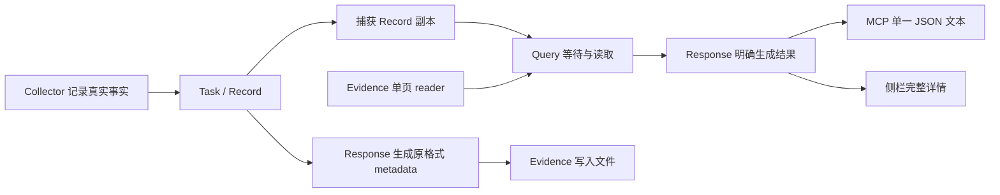

# Agent MCP 响应与读取契约设计

状态：功能设计与代码整改方案完成，尚未实施、验收或发行。2026-11-18 核对基线为插件 0.2.2、仓库提交 `ab7b3d31fb543a83d8017cb4789a2bf9b5b3ea61`。第 1–14 节定义 A 类功能设计，第 15–23 节定义实现边界、步骤与验收；都不是当前功能承诺。

## 1. 要解决的问题

真实使用场景是“调用 SoDeck，看看 187 的 CPU 是什么”。客户端正确调用目标列表、启动 `lscpu`、查询任务并取得结果，没有业务重试。这说明目标、执行和证据机制已经可用；本次重点是让调用方更容易读懂结果。

实际体验提出两个相互关联的问题：

- 同一份任务 JSON 和 CPU 输出同时出现在 `content` 与 `structuredContent`，增加响应体积和阅读重复。
- `outputMode=text` 仅删除原字节信封，仍返回原参数、时间、路径及完整内部事实；日常查 CPU 并不需要先读这些诊断信息。

源码也确认了这两点：MCP 出口调用 SDK 的 `CallToolResult::structured`；任务三个输出模式都先取得完整任务快照。当前契约见 [MCP API](../mcp-api.md)，当前操作与限制见 [Agent MCP](../features/mcp.md)。

产品目标：一次普通结果足以确认“哪台服务器、执行到什么阶段、实际退出结果、取得什么输出、证据是否完整、下一步如何读取”，正文只出现一份。需要排查插件、证据或清理故障时，调用方可以明确请求完整诊断。

不能把这次对话的总体耗时归因于插件：记录中的三次工具调用分别为 28ms、3ms、2ms，包含模型思考的对话耗时不是工具执行耗时。当前也没有可靠的上下文 token 基线；不能先宣布节省比例。

## 2. 范围与依赖

| 本次包含 | 本次之外 |
| --- | --- |
| 六工具结果的单一返回载体 | B：启动后短暂等待、同步返回结果 |
| 普通任务结果与完整诊断的边界 | B：requestId 自动生成、重试流程重设计 |
| 文本、原字节、不读正文三种输出规则 | C：地址/名称解析、目标缓存与自动重选 |
| 输出分页、等待、错误和容量的呈现 | 新工具、资源订阅、MCP task-augmented execution |
| 工具描述、兼容说明和实际客户端验收 | 中央页面、侧栏重排、核心安装包升级 |

本次使用现有完整任务快照、证据 reader、revision、分页、等待及资源额度。远端执行、落盘、取消、去重和稳定收尾的事实来源保持一致。核心 API 不变，不增加生产依赖、第二套任务数据库或通用响应框架。

B 后续返回的短命令结果必须使用本次定义的普通任务结果；本次不为 B 增加尚无使用场景的参数。C 后续沿用单一载体及错误规则，目标定位本次仍由明确 targetId 完成。

## 3. 核心决定

### 3.1 一份 JSON 文本承载完整工具结果

六工具统一使用 `content` 中的一个 `type=text` 块，该块是可解析的完整 JSON 对象。省略 `structuredContent`，不增加另一份自然语言摘要、第二个正文块或藏在 `_meta` 中的完整结果。

例如 MCP 外层形状如下，示例是启动凭据，不是执行成功结果：

```json
{
  "content": [
    {
      "type": "text",
      "text": "{\"runId\":\"run-example\",\"taskId\":\"task-example\",\"kind\":\"exec\"}"
    }
  ],
  "isError": false
}
```

选择理由：MCP 2025-11-25 允许工具只提供 unstructured content；一旦提供 structured content，规范建议同时提供同一 JSON 的文本副本。只用 JSON 文本符合协议的文本结果路径，直接解决双份载荷，也让只读取文本的客户端取得全部结果。

这是一项明确的应用契约取舍：结构化字段专用调用方必须调整解析方式。它不代表所有客户端的 token 消耗必然减半，也不能绕过真实客户端验收。客户端如果既不展示文本、也不解析文本，这套契约对它不适用。

本次不声明 `outputSchema`：该字段用于验证 `structuredContent`，不能在没有结构化字段时宣称客户端会自动验证 JSON 文本。工具说明与正式 API 文档定义文本内 JSON 的字段和语义。

规范依据：[MCP Tools — Structured Content](https://modelcontextprotocol.io/specification/2025-11-25/server/tools#structured-content)。SDK 行为依据锁定的 rmcp 3.10.0，而非另行手写 HTTP/MCP 协议。

### 3.2 默认普通结果，诊断显式请求

仅为 `sodeck_task_get` 增加 `detail` 布尔参数，默认 `false`。

| 参数 | 行为 |
| --- | --- |
| `detail=false`，或省略 | 返回普通任务结果；只保留操作判断、归属、继续读取和重要故障所需事实 |
| `detail=true` | 在同一对象中保留普通事实并展开完整原参数、上下文、时间、本地路径和原生诊断 |

诊断结果不再同时附一份普通结果；不返回 `summary + originalSnapshot` 的双层副本。诊断是同一组事实的完整投影，不是另行查询出来的第二套状态。它保留相同的关键字段语义，但不是普通对象的机械超集：普通下载的 file 由诊断中的完整 input/evidence.path 表达；有正文时两个详略都不再附重复的 outputInfo.savedBytes。

`detail` 只控制任务事实的详略，不控制正文 IO、页大小、等待期限或证据保存。目标列表、任务列表、启动和取消不再各增一组模式开关。

### 3.3 输出格式独立选择

`sodeck_task_get.outputMode` 仍有 `text / full / none`，默认改为 `text`。它与 `detail` 是独立的两个维度。

| 组合 | 使用场景 |
| --- | --- |
| 省略两参数 | 日常命令读取：普通事实和一页 stdout/stderr |
| `outputMode=none` | 等待或查看状态，不读证据正文 |
| `detail=true, outputMode=none` | 核对原参数、保存路径、原生与清理故障，不读正文 |
| `outputMode=full` | 获取一页原字节信封，保留来源和顺序 |
| `detail=true, outputMode=text/full` | 同时排查完整任务事实和指定格式的正文 |

非法枚举、非布尔 detail、非法参数组合仍明确报错；不能悄悄降级成默认模式。

## 4. 普通任务结果

### 4.1 字段和职责

结果继续使用 `phase`、`done` 和原生事实，不增加一个概括全部结果的 `success`。执行成功、证据完整和清理完成是三个独立判断。

| 字段 | 普通结果 | 设计理由 |
| --- | --- | --- |
| taskId、runId、targetId、requestId、kind | 保留 | 查询、归属、去重与重启边界所需身份，不缩短或重写 ID |
| target | 保留接纳时的真实名称、端点、协议和账号；未确认时 null | 防止将旧任务认成当前连接；不猜测服务器身份 |
| phase、done、revision、cancelRequested | 保留 | 判断采集、收尾、稳定结束、变化与取消请求 |
| native | 保留与实际执行判断有关的事实 | 包括实际存在的 state、admission、execSent、exitCode、exitSignal、remoteExitConfirmed、outputComplete、received、total、error |
| evidence | state、complete；有故障时附简明 error | 不能把非零退出等同证据不完整，也不能把退出 0 等同证据保存成功 |
| resourceReleased | 保留 | 清理事实不能从普通结果消失 |
| cleanupError | 有故障时保留简明错误，正常时省略 | 远端结果与清理失败同时可见 |
| output | 按 outputMode 返回一页；下载省略 | 一次请求最多读一页 |
| outputInfo | 仅命令 none 模式保留 savedBytes | 状态读取可知保存水位；有 output 时不重复 savedBytes |
| wait | 仅请求正等待时保留现有原因、请求/实际耗时 | timeout 是读取结果，不是命令超时 |
| file | 仅下载保留完整 remotePath 和 localPath | 普通下载结果应直接告诉调用方文件来源和是否已有可用本地证据 |

普通结果省略完整 `input`、Context、createdAt/finishedAt/observedAt、directory、原生内部 ID、workerFinished、内部运行耗时及诊断 details。它不是完整快照的字段别名副本。

已存在的 native 字段按事实返回；缺失不补 false、0 或推测状态。`remoteExitConfirmed` 缺失表示未得到确认，不表示已确认。native.state 为 unavailable 时，简明保留 `lastResult` 中最后已知的上述执行事实，明确它是历史观察；不把历史状态提升为当前确认。普通 lastResult 最多一层，有更深诊断时标明需要 detail 查询；诊断保留实际原生内容。

普通结果不得丢失任务内故障：native.error、evidence.error、cleanupError 分别表达远端/观察、保存和清理问题，不合并成一个“失败”。相关错误只摘要 code/message；原始细节由 detail 读取。JSON 的 null、缺失与 false 按正式字段语义使用，不互相代替。

### 4.2 CPU 查询示例

以下展示 JSON 文本块解析后的结果；数值及编号为示例，表示任务已稳定结束、远端退出 0、输出和证据完整：

```json
{
  "taskId": "task-example",
  "runId": "run-example",
  "targetId": "target-example",
  "requestId": "cpu-info-187",
  "kind": "exec",
  "target": {
    "name": "192.168.1.187",
    "endpoint": "192.168.1.187:22",
    "protocol": "ssh",
    "username": "ops"
  },
  "phase": "done",
  "done": true,
  "revision": "8",
  "cancelRequested": false,
  "native": {
    "state": "completed",
    "exitCode": 0,
    "remoteExitConfirmed": true,
    "outputComplete": true
  },
  "evidence": {"state": "saved", "complete": true},
  "resourceReleased": true,
  "output": {
    "stdout": "Model name: Intel(R) Xeon(R) Gold 5117 CPU @ 2.00GHz\nCPU(s): 56\n",
    "stderr": "",
    "nextCursor": "240",
    "savedBytes": "240",
    "hasMore": false,
    "previewEncoding": "utf-8-lossy-per-page"
  }
}
```

默认不会返回原 lscpu 命令的完整 input、全部时间戳和本地目录，但调用方仍能判断目标、退出结果和数据是否完整。每页结束后继续用 nextCursor；不因为该页没有更多数据就提前宣布任务完成。

### 4.3 下载结果

下载没有 stdout/stderr，也不增加假 output 或空正文页。`native.received/total` 按实际已有字段表达进度；`file.remotePath` 来自原请求，不能改写成本机路径。

`file.localPath` 只有在 done=true、evidence.complete=true 且文件确已提交时才提供可用证据路径，其他情况为 null。半成品、保存失败或仍在收尾不能作为完整下载交付。diagnostic 的 evidence.path 可以记录实际存在的残留证据，两者职责不同。

本轮不新增下载大小/期限、不覆盖既有文件、不增加续传或自动删除。

## 5. 诊断结果

`detail=true` 保留同一任务的全部诊断事实，包括原始 input、完整 Context、接纳目标、时间、原生结果、完整错误 details、directory、evidence.path、资源与清理信息。信息来自同一个捕获快照；不重新查询已释放的远端资源。

以下场景需要诊断：

| 场景 | 推荐读取 | 应取得的内容 |
| --- | --- | --- |
| 想确认完整执行命令/参数 | detail=true，none | 规范化原参数、请求与目标身份 |
| 退出 0，但证据 incomplete/failed | detail=true，none | 采集、落盘及最终元数据的真实故障 |
| cleanupError 存在 | detail=true，none | 各清理步骤错误及 resourceReleased |
| 正文读取失败 | detail=true，text 或 full | 再次读取的具体错误，以及该次读取捕获的任务事实 |
| 需要原字节/来源顺序 | full；需要任务诊断时另加 detail=true | 完整信封与 sequence，不依赖有损文本 |

detail=true 不自动读第一页正文；正文是否读取仍由 outputMode 决定。none 能查询任务事实，不验证 output.jsonl 是否可读，也不恢复上一次临时读取错误的完整过程；排查读取错误需要重试该游标的 detail 正文读取。

不新建永久诊断事件库；已经落盘的 metadata/output/download 保持原格式和完整内容。

## 6. 正文与分页

| 模式 | 正文内容 | 行为 |
| --- | --- | --- |
| text，默认 | stdout、stderr、nextCursor、savedBytes、hasMore、previewEncoding | 不附 chunks/Base64 |
| full | chunks、nextCursor、savedBytes、hasMore | 原信封只出现一次，不再同时附 stdout/stderr 预览 |
| none | 省略 output；命令保留 outputInfo.savedBytes | 不打开、解析或验证正文 |

full 的每个 chunk 保留已有 v、sequence、source、receivedAt、dataBase64。调用方需要文本时主动选 text，而不是 full 内再传一份同源正文。这个变化与默认 text 一起纳入 0.3.0 契约升级。

分页继续使用现有 JSONL 边界、单页最多约 16 KiB 原始完整信封和十进制 cursor。不引入文本行游标、第二种分页标识、自动遍历或客户端自选页大小。text/full 可以在同一 nextCursor 上切换；detail 切换不改变 cursor。

一份回复中的 revision、native、证据结果、savedBytes 与 hasMore 必须属于同一捕获水位；响应准备时新增输出留待后续查询，不混入该页。

命令保存水位为 0 且正文文件尚未建立时，text 返回空 stdout/stderr；full 返回空 chunks，nextCursor=savedBytes="0"、hasMore=false。由 phase/done 判断任务进展，不将空页当作成功。下载在任意模式省略 output。

hasMore=false 只表示已读到捕获水位。done=true 且 evidence.complete=false 可能说明停止后留下不完整证据；翻页只能读取已保存部分，不能把读取到末尾变成完整采集。

stdout/stderr 仍为每页有损 UTF-8，不保留跨来源交错顺序。跨页字符、二进制和准确顺序使用 full 或本地证据。本次不增加 UTF-8 接续状态或持久文本缓存。

## 7. 六个工具如何一致使用

| 工具 | 默认返回设计 | 变化边界 |
| --- | --- | --- |
| sodeck_targets_list | runId、targets，保留真实 targetId、Context、连接状态、closing、端点/账号 | 不猜目标、不自动选第一项；目标身份字段本次保持，错误不复制整份响应 |
| sodeck_exec_start | 原 runId/taskId/kind 启动凭据 | 不加入结果正文或短暂等待；凭据不表示已经执行成功 |
| sodeck_file_download | 原 runId/taskId/kind 启动凭据 | 不加入同步下载结果 |
| sodeck_tasks_list | 原分页外层和精简任务项 | 任务项复用普通事实；额外保留 inputPreview/inputTruncated、createdAt/finishedAt、serverId，省略完整 Context/正文/文件路径 |
| sodeck_task_get | 普通任务事实与默认 text；支持 detail 和其他输出模式 | 本轮的主要新读取契约 |
| sodeck_task_cancel | taskId、cancelRequested、result | result 使用普通任务事实、不读正文；不重复完整诊断，完整结果另查 task_get |

tasks_list 的 serverId 取自保存的 Context，用于解释 serverId 筛选；不是新的目标解析能力。inputPreview 仍按完整字符保留前 256 UTF-8 字节，标识截断；详情查询取得完整 input。

列表仍每页最多 50 条、默认 20，保持接纳上限、排序、筛选、counts 与游标绑定规则。切换结果详略不改变列表成员和已接纳任务。列表无需 detail 参数；只对需要的 taskId 查询诊断。

## 8. 错误和特殊状态

### 8.1 区分工具错误与任务结果

| 情况 | MCP isError | 返回要求 |
| --- | --- | --- |
| 正常查询到运行/收尾/结束任务 | false | 返回实际任务事实，包括失败状态 |
| 远端退出非零、取消、输出截断、证据保存或清理失败 | false | 普通任务结果明确表达，不能因查询本身成功隐藏这些问题 |
| 读取等待到期 | false | wait.reason=timeout，任务状态保持真实 |
| 参数、归属、额度、正文读取失败等工具业务错误 | true | 单一 JSON 文本中的 error，以及可取得的 task 事实 |
| 未知工具、畸形 MCP 请求、协议错误 | 不包装成普通业务成功 | 使用既有 MCP/JSON-RPC 错误层 |
| HTTP 401/403/429、连接断开 | 无成功工具对象保证 | 沿用既有接入/传输行为；断开不证明远端未执行 |

普通业务错误沿用已有 code；原生核心错误的数字 code、message、details 保持来源，不统一改成含糊的 failed。

### 8.2 错误对象

工具业务错误统一用顶层 `error`。如果读取时已捕获任务，另用顶层 `task` 放一次对应详略的快照，不在 error.task 和其他位置重复它。

```json
{
  "error": {
    "code": "evidenceReadFailed",
    "message": "证据正文读取失败；可用 outputMode=none 查询任务事实。"
  },
  "task": {
    "taskId": "task-example",
    "phase": "done",
    "done": true,
    "revision": "8"
  }
}
```

上例 task 为节选，实际返回遵循普通/诊断字段规则。错误不能同时携带一份完整任务和另一份摘要。

任务内简明错误保留原 code，message 最多 512 UTF-8 字节，按完整字符截断；发生截断标 messageTruncated=true。省略原 details 时标 detailsAvailable=true，detail 查询返回完整内容。正常结果不增加空 details 或空错误占位。

临时读取错误没有被任务永久保存；其完整细节只能通过再次对原游标进行 detail 正文读取取得，重新读取可能成功。因此不对临时错误宣称“诊断一定能找回上次错误”，也不使用 detailsAvailable 承诺不存在的持久记录。

没有已接纳 taskId 的错误不能提示“查询任务详情”。此类错误保留实际 code/message 和解决问题所需的原 details；不为了整齐把未接纳错误塞进伪任务。本次不增加错误详情 token、缓存或查询工具。超大原错误按响应预算明确拒绝，不静默删除关键细节。

恢复说明直接写清动作，不再新增一套 recovery 枚举和自动执行逻辑：taskNotFound/runMismatch 重新查列表而不是重放命令；staleContext 重新列目标；requestConflict 核对原参数；resourceBusy 按失败域提示接纳、活动、记录、等待或正文 IO 的具体限制，读取忙时退避重读原任务/游标；evidenceReadFailed 用 none 查事实并核对本地证据。记录额度耗尽需要结束本次插件运行，不能提示持续重试就会恢复；重启前需处理仍运行的任务，本轮不提供自动重启。

对于 invalidCursor，返回原因并说明使用已有 nextCursor 或从 0 重读；不自动把错误游标改成 0。诊断读取与普通读取具有相同的错误判断。

## 9. 状态、等待与容量

既有等待语义保持：waitMs 最多 20000；done、已有输出、revision 变化、期限到达按原优先级返回。none 不以已有输出作为立即唤醒条件。detail 不影响唤醒和额度。

HTTP 中断取消读取及等待，不调用远端 task_cancel；等待配额和 IO permit 按实际生命周期释放。输出 reader 不从头追赶、不累计全部历史、不因诊断另占一套任务额度。

保留当前请求正文 32 KiB、HTTP 并发 32、全局等待 16/每任务 2、正文 IO 4、目标 64、活动任务 24、请求记录 4096 的边界。本次不为提高表面成功率放宽额度。

新增统一的工具结果预算：序列化后的 `tools/call` result 最多 256 KiB，按实际 UTF-8 字节核验，包含 JSON 文本及外层转义成本。该上限不是单页大小，不能以缩小页、改变游标或截断原参数来凑预算。

超预算使用工具业务错误 resourceLimit，明确“响应超过容量”，给出可取得的 taskId、当前读取游标及建议更小的读取组合，例如 detail=true/full 改成 none 或普通 text。无法保留全部诊断时明确说明，不能返回看似完整的诊断。

不得截断 taskId、targetId、完整端点、完整 input、chunks 或已读取正文。列表和目标列表超预算明确拒绝，不静默漏目标/条目、伪造 hasMore 或 count；目标列表本次不另增分页体系。错误回复自身要有界，不能递归附原超大响应。

## 10. 客户端使用流程

### 普通 CPU/日志查询

1. 使用 targets_list 明确选择目标，再用原有 exec_start 启动。
2. 使用 task_get；省略 detail/outputMode 即取得普通事实和文本页，可选原 waitMs。
3. 结合 phase/done、原生退出事实和 evidence.complete 判断结果。保存 revision 与 nextCursor，按需继续读取；不忙循环。
4. 出现保存、清理或原生观察故障，再对该 taskId 查询 detail=true，通常先用 none。

本轮仍有“列目标 → 启动 → 查询”三个业务步骤。不能将 A 类交付描述为已经减少调用次数；那属于 B。

### 状态观察与诊断

- 只等状态：普通 none 与 sinceRevision/waitMs；不产生正文 IO。
- 完整原参数/路径：detail=true、none。
- 精确数据：full 与同一分页游标；它不会再自动提供文本预览。
- 取消：请求取消后继续查询原任务；cancelRequested=true 不是远端及所有后代进程已退出的保证。

## 11. 兼容与版本策略

建议作为插件 0.3.0 发行，明确发布为读取契约升级；不是 0.2.x 无变化兼容补丁。插件当前小于 1.0，采用次版本表达本次影响；版本号只在实施阶段修改。

| 兼容方面 | 设计决定 |
| --- | --- |
| MCP 协议与认证 | 保持协议协商、回环地址、端口、密钥、核心认证机制 |
| 工具名称与操作参数 | 六工具保留；task_get 增加 detail；requestId/targetId/taskId 身份及重试行为保持 |
| 默认输出 | full 改为 text，普通事实成为默认 |
| 返回载体 | 只提供 JSON 文本，structuredContent 专用解析需要迁移 |
| full 正文 | 保留 chunks 与分页，删除同源 stdout/stderr；需要预览显式请求 text |
| 完整诊断 | task_get detail=true 取得；不声称普通字段仍是完整快照 |
| 客户端配置及历史证据 | 配置不变、证据文件不迁移；旧运行任务仍不跨重启恢复 |
| 核心与界面 | 核心 API/最低版本不变，插件侧栏继续使用自己的完整读取，不因 MCP 精简丢失内容 |

不给新 API 再增加 legacy、transport、fields、includeMetadata 等兼容组合，不复制一套旧服务端。0.2.2 正式包及历史说明继续保留；依赖旧字段的用户可以暂用旧插件版本，完成客户端调整后升级。

工具说明必须明确：结果位于一个 JSON text 块；默认普通 text；detail 用于诊断；full 提供原字节而非预览；done 不等同执行成功。更新后客户端重新发现工具，不能只依赖旧缓存；既有插件更新重启生效规则保持。

## 12. 功能验收

### 12.1 真实性与一致性

| 验收场景 | 必须满足 |
| --- | --- |
| 短 CPU 查询 | 正确目标、完整 stdout、实际退出/证据事实足以回答；正文只有一份 |
| 非零退出且证据完整 | 普通结果保留非零退出，evidence.complete 可为 true；不能宣称执行成功 |
| 退出 0 但保存失败 | 普通结果显示保存失败；detail 保留完整错误与原参数 |
| 仍执行且当前页读完 | hasMore=false、done=false 可以同时出现；继续等待原任务 |
| finalizing | done=false，显示实际收尾状态；不提前提供完整下载路径 |
| 观察失联但有 lastResult | 当前 unavailable 与最后已知事实同时可见，不能冒充当前确认 |
| 取消及清理失败 | 普通结果保留实际取消、退出、资源释放和清理问题；故障不互相覆盖 |
| 下载完成/残留 | 只对完整已提交文件提供可用 localPath；残留路径仅作为诊断 |

### 12.2 读取与载荷

- 六工具均只有一个完整 JSON 文本块，无 structuredContent、副本摘要或 `_meta` 正文。
- text 不含 chunks/Base64；full 不含 stdout/stderr；none 与 diagnostic none 不产生正文 IO。
- 跨页、空页、有损字符、二进制和交错来源保留原 reader 边界；切换 detail/模式不改变分页身份。
- 并发输出期间普通/诊断的状态与页水位一致；切换读取不得重新执行命令。
- detail 仅展开真实诊断，不再嵌套同一任务摘要；列表、取消与 task_get 普通字段语义一致。
- 超预算明确返回 resourceLimit，正常任务/证据保持，不能静默截断或推进游标。

响应体积按固定夹具、相同任务状态与相同输出页比较，统计整个 MCP result 的 UTF-8 字节而非只算内部 JSON：

| 场景 | 目标与记录 |
| --- | --- |
| 代表性 CPU 输出：0.2.2 显式 text 对比新默认 | 总响应体积至少下降 40%，答案和重要事实完全保留 |
| 代表性日志 text 页 | 正文相同，确认双份传输消失；记录实际降幅 |
| 同页原字节 full | chunks 完全一致，无同源预览；记录体积及下降来源 |
| none、任务列表、取消 | 记录前后字节及字段减少，不能通过漏掉失败事实达标 |
| detail | 不设“必须很小”的虚假目标；完整性、单份载荷及预算优先 |

40% 是实现验收目标，不是已验证结果。若真实 CPU 夹具未达标，先查返回冗余与实际编码，不通过减少 CPU 输出或删除失败判断来满足指标。

### 12.3 真实客户端与兼容

- 实际 Codex CLI/当前使用客户端发现六工具并完成目标选择、CPU 查询、状态等待、分页与诊断，不因 text-only 失去输出。
- 原始 HTTP 测试解析 content[0].text；保留客户端适配测试，验证不读取 structuredContent 也可完成完整流程。
- 必须观察客户端呈现与模型收到的内容；纯协议夹具通过不等于模型读取成本已经改善。
- 新工具说明足以引导选择 none/detail/full。客户端是否自动选择诊断要用实际调用核对，不以文案存在代替验收。
- 客户端日志可能未提供准确 token 计数；报告可验证的字节、是否重复、调用正确性，不能虚构 token 节省。

### 12.4 回归及发行范围

复用既有 MCP 单元、实际插件进程、三服务器 SSH 与界面回归，重点验证未知接纳不重发、分页/等待/HTTP 断开、故障收尾、证据完整性和侧栏详情没有被外部投影误改。

实施阶段执行相关格式、类型、构建、测试与文档检查。独立插件五平台原生包及实际包启动/挂载/退出均按[分发流程](../distribution.md)完成；实际 Codex 客户端验收依赖认证，需要记录明确结果。无法完成约定客户端验收时，不宣布 A 类整体完成。

## 13. 难度、风险与未决验证

实现难度评估为中高，主要工作是完整划定事实投影、错误与客户端迁移；单纯替换 SDK 返回方法很容易，但不足以交付 A。

| 风险 | 应对与验收 |
| --- | --- |
| 结构化专用客户端停止解析 | 显式 0.3.0 变更、迁移说明、实际客户端核验；不隐瞒破坏性影响 |
| 精简后遗漏保存/清理故障 | 普通结果保留三个独立事实与故障；受控故障组合回归 |
| 诊断影响证据或界面 | 同一完整事实来源，MCP 独立投影；既有界面回归 |
| full/text/none 与 detail 组合变多 | 只有两条正交规则、固定合法组合；不再增加第三维可选字段配置 |
| 新响应预算拒绝少数超大诊断 | 明确报错并分开读取；保留本地完整证据；不悄悄截断 |
| 客户端仍重复包装或读取不佳 | 实际客户端验收决定是否达成目标，不以服务端字节测试代替 |

设计已确定单一 JSON 文本、普通/诊断和输出维度；尚未证明真实客户端的新呈现、40% 字节目标及五平台包验收。上述内容是实施后的验证项，不需要在本轮设计中假装已通过。

## 14. 实施后的文档归属与收束

本主题只维护本文，不再另建配对 implementation 文档。

| 正式归属 | 实施完成后同步内容 |
| --- | --- |
| [MCP API](../mcp-api.md) | 单一载体、字段、detail、默认输出、分页、错误、容量与兼容契约 |
| [Agent MCP 功能](../features/mcp.md) | 普通读取、按需诊断、客户端升级和使用限制 |
| [架构](../architecture.md) | 必要的完整事实来源与 MCP 投影职责，不复制完整字段表 |
| [开发指南](../development.md) | 仅在现有命令/验收入口确有变化时调整 |
| [插件 CHANGELOG](../../plugins/mcp/CHANGELOG.md) | 实际版本、破坏性变化、迁移、固定包来源及通过/跳过范围 |
| 插件 release-evidence | 持久响应测量、客户端及五平台原包验证证据，不以临时 CI 附件为唯一来源 |

当前正式文档继续描述 0.2.x；设计没有实施前不改写成已支持。实现、约定验收、正式文档与必要发行证据全部完成后删除本文，历史由 Git 保留。

## 15. 代码整改结论

整改从内部数据交接开始，最终统一 MCP 出口。不是在原完整 JSON 上追加 detail 分支、逐层删字段，再用一个包装器掩盖旧流程。

现有问题是 task、query、evidence 都过早生成对外 JSON，导致任务状态、正文读取和展示形状绑定。新路径先交接完整事实和一页正文，再明确生成 MCP、侧栏及证据的结果；任务持久状态仍只有 Task 内的一份 Record。



response 是插件内的结果构造模块，只有明确的本插件用途，不提取到核心、共享 plugin-client 或通用 SDK。Collector、MCP 和侧栏使用同一 Task；response 没有可变状态、IO、线程、缓存、远端调用和生命周期能力。

## 16. 任务事实：删除 JSON 快照缓存形状

### 16.1 一个 Record 表示运行事实

保留当前 Record 字段及 Task 的状态锁、watch/revision、final_candidate/publish 过程。`Task::snapshot()` 改成克隆 Record，返回原始事实，不再返回当前的 `Snapshot { value, committed, revision, done }`。

当前 Snapshot 同时存完整 JSON 和重复的 committed/revision/done；整改后删除这个类型，不另外定义一份字段几乎相同的 DTO 或持久状态。Record 字段只对插件 crate 内相关模块可读，Task 的 Mutex 继续私有；读到的副本不是修改 Task 的入口。

| Task 入口 | 新行为 |
| --- | --- |
| snapshot | 锁内克隆 Record，立即释放锁，不构造 JSON |
| request_cancel | 按既有规则记录首次取消，返回该次取消观察到的 Record |
| metadata / metadata_for | 通过 response 的明确 metadata 函数序列化既有文件形状 |
| observe / update / finalizing / cleanup / publish | 保持现有事实更新与稳定终态约束；不调用 MCP 普通投影 |

### 16.2 修正所有内部调用方

Collector 目前通过 snapshot.value.native 判断接纳是否 pending、worker 是否结束，并保留 lastResult。全部改为读取 Record 的原始 native；不能让精简 MCP 的白名单控制清理判断。

任务内部的 `facts()` 明确改名为 revision_facts，留在 task.rs。它负责既有有效变化判断，不能被 response 的简明 native 函数替换。workerFinished、原生 ID 等即使不对外显示，仍参与现有生命周期与有效变化语义。

不在这轮顺带重写 Collector 的接纳、五秒清理期限、unknown 处理、revision 算法或错误持久化。若迁移暴露真正的事实缺陷，先复现并按独立可验收问题处理，不能靠删返回字段掩盖。

### 16.3 一次捕获沿用到底

读取需要同时持有不可变 Task 身份及该次 Record；使用一个小型 `CapturedTask { task: Arc<Task>, record: Record }` 交接。它只是一份请求内数据，不加入 registry、不保存到磁盘、不创建新任务。

列表、取消和正文失败都确实需要这个组合，因此可以共用；不再为每个出口创造独立的任务缓存。

取消入口变为返回 CapturedTask，取消 JSON 由调用出口构造。MCP 与侧栏各自从同一 Record 生成回执，删除 `scope.is_some()` 决定返回详略以及随后 `task.summary()` 再抓一次状态的分支。scope 只负责归属检查。

request_cancel 内的取消判定、首次标记、revision 更新与 Record 克隆必须在同一次状态锁内完成，watch 按原事实变化通知；不能先 update 解锁，再调用 snapshot。其余普通状态更新不为了这个需求改成每次克隆 Record，也不重写一套状态机。

## 17. 正文 reader：一次读取，一种正文

### 17.1 显式页数据

在 evidence.rs 定义正文格式与单页结果；不把页面先构造成混合 JSON。

以下类型为边界示意，字段名以实现后的正式 API 为准：

```rust
enum PageFormat { Text, Full }

enum PageBody {
    Text { stdout: String, stderr: String },
    Full { chunks: Vec<serde_json::Value> },
}

struct Page {
    body: PageBody,
    next_cursor: u64,
    saved_bytes: u64,
    has_more: bool,
}

enum ReadError {
    InvalidCursor(String),
    EvidenceReadFailed(String),
}
```

PageBody 只存一种正文，避免同时积累 Base64 信封和解码文本后再删除一份。none 不进入 reader，也不需要 PageFormat::None。

full 仍调用现有信封校验/解码来验证 Base64 与字段有效性，但不把解码字节积累成 stdout/stderr；text 将解码字节按来源积累，不保存原 chunks。验证不能因不显示某字段而被跳过。

### 17.2 单一分页算法

保留 page 和 tail 的实际算法，只把 include_chunks 布尔值改成 PageFormat，并把返回改成 Page。tail 继续计算现有尾页起点并调用 page，不新增第二个分页 reader。

JSONL 行边界、committed 截止、16 KiB 原始页预算、跨来源顺序与现有损坏检查保持。空水位且文件尚未建立时统一返回对应格式的空页；其他 IO 错误不能冒充空页。所有空页、真实页和尾页使用相同返回类型。

读取错误从实际判断点分类为 ReadError。Query 不再通过 `message.starts_with("cursor ")` 推断业务错误码；操作系统错误 message 保留用于诊断。

append、sync、metadata 写入仍是原格式和原边界，不采用新的 Page 作为证据文件格式。

## 18. Query：交接数据，不决定显示

### 18.1 参数拆到明确入口

删除 `Options::parse(p, ui: bool)`。改为 `parse_mcp_read` 与 `parse_ui_read` 两个明确入口，内部只共用真实相同的数字、游标和格式校验。

| 入口 | 明确默认与约束 |
| --- | --- |
| MCP | detail=false；正文默认 text；沿用 waitMs/sinceRevision；不提供 tail 参数 |
| 侧栏 | 正文默认 text；保留现有 tail/页游标行为；waitMs 只能省略或为 0；无外部 detail 开关 |

内部读页选项用 `Option<PageFormat>`：None 就是不读正文。detail 只存在 MCP 请求中，不传给 reader/等待算法。侧栏使用自己的完整展示入口，不冒充 detail=true 的外部客户端。

兼容现有 UI 请求中的合法字段与参数语义；不能为了少几行让侧栏突然继承 MCP 新默认形状，也不给它增加新的用户流程。

### 18.2 成功和失败都持有捕获事实

请求内数据形状：

```rust
struct TaskRead {
    captured: CapturedTask,
    page: Option<Page>,
    wait: Option<WaitResult>,
}

struct ReadFailure {
    error: serde_json::Value,
    captured: Option<CapturedTask>,
}
```

ReadFailure 是读取流程的失败交接，不是全插件错误框架。resolve/参数错误可能没有任务；等待、游标和正文失败已经捕获任务时附一次原事实。无额外错误状态落盘，MCP/侧栏各自决定该事实怎样展示。

`query::get()` 保留现有 async watch 等待，返回 TaskRead，不返回最终 Value。CapturedTask 留在调用读取的一侧；ReadJob 只持有正文路径、该次 committed、页选项和 IO permit，阻塞读取完成后返回 Page/ReadError。Query 或 UI 读取入口把错误与原 CapturedTask 组成 ReadFailure，不让 reader 依赖 Task 全部字段。

这样 blocking 任务异常退出也能从读取入口附上原捕获事实，不需要额外复制完整 Record 留备份。HTTP 请求取消后读取入口可以释放捕获，但实际读盘 job 仍持有自身 permit 和必要路径直到退出。

默认 none、下载读取直接返回无 Page 的结果，不运行正文文件 metadata 检查。正在等待时可以观察新 Record；决定返回的那次 Record 作为本次唯一结果基线，其 committed 交给 reader。

### 18.3 资源交接顺序

1. 先订阅变化再抓基线，保持既有无漏通知顺序。
2. 按 done/输出/变化/到期判断返回；正等待确有必要时才取得原等待配额。
3. 返回基线确定后释放等待配额；需要正文时取得 IO permit。
4. IO permit 放进实际 blocking ReadJob；HTTP 请求取消不能提前释放尚未完成的读盘。
5. 页返回后构造 TaskRead；JSON 投影和 MCP 编码在锁与等待配额之外完成。

响应失败、超预算和返回格式不会修改 committed、revision、任务状态或取消远端操作。游标只是响应中的读取位置，失败请求不在服务端记忆或推进它。

## 19. Response：一个模块，明确出口

只新增 `plugins/mcp/src/response.rs` 一个生产模块。各入口用具名函数表达真实用途：

| 入口函数职责 | 调用方 | 输出用途 |
| --- | --- | --- |
| mcp_task | MCP task_get | 普通或诊断任务事实与选择的 Page |
| mcp_row | MCP tasks_list | 普通列表项及预览/时间/serverId |
| mcp_cancel | MCP cancel | 普通取消回执，无正文 |
| ui_task / ui_row / ui_cancel | 现有侧栏宿主 | 当前完整详情、摘要及取消回执 |
| metadata | Task/Collector | 原有 metadata.json 格式 |
| mcp_read_error | MCP 读取失败 | 单一 error 与可取得的 task |
| tool_result | 六工具公共出口 | 单一 JSON text、isError、响应预算 |

具名入口可以使用模块内的少量共同函数，例如基本身份/阶段字段和完整诊断字段。公共部分只能表达已经相同的事实，不接受任意 fields 列表、闭包投影、模板、trait 渲染器或可配置的响应 profile。

### 19.1 从原事实直接生成结果

移除 `Task::value(summary: bool)` 与原 summary 函数的展示职责。MCP 普通字段按功能设计白名单从 Task/Record 构建；诊断、UI、metadata 明确构建自己的形状。

禁止“完整 Value → clone → remove 很多字段”的普通结果实现。禁止“普通 Value + 原 snapshot Value”作为诊断。共同身份字段每份对象生成一次；Page 转换按消费端生成一次。

原生数据继续用 serde_json::Value 保留核心动态事实，不把核心各种传输状态重新定义成第二套强类型状态机。具名投影按实际存在的字段读取，不填推测值，不将未知字段自动曝光到普通结果。

native 的普通 lastResult 只生成一层历史事实；有更深内容时用 `lastResultDetailsAvailable=true` 标明原诊断仍可读取。这个标记不是当前退出确认。完整诊断和证据保留实际原生内容，不能为了普通结果去修改 Collector 的 lastResult。

### 19.2 错误摘要只有一份规则

普通任务内的 native/evidence/cleanup 错误共用一个具名摘要函数，原 code 的字符串/数字类型保持，message 按 UTF-8 字符边界限制 512 字节。省略 details 与截断分别明确标记。

临时 ReadFailure 不进入永久 Record；它的完整详情仅在该次 detail 读取错误中返回。不对下一次诊断读取承诺能恢复原临时故障。没有 CapturedTask 的未接纳错误保留原必要细节，不创建虚假任务。

容量错误按实际产生点说明接纳/活动/记录/等待/IO。错误文字在其产生模块维护，response 不根据中文文案猜恢复类别、不追加自动重试动作。

### 19.3 有界 JSON 编码

tool_result 使用 rmcp 标准文本结果构造，不手写 MCP/JSON-RPC 协议。成功与工具业务失败都走相同预算规则；isError 按实际工具调用结果设置。

编码步骤固定为：

1. 使用 serde_json::to_writer 向本模块内的有界文本缓冲写 JSON，上限 256 KiB；超过即停止，不先生成无限大小 String。
2. 将成功生成的 UTF-8 JSON 放进一个 ContentBlock::text。
3. 对实际 rmcp CallToolResult 再用计数 writer 核对 256 KiB，计入文本外层转义、isError 及实际 SDK 字段。该检查不生成另一份完整响应缓冲。
4. 超预算时丢弃候选，返回一份小的 resourceLimit 错误；不循环删字段或缩小页后重试编码。

这两个基于 std::io::Write 的局部工具只用于该出口，不新增编码库、共享框架或业务依赖。检查对象是 MCP result，不包含无关 HTTP/JSON-RPC envelope；与第 9 节口径一致。

容量错误只附从可信捕获事实/已返回启动凭据中取得的 taskId，以及已验证的读取游标。不能回显未经校验的 command、Token、整个参数或原超大错误。无任务的列表/目标错误说明操作名和原因即可；错误本身必须通过同一预算。

## 20. 六工具与侧栏的完整接入

### 20.1 MCP 出口迁移

mcp.rs 负责工具声明、未知参数检查、分派和最终 tool_result。任务结果/列表/取消通过 response 构造 Value 后再统一编码。启动与目标列表已有有意义的 Value 继续使用，不为了统一外观强行增加一组空包装类型。

在同一个整改主题中完成六工具出口，移除 structured/structured_error 调用。不能只改 task_get，留下其他工具或错误路径继续双份返回。

### 20.2 列表沿用原分页，改变结果构造时机

query::list 返回选中的 CapturedTask、counts、hasMore、nextCursor，由 mcp_row 构造列表项。过滤、接纳上限、排序和 Cursor 绑定保持原算法语义。

先按不可变 order 排列候选 Task；每个满足身份过滤的 Task 捕获一次 Record，用该次 phase 同时判断计数和本页成员。只保留本页 limit+1 条捕获用于 hasMore，其余读取后丢弃；仍遍历最多 4096 个记录取得现有 counts。

不为计算 counts 构造每条任务的完整/普通 JSON，不在截取 20 条之前保留全部 JSON。列表不是全局冻结状态，但每个已返回条目的成员判断与事实来自它的同一 Record。

MCP 列表和侧栏排序不同，分别保留现有策略。不要把 MCP 接纳顺序改成侧栏活动优先，也不要复用侧栏 40 KiB 摘要预算来悄悄漏 MCP 条目。

### 20.3 侧栏与证据继续使用自己的形状

tasks.rs 的 view_task 取得 TaskRead 后调用 ui_task；仍使用现有 UI 56 KiB 详情预算。view 通过 ui_row 生成原摘要，保持活动优先、最多 50 条、40 KiB 摘要和 recordCount。

main.rs 的侧栏取消入口用 ui_cancel，保持 UI 结果字段和归属检查。ui/view.js、HTML、CSS 不需要为了 MCP 变更改流程。只有实际返回契约必须修复时才修改对应界面调用，不引入中央区域或新的客户端展示开关。

metadata 从 Record 按原 schemaVersion=1、原参数、完整 Context、原生/证据/清理字段生成。metadata 的原 outputInfo.savedBytes 等字段保留；MCP 里消除水位重复不能顺带改写已发行文件格式。

## 21. 文件范围与应删除的旧路径

| 文件 | 完整修改职责 |
| --- | --- |
| [task.rs](../../plugins/mcp/src/task.rs) | 原事实快照、取消捕获、revision 与展示解耦，metadata 转交具名构造 |
| [collector.rs](../../plugins/mcp/src/collector.rs) | 内部 JSON 快照读取迁移为 Record 原生事实，维持接纳/清理 |
| [evidence.rs](../../plugins/mcp/src/evidence.rs) | 单页 Page/格式、分类 ReadError、空页、text/full 单份正文 |
| [query.rs](../../plugins/mcp/src/query.rs) | MCP/UI 明确参数入口、TaskRead/ReadFailure、同水位页、列表捕获 |
| [tasks.rs](../../plugins/mcp/src/tasks.rs) | 取消返回捕获、侧栏完整结果、原排序/预算；必要的 busy 恢复说明 |
| [mcp.rs](../../plugins/mcp/src/mcp.rs) | detail/默认模式的工具声明、六工具分派与单一出口 |
| [main.rs](../../plugins/mcp/src/main.rs) | 声明 response 模块，侧栏取消结果接入 |
| 新 response.rs | 本插件的具名投影、错误摘要、MCP 编码和预算，不持有运行状态 |
| 插件 Cargo.toml / Cargo.lock | 实施收尾时只升插件 0.3.0，同步锁文件；无新增依赖 |

旧路径全部移除：JSON 型 Snapshot、Task::value(summary)、query 向 snapshot.value 塞 output/error.task、include_chunks 混合页、`parse(..., ui: bool)`、scope 决定取消展示、MCP structured 双份编码。

不得保留旧路径再加 new_ 前缀包一层，或通过新的默认分支使旧代码事实上不被执行。metadata/UI 旧形状由新具名函数主动生成，是现有独立消费方的真实需要，不是 MCP legacy 开关。

## 22. 实施顺序与完整验收

### 22.1 内部实施顺序

本主题可分提交，但中间实现不发行。每一步迁移全部调用方并保持可编译、可验证；最后按完整功能交付。

| 顺序 | 交付范围 | 当步必须验证 |
| --- | --- | --- |
| 1 | 固定旧 CPU/日志/none/full/取消/下载/故障基线，冻结 metadata/UI 消费形状 | 测量数据来自实际 0.2.2；新增行为断言能在旧实现失败 |
| 2 | Record 原事实快照、response 的 metadata/UI 构造、Collector/Query 内部读取迁移 | 状态更新、最终保存、清理和 UI 仍正确；删除 JSON 型 Snapshot |
| 3 | Page 与 ReadError、TaskRead/ReadFailure、单页/尾页/空页迁移 | 水位一致、原字节有效、none 不读盘、IO permit 实际释放 |
| 4 | 普通/诊断、列表/取消、六工具单一编码与预算一次接入 | 完整新契约；旧 MCP 构造/参数分支删除 |
| 5 | 客户端解析与真实 SSH/Codex 验收，正式文档和版本迁移 | 第 12 节所有行为，体积目标与客户端呈现 |
| 6 | 若后续明确要求发行，独立五平台原生 package/verify 及公开附件核验 | 固定本次来源与原包，正式说明/证据完整；不重建同一候选 |

第 2–3 步可暂由现有 MCP 出口消费同一新数据以维持旧版本可运行，但不能新建兼容模式或长期双轨服务。第 4 步结束后只有新契约出口。

### 22.2 测试具体落点

| 入口 | 必须增加或调整的行为验证 |
| --- | --- |
| task.rs 单元 | 取消返回同次 Record；读取/投影不改 revision；终态稳定；实际 workerFinished 仍控制内部判断 |
| evidence.rs 单元 | 同页 text/full 的正文互斥、原字节/来源/顺序一致；空页、UTF-8、截断文件、错误游标分类 |
| query.rs 单元 | 受控屏障期间追加输出，结果始终使用捕获水位；detail=true + none 不触发正文 IO；取消和失败释放真实配额 |
| response.rs 单元 | 正常/非零/保存失败/清理失败/unknown/lastResult/下载的字段及判断；单一载荷、转义成本、精确预算边界、明确 limit 错误 |
| [实际进程](../../scripts/test-mcp-process.mjs) | 六工具严格解析 text；完整默认与 detail/full/none 契约，去重、等待/断开、列表、取消、超预算和原有故障组合 |
| [真实核心 SSH 夹具](../../src-tauri/tests/fixtures/mcp_flow.rs) | 移除 structuredContent 专用读取，验证普通结果、原字节 full、file.localPath、诊断、三个目标和侧栏互不干扰 |
| [MCP UI](../../scripts/test-mcp-ui.mjs) | 原完整命令/分页/取消回执/列表/秘密清理/主区域与三主题回归；不因外部精简删断言 |
| [实际插件包](../../scripts/test-plugin-package.mjs) | 六工具 JSON text 接入、包内程序/挂载/退出、实际包进程回归与本次结果契约 |
| 已有 SODECK_TEST_CODEX 入口 | 实际模型读取、状态等待、分页、诊断与正确回答，保留调用日志中的真实结果和有限测量 |

测试不得统一补 detail=true 来让旧断言通过。默认流程必须独立验收；只有检查原参数、原本地目录、完整清理 details 等诊断行为的断言才显式查询 detail。

实际进程和新包验证断言 structuredContent 缺席、content 只有一个 text、JSON 可解析。旧 0.2.2 基线使用固定历史版本自己的解析路径；它只用于对比，不成为新生产代码的 fallback。

需要新增测量文件时放在 MCP 测试主题目录，输入必须固定，入口可在干净环境运行。前后结果保留源版本/提交、页数据与哈希、实际整个 result 字节；同一测试可以生成报告，不建立 benchmark 框架或从生产全局开关选择测量模式。

### 22.3 验收标准不能被实现改写

默认 CPU 响应的 40% 下降目标、单份正文、失败事实完整、实际 Codex 可读和等待/证据回归同时满足。不能以响应字节通过替代客户端验收，也不能以只跑 detail 流程宣称默认可用。

实际包测试使用升级后的生产源码与入口，不为了测试另建专用 MCP 服务或伪造能力。五平台实际包与真实 SSH 组合、物理输入设备等额外专项仍如实区分；约定实际客户端验收未完成就保留计划。

## 23. 复杂度约束与本轮状态

复杂度集中在两个真正需要变化的交接：Record 到结果投影、正文 reader 到 Page。其余架构、运行状态和发布入口继续复用。

本轮禁止增加：

- 核心响应框架、额外服务或共享渲染 SDK。
- generic DTO 层、任意字段选择、可插拔 renderer/profile、通用中间件链。
- legacy/transport 开关、两份工具实现、新旧任务状态同步。
- 错误详情缓存/令牌、自动诊断、自动重试、第二套分页和数据库。
- B/C 的等待执行、自动 requestId、模糊目标解析，及改变主窗口区域的界面工作。

新增的数据类型只承载已经存在的事实与页，不重复存储。现有动态核心结果继续用 Value，内部页/读取失败用少量具体类型表达互斥与同次捕获；不为“全强类型”扩写完整核心协议。

源码已按第 16–21 节完成，插件升为 0.3.0；旧 JSON Snapshot、混合正文、structured 双份出口、scope 展示分支已移除。10 项插件单元、实际进程、类型/格式、187 项工程脚本和三主题侧栏回归通过。固定代表性 CPU 原包对比 3256 → 977 字节，输出与必要事实一致；证据见插件 release-evidence/v0.3.0-response.json。正式 API/功能/架构已同步。实际 Codex 正等待、默认读取、三页、full/诊断及正确 CPU 回答通过；三服务器 SSH/下载与核心本机套件通过。剩余：来源提交 Check、单次五平台原生 package/verify、公开 Latest 发布及永久发行证据。满足后按第 14 节删除本计划。
