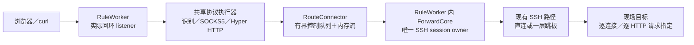

# SSH 内网代理：代码设计方案

日期：2026-10-21。状态：已实现并完成本地验证。本文件保留为实现基线与维护参考；未开启子智能体。

产品范围以 [功能与交互规划](ssh-network-proxy-plan.md) 为基线。本文根据当前源码细化实现边界、数据结构、线程归属、协议处理、IPC、界面、迁移和测试。文中的模块划分和接口约束对应当前实现；其中部分代码片段仍以设计示意形式保留，具体行为以源码和测试为准。

## 1. 本次拟确认的实现基线

1. 在原管理窗口增加“内网代理”，保留现有固定端口转发。产品窗口名称改为“端口转发与代理”，内部窗口标签、路由、Manager 和旧 IPC 名称保留。
2. 一条代理规则在一个本地回环端口上识别 HTTP/1 代理和 SOCKS5 CONNECT。HTTPS 通过 HTTP CONNECT 或 SOCKS5 透传，支持非标准目标端口。
3. 复用现有直连／一层跳板 SSH 路径，最终 SSH 节点负责访问目标和解析域名。Windows、Linux 现场节点均可使用，不安装远端代理，不调用远端 shell。
4. SSH 连接继续由每规则的 RuleWorker 单独驱动；协议模块用共享异步执行器，通过有界内存流请求 SSH 通道，不持有 `ssh2::Session`／`Channel`。
5. HTTP 使用 Hyper 的 HTTP/1 服务端与客户端连接 API；不自写 HTTP 请求体、chunked 和响应边界编解码，不使用会自行 DNS／拨号的通用 HTTP 客户端连接器。
6. 规则库升级到 schema v2，事务迁移旧配置，保留规则身份、版本、排列与原有运行设置。旧版本应用明确拒绝读取 v2。
7. 一期不接管系统代理、不自动启动专用浏览器、不提供 PAC／UDP／VPN／服务发现。完整 HTTP、SOCKS5、UI、迁移和兼容性验收通过后再对外提供此功能。

## 2. 当前代码事实及改造边界

| 当前文件 | 当前事实 | 本次处理 |
| --- | --- | --- |
| [model.rs](../src-tauri/src/port_forwarding/model.rs) | `Settings` 必须包含固定目标；`Runtime` 保存运行设置快照 | 增加分类型目标策略、结构化结果和代理诊断 |
| [store.rs](../src-tauri/src/port_forwarding/store.rs) | schema v1；JSON 配置与 ID／revision／server_id 同库存储；CAS 保存 | 增加 v1→v2 迁移及用途不可变约束 |
| [worker.rs](../src-tauri/src/port_forwarding/worker.rs) | `serve` 构造一个固定 `Target`；接受后直接 `enqueue`；`Clients` 登记全局连接数 | 保留监听／SSH 监督循环，增加固定转发／代理分支及可跨任务持有的配额 |
| [forwarding.rs](../src-tauri/src/ssh_transport/forwarding.rs) | `enqueue` 每次可传不同 `Target`；一个 owner 驱动 session；socket／probe 两种输入 | 增加通用内存流端点和打开后的激活闸门，保留旧入口 |
| [ssh_transport.rs](../src-tauri/src/ssh_transport.rs) | 跳板也使用同一 `ForwardCore`，并等待 `Opened` 才进入下一跳认证 | 只适配通用事件／端点签名，保持跳板时序 |
| [commands.rs](../src-tauri/src/port_forwarding/commands.rs) | 真实窗口和 generation 校验；测试对象是固定目标 | 复用现有命令，单独增加代理测试入口 |
| [observe.rs](../src-tauri/src/port_forwarding/observe.rs) | 完整状态帧、ACK、窗口代次、配置故障应急快照 | 扩展帧内容，不另建代理状态通道 |
| [portForwardApi.ts](../src/portForwardApi.ts)、[portForwardDraft.ts](../src/portForwardDraft.ts) | DTO 和草稿以固定目标为中心 | 改成显式联合类型；创建过程保留两种草稿 |
| [PortForwardEditor.tsx](../src/PortForwardEditor.tsx)、[PortForwardDetail.tsx](../src/PortForwardDetail.tsx) | 已有分组表单、地址、路径、统计和折叠诊断 | 扩展模式相关区域，共用生命周期与布局 |

不另建代理专用 Manager、规则数据库、认证系统或 SSH 连接体系。保留现有版本冲突、服务器引用检查、启动意图、窗口关闭与退出语义。已有其他未提交工作属于本次设计之外，实现时按文件和具体改动合并，不回退或覆盖。

## 3. 模块与资源归属

### 3.1 数据路径



listener 的绑定、接受、就绪判断及整个 run 的端口保留仍归 RuleWorker。代理分支接受 `TcpStream` 后，将其和配额交给协议任务，任务在执行器内转换成 Tokio stream。固定转发继续把 socket 直接交给 `ForwardCore`。同一 socket 不在两个执行器上同时注册。

### 3.2 拟新增文件

```text
src-tauri/src/
  port_forwarding/
    admission.rs          # RAII 客户端／协商／目标通道配额
    migration.rs          # v1 DTO、备份验证、事务迁移
    proxy/
      mod.rs              # ProxyRunScope、接入与协议分派
      executor.rs         # 应用内共享 Tokio 执行器及任务收尾
      connector.rs        # Open 队列、激活／取消通知与目标租约
      sniff.rs            # 首字节识别、预读保留
      socks5.rs           # 无认证 CONNECT 状态机
      http.rs             # Hyper 服务、CONNECT、逐请求转发、Upgrade
      headers.rs          # authority 校验、逐跳头与消息策略
      probe.rs            # 经实际本地入口的协议／目标测试
      error.rs            # 协议错误码、用户诊断字段
  ssh_transport/
    pipe.rs               # 有界双向内存流；不包含 HTTP／SOCKS 解析
    forwarding.rs         # 增加 FlowEndpoint 和激活闸门

src/
  NetworkProxyGuide.tsx   # 详情内联指南
  NetworkProxyProbe.tsx   # 代理测试表单与结果
  networkProxyGuide.ts    # 纯函数生成地址／示例／shell 转义

tests/
  network-proxy-ui.spec.ts
  network-proxy/          # 隔离 HTTP／TLS／WS／SSE 服务与验证脚本
```

小型内部类型随所属模块定义，不按类型数量机械拆文件。单元测试随模块放置；真实 SSH fixture 优先扩展现有隔离环境，不建立读取用户服务器配置的测试。

### 3.3 线程、任务与依赖选择

| 资源 | 所有者 | 边界 |
| --- | --- | --- |
| 规则监督、listener、最终 SSH session | 每规则一个现有 RuleWorker | 网络 I/O 不持有配置／数据库／运行视图锁 |
| SSH 连接尝试 | 现有 RouteJob | 认证、指纹及原取消机制不变 |
| 跳板 session | 现有 JumpDriver | 不把父 session 交给代理任务 |
| 本地代理协议任务 | 一个应用共享的 Tokio current-thread runtime | 每客户端一个异步任务；无每客户端阻塞线程 |
| Hyper 上游驱动、升级转发 | 所属客户端的受控子任务 | 客户端／路径退出一起取消并回收 |
| 双向字节队列 | Pipe 两端共同持有 | 各方向 32 KiB，背压和关闭都有唤醒 |

共享执行器在首次启动代理前准备，由 Manager 持有；准备过程在配置锁和 entry 锁外完成。执行器的启动失败只影响代理启动，原固定转发继续可用。所有子任务进入有界任务登记，不能 `spawn` 后遗失归属。

计划增加直接依赖：`tokio`（rt/net/time/io-util/sync）、`hyper`（client/server/http1）、`hyper-util`（tokio）、`http`、`http-body-util`、`bytes`；`rusqlite` 增加 backup feature。当前 lockfile 已含这些 HTTP／异步库的间接依赖，但实现时仍须显式声明使用关系和最小 features，不把间接依赖当稳定接口。以当前锁定 Hyper 1.12 系列的已检查 API 为设计基线，实施时记录最终锁定版本。

不新增前端动效库；本功能以静态切换和短透明度反馈实现，不引入手势位移动画。

## 4. 规则模型及 DTO

### 4.1 共同设置与目标策略

Rust 设计示意：

```rust
#[derive(Clone, Debug, PartialEq, Serialize, Deserialize)]
#[serde(rename_all = "camelCase", deny_unknown_fields)]
pub struct Settings {
    pub server_id: String,
    pub listen_address: String,
    pub listen_port: Option<u16>,
    pub auto_reconnect: bool,
    pub service: Service,
}

#[derive(Clone, Debug, PartialEq, Serialize, Deserialize)]
#[serde(tag = "kind", rename_all = "camelCase", deny_unknown_fields)]
pub enum Service {
    PortForward {
        #[serde(rename = "targetHost")]
        target_host: String,
        #[serde(rename = "targetPort")]
        target_port: u16,
    },
    NetworkProxy,
}

// Rule 继续保留 id / revision / name / web_scheme / settings。
// web_scheme 是现有“打开网页”的展示元数据；NetworkProxy 必须为 None。
```

JSON／TypeScript 对齐为：

```typescript
type ForwardService =
  | { kind: "portForward"; targetHost: string; targetPort: number }
  | { kind: "networkProxy" };

type ForwardSettings = {
  serverId: string;
  listenAddress: "127.0.0.1" | "::1";
  listenPort: number | null;
  autoReconnect: boolean;
  service: ForwardService;
};
```

代理配置不使用空主机、端口 0、虚构目标或多个可相互矛盾的开关。HTTP／SOCKS5 共端口为一期固定能力，不保存未实现的可选协议列表。新增设置中的未知字段、未知 kind 一律报错；v1 只通过显式迁移 DTO 读取。

### 4.2 校验及兼容约束

- 共同字段沿用名称长度／控制字符、服务器存在、回环地址、端口范围验证。`listenPort = null` 才表示自动分配。
- 固定目标使用统一的 `TargetAddress` 校验／规范化函数；代理输入的目标也经过它，统一 IPv4、IPv6、ASCII 域名和端口规则。
- 代理模式的 `webScheme` 必须为空；不能借它启用 `open_port_forward_web`。已保存规则的 `service.kind` 不可改变，Store 在 CAS 更新事务中核对旧用途，不仅靠禁用 UI。
- 固定转发仍允许编辑固定目标；网页 scheme 仍是展示元数据，变更它无需重建 SSH。`pendingChanges` 只比较规范化后的 Settings 和既有路径快照。
- 前端 `sameSettings` 改为显式逐字段／联合分支比较；原有浅比较不能继续比较嵌套 `service` 对象引用。
- 不在本机为代理域名调用 DNS；HTTP authority、SOCKS domain 规范化为目标字符串后直接发送给 SSH。需要 IDN 时由客户端传 ASCII A-label，一期拒绝不合法编码及含控制字符目标。
- 不限制为 RFC1918 地址：最终节点可达范围由 SSH 策略和现场网络决定；`127.0.0.1` 作为目标表示现场节点自身，不能误解为本机服务。

### 4.3 运行与诊断模型

`Runtime.settings` 保留整个启动时 Settings；运行中修改配置不改变它。新增字段拟为：

```typescript
type ProxyRuntimeInfo = {
  negotiatingConnections: number;
  waitingChannels: number;
  idleClients: number;
  activeTargetChannels: number;
  lastProbe: ProxyProbeResult | null;
};

type TargetOutcome = {
  at: number;
  source: "probe" | "connection";
  host: string;
  port: number;
  protocol: "tcp" | "socks5" | "httpConnect" | "http";
  stage: "protocol" | "channelOpen" | "relay";
  success: boolean;
  message: string;
};
```

固定转发的 `targetResult` 升级为带目标的结构；代理的主动测试结果与普通业务连接结果分别保存，业务失败不能覆盖正在查看的测试结论。`ProxyRuntimeInfo` 仅代理模式有值，固定转发为空。

现有 `activeConnections` 对代理表示已打开且尚未释放的目标通道，不包含协议协商和 HTTP 空闲客户端。诊断另有上述计数；有活动资源却暂无目标通道时，停止／重启仍依据后端资源状态判断。Summary 的连接数沿用业务通道统计，退出判定继续使用 active rules，不能只看连接数。

## 5. 存储、迁移与回退

继续使用 `port-forwards.sqlite` 和 `forward_rules` 表，不新增代理表。schema v2 改变 JSON 契约，现有 id／revision／server_id 列和索引保留。

迁移次序：

1. 初始化时读取 `user_version`。空库直接创建 v2；v2 按新类型校验；未知／更高版本拒绝打开，保留文件。不能因 list／反序列化失败创建替代空库。
2. v1 使用 `LegacyRuleV1`／`LegacySettingsV1` 严格读取；核对 JSON 与索引列的 ID、revision、server_id 一致，记录原排列。遇到损坏行则完整停止，不跳过。
3. 用 SQLite backup API 制作同目录、不覆盖旧文件的升级前备份，不能直接复制可能有 WAL 的主文件。验证备份可打开、`quick_check`、版本及全部旧规则可读取；备份失败则不迁移。
4. `BEGIN IMMEDIATE` 后重新读取原库。与备份快照不一致则回滚并报“配置在迁移前发生变化，请重试”，避免备份与最终迁移源不一致。
5. 在同一事务逐行改写 JSON 为 `service.kind = portForward`，保留 ID、revision、name、webScheme、本地地址／端口、目标、重连值、服务器引用及 rowid。迁移不递增用户编辑 revision。
6. 全部按 v2 解码验证后设置 `user_version = 2` 并提交；提交后才能启动规则与状态订阅。任何失败完整回滚，Manager 进入既有存储错误路径。

备份文件沿用应用目录的访问权限，名称带 schema、时间及随机后缀；不保存 SSH 凭据。实际恢复操作须关闭应用，保留当前 v2 数据并使用完整备份恢复，不在运行中覆盖 WAL 数据。降级会丢失备份之后新增的代理和编辑；文档明确这一边界，不承诺 v1/v2 并发写或自动双向同步。

测试采用临时目录／内存库，故障注入覆盖备份失败、行损坏、事务中断、列与 JSON 不符、未知类型和更高版本。

## 6. 代理与 SSH 之间的通道接口

### 6.1 两层标识和单一归属

保留现有 ruleId／runId／attemptId／window generation。新增只在后端使用的 `RouteGeneration`：同一个 run 重连替换 SSH core 时递增。它与客户端 ID、flow ID 一起隔离迟到操作。

```text
RunScope = ruleId + runId
RouteScope = RunScope + routeGeneration
ClientScope = RouteScope + clientId
FlowScope = ClientScope + flowId
```

一个代理客户端不能迁移到下一代 SSH。路径断开时关闭这代全部客户端、HTTP 空闲连接、内存流和子任务；重连只接收新连接。这样可防止旧页面请求在新认证身份下被继续发送。

### 6.2 拟新增内部请求

```rust
enum ProxyCommand {
    Open {
        scope: FlowScope,
        target: TargetAddress,
        origin: SocketAddr,
        endpoint: WorkerPipe,
        reply: OpenReply,
    },
}

// 设计接口：实际错误／取消类型由 connector 模块统一定义。
async fn open_target(
    connector: &RouteConnector,
    target: TargetAddress,
) -> Result<PendingTunnel, ProxyError>;

impl PendingTunnel {
    async fn activate(self) -> Result<ProxyStream, ProxyError>;
}
```

代理队列独立于现有认证／恢复控制队列，有界容量拟为 32；每轮 worker 取不超过 16 项，停止标志优先。队列发送成功即通知 `run.wake`。队列满返回明确的 busy，不能阻塞 SSH 线程。

`OpenReply` 在 `Update::Opened` 后返回，打开失败返回错误；core 接收请求不等于目标已连接。每个目标租约另有激活／取消原子状态和确认通道：`PendingTunnel.activate()` 设置激活意图并 notify worker，worker 校验 scope 后调用内部 `core.activate`，返回 Activated 确认后才交付可用流。激活和取消都不经过普通有界命令队列，避免成功回复已发出后因队列满而无法继续。状态转换中取消优先；激活前取消、停止、代次变化均失败。core 终结必须唤醒尚在等确认的任务。

HTTP、SOCKS5 和 CONNECT 都使用同一接口。一次 `Open` 只携带目标 host/port，不能携带任意 shell、URL 执行指令或另建 SSH 凭据。

### 6.3 通用有界内存流

`ssh_transport::pipe` 定义两个方向各 32 KiB 的环形队列。Worker 端提供非阻塞 `Read/Write` 与状态查询；协议端提供 `AsyncRead/AsyncWrite` 适配。共享 core 不依赖 Hyper／HTTP 类型。

- 队列满时停止读上游；有容量后唤醒对方。没有数据返回 WouldBlock／Pending，不返回伪 EOF。
- 写入、读取释放空间、半关闭、取消和目标就绪都能通知对应端；注册 waker 与状态复查在同一短临界区，防止遗漏唤醒。
- Worker 到异步任务使用标准 task waker；异步任务到 worker 使用现有 Poller notify。锁内只移动有界字节和更新状态，锁外调用 waker／notify。
- 两端都支持半关闭和错误终止。`poll_shutdown` 在已排队写入被消费后才完成目标方向关闭，不把“已排队”误当“已经发出”。
- Core 仍有现有双向 32 KiB 缓冲，内存 pipe 是额外一层；资源估算必须同时计算，不能宣称每连接总共只有 64 KiB。
- 默认不复用 pipe；drop 使所属 flow 取消，迟到打开成功仍按现有 pending libssh2 操作规则关闭。

### 6.4 ForwardCore 的最小扩展

拟引入内部 `FlowEndpoint::{Socket, Pipe, Probe}`，替代 `Option<Socket>` 隐含 probe 的分支；公开给旧调用者的 `enqueue(id, Option<Socket>, target, origin)` 保留为兼容包装。

新增 `enqueue_suspended` 和 `activate`：代理 flow 的 SSH 通道打开后停在 AwaitActivation。此阶段可以完成 libssh2 必要内部协议工作，但不读写目标业务、不消费预读业务前缀。

```text
Queued → Opening → AwaitActivation → Relaying → Draining → Closing → Finished
                   └→ Cancelled／失败 → Closing
```

`Opened` 表示 TCP 通道打开；新增 `Activated` 表示 core 接受激活。`Failed` 不能当作配额已释放，真正释放以 `Finished` 或整个 core 销毁为准。旧固定转发默认立即激活，旧 probe 打开后立即关闭，跳板行为保持不变。

Bytes 事件增加 flow ID／计量类别，或提供等效的逐 flow 聚合接口，避免将主动测试／成功回复计入业务。所有打开失败终结路径统一发出终结事件；如果同时发 Failed 和 Finished，客户端账目只能释放一次。

`wait` 按端点区分：真实 socket 沿用 polling 注册，Pipe 依靠 notify，AwaitActivation 不注册无意义读写。SSH socket 仍由 core 根据真实挂起方向等待。异步任务在其他线程前进时，notify 必须能打断等待；不能用把 200 ms 降成 1 ms 的忙轮询修复握手延迟。

现有 outbound pending 的同操作重试、缓冲地址稳定、channel-close 超时淘汰 session、keepalive 失败处理保持原约束。channel-open 的客户端期限到达后只结束对应 flow；保留尚未完成的 libssh2 open 及其原参数，继续驱动并清理迟到结果。不能为按 flow 取消或超时而强行删除尚需继续的 libssh2 pending 操作。`ForwardCore::drop` 终止全部 Pipe 并唤醒协议任务。

## 7. 本地协议处理

### 7.1 接入与识别

RuleWorker 只在 Ready 时交接代理 socket；认证中、重连中及停止中保持现有“接受后立即关闭”的行为，不把连接排到将来的 SSH 路径。接入时先取得全局／每规则 ClientPermit，再创建协议任务。

任务在 10 秒协商预算内读取首字节：`0x05` 进入 SOCKS5；合法 HTTP 方法 token 起始进入 HTTP 服务。SOCKS4、TLS 直连代理端口、HTTP/2 prior knowledge 和未知二进制拒绝，不在协议之间猜测重试。预读字节通过 `PrefixedIo` 还给对应解析器；不会丢首字节或握手后合包数据。

### 7.2 SOCKS5 CONNECT

```text
ReadGreeting → WriteSelectedMethod → ReadRequest → OpenTarget
  → WriteSuccessCompletely → Activate → CopyBidirectionally → HalfClose → Finish
```

- 无认证方法只接受客户端提供的 `0x00`；否则回复 `05 FF` 并关闭。
- 只支持 CONNECT；BIND／UDP ASSOCIATE 返回 command-not-supported。地址类型支持 IPv4、IPv6、域名，检查 RSV、长度、编码及端口；域名直接交给现场 SSH。
- 分段读取固定长度结构；握手总字节上限 16 KiB，合法 SOCKS5 报文本身远小于它。请求后的业务字节继续保留，不先发给目标。
- 目标真实打开后才写成功回复。BND.ADDR／BND.PORT 采用合法的 `0.0.0.0:0` 未报告形式，不伪称已知现场源端口；连接原始目标另作诊断。
- 成功回复完整写入客户端后才 Activate，并开始双向复制。回复期间客户端离开，租约取消目标通道，不发送业务。
- SSH 若只返回通用 channel open failure，不从错误字符串猜“DNS 不存在”或“连接被拒绝”；无法确认时使用 SOCKS 通用失败。明确的策略拒绝／已知类型再细分映射。
- 活跃流不套用协商总时限。正常 EOF 分别传递半关闭，保持已缓冲数据；停止或路径丢失则直接错误终止。

### 7.3 HTTP CONNECT

Hyper HTTP/1 服务端收到 CONNECT 后：

1. 只接受 `host:port` authority；IPv6 必须为 `[addr]:port`，端口 1–65535。拒绝 userinfo、控制字符、路径和不明确目标。
2. CONNECT 不接受请求体长度／chunked 声明；异常请求返回 400 并关闭，避免把 body 与后续隧道数据混淆。
3. 保存 `on_upgrade` future，等待 SSH Opened。失败时返回 502／503／504，不先返回 200。
4. 返回无 body、无 Content-Length／Transfer-Encoding 的 `200 Connection Established`，让 Hyper 管理响应和升级。
5. `on_upgrade` 成功后才 Activate。Hyper 升级对象保留提前读到的 TLS／业务字节，随后进行有界双向复制。

不直接从另一个任务向 Hyper 正在管理的 socket 写 200。成功回复与目标数据的顺序由升级边界保证，并以“目标一打开就主动发数据”的真实测试验证。TLS 的 SNI、证书、登录及内部 HTTP/2 原样通过，不做 HTTPS 解密。

### 7.4 普通 HTTP：每请求选择目标

使用 `hyper::server::conn::http1` 配合 `service_fn`；上游使用 `hyper::client::conn::http1::handshake`，其传输只能是已打开／激活的 `ProxyStream`。不调用系统 DNS、不调用本机直连 HTTP connector。

请求处理顺序：

1. 解析绝对形式 `http://authority/path?query`；仅有 origin-form、缺 authority、非法 Host、userinfo 或 fragment 的请求返回 400。本地端口不是普通网站服务器。
2. 支持 absolute-form `ws://` 作为合法 WebSocket Upgrade 的路由输入；不升级的 `ws://` 请求拒绝。`https://`／`wss://` 明文 absolute-form 拒绝并提示客户端使用 CONNECT，不悄悄建立远端 TLS 或转成本机直连。
3. 从 URI 的 authority 提取目标，空路径规范为 `/`，转发给源站时改为 origin-form。Host 由该 authority 重建，按规则处理默认端口和 IPv6。不让另一个 Host 把请求送到与 SSH 目标不一致的虚拟主机。
4. 清除代理专用头、普通逐跳头及 `Connection` 指定的头。保留原服务的 Authorization、Cookie 和端到端业务头，不记录其值。
5. 打开目标、Activate、建立 Hyper 上游 HTTP/1 连接。普通请求一期不复用上游连接池，向源站使用 `Connection: close`；客户端到代理的 keep-alive 仍可继续服务下一个目标。
6. 流式转发请求体与响应体，Data／Trailers 都经库处理并按策略过滤。HEAD、204、304、长度限定、chunked 与 close-delimited 按 HTTP 编解码器语义处理，不按字符串查找边界。
7. 每个客户端同一时间只允许一个上游请求／响应及所属目标租约；响应完整消费或错误终止后关闭该通道，等待 core Finished 确认再为下一请求打开新通道。流水请求保持顺序，有界预读，不提前为后续目标创建一批通道。

客户端连接可以先请求服务 A，再请求服务 B。第二次重新从 URI 取得目标，绝不继承第一个 Target。即使一期不做连接池，也必须通过此场景的真实字节／目标隔离验收。

### 7.5 HTTP 的边界策略

| 项目 | 具体设计 |
| --- | --- |
| `Expect: 100-continue` | 验证目标和完成通道打开后才 poll 下游 body，由 Hyper 按需向客户端发本地 100；上游删除 Expect，直接流式发送。未知 expectation 返回 417，不等待两端互相发 100 |
| 102／103 等临时响应 | 使用上游库按 HTTP 语义消费；一期不保证转发 Early Hints，不把 1xx 当最终响应返回。101 走独立升级流程 |
| WebSocket Upgrade | 检查合法 Upgrade／Connection token 和请求目标；例外保留必要升级头。上游返回 101 后，两个 on_upgrade 都完成才双向透传；非 101 则正常返回 HTTP 响应 |
| SSE／长下载／上传 | 流式、有界、不整体 collect；请求头计时不得包住整段 body，不因 10 秒协商预算关闭正常业务 |
| 响应已开始后的错误 | 关闭当前响应／客户端连接并记录目标级错误，不能再向同一响应追加第二个 502 |
| 早到最终拒绝响应 | 停止向上游传剩余请求体；如果下游 body 未消费完，返回最终响应后关闭下游，不把未读 body 误作下一请求 |
| 连接重试 | 不重放 GET／POST／上传，不在通道失败后尝试本地直连，也不自动重试到新 SSH 代次 |
| Trailer | 通过 Body Frame 传递并过滤禁止字段；不能将 trailer 中的代理认证／逐跳字段绕过头过滤 |

关于“冲突长度”的实现细化：当前锁定 Hyper 会拒绝不同值的重复 Content-Length；对同时带 Transfer-Encoding 和 Content-Length 的请求，库会采用 TE、移除 CL 并关闭该连接。本文采用这一标准化边界，确保向源站只生成一套明确 framing，而非声称 service handler 能看到并拒绝库已移除的原始 CL。**这将产品规划 P08 的“头部冲突被拒绝”细化为：不同 CL 拒绝，TE＋CL 规范化后关闭连接；属于本次待确认设计对该验收项的调整。** 不得在此基础上做原始报文拼接转发。若实际锁定库行为变化，以畸形报文测试验证后修订，不静默打第三方补丁。

逐跳过滤涵盖 Connection token 关联字段、Proxy-Connection、Keep-Alive、Proxy-Authorization、Proxy-Authenticate 等；Transfer-Encoding／Content-Length／Trailer 由 Body framing 决定，不能简单删除后保留不匹配的原始正文。WebSocket 升级与 `TE: trailers` 单独按合法语义处理。

源站的真实 401／403／404／500、重定向 Location、Cookie 域和内容压缩原样保留，不把应用错误改称代理故障。无需为原服务修改 Host、SNI 或网页内容。

### 7.6 时限和头部边界

首字节识别／SOCKS 协商总预算 10 秒；请求头含起始行上限 16 KiB、头字段数量上限 100。显式配置 Hyper 的头大小、缓冲上限和 Timer，不能使用约 400 KiB 的默认连接读缓冲作为产品约束。

HTTP/1 请求头阶段拟使用 10 秒 `header_read_timeout`。已检查的 Hyper 从准备读取请求头时开始计时，因此它也约束 keep-alive 等待下一请求的时间；本方案明确接受 HTTP 空闲连接约 10 秒后被关闭并由客户端重连，不另承诺更长的独立空闲窗口。这一计时不作用于进行中的响应 body、SSE、CONNECT 或升级连接。到达协议上限的异常输入使用库可提供的 400／408／431 或直接关闭，不保证每类解析失败都有可读正文。

目标 SSH open（含排队）／close 采用 12 秒／5 秒。open 超时向客户端报告 HTTP 504／SOCKS 通用失败，释放客户端并保留 SSH 代次；未完成的 libssh2 请求继续收尾，迟到的成功通道立即关闭，不再发布该 flow 的结果。libssh2 的串行 open 状态意味着新请求可能等待前一个请求收尾，排队客户端也按期结束；已打开的通道继续驱动。传输故障与不能安全恢复的协议发送仍淘汰 SSH 代次。活跃 stream 不增加任意总时长限制。

## 8. 配额、取消与生命周期

### 8.1 两类配额

`ClientPermit` 在接受本地连接时取得并沿客户端整个生命周期持有，覆盖识别、握手、HTTP 空闲和传输。`TargetLease` 管理已排队／打开／关闭的 SSH 通道，归属一个 client 或内部 probe，不重复把同一个业务客户端计入全局连接数。

| 预算 | 设计值与计数方式 |
| --- | --- |
| 运行规则 | 固定转发＋代理合计 32 |
| 客户端 | 每规则 64、全局 256；未协商和空闲 HTTP 也占用 |
| 协议协商 | 每规则最多 16；取得方法／首请求目标后释放协商许可，后续 HTTP 请求受原 ClientPermit 管理 |
| 等待／正在打开 SSH 通道 | 每 core 8；排队前和 core 接收时均检查，不形成无界外层队列 |
| core flow | 沿用 64，包含关闭中通道；每客户端最多一个目标租约，probe 共享容量 |
| Pipe | 双向各 32 KiB，外加原 core 双向各 32 KiB |
| HTTP 缓冲 | 头 16 KiB／100 字段；显式限制双端 Hyper 读写缓冲，流式 body 不加无界队列 |
| 事件 | 每规则最多 200，重复事件合并；状态流沿用 ACK 与按秒采样 |

内部 probe 连接也取得资源许可，不能绕过 64／256；在入口接受前发起测试的本地连接最多每规则一个，属于受控的临时资源。满额时返回忙碌，不驱逐正常业务。

RAII 配额不在 `Failed` 事件时提前返还；失败回复排空、pending 通道关闭和子任务退出仍占资源。ClientPermit 由 client scope 持有，只有其任务和未终结 TargetLease 都释放才返还；防止不断失败握手绕过上限积累 closing flow。

### 8.2 停止和重连

- Stop：先关闭接受门禁和当前 route scope，设置现有 stopped 标志并唤醒 worker；取消协议任务、内存流、probe；释放 core／route job；等待所属任务确认结束后才发布 done。
- 运行 SSH 断开：失效当前 routeGeneration，终止所有这一代客户端，包括没有目标通道的 HTTP 空闲连接；保留实际 listener 端口，继续现有重连退避。旧请求绝不在新路径上恢复。
- 首次启动失败：释放 listener、任务和配额，保留已保存规则，显示启动失败。
- 窗口关闭：沿用 `ever_ready`；未首次成功的运行取消，已成功运行继续后台工作，当前认证尝试按原代次取消。指南的 React 状态不持有后端运行资源。
- 应用退出：现有 Manager 先 stop 全部规则，等待各 run 和任务收尾，再停止共享执行器。超时不声称已经释放；仍可按原退出逻辑重试。

取消／任务收尾使用独立唤醒，不借普通待满队列传递“必须停止”的操作。所有 async task 在等待 OpenReply、socket、pipe、body、upgrade 时都能响应 scope 失效。正文转发任务和 Hyper connection driver 必须纳入同一 client scope，不能让 detached driver 持有端口或配额。

## 9. 错误、计量和隐私边界

### 9.1 错误映射

| 故障 | HTTP／SOCKS 响应 | 后端状态 |
| --- | --- | --- |
| 无效协议、目标、authority | HTTP 400／417／431 或关闭；SOCKS 对应格式／地址错误 | 仅结束客户端，不改变 Ready |
| 目标 channel 被拒绝 | HTTP 502；SOCKS 通用或可确认的细分类 | 目标级事件，其他流继续 |
| 明确超时 | 未返回响应时尽可能 504／SOCKS 通用失败 | 若 core 必须淘汰，转路径故障并关闭该代 |
| 连接／打开队列配额满 | 已能解析请求时 503／SOCKS 失败；接入满额可直接关闭 | Ready 保持，受控合并提示 |
| SSH 身份、指纹或路径失效 | 已开始的传输关闭；新业务暂不可用 | 原 reconnecting／attention 流程 |
| 源站 HTTP 4xx／5xx | 原样返回 | 不是代理连接错误 |

网络错误不一律升级为规则失败，业务输入错误也不触发 SSH 重连。不要解析本地化错误字符串伪造准确原因。内部错误携带 scope／target／protocol／stage／可重试性，用户可见消息由固定模板生成。

### 9.2 流量统计

沿用 TrafficPurpose::PortForward 记录整个 SSH 连接通信，跳板外层不重复挂账。规则“业务流量”计算成功写入目标 channel 的字节，以及成功交付客户端的目标数据：

- SOCKS／CONNECT 的协商和本地成功／失败回复不计入业务。
- 普通 HTTP 的转发报文计业务，含 HTTP 头／正文／framing，不声称是纯正文体积；本地产生的代理错误不计业务。
- HTTP 接收侧在目标响应实际送往客户端时累计，不能把已从 SSH 预读但客户端未消费的字节算成交付。HTTP 重编码后统计是客户端输出视角，不与原始 SSH 字节强行相等。
- 测试使用 Probe 计量类别，经过真实路径但不加入业务发送／接收；SSH 总账仍自然包含其开销。
- 同一个方向只在一个归属点计数；受控任务以累计值／合并 delta 上报，不能每小块经 Tauri 发事件或保存无界消息。

### 9.3 事件与日志

只保留目标 host／port、协议、阶段、时间和固定错误码／说明。不将完整 URI、查询、Cookie、Authorization、Proxy-Authorization、正文或 TLS 内容写入 notes、诊断和前端错误。

特别处理 Hyper 错误：不把未知 `Display`／`Debug` 整段直接透传，它可能带报文片段；先映射固定分类。测试 IPC 的诊断只记录操作名、标识及成功／失败，不倾倒请求参数。普通无效协议噪声计数／合并，不用每个失败刷新整个页面。

## 10. IPC、测试入口与状态帧

### 10.1 既有命令

保留 `save/start/stop/apply/delete/resume/answer/subscribe/ack_port_forward*` 的名称和归属校验。Save 接受新 Settings，Start 根据 `service.kind` 分派；Apply 仍由后端固定意图／版本后停止并启动，不能改成前端拼接。

`open_port_forward_window` 的固定目标 seed 继续只创建 portForward；通用新建默认固定转发。窗口标签 `port-forwarding` 和 `?port-forwarding=1` 保持，避免改动 capability／窗口生命周期约定；原窗口标题和入口提示的用户可见文案更新。

`open_port_forward_web` 增加后端用途校验，仅允许固定转发；代理模式即使收到伪造 IPC 也拒绝。旧 `test_port_forward` 保持固定目标 TCP 测试和取消行为，不把空目标解释成代理。

### 10.2 新增命令

```typescript
type ProxyProbeRequest = {
  protocol: "httpConnect" | "socks5";
  target: { host: string; port: number };
};

// test_network_proxy:
// generation, id, runId, request -> probeId
// cancel_network_proxy_test:
// generation, id, runId, probeId -> void
```

Rust 检查真实窗口／generation、规则用途、当前 run/route、Ready、目标格式、单次测试互斥。启动前原子预留 probeId；控制交接失败撤销预留。调用者不指定本地 URL、SSH 路径、代理地址或任意 HTTP 请求正文。

后端在共享执行器内连接 Runtime 中真实的回环地址，以 SOCKS5 CONNECT 或 HTTP CONNECT 发送目标，走与浏览器完全相同的代理解析和 SSH 通道路径。测试不只调用 `core.enqueue(None)` 跳过代理层。

测试先创建 Tokio TcpSocket 并绑定回环临时端口，取得 local_addr；将该地址、真实代理目标地址、run／route／probe 登记后，才执行 connect 和发送握手。这样在 listener accept 之前已有精确匹配记录，避免“已接受后才登记”的竞争。服务端按完整连接元组匹配内部 probe，以取得目标打开结果、标识和不计业务的类别；登记仅消费一次，连接失败、取消、超时或结束即删除，不能仅因来源是 loopback 就把普通客户端当测试。

结果至少包含 probeId、runId、协议、target、开始／结束时间、阶段及成功与否。成功只说明“本地协议握手＋当前 SSH TCP 目标通路”通过；不发业务 HTTP 请求，不校验证书、登录或页面健康。HTTP CONNECT 测试也不代替普通 HTTP 正向代理的集成验收。

取消、窗口代次失效和 route 变化关闭探测 socket／租约，清理 reservation，抑制迟到结果。测试默认目标仅保存在当前 UI 草稿；可用于命令示例，不混入规则固定配置。

### 10.3 状态与权限接入

扩展现有 Frame，不增加每客户端事件订阅。`Runtime.proxy`／结构化 targetResult／lastProbe 随完整帧发送，ACK 机制保持。协议任务只更新有界后端汇总，不直接调用前端 Channel。

新增命令在 `lib.rs` 注册，在诊断 command allowlist 中加入名称并补充参数处理测试；检查既有 capability 仅允许本来就能管理规则的窗口，不开放任意网络、shell 或系统代理权限。

## 11. 前端代码与 Apple Design 落地

### 11.1 组件分工

| 文件 | 具体变更 |
| --- | --- |
| `portForwardApi.ts` | 联合类型、代理运行／测试 DTO、两个新 IPC 封装、emptyNetworkProxy |
| `portForwardDraft.ts` | 新建两种草稿、按用途校验、独立默认端口和构造 Settings；字符串端口提交前不转数字 |
| `portForwardPresentation.ts` | 当前运行优先、service 分支、类型文案、代理 URL、搜索、显式设置比较 |
| `PortForwardApp.tsx` | 统一规则列表；管理新建用途；首次成功时展开指南的瞬时意图；seed 固定转发兼容 |
| `PortForwardEditor.tsx` | 新建时用途 radio group、模式相关字段、编辑用途只读、提交／重启语义保持 |
| `PortForwardDetail.tsx` | 根据用途选择地址文案、复制项、指南与测试；复用运行／流量／控制区 |
| `PortForwardPath.tsx` | 末节点改成类型化数据：固定服务或“现场网络／由请求指定目标”，不伪造固定地址 |
| `NetworkProxyGuide.tsx` | 详情内联展开：浏览器／命令行，原位复制，不叠欢迎弹窗 |
| `NetworkProxyProbe.tsx` | host、port、协议、测试／取消、分阶段结果，目标错误留在诊断区域 |
| `networkProxyGuide.ts` | 纯函数生成 HTTP／SOCKS URL 和 Windows／POSIX 示例，集中转义与占位符策略 |
| `port-forwarding.css` | 基于现有 token 添加分段选择、内联指南与紧凑测试行，补偏好覆盖 |

不为“内网代理”复制整个 Editor／App。共享区域保持稳定 DOM 和 key；切换规则时只替换必要内容，不因每秒流量帧重置指南、测试草稿或复制状态。

### 11.2 新建、编辑与首次使用

新建草稿容器为 `{ selectedKind, drafts: { portForward, networkProxy } }`；两种用途分别保留名称、端口、目标等输入。代理默认固定 1080／IPv4 回环／自动重连；自动分配位于高级选项。不把旧固定目标端口自动同步逻辑套到代理草稿。

新建用途使用原生 radio group＋分段外观，方向键／空格依标准 radio 行为；当前选择 `aria-checked`，两个标签都有清楚用途说明。保存后的用途只读，后端同样禁止转换。

保存意图仍为 save／start／restart。成功保存但启动失败保留规则，单独显示启动结果。代理第一次“创建并启动”通过后，当前详情内展开指南一次：意图只属于本窗口这次创建动作和 run，不由每次 ready 帧触发，不在重连／重开窗口反复弹出；用户已选择其他规则时不抢回选择。

运行中旧配置和下次启动设置继续可区分。代理无固定目标或打开网页选项；固定规则仍保留现有网页入口。停止／重启前使用后端当前资源计数，实际有业务连接时说明影响，避免重复确认。

### 11.3 指南及复制

- 地址主操作显示实际运行地址；IPv6 使用方括号。复制下拉增加 `http://[host]:port` 与 `socks5://[host]:port`，curl 用 `socks5h://` 体现现场 DNS。
- `window.navigator`／现有平台信息只推断本机命令写法，不根据远端 OS 选择命令。Windows 显示 `curl.exe`（PowerShell），其他显示 `curl`（POSIX shell），允许切换查看。
- 示例以已验证 host／port 构造最小 URL，不复制用户完整含参数业务地址。Windows 单引号按 PowerShell 转义，POSIX 单引号按 shell 转义；传参始终加引号。只复制，不执行命令。
- 尚无测试目标时显示标明“示例”的地址；不显示看似已验证成功的命令。保留服务原地址访问、HTTP／HTTPS 均需代理、SOCKS 远程 DNS、内网绕过／NO_PROXY、TCP 回退等说明。
- curl 示例可用 `--noproxy ""` 排除环境 NO_PROXY 干扰，并解释其仅作用于该命令；不会更改用户环境变量。
- Chrome／Edge 依据系统代理或用户已有工具说明；不虚构它们普遍存在独立代理设置。Firefox 可作为独立浏览器配置示例。无系统代理已完成的虚假检测或自动启用开关。

### 11.4 可验收的视觉、交互约束

| Apple Design 原则 | 代码层实现约束 |
| --- | --- |
| 清楚层级 | 原详情首屏突出状态／本地代理地址；指南为次要动作；诊断默认折叠。不堆新的全尺寸边框卡片 |
| 平台一致 | 复用 WindowTitlebar、DialogHeader、PortForwardMenu／Confirm；Windows 窗口控制与系统字体不变 |
| 统一材质 | 引用 `--material/--sheet/--surface`、现有字号／圆角／阴影；实色内容面，浮层才使用材质，不叠多层玻璃 |
| 即时反馈 | :active 在按下时反馈；复制按钮原位变“已复制”，固定宽度、保留焦点；异步请求不等动画才发出 |
| 可中断 | 用途和指南先采用即时布局＋约 120–180 ms opacity 反馈；不锁输入、不播放完整面板位移。以后若加入弹性位移，须从当前呈现状态继续并默认无回弹 |
| 稳定数字 | 地址使用 `--mono`、统计使用 tabular-nums；帧刷新不触发重新进场或改变按钮宽度 |
| 键盘和焦点 | 原生表单语义；错误关联 aria-describedby；提交聚焦首错；关闭弹窗／菜单回触发点；指南收起若焦点在内部则回“如何使用” |
| 偏好适配 | reduced-motion 取消新增过渡；reduced-transparency 使用实色；contrast-more／forced-colors 提供边界与可见焦点 |
| 可读性与尺寸 | 沿用 rem、系统字体和约 1.5 中文行高；1100×760／800×560、长 IPv6、文本放大时可滚动，弹窗底部操作可达 |

radio 的键盘切换和业务提交立即响应，不引入为动效服务的延时。`aria-live` 只播报复制／测试／有意义运行状态变化，不每秒播报速率。协议缩写保留在帮助和诊断中，主任务仍是“选择现场节点并访问服务”。

交互原型在确认进入实现后，以真实组件做最小可操作版本，验证快速切换、焦点、长内容和最小窗口后再完善视觉；本轮未制作原型代码。

## 12. 测试方案与验收映射

### 12.1 第一批必须验证的技术点

| 技术点 | 需要证据 | 不通过时处理 |
| --- | --- | --- |
| 内存流／通知接入 | 空闲无忙轮询；双向满缓冲、半关闭、激活前目标主动发送、停止时所有等待能醒 | 修复桥接和 core，不以定时轮询替代 |
| Hyper 与 SSH stream | CONNECT 早到 TLS、逐请求不同目标、上传／chunked／trailer、100、WS 101、SSE 实测 | 调整协议适配，不降低为首目标永久透传 |
| libssh2 pending 兼容 | 排队／打开／写入／关闭挂起时取消，旧固定转发和跳板并行回归 | 保持既有 owner／pending 约束；需要换库或底层补丁则先修订方案 |

### 12.2 测试分层

1. Rust 单元：联合类型／用途校验、目标规范化、迁移／回滚、Pipe 字节与唤醒、SOCKS 拆包／合包／错误、头过滤、authority、scope 失效、RAII 配额、错误脱敏、计量不重复。
2. 协议集成：真实 loopback 客户端连接代理，HTTP A/B 复用同一客户端连接、CONNECT 非标准 TLS 端口／提前发送、SOCKS IPv4／IPv6／域名、远端 DNS、TE/CL／重复长度／畸形 chunked、并发 64 边界、slow header、取消半开、半关闭和断线。
3. 业务兼容：GET／HEAD／POST／multipart、100／早到最终拒绝、原始 401／重定向／Cookie、gzip、长下载哈希、WebSocket 双向、SSE 多事件；确认没有 body 全量缓冲或自动重试 POST。
4. 真实 SSH：扩展现有 Paramiko fixture 和 OpenSSH 容器环境，验证直连／跳板／仅允许转发账号／PermitOpen 拒绝／重连／指纹变更；单目标失败不影响其他目标，整条路径失败关闭全部旧客户端。
5. UI：新增代理独立 Playwright spec，并加入现有 port-forwarding 测试配置与脚本覆盖；验证草稿切换、原固定 seed、用途只读、复制当前端口、指南只展开一次、测试取消／迟到、target 失败仍 Ready、pending 设置不覆盖运行地址。
6. 原生：Windows 本机＋Windows OpenSSH／Linux SSH 现场组合；目标发布平台的 IPv6／休眠／端口冲突／退出；Windows Edge／Chrome／Firefox 及其 DNS、绕过规则与 WebSocket 行为。macOS／Linux 构建和原生验收单独记录，不能由 Windows 构建代替。

所有协议与 SSH 服务使用隔离目录、测试账号、随机端口和自生成证书，不向用户现有 `192.168.1.186` 或现场服务主动发送测试。本机到库支持通过单元／fixture 不等于真实 Windows OpenSSH 兼容已通过。

### 12.3 与产品验收编号对应

| 功能规划编号 | 本代码方案的主要验证位置 |
| --- | --- |
| P01–P05（原链路、无远端组件、平台、协议、远端 DNS） | proxy/socks5、http、connector；真实 HTTP／SSH 与 Windows／Linux 现场验证 |
| P06–P09（TLS、完整页面、HTTP 完整性、长连接） | HTTP／CONNECT／SOCKS 隔离服务及浏览器；上传下载、100、跨目标、WS／SSE；P08 按 7.5 的显式调整验收 |
| P10–P12（故障隔离、重连、取消与容量） | pipe、admission、worker、RouteScope；断线／取消／迟到交错及满额用例 |
| P13–P14（旧功能兼容、真实代理测试） | migration、commands、draft／presentation、proxy/probe；旧固定转发全套回归 |
| P15–P18（视觉、无障碍、浏览器、负载） | 新增 UI spec、原生浏览器验证、CPU／内存／句柄实测 |
| P19–P20（日志与迁移故障） | 脱敏／计量断言、临时库迁移／恢复／旧版本拒绝验证 |

验收时逐项按功能规划 P01–P20 填写实际证据；P08 的 TE＋CL 行为按本文 7.5 调整，其余场景沿用原文。上表只作实现定位，不以编号分组替代场景检查。

### 12.4 实施后的检查入口

按实际修改执行 `cargo fmt --check`、相关 Rust tests、`npm test` 中受影响用例、`npm run test:port-forwarding`、`npm run build` 和 Rust 平台构建检查；真实 SSH 的 ignored tests 与平台原生用例显式执行并单独记录。未具备条件的项目标为未验证，不能把编译成功当协议／浏览器通过。

本次只新增设计文档，不运行应用测试或迁移；文档校验不构成以上测试的结果。

## 13. 实施批次、文件影响与完成条件

| 批次 | 主要工作／文件 | 完成条件 |
| --- | --- | --- |
| C0：通道与协议验证 | Cargo 直接依赖、pipe、ForwardCore 闸门、最小 connector＋Hyper／SOCKS、隔离 fixture | 三个技术点取得证据；固定转发／跳板回归通过 |
| C1：模型与存储 | model、migration、store、manager 引用／快照；同步 DTO 与旧 fixture | v1 完整迁移／故障回滚；新旧用途均可保存，旧规则行为保持 |
| C2：完整代理后端 | proxy 各模块、admission、worker、probe、停止／退出、计量 | HTTP／CONNECT／SOCKS5、多目标、WS／SSE、容量／取消通过，无残留任务 |
| C3：窗口与使用流程 | Editor／Detail／Path／Guide／Probe、样式、命令注册／诊断 | 端到端创建／配置指南／测试／停止可用，Apple Design 与旧入口回归通过 |
| C4：平台及发布验证 | native／真实 SSH／浏览器／可访问性／负载、实施记录 | P01–P20 有结果；所有未验证限制明确列出，完整协议就绪后才对外呈现 |

C0 在隔离测试入口使用暂定类型，不先改写真实规则库；C1 的后端与前端 DTO 作为同一批同步，避免中间工程无法解释原规则。未完成 C2 前，不在正常 UI 展示一个实际只支持 CONNECT 的“完整 HTTP 代理”。

外围必要变更：`lib.rs` 注册两个命令和执行器收尾；`diagnostics/commands_allowlist.rs` 增加命令名；窗口标题／按钮提示／QuitDialog 等文案改为含代理。保留 TrafficPurpose 枚举和通信分类，不新造重复统计类别；不为此功能重命名整个 port_forwarding 目录。

### 13.1 关键风险与应对

- **HTTP 转发语义复杂**：使用成熟 HTTP/1 编解码，第一批验证真实请求体、升级和跨目标复用；不把编译成功当完成。
- **共享 SSH 内核回归**：保留旧 enqueue 默认行为；内存端点／激活为增量接口，固定转发和跳板同时验证。
- **取消和重连交错**：run＋routeGeneration＋flow 归属、独立取消唤醒、终结时才返还配额；不能用前端状态判断资源已释放。
- **数据升级失败**：备份 API、验证、事务迁移、未知 schema 拒绝；不自动清空／降级读取。
- **浏览器配置差异**：指南明确远端 DNS、内网绕过、HTTP／HTTPS 配置；不声称能接管或检测用户浏览器设置。

确认本方案后，实施范围即为上述 C0–C4；若技术验证要求更换 SSH 库、修改协议承诺、引入第三方补丁或扩大系统网络接管范围，先更新具体设计供用户决定，不静默扩大改动。

## 14. 当前交付状态

已完成代码设计文档及源码核对。当前没有新增可运行代理、修改实现／依赖或执行数据库升级；等待用户最终确认后，才进入 C0 并开始改代码。
