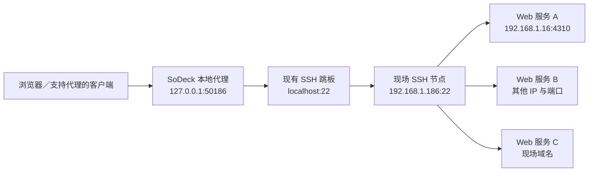

# SSH 内网代理：功能与交互规划

日期：2026-10-21。状态：待评审的规划建议，尚未实现。本轮仅新增本文，不修改业务代码，不建立实际代理或变更系统网络设置。

本文根据当前端口转发实现、用户提供的现场链路，以及 apple-design 的设计原则制定。既有功能基线见 [端口转发需求](port-forwarding-requirements.md)、[总体设计](port-forwarding-design.md) 和 [实施记录](port-forwarding-implementation.md)。下文明确区分已有能力与拟新增能力，不把旧测试结果视为新代理功能的验证证据。

## 1. 要解决的问题

当前一条规则把本机端口固定连接到一个远端目标。例如：

```text
本机 127.0.0.1:50185
  → VPN／跳板节点 localhost:22（模拟）
  → 现场 SSH 节点 192.168.1.186:22
  → 固定服务 192.168.1.16:4310
```

新需求是为一个现场建立统一访问入口。浏览器配置一次代理，即可使用各服务原来的地址，访问现场 SSH 节点可达的多个 Web 服务，无需逐服务建立转发。

用户仍在地址栏输入 `http://192.168.1.16:4310`、其他内网 IP 或内网域名；本机代理地址填写在客户端代理配置中。代理入口本身不是服务导航网站，也不自动发现现场服务。

“现场内网”描述用途，不代表自动获得整个集群的路由。实际可达范围、域名解析和 SSH 转发权限均以最终 SSH 节点为准。只在 Pod 网络内可达的地址，需要最终节点本身具备相应访问路径。

## 2. 建议采用的产品方案

新增一种规则用途：**内网代理**。由 SoDeck 在本机监听代理请求，根据每次请求的目标，通过现有 SSH 路径建立连接。最终现场节点可以是 Windows 或 Linux，无需另外安装 HTTP 代理，也无需拥有远程交互式 shell。



示例新用 `50186`，避免与当前 `50185` 的规则冲突；停止旧规则后也可复用 `50185`。

### 2.1 一期完整交付：同一个端口支持 HTTP 与 SOCKS5

产品只呈现“内网代理”，自动识别 HTTP 代理请求和 SOCKS5 请求。无需让用户创建两条规则、记住两个端口，或在新建表单里判断协议。

| 能力 | 用途 | 用户如何选择 |
| --- | --- | --- |
| HTTP 正向代理 | HTTP 网页、API，以及通过 CONNECT 访问 HTTPS | 在客户端选择 HTTP 代理 |
| SOCKS5 CONNECT | 浏览器及其他支持 SOCKS5 的 TCP 客户端 | 在客户端选择 SOCKS5 |
| 现有固定端口转发 | 单个 Web、数据库或其他 TCP 服务 | 继续选择“端口转发” |

自动识别只发生在本地连接开始时；不进行两种协议之间的猜测重试，也不在代理失败时转为本机直连。

技术上先完成 SOCKS5 和 HTTP CONNECT，随后完成普通 HTTP 请求；两部分全部通过验收后，才对外宣称“HTTP / SOCKS5 共用端口”。这是内部实施顺序，不是让用户面对未完成的协议选项。

### 2.2 远端 HTTP 代理仍是一种现有功能用法

用户原先提出的“现场运行 HTTP 代理，再转发到本机”完全可行。它可继续通过现有固定端口规则使用，适合已经部署了组织代理、需要远端代理认证或访问策略的场景。

本次新功能不负责在远端安装、更新、启停代理服务。原生内网代理让常见用法只依赖现场 SSH 服务；已有远端代理的规则也不自动转换。

## 3. 当前可复用的基础与实际缺口

| 当前实现 | 已有能力 | 本次新增工作 |
| --- | --- | --- |
| `connection.rs` | 直连／一层跳板、认证、指纹验证、连接上下文 | 复用；代理业务不建立终端或 PTY |
| `ssh_transport/forwarding.rs` | 每条连接可携带自己的 `Target`；独占 SSH session，多通道收发、背压、半关闭 | 提供代理握手所需的分阶段激活与预缓冲接入；回归跳板和固定转发 |
| `port_forwarding/worker.rs` | 本地监听、客户端登记、运行快照、重连、停止、资源清理 | 从“统一固定目标”扩展到“逐连接／逐 HTTP 请求确定目标” |
| `port_forwarding/model.rs`、`store.rs` | 固定目标规则、JSON 配置存储、版本冲突检查 | 规则用途、分类型配置及版本迁移 |
| `commands.rs`、`observe.rs` | 独立窗口、调用归属、认证挑战、带 ACK 的状态流 | 代理测试与模式相关 DTO，沿用旧结果隔离机制 |
| `PortForwardEditor`、`PortForwardDetail` | 分组表单、地址、路径、流量、折叠诊断、复制反馈 | 用途选择、精简代理表单、客户端使用说明与多目标诊断 |
| `theme.css`、公共弹窗／菜单 | 系统字体、浅深主题、材质变量、对比度和减少动态效果支持 | 继承并补齐新组件覆盖，不另建视觉体系 |

现有 SSH 内核是合适基础，但当前本地连接接受后会直接进行字节转发。代理还需要握手、成功／失败回复及 HTTP 报文处理，因此不能仅给规则增加一个类型字段就完成。

## 4. 信息架构与入口

### 4.1 在现有管理窗口内扩展

- 窗口及主入口提示名建议改为“端口转发与代理”，含义直接，保留用户对原功能的识别。
- 继续使用侧栏列表与右侧详情，不新增独立代理管理窗口或主应用一级页面。
- 工具栏保留一个“新建”按钮；侧栏统一称“规则”。
- 列表中用小图标和次要文字区分“端口转发”“内网代理”，运行状态仍位于熟悉的位置。
- 搜索涵盖名称、类型、当前本地地址、最终服务器和跳板。已有服务器筛选继续适用。
- 规则较少时不增加分组、分页或类型筛选器；先用清楚的列表行解决辨识。

### 4.2 继承现有上下文入口

从服务器或会话入口打开窗口，仍先显示该服务器的已有规则，并在新建时预选它；不会因进入窗口而自动建立代理。

Docker、容器端口等已有“转发此端口”入口继续创建固定目标规则，默认选中“端口转发”。通用“新建”也默认端口转发，用户可在同一表单切换用途。

## 5. 新建与编辑流程

### 5.1 新建表单

顶部使用两段选择控件：**端口转发｜内网代理**。两个选项下分别提供一句简短用途说明：

- 端口转发：“将一个远程服务连接到本机端口。”
- 内网代理：“通过这台服务器访问多个服务。”

切到内网代理后，主要字段如下：

| 分组 | 字段／行为 | 默认值 |
| --- | --- | --- |
| 基本信息 | 名称，可编辑；随首次选择服务器建议名称 | 例如“现场节点 · 内网代理” |
| 连接路径 | SSH 服务器；展示其现有跳板 | 沿用入口预选；跳板在服务器配置中管理 |
| 本地代理 | 本地端口 | 固定端口，建议 `1080` |
| 高级选项 | 自动分配端口、IPv4／IPv6 回环、断线自动重连 | IPv4 回环、自动重连开启 |

代理表单不显示固定“目标地址／目标端口”和“网页打开方式”。说明文案为：“目标由浏览器或客户端的请求决定，由所选服务器连接。”

端口 `1080` 只是建议，不预留、不承诺可用。发现已知冲突时在字段旁提示，绑定时仍以操作系统结果为准；发生冲突保持原值并让用户修改，不悄悄换端口。自动分配适合临时使用，注明再次启动后客户端可能需要更新端口。

在新建弹窗里往返切换用途，分别保留两种草稿；不会把固定目标错误带入代理配置。已保存规则的用途只读，如需另一种用途则新建规则，避免改变规则身份及运行含义。

底部沿用“创建后启动”“取消”“创建并启动”。字段在离开后就地校验；提交无效时聚焦首个问题，保留草稿。

### 5.2 编辑与应用

沿用已有语义：名称立即更新；服务器、跳板路径、本地地址、端口和重连策略等运行设置默认下次启动生效。用户可显式选择“保存并重启”。

运行详情同时区分当前运行与下次启动配置。状态流不得覆盖编辑中的草稿；保存成功但启动失败分别反馈，不显示成“保存失败”。

停止零连接的代理直接执行；停止或重启存在业务连接的代理，在操作前说明会断开的连接数，仅确认一次。删除保留既有明确确认。

## 6. 代理详情页

### 6.1 首屏层级

顺序与现有详情保持一致，主要回答“是否就绪、入口在哪、如何使用、通过哪里”。

```text
现场节点 · 内网代理                         停止   ⋯
● 已启动 · 已运行 3 分钟

本地代理地址
127.0.0.1:50186                         复制地址 ▾
HTTP / SOCKS5 · 在浏览器或客户端中配置此地址。
如何使用

连接路径
本机 → localhost → 192.168.1.186 → 现场网络
                                      由请求指定目标

本次运行
活动连接             发送                 接收
4 条                  …                    …

▸ 连接检查与事件                      尚未测试服务
```

- 地址是页面最醒目的信息；复制是入口区域唯一强调按钮。
- “如何使用”是紧邻地址的次级操作；首次创建并启动成功后，在详情中展开一次内联指南，不再叠加一个欢迎弹窗。
- 地址复制后在原按钮位置显示“已复制”，保留宽度与焦点；不弹出全局成功通知。
- 复制下拉提供主机、端口、HTTP 代理 URL、SOCKS5 代理 URL；其中 `socks5h://` 示例注明适用于 curl 等支持该写法的客户端。
- 原固定转发的“打开网页”只用于固定服务。代理详情不提供一个会把代理端口误当网站打开的同名按钮。
- 运行中即使没有连接、流量为零，也显示正常就绪，不显示“未工作”或错误。

“连接路径”的最后一项是“现场网络／由请求指定目标”，不是虚构的固定 IP 或“所有服务可用”。最近一次失败目标也不会替换整条路径的终点。

### 6.2 使用指南

指南与地址属于同一任务，在当前详情区域展开；关闭后焦点回到“如何使用”。使用系统控件和分组行，不堆叠多张大卡片。

提供“浏览器”和“命令行”两个用途入口；说明根据本机平台和所选客户端显示。远端 Windows／Linux 不影响本机应复制哪种命令。

| 用途 | 指南必须讲清的内容 |
| --- | --- |
| 浏览器使用 HTTP 代理 | 主机与端口；HTTP 和 HTTPS 都需使用该代理；HTTPS 通过 CONNECT，通常不需要选择“TLS 连接到代理” |
| 浏览器使用 SOCKS5 | 选择 SOCKS5；通过代理解析域名，避免本机解析失败或解析到错误现场 |
| 绕过规则 | 检查“内网地址不使用代理”、短主机名与 localhost 例外；目标必须实际被客户端发送到代理 |
| 原地址访问 | 在地址栏输入服务的原 IP／域名及端口；本地代理地址填在代理设置中 |
| 停止后的表现 | 已配置的客户端会连接失败；重新启动代理或恢复客户端原来的配置 |

Windows 命令行示例使用 `curl.exe`，Linux／macOS 使用 `curl`；HTTP 示例用 `--proxy http://127.0.0.1:端口`，SOCKS5 示例用 `--proxy socks5h://127.0.0.1:端口`。实际端口从当前运行地址生成，不硬编码。

示例优先使用用户在连接测试中输入的主机和端口；没有目标时提供清楚的示例标记，不把占位符生成成看似可直接成功的命令。命令只展示与复制，不自动执行；按目标 shell 正确转义。

第一期不自动修改系统代理，不修改浏览器配置，也不声称能检测浏览器已完成配置。Chrome／Edge 通常跟随系统代理，指南据实际支持方式解释；不得虚构它们普遍存在独立代理设置。Firefox、命令行或用户已有的按浏览器配置方式可作为独立验证路径。

### 6.3 流量与连接

沿用现有“本次运行”的业务发送／接收及累计量。代理握手字节单独作为协议开销，不混入业务载荷统计；应用通信账目仍记录包含 SSH 开销的传输量，两者不相加。

活动连接统计已建立的目标通道；协商中、等待打开的连接按内部资源预算计算，可在诊断中查看，不制造“正在使用 8 条”但目标尚未连通的假象。HTTP 一条客户端连接可能先后访问多个目标，不能把活动连接数说成服务数或用户数。

一期不增加持续刷新的网站访问历史。连接错误只保留排障需要的目标主机、端口、阶段和时间，默认收在诊断里；不记录 URL 路径、请求参数、Cookie、认证头或业务正文。

## 7. 状态、失败与诊断

### 7.1 区分三层状态

| 层级 | 状态的含义 | 页面表现 |
| --- | --- | --- |
| 规则运行 | 本地监听和 SSH 路径是否可用 | 沿用已停止、连接中、需认证、已启动、重连中、需处理、停止中、失败 |
| 单次代理连接 | 客户端协议、目标通道是否成功 | 失败只影响该请求，诊断显示目标与原因 |
| 用户客户端 | 是否设置了代理、绕过规则是否正确 | 提供使用说明；没有证据时不显示“浏览器已连接” |

例如 `192.168.1.16:4310` 拒绝连接，而另一服务可用时，规则仍为“已启动”；显示“此服务连接失败”，不能把整条代理改为失败。

SSH 路径实际中断才触发重连。沿用当前端口保留、退避、指纹固定和重新认证机制；恢复后由客户端建立新连接，不自动重放 HTTP 请求、上传或非幂等业务。

重连期间新请求在协议可识别后尽快收到暂不可用回复，不无限等待；旧业务连接关闭。已停止、连接中、重连中和已就绪各状态的地址说明必须与实际能力一致。

### 7.2 连接测试

在“连接检查与事件”中提供目标主机、端口和“测试连接”，无须保存成另一条规则。目标可为 IP 或域名；一次运行至多一个显式测试，可取消。

测试通过实际本地监听端口完成 HTTP CONNECT 或 SOCKS5 握手，再经当前 SSH 路径连接目标。这样同时检查本地入口、协议处理和目标 TCP 通路；不能只在 SSH 上另开一个通道就宣称代理正常。

默认测试 HTTP CONNECT，可在诊断中改为 SOCKS5。测试结果明确写“目标 TCP 连接成功”，不推断 HTTP 200、TLS 证书正确、用户已登录或网页完整可用。应用层检测可在后续独立增加。

测试成功提示：“代理握手成功，已连接 192.168.1.16:4310。”附带测试方式和时间。失败只报告有证据的阶段，例如代理协议错误、SSH 拒绝转发、目标连接失败或超时；SSH 没提供 DNS 细分原因时，不臆测成“DNS 失败”。

测试流量与业务统计分开。测试结果绑定规则、运行、连接尝试、测试 ID 和测试目标；取消、停止、重连或编辑目标后，过期结果不得覆盖新状态。重连后明确将先前结果标为过期。

### 7.3 错误处理原则

- 端口冲突：指出实际地址，提供“修改端口”；不无声换端口。
- SSH 权限或身份问题：沿用逐跳阶段与认证交互，不要求用户先打开终端。
- 协议或单目标失败：合并相邻重复事件，限制保留数量；不反复弹窗，不反复占据主页面。
- 整条 SSH 故障：详情可见、主入口沿用需处理提示。普通目标拒绝只终止对应连接；若 libssh2 出现现有内核无法安全恢复的协议发送／打开超时，则允许淘汰整条 SSH 路径并按当前策略重建。

## 8. Apple Design 的具体约束

目标是让人清楚、放心地完成连接任务。设计以现有 SoDeck 主题为基础，保持 Windows 的窗口习惯与系统字体；不搬用 macOS 的窗口按钮布局。

### 8.1 层级与材质

- 主页面使用稳定的内容平面；侧栏略有材质差异，选中态延用现有淡蓝色，不为不同协议引入多套强调色。
- 详情通过留白、字号与字重形成层次；主要地址、次要说明、诊断逐级减弱，避免全页等权的边框卡片。
- 新建／编辑沿用居中任务弹窗与背景遮罩；非阻塞使用说明在详情内展开，无额外遮罩。
- 菜单锚定触发按钮；材质仅用于工具栏、菜单和弹窗等功能层，避免透明面板互相堆叠。低透明度偏好时使用实色，高对比度时强化边界。
- 所有颜色、圆角、阴影和字体尺寸尽量引用 `theme.css` 的既有变量；新增间距按 4／8 基准组织，以 `rem` 支持字号变化。

### 8.2 字体与布局

- 沿用当前系统字体链；macOS 可使用系统字体，Windows 使用 Segoe UI 与现有中文回退，不分发或强制仿造 Apple 字体。
- 标题依靠适度字号和 600 字重建立层级；中文正文保持正常字距、约 1.5 行高。负字距仅在适合的拉丁大字号内容中评估，不能全局套在中文上。
- 地址使用现有等宽字体；统计数字使用等宽数字，刷新时不移动相邻元素。
- 默认窗口继续以 1100×760 为基线，兼容当前最小 800×560。弹窗正文滚动，底部主要操作始终可见；长地址和 IPv6 可换行或显示完整提示。
- 常规桌面控件沿用约 32–36 个逻辑像素的高度；小图标提供足够命中区和可见焦点。可触屏场景再扩大至约 44 个逻辑像素，避免把桌面表单整体放大。

### 8.3 反馈与动效

| 交互 | 预期行为 |
| --- | --- |
| 按钮按下 | 立即产生按压反馈；在释放时提交动作，不人为等待动画 |
| 切换规则 | 稳定替换内容；如需过渡仅短淡入，不从整个窗口外飞入 |
| 用途切换／指南展开 | 从当前可见状态自然过渡，快速反向操作可中断，不先播完再响应 |
| 弹窗／菜单 | 从一致来源进入并沿相同路径退出；菜单以触发点为锚 |
| 有位移的弹性过渡 | 以无回弹的临界阻尼为默认，响应约 0.3 秒；仅在确有动量手势时考虑轻微回弹 |
| 复制与状态刷新 | 原位反馈；速率、连接数更新不触发布局跳动或整页重新进场 |
| 减少动态效果 | 静态替换或短淡入淡出；沿用现有全局减少动画设置 |

先确认交互是否需要动效，再决定实现手段。手势驱动或可反向的位移需从当前呈现值及速度继续；颜色／透明度的普通悬停反馈可沿用简单过渡。不为这一功能额外发明拖拽、滑动或复杂弹性手势。

### 8.4 可访问性与控制感

分段选择、表单、菜单、指南及测试流程均可只用键盘完成；遵循控件标准按键，Escape 关闭相应浮层并恢复焦点。校验错误关联字段；状态使用文字配合颜色，不仅依赖绿点。

复制和连接状态等有意义变化用适度的辅助阅读通知；不每秒播报流量。减少透明度、增加对比度和减少动态效果独立适配。常规操作就地反馈；只有丢弃未保存内容、删除或实际断开正在使用的连接等情形才增加确认。

## 9. 协议范围与兼容性

### 9.1 SOCKS5

一期支持 SOCKS5 无认证协商及 CONNECT，目标类型为 IPv4、IPv6 和域名。只监听本机回环地址，用户 SSH 身份仍按原机制校验；本地代理不新增一套用户名密码。

域名原样经过规范化后交给最终 SSH 服务解析，不在本机先做 DNS 查询。客户端已自行解析并传入 IP 时，SoDeck 无法替它恢复原域名；指南需要说明这一点。

支持拆包、合包、部分读写及握手后紧随的业务数据。先收到 SSH 通道成功，再回复 SOCKS5 成功，回复完整发送后才放行业务。失败按协议返回可确认的错误；无法细分时使用通用失败。BIND、UDP ASSOCIATE 和不支持的认证方法应明确拒绝。

### 9.2 HTTP 与 HTTPS

- 支持 HTTP/1.1 正向代理的常用方法、请求体和流式响应。普通 HTTP 请求需要正确处理绝对形式 URI、目标 Host、消息边界和逐跳头。
- 支持 CONNECT 到合法 TCP 端口，包括 `4310` 等非标准 HTTPS 端口；是否允许仍受现场 SSH 策略约束。
- CONNECT 成功后透传 TLS，保持原始域名、SNI、证书验证和服务登录；不安装根证书，不解密 HTTPS。
- HTTP 连接复用时，下一条请求可能指向另一主机。必须逐请求路由，不能解析首个目标后永久把后续字节发给它；一期可不做远端连接池，但必须保证请求正确归属。
- 使用成熟 HTTP/1 实现或编解码库处理 Content-Length、chunked、100 Continue 和完整消息边界；拒绝冲突的长度声明及无效 authority。不以字符串分割实现完整 HTTP 代理。
- 正确处理逐跳头和 Proxy-Authorization；代理专用头不得泄露到目标。HTTP Upgrade 的必要字段需按协议保留。
- 支持 WebSocket Upgrade、SSE、长响应、上传与下载，并维持有界缓冲和背压。升级后切换为透明双向流；升级前正确处理响应状态。
- 不要求客户端到本地代理使用 TLS；“支持 HTTPS 网站”通过 CONNECT 实现。终端服务在 CONNECT 内协商的 HTTP/2 可以透明使用；客户端直连本地代理的 HTTP/2／h2c 不在一期范围。

SOCKS5 和 CONNECT 的成功回复不能早于远端通道打开；HTTP 普通请求在打开失败时返回合适的 502，SSH 路径暂不可用或容量已满时返回 503，明确目标超时可返回 504。错误正文简短，不包含凭据或业务内容。

### 9.3 明确不纳入一期

系统代理自动切换、PAC／按域名分流、专用浏览器启动、VPN／TUN／UDP／QUIC、远程端口转发、多层跳板、局域网共享代理、远端代理部署、服务自动发现、统一服务导航页、HTTPS 解密及代理退出后驻留。

这些能力不是藏在“高级选项”里的占位项。HTTP/3 等依赖 UDP 的能力不受此 TCP 代理覆盖，兼容性验收确认目标浏览器的 TCP 回退表现。

## 10. 后端与数据规划

### 10.1 配置与兼容

规则分为共同配置和分类型设置，不能用空目标或端口 0 表示代理模式：

| 配置部分 | 内容 |
| --- | --- |
| 共同字段 | ID、revision、名称、SSH 服务器、本地监听地址／端口、自动重连 |
| 固定转发设置 | 固定目标主机／端口、既有 HTTP／HTTPS 打开方式 |
| 内网代理设置 | 明确的代理用途标识；HTTP／SOCKS5 同端口为一期固定能力，无多余开关 |

沿用 `port-forwards.sqlite`，建议升为 schema v2。在一个事务中将 v1 JSON 转换为明确的固定转发配置，保留 ID、revision、服务器引用和原值；迁移完成前不启动 worker。迁移前制作可验证恢复的备份，失败回滚，未知模式或更高版本不静默降级为固定转发。

旧版本应用应因 schema 不支持而明确拒绝打开，不能把代理误当固定转发；降级流程使用升级前备份，不能承诺新旧版本同时写同一配置。跨库服务器引用检查、CAS、防止过期保存、活动运行快照及存储故障时仍可停止等能力一并保留。

### 10.2 运行与协议模块

保留一规则一 worker、一套独立 SSH 路径、SSH session 单一 owner 的基本结构。增加独立协议模块，分别负责协议识别、SOCKS5、HTTP、握手状态和协议错误映射；它们不直接持有或并发驱动 libssh2 session。

连接处理分为：接入与配额 → 协议协商 → 得到目标 → 排队打开 SSH 通道 → 协议成功回复 → 业务传输 → 半关闭与释放。

当前 `ForwardCore` 不具备完整代理握手语义。需先设计通用的分阶段接入：保留已读业务前缀、暂停透传、成功回复完全发送后激活、失败回复排空后关闭。HTTP／SOCKS 的具体报文字节由协议层生成，不把协议解析塞进共享 SSH 内核。

普通 HTTP 的消息级适配独立于 CONNECT／SOCKS 的字节透传。在首个技术验证中确定成熟 HTTP 库与接入方式：优先兼容现有 readiness 调度；若库需要异步执行器，则使用有界共享协议执行器和受控流适配连接 SSH worker，禁止每客户端一个阻塞线程，也不重写现有 SSH 连接体系。

握手中 socket 和协议待写缓冲都需注册 readiness。不能只把它们放进 worker 列表，却继续使用只关注现有 flow 的等待函数，否则空闲等待会增加握手延迟或造成忙轮询。

探测、认证和客户端事件沿用规则／运行／尝试／连接标识。关闭窗口已就绪后继续运行，首次启动尚未就绪时关闭窗口则取消；应用退出释放全部资源，不以窗口存活维持代理。

### 10.3 资源预算

初始预算继承现有上限，并把新协议状态纳入计算；数值是实现约束，不是吞吐承诺。

| 项目 | 初始约束 |
| --- | --- |
| 运行规则总数 | 固定转发与代理合计不超过现有 32 条 |
| 连接总数 | 全局现有 256；每规则 64；握手、排队与传输均需先占额度，不能绕过限制 |
| 正在协议协商 | 每规则最多 16，且计入上述总数 |
| 等待／正在打开通道 | 沿用最多 8 项，容量不足及时拒绝 |
| 握手与 HTTP 请求头 | 拟定累计上限 16 KiB，协商／请求头总时限 10 秒，异常长度尽早拒绝 |
| 单通道数据缓冲 | 沿用双向各 32 KiB 基线；协议缓冲独立有界 |
| 目标打开／关闭 | 沿用 12 秒／5 秒，并保持现有 session 故障处理约束 |
| 事件、状态上报 | 沿用最多 200 条及合并策略、带 ACK 的状态流和按秒速率采样 |

HTTP 请求体和响应体流式转发，不整体缓存。HTTP 空闲复用超时、待请求头时限与活动流传输时限分开；不能用握手超时误杀 SSE、WebSocket 或正常的大文件传输。配额满时的处理不得阻塞已有连接和停止操作。

## 11. 实施顺序与每步交付

| 阶段 | 工作与交付 | 完成门槛 |
| --- | --- | --- |
| M0：交互定稿 | 新建两种用途、代理详情、指南、失败与重连、最小窗口；后续制作可操作原型验证 | 真实任务可完成，术语清楚；原型也不修改系统代理 |
| M1：协议接入验证 | 阶段激活、预缓冲、readiness；SOCKS5 与 CONNECT；确定 HTTP 库接入方案 | 真实 SSH 路径下拆包、错误回复、取消、半关闭和并发通过；旧转发／跳板通过回归 |
| M2：后端完整能力 | 普通 HTTP、连接复用、多目标、Upgrade、流控、配置 v2、恢复和统计 | HTTP／SOCKS 同端口可用；迁移可恢复；没有本机 DNS 或直连回退 |
| M3：产品接入 | 类型表单、详情、使用指南、实际本地入口测试、状态与错误、各上下文入口 | 不靠终端即可完成创建／认证／使用说明／测试／停止；与既有规则共存 |
| M4：平台与发布验收 | Windows／Linux SSH 服务、目标浏览器、原生窗口、网络故障、性能和可访问性 | 下列验收矩阵通过，明确记录尚未覆盖的组合；一期范围不以占位 UI 发布 |

M1、M2 是主要工程风险，尤其普通 HTTP 不能当作一次握手后的裸 TCP 转发。在完成库接入和真实浏览器验证前，不给出“很快就能加好”的工期承诺。先以每阶段的可验证成果评估余下工作。

## 12. 验收矩阵

| 编号 | 场景 | 通过标准 |
| --- | --- | --- |
| P01 | 用户原链路：本机 → localhost 跳板 → 192.168.1.186 | 一条代理访问至少三个不同主机／端口；浏览器使用原服务 URL |
| P02 | 无远端组件 | 只要求 SSH 服务允许转发；不启动远端 shell，不安装代理 |
| P03 | Windows 与 Linux 现场节点 | 两类真实 OpenSSH 服务均通过直连及一层跳板的关键测试；不将 fixture 替代平台实测 |
| P04 | 同端口混合协议 | HTTP、CONNECT、SOCKS5 可并发；同一 IP／端口完成全部代理测试 |
| P05 | 远端域名 | 本机无法解析的测试域名仍能经现场节点访问；不额外产生目标本机 DNS 查询 |
| P06 | HTTPS 与非标准端口 | 正常证书仍验证通过，错误证书仍由客户端拒绝；HTTPS `:4310` 等端口可在权限允许时使用 |
| P07 | 完整页面 | 多源资源、重定向、登录、跨源 API 在客户端均走代理时可使用；不靠改写 HTML 或绕过浏览器策略 |
| P08 | HTTP 完整性 | 流式／chunked、上传下载、100 Continue、同连接换目标、部分读写均正确；头部冲突被拒绝 |
| P09 | 长连接 | WebSocket、SSE 持续使用；一条慢读连接不阻塞其他目标 |
| P10 | 单目标故障隔离 | 一服务拒绝或不可达时其他服务继续；协议回复、事件和全局状态准确 |
| P11 | SSH 故障与重连 | 旧连接关闭，本地端口稳定，无请求重放，无自动直连；身份变化需处理 |
| P12 | 取消与容量 | 慢握手、超长头、错误协议、队列满、客户端中途关闭均释放资源；停止及时且旧结果无复活 |
| P13 | 旧功能兼容 | 旧配置迁移后原值不变；固定转发、跳板、Docker 创建入口、服务器删除和退出检查通过回归 |
| P14 | 真实代理测试 | 页面测试通过实际监听入口；可取消；成功仅证明所标注 TCP 通路，不声称完整网页健康 |
| P15 | 窗口与视觉 | 1100×760、800×560、浅深主题、长名称、IPv6、放大字号无关键遮挡；底部操作始终可达 |
| P16 | 键盘与辅助功能 | 全流程可键盘操作，焦点恢复正确；减少动态／透明度和高对比度有效，数值刷新不刷屏播报 |
| P17 | 浏览器实测 | Windows 上 Edge／Chrome／Firefox，其他目标平台上的关键浏览器；记录代理绕过、域名、WebSocket 与 TCP 回退表现 |
| P18 | 负载与空闲 | 记录多个页面并行加载、长连接及上限附近的 CPU／内存／句柄；空闲无忙轮询，无取消后残留 |
| P19 | 日志与业务数据 | 不存正文、完整 URL、Cookie、认证头或 TLS 内容；业务／协议／SSH 统计边界明确 |
| P20 | 迁移故障与降级 | 迁移失败事务回滚；原配置与备份可恢复；未知模式／更高 schema 明确拒绝，不错误启动 |

实现阶段按变更运行相应协议、真实 SSH、UI 和迁移测试；最终执行前端构建与既有相关回归。已有实施记录中的测试数量不自动计入以上验收。

## 13. 后续扩展顺序

一期解决“一个本地代理入口访问现场多个服务”。实际使用后，再按需求选择独立增量：

1. **按域名／网段分流与 PAC**：减少手工配置与全浏览器流量绕现场的问题；单独设计域名规则、PAC DNS 行为及断线策略。
2. **专用浏览器入口**：隔离日常浏览器配置，支持直接打开现场地址；需先确定各平台浏览器探测、独立配置目录及退出恢复行为。
3. **服务书签**：保存服务名称和原 URL，形成便捷入口；保留浏览器代理是否就绪的真实边界。
4. **系统代理接管**：仅在用户明确需要后设计显式启用、原值快照、冲突检测、崩溃恢复与可靠撤销。

这些扩展不阻塞一期，也不预先出现在设置中。远端代理自动部署和完整 VPN 属于其他产品范围，不能由“多服务访问”顺带扩大。

## 14. 本次建议的决策基线

建议按“现有窗口新增内网代理；本地单端口支持 HTTP 与 SOCKS5；复用 SSH 跳板和现场转发；无需远端安装”的方向实施。先验证协议与内核接入，再完成界面及平台验收。

用户得到的操作路径为：**选择现场节点 → 创建并启动 → 按指南设置客户端一次 → 使用服务原地址访问**。设计验收以是否清楚、稳定地完成这条路径为准，视觉与动效服务于该路径。
