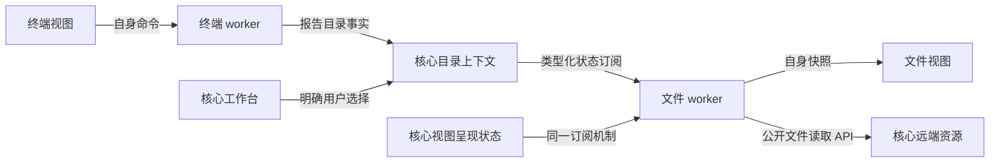

# 组件通信通用策略与代码设计

更新日期：2026-10-27 · 修订：r3 · 状态：既有状态通信已实施；T-016历史事件增量为设计
依据：[P-13/14/22/36](../product.md)、[F-CORE-001](../core/communication.md)
本次应用：[T-010](../tasks/T-010-terminal-directory-follow.md)、[目录联动代码方案](terminal-directory-follow-implementation.md)

T-016衔接：新增[持久历史查询/订阅](../core/observability/history.md)的能力提案，服务于诊断事实，不改变本文件最新状态的合并/重取保证；使用独立持久游标和明确缺口，复用可信来源及有界宿主传输。不是插件命令总线，不允许从日志监听隐式执行其他插件业务。上报/查询/ack继续审计，传输控制审计不回投自己的feed。实现前统一核算现有宿主队列子预算，当前接口与结果保持。

## 1. 决策与边界

采用“明确状态所有者 + 类型化命令/查询 + 可恢复状态订阅 + 独立有界流”。复用通信机制，业务契约仍由相应模块定义。保持现有核心/插件架构，不引入跨插件事件总线、服务发现、全局可写 store 或远端消息中间件。

| 通信范围 | 选用方式 | 状态所有者 |
| --- | --- | --- |
| 同一 React 视图内部 | props/callback，必要时局部 reducer/context | 视图或其业务控制器；不把每次点击变成 IPC |
| 插件 UI → 自己的 worker | 已有同所有者 `plugin.invoke`，逐命令 schema；返回快照/回执 | worker 持有会话和业务状态，UI 持有草稿/展开反馈 |
| 插件 → 核心 | SDK 类型化 RPC、状态订阅、资源流 | 对应核心服务 |
| 不同插件间的协作 | 分别发布/读取核心拥有的公开语义契约 | 核心管理公共上下文，插件解释各自业务 |
| 核心内部模块 | 类型化 Rust 接口和领域变更；应用层装配 | 各服务单一写入者；不为本地调用绕一圈 IPC |

“通用”指身份、作用域、修订、订阅、取消、流量和错误规则可以复用，不指插件可以随意发布任意 topic。公开状态契约由核心代码注册，固定 schema、所有者、适用 scope、容量和兼容版本。新增消费者无需修改生产者；新增一种公共语义才需要扩展核心契约。纯插件业务状态继续私有。

首批用目录上下文和已有 `views.presentation` 两种状态检验复用。后续连接状态、任务进度可按任务迁入；本次不重写全部通信路径，不提前实现 Docker/监控或开放插件互调。

## 2. 三种通道各自的保证

| 通道 | 适合的信息 | 保证与禁止事项 |
| --- | --- | --- |
| 命令/查询 RPC | 新建终端、定位目录、取得快照、关闭资源 | 有请求/结果/结构化错误；副作用定义幂等与回执。禁止用广播代替命令 |
| 最新状态订阅 | 当前来源、目录、可见性、焦点 | 返回一致快照，随后按对象修订更新；允许合并中间状态，可重新查询。不能承担每条必达的交易通知 |
| 有序字节流 | PTY、文件、exec 输出 | 序号、字节预算、消费/丢失规则独立。禁止把终端正文塞进状态事件 |

现有 `RpcRequest.apiVersion:1` 传输信封不变，插件 API 升级另行协商。写操作继续复用 operationId、请求去重与查询回执；超时返回结果不明时不自动重放。`AbortSignal` 先停止本地等待，再按方法声明发起取消；不能把停止等待当作远端回滚。

## 3. 身份、作用域与时序

宿主从真实通道绑定 pluginId、pluginVersion、instanceId；UI 另绑定 viewId/mountGeneration。参数中的作用域只是目标，核心必须查验其存在、代次和资源归属，不能信任调用方自报所有者。工作区关闭后再开同一服务器，仍是新的 workspaceGeneration。

所有公开契约都声明所需上下文；不强迫全局设置带 serverId。本批目录状态以 `{workspaceId, workspaceGeneration}` 为 scope，来源资源再绑定连接/PTY 代次。展示表面换代不等于业务会话换代：移窗保留逻辑视图/目录来源，旧 WebView 的消息失效。

保留不同含义的编号：

- `requestId`：一次请求；`operationId`：可查询的操作。
- `revision`：一个状态对象的修改顺序；不可跨对象比较。
- `feedEpoch + deliverySequence`：一次订阅的交付顺序，不等于领域状态 revision。
- 业务自己的 `selectionRevision/pathRevision`：区分来源切换、路径变化和相同目录的重复报告。

编号使用协议定义的非负十进制字符串，避免 Rust u64 到 JS Number 的精度损失。公开通知带 contract、scope、对象身份、revision 和 subscriptionId；不广播秘密、终端正文或可转交资源句柄。requestId/causeId 可贯穿诊断，但不能作为身份凭据。

## 4. 状态订阅 API 与恢复

拟新增 `core.state.v1`，具体 schema 保存为 `contracts/state-feed-v1.schema.json`，TS/Rust 从同一来源生成。以下是待实现的接口设计，当前不能调用：

| 方法/通知 | 参数与结果 | 语义 |
| --- | --- | --- |
| `state.get` | `{contract, target}` → `{scope, objectId, revision, value}` | 查询某个固定契约的当前完整状态 |
| `state.open` | 同上 → `{subscriptionId, feedEpoch, sequence:"0", snapshot}` | 在同一状态提交边界取得快照并注册订阅；初始为暂停交付 |
| `state.ack` | `{subscriptionId, feedEpoch, sequence}` | SDK 安装快照后 ack 0 激活；后续确认累计交付序号并释放额度 |
| `state.update` | `{subscriptionId, feedEpoch, sequence, snapshot}` | 新的完整状态；同对象可合并，消费者不依赖每个中间值 |
| `state.resyncRequired` | 订阅身份与稳定原因码 | 不能保证连续交付时暂停数据；SDK 关闭并重新 open，不能静默续用缺口 |
| `state.close` / `state.closed` | 订阅身份 / 结束原因 | 主动关闭幂等；对象/实例结束自动结束 |

首批契约为 `workspace.directory.v1` 和 `view.presentation.v1`。前者公开有限的目录上下文，后者保留现有视图作用域与所有者规则。SDK 对 contract 与 target/value 做判别联合校验；没有 `state.publish(topic, any)` 公共接口。更新分别通过 `directories.report` 和工作台呈现服务产生。

原子性流程：状态服务在自己的串行提交段内注册观察者并截取 snapshot；期间产生的更新进入有界的最新值槽。返回 snapshot 后等待 ack 0，才发送后续值。因此不依赖“先 query、稍后 listen”的时间巧合，也避免通知先于 open 响应到达。暂停握手 10 秒未完成则释放。

每个订阅最多一个未确认帧和一个最新值槽。SDK 安装状态到本地缓存后确认，再通知业务 listener；慢监听者不能阻塞宿主锁或其他订阅。监听回调抛错隔离并记录，业务异步工作自行取消/合并。重复帧可重复 ack，但不再次应用；未知 epoch、乱序、非法 schema 都触发明确恢复或关闭。

不保留跨关闭/跨实例的事件日志；恢复总是重新 open 取得最新快照。对象删除、作用域失效和 resync 控制消息有保留额度；控制通道也失效时标记连接失效并终止订阅，不能只丢掉结束通知。需要逐条可靠事件的未来功能必须另建带回执的日志/操作契约，不能声称本机制已提供。

## 5. 传输、调度与代码组织

新增小型 `crates/communication`，仅包含 `scope`、`latest_state`、`feed`、`budget` 和稳定错误/信封类型，不依赖 terminal/files、Tauri 或 SSH。core/desktop/host 通过接口装配它；状态值与修改规则仍在领域服务，不建一个万能业务管理器。

| 落点 | 修改设计 |
| --- | --- |
| `contracts/`、生成脚本 | 新增 state-feed 契约和示例；复用现有 schema 校验/生成模式，严格校验未知字段 |
| `packages/sdk/src/client.ts`、`state.ts`、`worker.ts`（新增） | 抽出无 DOM 的请求/校验/订阅实现；UI 和 QuickJS 用各自 transport，统一错误/取消/dispose 行为；旧 index 导出保留 |
| `crates/plugin-host/src/bootstrap.js` | 增加经协商的 host→worker 通知帧及 listener/dispose；通知不经过 plugin.invoke，不创建等待业务响应的调用 |
| `crates/plugin-host/src/process.rs`、`transport.rs` | 复用每实例既有有界 IPC，状态与控制消息分队列、按额度公平发送；通知不再每条 thread::spawn |
| `apps/desktop/src-tauri/src/communication_services.rs`（新增） | 绑定真实 Caller、注册契约适配器、向所属 worker 或匹配 UI 表面投递；保持 app.rs 为装配/分发入口 |
| `plugin_presentation.rs` | 新版订阅 `view.presentation.v1`；旧包沿用原 lifecycle.presentation，按能力选择一条交付路径，不双发 |
| 两插件 worker / 各自 UI | 同插件命令逐项类型化；本次保留已有私有快照读取方式，公共上下文新增统一订阅；不强迫同步迁移全部 UI 轮询 |

核心状态提交时只登记快照/待投递项，释放领域锁后调度；不能持有工作台锁调用插件、等待 JS 或进行 SSH I/O。host 使用每实例一个通知发送循环；新状态调用走有界短任务队列，复用进程级固定 4 个线程的 dispatcher，不为每个订阅/每次变化开线程。现有可能阻塞的旧 RPC 保持原适配路径及每实例 32 个 pending 上限，本次不把它们全部挤进短任务池。

所有新增调用继续经过统一调用记录，包括订阅、ack、read、close 和失败；不能通过 worker Callback 直达私有方法漏记。推送记录交付/丢失/关闭的摘要计数及订阅关联，不把每帧通知伪装成一次插件请求。日志不记录完整目录、命令、nonce 或原始 PTY 数据。

## 6. 容量、故障和释放

以下是本批预先约定的实施预算；实际压力样本见 [T-010 结果](../tasks/T-010-results.md)：

| 资源 | 预算与超过时的行为 |
| --- | --- |
| 状态对象/单帧 | 单个序列化状态最多 32 KiB；具体契约可以更小；发布超限拒绝 |
| 订阅 | 每插件实例最多 64，App 最多 512；超额 open 返回 CAPACITY |
| 新状态交付队列 | 每实例 512 KiB、App 8 MiB；计入未 ack 帧和最新槽，状态对象另有总预算；溢出 resync，禁止无界堆积 |
| 公共状态存储 | App 最多 8 MiB；创建前预留，结束释放；不挤掉其他对象的有效值 |
| 控制保留 | 每实例独立 32 KiB，结束/resync 按订阅合并；超过则关闭失效传输 |
| 短调用队列 | App 256 个待执行项，单实例最多 32；超额立即 CAPACITY；关闭/ack 预留通道不排在数据之后 |
| 生命周期 | 正常 close/实例结束后 1 秒内本地订阅与计数回到基线；迟到通知按 epoch/代次丢弃 |

宿主原有 1 MiB 帧、4 MiB 队列等上限不因此放宽；新增额度是其子预算，需统一核算。索引按 contract+target 查找观察者，发布只唤醒相关订阅，不能每次遍历所有插件或广播给所有窗口。

SDK 返回可 dispose 的订阅对象并支持 AbortSignal。React effect 负责 UI 订阅，插件 session/workspace owner 负责后台订阅；不能只依赖 UI 卸载释放。隐藏文件视图停止目录订阅和自动读取，但保留一条呈现订阅用来获知恢复；恢复时重新 open，获得最新目标。生产者故障使其上下文失效，消费者故障只清理消费者资源。

恢复细化（已确认范围内）：缺口后重新 open 若遇 TIMEOUT/RESULT_UNKNOWN/CAPACITY/TRANSPORT_ERROR，以 100/300/1000 ms 最多补试三次；每次先关闭已知旧订阅，不重放业务命令。身份/代次/契约错误直接结束；用尽重试明确 onError 并 dispose。dispose 中断等待，不能在关闭后重新订阅。初次 open 失败仍由调用者显示错误并在明确生命周期恢复时重新接入。COM-16 补测短暂失败后恢复和退订中断等待。

## 7. 如何接入未来组件

新增一次协作必须先回答：状态归谁、是命令/状态/流哪一种、什么 scope、何时失效、是否可合并、如何恢复、有何容量、如何演进。已有契约足够时只改新插件的 SDK 调用；不足时才增加核心语义契约及功能测试。

例如，未来编辑器跟随工作区目录，可订阅同一个目录契约，无需改终端；未来任务面板显示任务进度，可复用 state feed 但需要独立的 task 状态所有者；“执行部署”是有回执的命令，不能发送 `deploy` 广播等待某个插件响应。未来若开放插件服务互调，必须另行确认 P-13 的范围和服务契约，不从本次基础设施暗中获得。

## 8. 验证与采用条件

功能用例统一维护在 [F-CORE-001 COM-11～16](../core/communication.md)，本文件不重复结果。需用目录与呈现两个真实消费者证明同一基础设施复用；再以身份/调度夹具测 16 个实例、128 个订阅、每秒 200 次更新持续 60 秒，其中一个消费者停读 10 秒。测量队列峰值、线程数、单次提交/投递耗时、关闭释放及其他消费者进展。

在记录配置的 Windows 开发机上，新增短调用控制回执 p95 ≤ 200 ms，发布到正常 worker 接收 p95 ≤ 200 ms，按进程调度统计新增线程数量不随订阅数增长；缓存/队列不得超过上表。远端 RTT、文件加载耗时单列，不混入本地通信指标。不满足时修复或重新评审预算，不在实测后偷偷改预期。16 worker/128 订阅的已测结果与未单独量化部分如实见 [T-010 结果](../tasks/T-010-results.md)。
