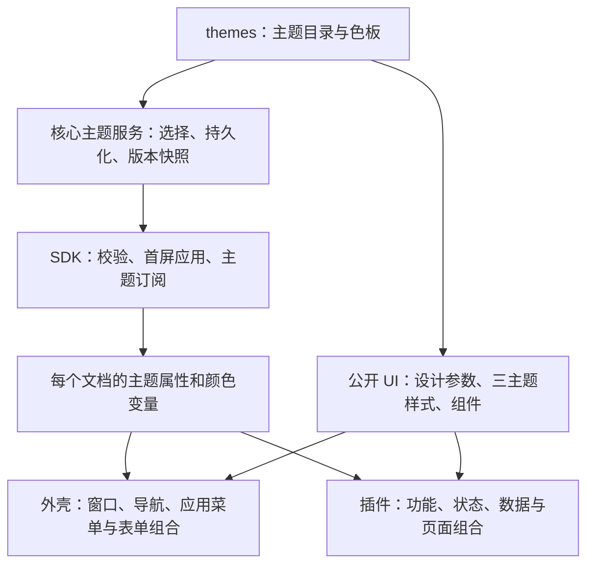

# T-012：公共设计系统与三主题代码设计方案

更新日期：2026-10-26 · 方案修订：r2 · 状态：实施中；用户明确要求取消多巴胺阴影
任务与确认：[T-012 r3](../tasks/T-012-dopamine.md) · 视觉：[设计稿 r2](../design/dopamine.md)
规则：[UI §2.4](../standards/ui.md#24-t-012-公共设计系统与插件样式边界) · 色彩：[主题规范](../standards/theme.md) · 功能及测试：[F-CORE-012 §8](../core/appearance.md#8-t-012-公共设计系统与复用测试)

## 1. 对目标的理解与本次选择

用户希望“所有样式可以提前定义，插件尽量少写样式，以功能为主”，允许必要例外。本稿将其落实为：**先建立三套完整样式和当前所需的公共组件，外壳与插件通过语义参数使用，插件负责数据、流程和业务状态。** 后续开发常见功能时，选择组件和组合布局即可，不再各自决定按钮、表单、提示或列表选中的样子。

“提前定义”覆盖当前产品已知的颜色、排版、尺寸、间距、边框、圆角、阴影、图标、动效及控件状态；不预造尚无需求的图表/编辑器，也不禁止业务专有布局。新增控件先定义公共规则和测试，再由消费者接入；仅用于某个插件的特殊视图可留在插件，成熟且有真实复用需求后再提取。

本次在现有`@sodeck/ui`扩展，继续React/TypeScript/CSS和Lucide；不引入另一套完整UI框架、运行时CSS注入服务、JSON页面引擎或插件公共业务store。`apple-design`用于清晰层级、即时反馈、稳定命中、焦点返回、系统字体及减少动态；外观继续按r2稿，不变成统一玻璃风格。

## 2. 已核实的代码事实

核实日期2026-10-26，分支`v2`，工作区含多项未提交工作；本轮仅只读核实和文档编辑。

| 实际文件/模块 | 当前事实 | 修改方向 |
| --- | --- | --- |
| `packages/ui/src/index.tsx`、`base.css` | 已有`ThemePreview`、`Notice`和全局基础规则；尚无完整控件库 | 扩展公开组件、设计参数和三主题样式；不从零另建重复包 |
| `apps/desktop/src/styles.css`、`dialog.tsx` | 大量通用表单、弹窗、提示和外壳布局混在一起；Dialog管理焦点与关闭 | 提取公共视觉/本地交互；原生隔离和业务草稿留在外壳 |
| `plugins/files/src/files.css` | 除虚拟列表布局，也定义选中、提示、详情、进度等通用样式 | 通用部分迁到UI，保留虚拟滚动及业务布局 |
| `plugins/terminal/src/terminal.css`、`terminal-view.tsx` | xterm适配与通知/状态条混合；已有主题订阅更新xterm调色板 | 公共通知/状态条复用；xterm生命周期、输入及PTY仍归终端 |
| `packages/sdk/src/presentation.ts` | 每文档初始化主题，设置颜色变量、`data-theme`和高对比标志；复用主题状态订阅 | 保留单一订阅，补目录/按ID选择；UI不另建订阅 |
| `themes/*.json`、`theme.rs` | 两份soft v2主题及旧graphite；主题含严格颜色字段，原生首屏注入已存在 | 新增dopamine及主题目录；保留v2形状和旧投影 |
| `presentation_services.rs`、`presentation.rs` | 应用与插件菜单都经原生HMENU；关闭结果按来源管理 | 仅应用菜单新增可完整控制样式的浮层，复用会话生命周期 |
| `scripts/dependency-boundaries.mjs` | 已禁止UI依赖SDK/外壳/插件，插件只用公开UI/SDK | 保留并扩展样式边界检查，不逆转依赖 |

当前包清单仍为desktop dev.7 / SDK4.3.0 / UI1.0.0 / terminal0.6.0 / files0.3.2；同时T-013开发中的`contracts/capabilities.rs`已为API4.4.0。这是正在整合的工作区，不是一个已发布版本组合。不得按旧T-012中的4.4或dev.8占位直接覆盖；实施前核对T-013和OpenWrt修复的实际整合结果。

## 3. 分层和依赖



箭头表示数据/能力提供方向。UI包不调用SDK、核心、网络或其他插件；SDK不依赖React/UI。核心拥有主题状态，UI拥有呈现规则，插件拥有业务。公共组件接收值、状态、事件回调和插槽，不接受SSH句柄、`serverId`后自动请求，或`files.*`等命令名。

| 内容 | 唯一维护位置 | 消费方式 |
| --- | --- | --- |
| 背景、文字、状态色、终端ANSI、补充表面色 | `themes/` | 核心快照/公共UI构建产物；代码不重配近似色 |
| 字体、字号、行高、间距、尺寸、圆角、描边、阴影位移、动效参数 | `packages/ui/src/tokens/` | 生成CSS变量和有类型的静态数据 |
| 按钮/输入/列表等各状态的呈现规则 | `packages/ui/src/styles/`及`components/` | 公开组件和受控variants |
| 工具栏、表单、状态区、滚动内容的通用组合 | `packages/ui/src/layout/`、`patterns/` | 可组合容器，无业务请求 |
| 窗口拖动、原生WebView位置、菜单/模态隔离 | desktop外壳与原生适配 | 调用公共组件并由宿主协调原生生命周期 |
| xterm/目录树的业务与专用几何 | 各插件 | SDK接口＋公共组件；必要局部样式可审查 |

## 4. 建议目录与修改范围

以下是拟建立/调整的结构，列出的新文件目前不表示已存在。只按当前覆盖页面拆文件，不按每个状态建一个模块。

```text
themes/
  catalog.json                 # 三主题ID、名称、mode、profile及文件映射
  soft-light.json              # 保留现有v2颜色契约
  soft-dark.json
  dopamine.json
  surfaces/                   # 额外语义表面色；不塞入终端ANSI
    soft-light.json
    soft-dark.json
    dopamine.json
packages/ui/src/
  index.tsx                   # 保留旧导出并添加公开组件
  tokens/
    foundation.json           # 跨主题稳定的字体、密度、命中和间距
    profiles/soft.json        # 细边、柔影、字重等有限覆盖
    profiles/dopamine.json    # 粗边、无投影、字重、图标笔画
    schema.json               # 有限键/类型/单位/范围，拒绝任意CSS
    tokens.generated.css
    tokens.generated.ts
  styles/
    reset.css
    components.css
    accessibility.css
    legacy.css                # 旧Notice/ThemePreview/base.css兼容
  components/                 # 基础控件、视觉状态和本地键盘语义
  layout/                     # Stack / Inline / Grid / ScrollArea
  patterns/                   # Toolbar / StatusBar / EmptyState等
  styles.css                  # 新入口：固定层次/顺序
  base.css                    # 保留旧路径的兼容入口
apps/desktop/src/
  styles/                     # shell、窗口几何、各页面特有组合
  application-menu/           # 应用动作模型、入口、浮层页面、窄桥接
  dialog.tsx                  # 公共Dialog的宿主适配器
apps/desktop/src-tauri/src/
  theme.rs / appearance_services.rs
  application_menu.rs         # owned浮层、DPI、来源/焦点/取消生命周期
  presentation_services.rs    # 与旧菜单互斥及结果协调
plugins/terminal/src/
  terminal-view.tsx           # 组合公共Notice、StatusBar等
  terminal.css                # xterm布局与供应商适配
plugins/files/src/
  view.tsx / details.tsx      # 公共控件＋文件业务
  files.css                   # 虚拟滚动、内容区域、特有列约束
assets/brand/                 # SVG母版、小尺寸变体和导出清单
scripts/
  generate-ui-tokens.mjs      # 确认后新增；生成与--check校验
  check-ui-boundaries.mjs     # 确认后新增；样式边界与例外检查
tests/ui/design-system/       # 确认后新增；组件状态目录及交互测试
```

公开组件是否分成多个文件不影响契约；不要求插件按此目录重排worker、通信或业务控制器。构建导出与源码文件名称可在方案范围内调整。

## 5. 样式提前定义到什么程度

### 5.1 设计参数和三主题

`foundation`提前定义spacing、font、density、controlSize、focus、motion和z-order等有限参数；颜色仍在`themes`。soft/dopamine profile只覆盖允许变化的视觉参数，不含组件代码、CSS选择器、URL或任意脚本。

例如普通按钮基准32px、输入36px、菜单普通项36px、树行28px属于共享密度；soft/dopamine的1/2px可见描边、柔影/无投影和常规/较粗图标笔画属于profile。切主题时外部盒与内容尺寸保持；必要时用内部视觉层或预留统一边框预算，不能让粗边挤小终端内容。文字放大和真实窗口resize仍可改变几何。

生成器校验完整性、引用、单位、数值范围和允许覆盖项后，生成全量CSS变量及TS常量。缺项/未知项在构建期失败；`--check`只比较产物、不悄悄修复。生成文件禁止手改，CI/本地check检查漂移。品牌PNG/ICO中的色值是从母版导出的冻结资产，属于有来源的产物例外。

核心Rust与前端构建共同读取同一catalog定义，校验ID、mode和文件映射一致，不在两端各维护第二份主题列表。CSS产物在文档首屏前加载完成，原生表面在初始化/ready边界展示，避免先以soft几何闪现再切dopamine。

运行时延续严格v2快照，不把全部设计参数送入状态通道。SDK设置`data-theme`后，随插件打包的公共CSS选择对应profile；未知测试ID使用完整soft profile，颜色仍使用已验证的测试快照。补充表面色按已知ID静态打包，未知ID映射到现有语义surface/selected等，不能拿terminal ANSI凑颜色。高对比覆盖颜色与装饰，减少动态禁用位移但保留状态反馈。

### 5.2 CSS作用域与覆盖顺序

公共类使用`sd-`前缀；组件内不依赖外壳`.dialog`、插件`.file-row`等私有类。拟统一cascade层序为reset → tokens → vendor → components → composition → accessibility。新入口显式声明顺序；xterm供应商CSS经适配入口导入vendor层，避免未分层的供应商规则无意压过公共样式。基础reset仅做必要标准化，绝不统一给所有`span/svg/button`加主题描边。

消费者组合样式限定布局属性，不覆盖组件内部结构/颜色；公共组件同样不选择业务类名。旧`base.css`保留导出和必要旧类兼容，`Notice`与`ThemePreview mode`继续可用；新消费者改用新入口和组件。兼容层只服务尚未迁移的旧接口，不作为新插件自由覆盖CSS的入口。

主题预览使用局部scope及局部变量，三张卡片各自呈现完整颜色和profile，不改变全局root或开启额外订阅。相同组件用于实际页面与预览用例，避免预览是一套手画效果而运行界面另一套。

### 5.3 本轮公共组件清单

| 组件组 | 本轮提供的能力 | 必须提前覆盖的状态 |
| --- | --- | --- |
| Button / IconButton / ToggleButton | primary/secondary/quiet/danger；图标、尺寸、pressed | normal、hover、active、focus、disabled、busy、pressed；禁用不保留hover危险色 |
| TextField / SelectField / Checkbox / RadioGroup / Field | 标准受控值、label、help、error、描述ID | empty/value、focus、readonly（适用项）、disabled、invalid、busy；IME不误提交 |
| Surface / Text / Badge / Separator | 语义表面、正文/辅文/标题、状态标记 | neutral/navigation/tool/accent及状态语义；文字不只靠颜色 |
| Notice / EmptyState / StatusBar / Progress | 加载、空态、错误/重试、状态与确定/不确定进度 | status/error/warning/success、行动/关闭；不自动决定重试或取消 |
| Toolbar / PanelHeader / FormSection / PropertyList | 固定间距、溢出、标题/动作、键值详情 | 窄宽、长文本、禁用；内容可滚动，重要操作可达 |
| ListRow / TreeRow / TabItem | 通用行/节点/标签外观；图标、附加列、选中、缩进 | hover、selected、focused、disabled、expanded、loading；选中并聚焦叠加 |
| Dialog / MenuList / MenuItem | 公共外观、标签、当前项/禁用、标准键盘与焦点 | open/closing、分组、危险项、溢出；Dialog与Menu职责分开 |
| ThemePreview / ThemeChoice / BrandMark | 三主题预览、选择卡及Logo尺寸变体 | current/default、busy/disabled、窄宽、高对比；Logo不充当模糊动作按钮 |
| Stack / Inline / Grid / ScrollArea | 常见排布、语义间距档、伸缩/滚动 | 窄窗、长内容、字号放大；不计算业务虚拟行 |

这是当前外壳/两插件覆盖面，不是未来组件库承诺。`SelectField`先保留原生select语义及平台选项弹出层，包装标签/字段外观；原生下拉外轮廓属于平台例外。以后若改成自绘组合框，需单独明确筛选/IME/辅助技术行为。

组件API优先语义值，例如`variant="primary"`、`tone="warning"`、`size="compact"`、`selected`、`busy`。不设计`pinkButton`、`darkBorder`或任意theme参数。非交互容器接受布局class/slot；普通控件不开放任意视觉style覆盖。DOM测量通过ref，复杂渲染器使用明确content slot。

`IconButton`要求可访问名称；图标由调用者提供Lucide图形，公共Icon适配统一尺寸/笔画，装饰图标隐藏于辅助技术。`Field`生成稳定label/help/error关联；Dialog用唯一标题ID，处理IME下Esc、初始焦点、循环与返回，但跨WebView输入屏障仍由宿主处理。`TreeRow`提供展示和属性，不实现取数、展开缓存或完整树导航控制器；`TabItem`不移动工作区或关闭会话。

`busy`保持当前焦点并阻止重复激活，同时设置可访问的忙碌/不可操作状态；异步成功、失败、取消仍由调用者传值。`disabled`按对应原生/复合控件语义处理，不用opacity代替禁用。需要取消的长操作提供独立可用动作，组件不把整页锁住。

## 6. 插件怎样写，哪些样式可以留

下面是拟定API的文档示例，不是新增原型或已存在的可编译接口：

```tsx
<Stack fill gap="none">
  <Toolbar>
    <TextField label="远端路径" labelVisibility="sr-only"
      value={pathInput} onChange={onPathChange} />
    <IconButton icon={RefreshCw} label="刷新目录"
      busy={loading} onClick={refreshDirectory} />
    <ToggleButton pressed={following} onClick={toggleFollowing}>
      跟随终端
    </ToggleButton>
  </Toolbar>
  {error && <Notice kind="error" action={retryAction}>{error}</Notice>}
  <VirtualFileTree rows={rows} onSelect={selectNode} />
  <StatusBar>{statusText}</StatusBar>
</Stack>
```

`VirtualFileTree`仍是文件插件自己的组件，内部用公共`TreeRow`；`refreshDirectory`等回调仍由文件插件经SDK调用业务控制器。UI不持有这些函数的业务策略，也不替用户决定是否重试不确定操作。

| 插件内容 | 处理原则 | 具体例子 |
| --- | --- | --- |
| 通用控件视觉 | 全部迁公共UI | `.notice`、`.status-dot`、按钮pressed、提示色、详情键值字体、进度轨道 |
| 通用页面排布 | 优先组合layout/patterns | Toolbar、上下布局、错误行动、加载空态，不另抄padding/gap |
| 业务专有布局 | 允许少量独立CSS，使用公共参数 | 文件详情区最大占比、文件名/大小列约束、终端host填满布局 |
| 运行时测量/数据几何 | 保留局部计算，并明确用途 | 虚拟窗口top/height、总高度；尺寸测量不得搬到主题订阅里 |
| 第三方渲染器 | 独立适配块，不全局污染 | xterm composition/viewport和容器；Canvas颜色来自主题快照 |
| 主题判断与私有色板 | 插件不编写 | 禁止在插件按`theme.id`写三套CSS、硬编码色值或覆盖`--sd-*` |

文件树将行高定义统一到公共density参数及测量探针；同一实测值用于虚拟高度、滚动索引、命中和TreeRow。缩进通过`level`和公共indent参数；属性随内容变化不算另一套视觉规则。小字号/表格数字由Text/PropertyList提供。容量进度由公共Progress接收已算好的比例，插件仍负责BigInt/缺失值和统计语义。

终端保留字体用户设置、fit、ANSI/真彩色适配、PTY及复制粘贴。通用默认等宽字体/排版值从公共tokens取得；用户字号10–24优先。切主题只改现有xterm.options.theme，公共容器的外部尺寸三主题相同，不制造额外PTY resize或实例重建。

不设置“插件最多多少行CSS”的硬指标。交付检查依据是通用视觉是否仍有重复、例外是否有必要、是否使用统一参数以及真实界面是否一致；不通过把业务类整份搬入公共包来刷减少行数。

## 7. 应用菜单、Logo与宿主适配

应用菜单按[F-CORE-008 §10](../core/workbench-interaction.md#10-t-012-应用入口与菜单重设计)和r2稿实现。`MenuList/MenuItem`属于公共UI；应用动作列表、来源窗口和执行回调属于desktop。仅应用菜单使用新浮层，插件`ui.menu.*`严格形状和终端/Tab右键沿用原机制。

推荐用宿主拥有的轻量WebView窗口绘制公共Menu组件，Windows adapter设置owner及工具窗口属性，不进入任务栏/Alt+Tab、不全局置顶。单个owner惰性创建至多一个缓存浮层；隐藏时无轮询/业务订阅，宿主销毁时销毁。它不是工作区/插件视图，不进入布局持久化或“找回全部窗口”列表。

内部桥接只处理打开会话的初始化、ready/内容尺寸、选择和关闭：核心绑定`menuId + ownerWindowId + ownerGeneration`、锚点和合法项目ID；浮层不能自报来源或执行任意核心方法。由原来源外壳收到一次性选择结果后调用现有业务操作。样式/内容就绪后才显示，未就绪关闭不得随后闪现。尺寸上报按屏幕工作区限幅，源窗口/DPI/主题改变时取消，迟到结果丢弃。原生输入屏障、互斥、外部首次点击消费和焦点交还由核心管理，不能只用DOM事件。相邻原生终端始终显示、输出继续；无法满足此要求视为AM验证失败，不能用隐藏插件替代。

主题快照在打开前连同初始化数据注入；浮层不另开长期主题订阅，主题变化直接关闭。首开加载失败清理半创建资源、复位入口并提示重试；无不可见输入屏障残留。浮层初始/退出可短淡化，不缩放承载WebView的祖先。生成完整边界/阴影空间，避免系统窗口裁剪硬阴影。

Logo按[F-CORE-013](../core/brand.md)建立正式母版、小尺寸简化变体及导出清单。公共`BrandMark`仅呈现语义尺寸；EXE/窗口/托盘由原生模块使用相应资源。构建读取统一资产清单，Windows缓存验证保留实际限制，不改App ID或托盘行为。

## 8. 主题接口、更新与旧包兼容

沿用[F-CORE-012 §7](../core/appearance.md#7-t-012-第三主题增量方案)的三主题、默认迁移、原子保存、目录/choose接口和失败行为。本稿细化开发组织，不增加运行时任意主题编辑能力。

| 维度 | 建议 |
| --- | --- |
| 公共UI版本 | 计划1.1.0，保留Notice/ThemePreview与base.css原导出；若实际必须破坏旧API，先更新方案，不伪装兼容 |
| API/SDK | T-013占用4.4后，T-012建议4.5.0或实施时首个未占用兼容小版本；整数API4、主题v2、app.theme.v1不变 |
| theme catalog / dopamine能力 | 沿用r2提案；标记宿主支持及插件完整样式兼容，绝非插件权限 |
| 核心/两插件版本 | 在实际整合基线递增，manifest、lock、build.json一并校验；保留files0.3.2修复及T-013能力 |
| 构建 | UI及CSS随外壳/每个插件独立构建，离线运行；不向旧WebView动态下载或注入新组件代码 |
| 旧live插件 | 实时获得兼容v2配色，控件仍为其打包版本；外观页明确提示部分样式未支持 |
| 旧静态插件 | 使用挂载主题直到自然重挂载；不为换主题重建会话 |
| 新插件＋旧核心 | 缺少声明的新能力时按现有兼容规则拒绝，保留旧包可恢复 |

**集中维护不等于所有已安装旧包自动变成新控件。** 调整已支持主题的颜色可通过核心快照传播；调整几何、组件或新增profile需要发布带新版UI的插件。本次随包终端/文件全部迁移并共同验收，后续插件升级仍独立、重启生效。

## 9. 防止样式再次分散

沿用`check-boundaries`的依赖规则；新增样式检查接入`npm run check`。拟用现有TypeScript AST检查JSX/style/入口，CSS用PostCSS和selector parser，显式列为开发依赖并锁版本，不直接依赖Vite的传递依赖或增加运行时包。

检查重点：插件无主题ID选择器/硬编码视觉值、无公共变量重定义/组件内部选择器、无外壳或其他插件私有CSS导入；公共UI无SDK/业务依赖；颜色只在主题数据或有来源的品牌/第三方产物；生成产物无漂移。扫描关注样式位置，不能把远端文件名中的HEX、终端测试正文或文档示例误报为颜色。

例外按文件、selector/property或AST位置、用途、所有者和对应测试窄登记，允许虚拟几何、用户字号和xterm供应商适配；禁止整目录通配放行。合法结构值如flex、0、100%、auto不当作颜色违规。检查器对运行时拼接CSS的局限明确保留：受管样式禁止动态样式字符串，仍需代码审查与真实截图，不把静态扫描当成最终视觉保证。

组件状态目录是开发/测试入口，离线、不进入生产导航；使用实际公共组件，展示三主题×控件状态、长文本、窄宽、键盘及高对比。实际入口为apps/desktop/design-system.html；组件测试见tests/ui/design-system，静态图稿仍不作为运行证据。

## 10. 实施次序与可审查交付

| 步骤 | 修改与输出 | 进入下一步的条件 |
| --- | --- | --- |
| 1 基线 | 核对T-013/文件修复、锁定版本及截图；建立tokens/色板/profile生成与检查 | 三主题变量完整、漂移与依赖检查有真实用例 |
| 2 公共组件 | 实现基础控件、patterns、无障碍与开发状态目录；保留旧入口 | DS-01/02/03通过；小状态不靠消费者补CSS |
| 3 主题运行态 | 核心catalog/choose、偏好迁移、SDK、首屏和局部预览 | DP默认/迁移/兼容/失败流程通过，订阅不增生 |
| 4 外壳 | 替换表单/选择器/认证/管理页/Tab/提示，拆分shell几何 | 公共Dialog与原生隔离配合，草稿/IME/焦点保持 |
| 5 两插件 | 替换通用视觉，精简局部样式；保留虚拟滚动/xterm适配 | TERM-DP、FILES-DP、DS-04通过，原业务回归保持 |
| 6 菜单与品牌 | 应用菜单owned浮层、图标资源和加载路径 | AM/BR真实原生检查通过，终端始终可见 |
| 7 整体交付 | 三主题×页面/状态审查，独立开发包、版本/哈希和验收入口 | 必需检查完成后待用户验收；未跑项不写通过 |

在同一获确认方案内按步骤连续实施，不逐文件索取确认。共享组件每次迁移应删除对应旧重复规则，避免两套CSS叠加；不得因视觉重构改动PTY、目录跟随、跳板或挂载解析规则。

## 11. 验证与完成口径

功能测试的唯一来源是[F-CORE-012 §8 DS-01～07](../core/appearance.md#8-t-012-公共设计系统与复用测试)；复用DP-01～08、AM-01～05、BR-01～05、TERM-DP-01和FILES-DP-01。计划运行类型/生成/边界、契约/Rust、组件与浏览器、Windows真实多WebView及隔离Linux SSH/SFTP；不把浏览器模拟作为原生验证。

完成应可观察到：当前外壳和两插件的公共控件/状态来自UI包；插件没有自写主题分支和重复通用皮肤；剩余局部样式都有具体结构或供应商用途；三主题与最新r3设计对应、主业务和更新边界不变；新增控件有公共定义、状态示例和检查入口。性能、对比度、首屏与资源结果必须来自所交付版本。

上述目录、组件、脚本、品牌和版本已在获确认的未提交工作区建立；真实执行结果与剩余环境限制见[T-012结果](../tasks/T-012-results.md)。

## r2 实施修正

依据用户2026-10-26直接指令，多巴胺所有shadow位移/模糊和press-offset置零；公共控件统一单外沿描边，外框保持2px预算，通过border-color和背景裁切维持soft的1px视觉边，禁止重复inset轮廓。头部连续分界与Tab轮廓由同一几何预算控制，不改插件业务。原生应用菜单来源同时验证工作区窗口和当前detached视图；单终端窗不是workbench.windows条目，不能因此错误拒绝。AM-04继续以三窗200次开关验证。菜单继承宿主文字尺寸，并在限制区域内自适应宽高。均属于已确认范围内修正。

菜单屏障消耗完整pointer-down/up手势，在up后取消，防止销毁浮层后的释放事件落入开启远端鼠标协议的终端。原生测试同时记录终端pointerdown/pointerup/keydown，验证取消不透传；不放宽旧用例预期。

DS-07循环验证发现第二轮合并/关闭后仅剩主窗却残留2条app.theme.v1订阅：changed时原生销毁尚未完成，旧窗口被当成live。修复由原生Destroyed事件直接移除该窗口的feed owner，无需等下一次主题修改；维持1秒回收预期，并重跑三轮及200菜单。

最终菜单压力复测在第130余次发现瞬时失焦事件可能在样式重设/显示交接时提前关闭浮层。完成显示配置后才标记shown；异步失焦取消重新读取实际窗口焦点及会话token，防止把已恢复的旧通知当作当前失焦。保持200次不重试通过的验收预期。
