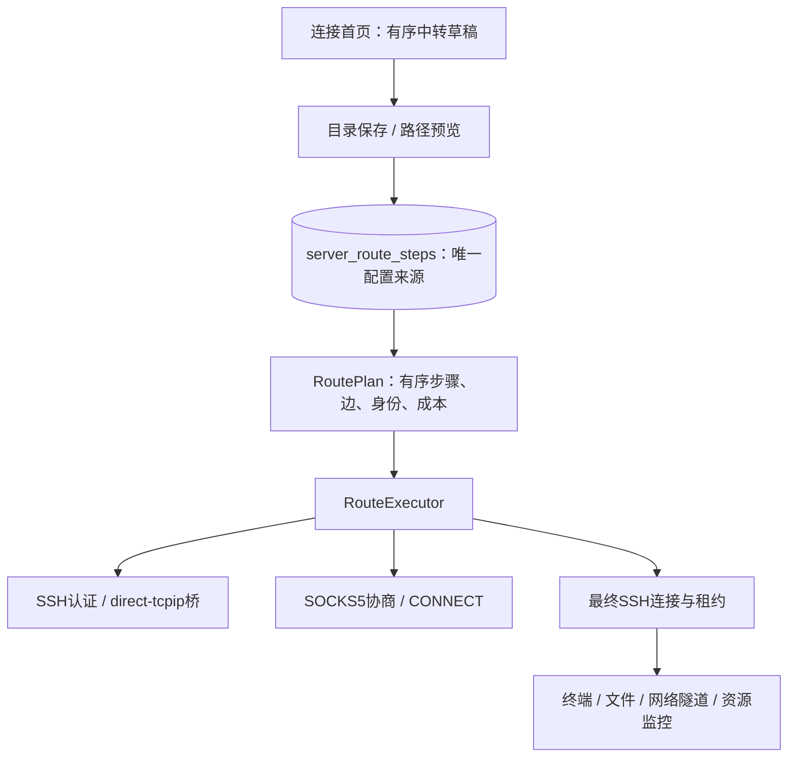

# T-027：混合多级连接代码修改方案

更新日期：2026-10-29 · 修订：r4 · 技术决定：原实现与本轮增量已采用，实施与验收见任务\
任务：[T-027 r2](../tasks/T-027-mixed-route.md) · 功能：[F-CORE-031 r2](../core/mixed-route.md) · 决定：[P-68](../product.md)

设计提出时的基线为 `v2` 未提交工作区：API/SDK 5.3.0、core 数据库 v6、四个已有官方插件。用户最新明确要求“不需要做兼容，数据库要简单明了”，并要求在插件中列修改计划；据此取消上一轮保留旧配置的建议。

本次采用 **API/SDK 6.0.0 + core 数据库 v7 + 四插件一起升级**。只实现一套路径模型、一套执行器、一套路径存储。旧 DTO、三模式解析、旧包兼容适配和数据库迁移均不保留。直连、纯 SSH、单 SOCKS 是新模型的自然组合，仍须验证其功能。

## 2026-10-29 已实施修订

本轮[整体修订 r2](../design/connection-editor-refinement.md) §3/4 定义统一 SSH 确认入口、信任与凭据绑定同事务、公共 UI 布局/选择层修复；[诊断代码方案 r1](connection-diagnostics.md)定义真实阶段结果、AttemptRecord/round/快照、有界缓存、诊断接口/事件和四插件接入。维持 core v7，不加诊断表或旧配置兼容层；已采用API/SDK6.1增量能力，宿主/四插件一起交付。原r2实施结果保留，新增接口和交互已获确认并实施，见T-027 r9及结果。测试为 REF、DIAG 和各插件专项，不能复用旧结果代替本轮检查。

## 1. 已核实的缺口与总体结构

| 实施前源码事实 | 本次处理 |
| --- | --- |
| `route.rs` 的 `AccessPath` 为三种互斥枚举，`RoutePlan.nodes` 只放SSH，另有一个 `proxy` | 改为有序类型化步骤；目标SSH由目标档案补到末尾，代理不再旁挂 |
| `route_store.rs` 同时存路径JSON和引用表；`resolve`限制SSH为1～255个 | 用单一步骤表保存顺序和引用；取消跳数校验，保留输入大小/实际运行预算 |
| `ssh.rs::connect_for` 仅在首段可调用SOCKS，代理认证回调没有节点参数 | 提取执行器，SSH/SOCKS按实际步骤执行，所有回调带步骤身份 |
| `transport::forward`返回 `TcpStream + Bridge`，已有有界泵和私有socket配对 | 直接复用，其目标允许是SOCKS端点；无需替换libssh2 I/O或另写全套异步传输 |
| `socks5::connect_metered`接收并返回同一TCP流，精确读取CONNECT回复 | 复用协议状态机，改清楚“下一站”语义和计量归属，连续调用即可串代理 |
| 秘密按server/proxy ID一个文件保存，代理上下文不含到达路径 | 引入统一的凭据上下文绑定表及加密blob，支持同一档案在多个前缀下的秘密 |
| 超时/诊断/桥段按 `nodes.len()` 或数组相邻SSH推断 | 改用计划的明确成本、step/edge身份，统一核心和SDK超时 |
| 网络隧道插件亲自展示路径；其他插件有连接超时、认证分类和连接代次检查 | 每个插件单独修改，不只更新核心和SDK后宣称全部可用 |



不引入新的业务插件、远端程序、系统代理配置或外部ssh进程。UI继续按已读取的apple-design及项目UI规范实现稳定列表、就地编辑、焦点恢复和即时反馈。

## 2. 唯一配置模型与运行快照

### 2.1 对外模型

```ts
type AccessPath = { steps: RouteStep[] };
type RouteStep =
  | { stepId: string; kind: 'ssh'; serverId: string }
  | { stepId: string; kind: 'socks5'; proxyId: string; resolve: 'proxy' | 'local' };
```

- `steps=[]`即直连。UI的“直接连接 / 经由中转”是草稿展示状态，不再保存一个重复的kind。
- `stepId`由编辑器创建UUID，排序/改引用保留、复制/新增产生新ID；目标步骤由核心使用保留ID `target`，不进入可编辑数组。
- SSH引用只能取主机地址、端口、账号和认证类型，不读取被引用服务器的路径。代理配置继续为独立档案，`resolve`属于这一次使用。
- 服务端拒绝未知字段、旧kind、重复步骤ID、自身/重复SSH ID、缺失引用、无效认证/端点。不将无效路径当直连，不递归展开，不以相同proxyId禁止合法有限链。
- 不添加 `maxItems=255`。路径配置序列化最多1 MiB，整个请求受现有传输大小上限约束；超限报 `CONFIGURATION_TOO_LARGE`。这是输入预算，不是产品跳数上限。长路径列表与详情分页，不能一次无界回传所有档案内容。

`contracts/connection-route.schema.json`维护Step、AccessPath、StepSummary、RouteMeta、EdgeSummary的唯一定义。服务器目录/凭据契约通过生成器明确导入所需定义，生成器检查重名和冲突；不在三个schema手工复制一份节点联合类型。生成Rust/TS及校验载荷只由脚本产生。

### 2.2 内部计划

新增 `route/plan.rs`：`ResolvedStep::{Ssh(SshStep), Socks5(ProxyStep)}`，包含稳定stepId、stepIndex、引用配置、到达该站的结构前缀；末尾唯一SSH目标。`RoutePlan`持有target、steps、edges、identityRevision、executionRevision、cost和timeouts，不持有密码/私钥。

新增 `route/identity.rs`：

- **配置修订**：档案并发保存用现有server/proxy revision，不混同运行身份。
- **前缀身份**：节点类型、端点、账号/认证方式、上游顺序及影响到达它的DNS选项；忽略显示名、草稿stepId、目标/跳板角色和后缀。
- **已验证前缀**：在结构前缀中加入此前SSH已核验的主机指纹；用于信任和凭据的有效context。代理没有SSH指纹，不伪造身份保证。
- **执行修订**：完整有效路线和相关credential owner/trust epoch；只改跳板自己的路径或显示名不改变有效路线。密码轮换或信任修改会改变对应epoch，阻止新租约复用旧快照；密码轮换不制造新主机身份。

保存/预览/建立连接都调用同一解析器；核心配置锁覆盖取快照，单个SQLite读事务读取目标、所有引用和路线。释放DB锁后才访问秘密文件/网络；任何握手/等待不能持有配置、DB或registry锁。

运行前使用当前已信任的上游指纹定位可用context；实际握手必须逐台重验。上游指纹未知/变化先抛挑战，不把旧下游context凭据发往新前缀。挑战答复时复查配置及已保存信任；最后交付lease前再检查执行修订，禁止配置变化期间交付旧连接。

### 2.3 阶段和诊断数据

`RouteMeta`提供 `stepCount`（含目标）、`sshCount`、`proxyCount`、`routeRevision`、`reference`、`attemptTimeoutMs`。删除旧 `nodeCount`、旁挂 `proxy` 和存储模式；可派生display分类，但不参与执行分支。

`StepSummary`为SSH/SOCKS判别联合；所有节点都有stepId/index、端点、访问来源、角色和配置revision，只有SSH有serverId/SSH账号/指纹语义。每条 `EdgeSummary`有fromStepId（起点为local）、toStepId、机制tcp/sshForward/socksConnect及解析位置。错误返回 `stepId/stepIndex/stepCount/stage/fromStepId/toStepId`，不再通过stage字符串是否以proxy开头猜节点类型。

桥指标附带真实edgeId，不能用第i座桥映射为第i和i+1个协议节点。SOCKS CONNECT后没有独立可观测的远端socket计数/RTT，不能虚构一组测量值；只展示实际协商/状态和已测桥指标。进度缓存以工作区+operation+attemptGeneration区分，迟到attempt不能覆盖新尝试；保留现有512条有界清理。

## 3. 数据库 v7：路径只存一份

### 3.1 路径表

保留servers、socks_proxies、分组、settings、host_keys、配置回执等现有职责；删除 `connection_paths` 和 `connection_path_refs`，新增以下唯一来源（示意DDL，确认后再编码）：

```sql
CREATE TABLE server_route_steps (
  target_server_id TEXT NOT NULL REFERENCES servers(id) ON DELETE CASCADE,
  ordinal INTEGER NOT NULL CHECK (ordinal >= 0),
  step_id TEXT NOT NULL,
  kind TEXT NOT NULL CHECK (kind IN ('ssh', 'socks5')),
  ssh_server_id TEXT REFERENCES servers(id) ON DELETE RESTRICT,
  proxy_id TEXT REFERENCES socks_proxies(id) ON DELETE RESTRICT,
  resolve TEXT,
  PRIMARY KEY (target_server_id, ordinal),
  UNIQUE (target_server_id, step_id),
  UNIQUE (target_server_id, ssh_server_id),
  CHECK (
    (kind='ssh' AND ssh_server_id IS NOT NULL AND proxy_id IS NULL
      AND resolve IS NULL AND ssh_server_id<>target_server_id)
    OR
    (kind='socks5' AND proxy_id IS NOT NULL AND ssh_server_id IS NULL
      AND resolve IS NOT NULL AND resolve IN ('proxy','local'))
  )
);
CREATE INDEX route_ssh_dependents ON server_route_steps(ssh_server_id);
CREATE INDEX route_proxy_dependents ON server_route_steps(proxy_id);
```

目标无行即直连，无另一个模式字段；顺序按ordinal，写事务要求0开始连续。删除目标级联清除它自己的步骤，删除被引用主机/代理由FK阻断，应用先列依赖说明。重复代理引用查询使用DISTINCT目标，不重复计引用服务器数量。运行依赖另查immutable plan，不能仅依赖数据库FK。

`server_catalog_store::save`同一事务完成目标、整份步骤替换、分组、目录revision、operation回执；保留T-025的幂等和未知结果核对。配置保存失败整体回滚；密码不进入该事务回执。保存接口携带按步骤顺序的 `expectedDependencies`，含stepId、引用ID和有效身份，阻止选择后被另一窗口改地址；改名称不误判身份冲突。

### 3.2 凭据索引和加密文件

增加一张小表 `credential_bindings`，列为 `owner_kind (ssh|socks5), owner_id, context_key, secret_id UNIQUE, revision`，主键为前三项。`context_key='preset'`表示未授权用于具体到达路径的预填值；其余为核心生成的前缀身份摘要。表不保存密码、私钥或口令。

秘密统一为 `core/secrets/<secret_id>.dpapi`，secret_id必须核心生成UUID；外部请求不能提供路径/secret_id/context_key。新库不继续使用serverId/proxyId直接作为加密文件名，不读取旧proxies子目录。SSH和SOCKS共用加密读写模块，但类型校验不同。owner删除事务清除绑定，文件通过提交后清理；内存临时凭据以同一逻辑键保存，退出清除。

`remember=false`只保留本次进程的同context值，并删除该context原持久binding及提交后清理对应blob，避免下次启动悄悄恢复旧密码；不影响其他context或preset。由preset确认绑定时仍生成独立secretId，不让两个binding共享可变blob。受控字段长度及私钥1 MiB限制沿用当前规则。

写入先产生新UUID加密文件、flush并原子发布，然后在配置锁下再次检查context/owner revision并提交绑定事务；冲突删除未引用新文件，提交后旧文件延迟清理。崩溃可能留下未引用blob，启动时在持有数据目录锁且数据库检查成功后清理已确认无引用的UUID文件；绝不因目录读取/DB错误误删。若新文件写失败，旧绑定继续有效；提交成功但通知/回执响应失败，不重新写秘密。

持续保存的binding revision与进程内owner epoch分别用于条件写和连接复用。改变owner端点/账号后旧绑定不自动复用；删除owner同时删除其全部context及preset。仅改某目标路线不删除其他目标使用的有效context。

### 3.3 重建、备份与回退

`store_bootstrap::SCHEMA_VERSION=7`，复用现有P-52通知、快照校验、journal和中断恢复，**不增加v6→v7转换器或双读分支**。只重建版本变化的core库及关联秘密；其他分区按各自版本处理。

用户影响：旧服务器/代理/分组、核心settings、主机信任和配置回执从活跃库退出，备份保留，新库重新配置。已保存的代理/SSH密码留在旧备份，不自动导入。独立插件包/偏好文件不全目录删除；如保留的网络规则引用不存在的旧serverId，插件展示“目标服务器不存在，请重新选择”，不得按同名主机重绑定或自行连接。

新开发包使用独立数据根。回退只允许匹配旧程序+完整旧备份，不能让旧程序读新库；新核心遇高/低版本均按P-52流程处理，损坏/备份失败停止启动并保留旧数据。数据库升版不代表安装器或发布已经获授权。

## 4. 连接执行器与资源

### 4.1 利用已有流顺序执行

新增 `ssh/route_executor.rs`，让 `Connection::connect_for`负责预算预约、调用执行器和最终worker交付。执行器不操作插件/UI/数据库，接收解析好的计划、取消标志、身份/凭据回调和progress sink。

执行状态只有两种：`ConnectedStream(TcpStream)`和`AuthenticatedSsh { session, socket }`；已消费的上游SSH由BridgeChain持有。起始只对第一站调用本机TCP，之后不任意拨号：

1. 流到达SSH步骤：运行共用handshake/host-key/auth函数，得到AuthenticatedSsh；若是最终目标，完成交付。
2. SSH后仍有步骤：`transport::forward`到下一站端点，把此SSH的唯一I/O所有权转移给bridge worker，得到新的ConnectedStream。
3. 流到达SOCKS步骤：取得该步骤上下文凭据，`socks5::connect_metered(stream, nextEndpoint, ...)`得到到下一站的同一流，然后处理下一步骤。

本例具体为：TCP→A SSH→A转发到B→B SSH→B转发到P→P CONNECT T→T SSH。连续P→Q则在P CONNECT Q后的同一流上再协商Q，不额外创建SSH session或loopback桥。

复用现有256 KiB/方向桥泵、背压、nonblocking协议等待、私有socket配对。`pair()`内部可能短暂绑定随机loopback端口，但配对完成即销毁listener，只接受匹配的本地peer；不暴露用户服务入口、不把12021映射到本机。复用现有ssh2/libssh2补丁，不增加新传输依赖。

### 4.2 协议、DNS和失败重试

SOCKS保持精确帧读取、严格认证方法、不降级和已知REP映射；将 `target`参数命名为nextEndpoint。协议缓冲上限4 KiB，不用有预读缓存但无法归还剩余字节的reader。SSH banner紧随CONNECT回复、连续两个SOCKS回复均为首个实施关口。

DNS由到达边决定：起点本机、SSH direct-tcpip远端、SOCKS按该节点resolve。`local`只指SoDeck电脑，结果IP缓存于本次尝试，不能影响另一目标；代理自身地址由前一边解析。

本机解析有多个地址时只在拨号/CONNECT的可重试网络错误下换候选；失败CONNECT会消耗流，重建所需整条前缀，绝不在已失败/已消费流上重新握手。候选组合按需生成，不构造笛卡尔积；每次用户尝试最多8次候选建立且受同一总截止时间和资源预约约束，耗尽明确报告。认证、指纹、协议错误及取消不进行候选重试。已交付后不自动重放业务。

### 4.3 预算与取消

令S为含目标的SSH数量、P为SOCKS数量、B=S-1。每条物理链的成本由plan计算：S个session、B座bridge、1+2B个已连接socket端点（不含dup句柄和瞬时配对listener）、每桥最多512 KiB双向缓冲、一个同时工作的SOCKS状态机。SOCKS增加协议步骤，不增加网络socket或SSH session。

建议固定运行预算：全App仍为64个目标连接（含构建中）、256个SSH session、256座bridge；桥缓冲总计最多128 MiB。新增所有活跃计划合计512个SOCKS上下文和16 MiB编码快照预算，单路径编码上限1 MiB、同时本机DNS任务沿用16。保存不检查当前运行余额；建立前原子预约所有成本，超限返回所需/可用资源，不能建立到中间才发现无额度。socket句柄dup和瞬时配对计入诊断实测，不能将端点公式误称实际句柄数。

统一超时公式：`attemptTimeoutMs = min(900000, 120000 + 75000 * max(0,S-2) + 30000 * P)`。单段DNS/TCP/forward≤15秒，SOCKS协商含认证≤15秒、CONNECT≤15秒，SSH握手和协议认证各≤30秒，全部取剩余总时间。超深配置可保存，实际连接可能因预算或总时限失败。

人工认证沿用“返回挑战 → 释放未完成链 → 确认后用同operation新attempt重新建立”的现有语义，挑战5分钟、最多512个；不占着桥等人工输入，也不把5分钟算入网络超时。每次新attempt有独立generation，已验证context可复用；没有用户无限等待的后台链。

取消先广播所有worker stop、shutdown唤醒，再逆序join；仅最后归还预约，不能worker未结束就放回预算。目标：1秒内结束取消等待、5秒内释放本次socket/bridge/session；系统DNS无法中止的线程占槽直到返回但不能发布迟到结果，单独记录，不伪称它被同步杀掉。断链只使所属物理路径失效；一个PTY/SFTP请求失败不自动关闭整个目标。

## 5. 凭据、认证与可靠提交

新增 `route/credentials.rs`集中生成上下文与查询binding，避免SSH/SOCKS实现各写一套hash。代理当前context只包含到达代理的前缀和代理身份；该代理自己的resolve影响下一站身份，不影响它自己的密码归属。上下文不包含最终目标ID，两个目标共享相同前缀可复用同一凭据。

预设和已绑定凭据明确分开：独立表单/内联代理保存的密码进入preset；连接遇到未授权context且有匹配preset时返回 `CREDENTIAL_CONFIRM_REQUIRED`，显示节点、访问来源和目标，提供“将已保存凭据用于此路径 / 重新输入 / 取消”。核心使用preset，UI不读取秘密。确认后写context binding，继续连接；没有preset则沿用SSH/SOCKS凭据输入挑战。SSH主机指纹始终先核对，新的上游指纹不会自动继承旧下游秘密。

目标表单预填SSH密码可以在已知完整且受信的前缀下条件绑定；缺少上游信任时作为预设，在逐台确认后使用同一挑战流程，不跳过主机身份检查。代理首次路径确认是凭据归属确认，不是插件权限审批。

统一 `ChallengeOwner = sshHost | targetSsh | socks5`，挑战包含caller instance、workspace generation、operation、attemptGeneration、routeRevision、stepId/index、owner revision、context token和expiresAt。公共错误使用opaque context token；上下文hash、secretId和密码不进入错误/日志。

保留 `auth.ssh.set`、`auth.socks5.set`、`hosts.trust`方法名但替换API6 strict DTO：运行答复必须携带有效challengeId；不带挑战的预填只走 `credentials.configuration.prepare/set/operation`。新增 `auth.credentials.usePreset`接受challengeId、operationId、remember；引用的preset revision由核心挑战固定。将新的确认错误统一交给SDK `isConnectionAuthenticationError`，宿主和插件不能各遗漏一个错误码。

凭据prepare/set沿用5分钟token、1024回执上限、24小时内存回执、HMAC请求摘要和条件提交。无网络工作在配置锁内；只对具体owner/context加写入互斥。配置成功、凭据失败显示已保存档案ID；丢响应核对原operation，不再创建档案或重复轮换密码。撤销/过期/改配置后的答复不得写入binding。更改凭据epoch后原挑战标为consumed，等待中的其他旧挑战失效；新attempt重新取plan，不能用“旧revision检查失败”卡住合法继续。

## 6. 契约、宿主和界面修改位置

### 6.1 单一API6契约

替换旧路径/目录/凭据形状，方法名保持可读，API5调用和插件包明确不支持；不实现兼容投影。`contracts/capabilities.rs`与SDK version升6.0.0；路由、服务器目录、代理目录、配置凭据的能力修订到 `connections.route.v2`、`servers.routes.v2`、`servers.catalog.v2`、`proxies.catalog.v2`、`credentials.configuration.v2`，从广告列表移除对应旧能力。未改语义的PTY、远程I/O、网络流、clock等能力名字保留，由API主版本界限阻止旧包混入。

目录/配置schema改名v2，生成器只生成当前版本；route主schema保留单文件。代理摘要从含糊hasSecret改为hasPreset；路径节点可返回hasBoundCredential用于当前context，不能从任意其他context推断可用。状态feed与观测的所有路由载荷引用新定义，严格校验和SDK/worker客户端同步更新。

`connectionCommandTimeout()`读取核心提供的attemptTimeoutMs再加60秒RPC完成余量，不再从nodeCount算公式。`plugin_registry.rs`使用核心同一预算，网络长操作和工作台命令外层时间也要覆盖；读取预算失败返回明确错误，不偷偷用固定180秒继续。SDK只转发预算，不自创不同算法。

### 6.2 核心/宿主文件表

| 位置 | 修改职责 |
| --- | --- |
| `route.rs`、新增 `route/{plan,identity,budget,credentials}.rs` | 唯一类型、快照、前缀/成本/预算；不做业务插件解析 |
| `route_store.rs`、`server_catalog_store.rs`、`configuration_dependencies.rs` | 新步骤表读写、原子保存、依赖与snapshot；删除旧JSON/引用双写 |
| `secrets.rs`、`credential_configuration.rs`、`proxies.rs`、`proxy_catalog.rs` | UUID blob与binding、preset/context条件写、代理删除和摘要 |
| `store_bootstrap.rs`及`store_bootstrap/dataset.rs` | v7建表、旧库备份/中断恢复；没有迁移 |
| `ssh.rs`、新增`ssh/route_executor.rs`、`ssh/transport.rs`、`socks5.rs` | 顺序执行、共用SSH认证、桥转发到任意下一站、严格协议、取消与预算 |
| `lib.rs`、`route_services.rs`、`route_diagnostics.rs` | 统一acquire/挑战/进度/分页与lease交付，旧hop数组索引彻底清理 |
| `network/route_pool.rs`、`remote_read.rs` | 独立network-data池、acquireExisting/旧连接代次校验使用新executionRevision，不另写代理实现 |
| `traffic`、`observability/calls.rs`、`observability/builtin.rs` | 真正节点/边关联，外层字节与内层桥不相加冒充网络总量；秘密与context不落日志 |
| `apps/desktop/src-tauri/src/workbench_services.rs`、`plugin_registry.rs` | 统一认证错误分类、挑战归属/继续/取消、核心给出的命令预算；迟到弹框不抢新工作区 |
| SDK相关生成器及`connection-route.ts`、`connection-timeout.ts`、`worker.ts`、`state.ts` | 新严格DTO、类型化节点/身份、预算与共用认证判断；清除旧模式分支 |

现有通信监控只需读取已发布的当前节点/边和实际计量；不借本任务恢复T-019后置测速/通知能力。观测DB表结构不因附加JSON字段变化而升版，不重建未改变版本的分区；历史事件保留为其原schema，当前producer只发新事件结构。

### 6.3 连接首页

`connection-home/model.ts`把jumpServerIds/proxyId/resolve替换为steps；草稿字段保存 `pathEnabled`和暂存steps，提交disabled时写空列表。新增 `route-draft.ts`维护稳定步骤ID、插入位置、排序、引用身份和纯展示来源计算；新增 `route-step-fields.tsx`按类型呈现，`access-path-fields.tsx`只组合列表与添加入口。

`Draft.parentId/inlineId`扩展为明确的 `{parentDraftId, targetStepId}`；内联代理保存后定位原节点，不向全局proxyId赋值、不覆盖其他依赖。不允许正在该节点保存时删除它；其他节点可以排序，回执仍按ID插入。父草稿已放弃或节点失效时保留已保存代理目录项，不复活父草稿、不抢焦点。

`validation.ts`和`save.ts`提交完整步骤与有序expectedDependencies，保持配置/凭据分阶段、结果未知核对和关闭冻结规则。`ssh-form.tsx`身份变化判断使用核心身份规则对应的规范化字段，不比较完整包含名称/顺序ID的JSON来清密码。`server-list.tsx`按SSH/SOCKS计数显示摘要。

`route-client.ts`、`route-path.tsx`、`connection-status.tsx`、`auth-dialog.tsx`改为统一步骤/边；渲染key=stepId，显示来源/回环归属，分页/异步响应校验reference和generation；认证区新增preset确认。网络代理自己的行不再摆在SSH列表外。保留T-025页面/原生表面/两阶段关闭职责。

复用现有公共组件和三主题，无新UI库或颜色参数。业务来源计算属于SDK/核心和外壳组合层，不进入无业务依赖的`@sodeck/ui`。键盘排序/删除焦点、内联取消、长路径与减少动态按MR-09验证。

## 7. 四个插件必须各自修改

插件详细代码与功能测试的唯一来源分别为：

| 插件 | 独立计划 | 本次必要修改 |
| --- | --- | --- |
| 终端 | [终端混合路径接入](../plugins/terminal/features/mixed-route-integration.md) | worker认证错误分类、继续/取消生命周期、view超时与API6依赖；不创建中转PTY |
| 文件 | [文件混合路径接入](../plugins/files/features/mixed-route-integration.md) | 新route status代次校验、连接预算、认证错误、旧cwd/容量缓存隔离；观察不自动建连 |
| 网络隧道 | [网络隧道混合路径接入](../plugins/proxy/features/mixed-route-integration.md) | `path.tsx`真实有序节点、Run快照/错误/重连及预算；固定转发和HTTP/SOCKS两条业务各验收 |
| 资源监控 | [监控混合路径接入](../plugins/monitor/features/mixed-route-integration.md) | connection/view-client预算及代次、controller认证状态；仍只采集最终目标 |

四插件manifest统一要求 `pluginApi:^6.0.0`，按实际调用声明v2能力、升级SDK依赖和包版本，仍独立构建签名。候选包版本依当前工作区递增为terminal0.12.0/files0.9.0/network-proxy0.5.0/monitor0.2.0；若在途任务已占版本，实施前再分配并记结果，不覆盖已生成包。

不新增插件自己的网络密码框、代理协议、路径配置副本或跨插件调用。插件的专属状态/文案/缓存/规则继续在插件里处理，外壳只提供共用认证交互。暂未实现的AI插件不为本任务新增代码。

API5包在API6核心启动/安装检查阶段明确拒绝，新包在旧核心拒绝；新核心带齐四个API6官方包。插件独立更新仍重启生效：验证API6环境中只替换一个插件包A→B，其他包hash不变，不能用整包重装代替独立更新证据。

## 8. 实施顺序与停止关口

1. **G0 传输验证**：在隔离夹具中以显式步骤计划复用forward+socks5，验证本例、连续SOCKS和SOCKS→SSH→SOCKS、精确读取/取消/释放。可先使用内存计划，不先铺全UI。若现有桥在代理字节流上不能稳定工作，保留失败证据并修订方案，不改用外部ssh/用户端口映射绕过。
2. **G1 契约和v7库**：替换schema/生成器及新表，删除旧DTO/解析、依赖双写；完成fresh库、未知旧输入拒绝和备份恢复检查。
3. **G2 计划/秘密/资源**：身份前缀、绑定文件一致性、挑战、预算、执行器、两种池和观测接入；主链真实服务及失败注入通过。
4. **G3 UI与插件**：连接首页及共用认证/详情；并按四份插件计划修改实际消费者。各自验证完成再组合回归，不只改manifest。
5. **G4 Windows交付**：必要类型/契约/构建、真实SSH/SOCKS及原生检查；生成独立T-027开发目录包，验证普通启动和重启、四插件及API6独立更新。目录包验证不宣称安装器验证或正式发布。

未通过关口则继续修复或记录明确外部阻塞，不标工程完成。实现细节可在已确认范围内自主处理；改变范围、资源结果或数据策略先修订文档。

## 9. 专属工程验证计划

功能MR-01～10及四插件专属用例继续适用。准备和清理继承F-CORE-031的隔离拓扑，新增凭据/存储故障都在临时数据根执行；禁止连接用户示例地址。

| 工程用例 | 步骤、观察与通过条件 |
| --- | --- |
| MR-CODE-01 G0传输 | 真OpenSSH A/B/T + 只监听B回环的P，核对各侧连接；覆盖P→Q/混合交替、分片、banner紧接；无目标本机直连、中转无PTY，退出全部回收 |
| MR-CODE-02 模型/契约 | Rust/TS同份新shape正反例；空steps、重复SSH/stepId、重复代理、长列表、未知旧kind；step/edge分页完整，无伪SSH代理，生成产物一致 |
| MR-CODE-03 SQL与回执 | 外键/顺序/自引/删除依赖；并发编辑和请求丢响应；服务器/步骤/组/回执同事务，重试不重复档案，无旧路径JSON或引用镜像表 |
| MR-CODE-04 凭据/挑战 | 相同proxyId不同回环上下文、上游指纹变化、后缀/名称变化、密码轮换、preset确认、并发答复/取消；秘密不串用、不出现在DTO/日志，其他context仍可用 |
| MR-CODE-05 文件事务 | 在写blob/发布/DB提交/回执/清理各点注入失败及重启；旧binding或新binding可解释，未引用blob可清，绝无binding指向未发布文件，备份完整 |
| MR-CODE-06 资源/超时 | 比较公式与实际session/bridge/socket/worker计数；256/512预算附近并发，50次取消；三层RPC时间取同一预算，取消≤1秒/本地释放≤5秒，DNS迟到无结果副作用 |
| MR-CODE-07 多消费者 | 两终端、文件、监控、网络池共用配置；改路线/移窗/托盘/关一消费者/退出；旧lease按快照运行，新申请不取旧epoch，网络池保持至多4成员，cwd/采样不串 |
| MR-CODE-08 编辑器原生 | 添加/插入/排序中代理保存回执、父草稿关闭、空/错误/失效引用；三主题/900×600/200%/IME/键盘/辅助设置，截图能看清远端回环归属 |
| MR-CODE-09 无兼容与重建 | v6副本/高版本/损坏/备份失败/中断恢复；只建空v7，不导入，旧格式/API5包被拒绝；旧包+完整备份在独立目录恢复成功 |
| MR-CODE-10 插件与包 | 四独立计划各自用例通过；新核心四包运行，旧核拒绝新包；API6中A→B单插件更新重启生效，其他包hash和业务不变；普通Windows目录包启动复验 |

测试入口包括：`crates/core/tests/access_path.rs`、`connection_configuration.rs`、`ssh_multihop.rs`、SDK `connection-route.test.ts`/`connection-timeout.test.ts`、连接首页model/UI测试。另有 `crates/core/tests/mixed_route.rs`、`tests/core/mixed_route_fixture.py`、`tests/desktop/mixed-route.mjs`和`mixed-route-package.mjs`；上述入口现已建立；原生辅助验证另见 `mixed-route-visual.mjs`，实测范围及日志由任务记录维护。

确认后依次执行受影响cargo测试、`npm run check`、`npm run test:contracts`、相应UI用例和原生/真实服务专项，最后构建目录包。测试通过后不无理由扩展长压测；MR-CODE-06的50次取消和预算边界是本任务定向验证，结果与T-024此前停测记录分开。

实施结果、真实环境、限制、用户验收及交付路径由 [T-027 实施记录](../tasks/T-027-results.md) 维护；本方案保留稳定的实现边界和专项测试定义。

## 10. 实施结果

已完成 API/SDK 6、core 数据库 v7、单一路径步骤表、类型化执行器、凭据上下文、预算/取消和四插件接入。实际验证、历史失败与最终交付证据统一见任务记录，不在本设计文档重复维护通过状态。

## 11. 修订记录

- r1，2026-10-28：首次代码方案；采用用户明确的不兼容/简单数据库要求，确定API6、core v7、单一路径步骤表、类型化执行器、凭据绑定、预算和四插件独立修改/测试计划。
