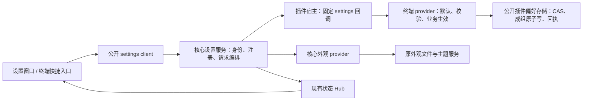

# T-023：设置窗口与插件配置代码设计

更新日期：2026-10-28 · 修订：r1 · 状态：可评审，已获实施确认
任务：[T-023 r2](../tasks/T-023-settings.md) · 行为基线：[F-CORE-028 r2](../core/settings.md) · 插件基线：[F-TERM-005 r2](../plugins/terminal/features/settings.md)
约束：[架构](../architecture.md)、[编码](../standards/coding.md)、[UI](../standards/ui.md)、[测试](../standards/testing.md)。沿用本会话已读取的 apple-design 原则。下文“拟新增”和“尚未创建”描述保留设计时基线；实际源码、分层测试和交付由[T-023结果](../tasks/T-023-results.md)维护。

## 1. 目标与已核实代码

用户2026-10-28要求“接下来你出一个代码设计方案”，授权将前一轮方案继续细化，不记为编码确认。本稿给出一次可确认的完整实施范围：右上角入口、应用级独立设置窗、搜索/分组/草稿/应用、声明协议、实际主题和终端接入、兼容与必需验证。

核实基线为当前未提交工作区：App `2.0.0-dev.17`、API/SDK `5.0.0`、终端 `0.10.0`，含其他任务已有改动。实施前核对是否有后续版本占用，兼容行为不因内部版本顺延改变。

| 位置 | 实际情况 | 本次处理 |
| --- | --- | --- |
| `apps/desktop/src/app.tsx`、`main.tsx` | 顶栏有应用菜单/系统按钮；外观是局部React弹窗 | 增加齿轮及独立设置路由，旧外观入口定位新页 |
| `src-tauri/src/monitor_window.rs`、`surface_endpoint.rs` | 已有应用级监控窗、来源代次与feed owner；工作台窗口仍有独立注册逻辑 | 复用创建/主题/chrome机制，新增明确的settings注册分支；不伪造workspace或复制监控业务 |
| `contracts/capabilities.rs`、`crates/core/src/lib.rs` | **`settings.v1`和`settings.get/set`已经存在**，是数据库键值读写 | 保留旧接口；本次新增独立贡献与存储能力，纠正功能r1中的候选命名 |
| `src-tauri/src/app.rs::plugin_storage` | worker的`storage.get/set`读写当前插件数据代次下`settings.json`，有单文件写入和每实例锁 | 抽成通用文件存储模块，添加组修订、原子批量写和结果回执，保留现有字段 |
| `plugin_registry.rs::worker_for` | 工作调用默认180秒；`PluginProcess`已支持指定超时和双向回调 | 设置使用5/10秒专用调用，不沿用180秒；等待worker时不持锁 |
| `theme.rs`、`appearance_services.rs` | 外观文件v2；选中值与系统高对比共用呈现revision；有原子替换和theme feed | 配置修订与呈现修订分开，补原子回执；保持原主题数据所有者 |
| `crates/plugin-manager/src/package.rs/store.rs` | manifest严格解析、完整签名校验；更新在新数据代次复制后启动；不同`dataSchemaVersion`直接拒绝 | 可选设置声明；复用现有复制/回退，本期插件整体dataSchema仍为1，不建设通用迁移执行器 |
| 终端`worker.ts`、`terminal-view.tsx` | 两项偏好分别写盘；字号在当前view更新；移窗快照优先使用旧字号；集成开关靠focus补读 | 同组提交、feed同步、快捷入口共用写路径；当前配置优先于旧快照字号 |

## 2. 分层与依赖



核心只理解描述结构、页面身份和保存状态。终端字号范围、目录集成规则和PTY适配均由终端包维护。`@sodeck/ui`只提供控件/排版，不依赖SDK；SDK的设置模块不依赖DOM，可同时用于QuickJS worker和WebView。配置正文不通过共享React store或任意跨插件事件传播。

本期一页对应一个provider和一个原子设置组；多页插件可贡献多组，字段存储键不得跨组重叠。跨组按F-CORE-028部分成功规则处理。未来自绘设置页不在本次接入协议中。

## 3. 文件与模块改动

下列路径均相对仓库；标为“新增”的文件目前尚不存在。不顺带迁移其他窗口或重构全部app.rs。

| 模块 | 新增/修改 | 职责 |
| --- | --- | --- |
| 契约 | 新增`contracts/settings-v1.schema.json`、`settings-descriptor-v1.schema.json`、`settings_descriptor.rs`；修改`capabilities.rs`及state-feed契约 | 请求/响应/回调/描述格式；共享Rust描述语义检查；新状态分支 |
| 生成与SDK | 新增`scripts/generate-settings.mjs`、`packages/sdk/src/settings.generated.ts`、`settings.ts`、`settings-provider.ts`；修改`index.ts`/`worker.ts`/`package.json` | 类型与双端验证、类型化client、无DOM provider helper；接入生成校验 |
| 插件管理 | 修改`crates/plugin-manager/src/package.rs`、必要的store元数据查询；修改`scripts/pack-plugin.mjs` | 可选描述引用、签名内资源、有效/不可用贡献结果；不改变激活事务 |
| 设置领域服务 | 新增`apps/desktop/src-tauri/src/settings/{mod,registry,service,contract}.rs` | 目录、来源、固定provider路由、操作状态、应用级快照 |
| 持久化 | 新增`src-tauri/src/plugin_preferences.rs`、`atomic_file.rs` | 从app.rs提取现有插件文件存储，单文件CAS/回执；抽取现有Windows原子替换，旧workbench入口委托 |
| 核心provider | 新增`settings/appearance.rs`、`settings/application.rs`；修改`theme.rs`/`appearance_services.rs`/`startup_config.rs` | 主题草稿提交适配、配置/呈现双revision、只读运行信息和目录操作 |
| 窗口与退出 | 新增`settings_window.rs`、`settings_exit.rs`；修改`app.rs`/`surface_endpoint.rs`/`communication_services.rs`/相关窗口控制分支/`capabilities/shell.json` | 单实例、来源代次、正常关闭及应用退出握手、状态释放 |
| 前端 | 新增`apps/desktop/src/settings/{root,navigation,form,appearance,application}.tsx`、`model.ts`、`client.ts`；修改`app.tsx`/`main.tsx`/应用菜单 | 设置窗口与状态机；移除旧独立外观编辑器，主题卡片复用 |
| 公共UI | 按需修改`packages/ui`的公开布局/表单样式与token | 优先复用Field、Input、Select、Checkbox、ThemeChoice、Dialog；仅补设置分栏需要的通用布局，不放领域规则 |
| 终端 | 新增`plugins/terminal/settings/settings.json`、`src/settings.ts`；修改manifest、worker、terminal-view、ui-observation及相关构建配置 | 单一描述来源、provider、全视图设置feed、快捷操作与移窗协调 |
| 验证与交付 | SDK/Rust相应单元和契约测试；新增`tests/ui/settings.spec.ts`、`tests/desktop/settings*.mjs`、`scripts/package-settings-dev.mjs` | §11矩阵与独立目录包；新脚本均待实施后建立 |

建议API/SDK提升为`5.1.0`，新终端正式包`0.11.0`，App目录包`2.0.0-dev.18`。新增能力为`settings.contributions.v1`、`storage.preferences.v1`、`ui.settings.v1`。其他业务插件不为本任务强制重编译；旧API5兼容范围内的终端/文件/网络包须回归。

## 4. 插件声明格式和校验

manifest可选字段固定为：

```json
"contributes": {
  "settings": { "descriptorVersion": 1, "path": "settings/settings.json" }
}
```

这是对原contributes的可选扩展，原views/commands等保持。声明设置的包要求API `^5.1.0`及上述贡献/偏好能力；旧核心按原兼容检查拒绝不支持的新包，不能忽略字段后错误加载。

终端描述的结构示例（保存为文档示意，不是本轮写入插件的文件）：

```json
{
  "descriptorVersion": 1,
  "pluginId": "sodeck.terminal",
  "pages": [{
    "id": "general", "title": "终端", "order": 100, "schemaVersion": 1,
    "sections": [
      { "id": "display", "title": "终端显示", "fields": [
        { "key": "fontSize", "label": "字号", "type": "integer",
          "default": 14, "minimum": 10, "maximum": 24,
          "effect": "immediate", "keywords": ["字体", "大小"] }
      ]},
      { "id": "integration", "title": "目录集成", "fields": [
        { "key": "shellIntegration", "label": "Shell 目录集成", "type": "boolean",
          "default": true, "effect": "newSession",
          "description": "仅影响新建或明确重连的终端，可能额外读取一次非交互 .bashrc。" }
      ]}
    ]
  }]
}
```

首期field类型为`boolean | integer | text | enum`；enum的选项值为稳定字符串。`visibleWhen`/`enabledWhen`仅允许同页单字段`{key, equals}`，引用合法标量，拒绝环/未知引用。隐藏或禁用字段保留当前值，不暗中清空；整组业务校验由provider最终处理。选项文字/说明只按文本渲染，不支持HTML、脚本、任意正则或网络资源。

核心规范化身份：`core:appearance`、`core:application`，插件为`plugin:<pluginId>:<pageId>`。显示名可变，身份不能随显示名改变。插件父组固定为“插件”，顺序按order/插件中文名/稳定ID确定；多页在右侧以页选择组织，左侧仍最多两层。首期终端只有一页。

描述单一来源由worker/UI构建时导入同一JSON，pack原样复制并纳入integrity与签名；构建需要时开启对应tsconfig的JSON导入。核心不另写终端默认值。主机验证包内的描述，SDK验证相同数据并检查schema/摘要匹配，防止UI/worker与描述版本错配。

校验分两层：签名/完整性、路径越界、缺少已引用文件等继续拒绝整个包；已经验证的受限描述若字段类型/默认/ID/版本错误，只标记设置贡献不可用，不使原插件业务退出。打包阶段对这些错误直接失败，运行时隔离是恢复手段。尚未运行/故障插件使用当前选定版本的描述和状态，不自动激活，不读待更新版本。当前管理器没有的启停/卸载产品入口不在本期新增。

## 5. 公开接口及provider通路

### 5.1 数据模型

- `SettingsPage`：稳定ID、所属核心/插件、显示文案、descriptor摘要/版本、可用状态及原因；目录接口不返回值。
- `SettingsSnapshot`：`pageId, providerEpoch, storageGeneration, schemaVersion, settingsRevision, values, syncState`，及有界修复提示。`providerEpoch`随worker重建变化；`storageGeneration`绑定插件管理器实际数据代次；`settingsRevision`为十进制字符串。
- `values/changes`在线路上使用唯一key的`[{key,value}]`数组（最多64项，value为boolean/安全整数/string），避免把动态字典误当成现有schema检查器支持的任意JSON Schema。UI内部可用Map。
- `CommitResult`：`operationId, persistedRevision, persistence: saved | unchanged, synchronization: current | pending`。不可用/校验/冲突通过结构化错误返回。current只表示provider已装入该修订且宿主已发布快照，不宣称所有WebView已绘制；已知投递失败显示同步待恢复，视图自身的呈现失败仍由视图报告。保存状态与视图已完成呈现分开，不承诺未知远端效果。
- `OperationResult`：`notStarted | running | saved | rejected | unknown`，带已知持久化修订和同步状态；过期/切换数据代次返回unknown及原因，不将unknown当成可以重试。

### 5.2 方法

| 方法 | 请求重点 | 结果及调用边界 |
| --- | --- | --- |
| `ui.settings.open` | `operationId, pageId?` | 窗口generation/导航revision；旧外观入口指定core:appearance |
| `ui.settings.context.get` | 空对象 | 当前窗口来源/导航；仅有效设置窗口上下文 |
| `ui.settings.session.report` | `generation, draftRevision, dirtyPageIds, unresolvedOperationIds` | 只报告有界状态，不上传草稿正文；不作为关闭确认的唯一证据 |
| `ui.settings.close.request/respond` | 原因；宿主签发ticket及本次draftRevision/决定 | §9关闭握手；不让任意窗口伪造设置页的同意 |
| `settings.catalog.list` | 游标/limit，默认50、最大100 | 目录页+catalogRevision，变化期间翻页要求重新取首屏 |
| `settings.page.get` | `pageId` | 描述和快照；加载该页才调用provider |
| `settings.validate` | `pageId, providerEpoch, schemaVersion, expectedRevision, changes` | 无副作用；返回字段错误，不取得长期锁 |
| `settings.commit` | 同上，加`operationId` | 通用校验和provider校验后原子提交；同一ID不同请求冲突 |
| `settings.operation.get` | `pageId, storageGeneration, operationId` | 当前操作/持久回执；不依赖原WebView还活着 |
| `settings.sync.retry` | `pageId, settingsRevision` | 补读当前持久值并同步；不重复写盘，不对新修订回放旧值 |
| `storage.preferences.read` | 本插件`groupId` | provider初始化/读取自己的值和组元数据，不自动写盘 |
| `storage.preferences.commit` | 宿主commitTicket、provider规范化changes | CAS+成组保存+回执；只接受当前所属worker的有效操作上下文 |
| `settings.provider.applied` | commitTicket或syncTicket、已同步revision | provider确认内存业务状态已更新；旧代次/旧revision不覆盖新状态 |
| `app.runtimeInfo.get` | 空对象 | 版本/渠道、portable/standard/development模式、当前数据路径；不修改旧app.info结果 |
| `app.dataDirectory.open/copyPath` | 空对象 | 原生打开固定当前data或复制它；无任意路径参数 |

所有方法使用`additionalProperties:false`，错误/结果也校验；跨字段语义另由Rust/TS公共规则校验，测试两端一致。`state.get/open/ack/close`沿用现有方法，增加`settings.catalog.v1`与`settings.page.v1`两个请求分支；不向旧严格响应乱加字段。

`settings.*`不能落入当前核心SQL的旧get/set；在桌面dispatch中增加明确路由，保留旧两个方法。`ui.settings.*`须在通用ui兜底之前处理。公共调用均走`Core::record`和现有诊断上下文；初始化允许`storage.preferences.read`，提交不在prepare阶段执行。

### 5.3 插件回调与快捷入口

保持现有wire帧和PluginProcess双向通路，新增固定宿主命令`settings.provider.read/validate/commit/sync`，统一由`settings-provider.ts`处理。provider helper向插件暴露读取、业务validate和apply回调，底层调用上述公开偏好存储。新包声明即承诺支持这些回调；失败只使该组不可用。

宿主读取注册表取得当前`Arc<Loaded>`后释放注册表锁，以5秒read/validate、10秒commit、5秒sync调用`invoke_with_context`。携带现有诊断上下文；结果校验后再次核对实例epoch。**任何设置注册表、Hub、workbench、存储或退出锁都不能在等待worker时持有。** provider回调可能向核心申请存储，必须允许回调响应继续流动。

设置窗以宿主身份访问注册的provider；插件UI/worker通过公开settings接口只能定位本插件的贡献，核心外观等核心公开能力按原规则可用。这个身份约束沿用P-13防止插件互调，不引入P-14禁止的权限分配。公开`plugin.invoke`拒绝`settings.provider.*`保留命令，插件不能借通用invoke直接绕过统一提交。

终端新版UI的字号/集成快捷入口改用`settings.commit`，从最近快照带revision立即保存。UI和worker随包成套更新，旧包原私有`settings.*`调用继续走旧实现；新版退出旧的直接storage.set写路径，不维护第二套权威偏好。重复快速点击合并/禁用至本次结果确定；冲突补读后由用户再次操作，不自动覆盖设置窗草稿。

## 6. 成组存储、冲突和结果确认

### 6.1 插件数据

保留当前插件数据代次下`settings.json`，既有`fontSize`/`shellIntegration`仍为原顶层字段。新增保留键`__sodeckPreferences`，含格式版本、各组的schema/keys/settingsRevision及有界回执；不新增业务数据库表。该保留键若已有不兼容用户数据，报冲突并保持原文件，不覆盖。

`PluginPreferenceStore`按真实数据目录共享一个Arc和mutex，旧storage接口与新group接口都经过它；不能为每个窗口/重载worker创建独立文件写锁。旧插件没有声明时，原storage.get/set仍可用；如果文件已含组元数据，旧写入触及组键时同时递增组revision、保留未知数据。新声明的组键只由provider提交路径写，旧raw set尝试写受管键返回明确错误，避免绕过业务校验。此约束只适用于当前已声明组，不改变其他插件存储。

保存事务在单文件内完成：读取并校验当前文件 → 核对ticket/实际数据代次/schema/revision → 合并已知变更且保留未知键 → 写入新revision和操作回执 → 同目录唯一临时文件write+sync → 平台原子替换。复用现有`workbench::replace`的Windows实现并抽到`atomic_file.rs`，不先删除目标文件。失败不改内存快照/权威值；替换后即为已保存，随后通知失败不能报“未保存”。读取损坏文件返回错误，不用默认值覆盖损坏数据。

每组没有元数据时revision为0，仅读取不落盘；第一次有效提交把当前合法旧值和元数据一起保存。缺值由插件声明默认值补全，非法旧值的回退/修复说明由插件负责；取消不修复文件。包整体`dataSchemaVersion`保持1，设置页`schemaVersion`首期为1；未来不兼容结构必须另设计迁移，遇到较高版本只读。schema相同的可选字段增量通过默认值兼容，不无故升级整个插件数据结构。

### 6.2 操作状态与幂等

每组最多1个在途提交，全应用最多8个；超过返回BUSY，不无限排队。宿主在短锁内登记operation和不可伪造的commitTicket，ticket绑定page/插件实例/数据代次/schema/revision/原始请求摘要；释放锁后回调worker。worker只能用此ticket向storage提交一次规范化变更，不能扩大为未提交的字段。provider可做纯值规范化，不可暗中修改无关字段或执行远端操作。

provider完成存储后先更新自己的权威运行状态，再调用`settings.provider.applied`；宿主发布对应快照和保存结果。磁盘已保存但worker崩溃/通知失败时，`operation.get`直接读持久回执，返回saved/pending并标识provider不可用；恢复初始化从持久值读取，重新发布当前代次快照。设置窗关闭不取消已开始的存储事务。

操作结果查询只需当前选定包的数据代次和存储对象，不调用loaded_for，worker已死仍可核对已落盘事实。插件退休/重建与ticket失效在同一存储提交临界区协调：替换文件前最后核对写入代次，旧worker不能在新实例接管后落入迟到写；已完成替换的写按已保存处理，新实例读取它。不得持有loaded注册表锁等待文件锁或worker。

回执与配置在同一个原子文件里提交，包含operationId、请求摘要、旧/新revision、变更key和保存结果，不存草稿正文副本。每组保留最近64个，实际原子文件总预算限制优先；回执被清理后unknown不可自动重放。重发仍必须带原expectedRevision，因此已成功写入但回执过期也会因revision前进而拒绝，不能再次产生副作用。相同ID/相同摘要返回同一持久结果，并可附当前同步状态；不同摘要返回CONFLICT。

超时仅代表等待结束。10秒后UI进入结果核对，在最初30秒内按1/2/5秒退避查询最多6次，其后停止自动查询并给出“核对结果”；页面恢复/插件恢复时再核对一次。未确定期间冻结该组再次应用，其他组仍可操作。请求尚未写入时ticket可被撤销；已进入文件事务时只能等待结果，不能用取消回滚已保存设置。

## 7. 核心外观与应用信息适配

主题继续由现有Appearance/主题服务拥有。将“选中配置的revision”和“实际呈现revision”拆开：系统高对比/测试主题变化可增加呈现revision，不导致用户选择草稿无故冲突；真正选择变化增加配置revision并按原协议同步所有表面。旧`ui.theme.choose/select`保持参数/响应格式，内部也调用同一保存函数，使旧入口写入能被设置中心发现。

为保证主题回执与选中值一起提交，`appearance-preferences.json`新增v3格式，包含themeId、配置revision、storageGeneration和有界回执；仍是独立外观文件，不迁入core.sqlite或再存一份主题。读取兼容v1/v2；在第一次应用写v3前保留字节一致的旧格式备份，备份失败则不写。仅打开设置不升级文件。系统高对比变化不写偏好文件。

保留旧文件的实际原始格式/字节（遇到v1也保存v1），统一使用独立的pre-v3备份，不冒充v2；相同备份可复用，不同内容已存在时停止覆盖。为做到读取无副作用，将当前load中的v1自动写v2迁移延后到用户实际选择外观时。格式损坏与未知更高版本区分：损坏文件显式修复前保留原副本；高版本只读，不由本版“修复”为v3。

这属于本次明确的数据影响：**旧核心不识别v3，不能直接拿新数据目录降级运行。** 测试/开发包独立输出；若要回退核心，关闭进程后使用保留的完整旧开发目录或外观备份副本。插件独立回退遵循原管理器，不受此核心外观格式变更替代。不把旧核心的默认主题回退当成成功保留配置。

提交前用现有Hub.reserve为当前设置页状态保留有界槽；写盘后更新内存，发布配置快照与原`app.theme.v1`快照，再更新原生背景。发布失败标记saved/pending并支持重试；不重写主题以“重试通知”。未更改themeId但退出测试覆盖/修复无效偏好的显式选择也按有效操作处理，不误认为普通no-op。

应用与数据页以StartupConfig解析结果为唯一来源，为其补只读运行模式/配置来源字段，不能按“路径是否包含data”猜测模式。复制路径使用现有剪贴板适配，打开目录走固定Path的原生API，不拼shell命令；路径可选择/换行。管理插件链接在设置窗中复用现有`ManagementDialog(page=plugins)`和公开插件管理接口，关闭管理弹层返回原焦点，草稿保留；不新增启停/卸载能力。

## 8. 状态feed与前端模型

### 8.1 复用Hub

`settings.catalog.v1`仅推catalogRevision和有界变动摘要，客户端按页补读；`settings.page.v1`按pageId打开，值为小快照（包含配置revision、providerEpoch、values和同步状态），不推描述或操作历史。Hub外层revision是投递状态版本，不能当配置CAS revision。

页key的scope使用appGeneration，value保存providerEpoch；worker故障发布unavailable，恢复更新epoch，客户端保留草稿并要求重新读取基线。来源owner使用现有window generation/view mount/worker身份，旧来源不能写/ack新窗口feed。给`state_call`、SDK生成联合类型、Hub清理/窗口owner保留路径同时增加新契约，避免现有prune把应用级设置当已关闭工作区删除。

设置窗只订阅目录+当前页面，已访问的非当前页草稿保留，在应用前重新核对revision；无需为每个字段开feed。终端每个view订阅一个页快照，沿用ack/resync/退订；初始化和移窗重新挂载先取得快照，迟到旧epoch不装入新视图。feed回调直接使用已验证快照，不在10ms公共pump中调用worker/读盘。

### 8.2 前端职责

`model.ts`为纯状态归约：页面记录`baseline, draft, baseRevision, providerEpoch, errors, status`，状态包括loading/clean/dirty/validating/saving/reconciling/conflict/unavailable。保存批次冻结待提交changes并禁止本批字段继续编辑，其他导航/搜索仍可操作；先验证全部脏组，再稳定顺序提交。中途失败按结果清理成功草稿并保留其余，禁止整体提示“保存成功”。取消只丢未应用草稿。

用户在有草稿时收到新配置revision，标记冲突；“载入最新”放弃本组草稿，“继续查看”保留但不能提交，符合功能规格。切页/搜索/异步读取使用页面request代次，结果只安装到对应页，不能覆盖新修订。整数输入暂存字符串，空串/IME/未完整数字不强制变0；合法后才形成提交值。

搜索在有界描述目录本地完成，元数据分页加载，不搜索values；索引字段标题/说明/关键词及分类路径，采用Unicode规范化和大小写折叠，多词AND、中文子串。搜索请求取消/切换不影响草稿；结果高亮用文本节点。所有四种控件均完成契约和UI错误/焦点验证，实际终端集成覆盖布尔和整数，文本/枚举用有标记的测试夹具。

复用公开UI控件和主题token；设置专属CSS只做分栏/滚动布局，不重新定义按钮配色。主窗口齿轮用Lucide `Settings`和已有IconButton，更新chrome命中区域，不能被拖动区吞掉。原外观弹窗退役，不留两套交互。维持§2的尺寸/键盘/三主题/减少动态约束。

## 9. 原生窗口和退出协调

label固定`settings`，来源`@window:settings/<generation>`；注册记录保存generation、来源窗口、导航revision和本次运行的几何。原生创建/显示在主线程，创建前占单实例位置，失败清理同代次记录，重复open聚焦已有窗；迟到创建必须核对generation，不能留下第二个窗口。主/子工作台是触发来源，设置窗本身不是Workspace或PluginView。

新增注册需要同时接通：rpc来源校验、endpoint_window/feed_owner、窗口控制目标、windows.chrome、主题bootstrap、事件泵投递、prune live owners、Destroyed释放以及Tauri shell capability的精确`settings`窗口条目。原生按钮关闭/Alt+F4/Esc/取消都进入同一close协议；正常退出时清理特例不能走主窗收托盘分支。大小/位置变化仅保存在本次运行，不写工作台现场恢复数据。

关闭协议由`settings_exit.rs`维护一个有界pending ticket：

1. 原生关闭或`app.exit`触发宿主意图，向当前设置窗发送带generation的closeRequested。没有设置窗直接沿用现有退出。
2. 前端冻结本次草稿revision，回报最新dirty/在途操作，并显示必要的“放弃更改/继续编辑”。宿主不只相信上一次session.report，避免最后一次输入尚未上报的竞态。
3. 继续编辑撤销ticket并恢复编辑。放弃仅撤销未应用草稿；宿主等待已有提交完成/查询回执，最多10秒，未决则明确告知已提交可能保存并让用户选择继续退出或返回核对。超时不是自动同意。
4. 宿主确认ticket仍属于当前窗口/草稿代次，设置“禁止新提交”的退出栅栏，再执行原shutdown。不可在等待UI或worker期间持shutdown_lock；系统强制终止只能保证已开始文件事务原子性，不承诺保留草稿。

现有dispatch把任意成功`app.exit`结果视为可退出，因此**等待选择不能返回成功**：先返回结构化`SETTINGS_REVIEW_REQUIRED`并聚焦设置窗；有效回应后由内部一次性许可重新进入退出流程。主菜单/托盘/原生ExitRequested统一走该流程，应用前端对该错误视为“正在处理关闭”而非普通红色错误。窗口3秒无响应时用原生可见确认承接，默认保留应用；不能因WebView失联静默丢草稿。此流程只为实际未完成编辑/在途写触发，不增加普通关闭确认。

关闭完成销毁当前generation，释放feed/搜索请求/操作观察，不取消已落盘提交。返回有效来源并恢复齿轮焦点；来源已销毁则聚焦仍存在的主工作台，不新建服务器。主窗收托盘仍保留设置窗。

## 10. 终端接入和独立更新验证

`src/settings.ts`从插件描述构建provider，导出当前偏好、纯校验、应用回调和供UI使用的描述。worker.prepare只读取旧值/组元数据，不新建PTY；activate就绪后注册状态。新建/重连捕获最新已保存shellIntegration快照，正在进行的创建流程沿用其开始时捕获的值，不途中换启动方式。

字号通知更新xterm option并通过既有terminalGeometry调度fit；不重建Terminal、PTY、连接或清空屏幕。隐藏视图只记最新值，显示后测量fit；禁止0尺寸resize。初始化时先恢复屏幕/选择/滚动等现场，再应用当前偏好字号。保留旧Snapshot.fontSize字段的读取兼容，但在已有有效设置快照时不作为权威值；旧快照不会覆盖新字号。

Shell集成的状态栏开关继续立即保存，显示的是下一次会话的偏好；现有会话是否启用集成仍由会话事实决定。设置保存不能触发远端命令或重连。删除原focus轮询补读，改用可靠快照/feed；失效时显示未同步并补读，不能吞掉错误保持伪成功。

独立更新不额外发明产品设置：在测试临时源码副本中产出两个真实终端包，A=`0.11.0-rc.1`仅将已有字号接入中心，B=`0.11.0-rc.2`增加已有Shell目录集成声明及统一保存通路。A保留原集成快捷功能；B验证新增布尔字段真实影响新建/重连会话。测试构建保存明确的A基线差异文件及哈希，只对临时副本应用，不在生产worker里按测试版本号切换业务。核心EXE哈希保持一致；准备B后A界面不变，重启后出现B字段。最终目录包使用完整`0.11.0`，不引入第三个未确认偏好。

插件管理器复制原数据后启用B，失败回退A及其原数据代次；页结构版本都为1，新增可选字段取已有持久值/默认。另用受控高版本组元数据验证只读保护，不通过提高manifest dataSchemaVersion假装已具备迁移执行器。

## 11. 预算、验证与实施顺序

### 11.1 固定预算

| 对象 | 本次限制 |
| --- | --- |
| 描述 | 每插件≤4页、每页≤64字段、≤8小节；完整描述≤128KiB，单页≤48KiB；全应用有效设置页≤128 |
| 文案/选项 | ID/key≤80 ASCII字符；标题≤80 Unicode字符；说明≤512；关键词≤16×40；enum≤64项；文本值≤4096字符且受组总字节约束 |
| 值/状态 | 每组values序列化≤16KiB；整页feed含元数据≤24KiB，低于现有32KiB单状态上限；目录feed≤4KiB；设置状态总预留≤4MiB，不提高现有8MiB Hub总额 |
| RPC/草稿 | 设置请求/结果≤64KiB；窗口全部草稿值≤2MiB；描述缓存≤6MiB；超过返回明确容量错误，不静默裁值 |
| 存储/回执 | 现有插件文件总额≤1MiB，含未知键和回执；每组≤64回执、每插件≤128KiB回执；外观v3≤64KiB，旧v1/v2沿用原16KiB读取上限 |
| 并发/等待 | 每组1写/全应用8写；provider read/validate5秒、commit10秒、sync5秒；正常读取最多4并发；打开单实例操作回执≤256、10分钟，过期不自动重开 |

容量在写入前和读取前均检查；文件读取用metadata+有界读取，不先读无限大文件再报错。注册预算不足只使超额贡献不可用，不挤掉主题/运行业务feed。达到任一预算不代表用户可以绕过校验。

### 11.2 本次代码验证流程

全部新增入口尚不存在。准备：Windows、独立v2目录、现有三官方插件、专用Bash/OpenSSH服务器、复制的旧偏好数据、可控坏包/慢回调/丢回执夹具。结果分为单元/契约、浏览器、真实worker、真实SSH、原生目录包；每组测试清理进程/PTY/订阅/故障注入/临时副本，恢复系统辅助设置，保留脱敏日志与包/EXE哈希。实际结果归T-023及后续结果文件。

| 编号 / 对应功能用例 | 准备、步骤和预期 | 拟验证位置 |
| --- | --- | --- |
| SCODE-01 / SET-07/08 | 两端加载相同有效/无效描述；重复ID、类型错、非法默认、条件环、超限/未知字段；新/旧API包加载。应一致拒绝坏贡献、签名坏包拒绝整体，旧无声明包运行 | Rust共享描述测试、SDK契约测试、plugin-manager测试 |
| SCODE-02 / SET-05/06/08 | 旧settings.json含18/false及未知key；并发CAS、同ID同/异载荷、64回执淘汰、旧raw写、满文件/坏文件；在write/sync/replace前后强停。只出现完整旧/新组，结果可核对，不重置合法值 | plugin_preferences单元/进程故障测试 |
| SCODE-03 / SET-05/06/07 | 真实worker回调再请求storage，另一路业务RPC同时运行；超时后迟到提交、旧ticket/旧实例/伪provider、worker崩溃恢复。无锁死/无限线程/误重放，持久成功与同步失败分开 | plugin-host与桌面集成 |
| SCODE-04 / SET-01/06/09 | 主窗/工作区窗/独立终端同时open；关闭创建中窗口、旧来源RPC、缩放/移动/Alt+F4；断feed后恢复。单窗口、当前代次有效、无工作区串用及订阅泄漏 | Windows原生settings测试 |
| SCODE-05 / SET-02/03/05/10 | 用四类控件夹具搜索/切页/恢复默认/部分失败/坏输入/IME；条件变化保留值；快速异步切页；复制/打开目录失败。错误定位、草稿不丢，未应用无副作用 | model单元、Playwright UI |
| SCODE-06 / SET-04/06/08 | 外观v1/v2副本读取、第一次应用v3、备份失败/磁盘失败、系统高对比变动、旧ui.theme.choose并发、回执丢失。配置revision独立、原子保存、取消无修改、三主题全表面一致 | theme/provider单元+原生appearance回归 |
| SCODE-07 / TERM-SET-01～04 | 无会话读/改配置；两服务器多view/隐藏页/移窗时改字号；丢feed；Shell偏好保存时已有会话/新建/重连。PTY身份保持、最新字号优先、集成只影响规定会话 | 终端worker/geometry测试及隔离SSH原生测试 |
| SCODE-08 / SET-06/09 | 从主菜单/托盘/原生退出；最后一次输入尚未report；保存中退出、用户取消、超时、WebView失联；重复票据。只有当前代次确认后退出，旧ticket无效，连接/worker统一释放 | 原生settings生命周期+既有tray-exit |
| SCODE-09 / SET-07/08、TERM-SET-05 | 同一EXE依次A/B包、准备未重启、重启/坏包/激活失败/高版本组；实测Shell开关启动效果。记录包/EXE哈希、源码差异，证明插件独立新增真实设置 | settings-updates及原有updates框架 |
| SCODE-10 / SET-09 | 三主题、100%/200%文字缩放、小工作区、纯键盘/IME、高对比/减少动态/透明；查看字段错误、保存中/未知/不可用。控件可达、对比和焦点达标 | UI截图+Windows原生人工操作 |
| SCODE-11 / SET-05～10 | 注入可识别文本值、路径和错误正文，检查call/事件记录；达到所有容量边界，关闭窗/换插件epoch。只记录来源/page/key/revision/结果，无值正文和路径，无状态增长泄漏 | 审计/契约/预算测试 |

代码新增的安全元数据须显式加入审计摘要白名单和builtin事件定义；现有审计默认只记录fieldCount等，不能声称它已记录page/字段变更。自由文本值、commitTicket、路径不进入记录，错误描述应脱敏；终端旧settings.changed事件改为字段名/revision/结果而非新值正文。

已有检查在实施后按实际入口运行：`npm run check`（接入settings生成检查）、`npm run test:contracts`、`npm run test:core`、`npm run build`；浏览器用现有Playwright配置的settings用例，原生以拟新增`tests/desktop/settings*.mjs`为主，并运行受影响appearance/terminal-geometry/directory-follow/updates/tray-exit回归。先测试相关范围，通过后不无故重复扩大整套；所有本期必需原生条件缺失时不能标工程完成。

### 11.3 实施批次与交付

1. 契约/描述/版本/打包验证与旧包兼容，建立SCODE-01。
2. 插件文件原子组存储、回执、provider回调及无死锁验证，完成SCODE-02/03。
3. 外观provider、v3备份/兼容、应用信息；完成SCODE-06。
4. 独立窗口、来源/退出、搜索/草稿/统一表单；完成SCODE-04/05/08。
5. 终端全流程与A/B独立更新；完成SCODE-07/09。
6. 三主题/辅助能力/记录/容量回归、release型独立目录包，完成SCODE-10/11及功能用例矩阵。

这是一份整体实施方案，确认后按批次自主完成，无需每批重复确认。目录包拟输出`.local/dev/SoDeck-v2-T023/`，数据与旧包分离；用户需要保留配置时仅在关闭后的测试副本验证兼容。最终交付实际截图、EXE/插件版本、测试结果、限制和3–5步体验流程；目录包不等于安装器验证或发布。按项目规则不自动分支、提交或推送。

## 12. 修订记录

r1，2026-10-28：从实际API5/终端0.10代码出发，固定新增能力、描述、provider、存储、外观格式、窗口/退出和回归计划；本轮只更新文档，SCODE-01～11尚未运行，等待用户实施确认。


实施细化（2026-10-28，已确认范围内）：目录 entry 可携带纯声明 definition，以便不读取值、不唤起 provider 即建立字段搜索索引；session.report 可携带 closeTicket 确认当前关闭通知已送达，未响应才启用原生回退。新关闭意图替换旧票据，旧回复不能关闭新提示。实际进展见 T-023-results；本文早期“尚未创建”的描述是设计时基线。

实施衔接（2026-10-28，范围不变）：应用退出通过同期T-025的统一关闭协调器调用设置审阅，使用`CLOSE_REVIEW_REQUIRED`和`settings.closeFinished`通知清除冻结；单独关闭设置窗仍走自身握手。新的退出请求替换待处理的退出票据，迟到的继续编辑响应不能吞掉新请求。构建时实际SDK为5.2.0，设置贡献最低仍为^5.1.0，不为本任务回退其他任务的版本。

回归适配：旧外观弹窗已移除，三主题/键盘/高对比/IME和缩放由settings及settings-lifecycle覆盖；旧terminal-geometry的私有设置调用由settings-terminal覆盖字号、移窗、PTY身份及末行几何；directory-follow改用公开settings.commit，并等待目录确认后执行一次定位。未将过期脚本记为通过。release包验证使用普通portable入口和迁移目录，测试结束才截取已保存页面。
