# GitHub Actions 工作流全景图（优化前快照）

2026-11-08 优化前快照。依据提交 `3a415ca6821ce45552933d5cc3cf1561d3a8d5e6` 的五个工作流和对应脚本。图中保留优化前的重测试、netem 和缓存行为，用于对照；源码测试移出打包后的结构见[提速第一步实施记录](implementation-release-performance.md)，当前运行入口见[开发指南](development.md)。

阅读方式：先看全景，再看各工作流内部。普通箭头表示执行依赖或产物流转；标明“手动”的虚线表示维护者选择，不代表工作流自动联动。同一任务内各步骤顺序执行，分叉的平台任务可并行。实际耗时是历史样本，单独标明来源。

## 1. 全局：五个入口如何连接

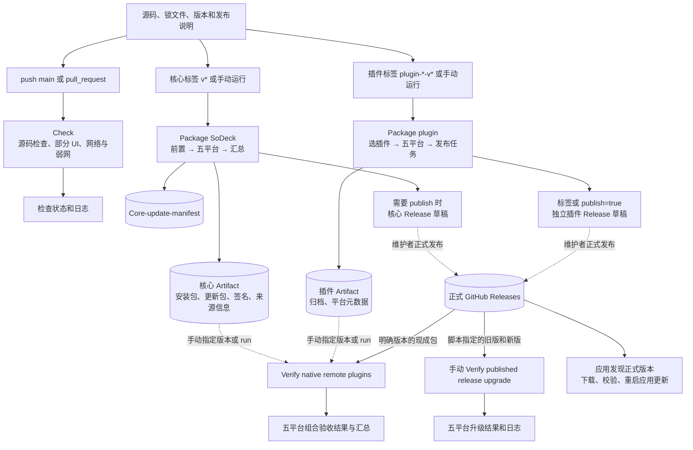

**没有自动连接的部分：**

- Check 与两个打包工作流没有 `needs` 或 `workflow_run` 连接；Check 成功不会自动启动打包，打包也不自动等待 Check。
- 核心与各插件没有构建依赖。核心安装包不携带业务插件，但核心打包中的 UI 测试会使用终端前端依赖。
- 两个验收工作流都是手动入口。验收结果不会自动把草稿发布为正式 Release。
- 草稿不供应用发现。正式发布是单独动作。
- 当前没有定时任务，没有纯文档路径过滤，也没有自动 main 预热打包。

## 2. 入口、权限、超时与平台

### 2.1 触发和输入

| 工作流 | 当前入口 | 手动输入及默认值 |
| --- | --- | --- |
| [Check](../.github/workflows/check.yml) | main push；pull_request | 无 workflow_dispatch |
| [Package SoDeck](../.github/workflows/build.yml) | v* 标签 push；workflow_dispatch | publish=false；core_run_id 为空 |
| [Package plugin](../.github/workflows/plugin.yml) | plugin-*-v* 标签 push；workflow_dispatch | plugin=terminal，必填字符串；publish=false |
| [Verify native remote plugins](../.github/workflows/remote-integration.yml) | 仅 workflow_dispatch | core/terminal/files/network 各自的 version、run_id；verification_run_id |
| [Verify published release upgrade](../.github/workflows/release-upgrade.yml) | 仅 workflow_dispatch | 无版本输入；版本写在脚本中 |

组合验收的核心、终端和文件各须提供版本或 run ID；网络两项均空则不参与。重放时填 verification_run_id，其他输入留空。

### 2.2 五个平台

| 平台任务名 | runner | 原生 Rust target | 核心格式 | 插件格式 |
| --- | --- | --- | --- | --- |
| windows-x86_64 | windows-2025 | x86_64-pc-windows-msvc | NSIS EXE | ZIP |
| windows-aarch64 | windows-11-arm | aarch64-pc-windows-msvc | NSIS EXE | ZIP |
| linux-x86_64 | ubuntu-22.04 | x86_64-unknown-linux-gnu | DEB + AppImage | tar.gz |
| linux-aarch64 | ubuntu-22.04-arm | aarch64-unknown-linux-gnu | DEB + AppImage | tar.gz |
| macos-aarch64 | macos-15 | aarch64-apple-darwin | DMG + app.tar.gz | tar.gz |

五个平台是并行的矩阵任务，实际启动仍受 runner 排队和配额影响。所有矩阵均设置 fail-fast=false，一个目标失败不会主动取消其他目标。

### 2.3 控制规则

| 工作流 / job | 超时 | 权限和并发 |
| --- | --- | --- |
| Check / format | 30 分钟 | contents:read；同一分支或 PR 新运行取消旧 Check |
| Check / network 两个目标 | 各 60 分钟 | 同上；与 format 没有 needs |
| 核心 preflight / package / metadata | 10 / 各 40 / 10 分钟 | 默认 contents:read、actions:read；只有 metadata 获得 contents:write |
| 插件 select / package / release | 10 / 各 20 / 10 分钟 | 默认 contents:read；只有 release 获得 contents:write |
| 组合 resolve / verify / summary | 10 / 各 20 / 5 分钟 | contents:read、actions:read |
| 升级 upgrade | 各 30 分钟 | contents:read |

核心 metadata 按核心标签串行，插件 release 按插件标签串行，两者 cancel-in-progress=false。这是发布写入任务的并发控制，不会把所有组件或所有平台串成一条流水线。

## 3. Check：三个并行任务，任务内串行

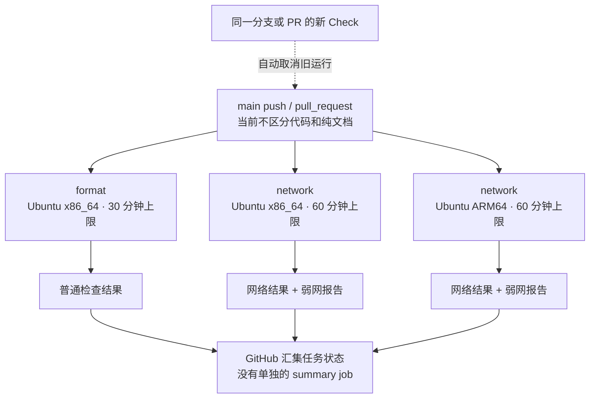

### 3.1 format 内部

任务名虽然叫 format，实际覆盖编译、测试和浏览器回归。

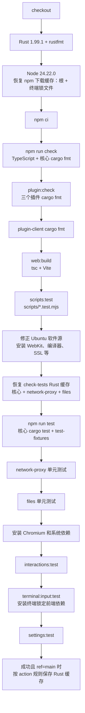

### 3.2 network 内部：两个 Linux 目标各执行一遍

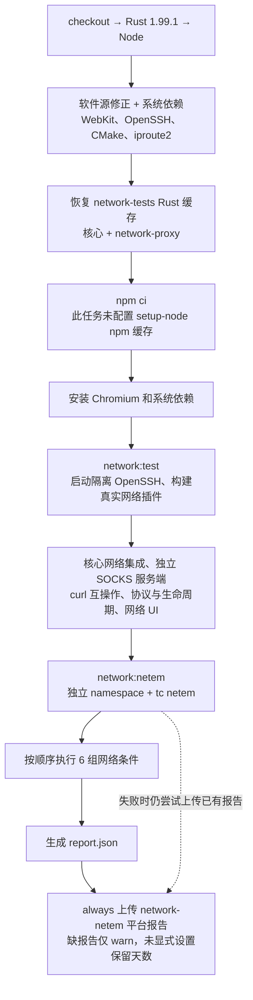

netem 配置顺序来自 [test-network-netem.mjs](../scripts/test-network-netem.mjs)：

| 配置 | 延迟 | 抖动 | 丢包 | 尝试次数 |
| --- | --- | --- | --- | ---: |
| baseline | 0 ms | 0 ms | 0% | 10 |
| remote | 50 ms | 10 ms | 0% | 10 |
| cross-region | 150 ms | 30 ms | 1% | 20 |
| poor | 300 ms | 50 ms | 3% | 20 |
| severe | 500 ms | 100 ms | 5% | 20 |
| blackhole | 0 ms | 0 ms | 100% | 2 |

这六组在每个 network 任务内顺序执行。两个 Linux 任务并行，不应将两个约 25 分钟的 netem 相加成 50 分钟的总体等待。

## 4. 核心打包：preflight → 五平台 → metadata

### 4.1 任务依赖与复用分支

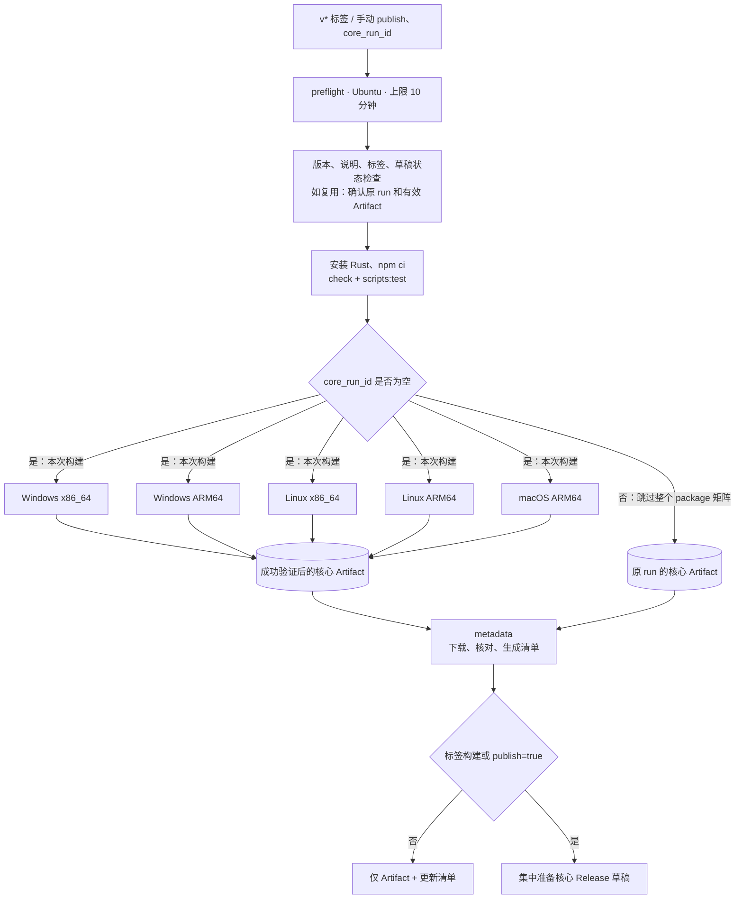

preflight 输出 tag、version、publish、source_sha、run_id。复用时 source_sha 和 run_id 指向原始产物；当前 checkout 的发布脚本仍执行自身检查，不将当前脚本提交冒充旧包来源。

metadata 的条件是：前置成功、未取消，即使 package 有失败或被恢复模式跳过，也会尝试运行。它依赖矩阵结束，但不要求矩阵整体 success。

### 4.2 每个 package 任务的顺序

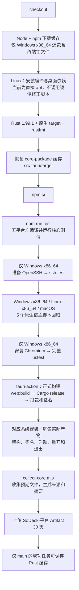

图中“仅……”步骤在其他平台跳过，其余顺序保持。五个平台各有自己的依赖安装和编译目录，并不共享同一个 runner 文件系统。

原生宿主脚本子集为 collect-core、core-release、plugin-settings-assets、release-metadata、smoke 的测试文件。完整 scripts:test 已在 preflight 执行一次。

### 4.3 完整 UI 回归还会展开哪些命令

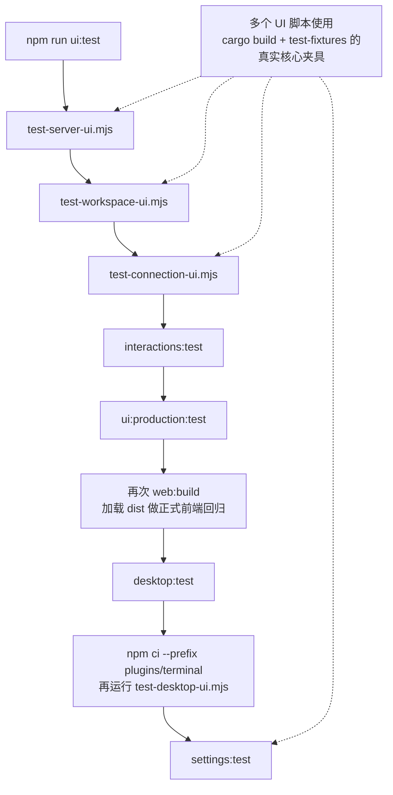

这解释了核心出包为什么会安装终端前端依赖。终端业务插件没有因此被打进核心安装包。

### 4.4 实际包验证按系统展开

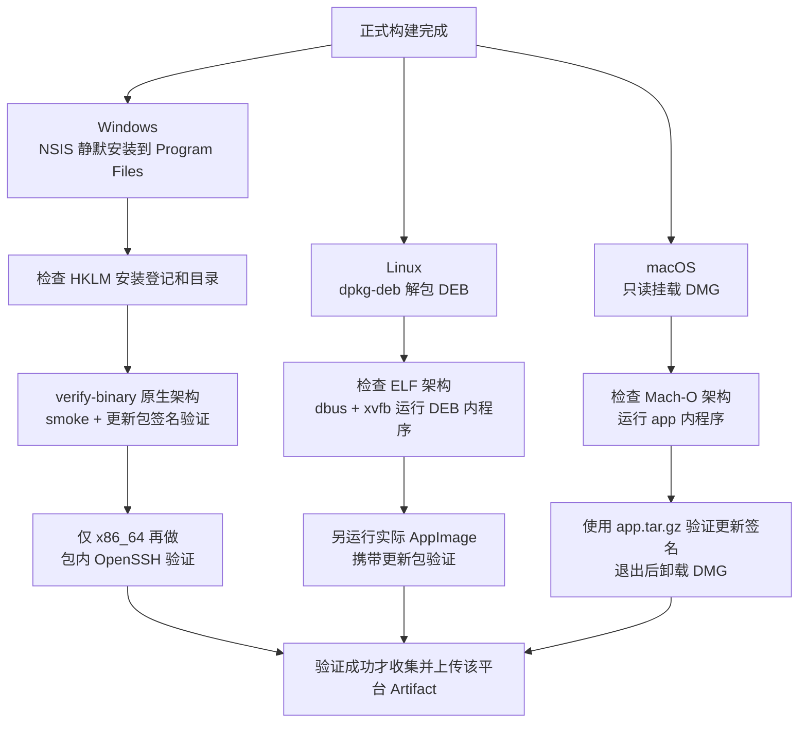

smoke 通常启动两次：首次验证窗口与资料保存，再重开验证持久资料，均要求正常退出。包内业务验收另按传入的插件和 SSH 配置启用。

### 4.5 metadata 与 Release 写入

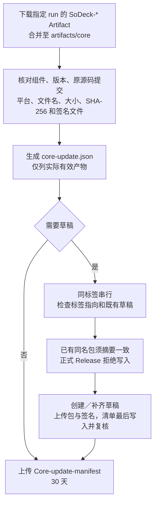

核心汇总允许处理部分平台成功的产物，记录缺失平台。这不等于该版本已经完成五平台交付；后面的组合验收选包要求更严格。

## 5. 插件打包：每次只处理所选插件

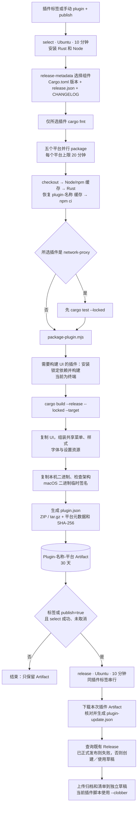

插件 release 等待矩阵结束，但条件不要求全部 package success；有效平台元数据可以生成部分平台清单。插件当前没有 core_run_id 式跨运行恢复参数。

插件打包检查归档元数据和二进制架构，不启动真实插件远程业务。运行、退出和协作行为由源码集成或后面的实际包验收覆盖。

插件草稿上传采用现有 --clobber，和核心“先逐包比对既有摘要再复用”的实现不同。正式版本仍会被前置检查拒绝覆盖。

## 6. 原生远程组合验收：先固定输入，再用现成包

### 6.1 每个组件怎样选包

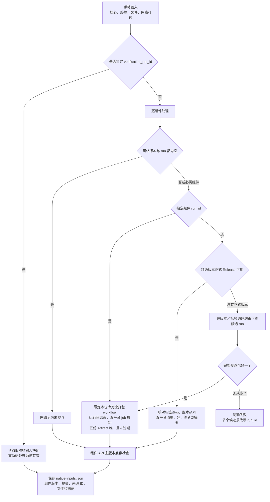

正式 Release 已存在但附件损坏、缺包、清单错误或下载失败时直接报错，不自动换成实验包。组件可以来自不同源码提交。仅发布汇总失败的构建，只要五平台 package 和 Artifact 合格，仍可作为验收输入。

### 6.2 工作流执行图

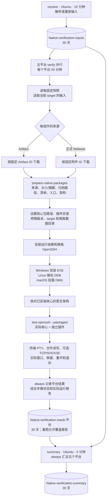

源码不在 verify 任务中重新编译；这里消费已经产出的核心和插件包。Linux 使用 DEB 内程序，当前这条组合验收不另跑 AppImage。

Windows ARM64 缺少 sshd 时下载固定版本微软 ARM64 便携包并校验摘要；Windows x86_64 使用系统可选组件。测试 SSH 服务只监听隔离回环环境，不随产品发行。

summary 的成功条件是：五个平台有效 job 均成功、各报告与本次测试提交匹配，且运行报告确认版本、平台、桌面和 SSH 行为完成；可选网络参与时还要求网络报告成功。缺报告、未启动、取消都不能当作通过。

同一验收 run 重试会复用已固定输入；新建 run 可用 verification_run_id 重放。原包失效时失败，不偷偷选择另一份包。

## 7. 已发布版本升级验收：当前是固定版本专项

当前 [test-release-upgrade.mjs](../scripts/test-release-upgrade.mjs) 中的版本为：

| 组件 | 旧版本 | 新版本 |
| --- | --- | --- |
| 核心 | 0.9.2 | 0.9.3 |
| terminal | 0.2.1 | 0.2.2 |
| files | 0.4.1 | 0.4.2 |
| network-proxy | 0.2.1 | 0.2.2 |

即使当前核心已是 0.9.4，手动运行该工作流也不会自动变成 0.9.3 → 0.9.4。

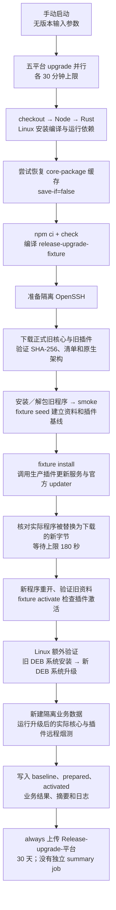

该流程由测试夹具驱动生产更新服务，包含实际安装字节和重开验证；不等于在真实设备上操作完整更新页面、管理员确认和交互式安装界面。

## 8. 缓存：存的是什么，谁能读写

### 8.1 当前 Rust 缓存关系

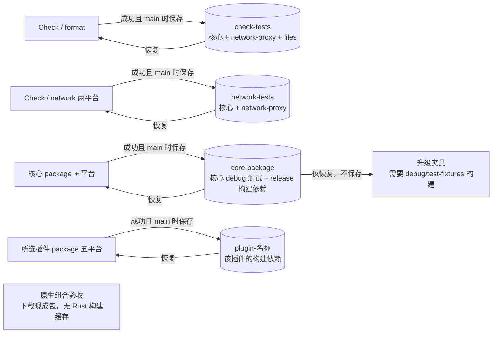

这些是缓存族，不是一个跨平台通用文件。action 自动把主机、架构、Rust 工具链、相关 Cargo 输入和编译环境纳入键。

| 使用点 | shared-key / 内容 | 附加输入 | 保存条件 |
| --- | --- | --- | --- |
| Check format | check-tests；三个 workspace 的 target 和 Cargo 下载内容 | 显式共享客户端清单摘要 | main 且任务成功，按 action 命中规则保存 |
| Check network | network-tests；核心与网络插件 workspace | 未配置 format 中那个附加环境摘要 | 同上 |
| 核心 package | core-package；src-tauri/target | 默认自动键 | 同上 |
| 插件 package | plugin-插件名；该插件 target | 显式共享客户端清单摘要 | 同上 |
| 升级 upgrade | core-package；src-tauri/target | 默认自动键 | false，永不保存 |

不同缓存族可能包含同一批核心依赖，但占用独立缓存空间。同一个 src-tauri/target 目录在不同 runner 上也不是同一份目录。

### 8.2 main 与标签的作用域

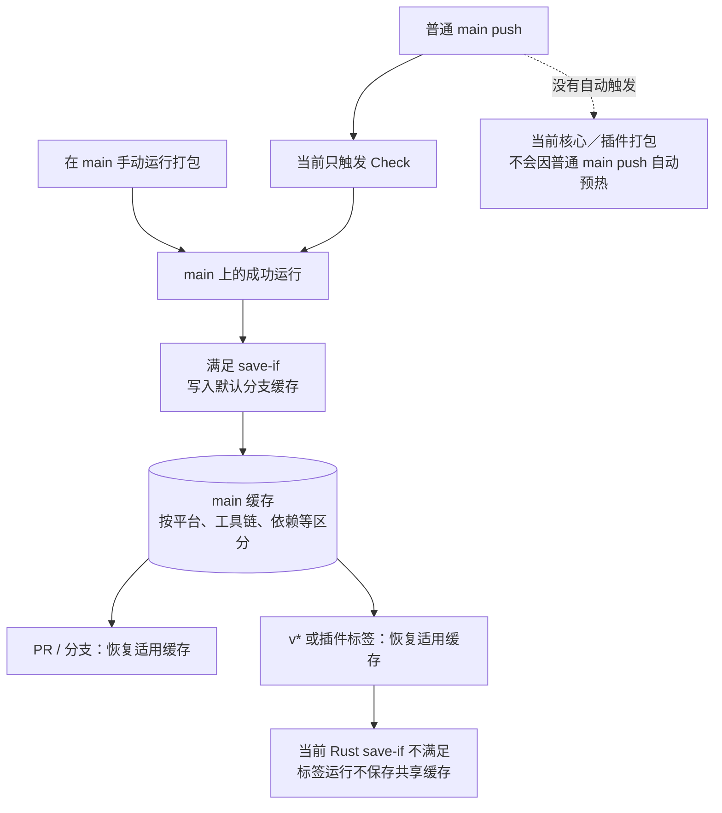

GitHub 会限制缓存可见的 ref。仅把标签构建改成“也保存”，并不能让下一个不同标签直接使用这份缓存。缓存也受未访问过期和仓库容量淘汰规则影响。

截至本次会话 2026-11-08 的查询：37 条缓存，约 9.89 GiB；核心只列出 Linux x86_64 和 ARM64 两份，未列出 Windows 和 macOS 核心条目。该快照是容量和覆盖证据，不能独立证明过去发生了哪一种淘汰。

### 8.3 npm 与未缓存内容

| 任务 | npm 下载缓存 |
| --- | --- |
| Check format | 根 package-lock + terminal/package-lock |
| Check network | 未配置 |
| 核心 preflight | 根 package-lock |
| 核心 package | Windows x86_64 根 + 终端；其他平台只有根 |
| 插件 package | terminal 时根 + 终端；其他插件只有根 |
| 核心 metadata、插件 select/release、组合验收、升级验收 | 未配置 |

缓存不是完整 runner 镜像。npm ci、Cargo、系统依赖安装和资源生成仍会执行；当前没有显式缓存整个 node_modules、APT 安装状态或 Playwright 浏览器。缓存命中不表示测试已通过，也不能代替发行 Artifact。

## 9. Artifact、Release 和缓存的去向

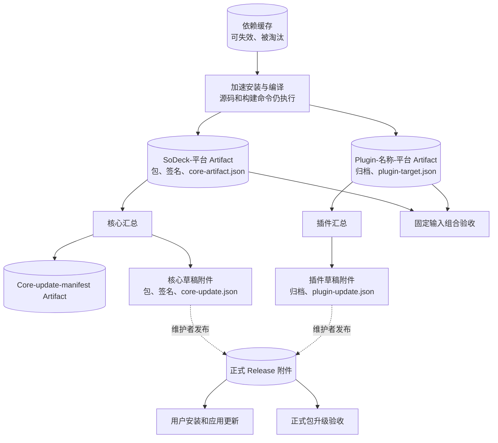

| 对象 | 内容 / 用途 | 保留 |
| --- | --- | --- |
| SoDeck-平台 | 原生核心包、更新签名、版本/平台/提交/文件摘要 | 30 天 |
| Core-update-manifest | core-update.json | 30 天 |
| Plugin-名称-平台 | ZIP 或 tar.gz、平台元数据 | 30 天 |
| Native-verification-inputs | 固定输入快照 | 30 天 |
| Native-verification-result-平台 | 平台结果和失败阶段 | 30 天 |
| Native-verification-summary | 五平台汇总 | 30 天 |
| Release-upgrade-平台 | 升级结果、基线和日志 | 30 天 |
| network-netem-平台 | 弱网 report.json | workflow 未指定，使用适用的默认保留设置 |
| 正式 Release 附件 | 用户安装和更新的稳定下载来源 | 不跟随临时 Artifact 到期 |
| npm / Rust cache | 加速后续构建 | 受缓存作用域、容量和淘汰规则控制 |

核心 Windows 更新指向 EXE；Linux 更新指向 AppImage，DEB 用于系统包安装；macOS 更新指向 app.tar.gz，DMG 用于安装。插件按本机原生 target 选择 ZIP 或 tar.gz。

核心清单有官方 updater 签名；插件清单有组件 ID、版本、API 版本、目标和 SHA-256。宿主测试夹具不进入发行包。

## 10. 失败、取消、重试的实际边界

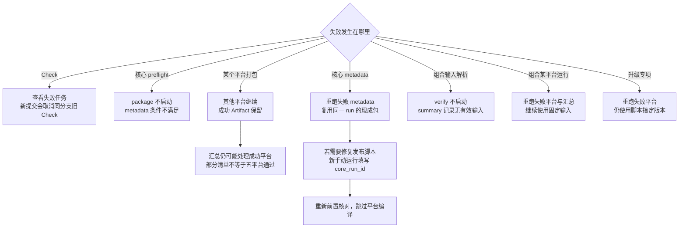

| 容易混淆的状态 | 当前含义 |
| --- | --- |
| package 某目标失败 | fail-fast=false，其他目标继续；不保证汇总自动失败 |
| 核心 metadata 成功 | 已处理所下载的有效产物；可能仍有缺失平台 |
| 插件 release 成功 | 可生成有效平台清单；当前条件不强制五平台全部成功 |
| 原生组合 summary 成功 | 五平台有效任务和实际运行报告都通过 |
| 核心恢复成功 | 可以只是复用旧包完成发布收尾，并非重新测试当前 checkout 的产品 |
| core_run_id 指向整体失败的 run | 若失败只在收尾而包有效，可能仍可复用；之后仍逐包验证 |
| Artifact 过期或包摘要变化 | 恢复或验收明确失败，需要处理固定来源；不能用缓存冒充包 |
| 草稿改成正式 Release | 当前是维护者动作；没有自动审批或自动发布链 |

## 11. 实际耗时：核心最长路径

下图为 [核心 run 42355132557](https://github.com/BgaSol/soDeck/actions/runs/42355132557)，时间为北京时间 2026-11-07。第二次运行只恢复 metadata；平台任务没有重编译。

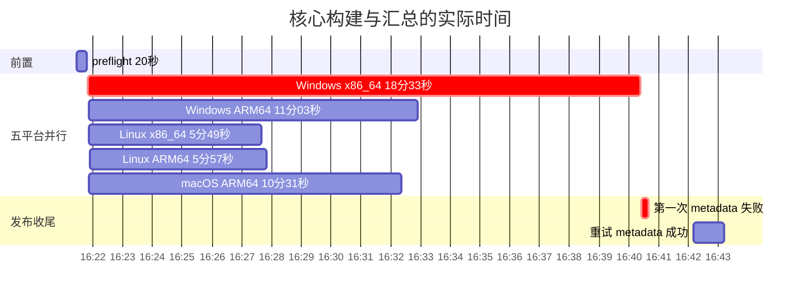

Windows x86_64 内部主要顺序：

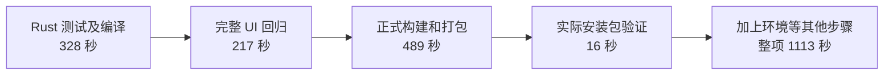

其余平台已较早完成，但 metadata 要等整个矩阵结束。这次从初次触发至重试完成约 21 分 47 秒，包含任务调度和两次汇总之间的间隔；不能只用成功重试的 62 秒代表整次出包。

## 12. 实际耗时：Check 最长路径

下图来自另一次 [Check 42356855256](https://github.com/BgaSol/soDeck/actions/runs/42356855256)，不是上图核心构建的同一次运行。此提交只修改发布记录，当前仍触发全部检查。

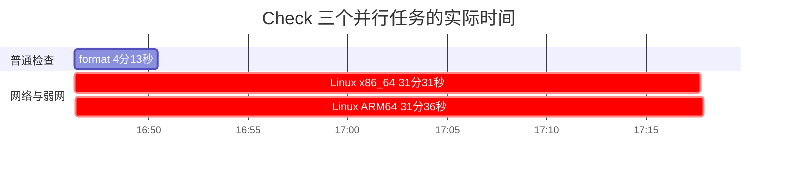

| 任务 | 整项 | 普通网络步骤 | netem 步骤 |
| --- | ---: | ---: | ---: |
| network x86_64 | 1891 秒 | 261 秒 | 1536 秒 |
| network ARM64 | 1896 秒 | 298 秒 | 1526 秒 |

普通网络步骤还包含浏览器安装、真实插件与夹具构建等开销。Check 约 32 分钟的整体等待取决于最慢任务，不是三项相加。

## 13. 用这组图检查当前边界

1. 日常 Check 仍含长耗时 netem，且纯文档提交也会执行。
2. 核心 package 同时承担测试编译和正式编译；Windows x86_64 额外承担完整 UI 回归。
3. 核心、插件的构建相互独立；原生组合验收另消费包。
4. 测试、打包、恢复发布是不同结果，不能只看一个总绿灯就互相替代。
5. Rust 缓存主要由 main 写入；现有打包默认只有标签和手动入口，因此并不自动持续补齐 main 的五平台核心缓存。
6. 当前 core-package 同时容纳测试和发行构建依赖；不同 Check 缓存族还会重复保存核心依赖。
7. 构建 Artifact 与正式 Release 附件分工明确；已经实现的核心恢复可以避免发布收尾失败后重新编译。
8. 当前升级专项固定验证 0.9.2 → 0.9.3，不能据此声称更新版本已经完成升级验收。

本文只做现状图示。未改工作流或测试，未触发构建、清理缓存或发布版本。
