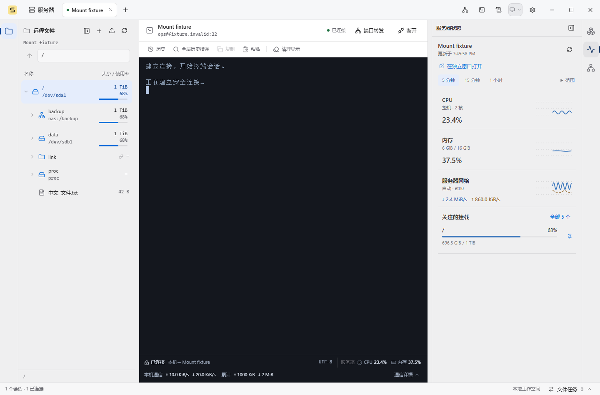

# 工作区工具窗口实施记录

日期：2026-10-21。用户已确认代码设计并授权实施。前端实现完成，沿用现有 React、主题变量、Lucide 图标、原生 dialog 和业务 Provider，无新增依赖。

## 实际行为

- 左侧固定文件夹入口，点击展开远程文件，再点收起；面板标题也可收起。
- 右侧固定排列 Docker、服务器状态、NetBird。一次显示一个右侧工具，再点当前图标收起，点其他图标切换。
- 新会话默认打开文件、收起右侧；极窄窗口首次优先显示终端。面板收起后释放终端空间，不保留空白占位。
- 文件展开节点、选中项、滚动位置，Docker 搜索与页面，NetBird 筛选、节点输入和诊断结果随普通收放保留。收放不重建终端或重新建立 SSH 连接。
- CPU、内存等摘要显式打开服务器状态并定位指标；Docker 和挂载中的文件定位显式打开文件面板，完成定位后在用户未转移焦点时聚焦目标文件。
- 每个会话保存自己的工具开关、最近使用的一侧、窄窗口内容区和偏好宽度。现有移动快照写入 version 2 工具状态，兼容读取旧视图字段。

## 布局和 Apple Design

以工作区实际宽度和当前 rem 尺寸计算布局，不依赖浏览器窗口宽度。14px 根字号下，工具栏 44px，终端舒适预算 560px，文件偏好范围 240–520px，服务偏好范围 320–480px；字号变化同步放大预算。

| 可用空间                    | 呈现方式                                 |
| --------------------------- | ---------------------------------------- |
| 足够容纳两侧工具和终端      | 两侧停靠，可独立收放                     |
| 只能容纳一侧工具和终端      | 最近使用的一侧停靠，保留另一侧打开意图   |
| 单侧停靠也会过度压缩终端    | 工具在所属一侧以非模态浮层呈现           |
| 工作区小于 760px × 字号比例 | 终端或一个工具独占内容区，提供“返回终端” |

自动隐藏和临时压缩只改变实际布局；重新放宽后恢复打开意图和偏好宽度。用户主动收起的工具保持关闭。分隔条支持指针捕获拖动、左右方向键以及双击恢复默认宽度。

采用语义主题色、低强调的单色图标、柔和选中背景、细边界与轻量浮层阴影。布局直接提交最终尺寸，内容短暂淡入，避免终端随宽度动画反复换行。支持字号缩放、深浅主题、减少动态效果、提高对比度和减少透明度。

入口具有完整名称、`aria-expanded` 和 `aria-controls`；隐藏内容使用 `hidden` 和 `inert` 退出交互。普通面板不锁焦点；Esc 只在当前浮层内部关闭工具，保留终端和业务菜单自己的 Esc 行为。

## 代码结构和生命周期

| 位置                                                   | 职责                                                 |
| ------------------------------------------------------ | ---------------------------------------------------- |
| `src/workspaceTools.ts`                                | 统一 reducer，开关与显式导航，快照规范化和旧版本迁移 |
| `src/workspaceSizing.ts`、`src/useWorkspaceLayout.ts`  | 真实宽度和字号测量，停靠/浮层/单内容区解析，拖动边界 |
| `src/WorkspaceToolRail.tsx`、`src/WorkspaceLayout.tsx` | 固定入口和稳定挂载的三个内容槽，分隔条、返回终端     |
| `src/ServicePanel.tsx`、`src/SessionWorkspace.tsx`     | 业务面板衔接，移除旧服务标签条，逐会话状态和移动快照 |
| `src/useWorkspaceFocus.ts`                             | 会话激活、显式导航、隐藏后的焦点回退，保留有效焦点   |
| `src/WorkspaceInteractionContext.tsx`                  | 工具归属和原生模态生命周期，关闭后的焦点恢复         |
| `src/TerminalPane.tsx`、`src/TerminalWorkspace.tsx`    | 实时/历史焦点接口，按帧合并 fit，串行去重 resize IPC |
| `src/workspace-layout.css`、`src/resources.css`        | 语义样式、响应式内容区和辅助功能媒体规则             |

面板和业务 Provider 保持挂载。可见性调整详情刷新兴趣，任务回执和原有后台规则继续工作。NetBird 连接身份变化时清理旧身份的诊断与操作状态，普通收放保留内容。

文件、Docker 和 NetBird 业务确认框通过 portal 脱离工具的隐藏祖先。已呈现的确认框在窗口缩窄时继续可用；工作区失活时暂停原生模态，返回时恢复原请求和输入。尚未呈现的晚到预检等待所属工具再次打开，避免抢走其他工具焦点；原预检有效期继续计时。Docker 既有来源失活后的迟到预览释放规则保持有效。

终端隐藏时继续接收输出和处理协议回复，停止用户输入。尺寸变化按动画帧合并，IPC 逐个发送并保留最新待发尺寸；忽略零尺寸、重复尺寸和失效代次。移动或断开清理待发请求，取消移动后重新校准。

## 验证结果

浏览器测试使用受控 IPC fixture，覆盖 Chromium 和 WebKit；截图来自实际运行界面。测试数据不代表真实服务器。相关旧导航和默认展开假设已迁移到幂等的 `openWorkspaceTool` 帮助函数，会话标签仍使用原标签页语义。

| 检查                           | 结果                                                                                                 |
| ------------------------------ | ---------------------------------------------------------------------------------------------------- |
| `npm test`                     | 30 个文件、192 项通过；包含状态迁移与布局性质测试                                                    |
| `npm run build`                | TypeScript 与生产构建通过；仍有既有的大 chunk 提示                                                   |
| `npm run test:workspace-tools` | 8 项通过；两侧开关、状态保留、响应式、字号、焦点、模态缩窄和 resize IPC                              |
| `npm run test:netbird`         | 20 项通过；包括隐藏期间晚到预检、到期检查和窄窗口模态                                                |
| Docker 回归                    | Chromium 和 WebKit 全套覆盖；修正后的宽度断言定向复验通过，公共对话框另有 8 项双浏览器复验通过       |
| 资源/挂载回归                  | 两种浏览器全套覆盖，迁移后的窄窗口断言定向复验通过；显式文件定位焦点另有 2 项通过                    |
| 连接回归                       | Chromium 相关全套及迁移断言复验通过；WebKit 75 项通过、1 项强制颜色用例按平台能力跳过                |
| 文件任务回归                   | 两种浏览器全套覆盖，入口和断言迁移后定向 16 项通过，含窄窗口删除、新建、下载焦点与原生选择器异步返回 |
| 终端剪贴板                     | Chromium 13 项、WebKit 13 项通过                                                                     |
| 终端历史                       | Chromium 6 项、WebKit 6 项通过                                                                       |
| `git diff --check`             | 通过                                                                                                 |

“全套覆盖”包括全套运行及旧断言迁移后的定向复验，不表示每套最后都重复执行了一次完整命令。通过后仅针对后续改动补测。

## 界面截图

截图采用 1440px、860px、650px 窗口及 150% 根字号；以下文件保存在仓库文档目录中，避免后续测试清理输出时丢失。

| 状态                        | 截图                                                                        |
| --------------------------- | --------------------------------------------------------------------------- |
| 默认仅文件展开，浅色        | [default-light.png](./prototypes/screens/workspace-tools/default-light.png) |
| 两侧工具展开，浅色          | [wide-light.png](./prototypes/screens/workspace-tools/wide-light.png)       |
| 两侧工具展开，深色          | [wide-dark.png](./prototypes/screens/workspace-tools/wide-dark.png)         |
| 860px 服务浮层              | [overlay-light.png](./prototypes/screens/workspace-tools/overlay-light.png) |
| 650px 单内容区              | [narrow-light.png](./prototypes/screens/workspace-tools/narrow-light.png)   |
| 150% 字号、深色与提高对比度 | [scaled-dark.png](./prototypes/screens/workspace-tools/scaled-dark.png)     |

## 验证边界

本轮没有执行 Windows WebView2 或 macOS 实机验收，未运行依赖真实 Tauri/CDP 与 SSH fixture 的 `tests/file-tree.spec.ts`、`tests/features.spec.ts` 和桌面窗口集成测试。跨窗口布局快照和取消移动由浏览器受控测试验证；真实窗口间移动、原生文件选择器及真实 SSH resize 仍需桌面验收。WebKit 结果不等同于 macOS 原生验收。

本次修改前端展示与交互；工作区中并行的 Rust 网络代理、SSH 和端口转发改动不属于本次 UI 交付。没有执行提交、推送或发布。应用重启后恢复工具布局仍属于后续范围。
